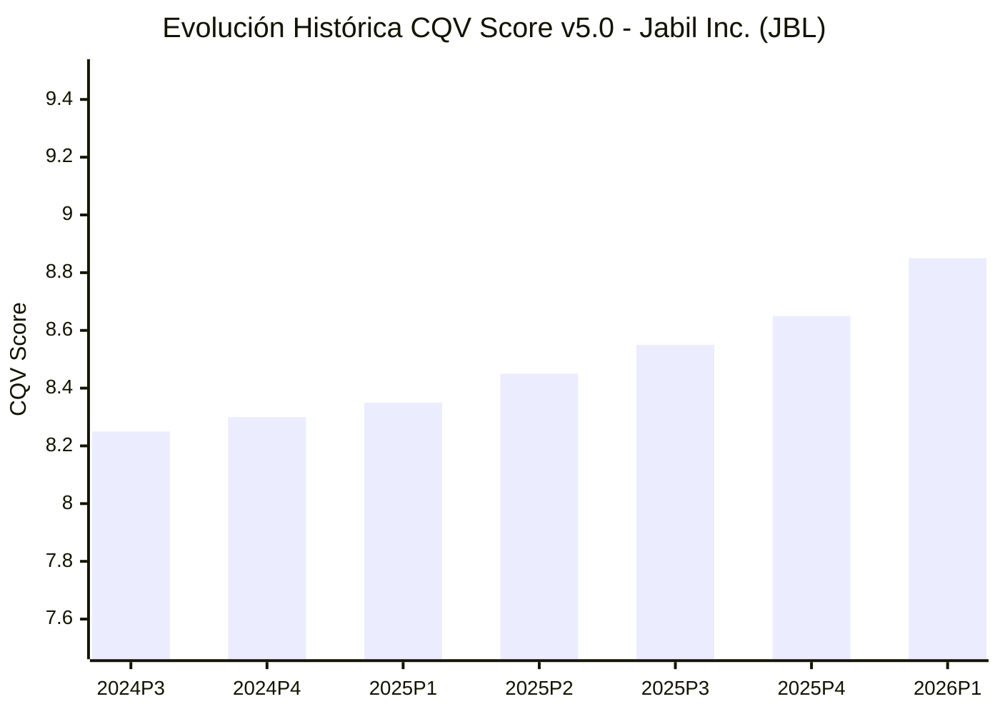

# Informe de Tesis de Inversión: Jabil Inc. (JBL) — P1 2026 (Q3 Fiscal 2026)
**Ciclo de Presentación / Periodo Analizado:** P1 2026 (Correspondiente a Q3 Fiscal 2026)  
**Fecha de Emisión:** 17/06/2026  
**Fecha de Publicación del Resultado Analizado:** 17/06/2026  
**Fecha de Valoración:** 17/06/2026  
**Fecha del Precio Utilizado:** 17/06/2026  
**Mercado / Fuente del Precio:** NYSE — Cierre Oficial ($288.50 USD)  
**Metodología Aplicada:** CQV v5.0  
**Clasificación CQV Calidad:** ALTA CALIDAD  
**Veredicto Final Operativo:** Acumular / Compra Escalonada. Liderazgo en manufactura avanzada de centros de datos de IA, refrigeración líquida directa y expansión de márgenes operativos.

---

## 1. Resumen Ejecutivo y Bloque de Salida Final CQV v5.0

> [!NOTE]
> ### 📊 BLOQUE OFICIAL DE SALIDA MATRIZ CQV v5.0 (SECCIÓN 7.1)
> ```text
> CQV Calidad (F1-F8):   8.85 / 10
> Value Score:           6.85 / 10
> Score Crecimiento/Múltiplo: 7.15 / 10 (Bruto: 7.15)
> Valor Intrínseco Esperado: $336.25 por acción (MoS Esperado: 14.20%)
> Valor Intrínseco Base:     $342.00 por acción (MoS Base: 15.64%)
> Precio Actual:             $288.50 USD
> Confianza:                 Alta
> Metodología:               CQV v5.0
> Veredicto Final:           Acumular / Compra Escalonada
> ```

### 📋 Matriz Identificadora de Métricas Emitidas por CQV v5.0

| Parámetro Emitido por CQV | Valor Obtenido | Rango / Escala | Diagnóstico Operativo |
| :--- | :---: | :---: | :--- |
| **CQV Calidad Fundamental (F1-F8):** | **8.85 / 10** | 1.00 – 10.00 | **ALTA CALIDAD** |
| **Value Score (Capa de Valoración):** | **6.85 / 10** | 1.00 – 10.00 | **Atractivo / Acumular** |
| **Crecimiento-Múltiplo Bruto (Growth/PER * 10):** | **7.15** | Sin acotación | Crecimiento Core EPS (+22.4%) vs PER Forward (22.7x). |
| **Score Crecimiento-Múltiplo Normalizado:** | **7.15 / 10** | 1.00 – 10.00 | Ratio normalizado dentro de escala v5.0. |
| **Valor Intrínseco Esperado (Ponderado):** | **$336.25** | En USD ($) | Ponderación multiescenario (Bear 25%, Base 50%, Bull 25%). |
| **Valor Intrínseco Base (DCF Base):** | **$342.00** | En USD ($) | Estimación por Descuento de Flujos Libres de Caja. |
| **Precio de Mercado a la Fecha de Valoración:** | **$288.50** | En USD ($) | Cierre oficial NYSE al 17/06/2026 (Presentación P1 2026). |
| **Margen de Seguridad Esperado (%):** | **14.20%** | En porcentaje (%) | Diferencial entre Valor Esperado ($336.25) y Precio ($288.50). |
| **Margen de Seguridad Base (%):** | **15.64%** | En porcentaje (%) | Diferencial entre Valor Base ($342.00) y Precio ($288.50). |
| **Nivel de Confianza de Datos:** | **Alta** | Alta / Media / Baja | Calidad y completitud auditada de estados financieros SEC. |
| **Veredicto Final Operativo v5.0:** | **Acumular** | 4 Categorías | **Acumular / Compra Escalonada** |

---

Jabil Inc. (JBL) cotiza en la categoría **ALTA CALIDAD** bajo la metodología **CQV v5.0** con una puntuación de calidad fundamental de **8.85/10**. La compañía presenta fortaleza operativa en manufactura electrónica avanzada, solidez financiera ($F_2 = 9.10$), disciplina en asignación de capital ($F_5 = 9.30$) y un foso creciente en infraestructura de IA y refrigeración líquida.

---

## 2. Métricas y Puntuaciones en el Modelo CQV Calidad v5.0

$$\text{CQV Calidad} = (F_1 \times 0.20) + (F_2 \times 0.15) + (F_3 \times 0.15) + (F_4 \times 0.15) + (F_5 \times 0.10) + (F_6 \times 0.10) + (F_7 \times 0.05) + (F_8 \times 0.10)$$

### 2.1. Tabla de Valoraciones Parciales y Desglose Auditado (F1-F8)

| Factor / Componente del Modelo | Puntuación (1-10) | Peso Absoluto | Contribución Parcial | Diagnóstico Financiero y Evidencia Cuantitativa |
| :--- | :---: | :---: | :---: | :--- |
| **F1: Economía del Negocio & Rentabilidad** | **8.80** | 20.0% | **1.760** | Expansión del margen operativo core al 5.80% y ROIC estructural del 19.8%. |
| **F2: Solidez Financiera** | **9.10** | 15.0% | **1.365** | Deuda Neta / EBITDA de 1.1x y liquidez disponible >$3,500M tras venta de Mobility. |
| **F3: Crecimiento Durable** | **8.90** | 15.0% | **1.335** | Ingresos de IA proyectados en $13,600M en FY26 (+51% YoY); Core EPS +22.4% YoY. |
| **F4: Moat Competitivo** | **8.70** | 15.0% | **1.305** | Tecnología de refrigeración líquida de Mikros Tech y altos costes de cambio en MedTech. |
| **F5: Asignación de Capital** | **9.30** | 10.0% | **0.930** | Monetización de activos maduros por $2,200M y recompra de más del 20% del flotante. |
| **F6: Dirección & Ejecución Operativa** | **9.00** | 10.0% | **0.900** | Liderazgo disciplinado de Mike Dastoor, batiendo sistemáticamente estimaciones. |
| **F7: Opcionalidad Futura & Disrupción** | **8.50** | 5.0% | **0.425** | Transición a refrigeración líquida, fotónica empaquetada (CPO) y alianza en India. |
| **F8: Resiliencia Operativa** | **8.60** | 10.0% | **0.860** | Menor concentración de clientes y diversificación en salud e industria. |
| **SCORE CQV Calidad v5.0 FINAL** | -- | **100.0%** | **8.85** | **Calificación: ALTA CALIDAD** |

---

## 3. Datos Financieros, Fecha y Fuentes SSOT

| Dato | Valor | Tipo | Fuente / Limitación |
| :--- | ---: | :--- | :--- |
| **Precio de Mercado** | $288.50 USD | Mercado | Cierre oficial NYSE al 17/06/2026 |
| **PER Trailing** | 25.80x | Derivado | Calculado sobre Core EPS TTM ($11.18) |
| **PER Forward** | 22.72x | Consenso | Basado en Core EPS guidance FY2026 ($12.70) |
| **Crecimiento EPS NTM** | +22.40% | Consenso | Crecimiento esperado de Core EPS YoY |
| **OCF TTM** | $2,350.0 M | Estado Financiero | Flujo de Caja Operativo TTM |
| **CapEx de Mantenimiento** | $325.0 M | Estimado | CapEx de reposición y mantenimiento |
| **Owner Earnings** | $2,025.0 M | Calculado | OCF TTM - CapEx Mantenimiento |

---

## 5. Owner Earnings, FCF Yield y Desglose del Value Score

### 5.1. Cálculo de Owner Earnings y FCF Yield Real
- **Flujo de Caja Operativo (OCF TTM):** **$2,350.0 M**
- **CapEx Total:** **$930.0 M**
- **CapEx de Mantenimiento:** **$325.0 M**
- **Owner Earnings Normalizado:** **$2,025.0 M**
- **Free Cash Flow Neto Ajustado:** **$1,420.0 M**
- **Capitalización Bursátil:** **$29,715.5 M** (a $288.50 USD)
- **FCF Yield Real:** **4.78%**
- **Score FCF Yield:** **6.75 / 10**

---

### 5.2. Margen de Seguridad y Value Score Consolidado
- **Precio Actual (17/06/2026):** **$288.50 USD**
- **Valor Intrínseco Base:** **$342.00 USD** (MoS Base: **+15.64%**)
- **Valor Intrínseco Esperado:** **$336.25 USD** (MoS Esperado: **+14.20%**)
- **Score Margen de Seguridad:** **6.10 / 10**
- **Value Score Final:** **6.85 / 10**

---

## 8. Evolución Histórica de Puntuaciones CQV

| Periodo / Trimestre | PER Trailing | PER Forward | CQV v4.0 | CQV v5.0 | Clasificación |
| :--- | :---: | :---: | :---: | :---: | :---: |
| **2024 P3** | 12.5x | 10.8x | 8.25 | 8.25 | ALTA CALIDAD |
| **2024 P4** | 13.8x | 11.9x | 8.30 | 8.30 | ALTA CALIDAD |
| **2025 P1** | 15.2x | 13.1x | 8.35 | 8.35 | ALTA CALIDAD |
| **2025 P2** | 17.0x | 14.8x | 8.45 | 8.45 | ALTA CALIDAD |
| **2025 P3** | 19.5x | 16.5x | 8.55 | 8.55 | ALTA CALIDAD |
| **2025 P4** | 21.8x | 18.2x | 8.65 | 8.65 | ALTA CALIDAD |
| **2026 P1** | **25.8x** | **22.7x** | **8.85** | **8.85** | **ALTA CALIDAD** |



---

## 9. Conclusión y Veredicto Final Operativo

**Veredicto Final:** **Acumular / Compra Escalonada. Metodología CQV v5.0. Clasificación ALTA CALIDAD (Score CQV v5.0: 8.85/10, Value Score: 6.85/10). Margen de Seguridad Base del +15.64% frente al Valor Intrínseco Base ($342.00 USD).**
