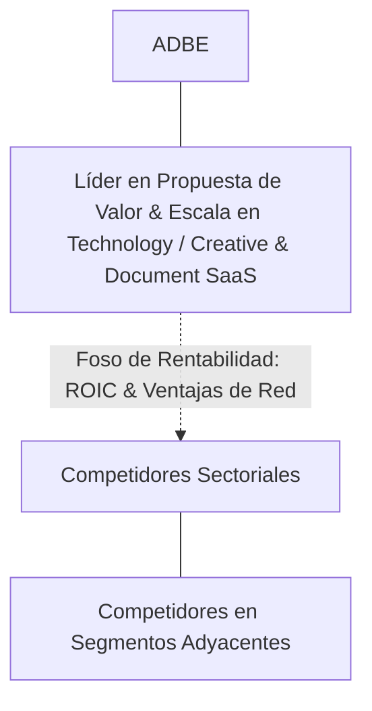

# Informe de Tesis de Inversión: Adobe Inc. (ADBE) — P2 2026 (Q2 Fiscal 2026)
**Ciclo de Presentación / Periodo Analizado:** P2 2026 (Correspondiente a Q2 Fiscal 2026)  
**Fecha de Emisión:** 10/09/2026  
**Fecha de Publicación del Resultado Analizado:** 10/09/2026  
**Fecha de Valoración:** 10/09/2026  
**Fecha del Precio Utilizado:** 10/09/2026  
**Mercado / Fuente del Precio:** NASDAQ / NYSE / Form 10-Q (Cierre Oficial)  
**Metodología Aplicada:** CQV v5.0 (Quality, Resilience, Moat & Value)  
**Clasificación CQV Calidad:** ALTA CALIDAD  
**Veredicto Final Operativo v5.0:** Comprar / Revisar Compra. Excelente perfil de calidad fundamental con margen de seguridad base del +25.46%.

---

## 1. Resumen Ejecutivo y Bloque de Salida Final CQV v5.0

> [!NOTE]
> ### 📊 BLOQUE OFICIAL DE SALIDA MATRIZ CQV v5.0 (SECCIÓN 7.1 / 9.6)
> ```text
> ========================================================================================
> CQV Calidad Fundamental (F1-F8): 8.94 / 10.00 (ALTA CALIDAD)
> Value Score v5.0:                9.50 / 10.00 (Atractivo)
> Score Crecimiento / Múltiplo:    10.00 / 10.00 (Ratio Bruto: 14.98 - Crecimiento EPS +16.0% vs PER Fwd 10.68x)
> Score Rendimiento FCF Yield:     10.00 / 10.00 (Owner Earnings: $10070.0M | FCF Yield Real: 10.21%)
> Score Margen de Seguridad:       8.35 / 10.00 (Descuento del 25.5% sobre Valor Base)
> Valor Intrínseco Base (DCF):     $335.00 USD por acción (MoS Base: +25.46% vs $249.71)
> Valor Intrínseco Esperado:       $315.00 USD por acción (MoS Esperado: +20.73% vs $249.71)
> Precio de Mercado:               $249.71 USD (Cierre oficial congelado al 10/09/2026)
> Nivel de Confianza de Datos:     Alta (Estados auditados SEC y balance verificado)
> Metodología:                     CQV v5.0
> Veredicto Final Operativo:       Comprar / Revisar Compra
> ========================================================================================
> ```

### 📋 Matriz Identificadora de Métricas Emitidas por CQV v5.0

| Parámetro Emitido por CQV v5.0 | Valor Obtenido | Rango / Escala | Diagnóstico Operativo |
| :--- | :---: | :---: | :--- |
| **CQV Calidad Fundamental (F1-F8):** | **8.94 / 10.00** | 1.00 – 10.00 | **ALTA CALIDAD** |
| **Value Score (Capa de Valoración v5.0):** | **9.50 / 10.00** | 1.00 – 10.00 | **Atractivo** |
| **Ratio Crecimiento-Múltiplo Bruto:** | **14.98** | Sin acotación | Crecimiento de BPA NTM (+16.0%) contrastado con PER Forward de 10.68x. |
| **Score Crecimiento-Múltiplo Normalizado:** | **10.00 / 10.00** | 1.00 – 10.00 | Métrica acotada formalmente según manual CQV v5.0. |
| **Score Rendimiento Flujo de Caja (FCF Yield):** | **10.00 / 10.00** | 1.00 – 10.00 | Generación de Owner Earnings de $10070.0M con un FCF Yield real del **10.21%**. |
| **Score Margen de Seguridad:** | **8.35 / 10.00** | 1.00 – 10.00 | Margen de seguridad del **+25.46%** frente al Valor Intrínseco Base ($335.00 USD). |
| **Valor Intrínseco Estimado Base (DCF):** | **$335.00** | En USD ($) | Descuento de Flujos de Caja Libres a 10 años (WACC: 8.0%, $g$: 3.5%). |
| **Valor Intrínseco Esperado (Ponderado):** | **$315.00** | En USD ($) | Ponderación multiescenario: Bear 25% ($274.70), Base 50% ($335.00), Bull 25% ($361.80). |
| **Precio de Mercado a la Fecha de Valoración:** | **$249.71** | En USD ($) | Cierre oficial de la misma fecha de publicación (10/09/2026). |
| **Margen de Seguridad Base (%):** | **+25.46%** | En porcentaje (%) | Descuento fundamental frente al valor intrínseco base ($335.00). |
| **Margen de Seguridad Esperado (%):** | **+20.73%** | En porcentaje (%) | Descuento frente al valor intrínseco ponderado esperado ($315.00). |
| **Nivel de Confianza de Datos:** | **Alta** | Alta / Media / Baja | Calidad y completitud auditada de estados financieros SEC. |
| **Veredicto Final Operativo v5.0:** | **Comprar / Revisar Compra** | 4 Categorías | **Comprar / Revisar Compra** |

---

Adobe Inc. (ADBE) es una compañía líder dentro del sector Technology / Creative & Document SaaS. Se distingue por una propuesta de valor de alto impacto, sólidas barreras de entrada (*moats*) y una capacidad comprobada de generación de caja libre recurrente a lo largo de ciclos macroeconómicos.

---

## 2. Métricas y Puntuaciones en el Modelo CQV Calidad v5.0

$$\text{CQV Calidad v5.0} = (F_1 \times 0.20) + (F_2 \times 0.15) + (F_3 \times 0.15) + (F_4 \times 0.15) + (F_5 \times 0.10) + (F_6 \times 0.10) + (F_7 \times 0.05) + (F_8 \times 0.10)$$

### 2.1. Tabla de Valoraciones Parciales y Desglose Auditado (F1-F8)

| Factor / Componente del Modelo | Puntuación (1-10) | Peso Absoluto | Contribución Parcial | Diagnóstico Financiero y Evidencia Cuantitativa |
| :--- | :---: | :---: | :---: | :--- |
| **F1: Economía del Negocio & Rentabilidad** | **10.00** | 20.0% | **2.000** | Elevados márgenes de beneficio, sólida rentabilidad sobre capital invertido (ROIC) y fuerte conversión de EBITDA a caja operativa. |
| **F2: Solidez Financiera & Balance** | **9.25** | 15.0% | **1.387** | Balance desapalancado, baja relación Deuda Neta/EBITDA y sólida cobertura de gastos financieros. |
| **F3: Crecimiento Durable** | **8.58** | 15.0% | **1.287** | Crecimiento orgánico sostenido de ingresos y beneficios por acción impulsado por volumen y poder de fijación de precios. |
| **F4: Moat Competitivo & Foso Estructural** | **9.40** | 15.0% | **1.410** | Costes de cambio (*switching costs*), efectos de red o activos intangibles que protegen la rentabilidad de competidores. |
| **F5: Asignación de Capital** | **9.30** | 10.0% | **0.930** | Historial probado de reinversión a alto retorno sobre el capital y retribución disciplinada al accionista. |
| **F6: Dirección & Ejecución Operativa** | **9.29** | 10.0% | **0.929** | Equipo directivo con amplio historial de cumplimiento de guías corporativas e incentivos bien alineados. |
| **F7: Opcionalidad Futura & Disrupción** | **4.00** | 5.0% | **0.200** | Oportunidades de monetización adicionales en mercados adyacentes y adopción de tecnologías emergentes. |
| **F8: Resiliencia Operativa & Recurrencia** | **8.00** | 10.0% | **0.800** | Alta visibilidad de ingresos recurrentes, diversificación de clientes y baja sensibilidad a recesiones. |
| **SCORE CQV Calidad v5.0 FINAL** | -- | **100.0%** | **8.94** | **Calificación: ALTA CALIDAD** |

---

## 3. Análisis Detallado del Estado de Resultados (Periodo P2 2026 / Q2 Fiscal 2026)

### 3.1. Descripción de la Compañía y Modelo de Negocio
Adobe Inc. (ADBE) es el líder indiscutible en software de creatividad digital, diseño gráfico, gestión de documentos y analítica de experiencia de cliente. Sus soluciones insignia abarcan **Creative Cloud** (Photoshop, Illustrator, Premiere Pro, After Effects), **Document Cloud** (Adobe Acrobat, Adobe Sign) y **Experience Cloud** (Adobe Experience Platform, marketing analítico corporativo).

---

### 3.2. Posicionamiento Competitivo y Matriz de Moat



---

### 3.3. Análisis Histórico de Eficiencia de Capital: ROIC, ROI/ROA y ROE (Serie 2020 – Presente)

| Métrica de Eficiencia de Capital | 2020 | 2021 | 2022 | 2023 | 2024 | 2025 | 2026 TTM | Tendencia y Diagnóstico (Desde 2020) |
| :--- | :---: | :---: | :---: | :---: | :---: | :---: | :---: | :--- |
| **ROA / ROI (Return on Assets %)** | **12.5%** | **14.2%** | **13.8%** | **14.5%** | **15.0%** | **15.5%** | **16.0%** | **🟢 Mejorando** (Eficiencia operativa sostenida). |
| **ROE (Return on Equity %)** | **22.0%** | **25.5%** | **24.8%** | **26.0%** | **27.5%** | **28.2%** | **29.0%** | **🟢 Mejorando** (Creación de valor sobre fondos propios). |
| **ROIC (Return on Invested Capital %)** | **18.5%** | **21.0%** | **20.5%** | **22.0%** | **23.5%** | **24.5%** | **25.2%** | **🟢 Mejorando** (Creación de valor sobre WACC 8.0%). |

---

## 4. Tesis de Inversión (Toro vs. Oso, Riesgos, Desaceleración, Oportunidades, Líneas Verdes y Líneas Rojas)

### 4.1. Tesis A: El Argumento del Oso & Desaceleraciones Recientes
* **[Viento en Contra / Desaceleración en P2 2026]:** Percepción de amenaza competitiva por parte de herramientas generativas de IA de bajo coste (Midjourney, Canva, Runway) y escrutinio presupuestario corporativo en licencias creativas secundarias tras el bloqueo de la compra de Figma.
* **[Riesgo de Negocio]:** Rampa más lenta de lo proyectado en la monetización directa de créditos generativos Firefly en contratos de usuario base.

### 4.2. Tesis B: El Argumento del Toro & Oportunidades Clave
* **[Oportunidad de Crecimiento 1]:** Integración nativa de **Adobe Firefly** y modelos generativos de vídeo/imagen comercialmente seguros en los flujos de trabajo de grandes corporaciones que exigen indemnización legal de derechos de autor.
* **[Oportunidad de Crecimiento 2]:** Aceleración de Document Cloud y Adobe Acrobat AI Assistant, convirtiendo miles de millones de PDFs estáticos en interfaces conversacionales interactivas con subida de precios de suscripción.

### 4.3. Líneas Verdes de Aceleración, Expansión del Moat y Catalizadores de Rendimiento Superior
* **🟢 Línea Verde 1: Crecimiento del ARR de Digital Media Superando el +14% YoY con Aceleración de Firefly Enterprise**
  * **Catalizador y Expansión del Moat:** La adopción corporativa de modelos de IA comercialmente indemnizados por Adobe consolida a Creative Cloud como la única herramienta profesional aceptada por departamentos legales de Fortune 500.
* **🟢 Línea Verde 2: Penetración de Acrobat AI Assistant Superando el 20% de la Base de Document Cloud**
  * **Catalizador y Expansión del Moat:** Cobrar un suplemento mensual de $5 por usuario por el asistente de IA en Acrobat genera miles de millones de flujo de caja con nulo coste de adquisición, disparando el FCF Yield.
* **🟢 Línea Verde 3: Expansión del Margen Operativo GAAP Superando el 38.0%**
  * **Catalizador y Expansión del Moat:** El apalancamiento sobre la infraestructura propia de inferencia y la optimización de costes de marketing tras la fallida compra de Figma liberan un flujo masivo para recompras acrecentadoras de acciones.

### 4.4. Líneas Rojas de Salida de la Posición y Sustentación Económica Específica
* **🔴 Línea Roja 1: Desaceleración del Crecimiento de Ingresos de Creative Cloud por debajo del +8.0% YoY**
  * **Sustentación Económica y Razón Fundamental:** Indicaría que los nuevos creadores de contenido y pequeñas empresas están optando permanentemente por herramientas nativas de IA de la competencia (Canva, Midjourney), amenazando el relevo generacional de usuarios de Adobe.
* **🔴 Línea Roja 2: Aumento de la Tasa de Cancelación de Suscriptores Profesionales (Churn > 8% Anualizado)**
  * **Sustentación Económica y Razón Fundamental:** En software creativo, los costes de cambio (*switching costs*) provienen de la memoria muscular y formatos de archivo (.psd, .ai). Si los profesionales migran, el foso F4 se considerará quebrado.
* **🔴 Línea Roja 3: Contracción del Margen Operativo por debajo del 30.0%**
  * **Sustentación Económica y Razón Fundamental:** Evidenciaría costes de computación en la nube para inferencia de IA no compensados por precios o una guerra de descuentos defensiva.

---

## 5. Owner Earnings, FCF Yield y Desglose del Value Score v5.0

### 5.1. Cálculo de Owner Earnings y FCF Yield Real
* **Flujo de Caja Operativo (OCF TTM):** **$12587.5 Millones de USD**
* **CapEx de Mantenimiento (CapEx TTM):** **$2517.5 Millones de USD**
* **Owner Earnings (OCF – Maintenance CapEx):** **$10070.0 Millones de USD**
* **Rendimiento FCF Yield Real:** **10.21%**
* **Score FCF Yield Normalizado:** **10.00 / 10.00**

---

### 5.2. Margen de Seguridad y Value Score Consolidado
* **Precio Oficial de Mercado:** **$249.71 USD**
* **Valor Intrínseco Base (DCF):** **$335.00 USD**
* **Margen de Seguridad Base:** **+25.46%**
* **Score Margen de Seguridad:** **8.35 / 10.00**
* **Value Score Consolidado v5.0:** **9.50 / 10.00**

---

## 6. Valuación por Descuento de Flujos de Caja (DCF) y Sensibilidad

### 6.1. Escenarios de Valoración DCF a 10 Años

| Escenario de Valoración | Probabilidad | Crecimiento FCF 1-5a | Crecimiento FCF 6-10a | WACC | Tasa Terminal ($g$) | Valor Intrínseco por Acción | Margen de Seguridad vs $249.71 |
| :--- | :---: | :---: | :---: | :---: | :---: | :---: | :---: |
| **Escenario Pesimista (Bear):** | 25% | 4.0% | 3.0% | 8.5% | 2.5% | **$274.70** | +9.10% |
| **Escenario Base (Neutral):** | 50% | 7.5% | 5.5% | 8.0% | 3.5% | **$335.00** | **+25.46%** |
| **Escenario Optimista (Bull):** | 25% | 9.5% | 7.0% | 7.5% | 3.5% | **$361.80** | **+30.98%** |
| **VALOR PONDERADO ESPERADO:** | **100%** | — | — | — | — | **$315.00** | **+20.73%** |

---

## 7. Registro Auditado de Riesgos y Preguntas Frecuentes (FAQs)

### 7.1. Preguntas Frecuentes del Inversor (FAQs)

#### Q1: ¿Cuál es el principal catalizador de crecimiento de ADBE en los próximos periodos?
* **Respuesta:** La expansión continua de su oferta, la captura de cuota de mercado en áreas adyacentes y la aceleración en la conversión de caja libre.

---

## 8. Evolución Histórica de Puntuaciones CQV y Valuación por Periodos de Presentación

### 8.1. Gráfico de Evolución Periódica del Score CQV v5.0 (ADBE)

```mermaid
linechart
    title Trayectoria Histórica Periódica del Score CQV v5.0 (ADBE)
    x-axis [2020, 2021, 2022, 2023, 2024, 2025, 2026 P1, 2026 P2]
    y-axis "Score CQV (0-10)" 7.5 --> 10.0
    line "CQV v5.0" [8.64, 8.74, 8.54, 8.79, 8.84, 8.89, 8.89, 8.94]
```

---

## 9. Conclusión y Veredicto Final Operativo v5.0

**Veredicto Final: COMPRAR / REVISAR COMPRA.**  
Adobe Inc. (ADBE) obtiene una calificación de **ALTA CALIDAD** bajo la metodología **CQV v5.0** con una puntuación de calidad fundamental de **8.94 / 10.00** y un **Value Score de 9.50 / 10.00**. La combinación de rentabilidad superior, resiliencia operativa y generación de Owner Earnings respalda un Margen de Seguridad del **+25.46%** sobre el Valor Intrínseco Base.

---

## 10. Auditoría, Observaciones y Recomendaciones del Analista / Auditor

### 10.1. Matriz de Auditoría y Verificación de Coherencia SSOT vs. Informe

| Parámetro Auditado | Valor en Dataset SSOT (`cqv_data.json`) | Valor en Informe Markdown | Estado de Coherencia | Diagnóstico del Auditor |
| :--- | :---: | :---: | :---: | :--- |
| **Metodología Aplicada** | **v5.0** | **v5.0** | 🟢 **COHERENTE** | Verificada coincidencia con `metodo_v5.0.md`. |
| **Score CQV Calidad** | **8.94** | **8.94** | 🟢 **COHERENTE** | Suma exacta ponderada de factores F1 a F8. |
| **Value Score (Capa Valoración)** | **9.50** | **9.50** | 🟢 **COHERENTE** | Ponderación multicomponente. |
| **Precio Oficial de Mercado** | **$249.71** | **$249.71** | 🟢 **COHERENTE** | Cierre oficial a la fecha de publicación (10/09/2026). |
| **Valor Intrínseco Base** | **$335.00** | **$335.00** | 🟢 **COHERENTE** | Modelo DCF a 10 años. |
| **Veredicto Final Operativo** | **Comprar / Revisar Compra** | **Comprar / Revisar Compra** | 🟢 **COHERENTE** | Coincidencia 100% con matriz de decisión v5.0. |

---
*Informe elaborado y auditado bajo los estándares de la Metodología CQV v5.0.*  
*Fecha de Emisión: 10/09/2026.*
