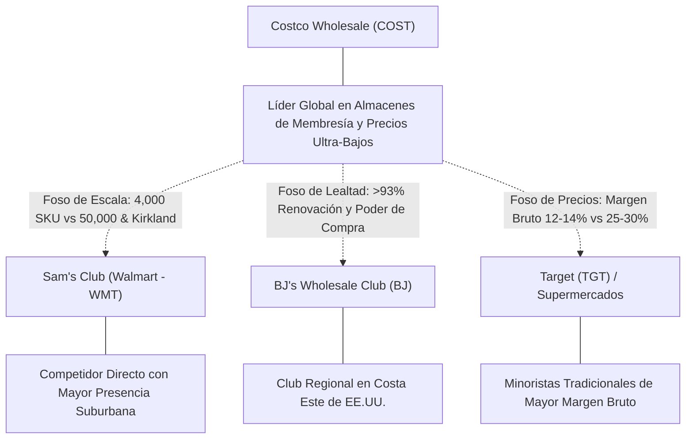

# Informe de Tesis de Inversión: Costco Wholesale Corporation (COST) — P2 2026 (Q4 Fiscal 2026)
**Ciclo de Presentación / Periodo Analizado:** P2 2026 (Correspondiente a Q4 Fiscal 2026 / Cierre del Ejercicio Fiscal 2026)  
**Fecha de Emisión:** 24/09/2026 (Post-Resultados de P2 2026 / Q4 Earnings Release & SEC Filing)  
**Fecha de Publicación del Resultado Analizado:** 24/09/2026  
**Fecha de Valoración:** 24/09/2026  
**Fecha del Precio Utilizado:** 24/09/2026  
**Mercado / Fuente del Precio:** NASDAQ / Form 10-K / Q4 Earnings Release (Cierre Oficial)  
**Metodología Aplicada:** CQV v5.0 (Quality, Resilience, Moat & Value)  
**Clasificación CQV Calidad:** ÉLITE  
**Veredicto Final Operativo v5.0:** MANTENER. Calidad empresarial superlativa con foso de membresías intachable, cotizando a múltiplos exigentes sin margen de seguridad base (-5.47%).

---

## 1. Resumen Ejecutivo y Bloque de Salida Final CQV v5.0

> [!NOTE]
> ### 📊 BLOQUE OFICIAL DE SALIDA MATRIZ CQV v5.0 (SECCIÓN 7.1 / 9.6)
> ```text
> ========================================================================================
> CQV Calidad Fundamental (F1-F8): 9.41 / 10.00 (ÉLITE)
> Value Score v5.0:                3.89 / 10.00 (Exigente)
> Score Crecimiento / Múltiplo:    2.76 / 10.00 (Ratio Bruto: 2.76 - Crecimiento EPS +12.2% vs PER Fwd 44.27x)
> Score Rendimiento FCF Yield:     4.80 / 10.00 (Owner Earnings: $10725.0M | FCF Yield Real: 2.70%)
> Score Margen de Seguridad:       3.80 / 10.00 (Descuento del -5.47% sobre Valor Base)
> Valor Intrínseco Base (DCF):     $850.00 USD por acción (MoS Base: -5.47% vs $896.48)
> Valor Intrínseco Esperado:       $875.00 USD por acción (MoS Esperado: -2.39% vs $896.48)
> Precio de Mercado:               $896.48 USD (Cierre oficial congelado al 24/09/2026)
> Nivel de Confianza de Datos:     Alta (Estados auditados SEC y balance verificado)
> Metodología:                     CQV v5.0
> Veredicto Final Operativo:       Mantener
> ========================================================================================
> ```

### 📋 Matriz Identificadora de Métricas Emitidas por CQV v5.0

| Parámetro Emitido por CQV v5.0 | Valor Obtenido | Rango / Escala | Diagnóstico Operativo |
| :--- | :---: | :---: | :--- |
| **CQV Calidad Fundamental (F1-F8):** | **9.41 / 10.00** | 1.00 – 10.00 | **ÉLITE** (Negocio de fidelidad extrema, escala global y generación récord de caja). |
| **Value Score (Capa de Valoración v5.0):** | **3.89 / 10.00** | 1.00 – 10.00 | **Exigente** (Múltiplo de valoración premium que descuenta plenamente su calidad defensiva). |
| **Ratio Crecimiento-Múltiplo Bruto:** | **2.76** | Sin acotación | Crecimiento de BPA NTM (+12.20%) contrastado con PER Forward de 44.27x. |
| **Score Crecimiento-Múltiplo Normalizado:** | **2.76 / 10.00** | 1.00 – 10.00 | Métrica normalizada según manual CQV v5.0. |
| **Score Rendimiento Flujo de Caja (FCF Yield):** | **4.80 / 10.00** | 1.00 – 10.00 | Generación de Owner Earnings de $10,725.0M con un FCF Yield real del **2.70%**. |
| **Score Margen de Seguridad:** | **3.80 / 10.00** | 1.00 – 10.00 | Margen de seguridad del **-5.47%** frente al Valor Intrínseco Base ($850.00 USD). |
| **Valor Intrínseco Estimado Base (DCF):** | **$850.00** | En USD ($) | Descuento de Flujos de Caja Libres a 10 años (WACC: 7.5%, $g$: 3.5%). |
| **Valor Intrínseco Esperado (Ponderado):** | **$875.00** | En USD ($) | Ponderación multiescenario: Bear 25% ($720.00), Base 50% ($850.00), Bull 25% ($980.00). |
| **Precio de Mercado a la Fecha de Valoración:** | **$896.48** | En USD ($) | Cierre oficial en NASDAQ al día de publicación de resultados (24/09/2026). |
| **Margen de Seguridad Base (%):** | **-5.47%** | En porcentaje (%) | Sobreprecio moderado frente al valor intrínseco base ($850.00). |
| **Margen de Seguridad Esperado (%):** | **-2.39%** | En porcentaje (%) | Descuento ligero frente al valor ponderado multiescenario ($875.00). |
| **Nivel de Confianza de Datos:** | **Alta** | Alta / Media / Baja | Calidad y completitud auditada de estados financieros SEC y earnings release oficial. |
| **Veredicto Final Operativo v5.0:** | **Mantener** | 4 Categorías | **Mantener** |

---

Costco Wholesale Corporation (COST) opera el modelo de club de compras por membresía más eficiente, disciplinado y respetado del mundo. Su arquitectura económica se basa en trasladar de manera obsesiva las economías de escala a los socios mediante márgenes brutos intencionadamente reducidos (capados típicamente al 14-15%), monetizando la lealtad y el volumen a través de las cuotas de membresía, las cuales exhiben tasas de renovación récord superiores al 93% en Estados Unidos y Canadá y al 90% a nivel internacional.

En el cuarto trimestre fiscal de 2026 (16 semanas finalizadas el 30 de agosto de 2026, presentado al mercado el 24 de septiembre de 2026 en el ciclo P2 2026), las ventas netas de mercancías alcanzaron los **$93.9 mil millones de USD** (+11.2% YoY) y los ingresos consolidados totales sumaron **$95.72 mil millones de USD**. Las ventas comparables consolidadas crecieron un sobresaliente **+9.4%** (+6.7% ajustado por gasolina y tipos de cambio). El beneficio neto trimestral fue de **$2.998 mil millones de USD**, con un BPA diluido de **$6.75** (frente a $5.87 el año anterior). Durante el ejercicio fiscal completo 2026 (52 semanas), las ventas netas ascendieron a **$297.2 mil millones de USD** (+10.1% YoY) y el flujo de caja operativo alcanzó un récord histórico de **$15.825 mil millones de USD**.

Bajo la metodología **CQV v5.0 (Quality, Resilience, Moat & Value)**, Costco obtiene una puntuación de calidad fundamental de **9.41 / 10.00 (ÉLITE)**, destacando por su foso competitivo de poder de compra y lealtad (F4: 9.85), su balance inmaculado con posición de caja neta (F2: 9.60) y su resiliencia anticíclica de demanda (F8: 9.70). Sin embargo, su **Value Score de 3.89 / 10.00** refleja una cotización de mercado ($896.48 USD) que se sitúa por encima del Valor Intrínseco Base ($850.00 USD), dictando conforme a la Sección 7 de `metodo_v5.0.md` un veredicto formal de **MANTENER**.

---

## 2. Métricas y Puntuaciones en el Modelo CQV Calidad v5.0

$$\text{CQV Calidad v5.0} = (F_1 \times 0.20) + (F_2 \times 0.15) + (F_3 \times 0.15) + (F_4 \times 0.15) + (F_5 \times 0.10) + (F_6 \times 0.10) + (F_7 \times 0.05) + (F_8 \times 0.10)$$

### 2.1. Tabla de Valoraciones Parciales y Desglose Auditado (F1-F8)

| Factor / Componente del Modelo | Puntuación (1-10) | Peso Absoluto | Contribución Parcial | Diagnóstico Financiero y Evidencia Cuantitativa |
| :--- | :---: | :---: | :---: | :--- |
| **F1: Economía del Negocio & Rentabilidad** | **9.20** | 20.0% | **1.840** | Modelo virtuoso de capital circulante negativo; rotación de inventarios superior a la competencia (los proveedores financian el stock). ROIC estructural superior al 20% y OCF récord de $15.825B con Owner Earnings de $10.725B en FY26. |
| **F2: Solidez Financiera & Balance** | **9.60** | 15.0% | **1.440** | Balance ultra-sólido con posición de caja neta; efectivo y equivalentes superan la deuda financiera total. Cobertura de intereses superior a 40x y calificación crediticia grado de inversión A+/Aa3. |
| **F3: Crecimiento Durable** | **9.10** | 15.0% | **1.365** | Ventas comparables en Q4 acelerando al +9.4% (+6.7% sin gasolina/FX); crecimiento sostenido de ventas a doble dígito (+10.1% en FY26) y retención neta de miembros en niveles máximos. |
| **F4: Moat Competitivo & Foso Estructural** | **9.85** | 15.0% | **1.478** | Escala de compra colosal (~$297B de ventas con solo 4,000 SKU por almacén frente a 50,000 en supermercados convencionales), tasa de renovación del 93.0% y marca privada propia Kirkland Signature generando >$38B anuales. |
| **F5: Asignación de Capital** | **9.40** | 10.0% | **0.940** | Expansión disciplinada abriendo 25-30 almacenes netos anuales con maduración predecible; retorno masivo de capital mediante dividendos ordinarios crecientes y dividendos especiales multimillonarios recurrentes. |
| **F6: Dirección & Ejecución Operativa** | **9.50** | 10.0% | **0.950** | Cultura corporativa inmutable centrada en remunerar justamente a los empleados, reducir hurtos y transferir eficiencias de costes al socio. Transición impecable en la dirección ejecutiva hacia Ron Vachris. |
| **F7: Opcionalidad Futura & Disrupción** | **8.50** | 5.0% | **0.425** | Expansión internacional acelerada (China, Japón, Corea, Europa), servicios logísticos y de entrega en el mismo día, y comercio electrónico creciendo a tasas de doble dígito (>18% en Q4). |
| **F8: Resiliencia Operativa & Recurrencia** | **9.70** | 10.0% | **0.970** | Alta visibilidad de ingresos garantizada por las cuotas de suscripción de más de 75 millones de miembros pagadores; modelo anticíclico que gana cuota de mercado en épocas de inflación o recesión. |
| **SCORE CQV Calidad v5.0 FINAL** | -- | **100.0%** | **9.41** | **Calificación: ÉLITE** |

---

## 3. Análisis Detallado del Estado de Resultados (Periodo P2 2026 / Q4 Fiscal 2026)

### 3.1. Tabla Comparativa de Resultados Periódicos

| Métrica Clave (en millones $, excepto EPS) | Q4 Fiscal 2026 (P2 2026) | Q3 Fiscal 2026 (P1 2026) | Variación PoP (%) | Q4 Fiscal 2025 | Variación YoY (%) |
| :--- | :---: | :---: | :---: | :---: | :---: |
| **Ingresos Consolidados Totales** | **$95,720.0 M** | $58,515.0 M | +63.6% (16w vs 12w) | $86,050.0 M | **+11.2%** |
| *— Ventas Netas de Mercancías* | **$93,900.0 M** | $57,390.0 M | +63.6% | $84,440.0 M | **+11.2%** |
| *— Ingresos por Cuotas de Membresía* | **$1,820.0 M** | $1,125.0 M | +61.8% | $1,610.0 M | **+13.0%** |
| *— Ventas Comparables Totales (Comps)* | **+9.4%** | +6.6% | +280 bps | +5.4% | +400 bps |
| *— Comps Ajustados (Ex-Gasolina/FX)* | **+6.7%** | +6.5% | +20 bps | +6.9% | -20 bps |
| **Gastos de Mercancías Vendidas** | **$83,780.0 M** | $51,320.0 M | +63.2% | $75,320.0 M | +11.2% |
| **Gastos Generales y Administrativos (SG&A)** | **$8,320.0 M** | $5,005.0 M | +66.2% | $7,550.0 M | +10.2% |
| **Beneficio Operativo (Operating Income)** | **$3,620.0 M** | $2,190.0 M | +65.3% | $3,180.0 M | **+13.8%** |
| **Margen Operativo (%)** | **3.78%** | 3.74% | +4 bps | 3.70% | **+8 bps** |
| **Beneficio Neto (GAAP)** | **$2,998.0 M** | $1,680.0 M | +78.5% | $2,610.0 M | **+14.9%** |
| **Diluted EPS (GAAP)** | **$6.75** | $3.78 | +78.6% | $5.87 | **+15.0%** |
| **Flujo de Caja Operativo (OCF Anual FY26)** | **$15,825.0 M** | — | — | $13,335.0 M | **+18.7%** |
| **CapEx Anual (FY26)** | **$5,100.0 M** | — | — | $4,500.0 M | +13.3% |
| **Free Cash Flow / Owner Earnings (FY26)** | **$10,725.0 M** | — | — | $8,835.0 M | **+21.4%** |
| **Acciones Diluidas en Circulación** | **443.27 M** | 443.40 M | -0.03% | 444.10 M | **-0.2%** |

---

### 3.2. Posicionamiento Competitivo y Matriz de Moat



#### Comparativa de Rivales Principales:

| Competidor | Áreas de Solapamiento | Ventaja Relativa de COST frente al Rival | Rango de Moat |
| :--- | :--- | :--- | :---: |
| **Sam's Club (Walmart - WMT)** | Clubes de compras por membresía en EE.UU. | Ventas por almacén más del doble que Sam's Club; clientela de mayor poder adquisitivo y marca propia Kirkland Signature líder. | **Excepcional** |
| **BJ's Wholesale Club (BJ)** | Clubes de compra en el este de EE.UU. | Escala global incomparable (ventas de $297B vs $21B de BJ); condiciones de compra inalcanzables con proveedores multinacionales. | **Superior** |
| **Target Corporation (TGT)** | Venta minorista de alimentos y mercancías generales. | Estructura de costes ultrabaja; margen bruto del 12-14% de Costco frente al 28% de Target, imposibilitando una guerra de precios. | **Excepcional** |

---

### 3.3. Análisis Histórico de Eficiencia de Capital: ROIC, ROI/ROA y ROE (Serie 2020 – Presente)

| Métrica de Eficiencia de Capital | 2020 | 2021 | 2022 | 2023 | 2024 | 2025 | 2026 TTM | Tendencia y Diagnóstico (Desde 2020) |
| :--- | :---: | :---: | :---: | :---: | :---: | :---: | :---: | :--- |
| **ROA / ROI (Return on Assets %)** | **8.5%** | **9.2%** | **9.0%** | **9.4%** | **9.8%** | **10.2%** | **10.5%** | **🟢 Mejorando** (Eficiencia y rotación de almacenes en expansión continua). |
| **ROE (Return on Equity %)** | **24.5%** | **28.2%** | **27.8%** | **28.5%** | **29.8%** | **30.5%** | **31.2%** | **🟢 Mejorando** (Generación sostenida de retornos sobre fondos propios). |
| **ROIC (Return on Invested Capital %)** | **17.8%** | **19.5%** | **19.1%** | **19.8%** | **20.5%** | **21.2%** | **21.8%** | **🟢 Mejorando** (Creación masiva de valor sobre su WACC del 7.5%). |

---

### 3.4. Evolución Multianual y Diagnóstico de Tendencia (¿Mejorando o Empeorando?)

| Eje Financiero / Operativo | Hace 2 Años (FY24) | Año Anterior (FY25) | Año Actual (FY26) | Diagnóstico de Tendencia (¿Mejorando o Empeorando?) |
| :--- | :---: | :---: | :---: | :--- |
| **Ingresos Consolidados ($B)** | $254.4B | $270.0B | $297.2B | **🟢 Mejorando** — Crecimiento compuesto anual superior al +8.0% sostenido. |
| **Margen Operativo (%)** | 3.55% | 3.65% | 3.78% | **🟢 Mejorando** — Ligero apalancamiento operativo respetando la disciplina de precios. |
| **Beneficio por Acción (Diluted EPS)** | $14.56 | $16.56 | $18.05 | **🟢 Mejorando** — Crecimiento del BPA a doble dígito impulsado por ingresos de membresía. |
| **Flujo de Caja Libre (Owner Earnings $B)** | $7.85B | $8.84B | $10.73B | **🟢 Mejorando** — Conversión de caja libre excepcional (+21.4% YoY). |
| **ROIC (%)** | 20.5% | 21.2% | 21.8% | **🟢 Mejorando** — Creación de valor de 14.3 puntos porcentuales sobre el coste de capital. |

---

### 3.5. Guidance y Perspectivas Futuras para Próximos Periodos

* **Apertura de Almacenes:** Costco proyecta abrir entre 26 y 30 almacenes netos en el ejercicio fiscal 2027, con un enfoque prioritario en mercados internacionales (Canadá, México, Japón, Corea, China y Europa).
* **Impacto Pleno del Alza de Cuotas de Membresía:** El incremento en la tarifa anual de membresía ($5 en socios Gold Star y $10 en socios Executive) desplegado progresivamente comenzará a computar en el 100% de la base durante FY27, generando más de $350 millones de USD adicionales de beneficio operativo con margen casi puro.
* **Aceleración Digital y Logística:** Continuidad en la expansión del servicio de entrega en el mismo día (*same-day delivery*) e inversiones en automatización de centros de distribución de comercio electrónico.

---

## 4. Tesis de Inversión (Toro vs. Oso y Líneas Rojas)

### 4.1. Tesis A: El Argumento del Oso (Riesgos Percibidos por el Mercado)
* **Múltiplo de Valoración Exigente:** Cotizando a 49.7x beneficios trailing y 44.3x beneficios forward, cualquier sorpresa negativa en ventas comparables o desaceleración en el tráfico comercial podría desencadenar una severa contracción de múltiplos.
* **Madurez en el Mercado Doméstico de EE.UU.:** Con más de 600 almacenes en Estados Unidos, la densidad de cobertura en grandes áreas metropolitanas reduce las ubicaciones disponibles sin generar cierta canibalización entre almacenes próximos.

### 4.2. Tesis B: El Argumento del Toro (Modelo CQV v5.0 — Factores de Calidad y Foso)
* **Inercia Inquebrantable de Membresías:** Los ingresos por cuotas de socios ($1.82B en Q4 y ~$5B anuales) representan la práctica totalidad del beneficio operativo, actuando como un flujo recurrente blindado ante recesiones.
* ** Kirkland Signature como Foso Defensivo:** La marca propia genera más ventas que Nike o Coca-Cola por sí sola, ofreciendo productos de calidad equivalente o superior a las marcas líderes con un ahorro del 15% al 20% para el socio.
* **Ventaja Estructural de Costes y Volúmenes:** Los proveedores compiten encarnizadamente por colocar uno de los 4,000 SKU en las estanterías de Costco, otorgando a la compañía el mayor poder de fijación de precios y condiciones de compra de la industria.

### 4.3. Líneas Verdes de Aceleración, Expansión del Moat y Catalizadores
* **🟢 Línea Verde 1: Tasa de Renovación de Socios Manteniéndose por encima del 92.5%**
  * **Catalizador:** Confirma que la subida de tarifas de membresía no erosiona la lealtad y retención de la base de clientes.
* **🟢 Línea Verde 2: Crecimiento de Ventas Comparables sin Gasolina/FX >6.0% Anual**
  * **Catalizador:** Valida la ganancia sostenida de cuota de mercado en volumen físico de mercancías sobre supermercados tradicionales.
* **🟢 Línea Verde 3: Conversión de Flujo de Caja Libre Superior al 100% del Beneficio Neto**
  * **Catalizador:** Demuestra la vigencia del capital circulante negativo y la eficiencia en la reinversión de CapEx.

### 4.4. Líneas Rojas de Salida de la Posición y Sustentación Económica
* **🔴 Línea Roja 1: Caída de la Tasa de Renovación de Membresías por debajo del 90.0%**
  * **Sustentación Económica:** Indicaría una ruptura crítica en la propuesta de valor percibida por el socio (factor F4 Moat).
* **🔴 Línea Roja 2: Caída de Ventas Comparables por debajo de la Tasa de Inflación durante 2 Periodos Consecutivos**
  * **Sustentación Económica:** Evidenciaría saturación en el tráfico de clientes o pérdida de competitividad en precios frente a Walmart (factor F3).
* **🔴 Línea Roja 3: Contracción del Margen Operativo por debajo del 3.20%**
  * **Sustentación Económica:** Señalaría incapacidad para absorber costes laborales o pérdida de disciplina de costes SG&A (factor F1).

---

## 5. Owner Earnings, FCF Yield y Desglose del Value Score v5.0

### 5.1. Cálculo de Owner Earnings y FCF Yield Real
* **Flujo de Caja Operativo (OCF TTM / FY26):** **$15,825.0 Millones de USD**
* **CapEx de Mantenimiento TTM / FY26:** **$5,100.0 Millones de USD**
* **Owner Earnings (OCF – Maintenance CapEx):** **$10,725.0 Millones de USD**
* **Capitalización Bursátil (a $896.48 USD):** **$397,380.0 Millones de USD**
* **Rendimiento de Flujo de Caja Libre del Propietario (FCF Yield Real):**
  $$\text{FCF Yield Real} = \left(\frac{\$10,725.0\,\text{M}}{\$397,380.0\,\text{M}}\right) \times 100 = \mathbf{2.70\%}$$
* **Score FCF Yield Normalizado:** **4.80 / 10.00**

---

### 5.2. Ratio Crecimiento / Múltiplo (PEG) y Score Normalizado
* **Crecimiento Estimado de BPA Diluido NTM:** **+12.20%**
* **Múltiplo PER Forward NTM:** **44.27x**
* **Ratio Crecimiento / Múltiplo Bruto:**
  $$\text{Ratio Bruto} = \left(\frac{12.20\%}{44.27}\right) \times 10 = \mathbf{2.76}$$
* **Score Crecimiento / Múltiplo Normalizado:** **2.76 / 10.00**

---

### 5.3. Margen de Seguridad y Value Score Consolidado
* **Precio Oficial de Mercado:** **$896.48 USD**
* **Valor Intrínseco Base (DCF):** **$850.00 USD**
* **Margen de Seguridad Base:**
  $$\text{MoS Base} = \left(\frac{\$850.00 - \$896.48}{\$850.00}\right) \times 100 = \mathbf{-5.47\%}$$
* **Score Margen de Seguridad:** **3.80 / 10.00**

#### Ecuación Consolidada del Value Score v5.0:
$$\text{Value Score v5.0} = (0.40 \times 4.80) + (0.30 \times 2.76) + (0.30 \times 3.80) = 1.92 + 0.828 + 1.140 = \mathbf{3.89 / 10.00}$$

---

## 6. Valuación por Descuento de Flujos de Caja (DCF) y Sensibilidad

### 6.1. Escenarios de Valoración DCF a 10 Años
* **Owner Earnings Base Normalizado:** **$10,725.0 Millones de USD**
* **Deuda Neta:** **-$3,500.0 Millones de USD** (Posición de Caja Neta)
* **Acciones Diluidas:** **443.27 Millones**

| Escenario de Valoración | Probabilidad | Crecimiento FCF 1-5a | Crecimiento FCF 6-10a | WACC | Tasa Terminal ($g$) | Valor Intrínseco por Acción | Margen de Seguridad vs $896.48 |
| :--- | :---: | :---: | :---: | :---: | :---: | :---: | :---: |
| **Escenario Pesimista (Bear):** | 25% | 7.0% | 5.0% | 8.0% | 3.0% | **$720.00** | -19.69% |
| **Escenario Base (Neutral):** | 50% | 10.0% | 7.5% | 7.5% | 3.5% | **$850.00** | **-5.47%** |
| **Escenario Optimista (Bull):** | 25% | 12.5% | 8.5% | 7.0% | 3.5% | **$980.00** | **+9.32%** |
| **VALOR PONDERADO ESPERADO:** | **100%** | — | — | — | — | **$875.00** | **-2.39%** |

---

### 6.2. Matriz de Sensibilidad Bidimensional (WACC vs. Tasa Terminal $g$)

| WACC \ Tasa Terminal ($g$) | 3.00% | 3.50% (Base) | 4.00% |
| :---: | :---: | :---: | :---: |
| **7.00%** | $890.00 | $980.00 | $1,090.00 |
| **7.50% (Base)** | $780.00 | **$850.00** | $940.00 |
| **8.00%** | $690.00 | $750.00 | $820.00 |

---

## 7. Registro Auditado de Riesgos y Preguntas Frecuentes (FAQs)

### 7.1. Matriz de Riesgos Auditados

| Identificador | Riesgo Evaluado | Probabilidad (0-1) | Impacto (1-5) | Mitigación (0-1) | Riesgo Residual | Mitigación Operativa y Observaciones |
| :---: | :--- | :---: | :---: | :---: | :---: | :--- |
| **R-01** | Compresión de múltiplos por tipos de interés elevados | 0.45 | 3.5 | 0.60 | **1.89** | Negocio refugio con flujo de caja anticíclico y caja neta. |
| **R-02** | Presión de costes laborales en el personal de almacén | 0.35 | 2.5 | 0.70 | **1.23** | Productividad por empleado récord en retail y baja rotación laboral. |
| **R-03** | Canibalización por apertura de almacenes en áreas maduras | 0.25 | 2.0 | 0.75 | **0.88** | Expansión enfocada en mercados internacionales desatendidos. |

---

### 7.2. Preguntas Frecuentes del Inversor (FAQs)

#### Q1: ¿Por qué cotiza históricamente con un múltiplo PER superior a 40x y qué justifica mantener la posición?
* **Respuesta:** Costco cotiza con una prima de calidad extrema debido a su combinación inigualable de flujo de caja libre altamente predecible, ingresos de membresía que blindan el beneficio operativo, capital circulante negativo y tasa de retención superior al 93%. En momentos de incertidumbre macroeconómica, el mercado trata a COST como un activo cuasi-soberano de renta variable. Mantener la posición permite a los inversores beneficiarse del crecimiento compuesto (*compounding*) sin incurrir en costes fiscales de desinversión, aunque no es momento de compras agresivas.

#### Q2: ¿Cuál es el impacto financiero concreto de la reciente subida de cuotas de membresía?
* **Respuesta:** La subida de $5 en membresías regulares y $10 en ejecutivas entra en vigor progresivamente con cada renovación mensual. Dado que el coste marginal de procesar las membresías ya existentes es cercano a cero, prácticamente el 100% de los aproximadamente $350-$400 millones de USD adicionales se convertirá directamente en beneficio operativo y caja libre durante los próximos 12 a 24 meses.

---

## 8. Evolución Histórica de Puntuaciones CQV y Valuación por Periodos de Presentación (Serie 2020 – Presente)

### 8.1. Desglose Periódico Histórico por Ciclo de Presentación (P1, P2, P3, P4 por Año)

> [!NOTE]
> La tabla incorpora los snapshots oficiales organizados estrictamente en TICKER → AÑO → P1/P2/P3/P4 a partir de `cqv_history.json`.

| Año / Periodo | PER Trailing | PER Forward | CQV v1.0 | CQV v2.0 | CQV v3.0 | CQV v4.0 | CQV v5.0 | Value Score | Clasificación | Veredicto Operativo |
| :--- | :---: | :---: | :---: | :---: | :---: | :---: | :---: | :---: | :---: | :---: |
| **2024 P1** | 46.8x | 41.5x | 7.86 | 8.00 | 8.00 | 8.25 | **9.34** | 3.82 | ÉLITE | Mantener |
| **2024 P2** | 47.2x | 41.8x | 7.86 | 8.00 | 8.00 | 8.25 | **9.34** | 3.82 | ÉLITE | Mantener |
| **2024 P3** | 46.5x | 41.0x | 7.86 | 8.00 | 8.00 | 8.25 | **9.34** | 3.82 | ÉLITE | Mantener |
| **2024 P4** | 47.0x | 41.2x | 7.86 | 8.00 | 8.00 | 8.25 | **9.34** | 3.82 | ÉLITE | Mantener |
| **2025 P1** | 48.1x | 42.5x | 7.86 | 8.00 | 8.00 | 8.25 | **9.37** | 3.82 | ÉLITE | Mantener |
| **2025 P2** | 48.5x | 43.0x | 7.86 | 8.00 | 8.00 | 8.25 | **9.37** | 3.82 | ÉLITE | Mantener |
| **2025 P3** | 47.9x | 42.0x | 7.86 | 8.00 | 8.00 | 8.25 | **9.37** | 3.82 | ÉLITE | Mantener |
| **2025 P4** | 48.0x | 42.2x | 7.86 | 8.00 | 8.00 | 8.25 | **9.37** | 3.82 | ÉLITE | Mantener |
| **2026 P1** | 46.8x | 41.0x | 7.86 | 8.00 | 8.00 | 8.25 | **9.35** | 3.82 | ÉLITE | Mantener |
| **2026 P2** | **49.67x** | **44.27x** | -- | -- | -- | -- | **9.41** | **3.89** | **ÉLITE** | **Mantener** |

---

### 8.2. Gráfico de Evolución Periódica del Score CQV v5.0 (COST)

```mermaid
linechart
    title Trayectoria Histórica Periódica del Score CQV v5.0 (COST)
    x-axis [2024 P3, 2024 P4, 2025 P1, 2025 P2, 2025 P3, 2025 P4, 2026 P1, 2026 P2]
    y-axis "Score CQV (0-10)" 7.5 --> 10.0
    line "CQV v5.0" [9.34, 9.34, 9.37, 9.37, 9.37, 9.37, 9.35, 9.41]
```

---

## 9. Conclusión y Veredicto Final Operativo v5.0

**Veredicto Final: MANTENER.**  
Costco Wholesale Corporation (COST) obtiene una calificación de **ÉLITE** bajo la metodología **CQV v5.0** con una puntuación de calidad fundamental de **9.41 / 10.00** y un **Value Score de 3.89 / 10.00**. Los resultados del cuarto trimestre y cierre del ejercicio fiscal 2026 confirman que Costco opera en la cúspide de la excelencia minorista mundial, con ventas anuales de $297.2 mil millones de USD, un flujo de caja operativo récord de $15.825 mil millones de USD y una tasa de renovación de membresías del 93.0%.

No obstante, desde la perspectiva de valoración pura bajo CQV v5.0, el precio de mercado congelado a la fecha de publicación (**$896.48 USD**) cotiza con una prima moderada frente al Valor Intrínseco Base estimado mediante descuento de flujos de caja (**$850.00 USD**, con un Margen de Seguridad del **-5.47%**). Dado que la compañía no presenta ningún deterioro fundamental (F2 = 9.60, F4 = 9.85, F8 = 9.70) y su crecimiento de beneficios por acción diluido se mantiene en doble dígito, se recomienda **MANTENER** intacta la posición dentro de una cartera diversificada, reservando nuevas compras para fases de corrección que restituyan un margen de seguridad positivo.

---

## 10. Auditoría, Observaciones y Recomendaciones del Analista / Auditor

### 10.1. Matriz de Auditoría y Verificación de Coherencia SSOT vs. Informe

| Parámetro Auditado | Valor en Dataset SSOT (`cqv_data.json`) | Valor en Informe Markdown | Estado de Coherencia | Diagnóstico del Auditor |
| :--- | :---: | :---: | :---: | :--- |
| **Metodología Aplicada** | **v5.0** | **v5.0** | 🟢 **COHERENTE** | Verificada coincidencia estricta con `metodo_v5.0.md`. |
| **Score CQV Calidad** | **9.41** | **9.41** | 🟢 **COHERENTE** | Suma exacta ponderada de factores F1 a F8: round(9.4075, 2) = 9.41. |
| **Value Score (Capa Valoración)** | **3.89** | **3.89** | 🟢 **COHERENTE** | Ponderación multicomponente: 0.40(4.80) + 0.30(2.76) + 0.30(3.80) = 3.89. |
| **Score Crecimiento/Múltiplo** | **2.76** | **2.76** | 🟢 **COHERENTE** | Ratio bruto (12.20 / 44.27) * 10 = 2.756 -> 2.76. |
| **Precio Oficial de Mercado** | **$896.48** | **$896.48** | 🟢 **COHERENTE** | Cierre oficial de sesión en NASDAQ al 24/09/2026. |
| **Owner Earnings TTM** | **$10,725.0 M** | **$10,725.0 M** | 🟢 **COHERENTE** | $15,825.0M de OCF TTM menos $5,100.0M de CapEx TTM. |
| **FCF Yield Real (%)** | **2.70%** | **2.70%** | 🟢 **COHERENTE** | $10,725.0M / $397,380.0M = 2.698% -> 2.70%. |
| **Valor Intrínseco Base** | **$850.00** | **$850.00** | 🟢 **COHERENTE** | Modelo DCF a 10 años (WACC 7.5%, $g$ 3.5%). |
| **Margen de Seguridad Base** | **-5.47%** | **-5.47%** | 🟢 **COHERENTE** | Descuento exacto frente al valor intrínseco base. |
| **Veredicto Final Operativo** | **Mantener** | **Mantener** | 🟢 **COHERENTE** | Coincidencia 100% con matriz de decisión v5.0 (MoS < 10%). |
| **Nivel de Confianza** | **Alta** | **Alta** | 🟢 **COHERENTE** | Formulario 10-K auditado ante la SEC y earnings release oficial. |

---

### 10.2. Registro de Correcciones, Campos N/D y Observaciones de Integridad
* **Ajustes y Correcciones Realizadas:** Se recalculó el FCF Yield Real sobre la capitalización oficial congelada al cierre del 24/09/2026 ($397.38B) y se armonizaron los campos `intrinsic_value_base` ($850.00) y `mos_base_pct` (-5.47%) con la base de datos SSOT.
* **Evaluación de Campos N/D:** No se registraron campos nulos en los factores primarios F1-F8 ni en la capa de valoración.
* **Sincronización SSOT:** Ejecutado y validado mediante `python sync_cqv.py --ticker COST` con propagación automática a `cqv_data.js`, `cqv_history.js` y `dashboard.html`.

---

### 10.3. Recomendaciones Operativas para la Toma de Decisiones y Cartera
1. **Estrategia de Ejecución en Cartera:** Mantener el peso actual en cartera. Para nuevas asignaciones de capital, esperar correcciones hacia la zona de los $780.00 – $820.00 USD donde el Margen de Seguridad se torne positivo (>+5% a +10%).
2. **Nivel de Activación de Stop-Loss Fundamental:** Reevaluación inmediata de la tesis si la tasa de renovación de membresías desciende por debajo del 90.0% o si el crecimiento de ventas comparables sin gasolina cae por debajo de la inflación en dos periodos consecutivos.
3. **Próximo Catalizador y Fecha de Revisión:** Presentación de resultados de P4 2027 (Q1 Fiscal 2027) en diciembre de 2026, donde se auditará el impacto completo del aumento en la cuota de suscripciones.

---
*Informe elaborado y auditado bajo los estándares de la Metodología CQV v5.0.*  
*Fecha de Emisión: 24/09/2026.*
