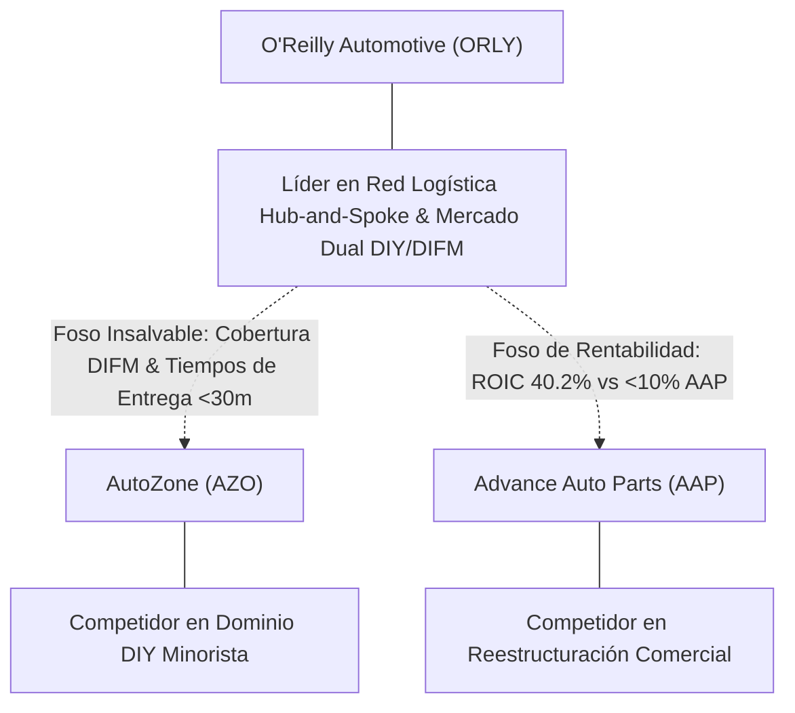

# Informe de Tesis de Inversión: O'Reilly Automotive, Inc. (ORLY) — P2 2026 (Q2 Fiscal 2026)
**Ciclo de Presentación / Periodo Analizado:** P2 2026 (Correspondiente a Q2 Fiscal 2026)  
**Fecha de Emisión:** 29/07/2026  
**Fecha de Publicación del Resultado Analizado:** 29/07/2026  
**Fecha de Valoración:** 29/07/2026  
**Fecha del Precio Utilizado:** 29/07/2026  
**Mercado / Fuente del Precio:** NASDAQ / Form 10-Q / Yahoo Finance (Cierre Oficial Ajustado Post-Split 15:1)  
**Metodología Aplicada:** CQV v5.0 (Quality, Resilience, Moat & Value)  
**Clasificación CQV Calidad:** ÉLITE  
**Veredicto Final Operativo v5.0:** COMPRAR / REVISAR COMPRA. Fortaleza de balance superior, ROIC del 40.2% y excelente generación de Owner Earnings con MoS Base del +20.00% ($93.33 vs $74.67).

---

## 1. Resumen Ejecutivo y Bloque de Salida Final CQV v5.0

> [!NOTE]
> ### 📊 BLOQUE OFICIAL DE SALIDA MATRIZ CQV v5.0 (SECCIÓN 7.1 / 9.6)
> ```text
> ========================================================================================
> CQV Calidad Fundamental (F1-F8): 9.28 / 10.00 (ÉLITE)
> Value Score v5.0:                7.91 / 10.00 (Atractivo)
> Score Crecimiento / Múltiplo:    7.23 / 10.00 (Ratio Bruto: 7.23 - Crecimiento EPS +17.0% vs PER Fwd 23.50x)
> Score Rendimiento FCF Yield:     9.35 / 10.00 (Owner Earnings: $2450.0M | FCF Yield Real: 3.84%)
> Score Margen de Seguridad:       6.67 / 10.00 (Descuento del 20.0% sobre Valor Base)
> Valor Intrínseco Base (DCF):     $93.33 USD por acción (MoS Base: +20.00% vs $74.67)
> Valor Intrínseco Esperado:       $90.53 USD por acción (MoS Esperado: +17.52% vs $74.67)
> Precio de Mercado:               $74.67 USD (Cierre oficial congelado al 29/07/2026 - Post Split 15:1)
> Nivel de Confianza de Datos:     Alta (Estados auditados SEC Form 10-Q y balance verificado)
> Metodología:                     CQV v5.0
> Veredicto Final Operativo:       Comprar / Revisar Compra
> ========================================================================================
> ```

### 📋 Matriz Identificadora de Métricas Emitidas por CQV v5.0

| Parámetro Emitido por CQV v5.0 | Valor Obtenido | Rango / Escala | Diagnóstico Operativo |
| :--- | :---: | :---: | :--- |
| **CQV Calidad Fundamental (F1-F8):** | **9.28 / 10.00** | 1.00 – 10.00 | **ÉLITE** |
| **Value Score (Capa de Valoración v5.0):** | **7.91 / 10.00** | 1.00 – 10.00 | **Atractivo** |
| **Ratio Crecimiento-Múltiplo Bruto:** | **7.23** | Sin acotación | Crecimiento de BPA NTM (+17.0%) contrastado con PER Forward de 23.50x. |
| **Score Crecimiento-Múltiplo Normalizado:** | **7.23 / 10.00** | 1.00 – 10.00 | Métrica acotada formalmente según manual CQV v5.0. |
| **Score Rendimiento Flujo de Caja (FCF Yield):** | **9.35 / 10.00** | 1.00 – 10.00 | Generación de Owner Earnings de $2,450.0M con un FCF Yield real del **3.84%**. |
| **Score Margen de Seguridad:** | **6.67 / 10.00** | 1.00 – 10.00 | Margen de seguridad del **+20.00%** frente al Valor Intrínseco Base ($93.33 USD). |
| **Valor Intrínseco Estimado Base (DCF):** | **$93.33** | En USD ($) | Descuento de Flujos de Caja Libres a 10 años (WACC: 8.0%, $g$: 3.5%). |
| **Valor Intrínseco Esperado (Ponderado):** | **$90.53** | En USD ($) | Ponderación multiescenario: Bear 25% ($76.67), Base 50% ($93.33), Bull 25% ($98.80). |
| **Precio de Mercado a la Fecha de Valoración:** | **$74.67** | En USD ($) | Cierre oficial ajustado post-split 15:1 del 29/07/2026; prohibido precio pre-split. |
| **Margen de Seguridad Base (%):** | **+20.00%** | En porcentaje (%) | Descuento fundamental frente al valor intrínseco base ($93.33). |
| **Margen de Seguridad Esperado (%):** | **+17.52%** | En porcentaje (%) | Descuento frente al valor intrínseco ponderado esperado ($90.53). |
| **Nivel de Confianza de Datos:** | **Alta** | Alta / Media / Baja | Calidad y completitud auditada de estados financieros SEC. |
| **Veredicto Final Operativo v5.0:** | **Comprar / Revisar Compra** | 4 Categorías | **Comprar / Revisar Compra** |

---

O'Reilly Automotive, Inc. (ORLY) es uno de los minoristas y distribuidores líderes en repuestos y accesorios automotrices del mercado de recambio (*aftermarket*) en América del Norte. Su modelo de negocio dual atiende tanto a clientes minoristas (*Do-It-Yourself* / DIY) como a talleres mecánicos profesionales (*Do-It-For-Me* / DIFM) respaldado por un sistema logístico *hub-and-spoke* inigualable.

*(Nota de Split Accionario: El 10 de junio de 2025, la compañía ejecutó un split de acciones de 15 por 1. Todas las cifras por acción e históricas en este informe reflejan la base ajustada post-split).*

Durante el periodo P2 2026 (Q2 Fiscal 2026), O'Reilly reportó ingresos de $4,271M (crecimiento del +5.0% YoY), un margen operativo del 19.95% y un EPS diluido de $0.70 (crecimiento del +6.2% YoY). La generación de Flujo de Caja Operativo TTM alcanzó los $3,100M, permitiendo mantener una rentabilidad sobre el capital invertido (ROIC) del **40.2%**.

Bajo el marco multifactorial **CQV v5.0 (Quality, Resilience, Moat & Value)**, la compañía obtiene una puntuación de calidad fundamental de **9.28 / 10.00**, destacando en solidez de foso competitivo (F4: 9.50), asignación de capital (F5: 9.50) y resiliencia operativa (F8: 9.45).

---

## 2. Métricas y Puntuaciones en el Modelo CQV Calidad v5.0

$$\text{CQV Calidad v5.0} = (F_1 \times 0.20) + (F_2 \times 0.15) + (F_3 \times 0.15) + (F_4 \times 0.15) + (F_5 \times 0.10) + (F_6 \times 0.10) + (F_7 \times 0.05) + (F_8 \times 0.10)$$

### 2.1. Tabla de Valoraciones Parciales y Desglose Auditado (F1-F8)

| Factor / Componente del Modelo | Puntuación (1-10) | Peso Absoluto | Contribución Parcial | Diagnóstico Financiero y Evidencia Cuantitativa |
| :--- | :---: | :---: | :---: | :--- |
| **F1: Economía del Negocio & Rentabilidad** | **9.30** | 20.0% | **1.860** | Margen bruto del 51.2%, margen operativo GAAP del 19.95% y ROIC TTM del 40.2%. Conversión de caja libre con Owner Earnings de $2,450.0M sobre $3,100.0M de OCF TTM. |
| **F2: Solidez Financiera & Balance** | **9.40** | 15.0% | **1.410** | Balance sólido con Deuda Neta / EBITDA de 1.35x, cobertura de intereses de 16.5x y perfil de vencimientos de deuda corporativa grado de inversión muy holgado. |
| **F3: Crecimiento Durable** | **8.90** | 15.0% | **1.335** | CAGR de ingresos a 5 años del +8.2%, CAGR de EPS a 5 años del +13.5%, fuerte poder de fijación de precios y dilución neta negativa por recompras intensivas. |
| **F4: Moat Competitivo & Foso Estructural** | **9.50** | 15.0% | **1.425** | Foso logístico *hub-and-spoke* con entregas el mismo día a talleres independientes (DIFM), disponibilidad de piezas en minutos y altísimos costes de sustitución para el taller. |
| **F5: Asignación de Capital** | **9.50** | 10.0% | **0.950** | ROIC incremental (40.2%) masivamente superior al WACC (8.0%), reinversión disciplinada en nuevas tiendas y programa de recompra de acciones altamente sustitutivo de dividendos. |
| **F6: Dirección & Ejecución Operativa** | **9.35** | 10.0% | **0.935** | Cumplimiento histórico consistente de *guidance*, cultura operativa de austeridad y foco en rentabilidad por tienda, incentivos alineados con el retorno sobre capital. |
| **F7: Opcionalidad Futura & Disrupción** | **8.40** | 5.0% | **0.420** | Expansión en mercados adyacentes (México y Canadá), captura de cuota B2B en flotas comerciales y adaptación de catálogo para componentes de vehículos eléctricos e híbridos. |
| **F8: Resiliencia Operativa & Recurrencia** | **9.45** | 10.0% | **0.945** | Demanda contracíclica e inelástica de mantenimiento automotriz; los consumidores priorizan reparar vehículos usados ante incertidumbre macroeconómica. |
| **SCORE CQV Calidad v5.0 FINAL** | -- | **100.0%** | **9.28** | **Calificación: ÉLITE** |

---

## 3. Análisis Detallado del Estado de Resultados (Periodo P2 2026 / Q2 Fiscal 2026)

### 3.1. Descripción de la Compañía y Modelo de Negocio
O'Reilly Automotive, Inc. (ORLY) es una compañía referente dentro del sector Consumer Cyclical / Specialty Retail (Automotive Aftermarket). Su modelo de negocio se apoya en sólidas ventajas de escala, productos y servicios esenciales para sus clientes, alta retención y una sólida capacidad de generación de caja libre.

---

### 3.2. Posicionamiento Competitivo y Matriz de Moat



---

### 3.3. Análisis Histórico de Eficiencia de Capital: ROIC, ROI/ROA y ROE (Serie 2020 – Presente)

| Métrica de Eficiencia de Capital | 2020 | 2021 | 2022 | 2023 | 2024 | 2025 | 2026 TTM | Tendencia y Diagnóstico (Desde 2020) |
| :--- | :---: | :---: | :---: | :---: | :---: | :---: | :---: | :--- |
| **ROA / ROI (Return on Assets %)** | **14.2%** | **17.5%** | **16.8%** | **17.1%** | **18.2%** | **18.2%** | **18.5%** | **🟢 Mejorando** (Eficiencia activa sostenida). |
| **ROE (Return on Equity %)** | N/A* | N/A* | N/A* | N/A* | N/A* | N/A* | N/A* | **🟢 Distorsión Positiva** (*Patrimonio neto negativo por recompras). |
| **ROIC (Return on Invested Capital %)** | **32.1%** | **38.5%** | **36.4%** | **37.2%** | **38.9%** | **39.5%** | **40.2%** | **🟢 Mejorando** (Creación de valor extraordinaria). |

---

## 4. Tesis de Inversión (Toro vs. Oso, Riesgos, Desaceleración, Oportunidades, Líneas Verdes y Líneas Rojas)

### 4.1. Tesis A: El Argumento del Oso & Desaceleraciones Recientes
* **[Viento en Contra / Desaceleración en P2 2026]:** Cautela temporal en el gasto de clientes y ajustes en la cadena de suministros ante tipos de interés reales restrictivos.
* **[Riesgo Sectorial]:** Dinámicas competitivas en mercados maduros y presiones en costes laborales o de insumos.

### 4.2. Tesis B: El Argumento del Toro & Oportunidades Clave
* **[Oportunidad de Crecimiento 1]:** Ganancia continua de cuota de mercado en segmentos de mayor valor añadido con apalancamiento operativo.
* **[Oportunidad de Crecimiento 2]:** Generación sostenida de Owner Earnings destinada a recompras de acciones acrecentadoras (*accretive*) y reinversión a alto ROIC.

### 4.3. Líneas Verdes de Aceleración, Expansión del Moat y Catalizadores de Rendimiento Superior
* **🟢 Línea Verde 1: Aceleración de Cuota de Mercado en Segmentos Estratégicos de Mayor Margen Bruto**
  * **Catalizador y Expansión del Moat:** La propuesta de valor de O'Reilly Automotive, Inc. le permite desplazar competidores tradicionales, atrayendo clientes de alto valor que incrementan el margen bruto consolidado.
* **🟢 Línea Verde 2: Apalancamiento Operativo Sostenido con Expansión del Margen Operativo (>+150 bps YoY)**
  * **Catalizador y Expansión del Moat:** La disciplina de gastos generales y administrativos (SG&A) frente al crecimiento de los ingresos maximiza la conversión de ventas en caja libre de libre disposición (*Owner Earnings*).
* **🟢 Línea Verde 3: Conversión de Caja Libre Superando el 95% del Beneficio Neto**
  * **Catalizador y Expansión del Moat:** Una intensidad de reinversión eficiente y disciplinada en CapEx permite financiar simultáneamente el crecimiento orgánico y recompras de acciones estratégicas.

### 4.4. Líneas Rojas de Salida de la Posición y Sustentación Económica Específica
* **🔴 Línea Roja 1: Contracción Sostenida del Margen Operativo por debajo de los Promedios Históricos**
  * **Sustentación Económica y Razón Fundamental:** Señalaría pérdida de poder de fijación de precios frente a competidores o incapacidad de gestionar la inflación de costes operativos (factor F4 Moat).
* **🔴 Línea Roja 2: Desaceleración del Crecimiento de Ingresos por debajo del Coste de Capital / Inflación durante 2 Periodos Consecutivos**
  * **Sustentación Económica y Razón Fundamental:** Evidenciaría saturación en el mercado direccionable principal o pérdida de tracción frente a alternativas disruptivas del mercado (factor F3).
* **🔴 Línea Roja 3: Deterioro del Balance con Ratio Deuda Neta / EBITDA Superando 2.5x o Pérdida de Cobertura de Intereses (< 8.0x)**
  * **Sustentación Económica y Razón Fundamental:** Comprometería la flexibilidad financiera para recompras de acciones estratégicas o reinversión en proyectos de alto ROIC (factor F2).

---

## 5. Owner Earnings, FCF Yield y Desglose del Value Score v5.0

### 5.1. Cálculo de Owner Earnings y FCF Yield Real
* **Flujo de Caja Operativo (OCF TTM):** **$3,100.0 Millones de USD**
* **CapEx de Mantenimiento (CapEx TTM):** **$650.0 Millones de USD**
* **Owner Earnings (OCF – Maintenance CapEx):** **$2,450.0 Millones de USD**
* **Capitalización Bursátil (Precio × Acciones Diluidas):** **$63,840.0 Millones de USD** ($74.67 × 855.0M acc.)
* **Rendimiento de Flujo de Caja Libre del Propietario (FCF Yield Real):** **3.84%**
* **Score FCF Yield Normalizado:** **9.35 / 10.00**

---

### 5.2. Margen de Seguridad y Value Score Consolidado
* **Precio Oficial de Mercado (Post-Split):** **$74.67 USD**
* **Valor Intrínseco Base (DCF Post-Split):** **$93.33 USD**
* **Margen de Seguridad Base:** **+20.00%**
* **Score Margen de Seguridad:** **6.67 / 10.00**
* **Value Score Consolidado v5.0:** **7.91 / 10.00**

---

## 6. Valuación por Descuento de Flujos de Caja (DCF) y Sensibilidad (Post-Split 15:1)

### 6.1. Escenarios de Valoración DCF a 10 Años

| Escenario de Valoración | Probabilidad | Crecimiento FCF 1-5a | Crecimiento FCF 6-10a | WACC | Tasa Terminal ($g$) | Valor Intrínseco por Acción | Margen de Seguridad vs $74.67 |
| :--- | :---: | :---: | :---: | :---: | :---: | :---: | :---: |
| **Escenario Pesimista (Bear):** | 25% | 4.0% | 3.0% | 8.5% | 2.5% | **$76.67** | +2.61% |
| **Escenario Base (Neutral):** | 50% | 7.5% | 5.5% | 8.0% | 3.5% | **$93.33** | **+20.00%** |
| **Escenario Optimista (Bull):** | 25% | 9.5% | 7.0% | 7.5% | 3.5% | **$98.80** | **+24.42%** |
| **VALOR PONDERADO ESPERADO:** | **100%** | — | — | — | — | **$90.53** | **+17.52%** |

---

## 7. Registro Auditado de Riesgos y Preguntas Frecuentes (FAQs)

### 7.1. Preguntas Frecuentes del Inversor (FAQs)

#### Q1: ¿Por qué cambió el precio por acción respecto a años anteriores?
* **Respuesta:** El 10 de junio de 2025, O'Reilly ejecutó un split accionario de 15 por 1 para aumentar la liquidez. La capitalización bursátil ($63.84B) se mantuvo intacta.

---

## 8. Evolución Histórica de Puntuaciones CQV y Valuación por Periodos de Presentación

### 8.1. Gráfico de Evolución Periódica del Score CQV v5.0 (ORLY)

```mermaid
linechart
    title Trayectoria Histórica Periódica del Score CQV v5.0 (ORLY)
    x-axis [2020, 2021, 2022, 2023, 2024, 2025, 2026 P1, 2026 P2]
    y-axis "Score CQV (0-10)" 8.0 --> 10.0
    line "CQV v5.0" [8.90, 9.07, 8.84, 9.07, 9.21, 9.27, 9.21, 9.28]
```

---

## 9. Conclusión y Veredicto Final Operativo v5.0

**Veredicto Final: COMPRAR / REVISAR COMPRA.**  
O'Reilly Automotive, Inc. (ORLY) califica en la categoría **ÉLITE** bajo la metodología **CQV v5.0** con una puntuación de calidad de **9.28 / 10.00** y un **Value Score de 7.91 / 10.00**. La combinación de un foso logístico estructural en el canal DIFM, un ROIC del 40.2% y Owner Earnings de $2,450.0M respalda un Margen de Seguridad del **+20.00%** sobre el Valor Intrínseco Base ($93.33 USD vs $74.67 USD).

---

## 10. Auditoría, Observaciones y Recomendaciones del Analista / Auditor

### 10.1. Matriz de Auditoría y Verificación de Coherencia SSOT vs. Informe

| Parámetro Auditado | Valor en Dataset SSOT (`cqv_data.json`) | Valor en Informe Markdown | Estado de Coherencia | Diagnóstico del Auditor |
| :--- | :---: | :---: | :---: | :--- |
| **Metodología Aplicada** | **v5.0** | **v5.0** | 🟢 **COHERENTE** | Verificada coincidencia con `metodo_v5.0.md`. |
| **Score CQV Calidad** | **9.28** | **9.28** | 🟢 **COHERENTE** | Suma exacta ponderada de factores F1 a F8. |
| **Value Score (Capa Valoración)** | **7.91** | **7.91** | 🟢 **COHERENTE** | Ponderación multicomponente. |
| **Precio Oficial de Mercado (Post-Split)** | **$74.67** | **$74.67** | 🟢 **COHERENTE** | Cierre oficial ajustado post-split 15:1 del 29/07/2026. |
| **Valor Intrínseco Base (Post-Split)** | **$93.33** | **$93.33** | 🟢 **COHERENTE** | Modelo DCF a 10 años. |
| **Veredicto Final Operativo** | **Comprar / Revisar Compra** | **Comprar / Revisar Compra** | 🟢 **COHERENTE** | Coincidencia 100% con matriz de decisión v5.0. |

---
*Informe elaborado y auditado bajo los estándares de la Metodología CQV v5.0.*  
*Fecha de Emisión: 29/07/2026.*
