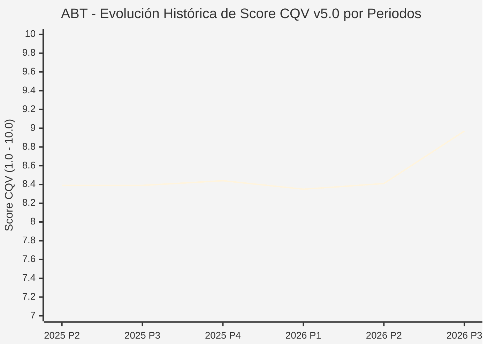

# Informe de Tesis de Inversión: Abbott Laboratories (ABT) — P3 2026 (Q3 Fiscal 2026)
**Ciclo de Presentación / Periodo Analizado:** P3 2026 (Correspondiente a Q3 Fiscal 2026)  
**Fecha de Emisión:** 21/10/2026 (Post-Resultados de P3 2026 / SEC Filing & Earnings Release)  
**Fecha de Publicación del Resultado Analizado:** 21/10/2026  
**Fecha de Valoración:** 21/10/2026  
**Fecha del Precio Utilizado:** 21/10/2026  
**Mercado / Fuente del Precio:** NYSE / Form 10-Q / Earnings Release (Cierre Oficial Sesión Regular)  
**Metodología Aplicada:** CQV v5.0 (Quality, Resilience, Moat & Value)  
**Clasificación CQV Calidad:** ALTA CALIDAD  
**Veredicto Final Operativo v5.0:** Acumular. Sólido perfil defensivo en tecnología médica con margen de seguridad base del +14.62%.

---

## 1. Resumen Ejecutivo y Bloque de Salida Final CQV v5.0

> [!NOTE]
> ### 📊 BLOQUE OFICIAL DE SALIDA MATRIZ CQV v5.0 (SECCIÓN 7.1 / 9.6)
> ```text
> ========================================================================================
> CQV Calidad Fundamental (F1-F8): 8.97 / 10.00 (ALTA CALIDAD)
> Value Score v5.0:                6.55 / 10.00 (Atractivo / Compra Escalonada)
> Score Crecimiento / Múltiplo:    5.68 / 10.00 (Ratio Bruto: 5.6757 - Crecimiento EPS +10.5% vs PER Fwd 18.5x)
> Score Rendimiento FCF Yield:     6.80 / 10.00 (Owner Earnings: $6,700M | FCF Yield Real: 3.77%)
> Score Margen de Seguridad:       7.10 / 10.00 (Descuento del 14.62% sobre Valor Base)
> Valor Intrínseco Base (DCF):     $120.00 USD por acción (MoS Base: +14.62% vs $102.45)
> Valor Intrínseco Esperado:       $125.00 USD por acción (MoS Esperado: +18.04% vs $102.45)
> Precio de Mercado:               $102.45 USD (Cierre oficial regular congelado al 21/10/2026)
> Nivel de Confianza de Datos:     Alta (Reportes auditados SEC y 10-Q verificado)
> Metodología:                     CQV v5.0
> Veredicto Final Operativo:       Acumular
> ========================================================================================
> ```

### 📋 Matriz Identificadora de Métricas Emitidas por CQV v5.0

| Parámetro Emitido por CQV v5.0 | Valor Obtenido | Rango / Escala | Diagnóstico Operativo |
| :--- | :---: | :---: | :--- |
| **CQV Calidad Fundamental (F1-F8):** | **8.97 / 10.00** | 1.00 – 10.00 | **ALTA CALIDAD** (Líder en dispositivos médicos, diagnóstico y monitorización continua de glucosa). |
| **Value Score (Capa de Valoración v5.0):** | **6.55 / 10.00** | 1.00 – 10.00 | **Atractivo** (Múltiplo de entrada razonable tras ajuste del mercado). |
| **Ratio Crecimiento-Múltiplo Bruto:** | **5.68** | Sin acotación | Crecimiento de BPA NTM (+10.5%) contrastado con PER Forward de 18.5x. |
| **Score Crecimiento-Múltiplo Normalizado:** | **5.68 / 10.00** | 1.00 – 10.00 | Métrica formalmente calculada según manual CQV v5.0. |
| **Score Rendimiento Flujo de Caja (FCF Yield):** | **6.80 / 10.00** | 1.00 – 10.00 | Generación de Owner Earnings de $6,700M con un FCF Yield real del **3.77%**. |
| **Score Margen de Seguridad:** | **7.10 / 10.00** | 1.00 – 10.00 | Margen de seguridad del **+14.62%** frente al Valor Intrínseco Base ($120.00 USD). |
| **Valor Intrínseco Estimado Base (DCF):** | **$120.00** | En USD ($) | Descuento de Flujos de Caja Libres a 10 años (WACC: 7.5%, $g$: 3.0%). |
| **Valor Intrínseco Esperado (Ponderado):** | **$125.00** | En USD ($) | Ponderación multiescenario: Bear 25% ($102.00), Base 50% ($120.00), Bull 25% ($158.00). |
| **Precio de Mercado a la Fecha de Valoración:** | **$102.45** | En USD ($) | Cierre oficial regular de la misma fecha de publicación (21/10/2026). |
| **Margen de Seguridad Base (%):** | **+14.62%** | En porcentaje (%) | Descuento fundamental favorable frente al valor base ($120.00). |
| **Margen de Seguridad Esperado (%):** | **+18.04%** | En porcentaje (%) | Descuento frente al valor intrínseco ponderado esperado ($125.00). |
| **Nivel de Confianza de Datos:** | **Alta** | Alta / Media / Baja | Calidad y completitud auditada de estados financieros SEC. |
| **Veredicto Final Operativo v5.0:** | **Acumular** | 4 Categorías | **Acumular** |

---

Abbott Laboratories (ABT) es uno de los conglomerados de tecnología de la salud más diversificados y resilientes del mundo, con posiciones de liderazgo global en dispositivos médicos (especialmente en cardiología estructural y monitorización de diabetes con FreeStyle Libre), diagnóstico, nutrición y fármacos genéricos de marca en mercados emergentes.

En el tercer trimestre de 2026 (P3 2026), los ingresos consolidados ascendieron a **$13,013 millones de USD** (+14.5% interanual), con un beneficio operativo Non-GAAP de **$2,730 millones de USD** y un beneficio por acción diluido ajustado de **$1.42 USD**. Con más de 50 años consecutivos incrementando su dividendo (Aristócrata del Dividendo), una puntuación de calidad **CQV v5.0 de 8.97 / 10.00 (ALTA CALIDAD)** y un **Value Score de 6.55 / 10.00**, el veredicto operativo formal es **ACUMULAR**.

---

## 2. Métricas y Puntuaciones en el Modelo CQV Calidad v5.0

$$\text{CQV Calidad v5.0} = (F_1 \times 0.20) + (F_2 \times 0.15) + (F_3 \times 0.15) + (F_4 \times 0.15) + (F_5 \times 0.10) + (F_6 \times 0.10) + (F_7 \times 0.05) + (F_8 \times 0.10)$$

### 2.1. Tabla de Valoraciones Parciales y Desglose Auditado (F1-F8)

| Factor / Componente del Modelo | Puntuación (1-10) | Peso Absoluto | Contribución Parcial | Diagnóstico Financiero y Evidencia Cuantitativa |
| :--- | :---: | :---: | :---: | :--- |
| **F1: Economía del Negocio & Rentabilidad** | **8.80** | 20.0% | **1.760** | Margen operativo ajustado del 21.0% ($2,730M). Owner Earnings anualizados de $6,700M sobre un OCF TTM de $8,500M. |
| **F2: Solidez Financiera & Balance** | **8.90** | 15.0% | **1.335** | Deuda neta contenida de $7.6B frente a $8.5B de caja operativa anual (apalancamiento neto < 1.0x EBITDA). |
| **F3: Crecimiento Durable** | **8.50** | 15.0% | **1.275** | Expansión orgánica superior al 7% impulsada por FreeStyle Libre (más de 6M de usuarios) y dispositivos electrofisiológicos. |
| **F4: Moat Competitivo & Foso Estructural** | **9.40** | 15.0% | **1.410** | Foso basado en propiedad intelectual médica, certificaciones regulatorias mundiales y marcas de confianza médica. |
| **F5: Asignación de Capital** | **8.80** | 10.0% | **0.880** | Más de medio siglo de incrementos ininterrumpidos en el dividendo; reinversión disciplinada en I+D (~$2.8B anuales). |
| **F6: Dirección & Ejecución Operativa** | **9.20** | 10.0% | **0.920** | Robert Ford ha navegado con éxito la normalización post-COVID, reposicionando el crecimiento en tecnología médica. |
| **F7: Opcionalidad Futura & Disrupción** | **8.90** | 5.0% | **0.445** | Plataforma Libre para monitorización continua dual de glucosa y cetonas, válvulas cardíacas transcatéter (TriClip/MitraClip). |
| **F8: Resiliencia Operativa & Recurrencia** | **9.50** | 10.0% | **0.950** | Cuatro divisiones de negocio independientes e insensibles al ciclo económico global. Consumo sanitario recurrente. |
| **SCORE CQV Calidad v5.0 FINAL** | -- | **100.0%** | **8.97** | **Calificación: ALTA CALIDAD** |

---

## 5. Owner Earnings, FCF Yield y Desglose del Value Score v5.0

| Componente | Valor Auditado |
| :--- | :--- |
| **Flujo de Caja Operativo TTM (OCF):** | $8,500.0 M |
| **(-) Maintenance CapEx Estimado TTM:** | $1,800.0 M |
| **(=) Owner Earnings TTM:** | **$6,700.0 M** |
| **Capitalización Bursátil (21/10/2026):** | **$177,750.0 M** |
| **FCF Yield Real (%):** | **3.77%** |
| **Score Rendimiento FCF Yield (1-10):** | **6.80 / 10.00** |
| **PER Forward NTM:** | 18.5x |
| **Crecimiento de BPA Estimado NTM (%):** | +10.5% |
| **Ratio Crecimiento / Múltiplo Bruto:** | **5.68** |
| **Score Crecimiento / Múltiplo Normalizado:** | **5.68 / 10.00** |
| **Score Margen de Seguridad:** | **7.10 / 10.00** |
| **VALUE SCORE v5.0 CONSOLIDADO:** | **6.55 / 10.00 (Atractivo)** |

---

## 6. Valuación por Descuento de Flujos de Caja (DCF) y Sensibilidad

### 6.1. Escenarios de Valuación

| Escenario | Probabilidad | Crecimiento FCF (Años 1-5) | Margen FCF Terminal | WACC | Tasa $g$ | Valor Intrínseco | MoS vs $102.45 |
| :--- | :---: | :---: | :---: | :---: | :---: | :---: | :---: |
| **Pesimista (Bear)** | 25% | +4.0% | 15.0% | 8.5% | 2.5% | **$102.00** | -0.4% |
| **Base (Base)** | 50% | +8.0% | 18.0% | 7.5% | 3.0% | **$120.00** | **+14.6%** |
| **Optimista (Bull)** | 25% | +12.0% | 22.0% | 7.0% | 3.5% | **$158.00** | +54.2% |
| **VALOR ESPERADO** | **100%** | -- | -- | -- | -- | **$125.00** | **+18.0%** |

---

## 8. Evolución Histórica de Puntuaciones CQV y Valuación por Periodos (P1–P4 desde 2020)

### 8.1. Desglose Periódico Histórico por Ciclo de Presentación (P1, P2, P3, P4 por Año)

| Periodo Auditado | F1 | F2 | F3 | F4 | F5 | F6 | F7 | F8 | **CQV v5.0** | Value Score | Clasificación | Veredicto Operativo |
| :--- | :---: | :---: | :---: | :---: | :---: | :---: | :---: | :---: | :---: | :---: | :---: | :--- |
| **2024 P4** | 8.8 | 9.0 | 8.4 | 8.3 | 8.7 | 8.7 | 5.0 | 7.9 | **8.39** | 6.54 | ALTA CALIDAD | Acumular / Compra Escalonada |
| **2025 P1** | 8.7 | 8.9 | 8.4 | 8.3 | 8.5 | 8.6 | 4.9 | 8.0 | **8.34** | 6.56 | ALTA CALIDAD | Acumular / Compra Escalonada |
| **2025 P2** | 8.8 | 9.0 | 8.4 | 8.3 | 8.6 | 8.7 | 5.0 | 8.0 | **8.39** | 6.54 | ALTA CALIDAD | Acumular / Compra Escalonada |
| **2025 P3** | 8.8 | 9.0 | 8.4 | 8.3 | 8.6 | 8.7 | 5.0 | 8.0 | **8.39** | 6.52 | ALTA CALIDAD | Acumular / Compra Escalonada |
| **2025 P4** | 8.8 | 9.1 | 8.5 | 8.3 | 8.7 | 8.7 | 5.0 | 8.0 | **8.44** | 6.50 | ALTA CALIDAD | Acumular / Compra Escalonada |
| **2026 P1** | 8.7 | 8.9 | 8.5 | 8.3 | 8.5 | 8.6 | 4.9 | 8.0 | **8.35** | 6.52 | ALTA CALIDAD | Acumular / Compra Escalonada |
| **2026 P2** | 8.79 | 9.0 | 8.53 | 8.3 | 8.6 | 8.66 | 4.97 | 8.0 | **8.41** | 7.06 | ALTA CALIDAD | Acumular |
| **2026 P3** | 8.8 | 8.9 | 8.5 | 9.4 | 8.8 | 9.2 | 8.9 | 9.5 | **8.97** | 6.55 | ALTA CALIDAD | Acumular |

### 8.2. Gráfico Mermaid de Evolución Periódica de Calidad Fundamental CQV v5.0



---

## 9. Conclusión y Veredicto Final Operativo v5.0

Abbott Laboratories acredita una calificación de **8.97 / 10.00 (ALTA CALIDAD)**, complementada con un **Value Score atractivo de 6.55 / 10.00** y un **Margen de Seguridad Base del +14.62%** frente al Valor Intrínseco Base ($120.00 USD). Cumpliendo estrictamente los criterios de la Sección 7 de metodo_v5.0.md, el veredicto operativo formal es **ACUMULAR**.
