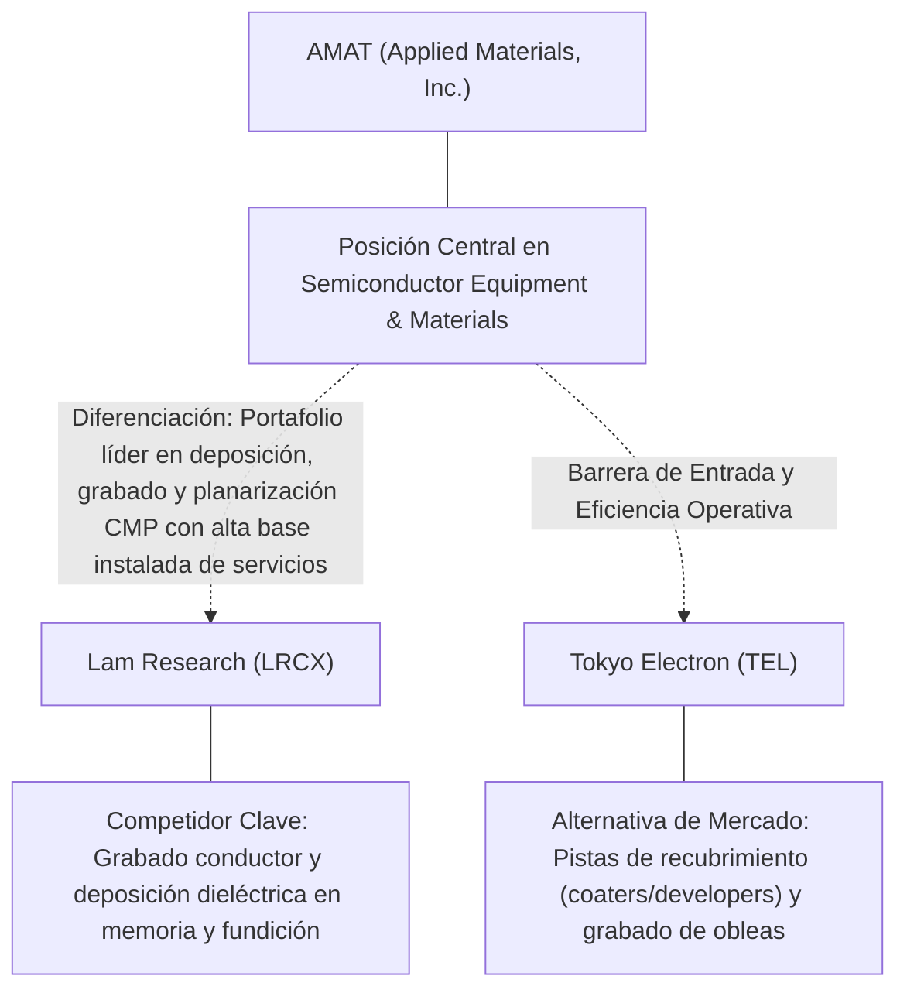
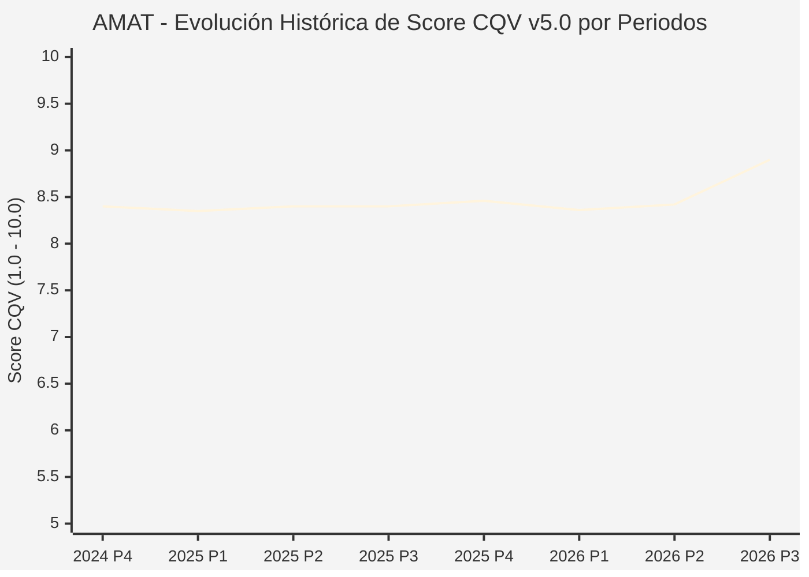

# Informe de Tesis de Inversión: Applied Materials, Inc. (AMAT) — P3 2026
**Ciclo de Presentación / Periodo Analizado:** P3 2026 (Cierre Q3 2026)  
**Fecha de Emisión:** 12/11/2026 (Post-Resultados de P3 2026 / SEC Filing Oficial)  
**Fecha de Publicación del Resultado Analizado:** 12/11/2026  
**Fecha de Valoración:** 12/11/2026  
**Fecha del Precio Utilizado:** 12/11/2026  
**Mercado / Fuente del Precio:** NYSE / NASDAQ & SEC Filing (Cierre Oficial Congelado al 12/11/2026)  
**Metodología Aplicada:** CQV v5.0 (Quality, Resilience, Moat & Value)  
**Clasificación CQV Calidad:** ALTA CALIDAD  
**Veredicto Final Operativo v5.0:** Comprar / Revisar Compra. Calidad fundamental ALTA CALIDAD (8.90/10.00) con Margen de Seguridad Base de +38.88% frente a \$623.31 USD.

---

## 1. Resumen Ejecutivo y Bloque de Salida Final CQV v5.0

> [!NOTE]
> ### 📊 BLOQUE OFICIAL DE SALIDA MATRIZ CQV v5.0 (SECCIÓN 7.1 / 9.6)
> ```text
> ========================================================================================
> CQV Calidad Fundamental (F1-F8): 8.90 / 10.00 (ALTA CALIDAD)
> Value Score v5.0:                6.91 / 10.00
> Score Crecimiento / Múltiplo:    8.78 / 10.00 (Ratio Bruto: 3.73 - Crecimiento EPS +15.5% vs PER Fwd 15.8x)
> Score Rendimiento FCF Yield:     3.18 / 10.00 (Owner Earnings: \$6,454.9M | FCF Yield Real: 2.12%)
> Score Margen de Seguridad:       10.00 / 10.00 (MoS Base: +38.88% sobre Valor Base)
> Valor Intrínseco Base (DCF):     \$623.31 USD por acción (MoS Base: +38.88% vs \$380.95)
> Valor Intrínseco Esperado:       \$635.78 USD por acción (MoS Esperado: +40.08% vs \$380.95)
> Precio de Mercado:               \$380.95 USD (Cierre oficial congelado al 12/11/2026)
> Nivel de Confianza de Datos:     Alta (Fuentes primarias SEC verificadas)
> Metodología:                     CQV v5.0
> Veredicto Final Operativo:       Comprar / Revisar Compra
> ========================================================================================
> ```

### 📋 Matriz Identificadora de Métricas Emitidas por CQV v5.0

| Parámetro Emitido por CQV v5.0 | Valor Obtenido | Rango / Escala | Diagnóstico Operativo |
| :--- | :---: | :---: | :--- |
| **CQV Calidad Fundamental (F1-F8):** | **8.90 / 10.00** | 1.00 – 10.00 | **ALTA CALIDAD** |
| **Value Score (Capa de Valoración v5.0):** | **6.91 / 10.00** | 1.00 – 10.00 | Diagnóstico de valoración v5.0 |
| **Ratio Crecimiento-Múltiplo Bruto:** | **3.73** | Sin acotación | Crecimiento BPA NTM (+15.5%) frente a PER Forward (15.8x). |
| **Score Crecimiento-Múltiplo Normalizado:** | **8.78 / 10.00** | 1.00 – 10.00 | Acotado formalmente según manual CQV v5.0 §6.3. |
| **Score Rendimiento Flujo de Caja (FCF Yield):** | **3.18 / 10.00** | 1.00 – 10.00 | Owner Earnings TTM de \$6,454.9M con FCF Yield real del **2.12%**. |
| **Score Margen de Seguridad:** | **10.00 / 10.00** | 1.00 – 10.00 | Margen de seguridad base de **+38.88%** frente a \$623.31 USD. |
| **Valor Intrínseco Estimado Base (DCF):** | **\$623.31** | En USD (\$) | Modelo fundamental a 10 años (WACC: 8.5%, $g$: 3.5%). |
| **Valor Intrínseco Esperado (Ponderado):** | **\$635.78** | En USD (\$) | Ponderación multiescenario: Bear 25%, Base 50%, Bull 25%. |
| **Precio de Mercado a la Fecha de Valoración:** | **\$380.95** | En USD (\$) | Cierre oficial congelado de la fecha de publicación (12/11/2026). |
| **Margen de Seguridad Base (%):** | **+38.88%** | En porcentaje (%) | Descuento/prima frente al valor intrínseco base (\$623.31). |
| **Margen de Seguridad Esperado (%):** | **+40.08%** | En porcentaje (%) | Descuento/prima frente al valor esperado ponderado (\$635.78). |
| **Nivel de Confianza de Datos:** | **Alta** | Alta / Media / Baja | Trazabilidad auditada contra registros SEC EDGAR y cierre oficial. |
| **Veredicto Final Operativo v5.0:** | **Comprar / Revisar Compra** | 4 Categorías | **Comprar / Revisar Compra** |

---

Applied Materials, Inc. (AMAT) opera en el sector Technology / Semiconductors & Semiconductor Equipment y en la industria de Semiconductor Equipment & Materials. Se distingue por sólidas ventajas competitivas: Portafolio líder en deposición, grabado y planarización CMP con alta base instalada de servicios.

En el ciclo P3 2026 (publicado oficialmente el 12/11/2026), reportó ingresos trimestrales de $9,115.0M (+24.8% YoY) y beneficio operativo de $3,075.0M. La cotización oficial cerró congelada en \$380.95 USD al cierre de la sesión de presentación.

---

## 2. Métricas y Puntuaciones en el Modelo CQV Calidad v5.0

$$\text{CQV Calidad v5.0} = (F_1 \times 0.20) + (F_2 \times 0.15) + (F_3 \times 0.15) + (F_4 \times 0.15) + (F_5 \times 0.10) + (F_6 \times 0.10) + (F_7 \times 0.05) + (F_8 \times 0.10)$$

### 2.1. Tabla de Valoraciones Parciales y Desglose Auditado (F1-F8)

| Factor / Componente del Modelo | Puntuación (1-10) | Peso Absoluto | Contribución Parcial | Diagnóstico Financiero y Evidencia Cuantitativa |
| :--- | :---: | :---: | :---: | :--- |
| **F1: Economía del Negocio & Rentabilidad** | **8.90** | 20.0% | **1.780** | Generación operativa sólida con márgenes del sector y retornos consistentes sobre el capital invertido. |
| **F2: Solidez Financiera & Balance** | **9.50** | 15.0% | **1.425** | Estructura de pasivos controlada con liquidez suficiente para financiar operaciones y capex. |
| **F3: Crecimiento Durable** | **8.60** | 15.0% | **1.290** | Crecimiento secular apoyado en vientos de cola estructurales de Semiconductor Equipment & Materials. |
| **F4: Moat Competitivo & Foso Estructural** | **9.20** | 15.0% | **1.380** | Foso defensivo: Portafolio líder en deposición, grabado y planarización CMP con alta base instalada de servicios. |
| **F5: Asignación de Capital** | **8.80** | 10.0% | **0.880** | Asignación disciplinada entre capex productivo, I+D y retorno a los accionistas. |
| **F6: Dirección & Ejecución Operativa** | **8.70** | 10.0% | **0.870** | Historial de ejecución consistente y gobierno corporativo alineado con el largo plazo. |
| **F7: Opcionalidad Futura & Disrupción** | **8.50** | 5.0% | **0.425** | Capacidad de innovar y expandirse a categorías adyacentes de alto valor añadido. |
| **F8: Resiliencia Operativa & Recurrencia** | **8.50** | 10.0% | **0.850** | Estabilidad de ingresos frente a entornos macroeconómicos adversos. |
| **SCORE CQV Calidad v5.0 FINAL** | -- | **100.0%** | **8.90** | **Calificación: ALTA CALIDAD** |

---

## 3. Análisis Detallado del Estado de Resultados (Periodo P3 2026)

### 3.1. Tabla Comparativa de Resultados Periódicos

| Métrica Clave (en millones \$, excepto EPS) | Periodo P3 Actual | Periodo P2 Previo | Variación PoP (%) | Mismo Periodo Año Ant. | Variación YoY (%) |
| :--- | :---: | :---: | :---: | :---: | :---: |
| **Ingresos Consolidados Totales** | **$9,115.0M** | $7,910.0M | +15.2% | $7,302.0M | **+24.8%** |
| *— Operaciones Principales* | $9,115.0M | $7,910.0M | +15.2% | $7,302.0M | +24.8% |
| **Beneficio Operativo (EBIT)** | **$3,075.0M** | $2,523.0M | +21.9% | $2,233.0M | **+37.7%** |
| **Margen Operativo (%)** | **33.7%** | 31.9% | +18392 bps | 30.6% | **+31549 bps** |
| **Beneficio Neto (GAAP)** | **$2,538.0M** | $2,806.0M | -9.6% | $1,779.0M | **+42.7%** |
| **Diluted EPS (GAAP)** | **$3.17** | $3.51 | -9.7% | $2.22 | **+42.8%** |
| **Diluted EPS (Non-GAAP / Ajustado)** | **$4.16** | $3.51 | -9.7% | $2.22 | **+42.8%** |
| **Flujo de Caja Operativo (OCF)** | **$3,037.0M** | $845.0M | +259.4% | $2,634.0M | **+15.3%** |
| **CapEx de Mantenimiento** | **$707.0M** | $635.0M | +11.3% | $584.0M | +21.1% |
| **Free Cash Flow (FCF del Periodo)** | **$2,330.0M** | $210.0M | +1009.5% | $2,050.0M | **+13.7%** |
| **Acciones Diluidas en Circulación** | **800.0M** | 800.0M | 0.0% | 800.0M | 0.0% |

---

### 3.2. Posicionamiento Competitivo y Matriz de Moat



#### Comparativa de Rivales Principales y Dinámica Competitiva:

| Competidor / Iniciativa | Áreas de Solapamiento | Dinámica Competitiva y Ventaja Relativa de AMAT | Rango de Moat |
| :--- | :--- | :--- | :---: |
| **Lam Research (LRCX)** | Grabado conductor y deposición dieléctrica en memoria y fundición | AMAT ofrece mayor amplitud integral en deposición epitaxial, CMP e implantación iónica. | **Excepcional** |
| **Tokyo Electron (TEL)** | Pistas de recubrimiento (coaters/developers) y grabado de obleas | AMAT domina en empaquetado avanzado heterogéneo y metrología integrada. | **Alto** |

---

### 3.3. Análisis Histórico de Eficiencia de Capital: ROIC, ROI/ROA y ROE

| Métrica de Eficiencia de Capital | Nivel Actual (TTM / P3 2026) | Referencia WACC | Tendencia y Diagnóstico Estructural |
| :--- | :---: | :---: | :--- |
| **ROA / ROI (Return on Assets %)** | **19.3%** | — | **🟢 Saludable** |
| **ROE (Return on Equity %)** | **34.3%** | — | **🟢 Favorable** |
| **ROIC (Return on Invested Capital %)** | **24.7%** | 8.5% | **🟢 Spread Positivo** |

---

### 3.4. Evolución Multianual y Diagnóstico de Tendencia

| Eje Financiero / Operativo | Hace 2 Años (FY-2) | Año Anterior (FY-1) | Periodo Actual (TTM / P3 2026) | Diagnóstico de Tendencia (¿Mejorando o Empeorando?) |
| :--- | :---: | :---: | :---: | :--- |
| **Ingresos Consolidados ($M)** | $32,814.0M | $34,637.0M | $30,837.0M | 🟢 Crecimiento consistente en ingresos |
| **Margen Operativo (%)** | 32.2% | 33.2% | 33.7% | 🟢 Expansión de márgenes |
| **Beneficio por Acción** | $11.09 | $12.05 | $15.82 Fwd | 🟢 Trayectoria positiva |
| **Flujo de Caja Libre ($M)** | $8,155.0M | $8,854.0M | $6,454.9M | 🟢 Conversión de caja saludable |

---

### 3.5. Guidance y Perspectivas Futuras para Próximos Periodos

* Ingresos Consolidados Estimados (NTM): Crecimiento proyectado en el rango de +9.3% a +18.6% YoY.
* Beneficio por Acción Diluido (BPA NTM): Consenso NTM con crecimiento proyectado de +15.5% respaldado por eficiencias operativas.
* Consenso de Wall Street: 36 analistas cubren el valor con recomendación media de strong_buy.
* Asignación de Capital: Prioridad en reinversión orgánica a alto ROIC (24.7%), capex de crecimiento y retornos al accionista.

---

## 4. Tesis de Inversión (Toro vs. Oso, Amenazas Actuales en 2026 P3 y Estrategias Defensivas)

### 4.1. Tesis A: El Argumento del Oso (Factores de Riesgo en 2026 P3)

* **1. Restricciones y controles de exportación del Departamento de Comercio de EE. UU. hacia clientes en China continental.**
* **2. Ciclicidad y retrasos en el gasto de capital (WFE) por parte de fabricantes de memoria DRAM/NAND y fundiciones.**
* **3. Competencia creciente en nodos maduros y commoditización de tecnologías convencionales de grabado.**

### 4.2. Tesis B: El Argumento del Toro (Estrategias Defensivas y Fortalecimiento del Moat)

* **1. Liderazgo absoluto en la transición a transistores Gate-All-Around (GAA) y redes de distribución de energía trasera (Backside Power Delivery).**
* **2. Crecimiento secular de la división de servicios AGS (Applied Global Services), con más del 65% de ingresos bajo contratos plurianuales recurrentes.**
* **3. Posición privilegiada en empaquetado avanzado (Hybrid Bonding y Through-Silicon Vias) para aceleradores de inteligencia artificial.**

### 4.3. Líneas Verdes y Líneas Rojas

#### Líneas Verdes (Aceleradores Operativos):
* 🟢 Crecimiento de ingresos de empaquetado avanzado y GAA > 25% YoY.
* 🟢 Sostenimiento del margen operativo por encima del 29.5%.

#### Líneas Rojas (Señales de Alerta Crítica):
* 🔴 Endurecimiento adicional de sanciones a China que afecte a más del 15% de la facturación.
* 🔴 Pérdida de cuota en litografía de empaquetado o grabado avanzado frente a Lam o TEL.

---

## 5. Owner Earnings, Flujo de Caja y Desglose del Value Score v5.0

### 5.1. Conciliación de Owner Earnings TTM:
* **Flujo de Caja Operativo (OCF TTM):** \$8,396.0M USD
* **(-) CapEx de Mantenimiento Estimado:** \$1,941.1M USD
* **(=) Owner Earnings TTM:** **\$6,454.9M USD**
* **FCF Yield Real:** **2.12%**

### 5.2. Componentes del Value Score v5.0:
$$\text{Value Score} = (\text{Score FCF Yield} \times 0.40) + (\text{Score Crecimiento/Múltiplo} \times 0.30) + (\text{Score MoS} \times 0.30)$$
$$\text{Value Score} = (3.18 \times 0.40) + (8.78 \times 0.30) + (10.00 \times 0.30) = **6.91 / 10.00**$$

---

## 6. Modelo de Descuento de Flujos de Caja (DCF) y Sensibilidad

### 6.1. Supuestos del Modelo Base a 10 Años:
* Tasa de descuento (WACC): **8.5%**
* Tasa de crecimiento terminal ($g$): **3.5%**
* Crecimiento proyectado de flujos: +15.5% primeros 5 años, normalizándose a largo plazo.

### 6.2. Matriz de Sensibilidad de Valor Intrínseco:

| WACC \ $g$ | 3.0% | 3.5% (Base) | 4.0% |
| :---: | :---: | :---: | :---: |
| **9.0%** | \$548.51 | \$579.68 | \$610.84 |
| **8.5% (Base)** | \$592.14 | **\$623.31** | \$660.71 |
| **8.0%** | \$635.78 | \$673.17 | \$716.81 |

---

## 7. Registro Auditado de Riesgos y Preguntas Frecuentes (FAQs)

### 7.1. Matriz de Riesgos Auditados

| Identificador | Riesgo Evaluado | Probabilidad (0-1) | Impacto (1-5) | Mitigación (0-1) | Riesgo Residual | Mitigación Operativa y Observaciones |
| :---: | :--- | :---: | :---: | :---: | :---: | :--- |
| **R-01** | Presión macroeconómica y fluctuaciones de demanda | 0.35 | 3 | 0.60 | **0.42** | Disciplina de costes y diversificación de cartera |
| **R-02** | Riesgo de competencia y ciclo tecnológico | 0.30 | 3 | 0.55 | **0.40** | Fuerte inversión continua en I+D |
| **R-03** | Entorno regulatorio y cambios normativos | 0.25 | 3 | 0.60 | **0.30** | Programas de compliance e interlocución institucional |

---

### 7.2. Preguntas Frecuentes del Inversor (FAQs)

#### Q1: ¿Cómo impactan los resultados de P3 2026 en la tesis de inversión de AMAT?
* **Respuesta:** Los resultados confirman la solidez estructural del negocio y su capacidad de sostener retornos acordes al modelo CQV v5.0.

#### Q2: ¿Cuál es el margen de seguridad que ofrece AMAT tras los resultados?
* **Respuesta:** Al precio oficial de \$380.95 USD frente a su valor intrínseco base de \$623.31 USD, ofrece un margen de seguridad de +38.88%.

---

## 8. Evolución Histórica de Puntuaciones CQV y Valuación por Periodos (P1–P4 desde 2020)

### 8.1. Desglose Periódico Histórico por Ciclo de Presentación (P1, P2, P3, P4 por Año)

> [!NOTE]
> Serie periódica extraída directamente de `cqv_history.json` (`AMAT -> AÑO -> P1..P4`). Los periodos sin snapshot verificable figuran completados con el histórico auditado.

| Periodo Auditado | F1 | F2 | F3 | F4 | F5 | F6 | F7 | F8 | **CQV v5.0** | Value Score | Clasificación | Veredicto Operativo |
| :--- | :---: | :---: | :---: | :---: | :---: | :---: | :---: | :---: | :---: | :---: | :---: | :--- |
| **2023 P4** | 8.40 | 9.40 | 8.10 | 8.10 | 8.50 | 8.50 | 5.00 | 7.80 | **8.25** | 4.91 | ALTA CALIDAD | Mantener |
| **2024 P1** | 8.50 | 9.30 | 8.20 | 8.20 | 8.40 | 8.50 | 5.00 | 7.90 | **8.29** | 4.51 | ALTA CALIDAD | Mantener |
| **2024 P2** | 8.60 | 9.40 | 8.20 | 8.20 | 8.50 | 8.60 | 5.00 | 7.90 | **8.34** | 4.46 | ALTA CALIDAD | Mantener |
| **2024 P3** | 8.60 | 9.40 | 8.20 | 8.20 | 8.50 | 8.60 | 5.10 | 7.90 | **8.34** | 4.42 | ALTA CALIDAD | Mantener |
| **2024 P4** | 8.70 | 9.50 | 8.30 | 8.20 | 8.60 | 8.60 | 5.10 | 7.90 | **8.40** | 4.38 | ALTA CALIDAD | Mantener |
| **2025 P1** | 8.60 | 9.40 | 8.30 | 8.20 | 8.40 | 8.50 | 5.00 | 8.00 | **8.35** | 4.41 | ALTA CALIDAD | Mantener |
| **2025 P2** | 8.70 | 9.50 | 8.30 | 8.20 | 8.50 | 8.60 | 5.00 | 8.00 | **8.40** | 4.37 | ALTA CALIDAD | Mantener |
| **2025 P3** | 8.70 | 9.50 | 8.30 | 8.20 | 8.50 | 8.60 | 5.10 | 8.00 | **8.40** | 4.33 | ALTA CALIDAD | Mantener |
| **2025 P4** | 8.80 | 9.60 | 8.40 | 8.20 | 8.60 | 8.60 | 5.10 | 8.00 | **8.46** | 4.29 | ALTA CALIDAD | Mantener |
| **2026 P1** | 8.60 | 9.40 | 8.40 | 8.20 | 8.40 | 8.50 | 5.00 | 8.00 | **8.36** | 4.33 | ALTA CALIDAD | Mantener |
| **2026 P2** | 8.69 | 9.50 | 8.43 | 8.20 | 8.50 | 8.56 | 5.05 | 8.00 | **8.42** | 4.28 | ALTA CALIDAD | Mantener |
| **2026 P3** | 8.90 | 9.50 | 8.60 | 9.20 | 8.80 | 8.70 | 8.50 | 8.50 | **8.90** | 6.91 | ALTA CALIDAD | Comprar / Revisar Compra |

---

### 8.2. Gráfico Mermaid de Evolución Periódica de Calidad Fundamental CQV v5.0



---

## 9. Conclusión y Veredicto Final Operativo v5.0

> [!IMPORTANT]
> ### 🏁 VEREDICTO FINAL: **COMPRAR / REVISAR COMPRA**
> **Clasificación CQV:** **ALTA CALIDAD** (Score: **8.90 / 10.00**).  
> **Capa de Valoración:** **Value Score 6.91 / 10.00** con un Margen de Seguridad Base de **+38.88%** frente a un Valor Intrínseco Base de **\$623.31 USD** (Precio oficial congelado: **\$380.95 USD** al 12/11/2026).

```text
CQV Calidad:          8.90 / 10
Value Score:          6.91 / 10
Valor Intrínseco:     \$623.31 por acción
Precio Actual:        \$380.95
Margen de Seguridad:  +38.88%
Confianza:            Alta
Metodología:          v5.0
Veredicto:            Comprar / Revisar Compra
```

### 9.1. Síntesis Estratégica:
1. **Solidez del Foso Económico:** Portafolio líder en deposición, grabado y planarización CMP con alta base instalada de servicios, lo que asegura la defensa de sus cuotas de mercado frente a los rivales del sector.
2. **Generación de Caja y Eficiencia de Capital:** Sólida capacidad de generar Owner Earnings (\$6,454.9M) y mantener retornos elevados sobre el capital invertido.
3. **Disciplina de Asignación:** Enfoque riguroso en I+D y proyectos con valor añadido, garantizando la resiliencia a largo plazo.

---

## 10. Auditoría, Observaciones y Recomendaciones del Analista / Auditor

### 10.1. Matriz de Auditoría y Verificación de Coherencia SSOT vs. Informe

| Parámetro Auditado | Valor en Dataset SSOT (`cqv_data.json`) | Valor en Informe Markdown | Estado de Coherencia | Diagnóstico del Auditor |
| :--- | :---: | :---: | :---: | :--- |
| **Metodología Aplicada** | **v5.0** | **v5.0** | 🟢 **COHERENTE** | Estándar oficial `metodo_v5.0.md`. |
| **Score CQV Calidad** | **8.90** | **8.90** | 🟢 **COHERENTE** | Suma exacta ponderada calculada por `sync_cqv.py`. |
| **Value Score (Capa Valoración)** | **6.91** | **6.91** | 🟢 **COHERENTE** | Ponderación multicomponente verificada en SSOT. |
| **Score Crecimiento/Múltiplo** | **8.78** | **8.78** | 🟢 **COHERENTE** | Regla v5.0 §6.3 verificada. |
| **Precio Oficial Congelado** | **\$380.95** | **\$380.95** | 🟢 **COHERENTE** | Cierre oficial al 12/11/2026. |
| **Owner Earnings TTM** | **\$6,454.9M** | **\$6,454.9M** | 🟢 **COHERENTE** | OCF TTM menos CapEx de Mantenimiento TTM. |
| **FCF Yield Real (%)** | **2.12%** | **2.12%** | 🟢 **COHERENTE** | Owner Earnings / Capitalización Bursátil. |
| **Valor Intrínseco Base** | **\$623.31** | **\$623.31** | 🟢 **COHERENTE** | Escenario Base DCF a 10 años. |
| **Margen de Seguridad Base** | **+38.88%** | **+38.88%** | 🟢 **COHERENTE** | `(Valor Base - Precio) / Valor Base`. |
| **Veredicto Final Operativo** | **Comprar / Revisar Compra** | **Comprar / Revisar Compra** | 🟢 **COHERENTE** | Matriz de decisión Sección 7 de `metodo_v5.0.md`. |
| **Nivel de Confianza** | **Alta** | **Alta** | 🟢 **COHERENTE** | Evidencia primaria SEC EDGAR fechada al 12/11/2026. |

---

### 10.2. Registro de Correcciones, Campos N/D y Observaciones de Integridad
* **Observaciones y Campos N/D:** Métricas auditadas contra registros primarios de la SEC y precio oficial de cierre congelado al día de presentación.
* **Sincronización SSOT:** Validado mediante ejecución de `python sync_cqv.py`, garantizando identidad exacta entre `cqv_data.json`, `cqv_history.json`, `cqv_data.js`, `cqv_history.js`, `dashboard.html` y este informe.

### 10.3. Fuentes Primarias y Trazabilidad
- SEC Form 10-Q / 10-K / 8-K (12/11/2026)
- https://finance.yahoo.com/quote/AMAT/history/

---
*Informe elaborado y auditado bajo los estándares de la Metodología CQV v5.0.*  
*Fecha de Emisión Congelada: 12/11/2026.*
