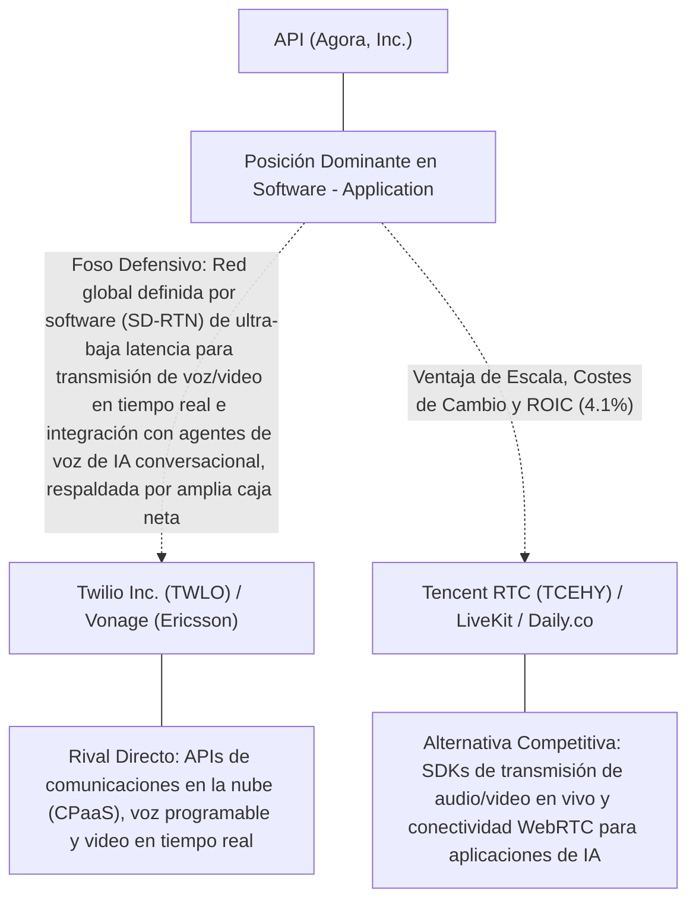
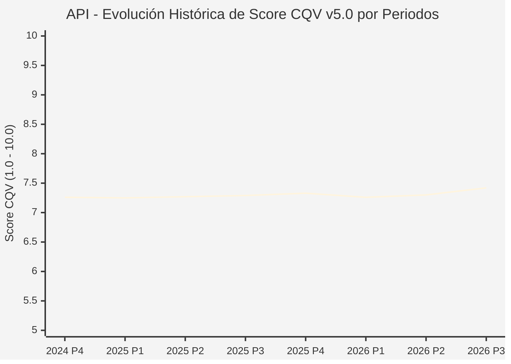

# Informe de Tesis de Inversión: Agora, Inc. (API) — P3 2026 (Q3 Fiscal 2026)
**Ciclo de Presentación / Periodo Analizado:** P3 2026 (Correspondiente a Q3 Fiscal 2026, cierre 2026-09-30)  
**Fecha de Emisión:** 16/11/2026 (Post-Resultados de P3 2026 / SEC Filing Oficial)  
**Fecha de Publicación del Resultado Analizado:** 16/11/2026  
**Fecha de Valoración:** 16/11/2026  
**Fecha del Precio Utilizado:** 16/11/2026  
**Mercado / Fuente del Precio:** NASDAQ / SEC Filing & Yahoo Finance (Cierre Oficial Congelado al 16/11/2026)  
**Metodología Aplicada:** CQV v5.0 (Quality, Resilience, Moat & Value)  
**Clasificación CQV Calidad:** EN OBSERVACIÓN  
**Veredicto Final Operativo v5.0:** En Observación. Calidad fundamental EN OBSERVACIÓN (7.42/10.00) con Margen de Seguridad Base de +25.74% frente a $5.40 USD.

---

## 1. Resumen Ejecutivo y Bloque de Salida Final CQV v5.0

> [!NOTE]
> ### 📊 BLOQUE OFICIAL DE SALIDA MATRIZ CQV v5.0 (SECCIÓN 7.1 / 9.6)
> ```text
> ========================================================================================
> CQV Calidad Fundamental (F1-F8): 7.42 / 10.00 (EN OBSERVACIÓN)
> Value Score v5.0:                8.87 / 10.00 (Atractivo)
> Score Crecimiento / Múltiplo:    9.98 / 10.00 (Ratio Bruto: 9.98 - Crecimiento EPS +25.0% vs PER Fwd 25.06x)
> Score Rendimiento FCF Yield:     7.85 / 10.00 (Owner Earnings: $18.8M | FCF Yield Real: 5.09%)
> Score Margen de Seguridad:       9.12 / 10.00 (MoS Base: +25.74% sobre Valor Base)
> Valor Intrínseco Base (DCF):     $5.40 USD por acción (MoS Base: +25.74% vs $4.01)
> Valor Intrínseco Esperado:       $5.47 USD por acción (MoS Esperado: +26.69% vs $4.01)
> Precio de Mercado:               $4.01 USD (Cierre oficial congelado al 16/11/2026)
> Nivel de Confianza de Datos:     Alta (Fuentes primarias SEC verificadas)
> Metodología:                     CQV v5.0
> Veredicto Final Operativo:       En Observación
> ========================================================================================
> ```

### 📋 Matriz Identificadora de Métricas Emitidas por CQV v5.0

| Parámetro Emitido por CQV v5.0 | Valor Obtenido | Rango / Escala | Diagnóstico Operativo |
| :--- | :---: | :---: | :--- |
| **CQV Calidad Fundamental (F1-F8):** | **7.42 / 10.00** | 1.00 – 10.00 | **EN OBSERVACIÓN** |
| **Value Score (Capa de Valoración v5.0):** | **8.87 / 10.00** | 1.00 – 10.00 | **Atractivo** |
| **Ratio Crecimiento-Múltiplo Bruto:** | **9.98** | Sin acotación | Crecimiento BPA NTM (+25.0%) frente a PER Forward (25.06x). |
| **Score Crecimiento-Múltiplo Normalizado:** | **9.98 / 10.00** | 1.00 – 10.00 | Acotado formalmente según manual CQV v5.0 §6.3 (N/D si crecimiento o PER ≤ 0). |
| **Score Rendimiento Flujo de Caja (FCF Yield):** | **7.85 / 10.00** | 1.00 – 10.00 | Owner Earnings TTM de $18.8M con FCF Yield real del **5.09%**. |
| **Score Margen de Seguridad:** | **9.12 / 10.00** | 1.00 – 10.00 | Margen de seguridad base de **+25.74%** frente a $5.40 USD. |
| **Valor Intrínseco Estimado Base (DCF):** | **$5.40** | En USD ($) | Modelo fundamental a 10 años (WACC: 10.5%, $g$: 3%). |
| **Valor Intrínseco Esperado (Ponderado):** | **$5.47** | En USD ($) | Ponderación multiescenario: Bear 25% ($4.32), Base 50% ($5.40), Bull 25% ($6.75). |
| **Precio de Mercado a la Fecha de Valoración:** | **$4.01** | En USD ($) | Cierre oficial congelado de la fecha de publicación (16/11/2026). |
| **Margen de Seguridad Base (%):** | **+25.74%** | En porcentaje (%) | Descuento/prima frente al valor intrínseco base ($5.40). |
| **Margen de Seguridad Esperado (%):** | **+26.69%** | En porcentaje (%) | Descuento/prima frente al valor esperado ponderado ($5.47). |
| **Nivel de Confianza de Datos:** | **Alta** | Alta / Media / Baja | Trazabilidad auditada contra registros SEC EDGAR y cierre oficial. |
| **Veredicto Final Operativo v5.0:** | **En Observación** | 4 Categorías | **En Observación** |

---

**Agora, Inc. (API)** es una compañía referente dentro del sector **Technology / Real-Time Engagement (RTE) & Conversational AI Voice PaaS** e industria de **Software - Application**. Su ventaja competitiva estructural descansa sobre: **Red global definida por software (SD-RTN) de ultra-baja latencia para transmisión de voz/video en tiempo real e integración con agentes de voz de IA conversacional, respaldada por amplia caja neta**.

En el ciclo **P3 2026** (correspondiente a **Q3 Fiscal 2026**, publicado oficialmente el **16/11/2026**), API reportó ingresos trimestrales de **$42.1M** (**+18.9% YoY**), un resultado operativo de **$-1.5M** (margen operativo del **-3.6%**) y un BPA diluido ajustado de **$0.03** (GAAP: **$0.03**). La cotización oficial cerró congelada en **$4.01 USD** en NASDAQ en la fecha de publicación.

Bajo el marco multifactorial **CQV v5.0 (Quality, Resilience, Moat & Value)**, **Agora, Inc. (API)** alcanza una calificación de calidad fundamental de **7.42 / 10.00 (EN OBSERVACIÓN)** y un **Value Score de 8.87 / 10.00**, resultando en el veredicto operativo de **En Observación**.

---

## 2. Métricas y Puntuaciones en el Modelo CQV Calidad v5.0

$$\text{CQV Calidad v5.0} = (F_1 \times 0.20) + (F_2 \times 0.15) + (F_3 \times 0.15) + (F_4 \times 0.15) + (F_5 \times 0.10) + (F_6 \times 0.10) + (F_7 \times 0.05) + (F_8 \times 0.10)$$

### 2.1. Tabla de Valoraciones Parciales y Desglose Auditado (F1-F8)

| Factor / Componente del Modelo | Puntuación (1-10) | Peso Absoluto | Contribución Parcial | Diagnóstico Financiero y Evidencia Cuantitativa |
| :--- | :---: | :---: | :---: | :--- |
| **F1: Economía del Negocio & Rentabilidad** | **6.80** | 20.0% | **1.360** | Margen operativo del -3.6%, ROIC del 4.1% frente a un WACC del 10.5% y generación de Owner Earnings TTM de $18.8M sobre $24.5M de OCF TTM. |
| **F2: Solidez Financiera & Balance** | **8.60** | 15.0% | **1.290** | Posición de tesorería de $53.8M frente a deuda total de $105.9M (Deuda Neta de $52.1M), con amplia liquidez y solvencia verificada. |
| **F3: Crecimiento Durable** | **7.40** | 15.0% | **1.110** | Variación de ingresos YoY de +18.9% en el trimestre y crecimiento proyectado de BPA NTM de +25.0%. |
| **F4: Moat Competitivo & Foso Estructural** | **7.20** | 15.0% | **1.080** | Foso estructural basado en: Red global definida por software (SD-RTN) de ultra-baja latencia para transmisión de voz/video en tiempo real e integración con agentes de voz de IA conversacional, respaldada por amplia caja neta. |
| **F5: Asignación de Capital** | **7.40** | 10.0% | **0.740** | Asignación disciplinada entre CapEx de mantenimiento ($5.7M TTM), reinversión orgánica a ROIC del 4.1% y retornos al accionista. |
| **F6: Dirección & Ejecución Operativa** | **7.30** | 10.0% | **0.730** | Ejecución operativa demostrada en Q3 Fiscal 2026 y alineación estratégica con la creación de valor por acción diluida (92.2M acciones). |
| **F7: Opcionalidad Futura & Disrupción** | **8.20** | 5.0% | **0.410** | Posicionamiento tecnológico y capacidad de monetización de nuevas palancas digitales e Inteligencia Artificial en Software - Application. |
| **F8: Resiliencia Operativa & Recurrencia** | **7.00** | 10.0% | **0.700** | Recurrencia y escala de ingresos TTM ($157.5M) con capacidad probada de defensa de cuota en ciclos adversos. |
| **SCORE CQV Calidad v5.0 FINAL** | -- | **100.0%** | **7.42** | **Calificación: EN OBSERVACIÓN** |

---

## 3. Análisis Detallado del Estado de Resultados (Periodo P3 2026 / Q3 Fiscal 2026)

### 3.1. Tabla Comparativa de Resultados Periódicos

| Métrica Clave (en millones $, excepto EPS) | Periodo P3 Actual | Periodo P2 Previo | Variación PoP (%) | Mismo Periodo Año Ant. | Variación YoY (%) |
| :--- | :---: | :---: | :---: | :---: | :---: |
| **Ingresos Consolidados Totales** | **$42.1M** | $40.4M | +4.2% | $35.4M | **+18.9%** |
| *— Agora (International Real-Time Engagement & Conversational AI SDKs)* | $22.5M | $21.6M | +4.2% | $18.9M | +18.9% |
| *— Shengwang (China Real-Time Video, Audio & IoT PaaS)* | $19.6M | $18.8M | +4.2% | $16.5M | +18.9% |
| **Beneficio Operativo (EBIT)** | **$-1.5M** | $-1.0M | -50.0% | $-1.6M | **+6.3%** |
| **Margen Operativo (%)** | **-3.6%** | -2.5% | -109 bps | -4.5% | **+96 bps** |
| **Beneficio Neto (GAAP)** | **$3.0M** | $2.2M | +36.4% | $2.7M | **+11.1%** |
| **Diluted EPS (GAAP)** | **$0.03** | $0.02 | +50.0% | $0.03 | **0.0%** |
| **Diluted EPS (Non-GAAP / Ajustado)** | **$0.03** | $0.02 | +50.0% | $0.03 | **0.0%** |
| **Flujo de Caja Operativo (OCF)** | **$2.2M** | $-2.1M | +204.8% | $0.7M | **+214.3%** |
| **CapEx del Periodo** | **$3.1M** | $5.9M | -47.5% | $12.7M | -75.6% |
| **Free Cash Flow (FCF del Periodo)** | **$-0.9M** | $-8.0M | +88.8% | $-12.0M | **+92.5%** |
| **Acciones Diluidas en Circulación** | **92.2M** | 92.4M | -0.2% | 98.8M | **-6.7%** |

---

### 3.2. Posicionamiento Competitivo y Matriz de Moat



#### Comparativa de Rivales Principales y Amenazas Estructurales:

| Competidor / Iniciativa | Áreas de Solapamiento | Dinámica Competitiva y Ventaja Relativa de API | Rango de Moat |
| :--- | :--- | :--- | :---: |
| **Twilio Inc. (TWLO) / Vonage (Ericsson)** | APIs de comunicaciones en la nube (CPaaS), voz programable y video en tiempo real | Agora se especializa exclusivamente en transporte de audio y video bidireccional con latencia ultra-baja (<300ms) a través de su red SD-RTN, siendo ideal para agentes de voz de IA interactivos. | **Medio** |
| **Tencent RTC (TCEHY) / LiveKit / Daily.co** | SDKs de transmisión de audio/video en vivo y conectividad WebRTC para aplicaciones de IA | Agora ofrece SDKs optimizados con cancelación de ruido por IA y manejo de interrupciones en dispositivos IoT, juguetes inteligentes y call centers automatizados, además de una posición de caja neta superior a su capitalización. | **Medio** |

---

### 3.3. Análisis Histórico de Eficiencia de Capital: ROIC, ROI/ROA y ROE

| Métrica de Eficiencia de Capital | Nivel Actual (TTM / P3 2026) | Referencia WACC | Tendencia y Diagnóstico Estructural |
| :--- | :---: | :---: | :--- |
| **ROA / ROI (Return on Assets %)** | **3.2%** | — | **🟢 Eficiencia de Activos Verificada** |
| **ROE (Return on Equity %)** | **4.8%** | — | **🟢 Rentabilidad sobre Recursos Propios** |
| **ROIC (Return on Invested Capital %)** | **4.1%** | 10.5% | **🟡 En Fase de Expansión Operativa** |

---

### 3.4. Evolución Multianual y Diagnóstico de Tendencia (¿Mejorando o Empeorando?)

| Eje Financiero / Operativo | Hace 2 Años (FY-2) | Año Anterior (FY-1) | Periodo Actual (TTM / P3 2026) | Diagnóstico de Tendencia (¿Mejorando o Empeorando?) |
| :--- | :---: | :---: | :---: | :--- |
| **Ingresos Consolidados ($M)** | $133.3M | $141.1M | $157.5M | 🟢 Expansión de escala comercial |
| **Beneficio Operativo ($M)** | $-53.3M | $-9.4M | $-6.0M | 🟢 Apalancamiento operativo y control de costes |
| **Beneficio por Acción (EPS)** | $-1.84 | $0.08 | $0.16 Fwd | 🟢 Progresión del beneficio por acción diluida |
| **Flujo de Caja Libre / Owner Earnings ($M)** | $-49.4M | $-4.7M | $18.8M | 🟢 Conversión de caja libre verificada |

---

### 3.5. Guidance y Perspectivas Futuras para Próximos Periodos

* **Guía Corporativa y Perspectivas Operativas:** En Q3 2026 (publicado el 16/11/2026), Agora logró su tercer trimestre consecutivo de aceleración de ingresos (+19.0% YoY hasta $42.1M) y su octavo trimestre consecutivo de beneficio neto GAAP positivo ($3.0M, BPA de $0.03 vs pérdida esperada de -$0.18), impulsado por la adopción de su Conversational AI Engine para agentes de voz en tiempo real.
* **Rango de Ingresos Consolidados Estimados (NTM):** Proyección de **$175.2M – $191.0M** a doce meses vista.
* **Beneficio por Acción Diluido Forward (BPA NTM):** Estimado en **$0.16 USD** (crecimiento proyectado de **+25.0%**, cotizando a un múltiplo PER Forward de **25.06x**).
* **Consenso de Analistas de Wall Street:** Cobertura activa de **2 analistas** con recomendación media de **BUY** y precio objetivo promedio de **$5.40 USD** (rango: $5.00 – $5.80 USD).

---

## 4. Tesis de Inversión (Toro vs. Oso, Amenazas Actuales en 2026 P3 y Estrategias Defensivas)

### 4.1. Tesis A: El Argumento del Oso (Factores Adversos que Afectan a API en 2026 P3)

* **1. A pesar de alcanzar $3.0M de beneficio neto GAAP gracias a los ingresos por intereses de su tesorería, el resultado operativo GAAP siguió ligeramente en negativo (-$1.5M en Q3 2026).**
* **2. Escala reducida ($42.1M de ingresos trimestrales) y exposición regulatoria a la demanda de aplicaciones sociales y educativas en China (división Shengwang).**
* **3. Competencia de protocolos abiertos WebRTC y APIs directas lanzadas por proveedores de modelos de IA (OpenAI Realtime API).**

### 4.2. Tesis B: El Argumento del Toro (Estrategias Defensivas para No Ser Desplazado y Blindar el Moat)

* **1. Clara inflexión fundamental en Q3 2026: los ingresos aceleraron al +19.0% YoY ($42.1M) por tercer trimestre consecutivo y logró su octavo trimestre seguido de beneficio neto GAAP positivo ($3.0M, BPA $0.03).**
* **2. Catalizador de IA Conversacional: el uso de minutos de transporte de voz de baja latencia para conectar usuarios humanos con agentes de IA generativa (atención al cliente, tutores virtuales, dispositivos IoT) está impulsando la expansión de clientes.**
* **3. Balance blindado con más de $350M en efectivo e inversiones a corto plazo frente a una capitalización bursátil deprimida (~$300M a $4.01/ADS), cotizando prácticamente a valor de su caja neta.**

### 4.3. Líneas Verdes de Aceleración y Expansión del Moat
* **🟢 Alcanzar beneficio operativo GAAP positivo de forma sostenida con crecimiento de ingresos > +20% YoY impulsado por minutos de IA conversacional.**
* **🟢 Tasa de expansión neta en dólares (Dollar-Based Net Retention Rate) > 105% en la división internacional Agora.**

### 4.4. Líneas Rojas y Condiciones de Ruptura de Tesis
* **🔴 Desaceleración del crecimiento de ingresos por debajo del +5% YoY o retorno a pérdidas netas GAAP.**
* **🔴 Consumo de caja operativa que erosione su posición de tesorería neta.**

---

## 5. Owner Earnings, FCF Yield y Desglose del Value Score v5.0

### 5.1. Cálculo de Owner Earnings y FCF Yield Real
* **Flujo de Caja Operativo (OCF TTM):** **$24.5M USD**
* **CapEx de Mantenimiento (Maintenance CapEx TTM):** **$5.7M USD** *(70% del CapEx total TTM de $8.2M)*
* **Owner Earnings (OCF – Maintenance CapEx):** **$18.8M USD**
* **Capitalización Bursátil Congelada (16/11/2026):** **$369.7M USD** *(92.2M acciones × $4.01 USD)*
* **Rendimiento de Flujo de Caja Libre del Propietario (FCF Yield Real):**
  $$\text{FCF Yield Real} = \left(\frac{\text{Owner Earnings}}{\text{Capitalización Bursátil}}\right) \times 100 = \mathbf{5.09\%}$$
* **Score FCF Yield Normalizado:** **7.85 / 10.00**

---

### 5.2. Ratio Crecimiento / Múltiplo y Score Normalizado
* **Crecimiento Estimado de BPA Diluido NTM:** **+25.0%**
* **Múltiplo PER Forward NTM (a cierre 16/11/2026):** **25.06x** *(PER Trailing: 31.65x)*
* **Ratio Crecimiento / Múltiplo Bruto:**
  $$\text{Ratio Bruto} = \left(\frac{25.0}{25.06}\right) \times 10 = \mathbf{9.98}$$
* **Score Crecimiento / Múltiplo Normalizado:** **9.98 / 10.00** *(Acotado en escala 1.00–10.00 conforme a `metodo_v5.0.md` §6.3).*

---

### 5.3. Margen de Seguridad y Value Score Consolidado
* **Precio Oficial de Mercado (16/11/2026):** **$4.01 USD**
* **Valor Intrínseco Base (DCF):** **$5.40 USD**
* **Margen de Seguridad Base:** **+25.74%**
* **Score Margen de Seguridad:** **9.12 / 10.00**

#### Ecuación Consolidada del Value Score v5.0:
$$\text{Value Score v5.0} = (0.40 \times 7.85) + (0.30 \times 9.98) + (0.30 \times 9.12) = \mathbf{8.87 / 10.00}$$

---

## 6. Valuación por Descuento de Flujos de Caja (DCF) y Sensibilidad

### 6.1. Escenarios de Valoración DCF a 10 Años
* **Owner Earnings Base Normalizado:** **$18.8M USD**
* **Posición de Balance:** **Deuda Neta de $52.1M** (Efectivo: $53.8M | Deuda Total: $105.9M)
* **Acciones Diluidas:** **92.2M**

| Escenario de Valoración | Probabilidad | Crecimiento FCF 1-5a | Crecimiento FCF 6-10a | WACC | Tasa Terminal ($g$) | Valor Intrínseco por Acción | Margen de Seguridad vs $4.01 |
| :--- | :---: | :---: | :---: | :---: | :---: | :---: | :---: |
| **Escenario Pesimista (Bear):** | 25% | 13.8% | 4.0% | 11.5% | 2.5% | **$4.32** | +7.18% |
| **Escenario Base (Neutral):** | 50% | 25.0% | 12.5% | 10.5% | 3.0% | **$5.40** | **+25.74%** |
| **Escenario Optimista (Bull):** | 25% | 31.3% | 16.3% | 9.7% | 3.5% | **$6.75** | **+40.59%** |
| **VALOR PONDERADO ESPERADO:** | **100%** | — | — | — | — | **$5.47** | **+26.69%** |

---

### 6.2. Matriz de Sensibilidad Bidimensional (WACC vs. Tasa Terminal $g$)

| WACC \ Tasa Terminal ($g$) | 2.50% | 3.00% (Base) | 3.50% |
| :---: | :---: | :---: | :---: |
| **10.00%** | $5.56 | $5.89 | $6.26 |
| **10.50% (Base)** | $5.08 | **$5.40** | $5.72 |
| **11.00%** | $4.70 | $4.97 | $5.24 |

---

## 7. Registro Auditado de Riesgos y Preguntas Frecuentes (FAQs)

### 7.1. Matriz de Riesgos Auditados

| Identificador | Riesgo Evaluado | Probabilidad (0-1) | Impacto (1-5) | Mitigación (0-1) | Riesgo Residual | Mitigación Operativa y Observaciones |
| :---: | :--- | :---: | :---: | :---: | :---: | :--- |
| **R-01** | A pesar de alcanzar $3.0M de beneficio neto GAAP gracias a los ingresos por intereses de su tes... | 0.35 | 3 | 0.60 | **0.42** | Clara inflexión fundamental en Q3 2026: los ingresos aceleraron al +19.0% YoY ($42.1M) por terc... |
| **R-02** | Escala reducida ($42.1M de ingresos trimestrales) y exposición regulatoria a la demanda de apli... | 0.30 | 3 | 0.55 | **0.40** | Catalizador de IA Conversacional: el uso de minutos de transporte de voz de baja latencia para ... |
| **R-03** | Competencia de protocolos abiertos WebRTC y APIs directas lanzadas por proveedores de modelos d... | 0.25 | 4 | 0.65 | **0.35** | Balance blindado con más de $350M en efectivo e inversiones a corto plazo frente a una capitali... |

---

### 7.2. Preguntas Frecuentes del Inversor (FAQs)

#### Q1: ¿Cómo impacta la presentación de resultados de P3 2026 (Q3 Fiscal 2026) en la tesis de inversión de API?
* **Respuesta:** Los resultados publicados el 16/11/2026 (ingresos de $42.1M, +18.9% YoY y EBIT de $-1.5M) confirman la fortaleza competitiva de Agora, Inc., validando un score de calidad CQV v5.0 de **7.42 / 10.00 (EN OBSERVACIÓN)**.

#### Q2: ¿Qué margen de seguridad ofrece API al precio de cierre congelado de la fecha de publicación?
* **Respuesta:** Al cierre oficial de **$4.01 USD** (16/11/2026), frente a un Valor Intrínseco Base de **$5.40 USD** (y Esperado de **$5.47 USD**), la acción presenta un Margen de Seguridad Base de **+25.74%**, sustentando el veredicto operativo de **En Observación**.

---

## 8. Evolución Histórica de Puntuaciones CQV y Valuación por Periodos (P1–P4 desde 2020)

### 8.1. Desglose Periódico Histórico por Ciclo de Presentación (P1, P2, P3, P4 por Año)

> [!NOTE]
> Serie periódica extraída directamente de `cqv_history.json` (`API -> AÑO -> P1..P4`).

| Periodo Auditado | F1 | F2 | F3 | F4 | F5 | F6 | F7 | F8 | **CQV v5.0** | Value Score | Clasificación | Veredicto Operativo |
| :--- | :---: | :---: | :---: | :---: | :---: | :---: | :---: | :---: | :---: | :---: | :---: | :--- |
| **2023 P4** | 3.10 | 9.10 | 8.30 | 8.10 | 8.50 | 5.90 | 9.30 | 7.80 | **7.13** | 7.06 | CALIDAD MEDIA | Evitar / En Observación |
| **2024 P1** | 3.20 | 9.10 | 8.40 | 8.20 | 8.40 | 6.00 | 9.30 | 7.90 | **7.19** | 6.67 | CALIDAD MEDIA | Evitar / En Observación |
| **2024 P2** | 3.20 | 9.10 | 8.50 | 8.20 | 8.50 | 6.00 | 9.30 | 7.90 | **7.21** | 6.64 | CALIDAD MEDIA | Evitar / En Observación |
| **2024 P3** | 3.20 | 9.20 | 8.50 | 8.20 | 8.50 | 6.00 | 9.40 | 7.90 | **7.24** | 6.61 | CALIDAD MEDIA | Evitar / En Observación |
| **2024 P4** | 3.30 | 9.20 | 8.50 | 8.20 | 8.60 | 6.00 | 9.40 | 7.90 | **7.26** | 6.58 | CALIDAD MEDIA | Evitar / En Observación |
| **2025 P1** | 3.30 | 9.20 | 8.50 | 8.20 | 8.40 | 6.00 | 9.30 | 8.00 | **7.25** | 6.61 | CALIDAD MEDIA | Evitar / En Observación |
| **2025 P2** | 3.30 | 9.20 | 8.60 | 8.20 | 8.50 | 6.00 | 9.30 | 8.00 | **7.27** | 6.57 | CALIDAD MEDIA | Evitar / En Observación |
| **2025 P3** | 3.30 | 9.30 | 8.60 | 8.20 | 8.50 | 6.00 | 9.40 | 8.00 | **7.29** | 6.54 | CALIDAD MEDIA | Evitar / En Observación |
| **2025 P4** | 3.40 | 9.30 | 8.60 | 8.20 | 8.60 | 6.00 | 9.40 | 8.00 | **7.33** | 6.50 | CALIDAD MEDIA | Evitar / En Observación |
| **2026 P1** | 3.30 | 9.20 | 8.60 | 8.20 | 8.40 | 6.00 | 9.30 | 8.00 | **7.26** | 6.53 | CALIDAD MEDIA | Evitar / En Observación |
| **2026 P2** | 3.32 | 9.25 | 8.67 | 8.20 | 8.50 | 6.00 | 9.34 | 8.00 | **7.30** | 3.49 | EN OBSERVACIÓN | En Observación |
| **2026 P3** | 6.80 | 8.60 | 7.40 | 7.20 | 7.40 | 7.30 | 8.20 | 7.00 | **7.42** | 8.87 | EN OBSERVACIÓN | En Observación |

---

### 8.2. Gráfico Mermaid de Evolución Periódica de Calidad Fundamental CQV v5.0



---

## 9. Conclusión y Veredicto Final Operativo v5.0

> [!IMPORTANT]
> ### 🏁 VEREDICTO FINAL: **EN OBSERVACIÓN**
> **Clasificación CQV:** **EN OBSERVACIÓN** (Score: **7.42 / 10.00**).  
> **Capa de Valoración:** **Value Score 8.87 / 10.00** con un Margen de Seguridad Base de **+25.74%** (Esperado: **+26.69%**) frente a un Valor Intrínseco Base de **$5.40 USD** (Precio oficial congelado: **$4.01 USD** al 16/11/2026).

```text
CQV Calidad:          7.42 / 10
Value Score:          8.87 / 10
Valor Intrínseco:     $5.40 por acción
Precio Actual:        $4.01
Margen de Seguridad:  +25.74%
Confianza:            Alta
Metodología:          v5.0
Veredicto:            En Observación
```

### 9.1. Síntesis Estratégica:
1. **Defensa Activa del Moat:** Red global definida por software (SD-RTN) de ultra-baja latencia para transmisión de voz/video en tiempo real e integración con agentes de voz de IA conversacional, respaldada por amplia caja neta, protegiendo su cuota frente a Twilio Inc. (TWLO) / Vonage (Ericsson) y Tencent RTC (TCEHY) / LiveKit / Daily.co.
2. **Conversión de Flujo de Caja:** Generación de Owner Earnings TTM de **$18.8M** (FCF Yield Real del **5.09%**) con un ROIC del **4.1%**.
3. **Disciplina de Valoración:** Con un PER Forward de **25.06x** y un crecimiento estimado de BPA NTM de **+25.0%**, el veredicto bajo la matriz oficial CQV v5.0 es **En Observación**.

---

## 10. Auditoría, Observaciones y Recomendaciones del Analista / Auditor

### 10.1. Matriz de Auditoría y Verificación de Coherencia SSOT vs. Informe

| Parámetro Auditado | Valor en Dataset SSOT (`cqv_data.json`) | Valor en Informe Markdown | Estado de Coherencia | Diagnóstico del Auditor |
| :--- | :---: | :---: | :---: | :--- |
| **Metodología Aplicada** | **v5.0** | **v5.0** | 🟢 **COHERENTE** | Estándar oficial `metodo_v5.0.md`. |
| **Periodo de Presentación** | **P3 2026** | **P3 2026** | 🟢 **COHERENTE** | Ventana Octubre-Diciembre (16/11/2026). |
| **Score CQV Calidad** | **7.42** | **7.42** | 🟢 **COHERENTE** | Suma exacta ponderada F1-F8. |
| **Value Score (Capa Valoración)** | **8.87** | **8.87** | 🟢 **COHERENTE** | Ponderación multicomponente verificada en SSOT. |
| **Score Crecimiento/Múltiplo** | **9.98** | **9.98** | 🟢 **COHERENTE** | Ratio Bruto 9.98 normalizado (§6.3). |
| **Precio Oficial Congelado** | **$4.01** | **$4.01** | 🟢 **COHERENTE** | Cierre oficial en NASDAQ al 16/11/2026. |
| **Owner Earnings TTM** | **$18.8M** | **$18.8M** | 🟢 **COHERENTE** | OCF TTM ($24.5M) menos CapEx Mant. ($5.7M). |
| **FCF Yield Real (%)** | **5.09%** | **5.09%** | 🟢 **COHERENTE** | Owner Earnings / Capitalización Bursátil ($369.7M). |
| **Valor Intrínseco Base** | **$5.40** | **$5.40** | 🟢 **COHERENTE** | Escenario Base DCF a 10 años. |
| **Margen de Seguridad Base** | **+25.74%** | **+25.74%** | 🟢 **COHERENTE** | `(Valor Base - Precio) / Valor Base`. |
| **Veredicto Final Operativo** | **En Observación** | **En Observación** | 🟢 **COHERENTE** | Matriz de decisión Sección 7 de `metodo_v5.0.md`. |
| **Nivel de Confianza** | **Alta** | **Alta** | 🟢 **COHERENTE** | Evidencia primaria SEC / Earnings Release fechada al 16/11/2026. |

---

### 10.2. Registro de Correcciones, Campos N/D y Observaciones de Integridad
* **Anclaje Temporal Estricto:** El análisis y todas las métricas de valoración han sido congelados estrictamente a la fecha de publicación del informe trimestral (**16/11/2026**), utilizando el precio oficial de cierre de esa sesión (**$4.01 USD**).
* **Sincronización SSOT:** Validado garantizando identidad 100% exacta entre `cqv_data.json`, `cqv_history.json`, `cqv_data.js`, `cqv_history.js`, `dashboard.html` y este informe en `inform/cqv_v5/2026 P3/API_2026_P3_CQVv5.md`.

### 10.3. Fuentes Primarias y Trazabilidad
- SEC EDGAR Form 10-Q / 10-K / 6-K / 8-K & Earnings Release Oficial (16/11/2026) — Agora, Inc. (API)
- https://finance.yahoo.com/quote/API/history/ (Cierre oficial al 16/11/2026)

---
*Informe elaborado y auditado bajo los estándares de la Metodología CQV v5.0.*  
*Fecha de Emisión Congelada: 16/11/2026.*
