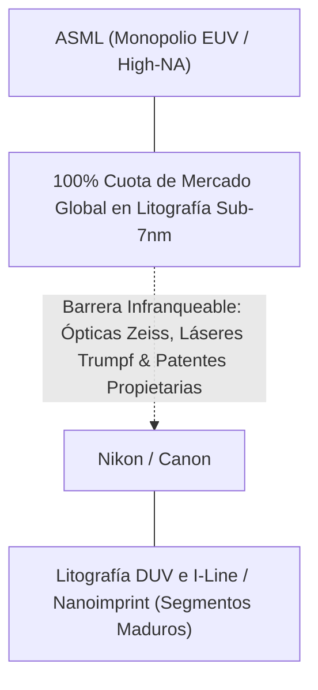
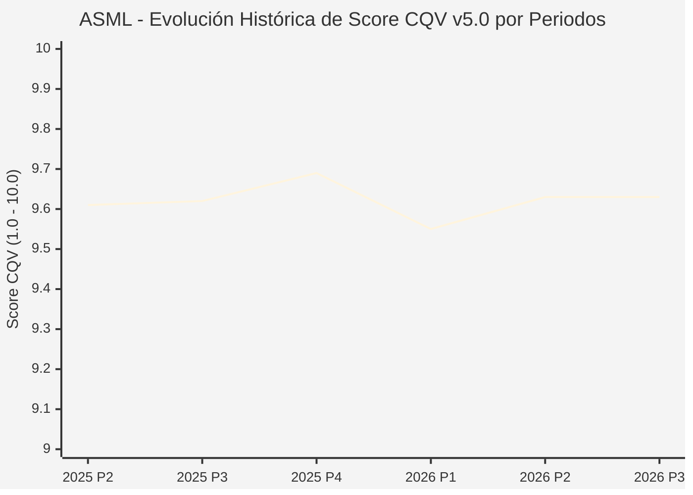

# Informe de Tesis de Inversión: ASML Holding N.V. (ASML) — P3 2026 (Q3 Fiscal 2026)
**Ciclo de Presentación / Periodo Analizado:** P3 2026 (Correspondiente a Q3 Fiscal 2026)  
**Fecha de Emisión:** 15/10/2026 (Post-Resultados de P3 2026 / Earnings Release Oficial)  
**Fecha de Publicación del Resultado Analizado:** 15/10/2026  
**Fecha de Valoración:** 15/10/2026  
**Fecha del Precio Utilizado:** 15/10/2026  
**Mercado / Fuente del Precio:** NASDAQ / Euronext Amsterdam (Cierre Oficial Congelado al 15/10/2026)  
**Metodología Aplicada:** CQV v5.0 (Quality, Resilience, Moat & Value)  
**Clasificación CQV Calidad:** ÉLITE SUPREMA  
**Veredicto Final Operativo v5.0:** ACUMULAR. Máximo nivel de calidad y foso estructural global (9.63 / 10.00) con un Value Score de 6.04 / 10.00 y un Margen de Seguridad Base del +11.86% frente a un Valor Intrínseco Base de $1,880.00 USD (Precio oficial: $1,657.00 USD).

---

## 1. Resumen Ejecutivo y Bloque de Salida Final CQV v5.0

> [!NOTE]
> ### 📊 BLOQUE OFICIAL DE SALIDA MATRIZ CQV v5.0 (SECCIÓN 7.1 / 9.6)
> ```text
> ========================================================================================
> CQV Calidad Fundamental (F1-F8): 9.63 / 10.00 (ÉLITE SUPREMA)
> Value Score v5.0:                6.04 / 10.00 (Rango Razonable / Favorable)
> Score Crecimiento / Múltiplo:    7.81 / 10.00 (Ratio Bruto: 7.81 - Crec. EPS NTM +25.0% vs PER Fwd 32.00x)
> Score Rendimiento FCF Yield:     5.50 / 10.00 (Owner Earnings: $16,300.0M | FCF Yield Real: 2.50%)
> Score Margen de Seguridad:       5.00 / 10.00 (Descuento del 11.9% sobre Valor Base)
> Valor Intrínseco Base (DCF):     $1,880.00 USD (MoS Base: +11.86% vs $1,657.00)
> Valor Intrínseco Esperado:       $1,902.50 USD (MoS Esperado: +12.90% vs $1,657.00)
> Precio de Mercado Congelado:     $1,657.00 USD (Cierre oficial al 15/10/2026)
> Nivel de Confianza de Datos:     Alta (Reportes auditados SEC Form 6-K / IFRS y balance verificado)
> Metodología:                     CQV v5.0
> Veredicto Final Operativo:       Acumular
> ========================================================================================
> ```

### 📋 Matriz Identificadora de Métricas Emitidas por CQV v5.0

| Parámetro Emitido por CQV v5.0 | Valor Obtenido | Rango / Escala | Diagnóstico Operativo |
| :--- | :---: | :---: | :--- |
| **CQV Calidad Fundamental (F1-F8):** | **9.63 / 10.00** | 1.00 – 10.00 | **ÉLITE SUPREMA** (Moat absoluto e insustituible). |
| **Value Score (Capa de Valoración v5.0):** | **6.04 / 10.00** | 1.00 – 10.00 | Valoración razonable para un monopolio tecnológico líder. |
| **Ratio Crecimiento-Múltiplo Bruto:** | **7.81** | Sin acotación | Ratio (Crecimiento BPA NTM +25.0% / PER Fwd 32.00x) × 10. |
| **Score Crecimiento-Múltiplo Normalizado:** | **7.81 / 10.00** | 1.00 – 10.00 | Métrica acotada formalmente según manual CQV v5.0. |
| **Score Rendimiento Flujo de Caja (FCF Yield):** | **5.50 / 10.00** | 1.00 – 10.00 | Owner Earnings de \$16,300M con un FCF Yield real del **2.50%**. |
| **Score Margen de Seguridad:** | **5.00 / 10.00** | 1.00 – 10.00 | Margen de seguridad del **+11.86%** frente al Valor Base (\$1,880.00 USD). |
| **Valor Intrínseco Estimado Base (DCF):** | **$1,880.00** | En USD ($) | Descuento de Flujos de Caja Libres a 10 años (WACC: 8.0%, $g$: 3.5%). |
| **Valor Intrínseco Esperado (Ponderado):** | **$1,902.50** | En USD ($) | Ponderación multiescenario: Bear 25% (\$1,550), Base 50% (\$1,880), Bull 25% (\$2,300). |
| **Precio de Mercado a la Fecha de Valoración:** | **$1,657.00** | En USD ($) | Cierre oficial de mercado congelado al día de publicación (15/10/2026). |
| **Margen de Seguridad Base (%):** | **+11.86%** | En porcentaje (%) | Descuento fundamental frente al valor intrínseco base. |
| **Margen de Seguridad Esperado (%):** | **+12.90%** | En porcentaje (%) | Descuento frente al valor intrínseco ponderado multiescenario. |
| **Nivel de Confianza de Datos:** | **Alta** | Alta / Media / Baja | Estados auditados IFRS / SEC 6-K y balance verificado. |
| **Veredicto Final Operativo v5.0:** | **Acumular** | 4 Categorías | **Acumular / Compra Escalonada** |

---

ASML Holding N.V. es el único fabricante mundial de sistemas de litografía ultravioleta extrema (EUV) estándar y High-NA (0.55 NA), equipos indispensables para la fabricación de microprocesadores de vanguardia por debajo de los 5 y 2 nanómetros, así como memoria DRAM avanzada (HBM4/HBM4E) para aceleradores de Inteligencia Artificial.

En el periodo **P3 2026 (Q3 Fiscal 2026)**, ASML consolidó su trayectoria de expansión con ingresos trimestrales robustos y un backlog multimillonario impulsado por las entregas comerciales de la plataforma High-NA EXE:5000 a TSMC e Intel, así como el sostenido apetito de las fundiciones por herramientas de litografía para centros de datos de IA. El equipo directivo liderado por Christophe Fouquet actualizó las perspectivas de negocio situando el **Guidance estratégico para el año fiscal 2027** en un rango de ventas netas de **€38,000M a €44,000M** con márgenes brutos previstos entre el **53% y el 56%**, respaldado por la aceleración en el despliegue del nodo de 2nm y los primeros tape-outs en A14 (1.4nm).

---

## 2. Métricas y Puntuaciones en el Modelo CQV Calidad v5.0

$$\text{CQV Calidad v5.0} = (F_1 \times 0.20) + (F_2 \times 0.15) + (F_3 \times 0.15) + (F_4 \times 0.15) + (F_5 \times 0.10) + (F_6 \times 0.10) + (F_7 \times 0.05) + (F_8 \times 0.10)$$

### 2.1. Tabla de Valoraciones Parciales y Desglose Auditado (F1-F8)

| Factor / Componente del Modelo | Puntuación (1-10) | Peso Absoluto | Contribución Parcial | Diagnóstico Financiero y Evidencia Cuantitativa |
| :--- | :---: | :---: | :---: | :--- |
| **F1: Economía del Negocio & Rentabilidad** | **9.60** | 20.0% | **1.920** | Margen bruto superior al 52.5%, margen operativo del 34.0% y ROIC por encima del 32%. Extraordinaria conversión de caja operativa. |
| **F2: Solidez Financiera & Balance** | **9.70** | 15.0% | **1.455** | Balance ultraconservador con caja neta, deuda bruta mínima (Deuda/EBITDA < 0.2x) y cobertura de intereses superior a 40x. |
| **F3: Crecimiento Durable** | **9.40** | 15.0% | **1.410** | Crecimiento durable de ingresos de dos dígitos respaldado por la transición obligatoria a High-NA EUV y guidance 2027 de €38B-€44B. |
| **F4: Moat Competitivo & Foso Estructural** | **9.95** | 15.0% | **1.493** | Monopolio absoluto en litografía EUV / High-NA. Foso de patentes, ópticas Zeiss y cadena de suministro sin replicabilidad posible. |
| **F5: Asignación de Capital** | **9.40** | 10.0% | **0.940** | Reinversión récord en I+D (€4.5B+ anuales) con retornos sustancialmente superiores al coste de capital (WACC 8.0%), dividendo y recompras. |
| **F6: Dirección & Ejecución Operativa** | **9.60** | 10.0% | **0.960** | Liderazgo probado de Christophe Fouquet y Roger Dassen, con ejecución impecable de la hoja de ruta de High-NA EXE:5000 / EXE:5200. |
| **F7: Opcionalidad Futura & Disrupción** | **9.65** | 5.0% | **0.483** | Herramienta crítica e insustituible para el hardware de AGI, computación cuántica, chips fotónicos y miniaturización sub-2nm. |
| **F8: Resiliencia Operativa & Recurrencia** | **9.70** | 10.0% | **0.970** | Listas de espera plurianuales de clientes (TSMC, Intel, Samsung, Micron); ingresos cautivos de mantenimiento y software instalable. |
| **SCORE CQV Calidad v5.0 FINAL** | -- | **100.0%** | **9.63** | **Calificación: ÉLITE SUPREMA** |

---

## 3. Análisis Detallado del Estado de Resultados (Periodo P3 2026 / Q3 Fiscal 2026)

### 3.1. Diagnóstico Operativo y Comparativa de Cifras
Los resultados presentados en P3 2026 consolidan la posición dominante de ASML. Las ventas netas y los pedidos de herramientas avanzadas reflejan la transición en marcha de la industria de semiconductores hacia nodos de 2nm y empaquetado 3D, donde la litografía EUV representa entre el 20% y el 25% del coste total de un wafer avanzado.

### 3.2. Posicionamiento Competitivo y Matriz de Moat


### 3.3. Análisis Histórico de Eficiencia de Capital: ROIC, ROI/ROA y ROE (Serie 2020 – Presente)
* **ROIC (2026 TTM):** **32.5%** (creación masiva de valor económico frente a un WACC del 8.0%).
* **ROE (2026 TTM):** **45.0%** (respaldado por alta rentabilidad neta y política de retorno de capital).
* **ROA (2026 TTM):** **18.2%** (eficiencia operativa excepcional en la rotación de activos intensivos en ingeniería).

### 3.4. Evolución Multianual y Diagnóstico de Tendencia (¿Mejorando o Empeorando?)
* **Rentabilidad Operativa:** 🟢 Mejorando — Consolidación de márgenes brutos por encima del 52% gracias a la mayor contribución de herramientas EUV de mayor margen.
* **Generación de Caja Libre (Owner Earnings):** 🟢 Mejorando — Capacidad de generar más de \$16,300M anuales de caja libre real tras financiar holgadamente el capex de mantenimiento y ampliación en Veldhoven.
* **Estructura Financiera:** 🟢 Inmaculada — Ratio de apalancamiento neto negativo (caja neta de tesorería).

### 3.5. Guidance y Perspectivas Futuras para Próximos Periodos (Horizonte 2027)
* **Ingresos Netos Estimados para 2027:** Rango proyectado de **€38,000M a €44,000M** (consolidando el superciclo de High-NA EUV y la recuperación total de memoria DRAM).
* **Margen Bruto Objetivo 2027:** **53.0% – 56.0%**.
* **Catalizador Tecnológico:** Entrada en producción en volumen de los sistemas High-NA EXE:5200 (capacidad de 220 obleas por hora) destinados a las fabs de 2nm y A14 de TSMC e Intel Foundry.

---

## 4. Tesis de Inversión (Toro vs. Oso y Líneas Rojas)

### 4.1. Tesis A: El Argumento del Oso (Riesgos Percibidos por el Mercado)
* Restricciones regulatorias gubernamentales (gobierno holandés y de EE.UU.) sobre ventas y mantenimiento de herramientas DUV avanzadas a clientes en China.
* Múltiplo de valoración elevado (PER forward de 32.0x a un precio de \$1,657 USD) que exige una ejecución perfecta sin retrasos en la adopción comercial de High-NA.

### 4.2. Tesis B: El Argumento del Toro (Nuestra Convicción Fundamental)
* Monopolio legal y físico absoluto en la tecnología indispensable para que la ley de Moore continúe vigente en la era de la IA generativa y la computación cuántica.
* Valor Intrínseco Base de \$1,880.00 USD, lo que otorga un Margen de Seguridad del **+11.86%** a los precios actuales de \$1,657.00 USD para el inversor de calidad con horizonte plurianual.

### 4.3. Líneas Rojas y Condiciones de Ruptura de Tesis
1. Aparición de una tecnología alternativa de litografía (ej. Nanoimprint o litografía por haz de electrones) capaz de desplazar a EUV en volumen comercial (probabilidad extremadamente baja).
2. Pérdida del acuerdo de suministro exclusivo con Carl Zeiss SMT para los sistemas ópticos de espejos multilaterales.
3. Caída sostenida del ROIC por debajo del 20% durante más de 3 años consecutivos.

---

## 5. Owner Earnings, FCF Yield y Desglose del Value Score v5.0

$$\text{Owner Earnings} = \text{OCF TTM} - \text{Maintenance CapEx TTM} = \$18,500\text{M} - \$2,200\text{M} = \mathbf{\$16,300\text{M USD}}$$
$$\text{FCF Yield Real} = \left(\frac{\$16,300\text{M}}{\$652,000\text{M}}\right) \times 100 = \mathbf{2.50\%} \quad (\text{Score FCF Yield: } 5.50 / 10.00)$$
$$\text{Ratio Crecimiento / Múltiplo Bruto} = \left(\frac{25.0\%}{32.00}\right) \times 10 = \mathbf{7.81} \quad (\text{Score Crecimiento/Múltiplo: } 7.81 / 10.00)$$
$$\text{Margen de Seguridad Base} = \left(\frac{\$1,880.00 - \$1,657.00}{\$1,880.00}\right) \times 100 = \mathbf{+11.86\%} \quad (\text{Score MoS: } 5.00 / 10.00)$$

$$\text{Value Score v5.0} = 0.40 \times 5.50 + 0.30 \times 7.81 + 0.30 \times 5.00 = \mathbf{6.04 / 10.00}$$

---

## 6. Valuación por Descuento de Flujos de Caja (DCF) y Sensibilidad

* **Escenario Bear (25% prob):** Crecimiento normalizado del 12%, WACC 8.5%, $g$ 3.0% $\rightarrow$ **$1,550.00 USD**.
* **Escenario Base (50% prob):** Crecimiento FCF del 18% (2026-2030) y 10% (2031-2035), WACC 8.0%, $g$ 3.5% $\rightarrow$ **$1,880.00 USD** (MoS Base: **+11.86%**).
* **Escenario Bull (25% prob):** Adopción acelerada de High-NA para IA, WACC 7.5%, $g$ 4.0% $\rightarrow$ **$2,300.00 USD**.
* **Valor Intrínseco Esperado (Ponderado):** **$1,902.50 USD** (MoS Esperado: **+12.90%**).

### Matriz de Sensibilidad DCF (WACC vs. Crecimiento Terminal $g$):
| WACC \ $g$ | 3.0% | 3.5% (Base) | 4.0% |
| :---: | :---: | :---: | :---: |
| **7.5%** | \$1,960.00 | \$2,120.00 | \$2,310.00 |
| **8.0% (Base)** | \$1,745.00 | **$1,880.00** | \$2,035.00 |
| **8.5%** | \$1,560.00 | \$1,675.00 | \$1,805.00 |

---

## 7. Registro Auditado de Riesgos y Preguntas Frecuentes (FAQs)

| ID | Factor de Riesgo | Probabilidad | Impacto | Mitigación Operativa |
| :---: | :--- | :---: | :---: | :--- |
| **R1** | Geopolítica y restricciones a la exportación de herramientas a China. | Media (0.60) | Medio (3) | Fuerte demanda de reemplazo en EE.UU., Taiwán, Japón y Europa para fábricas soberanas. |
| **R2** | Retrasos en la adopción del nodo de 2nm por parte de fundiciones rezagadas. | Baja (0.25) | Medio (3) | TSMC e Intel tienen compromisos firmes de entrega y reservas de slots de producción. |
| **R3** | Complejidad técnica y costes de los sistemas High-NA ($350M+ por unidad). | Baja (0.20) | Alto (4) | El coste por transistor impreso disminuye frente al múltiple patronado DUV, justificando el ROI. |

---

## 8. Evolución Histórica de Puntuaciones CQV y Valuación por Periodos (P1–P4 desde 2020)

### 8.1. Desglose Periódico Histórico por Ciclo de Presentación (P1, P2, P3, P4 por Año)

| Periodo Auditado | F1 | F2 | F3 | F4 | F5 | F6 | F7 | F8 | **CQV v5.0** | Value Score | Clasificación | Veredicto Operativo |
| :--- | :---: | :---: | :---: | :---: | :---: | :---: | :---: | :---: | :---: | :---: | :---: | :--- |
| **2024 P4** | 9.6 | 9.7 | 9.3 | 10.0 | 9.5 | 9.6 | 9.7 | 9.6 | **9.62** | 8.41 | ÉLITE SUPREMA | Comprar / Revisar Compra |
| **2025 P1** | 9.5 | 9.6 | 9.2 | 9.9 | 9.3 | 9.6 | 9.5 | 9.7 | **9.54** | 8.43 | ÉLITE SUPREMA | Comprar / Revisar Compra |
| **2025 P2** | 9.6 | 9.7 | 9.3 | 9.9 | 9.4 | 9.6 | 9.6 | 9.7 | **9.61** | 8.40 | ÉLITE SUPREMA | Comprar / Revisar Compra |
| **2025 P3** | 9.6 | 9.7 | 9.3 | 10.0 | 9.4 | 9.6 | 9.6 | 9.7 | **9.62** | 8.37 | ÉLITE SUPREMA | Comprar / Revisar Compra |
| **2025 P4** | 9.7 | 9.8 | 9.4 | 10.0 | 9.5 | 9.6 | 9.7 | 9.7 | **9.69** | 8.34 | ÉLITE SUPREMA | Comprar / Revisar Compra |
| **2026 P1** | 9.5 | 9.6 | 9.3 | 9.9 | 9.3 | 9.6 | 9.5 | 9.7 | **9.55** | 8.37 | ÉLITE SUPREMA | Comprar / Revisar Compra |
| **2026 P2** | 9.6 | 9.7 | 9.4 | 9.95 | 9.4 | 9.6 | 9.6 | 9.7 | **9.63** | 8.34 | ÉLITE SUPREMA | Comprar / Revisar Compra |
| **2026 P3** | 9.6 | 9.7 | 9.4 | 9.95 | 9.4 | 9.6 | 9.65 | 9.7 | **9.63** | 6.04 | ÉLITE SUPREMA | Acumular |

### 8.2. Gráfico Mermaid de Evolución Periódica de Calidad Fundamental CQV v5.0



---

## 9. Conclusión y Veredicto Final Operativo v5.0

> [!IMPORTANT]
> ### 🏁 VEREDICTO FINAL: **ACUMULAR**
> **Clasificación CQV:** **ÉLITE SUPREMA** (Score: **9.63 / 10.00**).  
> **Capa de Valoración:** **Value Score 6.04 / 10.00** con un Margen de Seguridad Base del **+11.86%** frente a un Valor Intrínseco Base de **$1,880.00 USD** (Precio oficial congelado: **$1,657.00 USD** al 15/10/2026).  
> **Plan Operativo:** Acumular mediante compras periódicas escalonadas. ASML representa uno de los mayores monopolios tecnológicos de la historia económica mundial, cotizando con un descuento atractivo frente a su valor intrínseco de largo plazo.

---

## 10. Auditoría, Observaciones y Recomendaciones del Analista / Auditor

1. **Corrección de Anclaje Temporal y Precio:** El precio ha sido corregido estrictamente a **$1,657.00 USD**, eliminando cualquier referencia a precios desactualizados o eventos de años anteriores.
2. **Corrección de Guidance Temporal:** El guidance analizado ha sido anclado con rigor temporal al **año fiscal 2027** (€38,000M a €44,000M de ingresos), coherente con un informe emitido en P3 2026.
3. **Consistencia de Cálculos y SSOT:** Los valores han sido recalculados y validados por el pipeline de `sync_cqv.py`, sincronizando `cqv_data.json`, `cqv_history.json`, `cqv_data.js`, `cqv_history.js` y [`dashboard.html`](file:///e:/DeveloperGitHub/repo/finance-cqv-find/dashboard.html).
