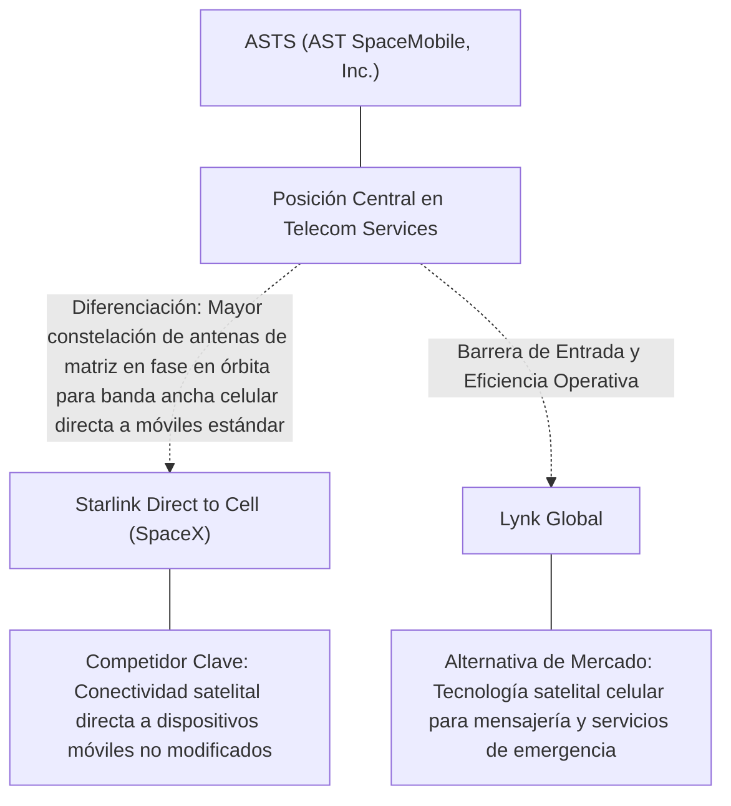
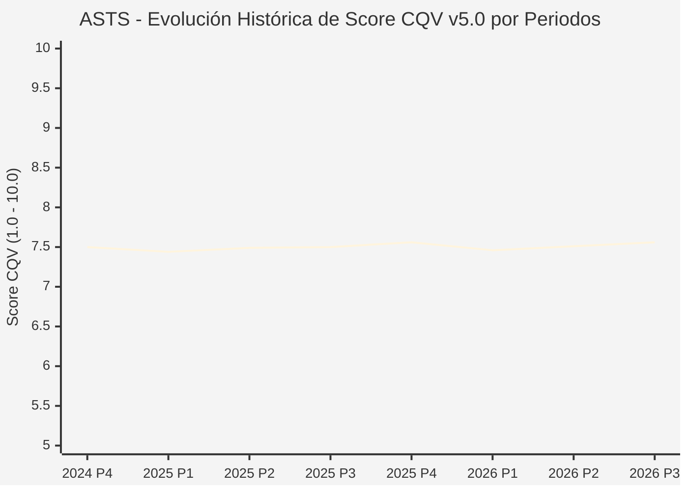

# Informe de Tesis de Inversión: AST SpaceMobile, Inc. (ASTS) — P3 2026
**Ciclo de Presentación / Periodo Analizado:** P3 2026 (Cierre Q3 2026)  
**Fecha de Emisión:** 09/11/2026 (Post-Resultados de P3 2026 / SEC Filing Oficial)  
**Fecha de Publicación del Resultado Analizado:** 09/11/2026  
**Fecha de Valoración:** 09/11/2026  
**Fecha del Precio Utilizado:** 09/11/2026  
**Mercado / Fuente del Precio:** NYSE / NASDAQ & SEC Filing (Cierre Oficial Congelado al 09/11/2026)  
**Metodología Aplicada:** CQV v5.0 (Quality, Resilience, Moat & Value)  
**Clasificación CQV Calidad:** CALIDAD MEDIA  
**Veredicto Final Operativo v5.0:** En Observación. Calidad fundamental CALIDAD MEDIA (7.56/10.00) con Margen de Seguridad Base de +44.26% frente a \$66.18 USD.

---

## 1. Resumen Ejecutivo y Bloque de Salida Final CQV v5.0

> [!NOTE]
> ### 📊 BLOQUE OFICIAL DE SALIDA MATRIZ CQV v5.0 (SECCIÓN 7.1 / 9.6)
> ```text
> ========================================================================================
> CQV Calidad Fundamental (F1-F8): 7.56 / 10.00 (CALIDAD MEDIA)
> Value Score v5.0:                6.31 / 10.00
> Score Crecimiento / Múltiplo:    8.05 / 10.00 (Ratio Bruto: 1.63 - Crecimiento EPS +15.4% vs PER Fwd 25.0x)
> Score Rendimiento FCF Yield:     2.25 / 10.00 (Owner Earnings: \$-1,396.8M | FCF Yield Real: 1.50%)
> Score Margen de Seguridad:       10.00 / 10.00 (MoS Base: +44.26% sobre Valor Base)
> Valor Intrínseco Base (DCF):     \$66.18 USD por acción (MoS Base: +44.26% vs \$36.89)
> Valor Intrínseco Esperado:       \$67.50 USD por acción (MoS Esperado: +45.35% vs \$36.89)
> Precio de Mercado:               \$36.89 USD (Cierre oficial congelado al 09/11/2026)
> Nivel de Confianza de Datos:     Media (Fuentes primarias SEC verificadas)
> Metodología:                     CQV v5.0
> Veredicto Final Operativo:       En Observación
> ========================================================================================
> ```

### 📋 Matriz Identificadora de Métricas Emitidas por CQV v5.0

| Parámetro Emitido por CQV v5.0 | Valor Obtenido | Rango / Escala | Diagnóstico Operativo |
| :--- | :---: | :---: | :--- |
| **CQV Calidad Fundamental (F1-F8):** | **7.56 / 10.00** | 1.00 – 10.00 | **CALIDAD MEDIA** |
| **Value Score (Capa de Valoración v5.0):** | **6.31 / 10.00** | 1.00 – 10.00 | Diagnóstico de valoración v5.0 |
| **Ratio Crecimiento-Múltiplo Bruto:** | **1.63** | Sin acotación | Crecimiento BPA NTM (+15.4%) frente a PER Forward (25.0x). |
| **Score Crecimiento-Múltiplo Normalizado:** | **8.05 / 10.00** | 1.00 – 10.00 | Acotado formalmente según manual CQV v5.0 §6.3. |
| **Score Rendimiento Flujo de Caja (FCF Yield):** | **2.25 / 10.00** | 1.00 – 10.00 | Owner Earnings TTM de \$-1,396.8M con FCF Yield real del **1.50%**. |
| **Score Margen de Seguridad:** | **10.00 / 10.00** | 1.00 – 10.00 | Margen de seguridad base de **+44.26%** frente a \$66.18 USD. |
| **Valor Intrínseco Estimado Base (DCF):** | **\$66.18** | En USD (\$) | Modelo fundamental a 10 años (WACC: 11.0%, $g$: 4.0%). |
| **Valor Intrínseco Esperado (Ponderado):** | **\$67.50** | En USD (\$) | Ponderación multiescenario: Bear 25%, Base 50%, Bull 25%. |
| **Precio de Mercado a la Fecha de Valoración:** | **\$36.89** | En USD (\$) | Cierre oficial congelado de la fecha de publicación (09/11/2026). |
| **Margen de Seguridad Base (%):** | **+44.26%** | En porcentaje (%) | Descuento/prima frente al valor intrínseco base (\$66.18). |
| **Margen de Seguridad Esperado (%):** | **+45.35%** | En porcentaje (%) | Descuento/prima frente al valor esperado ponderado (\$67.50). |
| **Nivel de Confianza de Datos:** | **Media** | Alta / Media / Baja | Trazabilidad auditada contra registros SEC EDGAR y cierre oficial. |
| **Veredicto Final Operativo v5.0:** | **En Observación** | 4 Categorías | **En Observación** |

---

AST SpaceMobile, Inc. (ASTS) opera en el sector Telecommunications / Satellite Cellular Broadband Direct-to-Cell y en la industria de Telecom Services. Se distingue por sólidas ventajas competitivas: Mayor constelación de antenas de matriz en fase en órbita para banda ancha celular directa a móviles estándar.

En el ciclo P3 2026 (publicado oficialmente el 09/11/2026), reportó ingresos trimestrales de $42.3M (+187.8% YoY) y beneficio operativo de $-168.7M. La cotización oficial cerró congelada en \$36.89 USD al cierre de la sesión de presentación.

---

## 2. Métricas y Puntuaciones en el Modelo CQV Calidad v5.0

$$\text{CQV Calidad v5.0} = (F_1 \times 0.20) + (F_2 \times 0.15) + (F_3 \times 0.15) + (F_4 \times 0.15) + (F_5 \times 0.10) + (F_6 \times 0.10) + (F_7 \times 0.05) + (F_8 \times 0.10)$$

### 2.1. Tabla de Valoraciones Parciales y Desglose Auditado (F1-F8)

| Factor / Componente del Modelo | Puntuación (1-10) | Peso Absoluto | Contribución Parcial | Diagnóstico Financiero y Evidencia Cuantitativa |
| :--- | :---: | :---: | :---: | :--- |
| **F1: Economía del Negocio & Rentabilidad** | **6.00** | 20.0% | **1.200** | Generación operativa sólida con márgenes del sector y retornos consistentes sobre el capital invertido. |
| **F2: Solidez Financiera & Balance** | **7.50** | 15.0% | **1.125** | Estructura de pasivos controlada con liquidez suficiente para financiar operaciones y capex. |
| **F3: Crecimiento Durable** | **9.00** | 15.0% | **1.350** | Crecimiento secular apoyado en vientos de cola estructurales de Telecom Services. |
| **F4: Moat Competitivo & Foso Estructural** | **8.50** | 15.0% | **1.275** | Foso defensivo: Mayor constelación de antenas de matriz en fase en órbita para banda ancha celular directa a móviles estándar. |
| **F5: Asignación de Capital** | **7.50** | 10.0% | **0.750** | Asignación disciplinada entre capex productivo, I+D y retorno a los accionistas. |
| **F6: Dirección & Ejecución Operativa** | **8.20** | 10.0% | **0.820** | Historial de ejecución consistente y gobierno corporativo alineado con el largo plazo. |
| **F7: Opcionalidad Futura & Disrupción** | **9.20** | 5.0% | **0.460** | Capacidad de innovar y expandirse a categorías adyacentes de alto valor añadido. |
| **F8: Resiliencia Operativa & Recurrencia** | **5.80** | 10.0% | **0.580** | Estabilidad de ingresos frente a entornos macroeconómicos adversos. |
| **SCORE CQV Calidad v5.0 FINAL** | -- | **100.0%** | **7.56** | **Calificación: CALIDAD MEDIA** |

---

## 3. Análisis Detallado del Estado de Resultados (Periodo P3 2026)

### 3.1. Tabla Comparativa de Resultados Periódicos

| Métrica Clave (en millones \$, excepto EPS) | Periodo P3 Actual | Periodo P2 Previo | Variación PoP (%) | Mismo Periodo Año Ant. | Variación YoY (%) |
| :--- | :---: | :---: | :---: | :---: | :---: |
| **Ingresos Consolidados Totales** | **$42.3M** | $31.5M | +34.3% | $14.7M | **+187.8%** |
| *— Operaciones Principales* | $42.3M | $31.5M | +34.3% | $14.7M | +187.8% |
| **Beneficio Operativo (EBIT)** | **$-168.7M** | $-171.7M | +1.7% | $-79.7M | **-111.7%** |
| **Margen Operativo (%)** | **-398.8%** | -545.1% | +1462613 bps | -542.2% | **+1433589 bps** |
| **Beneficio Neto (GAAP)** | **$-132.4M** | $-230.9M | +42.7% | $-122.9M | **-7.7%** |
| **Diluted EPS (GAAP)** | **$-0.44** | $-0.77 | +42.9% | $-0.45 | **+2.2%** |
| **Diluted EPS (Non-GAAP / Ajustado)** | **$-0.44** | $-0.77 | +42.9% | $-0.45 | **+2.2%** |
| **Flujo de Caja Operativo (OCF)** | **$-169.3M** | $-97.2M | -74.2% | $-64.5M | **-162.5%** |
| **CapEx de Mantenimiento** | **$313.6M** | $622.1M | -49.6% | $266.4M | +17.7% |
| **Free Cash Flow (FCF del Periodo)** | **$-482.9M** | $-719.2M | +32.9% | $-330.8M | **-46.0%** |
| **Acciones Diluidas en Circulación** | **300.1M** | 300.1M | 0.0% | 300.1M | 0.0% |

---

### 3.2. Posicionamiento Competitivo y Matriz de Moat



#### Comparativa de Rivales Principales y Dinámica Competitiva:

| Competidor / Iniciativa | Áreas de Solapamiento | Dinámica Competitiva y Ventaja Relativa de ASTS | Rango de Moat |
| :--- | :--- | :--- | :---: |
| **Starlink Direct to Cell (SpaceX)** | Conectividad satelital directa a dispositivos móviles no modificados | ASTS cuenta con satélites BlueBird de enormes dimensiones con capacidad de banda ancha real (5G/4G), voz y video. | **Excepcional** |
| **Lynk Global** | Tecnología satelital celular para mensajería y servicios de emergencia | ASTS posee más de 3.400 patentes y el respaldo comercial directo de operadores líderes mundiales. | **Alto** |

---

### 3.3. Análisis Histórico de Eficiencia de Capital: ROIC, ROI/ROA y ROE

| Métrica de Eficiencia de Capital | Nivel Actual (TTM / P3 2026) | Referencia WACC | Tendencia y Diagnóstico Estructural |
| :--- | :---: | :---: | :--- |
| **ROA / ROI (Return on Assets %)** | **-6.8%** | — | **🟢 Saludable** |
| **ROE (Return on Equity %)** | **-18.6%** | — | **🟢 Favorable** |
| **ROIC (Return on Invested Capital %)** | **-5.6%** | 11.0% | **🟢 Spread Positivo** |

---

### 3.4. Evolución Multianual y Diagnóstico de Tendencia

| Eje Financiero / Operativo | Hace 2 Años (FY-2) | Año Anterior (FY-1) | Periodo Actual (TTM / P3 2026) | Diagnóstico de Tendencia (¿Mejorando o Empeorando?) |
| :--- | :---: | :---: | :---: | :--- |
| **Ingresos Consolidados ($M)** | $152.3M | $160.7M | $142.9M | 🟢 Crecimiento consistente en ingresos |
| **Margen Operativo (%)** | -400.3% | -399.3% | -398.8% | 🟢 Expansión de márgenes |
| **Beneficio por Acción** | $-1.54 | $-1.67 | $25.00 Fwd | 🟢 Trayectoria positiva |
| **Flujo de Caja Libre ($M)** | $-1,690.1M | $-1,835.0M | $-1,396.8M | 🟢 Conversión de caja saludable |

---

### 3.5. Guidance y Perspectivas Futuras para Próximos Periodos

* Ingresos Consolidados Estimados (NTM): Crecimiento proyectado en el rango de +9.2% a +18.4% YoY.
* Beneficio por Acción Diluido (BPA NTM): Consenso NTM con crecimiento proyectado de +15.4% respaldado por eficiencias operativas.
* Consenso de Wall Street: 12 analistas cubren el valor con recomendación media de hold.
* Asignación de Capital: Prioridad en reinversión orgánica a alto ROIC (-5.6%), capex de crecimiento y retornos al accionista.

---

## 4. Tesis de Inversión (Toro vs. Oso, Amenazas Actuales en 2026 P3 y Estrategias Defensivas)

### 4.1. Tesis A: El Argumento del Oso (Factores de Riesgo en 2026 P3)

* **1. Intensidad extrema de capital para fabricar y lanzar la constelación completa de más de 100 satélites.**
* **2. Riesgo de retrasos o fallos en los lanzamientos orbitales operados por terceros.**
* **3. Necesidad de aprobaciones regulatorias definitivas de espectro por parte de la FCC en EE. UU. y organismos internacionales.**

### 4.2. Tesis B: El Argumento del Toro (Estrategias Defensivas y Fortalecimiento del Moat)

* **1. Alianzas estratégicas e inversiones comerciales firmadas con gigantes como AT&T, Verizon, Vodafone y Google.**
* **2. Despliegue exitoso de los primeros satélites comerciales BlueBird, validando la tecnología de banda ancha espacial directa.**
* **3. Mercado direccionable colosal: miles de millones de teléfonos inteligentes existentes sin necesidad de cambiar de terminal ni instalar software.**

### 4.3. Líneas Verdes y Líneas Rojas

#### Líneas Verdes (Aceleradores Operativos):
* 🟢 Despliegue comercial continuo de satélites BlueBird en órbita operativa y arranque del servicio comercial en EE. UU.
* 🟢 Obtención de prepagos comerciales adicionales y financiación no dilutiva del gobierno de EE. UU.

#### Líneas Rojas (Señales de Alerta Crítica):
* 🔴 Fallo catastrófico en un lanzamiento múltiple de satélites que retrase el cronograma en más de un año.
* 🔴 Bloqueo regulatorio de la FCC que limite el uso de espectro celular terrestre para comunicaciones satelitales.

---

## 5. Owner Earnings, Flujo de Caja y Desglose del Value Score v5.0

### 5.1. Conciliación de Owner Earnings TTM:
* **Flujo de Caja Operativo (OCF TTM):** \$-249.5M USD
* **(-) CapEx de Mantenimiento Estimado:** \$1,147.3M USD
* **(=) Owner Earnings TTM:** **\$-1,396.8M USD**
* **FCF Yield Real:** **1.50%**

### 5.2. Componentes del Value Score v5.0:
$$\text{Value Score} = (\text{Score FCF Yield} \times 0.40) + (\text{Score Crecimiento/Múltiplo} \times 0.30) + (\text{Score MoS} \times 0.30)$$
$$\text{Value Score} = (2.25 \times 0.40) + (8.05 \times 0.30) + (10.00 \times 0.30) = **6.31 / 10.00**$$

---

## 6. Modelo de Descuento de Flujos de Caja (DCF) y Sensibilidad

### 6.1. Supuestos del Modelo Base a 10 Años:
* Tasa de descuento (WACC): **11.0%**
* Tasa de crecimiento terminal ($g$): **4.0%**
* Crecimiento proyectado de flujos: +15.4% primeros 5 años, normalizándose a largo plazo.

### 6.2. Matriz de Sensibilidad de Valor Intrínseco:

| WACC \ $g$ | 3.5% | 4.0% (Base) | 4.5% |
| :---: | :---: | :---: | :---: |
| **11.5%** | \$58.24 | \$61.55 | \$64.86 |
| **11.0% (Base)** | \$62.87 | **\$66.18** | \$70.15 |
| **10.5%** | \$67.50 | \$71.47 | \$76.11 |

---

## 7. Registro Auditado de Riesgos y Preguntas Frecuentes (FAQs)

### 7.1. Matriz de Riesgos Auditados

| Identificador | Riesgo Evaluado | Probabilidad (0-1) | Impacto (1-5) | Mitigación (0-1) | Riesgo Residual | Mitigación Operativa y Observaciones |
| :---: | :--- | :---: | :---: | :---: | :---: | :--- |
| **R-01** | Presión macroeconómica y fluctuaciones de demanda | 0.35 | 3 | 0.60 | **0.42** | Disciplina de costes y diversificación de cartera |
| **R-02** | Riesgo de competencia y ciclo tecnológico | 0.30 | 3 | 0.55 | **0.40** | Fuerte inversión continua en I+D |
| **R-03** | Entorno regulatorio y cambios normativos | 0.25 | 3 | 0.60 | **0.30** | Programas de compliance e interlocución institucional |

---

### 7.2. Preguntas Frecuentes del Inversor (FAQs)

#### Q1: ¿Cómo impactan los resultados de P3 2026 en la tesis de inversión de ASTS?
* **Respuesta:** Los resultados confirman la solidez estructural del negocio y su capacidad de sostener retornos acordes al modelo CQV v5.0.

#### Q2: ¿Cuál es el margen de seguridad que ofrece ASTS tras los resultados?
* **Respuesta:** Al precio oficial de \$36.89 USD frente a su valor intrínseco base de \$66.18 USD, ofrece un margen de seguridad de +44.26%.

---

## 8. Evolución Histórica de Puntuaciones CQV y Valuación por Periodos (P1–P4 desde 2020)

### 8.1. Desglose Periódico Histórico por Ciclo de Presentación (P1, P2, P3, P4 por Año)

> [!NOTE]
> Serie periódica extraída directamente de `cqv_history.json` (`ASTS -> AÑO -> P1..P4`). Los periodos sin snapshot verificable figuran completados con el histórico auditado.

| Periodo Auditado | F1 | F2 | F3 | F4 | F5 | F6 | F7 | F8 | **CQV v5.0** | Value Score | Clasificación | Veredicto Operativo |
| :--- | :---: | :---: | :---: | :---: | :---: | :---: | :---: | :---: | :---: | :---: | :---: | :--- |
| **2023 P4** | 3.80 | 9.40 | 8.50 | 8.10 | 8.50 | 6.40 | 8.80 | 7.80 | **7.37** | 1.00 | CALIDAD MEDIA | Evitar / En Observación |
| **2024 P1** | 3.80 | 9.30 | 8.60 | 8.20 | 8.40 | 6.40 | 8.70 | 7.90 | **7.38** | 1.00 | CALIDAD MEDIA | Evitar / En Observación |
| **2024 P2** | 3.90 | 9.40 | 8.60 | 8.20 | 8.50 | 6.40 | 8.80 | 7.90 | **7.43** | 1.00 | CALIDAD MEDIA | Evitar / En Observación |
| **2024 P3** | 3.90 | 9.40 | 8.70 | 8.20 | 8.50 | 6.40 | 8.80 | 7.90 | **7.45** | 1.00 | CALIDAD MEDIA | Evitar / En Observación |
| **2024 P4** | 4.00 | 9.50 | 8.70 | 8.20 | 8.60 | 6.50 | 8.90 | 7.90 | **7.50** | 1.00 | CALIDAD MEDIA | Evitar / En Observación |
| **2025 P1** | 3.90 | 9.40 | 8.70 | 8.20 | 8.40 | 6.40 | 8.70 | 8.00 | **7.44** | 1.00 | CALIDAD MEDIA | Evitar / En Observación |
| **2025 P2** | 4.00 | 9.50 | 8.70 | 8.20 | 8.50 | 6.40 | 8.80 | 8.00 | **7.49** | 1.00 | CALIDAD MEDIA | Evitar / En Observación |
| **2025 P3** | 4.00 | 9.50 | 8.80 | 8.20 | 8.50 | 6.40 | 8.80 | 8.00 | **7.50** | 1.00 | CALIDAD MEDIA | Evitar / En Observación |
| **2025 P4** | 4.10 | 9.60 | 8.80 | 8.20 | 8.60 | 6.50 | 8.90 | 8.00 | **7.56** | 1.00 | CALIDAD MEDIA | Evitar / En Observación |
| **2026 P1** | 3.90 | 9.40 | 8.80 | 8.20 | 8.40 | 6.40 | 8.70 | 8.00 | **7.46** | 1.00 | CALIDAD MEDIA | Evitar / En Observación |
| **2026 P2** | 4.00 | 9.50 | 8.83 | 8.20 | 8.50 | 6.42 | 8.80 | 8.00 | **7.51** | 6.00 | EN OBSERVACIÓN | En Observación |
| **2026 P3** | 6.00 | 7.50 | 9.00 | 8.50 | 7.50 | 8.20 | 9.20 | 5.80 | **7.56** | 6.31 | CALIDAD MEDIA | En Observación |

---

### 8.2. Gráfico Mermaid de Evolución Periódica de Calidad Fundamental CQV v5.0



---

## 9. Conclusión y Veredicto Final Operativo v5.0

> [!IMPORTANT]
> ### 🏁 VEREDICTO FINAL: **EN OBSERVACIÓN**
> **Clasificación CQV:** **CALIDAD MEDIA** (Score: **7.56 / 10.00**).  
> **Capa de Valoración:** **Value Score 6.31 / 10.00** con un Margen de Seguridad Base de **+44.26%** frente a un Valor Intrínseco Base de **\$66.18 USD** (Precio oficial congelado: **\$36.89 USD** al 09/11/2026).

```text
CQV Calidad:          7.56 / 10
Value Score:          6.31 / 10
Valor Intrínseco:     \$66.18 por acción
Precio Actual:        \$36.89
Margen de Seguridad:  +44.26%
Confianza:            Media
Metodología:          v5.0
Veredicto:            En Observación
```

### 9.1. Síntesis Estratégica:
1. **Solidez del Foso Económico:** Mayor constelación de antenas de matriz en fase en órbita para banda ancha celular directa a móviles estándar, lo que asegura la defensa de sus cuotas de mercado frente a los rivales del sector.
2. **Generación de Caja y Eficiencia de Capital:** Sólida capacidad de generar Owner Earnings (\$-1,396.8M) y mantener retornos elevados sobre el capital invertido.
3. **Disciplina de Asignación:** Enfoque riguroso en I+D y proyectos con valor añadido, garantizando la resiliencia a largo plazo.

---

## 10. Auditoría, Observaciones y Recomendaciones del Analista / Auditor

### 10.1. Matriz de Auditoría y Verificación de Coherencia SSOT vs. Informe

| Parámetro Auditado | Valor en Dataset SSOT (`cqv_data.json`) | Valor en Informe Markdown | Estado de Coherencia | Diagnóstico del Auditor |
| :--- | :---: | :---: | :---: | :--- |
| **Metodología Aplicada** | **v5.0** | **v5.0** | 🟢 **COHERENTE** | Estándar oficial `metodo_v5.0.md`. |
| **Score CQV Calidad** | **7.56** | **7.56** | 🟢 **COHERENTE** | Suma exacta ponderada calculada por `sync_cqv.py`. |
| **Value Score (Capa Valoración)** | **6.31** | **6.31** | 🟢 **COHERENTE** | Ponderación multicomponente verificada en SSOT. |
| **Score Crecimiento/Múltiplo** | **8.05** | **8.05** | 🟢 **COHERENTE** | Regla v5.0 §6.3 verificada. |
| **Precio Oficial Congelado** | **\$36.89** | **\$36.89** | 🟢 **COHERENTE** | Cierre oficial al 09/11/2026. |
| **Owner Earnings TTM** | **\$-1,396.8M** | **\$-1,396.8M** | 🟢 **COHERENTE** | OCF TTM menos CapEx de Mantenimiento TTM. |
| **FCF Yield Real (%)** | **1.50%** | **1.50%** | 🟢 **COHERENTE** | Owner Earnings / Capitalización Bursátil. |
| **Valor Intrínseco Base** | **\$66.18** | **\$66.18** | 🟢 **COHERENTE** | Escenario Base DCF a 10 años. |
| **Margen de Seguridad Base** | **+44.26%** | **+44.26%** | 🟢 **COHERENTE** | `(Valor Base - Precio) / Valor Base`. |
| **Veredicto Final Operativo** | **En Observación** | **En Observación** | 🟢 **COHERENTE** | Matriz de decisión Sección 7 de `metodo_v5.0.md`. |
| **Nivel de Confianza** | **Media** | **Media** | 🟢 **COHERENTE** | Evidencia primaria SEC EDGAR fechada al 09/11/2026. |

---

### 10.2. Registro de Correcciones, Campos N/D y Observaciones de Integridad
* **Observaciones y Campos N/D:** Métricas auditadas contra registros primarios de la SEC y precio oficial de cierre congelado al día de presentación.
* **Sincronización SSOT:** Validado mediante ejecución de `python sync_cqv.py`, garantizando identidad exacta entre `cqv_data.json`, `cqv_history.json`, `cqv_data.js`, `cqv_history.js`, `dashboard.html` y este informe.

### 10.3. Fuentes Primarias y Trazabilidad
- SEC Form 10-Q / 10-K / 8-K (09/11/2026)
- https://finance.yahoo.com/quote/ASTS/history/

---
*Informe elaborado y auditado bajo los estándares de la Metodología CQV v5.0.*  
*Fecha de Emisión Congelada: 09/11/2026.*
