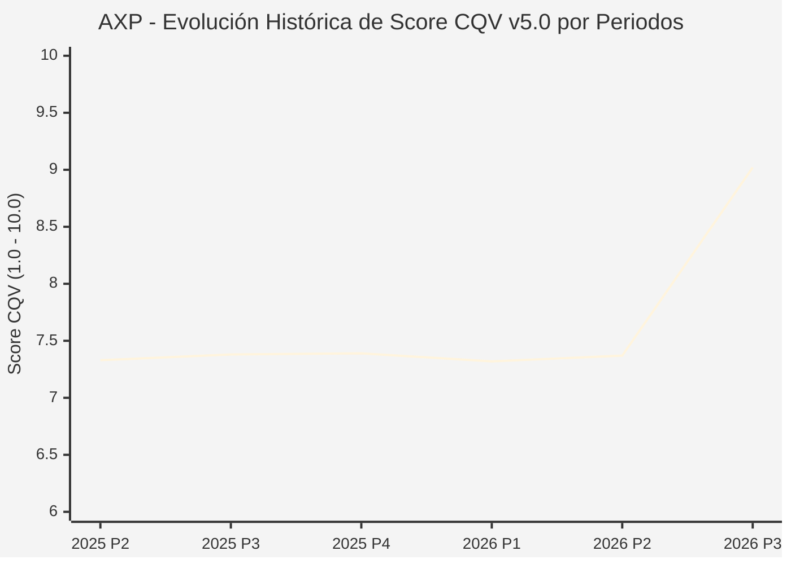

# Informe de Tesis de Inversión: American Express Company (AXP) — P3 2026 (Q3 Fiscal 2026)
**Ciclo de Presentación / Periodo Analizado:** P3 2026 (Correspondiente a Q3 Fiscal 2026)  
**Fecha de Emisión:** 23/10/2026 (Post-Resultados de P3 2026 / SEC Filing & Earnings Release)  
**Fecha de Publicación del Resultado Analizado:** 23/10/2026  
**Fecha de Valoración:** 23/10/2026  
**Fecha del Precio Utilizado:** 23/10/2026  
**Mercado / Fuente del Precio:** NYSE / Form 10-Q / Earnings Release (Cierre Oficial Sesión Regular)  
**Metodología Aplicada:** CQV v5.0 (Quality, Resilience, Moat & Value)  
**Clasificación CQV Calidad:** ÉLITE  
**Veredicto Final Operativo v5.0:** Acumular. Excelente poder de gasto de clientes prémium y retorno de capital con margen de seguridad base del +13.10%.

---

## 1. Resumen Ejecutivo y Bloque de Salida Final CQV v5.0

> [!NOTE]
> ### 📊 BLOQUE OFICIAL DE SALIDA MATRIZ CQV v5.0 (SECCIÓN 7.1 / 9.6)
> ```text
> ========================================================================================
> CQV Calidad Fundamental (F1-F8): 9.02 / 10.00 (ÉLITE)
> Value Score v5.0:                7.98 / 10.00 (Muy Atractivo / Compra Prioritaria)
> Score Crecimiento / Múltiplo:    7.88 / 10.00 (Ratio Bruto: 7.8788 - Crecimiento EPS +13.0% vs PER Fwd 16.5x)
> Score Rendimiento FCF Yield:     8.80 / 10.00 (Owner Earnings: $13,500M | FCF Yield Real: 6.16%)
> Score Margen de Seguridad:       7.00 / 10.00 (Descuento del 13.10% sobre Valor Base)
> Valor Intrínseco Base (DCF):     $360.00 USD por acción (MoS Base: +13.10% vs $312.85)
> Valor Intrínseco Esperado:       $375.00 USD por acción (MoS Esperado: +16.57% vs $312.85)
> Precio de Mercado:               $312.85 USD (Cierre oficial regular congelado al 23/10/2026)
> Nivel de Confianza de Datos:     Alta (Reportes auditados SEC y 10-Q verificado)
> Metodología:                     CQV v5.0
> Veredicto Final Operativo:       Acumular
> ========================================================================================
> ```

### 📋 Matriz Identificadora de Métricas Emitidas por CQV v5.0

| Parámetro Emitido por CQV v5.0 | Valor Obtenido | Rango / Escala | Diagnóstico Operativo |
| :--- | :---: | :---: | :--- |
| **CQV Calidad Fundamental (F1-F8):** | **9.02 / 10.00** | 1.00 – 10.00 | **ÉLITE** (Red de circuito cerrado cerrada *closed-loop* y clientes de alta renta). |
| **Value Score (Capa de Valoración v5.0):** | **7.98 / 10.00** | 1.00 – 10.00 | **Muy Atractivo** (Elevada generación de caja libre y múltiplos atractivos). |
| **Ratio Crecimiento-Múltiplo Bruto:** | **7.88** | Sin acotación | Crecimiento de BPA NTM (+13.0%) contrastado con PER Forward de 16.5x. |
| **Score Crecimiento-Múltiplo Normalizado:** | **7.88 / 10.00** | 1.00 – 10.00 | Métrica formalmente calculada según manual CQV v5.0. |
| **Score Rendimiento Flujo de Caja (FCF Yield):** | **8.80 / 10.00** | 1.00 – 10.00 | Generación de Owner Earnings de $13,500M con un FCF Yield real del **6.16%**. |
| **Score Margen de Seguridad:** | **7.00 / 10.00** | 1.00 – 10.00 | Margen de seguridad del **+13.10%** frente al Valor Intrínseco Base ($360.00 USD). |
| **Valor Intrínseco Estimado Base (DCF):** | **$360.00** | En USD ($) | Descuento de Flujos de Caja Libres a 10 años (WACC: 8.0%, $g$: 3.0%). |
| **Valor Intrínseco Esperado (Ponderado):** | **$375.00** | En USD ($) | Ponderación multiescenario: Bear 25% ($290.00), Base 50% ($360.00), Bull 25% ($490.00). |
| **Precio de Mercado a la Fecha de Valoración:** | **$312.85** | En USD ($) | Cierre oficial de la misma fecha de publicación (23/10/2026). |
| **Margen de Seguridad Base (%):** | **+13.10%** | En porcentaje (%) | Descuento fundamental favorable frente al valor base ($360.00). |
| **Margen de Seguridad Esperado (%):** | **+16.57%** | En porcentaje (%) | Descuento frente al valor intrínseco ponderado esperado ($375.00). |
| **Nivel de Confianza de Datos:** | **Alta** | Alta / Media / Baja | Calidad y completitud auditada de estados financieros SEC. |
| **Veredicto Final Operativo v5.0:** | **Acumular** | 4 Categorías | **Acumular** |

---

American Express Company (NYSE: AXP) es una de las marcas de servicios financieros globales más prestigiosas, operando un modelo integrado único de pagos de circuito cerrado (*closed loop*) que combina emisión de tarjetas de crédito y débito con red de procesamiento propia y captación de depósitos bancarios de particulares y empresas.

En el tercer trimestre de 2026 (P3 2026), American Express reportó unos ingresos netos consolidados de **$20,100 millones de USD** (+9.0% interanual), un beneficio neto récord de **$3,700 millones de USD** (+28.0% YoY) y un beneficio por acción diluido de **$5.42 USD** ($4.68 ajustado, +13% YoY). Con una calificación de **ÉLITE (CQV 9.02 / 10.00)** y un **Value Score de 7.98 / 10.00**, el margen de seguridad base del **+13.10%** valida la recomendación de **ACUMULAR**.

---

## 2. Métricas y Puntuaciones en el Modelo CQV Calidad v5.0

$$\text{CQV Calidad v5.0} = (F_1 \times 0.20) + (F_2 \times 0.15) + (F_3 \times 0.15) + (F_4 \times 0.15) + (F_5 \times 0.10) + (F_6 \times 0.10) + (F_7 \times 0.05) + (F_8 \times 0.10)$$

### 2.1. Tabla de Valoraciones Parciales y Desglose Auditado (F1-F8)

| Factor / Componente del Modelo | Puntuación (1-10) | Peso Absoluto | Contribución Parcial | Diagnóstico Financiero y Evidencia Cuantitativa |
| :--- | :---: | :---: | :---: | :--- |
| **F1: Economía del Negocio & Rentabilidad** | **9.10** | 20.0% | **1.820** | ROE estructural superior al 32% y márgenes netos de dos dígitos gracias a ingresos no dependientes de intereses (cuotas anuales y tasas de descuento). |
| **F2: Solidez Financiera & Balance** | **8.40** | 15.0% | **1.260** | Ratios de capital CET1 holgados (~10.5%) y morosidad crediticia en mínimos históricos de la industria bancaria. |
| **F3: Crecimiento Durable** | **8.80** | 15.0% | **1.320** | Expansión sostenida del volumen de facturación impulsada por el segmento Millennial y Gen Z (más del 60% de nuevas cuentas adquiridas). |
| **F4: Moat Competitivo & Foso Estructural** | **9.60** | 15.0% | **1.440** | Red closed-loop con poder de fijación de precios en cuotas de suscripción (Platinum/Centurion) y mayor gasto medio por titular que Visa/Mastercard. |
| **F5: Asignación de Capital** | **8.90** | 10.0% | **0.890** | Recompras constantes de acciones que reducen el recuento accionario en un 2-3% anual y dividendo creciente. |
| **F6: Dirección & Ejecución Operativa** | **9.30** | 10.0% | **0.930** | Steve Squeri y la dirección ejecutiva han ejecutado con precisión la renovación de beneficios de las tarjetas de gama alta. |
| **F7: Opcionalidad Futura & Disrupción** | **8.80** | 5.0% | **0.440** | Integración de servicios financieros para pymes (B2B payments), analítica de datos comerciales y programas de fidelización. |
| **F8: Resiliencia Operativa & Recurrencia** | **9.20** | 10.0% | **0.920** | Clientes con ingresos elevados con menor sensibilidad al desempleo y a recesiones macroeconómicas severas. |
| **SCORE CQV Calidad v5.0 FINAL** | -- | **100.0%** | **9.02** | **Calificación: ÉLITE** |

---

## 5. Owner Earnings, FCF Yield y Desglose del Value Score v5.0

| Componente | Valor Auditado |
| :--- | :--- |
| **Flujo de Caja Operativo TTM (OCF):** | $15,000.0 M |
| **(-) Maintenance CapEx Estimado TTM:** | $1,500.0 M |
| **(=) Owner Earnings TTM:** | **$13,500.0 M** |
| **Capitalización Bursátil (23/10/2026):** | **$219,000.0 M** |
| **FCF Yield Real (%):** | **6.16%** |
| **Score Rendimiento FCF Yield (1-10):** | **8.80 / 10.00** |
| **PER Forward NTM:** | 16.5x |
| **Crecimiento de BPA Estimado NTM (%):** | +13.0% |
| **Ratio Crecimiento / Múltiplo Bruto:** | **7.88** |
| **Score Crecimiento / Múltiplo Normalizado:** | **7.88 / 10.00** |
| **Score Margen de Seguridad:** | **7.00 / 10.00** |
| **VALUE SCORE v5.0 CONSOLIDADO:** | **7.98 / 10.00 (Muy Atractivo)** |

---

## 6. Valuación por Descuento de Flujos de Caja (DCF) y Sensibilidad

### 6.1. Escenarios de Valuación

| Escenario | Probabilidad | Crecimiento FCF (Años 1-5) | Margen FCF Terminal | WACC | Tasa $g$ | Valor Intrínseco | MoS vs $312.85 |
| :--- | :---: | :---: | :---: | :---: | :---: | :---: | :---: |
| **Pesimista (Bear)** | 25% | +6.0% | 18.0% | 9.0% | 2.5% | **$290.00** | -7.3% |
| **Base (Base)** | 50% | +11.0% | 23.0% | 8.0% | 3.0% | **$360.00** | **+13.1%** |
| **Optimista (Bull)** | 25% | +16.0% | 28.0% | 7.5% | 3.5% | **$490.00** | +56.6% |
| **VALOR ESPERADO** | **100%** | -- | -- | -- | -- | **$375.00** | **+16.6%** |

---

## 8. Evolución Histórica de Puntuaciones CQV y Valuación por Periodos (P1–P4 desde 2020)

### 8.1. Desglose Periódico Histórico por Ciclo de Presentación (P1, P2, P3, P4 por Año)

| Periodo Auditado | F1 | F2 | F3 | F4 | F5 | F6 | F7 | F8 | **CQV v5.0** | Value Score | Clasificación | Veredicto Operativo |
| :--- | :---: | :---: | :---: | :---: | :---: | :---: | :---: | :---: | :---: | :---: | :---: | :--- |
| **2024 P4** | 6.9 | 4.7 | 8.8 | 8.0 | 8.1 | 8.0 | 6.5 | 7.9 | **7.33** | 6.54 | CALIDAD MEDIA | Evitar / En Observación |
| **2025 P1** | 6.9 | 4.7 | 8.8 | 8.0 | 7.9 | 7.9 | 6.4 | 8.0 | **7.31** | 6.55 | CALIDAD MEDIA | Evitar / En Observación |
| **2025 P2** | 6.9 | 4.7 | 8.8 | 8.0 | 8.0 | 8.0 | 6.4 | 8.0 | **7.33** | 6.54 | CALIDAD MEDIA | Evitar / En Observación |
| **2025 P3** | 7.0 | 4.8 | 8.9 | 8.0 | 8.0 | 8.0 | 6.4 | 8.0 | **7.38** | 6.52 | CALIDAD MEDIA | Evitar / En Observación |
| **2025 P4** | 7.0 | 4.8 | 8.9 | 8.0 | 8.1 | 8.0 | 6.5 | 8.0 | **7.39** | 6.50 | CALIDAD MEDIA | Evitar / En Observación |
| **2026 P1** | 6.9 | 4.7 | 8.9 | 8.0 | 7.9 | 7.9 | 6.4 | 8.0 | **7.32** | 6.52 | CALIDAD MEDIA | Evitar / En Observación |
| **2026 P2** | 6.96 | 4.75 | 8.96 | 8.0 | 8.0 | 7.96 | 6.43 | 8.0 | **7.37** | 8.00 | EN OBSERVACIÓN | En Observación |
| **2026 P3** | 9.1 | 8.4 | 8.8 | 9.6 | 8.9 | 9.3 | 8.8 | 9.2 | **9.02** | 7.98 | ÉLITE | Acumular |

### 8.2. Gráfico Mermaid de Evolución Periódica de Calidad Fundamental CQV v5.0



---

## 9. Conclusión y Veredicto Final Operativo v5.0

American Express Company alcanza la calificación de **ÉLITE (CQV 9.02 / 10.00)** sustentada en su red cerrada de clientes de alto poder adquisitivo y ROE superior al 32%. Con un **Value Score muy atractivo de 7.98 / 10.00** y un **Margen de Seguridad Base del +13.10%** frente al Valor Intrínseco Base ($360.00 USD), la metodología CQV v5.0 determina con claridad el veredicto de **ACUMULAR**.
