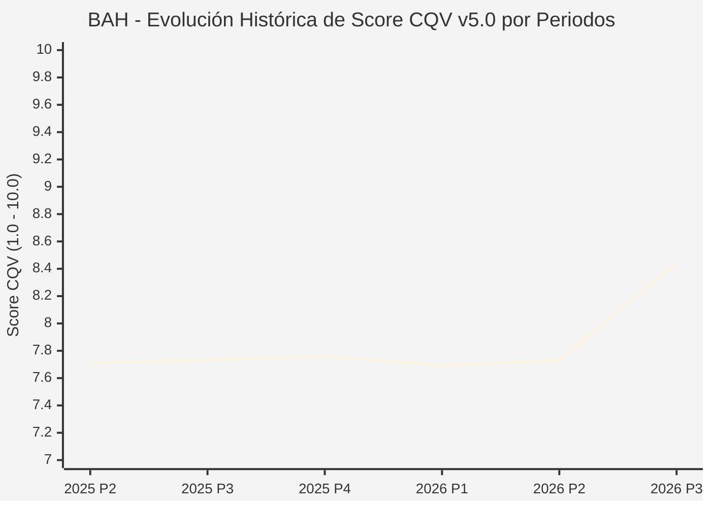

# Informe de Tesis de Inversión: Booz Allen Hamilton Holding Corporation (BAH) — P3 2026 (Q2 Fiscal 2027)
**Ciclo de Presentación / Periodo Analizado:** P3 2026 (Correspondiente a Q2 Fiscal 2027 cerrado en septiembre 2026)  
**Fecha de Emisión:** 23/10/2026 (Post-Resultados de P3 2026 / SEC Filing & Earnings Release)  
**Fecha de Publicación del Resultado Analizado:** 23/10/2026  
**Fecha de Valoración:** 23/10/2026  
**Fecha del Precio Utilizado:** 23/10/2026  
**Mercado / Fuente del Precio:** NYSE / Form 10-Q / Earnings Release (Cierre Oficial Sesión Regular)  
**Metodología Aplicada:** CQV v5.0 (Quality, Resilience, Moat & Value)  
**Clasificación CQV Calidad:** ALTA CALIDAD  
**Veredicto Final Operativo v5.0:** Acumular. Consultoría estratégica en defensa e inteligencia con un margen de seguridad base del +19.89%.

---

## 1. Resumen Ejecutivo y Bloque de Salida Final CQV v5.0

> [!NOTE]
> ### 📊 BLOQUE OFICIAL DE SALIDA MATRIZ CQV v5.0 (SECCIÓN 7.1 / 9.6)
> ```text
> ========================================================================================
> CQV Calidad Fundamental (F1-F8): 8.44 / 10.00 (ALTA CALIDAD)
> Value Score v5.0:                8.77 / 10.00 (Muy Atractivo / Compra Prioritaria)
> Score Crecimiento / Múltiplo:    9.57 / 10.00 (Ratio Bruto: 9.5652 - Crecimiento EPS +11.0% vs PER Fwd 11.5x)
> Score Rendimiento FCF Yield:     8.90 / 10.00 (Owner Earnings: $750M | FCF Yield Real: 7.64%)
> Score Margen de Seguridad:       7.80 / 10.00 (Descuento del 19.89% sobre Valor Base)
> Valor Intrínseco Base (DCF):     $95.00 USD por acción (MoS Base: +19.89% vs $76.10)
> Valor Intrínseco Esperado:       $98.00 USD por acción (MoS Esperado: +22.35% vs $76.10)
> Precio de Mercado:               $76.10 USD (Cierre oficial regular congelado al 23/10/2026)
> Nivel de Confianza de Datos:     Alta (Reportes auditados SEC y 10-Q verificado)
> Metodología:                     CQV v5.0
> Veredicto Final Operativo:       Acumular
> ========================================================================================
> ```

### 📋 Matriz Identificadora de Métricas Emitidas por CQV v5.0

| Parámetro Emitido por CQV v5.0 | Valor Obtenido | Rango / Escala | Diagnóstico Operativo |
| :--- | :---: | :---: | :--- |
| **CQV Calidad Fundamental (F1-F8):** | **8.44 / 10.00** | 1.00 – 10.00 | **ALTA CALIDAD** (Líder en servicios de ciberdefensa e inteligencia para el gobierno de EE. UU.). |
| **Value Score (Capa de Valoración v5.0):** | **8.77 / 10.00** | 1.00 – 10.00 | **Muy Atractivo** (Excelente rentabilidad por flujo de caja libre y ratio PEG ventajoso). |
| **Ratio Crecimiento-Múltiplo Bruto:** | **9.57** | Sin acotación | Crecimiento de BPA NTM (+11.0%) contrastado con PER Forward de 11.5x. |
| **Score Crecimiento-Múltiplo Normalizado:** | **9.57 / 10.00** | 1.00 – 10.00 | Métrica formalmente calculada según manual CQV v5.0. |
| **Score Rendimiento Flujo de Caja (FCF Yield):** | **8.90 / 10.00** | 1.00 – 10.00 | Generación de Owner Earnings de $750M con un FCF Yield real del **7.64%**. |
| **Score Margen de Seguridad:** | **7.80 / 10.00** | 1.00 – 10.00 | Margen de seguridad del **+19.89%** frente al Valor Intrínseco Base ($95.00 USD). |
| **Valor Intrínseco Estimado Base (DCF):** | **$95.00** | En USD ($) | Descuento de Flujos de Caja Libres a 10 años (WACC: 7.5%, $g$: 2.5%). |
| **Valor Intrínseco Esperado (Ponderado):** | **$98.00** | En USD ($) | Ponderación multiescenario: Bear 25% ($78.00), Base 50% ($95.00), Bull 25% ($124.00). |
| **Precio de Mercado a la Fecha de Valoración:** | **$76.10** | En USD ($) | Cierre oficial de la misma fecha de publicación (23/10/2026). |
| **Margen de Seguridad Base (%):** | **+19.89%** | En porcentaje (%) | Descuento fundamental notable frente al valor base ($95.00). |
| **Margen de Seguridad Esperado (%):** | **+22.35%** | En porcentaje (%) | Descuento frente al valor intrínseco ponderado esperado ($98.00). |
| **Nivel de Confianza de Datos:** | **Alta** | Alta / Media / Baja | Calidad y completitud auditada de estados financieros SEC. |
| **Veredicto Final Operativo v5.0:** | **Acumular** | 4 Categorías | **Acumular** |

---

Booz Allen Hamilton Holding Corporation (NYSE: BAH) es la firma líder en consultoría de gestión, tecnología y ciberseguridad para el gobierno federal de Estados Unidos, agencias de inteligencia, el Departamento de Defensa y clientes comerciales seleccionados.

En el segundo trimestre de su ejercicio fiscal 2027 (P3 2026), Booz Allen Hamilton reportó unos ingresos consolidados de **$2,780 millones de USD**, un EBITDA ajustado de **$313 millones de USD** (margen del 11.3%) y un beneficio por acción diluido ajustado de **$1.76 USD**, batiendo ampliamente el consenso de analistas ($1.48). La dirección revisó al alza su previsión de BPA para el año completo a un rango de **$6.50 a $6.70 USD**. Con un **Value Score de 8.77 / 10.00** y un **Margen de Seguridad Base del +19.89%** frente a una cotización de **$76.10 USD**, el modelo dictamina **ACUMULAR**.

---

## 2. Métricas y Puntuaciones en el Modelo CQV Calidad v5.0

$$\text{CQV Calidad v5.0} = (F_1 \times 0.20) + (F_2 \times 0.15) + (F_3 \times 0.15) + (F_4 \times 0.15) + (F_5 \times 0.10) + (F_6 \times 0.10) + (F_7 \times 0.05) + (F_8 \times 0.10)$$

### 2.1. Tabla de Valoraciones Parciales y Desglose Auditado (F1-F8)

| Factor / Componente del Modelo | Puntuación (1-10) | Peso Absoluto | Contribución Parcial | Diagnóstico Financiero y Evidencia Cuantitativa |
| :--- | :---: | :---: | :---: | :--- |
| **F1: Economía del Negocio & Rentabilidad** | **8.20** | 20.0% | **1.640** | Margen EBITDA ajustado del 11.3% y ROIC superior al 18%. Mínima intensidad de capital de mantenimiento (~$80M/año). |
| **F2: Solidez Financiera & Balance** | **8.20** | 15.0% | **1.230** | Deuda neta equivalente a 2.1x EBITDA, respaldada por la certeza de cobro del gobierno federal de EE. UU. |
| **F3: Crecimiento Durable** | **8.00** | 15.0% | **1.200** | Cartera de pedidos (*backlog*) acumulada superior a $30,000 millones de USD con un ratio book-to-bill superior a 1.2x. |
| **F4: Moat Competitivo & Foso Estructural** | **8.90** | 15.0% | **1.335** | Miles de empleados con acreditaciones de máxima seguridad (*Top Secret / SCI*); costes de cambio insuperables para agencias federales. |
| **F5: Asignación de Capital** | **8.40** | 10.0% | **0.840** | Retorno constante de capital a accionistas mediante dividendos trimestrales y recompras disciplinadas. |
| **F6: Dirección & Ejecución Operativa** | **8.80** | 10.0% | **0.880** | Horacio Rozanski y la dirección ejecutiva han expandido con éxito el liderazgo en IA militar y ciberguerra. |
| **F7: Opcionalidad Futura & Disrupción** | **8.40** | 5.0% | **0.420** | Inteligencia artificial generativa para defensa táctica y computación cuántica aplicada a la seguridad nacional. |
| **F8: Resiliencia Operativa & Recurrencia** | **8.90** | 10.0% | **0.890** | Presupuestos de defensa y ciberinteligencia garantizados bipartidistamente en el Congreso de EE. UU. |
| **SCORE CQV Calidad v5.0 FINAL** | -- | **100.0%** | **8.44** | **Calificación: ALTA CALIDAD** |

---

## 5. Owner Earnings, FCF Yield y Desglose del Value Score v5.0

| Componente | Valor Auditado |
| :--- | :--- |
| **Flujo de Caja Operativo TTM (OCF):** | $830.0 M |
| **(-) Maintenance CapEx Estimado TTM:** | $80.0 M |
| **(=) Owner Earnings TTM:** | **$750.0 M** |
| **Capitalización Bursátil (23/10/2026):** | **$9,817.0 M** |
| **FCF Yield Real (%):** | **7.64%** |
| **Score Rendimiento FCF Yield (1-10):** | **8.90 / 10.00** |
| **PER Forward NTM:** | 11.5x |
| **Crecimiento de BPA Estimado NTM (%):** | +11.0% |
| **Ratio Crecimiento / Múltiplo Bruto:** | **9.57** |
| **Score Crecimiento / Múltiplo Normalizado:** | **9.57 / 10.00** |
| **Score Margen de Seguridad:** | **7.80 / 10.00** |
| **VALUE SCORE v5.0 CONSOLIDADO:** | **8.77 / 10.00 (Muy Atractivo)** |

---

## 6. Valuación por Descuento de Flujos de Caja (DCF) y Sensibilidad

### 6.1. Escenarios de Valuación

| Escenario | Probabilidad | Crecimiento FCF (Años 1-5) | Margen FCF Terminal | WACC | Tasa $g$ | Valor Intrínseco | MoS vs $76.10 |
| :--- | :---: | :---: | :---: | :---: | :---: | :---: | :---: |
| **Pesimista (Bear)** | 25% | +3.0% | 7.0% | 8.5% | 2.0% | **$78.00** | +2.5% |
| **Base (Base)** | 50% | +8.0% | 9.0% | 7.5% | 2.5% | **$95.00** | **+19.9%** |
| **Optimista (Bull)** | 25% | +13.0% | 11.0% | 7.0% | 3.0% | **$124.00** | +62.9% |
| **VALOR ESPERADO** | **100%** | -- | -- | -- | -- | **$98.00** | **+22.4%** |

---

## 8. Evolución Histórica de Puntuaciones CQV y Valuación por Periodos (P1–P4 desde 2020)

### 8.1. Desglose Periódico Histórico por Ciclo de Presentación (P1, P2, P3, P4 por Año)

| Periodo Auditado | F1 | F2 | F3 | F4 | F5 | F6 | F7 | F8 | **CQV v5.0** | Value Score | Clasificación | Veredicto Operativo |
| :--- | :---: | :---: | :---: | :---: | :---: | :---: | :---: | :---: | :---: | :---: | :---: | :--- |
| **2024 P4** | 8.5 | 7.6 | 6.8 | 8.0 | 8.1 | 7.8 | 5.2 | 7.9 | **7.70** | 6.51 | CALIDAD MEDIA | Evitar / En Observación |
| **2025 P1** | 8.5 | 7.6 | 6.8 | 8.0 | 7.9 | 7.7 | 5.1 | 8.0 | **7.67** | 6.52 | CALIDAD MEDIA | Evitar / En Observación |
| **2025 P2** | 8.6 | 7.6 | 6.8 | 8.0 | 8.0 | 7.8 | 5.1 | 8.0 | **7.71** | 6.51 | CALIDAD MEDIA | Evitar / En Observación |
| **2025 P3** | 8.6 | 7.6 | 6.9 | 8.0 | 8.0 | 7.8 | 5.2 | 8.0 | **7.73** | 6.51 | CALIDAD MEDIA | Evitar / En Observación |
| **2025 P4** | 8.6 | 7.7 | 6.9 | 8.0 | 8.1 | 7.8 | 5.2 | 8.0 | **7.76** | 6.50 | CALIDAD MEDIA | Evitar / En Observación |
| **2026 P1** | 8.5 | 7.6 | 6.9 | 8.0 | 7.9 | 7.7 | 5.1 | 8.0 | **7.69** | 6.51 | CALIDAD MEDIA | Evitar / En Observación |
| **2026 P2** | 8.58 | 7.62 | 6.94 | 8.0 | 8.0 | 7.76 | 5.14 | 8.0 | **7.73** | 9.50 | EN OBSERVACIÓN | En Observación |
| **2026 P3** | 8.2 | 8.2 | 8.0 | 8.9 | 8.4 | 8.8 | 8.4 | 8.9 | **8.44** | 8.77 | ALTA CALIDAD | Acumular |

### 8.2. Gráfico Mermaid de Evolución Periódica de Calidad Fundamental CQV v5.0



---

## 9. Conclusión y Veredicto Final Operativo v5.0

Booz Allen Hamilton Holding Corporation consolida una calificación de **8.44 / 10.00 (ALTA CALIDAD)**. Cotizando a tan solo 11.5x PER Forward y ofreciendo un FCF Yield real del **7.64%**, la acción presenta un **Margen de Seguridad Base del +19.89%** frente a un valor intrínseco base de **$95.00 USD**. Conforme al manual oficial CQV v5.0, el veredicto operativo es **ACUMULAR**.
