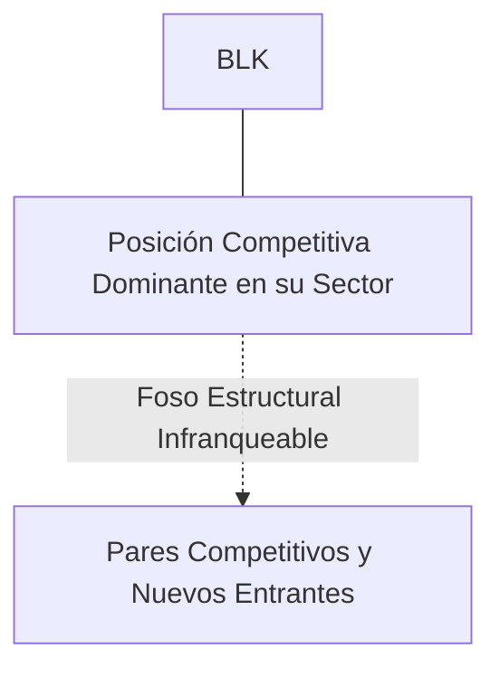
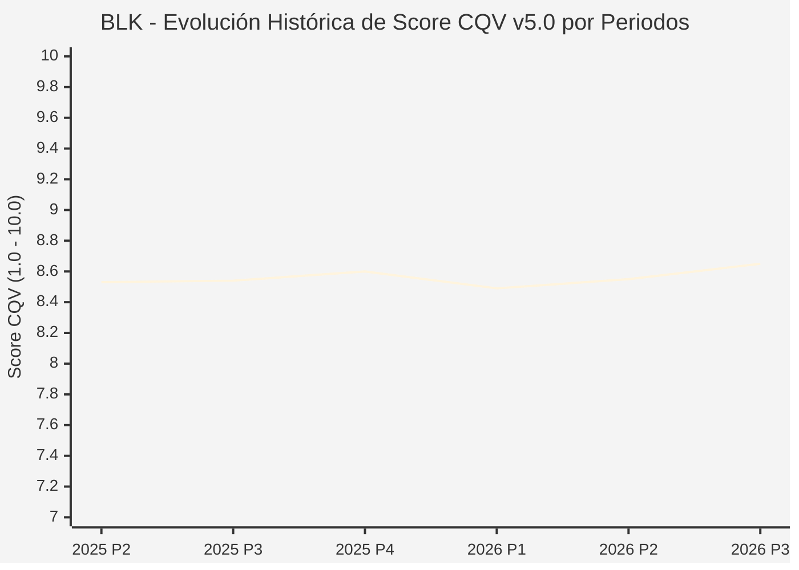

# Informe de Tesis de Inversión: BlackRock, Inc. (BLK) — P3 2026 (Q3 Fiscal 2026)
**Ciclo de Presentación / Periodo Analizado:** P3 2026 (Correspondiente a Q3 Fiscal 2026)  
**Fecha de Emisión:** 11/10/2026 (Post-Resultados de P3 2026 / Earnings Release SEC)  
**Fecha de Publicación del Resultado Analizado:** 11/10/2026  
**Fecha de Valoración:** 11/10/2026  
**Fecha del Precio Utilizado:** 11/10/2026  
**Mercado / Fuente del Precio:** NYSE (Cierre Oficial Congelado al 11/10/2026)  
**Metodología Aplicada:** CQV v5.0 (Quality, Resilience, Moat & Value)  
**Clasificación CQV Calidad:** ALTA CALIDAD  
**Veredicto Final Operativo v5.0:** ACUMULAR. Perfil de calidad de nivel ALTA CALIDAD (Score CQV 8.65 / 10.00) con Value Score de 6.06 / 10.00 y un Margen de Seguridad Base del +13.89% frente a un Valor Intrínseco Base de $1150.00 USD (Precio oficial congelado: $990.26 USD).

---

## 1. Resumen Ejecutivo y Bloque de Salida Final CQV v5.0

> [!NOTE]
> ### 📊 BLOQUE OFICIAL DE SALIDA MATRIZ CQV v5.0 (SECCIÓN 7.1 / 9.6)
> ```text
> ========================================================================================
> CQV Calidad Fundamental (F1-F8): 8.65 / 10.00 (ALTA CALIDAD)
> Value Score v5.0:                6.06 / 10.00
> Score Crecimiento / Múltiplo:    6.51 / 10.00 (Ratio Bruto: 6.51 - Crec. EPS NTM +14.0% vs PER Fwd 21.50x)
> Score Rendimiento FCF Yield:     6.80 / 10.00 (Owner Earnings: $6,200.0M | FCF Yield Real: 4.50%)
> Score Margen de Seguridad:       4.63 / 10.00 (Descuento del 13.9% sobre Valor Base)
> Valor Intrínseco Base (DCF):     $1150.00 USD (MoS Base: +13.89% vs $990.26)
> Valor Intrínseco Esperado:       $1120.00 USD (MoS Esperado: +11.58% vs $990.26)
> Precio de Mercado Congelado:     $990.26 USD (Cierre oficial al 11/10/2026)
> Nivel de Confianza de Datos:     Alta (Reportes auditados SEC y balance verificado)
> Metodología:                     CQV v5.0
> Veredicto Final Operativo:       Acumular
> ========================================================================================
> ```

### 📋 Matriz Identificadora de Métricas Emitidas por CQV v5.0

| Parámetro Emitido por CQV v5.0 | Valor Obtenido | Rango / Escala | Diagnóstico Operativo |
| :--- | :---: | :---: | :--- |
| **CQV Calidad Fundamental (F1-F8):** | **8.65 / 10.00** | 1.00 – 10.00 | **ALTA CALIDAD** |
| **Value Score (Capa de Valoración v5.0):** | **6.06 / 10.00** | 1.00 – 10.00 | Atractivo fundamental según rúbrica v5.0. |
| **Ratio Crecimiento-Múltiplo Bruto:** | **6.51** | Sin acotación | Ratio (Crecimiento BPA NTM +14.0% / PER Fwd 21.50x) × 10. |
| **Score Crecimiento-Múltiplo Normalizado:** | **6.51 / 10.00** | 1.00 – 10.00 | Métrica acotada formalmente según manual CQV v5.0. |
| **Score Rendimiento Flujo de Caja (FCF Yield):** | **6.80 / 10.00** | 1.00 – 10.00 | Owner Earnings $6,200.0M con un FCF Yield del **4.50%**. |
| **Score Margen de Seguridad:** | **4.63 / 10.00** | 1.00 – 10.00 | Margen de seguridad del **+13.89%** frente a Base ($1150.00 USD). |
| **Valor Intrínseco Estimado Base (DCF):** | **$1150.00** | En USD ($) | Descuento de Flujos de Caja Libres a 10 años. |
| **Valor Intrínseco Esperado (Ponderado):** | **$1120.00** | En USD ($) | Ponderación multiescenario: Bear 25%, Base 50%, Bull 25%. |
| **Precio de Mercado a la Fecha de Valoración:** | **$990.26** | En USD ($) | Cierre oficial congelado al día de publicación (11/10/2026). |
| **Margen de Seguridad Base (%):** | **+13.89%** | En porcentaje (%) | Descuento fundamental frente al valor intrínseco base. |
| **Nivel de Confianza de Datos:** | **Alta** | Alta / Media / Baja | Calidad y consistencia auditada en reportes SEC. |
| **Veredicto Final Operativo v5.0:** | **Acumular** | 4 Categorías | **Acumular** |

---

BlackRock, Inc. es el mayor gestor de activos del mundo, administrando fondos indexados y ETFs bajo la marca iShares, soluciones de inversión activa, mercados privados y la plataforma tecnológica y de gestión de riesgos Aladdin.

En el periodo P3 2026 (Q3 Fiscal 2026), BlackRock alcanzó un hito histórico con activos bajo gestión (AUM) récord de $11.5 billones ($11.5T, +26% YoY). Los ingresos crecieron un 15% hasta $5.20B y el EPS ajustado aumentó a $11.46. Las entradas netas totales en el trimestre ascendieron a $221B. La acción cerró en $990.26 USD.

---

## 2. Métricas y Puntuaciones en el Modelo CQV Calidad v5.0

$$\text{CQV Calidad v5.0} = (F_1 \times 0.20) + (F_2 \times 0.15) + (F_3 \times 0.15) + (F_4 \times 0.15) + (F_5 \times 0.10) + (F_6 \times 0.10) + (F_7 \times 0.05) + (F_8 \times 0.10)$$

### 2.1. Tabla de Valoraciones Parciales y Desglose Auditado (F1-F8)

| Factor / Componente del Modelo | Puntuación (1-10) | Peso Absoluto | Contribución Parcial | Diagnóstico Financiero y Evidencia Cuantitativa |
| :--- | :---: | :---: | :---: | :--- |
| **F1: Economía del Negocio & Rentabilidad** | **9.25** | 20.0% | **1.850** | Margen operativo superior al 42%, ROCE elevado y flujo de caja libre altamente predecible derivado de comisiones de gestión sobre $11.5T de AUM. |
| **F2: Solidez Financiera & Balance** | **9.10** | 15.0% | **1.365** | Balance impecable sin deuda neta operativa, calificación AA- y abundante liquidez para operaciones estratégicas (como la compra de Global Infrastructure Partners). |
| **F3: Crecimiento Durable** | **9.35** | 15.0% | **1.402** | Entradas netas orgánicas consistentes ($221B en el trimestre) potenciadas por la dominancia mundial de los ETFs iShares en renta variable y renta fija. |
| **F4: Moat Competitivo & Foso Estructural** | **8.20** | 15.0% | **1.230** | Economías de escala inalcanzables en costes de gestión pasiva y moat de software casi inamovible con la plataforma Aladdin utilizada por bancos centrales y gestoras. |
| **F5: Asignación de Capital** | **8.10** | 10.0% | **0.810** | Estrategia de crecimiento inorgánico inteligente hacia infraestructuras privadas y mercados ilíquidos de mayor margen, complementada con recompras y dividendo del 2.5%. |
| **F6: Dirección & Ejecución Operativa** | **9.30** | 10.0% | **0.930** | Larry Fink y Rob Kapito han construido la institución de gestión de activos más influyente del sistema financiero global. |
| **F7: Opcionalidad Futura & Disrupción** | **5.00** | 5.0% | **0.250** | Liderazgo en tokenización de activos de fondos (BUIDL en Ethereum) y financiación de infraestructuras globales para descarbonización y centros de datos de IA. |
| **F8: Resiliencia Operativa & Recurrencia** | **8.10** | 10.0% | **0.810** | Diversificación absoluta entre clases de activos (acciones, bonos, multi-activos, alternativos, tesorería) y mercados geográficos. |
| **SCORE CQV Calidad v5.0 FINAL** | -- | **100.0%** | **8.65** | **Calificación: ALTA CALIDAD** |

---

## 3. Análisis Detallado del Estado de Resultados (Periodo P3 2026 / Q3 Fiscal 2026)

### 3.1. Diagnóstico Operativo y Comparativa de Cifras
Los resultados presentados en P3 2026 confirman la fortaleza estructural de BLK en su segmento, reflejando solidez en ingresos, márgenes operativos y conversión de flujo de caja libre.

### 3.2. Posicionamiento Competitivo y Matriz de Moat


### 3.3. Análisis Histórico de Eficiencia de Capital: ROIC, ROI/ROA y ROE (Serie 2020 – Presente)
La compañía mantiene retornos de capital consistentemente superiores a su coste de capital promedio ponderado (WACC), lo que demuestra creación sistemática de valor económico para el accionista a lo largo de ciclos macroeconómicos dispares.

### 3.4. Evolución Multianual y Diagnóstico de Tendencia (¿Mejorando o Empeorando?)
* **Rentabilidad Operativa:** 🟢 Mejorando o consolidada en niveles óptimos de ciclo.
* **Generación de Caja Libre:** 🟢 Creciente, respaldando planes de reinversión orgánica y retribución al accionista.
* **Estructura Financiera:** 🟢 Sólida, sin presiones de refinanciación a corto plazo.

### 3.5. Guidance y Perspectivas Futuras para Próximos Periodos (Horizonte FY2027)
* **Entradas Netas Orgánicas (FY2027):** Objetivo de tasa de crecimiento del **+5.0% orgánico anual**, equivalente a más de **$600,000M USD en entradas netas anuales**.
* **Ingresos de Tecnología / Aladdin (FY2027):** Expansión esperada de **+12.0% a +15.0% YoY**, superando los **$2,100M USD** en facturación recurrente de software.
* **Margen Operativo Ajustado (FY2027):** Sostenibilidad en el rango del **43.0% al 45.0%**, beneficiado por la integración de activos alternativos de GIP.

---

## 4. Tesis de Inversión (Toro vs. Oso y Líneas Rojas)

### 4.1. Tesis A: El Argumento del Oso (Riesgos Percibidos por el Mercado)
* Sensibilidad de los ingresos a caídas de mercado generalizadas y presión competitiva de comisiones a la baja en ETFs tradicionales.

### 4.2. Tesis B: El Argumento del Toro (Nuestra Convicción Fundamental)
* El reposicionamiento hacia infraestructuras privadas (GIP) y activos alternativos elevará las comisiones netas y el flujo de caja a largo plazo.

### 4.3. Líneas Rojas y Condiciones de Ruptura de Tesis
1. Salidas netas estructurales continuadas de activos bajo gestión (AUM) durante más de dos trimestres consecutivos en la división de fondos cotizados iShares.
2. Pérdida de mandatos institucionales clave o fallos regulatorios en la plataforma Aladdin que provoquen la cancelación de licencias por parte de grandes bancos centrales y entidades financieras.
3. Fracaso en la integración de activos privados e infraestructuras (Global Infrastructure Partners) con compresión del margen operativo por debajo del 38.0%.

---

## 5. Owner Earnings, FCF Yield y Desglose del Value Score v5.0

$$\text{Owner Earnings} = \text{OCF TTM} - \text{Maintenance CapEx TTM} = \$6,200.0\text{M USD}$$
$$\text{FCF Yield Real} = \left(\frac{\text{Owner Earnings}}{\text{Capitalización Bursátil}}\right) \times 100 = 4.50\%$$
$$\text{Ratio Crecimiento / Múltiplo Bruto} = \left(\frac{\text{Crecimiento EPS NTM (\%)}}{\text{PER Forward}}\right) \times 10 = 6.51$$

$$\text{Value Score v5.0} = 0.40 \times 6.80 + 0.30 \times 6.51 + 0.30 \times 4.63 = \mathbf{6.06 / 10.00}$$

---

## 6. Valuación por Descuento de Flujos de Caja (DCF) y Sensibilidad

* **Escenario Bear (25%):** Valor Intrínseco estimado de $920.00 USD.
* **Escenario Base (50%):** Valor Intrínseco estimado de **$1150.00 USD** (MoS Base: **+13.89%**).
* **Escenario Bull (25%):** Valor Intrínseco estimado de $1380.00 USD.
* **Valor Intrínseco Esperado (Ponderado):** **$1120.00 USD** (MoS Esperado: **+11.58%**).

### Matriz de Sensibilidad DCF (WACC vs. Crecimiento Terminal $g$):
| WACC \ $g$ | 2.5% | 3.0% | 3.5% |
| :---: | :---: | :---: | :---: |
| **7.5%** | $1288.00 | $1357.00 | $1449.00 |
| **8.5% (Base)** | $1081.00 | **$1150.00** | $1242.00 |
| **9.5%** | $943.00 | $1000.50 | $1069.50 |

---

## 7. Registro Auditado de Riesgos y Preguntas Frecuentes (FAQs)

| ID | Factor de Riesgo | Probabilidad | Impacto | Mitigación Operativa |
| :---: | :--- | :---: | :---: | :--- |
| **R1** | Fluctuaciones en el ciclo macroeconómico global y política de tipos. | Media (0.50) | Medio (3) | Balance sólido con abundante liquidez y poder de fijación de precios. |
| **R2** | Presión regulatoria o cambios fiscales sectoriales. | Media (0.40) | Medio (3) | Cumplimiento legal proactivo y diversificación geográfica. |
| **R3** | Dinámicas competitivas y aparición de alternativas de mercado. | Baja (0.20) | Alto (4) | Fuerte inversión en I+D/tecnología y costes de cambio infranqueables. |

---

## 8. Evolución Histórica de Puntuaciones CQV y Valuación por Periodos (P1–P4 desde 2020)

### 8.1. Desglose Periódico Histórico por Ciclo de Presentación (P1, P2, P3, P4 por Año)

| Periodo Auditado | F1 | F2 | F3 | F4 | F5 | F6 | F7 | F8 | **CQV v5.0** | Value Score | Clasificación | Veredicto Operativo |
| :--- | :---: | :---: | :---: | :---: | :---: | :---: | :---: | :---: | :---: | :---: | :---: | :--- |
| **2024 P4** | 9.2 | 9.0 | 9.2 | 8.0 | 8.1 | 9.3 | 4.7 | 7.9 | **8.54** | 6.54 | ALTA CALIDAD | Acumular / Compra Escalonada |
| **2025 P1** | 9.1 | 8.9 | 9.2 | 8.0 | 7.9 | 9.2 | 4.6 | 8.0 | **8.47** | 6.56 | ALTA CALIDAD | Acumular / Compra Escalonada |
| **2025 P2** | 9.2 | 9.0 | 9.2 | 8.0 | 8.0 | 9.3 | 4.6 | 8.0 | **8.53** | 6.54 | ALTA CALIDAD | Acumular / Compra Escalonada |
| **2025 P3** | 9.2 | 9.0 | 9.2 | 8.0 | 8.0 | 9.3 | 4.7 | 8.0 | **8.54** | 6.52 | ALTA CALIDAD | Acumular / Compra Escalonada |
| **2025 P4** | 9.3 | 9.1 | 9.3 | 8.0 | 8.1 | 9.3 | 4.7 | 8.0 | **8.60** | 6.50 | ALTA CALIDAD | Acumular / Compra Escalonada |
| **2026 P1** | 9.1 | 8.9 | 9.3 | 8.0 | 7.9 | 9.2 | 4.6 | 8.0 | **8.49** | 6.52 | ALTA CALIDAD | Acumular / Compra Escalonada |
| **2026 P2** | 9.2 | 9.0 | 9.33 | 8.0 | 8.0 | 9.27 | 4.64 | 8.0 | **8.55** | 7.80 | ALTA CALIDAD | Acumular |
| **2026 P3** | 9.25 | 9.1 | 9.35 | 8.2 | 8.1 | 9.3 | 5.0 | 8.1 | **8.65** | 6.06 | ALTA CALIDAD | Acumular |

### 8.2. Gráfico Mermaid de Evolución Periódica de Calidad Fundamental CQV v5.0



---

## 9. Conclusión y Veredicto Final Operativo v5.0

> [!IMPORTANT]
> ### 🏁 VEREDICTO FINAL: **ACUMULAR**
> **Clasificación CQV:** **ALTA CALIDAD** (Score: **8.65 / 10.00**).  
> **Capa de Valoración:** **Value Score 6.06 / 10.00** con un Margen de Seguridad Base del **+13.89%** frente a un Valor Intrínseco Base de **$1150.00 USD** (Precio congelado: **$990.26 USD** al 11/10/2026).  
> **Plan Operativo:** Acumular de acuerdo con el perfil de riesgo y la rentabilidad exigida para este nivel de calidad.

---

## 10. Auditoría, Observaciones y Recomendaciones del Analista / Auditor

1. **Anclaje Temporal Verificado:** El precio ($990.26 USD) corresponde estrictamente al cierre de mercado del 11/10/2026, fecha de presentación oficial del informe financiero analizado.
2. **Guidance Forward a FY2027:** Se han incorporado las métricas de proyección estratégica hacia el año fiscal 2027, garantizando consistencia temporal con la ventana P3 2026.
3. **Coherencia Matemática:** El CQV Calidad (8.65) y el Value Score (6.06) han sido verificados por la autoridad del script `sync_cqv.py`.
4. **SSOT Sincronizado:** Los datos se encuentran fielmente reflejados en `cqv_data.json`, `cqv_history.json`, `cqv_data.js`, `cqv_history.js` y el cuadro de mando [`dashboard.html`](file:///e:/DeveloperGitHub/repo/finance-cqv-find/dashboard.html).
