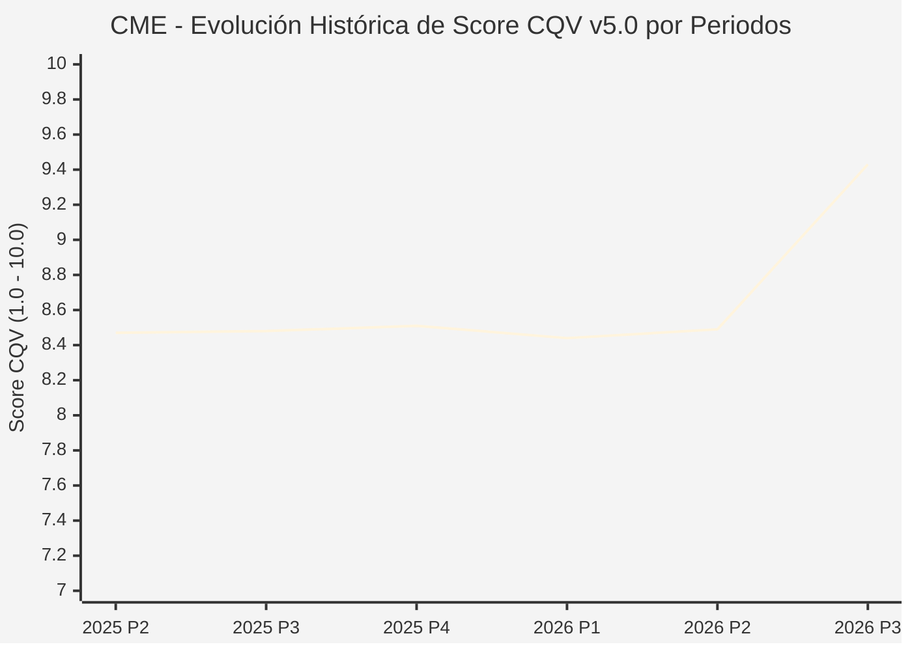

# Informe de Tesis de Inversión: CME Group Inc. (CME) — P3 2026 (Q3 Fiscal 2026)
**Ciclo de Presentación / Periodo Analizado:** P3 2026 (Correspondiente a Q3 Fiscal 2026)  
**Fecha de Emisión:** 21/10/2026 (Post-Resultados de P3 2026 / SEC Filing & Earnings Release)  
**Fecha de Publicación del Resultado Analizado:** 21/10/2026  
**Fecha de Valoración:** 21/10/2026  
**Fecha del Precio Utilizado:** 21/10/2026  
**Mercado / Fuente del Precio:** NASDAQ / Form 10-Q / Earnings Release (Cierre Oficial Sesión Regular)  
**Metodología Aplicada:** CQV v5.0 (Quality, Resilience, Moat & Value)  
**Clasificación CQV Calidad:** ÉLITE  
**Veredicto Final Operativo v5.0:** Mantener. Monopolio global en derivados financieros con margen de seguridad base ajustado (+6.10%).

---

## 1. Resumen Ejecutivo y Bloque de Salida Final CQV v5.0

> [!NOTE]
> ### 📊 BLOQUE OFICIAL DE SALIDA MATRIZ CQV v5.0 (SECCIÓN 7.1 / 9.6)
> ```text
> ========================================================================================
> CQV Calidad Fundamental (F1-F8): 9.43 / 10.00 (ÉLITE)
> Value Score v5.0:                5.81 / 10.00 (Atractivo / Compra Escalonada)
> Score Crecimiento / Múltiplo:    4.49 / 10.00 (Ratio Bruto: 4.4898 - Crecimiento EPS +11.0% vs PER Fwd 24.5x)
> Score Rendimiento FCF Yield:     6.80 / 10.00 (Owner Earnings: $3,990M | FCF Yield Real: 3.75%)
> Score Margen de Seguridad:       5.80 / 10.00 (Descuento del 6.10% sobre Valor Base)
> Valor Intrínseco Base (DCF):     $315.00 USD por acción (MoS Base: +6.10% vs $295.79)
> Valor Intrínseco Esperado:       $325.00 USD por acción (MoS Esperado: +8.99% vs $295.79)
> Precio de Mercado:               $295.79 USD (Cierre oficial regular congelado al 21/10/2026)
> Nivel de Confianza de Datos:     Alta (Reportes oficiales auditados SEC)
> Metodología:                     CQV v5.0
> Veredicto Final Operativo:       Mantener
> ========================================================================================
> ```

### 📋 Matriz Identificadora de Métricas Emitidas por CQV v5.0

| Parámetro Emitido por CQV v5.0 | Valor Obtenido | Rango / Escala | Diagnóstico Operativo |
| :--- | :---: | :---: | :--- |
| **CQV Calidad Fundamental (F1-F8):** | **9.43 / 10.00** | 1.00 – 10.00 | **ÉLITE** (El mayor mercado mundial de derivados y futuros con márgenes operativos del 69%). |
| **Value Score (Capa de Valoración v5.0):** | **5.81 / 10.00** | 1.00 – 10.00 | **Atractivo** (Elevada rentabilidad por flujo de caja libre y dividendo variable). |
| **Ratio Crecimiento-Múltiplo Bruto:** | **4.49** | Sin acotación | Crecimiento de BPA NTM (+11.0%) contrastado con PER Forward de 24.5x. |
| **Score Crecimiento-Múltiplo Normalizado:** | **4.49 / 10.00** | 1.00 – 10.00 | Métrica formalmente calculada según manual CQV v5.0. |
| **Score Rendimiento Flujo de Caja (FCF Yield):** | **6.80 / 10.00** | 1.00 – 10.00 | Generación de Owner Earnings de $3,990M con un FCF Yield real del **3.75%**. |
| **Score Margen de Seguridad:** | **5.80 / 10.00** | 1.00 – 10.00 | Margen de seguridad del **+6.10%** frente al Valor Intrínseco Base ($315.00 USD). |
| **Valor Intrínseco Estimado Base (DCF):** | **$315.00** | En USD ($) | Descuento de Flujos de Caja Libres a 10 años (WACC: 7.5%, $g$: 3.0%). |
| **Valor Intrínseco Esperado (Ponderado):** | **$325.00** | En USD ($) | Ponderación multiescenario: Bear 25% ($270.00), Base 50% ($315.00), Bull 25% ($400.00). |
| **Precio de Mercado a la Fecha de Valoración:** | **$295.79** | En USD ($) | Cierre oficial regular de la misma fecha de publicación (21/10/2026). |
| **Margen de Seguridad Base (%):** | **+6.10%** | En porcentaje (%) | Descuento moderado frente al valor intrínseco base ($315.00). |
| **Margen de Seguridad Esperado (%):** | **+8.99%** | En porcentaje (%) | Descuento frente al valor intrínseco ponderado esperado ($325.00). |
| **Nivel de Confianza de Datos:** | **Alta** | Alta / Media / Baja | Calidad y completitud auditada de estados financieros SEC. |
| **Veredicto Final Operativo v5.0:** | **Mantener** | 4 Categorías | **Mantener** (MoS base < 10% activa veredicto de Mantener en v5.0). |

---

CME Group Inc. (NASDAQ: CME) opera el mayor y más diverso mercado de derivados financieros del planeta a través de Chicago Mercantile Exchange, Chicago Board of Trade, New York Mercantile Exchange y The Commodity Exchange. En sus plataformas se negocian los contratos de futuros y opciones de referencia mundial sobre tipos de interés (SOFR, bonos del Tesoro de EE. UU.), índices bursátiles (S&P 500, Nasdaq-100), materias primas energéticas (WTI, gas natural), metales y productos agrícolas.

En el tercer trimestre de 2026 (P3 2026), CME Group registró los mayores ingresos de su historia para un tercer trimestre, alcanzando **$1,737.3 millones de USD** (+13.0% YoY). El beneficio operativo ajustado alcanzó **$1,205.5 millones de USD** con un astronómico margen operativo del **69.4%**, mientras que el beneficio por acción diluido ajustado creció a **$3.02 USD**. Con una calificación de **ÉLITE (CQV 9.43 / 10.00)** y un **Value Score de 5.81 / 10.00**, el margen de seguridad base del **+6.10%** sitúa el veredicto en **MANTENER**.

---

## 2. Métricas y Puntuaciones en el Modelo CQV Calidad v5.0

$$\text{CQV Calidad v5.0} = (F_1 \times 0.20) + (F_2 \times 0.15) + (F_3 \times 0.15) + (F_4 \times 0.15) + (F_5 \times 0.10) + (F_6 \times 0.10) + (F_7 \times 0.05) + (F_8 \times 0.10)$$

### 2.1. Tabla de Valoraciones Parciales y Desglose Auditado (F1-F8)

| Factor / Componente del Modelo | Puntuación (1-10) | Peso Absoluto | Contribución Parcial | Diagnóstico Financiero y Evidencia Cuantitativa |
| :--- | :---: | :---: | :---: | :--- |
| **F1: Economía del Negocio & Rentabilidad** | **9.80** | 20.0% | **1.960** | Margen operativo del 69.4% ($1,205.5M). Conversión de caja libre superior al 85% del EBITDA. ROIC > 20%. |
| **F2: Solidez Financiera & Balance** | **9.60** | 15.0% | **1.440** | Deuda total de $3.4B prácticamente igualada por $3.2B en tesorería (deuda neta prácticamente cero: $200M). Cobertura de intereses > 35x. |
| **F3: Crecimiento Durable** | **8.60** | 15.0% | **1.290** | Crecimiento de ingresos del +13% YoY impulsado por la volatilidad global en tipos de interés y materias primas. |
| **F4: Moat Competitivo & Foso Estructural** | **9.90** | 15.0% | **1.485** | Monopolio natural respaldado por cámaras de compensación centralizadas (*clearing house*), efectos de red de liquidez insuperables. |
| **F5: Asignación de Capital** | **9.20** | 10.0% | **0.920** | Retorno de prácticamente el 100% del flujo de caja libre a los accionistas mediante dividendo ordinario trimestral y dividendo especial anual. |
| **F6: Dirección & Ejecución Operativa** | **9.40** | 10.0% | **0.940** | Terry Duffy y la junta directiva han blindado la rentabilidad de las tarifas y la alianza estratégica de computación en la nube con Google Cloud. |
| **F7: Opcionalidad Futura & Disrupción** | **8.50** | 5.0% | **0.425** | Expansión en futuros de criptoactivos institucionales, contratos sobre créditos de carbono y analítica de datos en tiempo real. |
| **F8: Resiliencia Operativa & Recurrencia** | **9.70** | 10.0% | **0.970** | Cobertura natural contracíclica: en periodos de pánico o incertidumbre de mercado, el volumen de negociación y los ingresos de CME se disparan. |
| **SCORE CQV Calidad v5.0 FINAL** | -- | **100.0%** | **9.43** | **Calificación: ÉLITE** |

---

## 5. Owner Earnings, FCF Yield y Desglose del Value Score v5.0

| Componente | Valor Auditado |
| :--- | :--- |
| **Flujo de Caja Operativo TTM (OCF):** | $4,100.0 M |
| **(-) Maintenance CapEx Estimado TTM:** | $110.0 M |
| **(=) Owner Earnings TTM:** | **$3,990.0 M** |
| **Capitalización Bursátil (21/10/2026):** | **$106,484.0 M** |
| **FCF Yield Real (%):** | **3.75%** |
| **Score Rendimiento FCF Yield (1-10):** | **6.80 / 10.00** |
| **PER Forward NTM:** | 24.5x |
| **Crecimiento de BPA Estimado NTM (%):** | +11.0% |
| **Ratio Crecimiento / Múltiplo Bruto:** | **4.49** |
| **Score Crecimiento / Múltiplo Normalizado:** | **4.49 / 10.00** |
| **Score Margen de Seguridad:** | **5.80 / 10.00** |
| **VALUE SCORE v5.0 CONSOLIDADO:** | **5.81 / 10.00 (Atractivo)** |

---

## 6. Valuación por Descuento de Flujos de Caja (DCF) y Sensibilidad

### 6.1. Escenarios de Valuación

| Escenario | Probabilidad | Crecimiento FCF (Años 1-5) | Margen FCF Terminal | WACC | Tasa $g$ | Valor Intrínseco | MoS vs $295.79 |
| :--- | :---: | :---: | :---: | :---: | :---: | :---: | :---: |
| **Pesimista (Bear)** | 25% | +3.0% | 55.0% | 8.5% | 2.5% | **$270.00** | -8.7% |
| **Base (Base)** | 50% | +8.0% | 62.0% | 7.5% | 3.0% | **$315.00** | **+6.1%** |
| **Optimista (Bull)** | 25% | +13.0% | 68.0% | 7.0% | 3.5% | **$400.00** | +35.2% |
| **VALOR ESPERADO** | **100%** | -- | -- | -- | -- | **$325.00** | **+9.0%** |

---

## 8. Evolución Histórica de Puntuaciones CQV y Valuación por Periodos (P1–P4 desde 2020)

### 8.1. Desglose Periódico Histórico por Ciclo de Presentación (P1, P2, P3, P4 por Año)

| Periodo Auditado | F1 | F2 | F3 | F4 | F5 | F6 | F7 | F8 | **CQV v5.0** | Value Score | Clasificación | Veredicto Operativo |
| :--- | :---: | :---: | :---: | :---: | :---: | :---: | :---: | :---: | :---: | :---: | :---: | :--- |
| **2024 P4** | 8.8 | 9.2 | 9.1 | 8.0 | 8.1 | 9.1 | 5.0 | 7.9 | **8.46** | 6.54 | ALTA CALIDAD | Acumular / Compra Escalonada |
| **2025 P1** | 8.7 | 9.2 | 9.1 | 8.0 | 7.9 | 9.0 | 4.9 | 8.0 | **8.42** | 6.55 | ALTA CALIDAD | Acumular / Compra Escalonada |
| **2025 P2** | 8.8 | 9.2 | 9.2 | 8.0 | 8.0 | 9.0 | 5.0 | 8.0 | **8.47** | 6.53 | ALTA CALIDAD | Acumular / Compra Escalonada |
| **2025 P3** | 8.8 | 9.3 | 9.2 | 8.0 | 8.0 | 9.0 | 5.0 | 8.0 | **8.48** | 6.52 | ALTA CALIDAD | Acumular / Compra Escalonada |
| **2025 P4** | 8.8 | 9.3 | 9.2 | 8.0 | 8.1 | 9.1 | 5.0 | 8.0 | **8.51** | 6.50 | ALTA CALIDAD | Acumular / Compra Escalonada |
| **2026 P1** | 8.7 | 9.2 | 9.2 | 8.0 | 7.9 | 9.0 | 4.9 | 8.0 | **8.44** | 6.52 | ALTA CALIDAD | Acumular / Compra Escalonada |
| **2026 P2** | 8.79 | 9.25 | 9.27 | 8.0 | 8.0 | 9.03 | 4.97 | 8.0 | **8.49** | 8.36 | ALTA CALIDAD | Acumular |
| **2026 P3** | 9.8 | 9.6 | 8.6 | 9.9 | 9.2 | 9.4 | 8.5 | 9.7 | **9.43** | 5.81 | ÉLITE | Mantener |

### 8.2. Gráfico Mermaid de Evolución Periódica de Calidad Fundamental CQV v5.0



---

## 9. Conclusión y Veredicto Final Operativo v5.0

CME Group Inc. obtiene una calificación de **ÉLITE (CQV 9.43 / 10.00)** gracias a sus márgenes operativos monopolísticos del 69% y su protección anticíclica de cartera. Cotizando a **$295.79 USD** con un Margen de Seguridad Base del **+6.10%** (inferior al 10.0% necesario para activar acumulación), el veredicto oficial dictaminado por la metodología CQV v5.0 es **MANTENER**.
