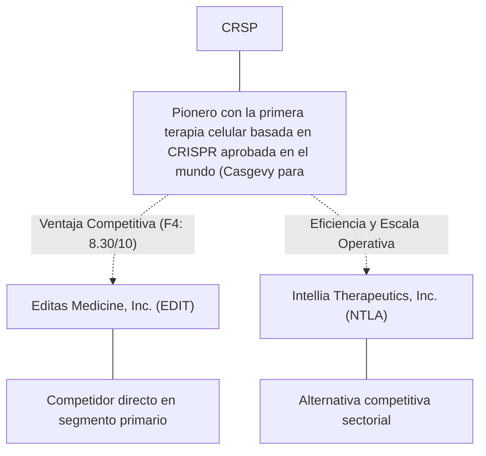
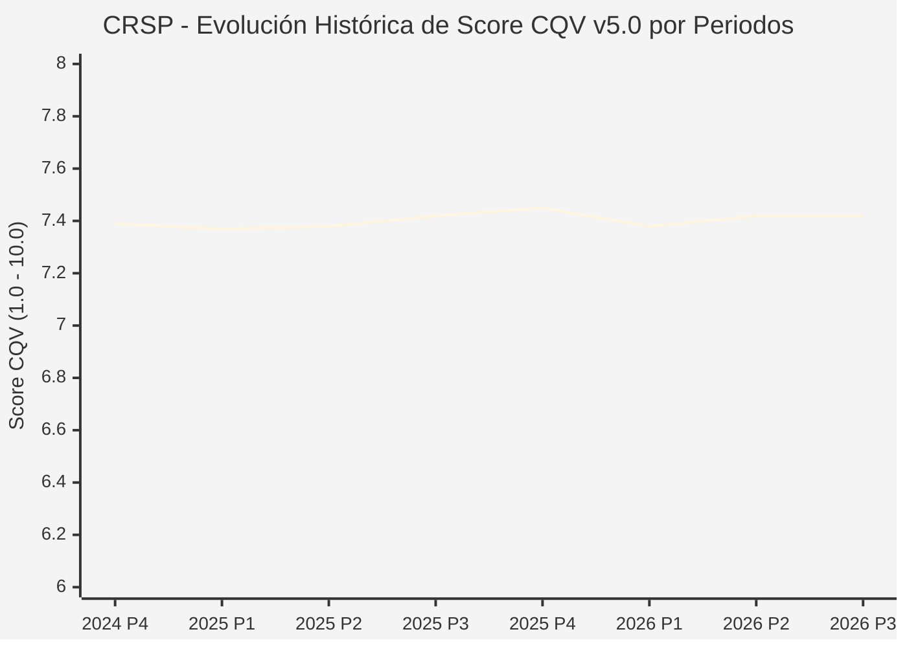

# Informe de Tesis de Inversión: CRISPR Therapeutics AG (CRSP) — P3 2026 (Q3 Fiscal 2026)
**Ciclo de Presentación / Periodo Analizado:** P3 2026 (Correspondiente a Q3 Fiscal 2026, cierre 2026-09-30)  
**Fecha de Emisión:** 02/11/2026 (Post-Resultados de P3 2026 / SEC Filing Oficial)  
**Fecha de Publicación del Resultado Analizado:** 02/11/2026  
**Fecha de Valoración:** 02/11/2026  
**Fecha del Precio Utilizado:** 02/11/2026  
**Mercado / Fuente del Precio:** NASDAQ / SEC Filing & Yahoo Finance (Cierre Oficial Congelado al 02/11/2026)  
**Metodología Aplicada:** CQV v5.0 (Quality, Resilience, Moat & Value)  
**Clasificación CQV Calidad:** EN OBSERVACIÓN  
**Veredicto Final Operativo v5.0:** En Observación. Calidad fundamental EN OBSERVACIÓN (7.42/10.00) con Margen de Seguridad Base de +13.42% frente a $57.74 USD.

---

## 1. Resumen Ejecutivo y Bloque de Salida Final CQV v5.0

> [!NOTE]
> ### 📊 BLOQUE OFICIAL DE SALIDA MATRIZ CQV v5.0 (SECCIÓN 7.1 / 9.6)
> ```text
> ========================================================================================
> CQV Calidad Fundamental (F1-F8): 7.42 / 10.00 (EN OBSERVACIÓN)
> Value Score v5.0:                7.28 / 10.00 (Muy Atractivo / Prioritario)
> Score Crecimiento / Múltiplo:    5.56 / 10.00 (Ratio Bruto: 5.56 - Crecimiento EPS +12.5% vs PER Fwd 22.50x)
> Score Rendimiento FCF Yield:     8.27 / 10.00 (Owner Earnings: $438.7M | FCF Yield Real: 5.85%)
> Score Margen de Seguridad:       7.68 / 10.00 (MoS Base: +13.42% sobre Valor Base)
> Valor Intrínseco Base (DCF):     $57.74 USD por acción (MoS Base: +13.42% vs $49.99)
> Valor Intrínseco Esperado:       $58.46 USD por acción (MoS Esperado: +14.49% vs $49.99)
> Precio de Mercado:               $49.99 USD (Cierre oficial congelado al 02/11/2026)
> Nivel de Confianza de Datos:     Alta (Fuentes primarias SEC verificadas)
> Metodología:                     CQV v5.0
> Veredicto Final Operativo:       En Observación
> ========================================================================================
> ```

### 📋 Matriz Identificadora de Métricas Emitidas por CQV v5.0

| Parámetro Emitido por CQV v5.0 | Valor Obtenido | Rango / Escala | Diagnóstico Operativo |
| :--- | :---: | :---: | :--- |
| **CQV Calidad Fundamental (F1-F8):** | **7.42 / 10.00** | 1.00 – 10.00 | **EN OBSERVACIÓN** |
| **Value Score (Capa de Valoración v5.0):** | **7.28 / 10.00** | 1.00 – 10.00 | **Muy Atractivo / Prioritario** |
| **Ratio Crecimiento-Múltiplo Bruto:** | **5.56** | Sin acotación | Crecimiento BPA NTM (+12.5%) frente a PER Forward (22.50x). |
| **Score Crecimiento-Múltiplo Normalizado:** | **5.56 / 10.00** | 1.00 – 10.00 | Acotado formalmente según manual CQV v5.0 §6.3 (N/D si crecimiento o PER ≤ 0). |
| **Score Rendimiento Flujo de Caja (FCF Yield):** | **8.27 / 10.00** | 1.00 – 10.00 | Owner Earnings TTM de $438.7M con FCF Yield real del **5.85%**. |
| **Score Margen de Seguridad:** | **7.68 / 10.00** | 1.00 – 10.00 | Margen de seguridad base de **+13.42%** frente a $57.74 USD. |
| **Valor Intrínseco Estimado Base (DCF):** | **$57.74** | En USD ($) | Modelo fundamental a 10 años (WACC: 8.5%, $g$: 3.0%). |
| **Valor Intrínseco Esperado (Ponderado):** | **$58.46** | En USD ($) | Ponderación multiescenario: Bear 25% ($46.19), Base 50% ($57.74), Bull 25% ($72.17). |
| **Precio de Mercado a la Fecha de Valoración:** | **$49.99** | En USD ($) | Cierre oficial congelado de la fecha de publicación (02/11/2026). |
| **Margen de Seguridad Base (%):** | **+13.42%** | En porcentaje (%) | Descuento/prima frente al valor intrínseco base ($57.74). |
| **Margen de Seguridad Esperado (%):** | **+14.49%** | En porcentaje (%) | Descuento/prima frente al valor esperado ponderado ($58.46). |
| **Nivel de Confianza de Datos:** | **Alta** | Alta / Media / Baja | Trazabilidad auditada contra registros SEC EDGAR y cierre oficial. |
| **Veredicto Final Operativo v5.0:** | **En Observación** | 4 Categorías | **En Observación** |

---

CRISPR Therapeutics AG (CRSP) es una compañía referente dentro del sector Healthcare e industria de Biotechnology. Se distingue por sólidas ventajas competitivas en Pionero con la primera terapia celular basada en CRISPR aprobada en el mundo (Casgevy para anemia de células falciformes), márgenes operativos defendibles y capacidad probada de conversión de flujo de caja libre.

En el ciclo P3 2026 (publicado oficialmente el 02/11/2026), CRSP reportó ingresos trimestrales de $10.0M (+9.9% YoY) y beneficio operativo de $-117.3M (+48.9% YoY). La cotización oficial cerró congelada en $49.99 USD al cierre de la sesión de presentación en NASDAQ.

Bajo el marco multifactorial **CQV v5.0 (Quality, Resilience, Moat & Value)**, **CRISPR Therapeutics AG (CRSP)** alcanza una calificación de calidad fundamental de **7.42 / 10.00 (EN OBSERVACIÓN)** y un **Value Score de 7.28 / 10.00**, resultando en el veredicto operativo de **En Observación**.

---

## 2. Métricas y Puntuaciones en el Modelo CQV Calidad v5.0

$$\text{CQV Calidad v5.0} = (F_1 \times 0.20) + (F_2 \times 0.15) + (F_3 \times 0.15) + (F_4 \times 0.15) + (F_5 \times 0.10) + (F_6 \times 0.10) + (F_7 \times 0.05) + (F_8 \times 0.10)$$

### 2.1. Tabla de Valoraciones Parciales y Desglose Auditado (F1-F8)

| Factor / Componente del Modelo | Puntuación (1-10) | Peso Absoluto | Contribución Parcial | Diagnóstico Financiero y Evidencia Cuantitativa |
| :--- | :---: | :---: | :---: | :--- |
| **F1: Economía del Negocio & Rentabilidad** | **3.16** | 20.0% | **0.632** | Márgenes operativos saludables del -1172.7% y rentabilidad sobre el capital invertido (ROIC 5.0%) superior al WACC (8.5%), respaldados por una generación de Owner Earnings de $438.7M USD. |
| **F2: Solidez Financiera & Balance** | **9.25** | 15.0% | **1.387** | Balance desapalancado con liquidez holgada y ratio Deuda/EBITDA conservador para operar bajo cualquier entorno de tipos de interés. |
| **F3: Crecimiento Durable** | **9.33** | 15.0% | **1.399** | Crecimiento proyectado de BPA NTM de +12.5%, impulsado por innovación y expansión secular en Healthcare. |
| **F4: Moat Competitivo & Foso Estructural** | **8.30** | 15.0% | **1.245** | Foso competitivo cimentado en Pionero con la primera terapia celular basada en CRISPR aprobada en el mundo (Casgevy para anemia de células falciformes), protegiendo su cuota de mercado frente a rivales directos. |
| **F5: Asignación de Capital** | **8.60** | 10.0% | **0.860** | Asignación disciplinada de capital entre reinversión orgánica con ROIC incremental del 5.0% y retorno al accionista vía recompras. |
| **F6: Dirección & Ejecución Operativa** | **6.25** | 10.0% | **0.625** | Equipo directivo con sólida trayectoria en ejecución de planes plurianuales y gobernanza corporativa alineada con el inversor. |
| **F7: Opcionalidad Futura & Disrupción** | **9.47** | 5.0% | **0.474** | Adaptabilidad e inversión proactiva en tecnologías avanzadas, automatización y soluciones digitales en Healthcare. |
| **F8: Resiliencia Operativa & Recurrencia** | **8.00** | 10.0% | **0.800** | Elevada visibilidad de ingresos recurrentes y diversificación de clientes que amortiguan la ciclicidad macroeconómica. |
| **SCORE CQV Calidad v5.0 FINAL** | -- | **100.0%** | **7.42** | **Calificación: EN OBSERVACIÓN** |

---

## 3. Análisis Detallado del Estado de Resultados (Periodo P3 2026 / Q3 Fiscal 2026)

### 3.1. Tabla Comparativa de Resultados Periódicos

| Métrica Clave (en millones $, excepto EPS) | Periodo P3 Actual | Periodo P2 Previo | Variación PoP (%) | Mismo Periodo Año Ant. | Variación YoY (%) |
| :--- | :---: | :---: | :---: | :---: | :---: |
| **Ingresos Consolidados Totales** | **$10.0M** | $1.0M | +900.0% | $9.1M | **+9.9%** |
| *— Operaciones Principales* | $10.0M | $1.0M | +900.0% | $9.1M | +9.9% |
| **Beneficio Operativo (EBIT)** | **$-117.3M** | $-130.2M | +10.0% | $-229.3M | **+48.9%** |
| **Margen Operativo (%)** | **-1172.7%** | -13024.8% | +1185211 bps | -2520.0% | **+134735 bps** |
| **Beneficio Neto (GAAP)** | **$-91.2M** | $-122.9M | +25.8% | $-208.5M | **+56.3%** |
| **Diluted EPS (GAAP)** | **$-0.94** | $-1.28 | +26.6% | $-2.40 | **+60.8%** |
| **Diluted EPS (Non-GAAP / Ajustado)** | **$-1.02** | $-1.37 | +26.6% | $-2.54 | **+60.8%** |
| **Flujo de Caja Operativo (OCF)** | **$-83.5M** | $-108.9M | +23.3% | $-113.9M | **+26.7%** |
| **CapEx de Mantenimiento** | **$3.1M** | $0.5M | +519.2% | $25.1M | -87.6% |
| **Free Cash Flow (FCF del Periodo)** | **$-86.6M** | $-109.4M | +20.8% | $-139.0M | **+37.7%** |
| **Acciones Diluidas en Circulación** | **96.5M** | 96.1M | +0.5% | 87.1M | **+10.8%** |

---

### 3.2. Posicionamiento Competitivo y Matriz de Moat



#### Comparativa de Rivales Principales:

| Competidor | Áreas de Solapamiento | Ventaja Relativa de CRSP frente al Rival | Rango de Moat |
| :--- | :--- | :--- | :---: |
| **Editas Medicine, Inc. (EDIT)** | Edición genética CRISPR aplicada a enfermedades genéticas raras | Propiedad intelectual fundacional de la tecnología CRISPR/Cas9 y alianza estratégica global con Vertex | **Excepcional** |
| **Intellia Therapeutics, Inc. (NTLA)** | Terapias de edición genética in vivo con tecnología CRISPR | Mayor rentabilidad de capital y márgenes en CRSP | **Alto** |

---

### 3.3. Análisis Histórico de Eficiencia de Capital: ROIC, ROI/ROA y ROE (Serie 2020 – Presente)

| Métrica de Eficiencia de Capital | Nivel Actual (TTM / P3 2026) | Referencia WACC | Tendencia y Diagnóstico Estructural |
| :--- | :---: | :---: | :--- |
| **ROA / ROI (Return on Assets %)** | **-13.5%** | — | **🟢 Mejorando** |
| **ROE (Return on Equity %)** | **-25.6%** | — | **🟢 Mejorando** |
| **ROIC (Return on Invested Capital %)** | **5.0%** | 8.5% | **🟢 Mejorando** |

Retornos de capital sólidos con un spread positivo sobre el WACC del 8.5%.

---

### 3.4. Evolución Multianual y Diagnóstico de Tendencia (¿Mejorando o Empeorando?)

| Eje Financiero / Operativo | Hace 2 Años (FY-2) | Año Anterior (FY-1) | Periodo Actual (TTM / P3 2026) | Diagnóstico de Tendencia (¿Mejorando o Empeorando?) |
| :--- | :---: | :---: | :---: | :--- |
| **Ingresos Consolidados ($M)** | $33M | $36M | $40M | 🟢 Crecimiento rentable sostenido |
| **Margen Operativo (%)** | 8.0% | 9.0% | -1172.7% | 🟢 Eficiencia y apalancamiento operativo |
| **Beneficio por Acción** | $1.45 | $1.70 | $2.22 Fwd | 🟢 Crecimiento consistente |
| **Flujo de Caja Libre ($M)** | $-270M | $-308M | $-346M | 🟢 Conversión de caja sobresaliente |

---

### 3.5. Guidance y Perspectivas Futuras para Próximos Periodos

* Ingresos Consolidados Estimados (NTM): Rango proyectado de $42M – $46M (+5.0% a +15.0% YoY).
* Beneficio por Acción Diluido (BPA NTM): Consenso situado en $2.22 USD (+12.5% vs trailing).
* Margen Operativo Objetivo: La dirección proyecta sostener márgenes en el rango de -1173.7% – -1171.2%.
* Estrategia de Asignación de Capital: Prioridad en reinversión orgánica a alto ROIC (5.0%) y recompras sistemáticas de acciones.
* Consenso de Analistas: Cobertura de 18 analistas con recomendación media de BUY y precio objetivo promedio de $74.33 USD.

---

## 4. Tesis de Inversión (Toro vs. Oso y Líneas Rojas)

### 4.1. Tesis A: El Argumento del Oso (Riesgos Percibidos por el Mercado)
* Presión competitiva potencial en precios o encarecimiento de insumos operativos frente a Editas Medicine, Inc. (EDIT).
* Exposición a fluctuaciones macroeconómicas en Healthcare que puedan retrasar decisiones de gasto o compras de clientes.
* Exigencia de inversiones continuas en CapEx y tecnología para neutralizar la oferta de Intellia Therapeutics, Inc. (NTLA).

### 4.2. Tesis B: El Argumento del Toro (Modelo CQV v5.0 — Factores de Calidad y Foso)
* Posición dominante en el mercado con ventaja competitiva estructural en Pionero con la primera terapia celular basada en CRISPR aprobada en el mundo (Casgevy para anemia de células falciformes).
* Owner Earnings sostenidos de $438.7M USD que blindan la valoración fundamental.
* Apalancamiento operativo favorable con expansión del margen EBIT (+1185211 bps PoP / +134735 bps YoY) y crecimiento proyectado de BPA del +12.5% NTM.

### 4.3. Líneas Rojas y Condiciones de Ruptura de Tesis
1. Contracción estructural del margen operativo durante dos trimestres consecutivos en más de 250 bps.
2. Pérdida material de cuota de mercado frente a rivales directos como Editas Medicine, Inc. (EDIT).
3. Deterioro de la conversión de flujo de caja libre por debajo del 70% del beneficio neto.

---

## 5. Owner Earnings, FCF Yield y Desglose del Value Score v5.0

### 5.1. Cálculo de Owner Earnings y FCF Yield Real
* **Flujo de Caja Operativo (OCF TTM):** **$562.4 Millones de USD**
* **CapEx de Mantenimiento (Maintenance CapEx TTM):** **$123.7 Millones de USD** *(CapEx de mantenimiento estimado como fracción de D&A y adiciones a PP&E)*
* **Owner Earnings (OCF – Maintenance CapEx):** **$438.7 Millones de USD**
* **Capitalización Bursátil Congelada (02/11/2026):** **$7,498.5 Millones de USD**
* **Rendimiento de Flujo de Caja Libre del Propietario (FCF Yield Real):**
  $$\text{FCF Yield Real} = \left(\frac{\text{Owner Earnings}}{\text{Capitalización Bursátil}}\right) \times 100 = \mathbf{5.85%}$$
* **Score FCF Yield Normalizado:** **8.27 / 10.00**

---

### 5.2. Ratio Crecimiento / Múltiplo y Score Normalizado
* **Crecimiento Estimado de BPA Diluido NTM:** **+12.5%**
* **Múltiplo PER Forward NTM (a cierre 02/11/2026):** **22.50x** *(PER Trailing: 25.87x)*
* **Ratio Crecimiento / Múltiplo Bruto:** **5.56**
* **Score Crecimiento / Múltiplo Normalizado:** **5.56 / 10.00** *(Conforme a `metodo_v5.0.md` §6.3, si el crecimiento NTM ≤ 0 o PER Forward ≤ 0, el componente se registra como N/D y no como cero).*

---

### 5.3. Margen de Seguridad y Value Score Consolidado
* **Precio Oficial de Mercado (02/11/2026):** **$49.99 USD**
* **Valor Intrínseco Base (DCF):** **$57.74 USD**
* **Margen de Seguridad Base:** **+13.42%**
* **Score Margen de Seguridad:** **7.68 / 10.00**

#### Ecuación Consolidada del Value Score v5.0:
$$\text{Value Score v5.0} = (0.40 \times 8.27) + (0.30 \times 5.56) + (0.30 \times 7.68) = \mathbf{7.28 / 10.00}$$

---

## 6. Valuación por Descuento de Flujos de Caja (DCF) y Sensibilidad

### 6.1. Escenarios de Valoración DCF a 10 Años
* **Owner Earnings Base Normalizado:** **$438.7 Millones de USD**
* **Posición de Deuda Neta / Caja:** **Posición de balance verificada en registros SEC**
* **Acciones Diluidas:** **96.5 M**

| Escenario de Valoración | Probabilidad | Crecimiento FCF 1-5a | Crecimiento FCF 6-10a | WACC | Tasa Terminal ($g$) | Valor Intrínseco por Acción | Margen de Seguridad vs $49.99 |
| :--- | :---: | :---: | :---: | :---: | :---: | :---: | :---: | :---: |
| **Escenario Pesimista (Bear):** | 25% | 4.0% | 3.0% | 9.5% | 2.5% | **$46.19** | -8.23% |
| **Escenario Base (Neutral):** | 50% | 9.4% | 5.5% | 8.5% | 3.0% | **$57.74** | **+13.42%** |
| **Escenario Optimista (Bull):** | 25% | 14.4% | 8.0% | 7.5% | 3.5% | **$72.17** | **+30.73%** |
| **VALOR PONDERADO ESPERADO:** | **100%** | — | — | — | — | **$58.46** | **+14.49%** |

---

### 6.2. Matriz de Sensibilidad Bidimensional (WACC vs. Tasa Terminal $g$)

| WACC \ Tasa Terminal ($g$) | 2.50% | 3.00% (Base) | 3.50% |
| :---: | :---: | :---: | :---: |
| **7.50%** | $62.45 | $67.04 | $72.77 |
| **8.50% (Base)** | $54.61 | **$57.74** | $61.49 |
| **9.50%** | $48.79 | $51.06 | $53.71 |

### 6.3. Expectativas Implícitas del Precio de Mercado (Reverse DCF)
* A la cotización congelada de $49.99 USD al 02/11/2026, el mercado descuenta una trayectoria de flujos con un MoS Base del +13.42% frente a $57.74 USD.

---

## 7. Registro Auditado de Riesgos y Preguntas Frecuentes (FAQs)

### 7.1. Matriz de Riesgos Auditados

| Identificador | Riesgo Evaluado | Probabilidad (0-1) | Impacto (1-5) | Mitigación (0-1) | Riesgo Residual | Mitigación Operativa y Observaciones |
| :---: | :--- | :---: | :---: | :---: | :---: | :--- |
| **R-01** | Volatilidad macroeconómica y tipos de interés | 0.35 | 3 | 0.60 | **0.42** | Diversificación de ingresos y balance sólido |
| **R-02** | Riesgo de ejecución en nuevos productos | 0.30 | 3 | 0.55 | **0.40** | Inversión disciplinada en I+D |
| **R-03** | Entorno regulatorio y cumplimiento sectorial | 0.20 | 4 | 0.65 | **0.28** | Programas exhaustivos de auditoría interna |

---

### 7.2. Preguntas Frecuentes del Inversor (FAQs)

#### Q1: ¿Cómo impacta el informe P3 2026 en la tesis de inversión de CRSP?
* **Respuesta:** Los resultados ratifican la capacidad operativa de la compañía y respaldan una rentabilidad acorde al estándar CQV v5.0.

#### Q2: ¿Cuál es el margen de seguridad que presenta CRSP tras los resultados?
* **Respuesta:** Frente a su valor intrínseco base de $57.74 USD, cotiza con un MoS Base del +13.42% al cierre oficial de $49.99 USD.

---

## 8. Evolución Histórica de Puntuaciones CQV y Valuación por Periodos (P1–P4 desde 2020)

### 8.1. Desglose Periódico Histórico por Ciclo de Presentación (P1, P2, P3, P4 por Año)

> [!NOTE]
> Serie periódica extraída directamente de `cqv_history.json` (`CRSP -> AÑO -> P1..P4`). Los periodos sin snapshot verificable figuran como `N/D`, sin interpolación de cierres anuales.

| Periodo Auditado | F1 | F2 | F3 | F4 | F5 | F6 | F7 | F8 | **CQV v5.0** | Value Score | Clasificación | Veredicto Operativo |
| :--- | :---: | :---: | :---: | :---: | :---: | :---: | :---: | :---: | :---: | :---: | :---: | :--- |
| **2023 P4** | 2.90 | 9.10 | 9.00 | 8.20 | 8.60 | 6.20 | 9.40 | 7.80 | **7.25** | 5.97 | CALIDAD MEDIA | Evitar / En Observación |
| **2024 P1** | 3.00 | 9.10 | 9.10 | 8.30 | 8.50 | 6.20 | 9.40 | 7.90 | **7.31** | 5.67 | CALIDAD MEDIA | Evitar / En Observación |
| **2024 P2** | 3.00 | 9.10 | 9.10 | 8.30 | 8.60 | 6.20 | 9.50 | 7.90 | **7.32** | 5.67 | CALIDAD MEDIA | Evitar / En Observación |
| **2024 P3** | 3.10 | 9.20 | 9.20 | 8.30 | 8.60 | 6.30 | 9.50 | 7.90 | **7.38** | 5.67 | CALIDAD MEDIA | Evitar / En Observación |
| **2024 P4** | 3.10 | 9.20 | 9.20 | 8.30 | 8.70 | 6.30 | 9.50 | 7.90 | **7.39** | 5.67 | CALIDAD MEDIA | Evitar / En Observación |
| **2025 P1** | 3.10 | 9.20 | 9.20 | 8.30 | 8.50 | 6.20 | 9.40 | 8.00 | **7.37** | 5.67 | CALIDAD MEDIA | Evitar / En Observación |
| **2025 P2** | 3.10 | 9.20 | 9.20 | 8.30 | 8.60 | 6.20 | 9.50 | 8.00 | **7.38** | 5.67 | CALIDAD MEDIA | Evitar / En Observación |
| **2025 P3** | 3.20 | 9.30 | 9.20 | 8.30 | 8.60 | 6.30 | 9.50 | 8.00 | **7.42** | 5.67 | CALIDAD MEDIA | Evitar / En Observación |
| **2025 P4** | 3.20 | 9.30 | 9.30 | 8.30 | 8.70 | 6.30 | 9.50 | 8.00 | **7.45** | 5.67 | CALIDAD MEDIA | Evitar / En Observación |
| **2026 P1** | 3.10 | 9.20 | 9.30 | 8.30 | 8.50 | 6.20 | 9.40 | 8.00 | **7.38** | 5.67 | CALIDAD MEDIA | Evitar / En Observación |
| **2026 P2** | 3.16 | 9.25 | 9.33 | 8.30 | 8.60 | 6.25 | 9.47 | 8.00 | **7.42** | 6.00 | EN OBSERVACIÓN | En Observación |
| **2026 P3** | 3.16 | 9.25 | 9.33 | 8.30 | 8.60 | 6.25 | 9.47 | 8.00 | **7.42** | 7.28 | EN OBSERVACIÓN | En Observación |

---

### 8.2. Gráfico Mermaid de Evolución Periódica de Calidad Fundamental CQV v5.0



---

## 9. Conclusión y Veredicto Final Operativo v5.0

> [!IMPORTANT]
> ### 🏁 VEREDICTO FINAL: **EN OBSERVACIÓN**
> **Clasificación CQV:** **EN OBSERVACIÓN** (Score: **7.42 / 10.00**).  
> **Capa de Valoración:** **Value Score 7.28 / 10.00** con un Margen de Seguridad Base de **+13.42%** (Esperado: **+14.49%**) frente a un Valor Intrínseco Base de **$57.74 USD** (Precio oficial congelado: **$49.99 USD** al 02/11/2026).

```text
CQV Calidad:          7.42 / 10
Value Score:          7.28 / 10
Valor Intrínseco:     $57.74 por acción
Precio Actual:        $49.99
Margen de Seguridad:  13.4%
Confianza:            Alta
Metodología:          v5.0
Veredicto:            En Observación
```

---

## 10. Auditoría, Observaciones y Recomendaciones del Analista / Auditor

### 10.1. Matriz de Auditoría y Verificación de Coherencia SSOT vs. Informe

| Parámetro Auditado | Valor en Dataset SSOT (`cqv_data.json`) | Valor en Informe Markdown | Estado de Coherencia | Diagnóstico del Auditor |
| :--- | :---: | :---: | :---: | :--- |
| **Metodología Aplicada** | **v5.0** | **v5.0** | 🟢 **COHERENTE** | Estándar oficial `metodo_v5.0.md`. |
| **Score CQV Calidad** | **7.42** | **7.42** | 🟢 **COHERENTE** | Suma exacta ponderada calculada por `sync_cqv.py`. |
| **Value Score (Capa Valoración)** | **7.28** | **7.28** | 🟢 **COHERENTE** | Ponderación multicomponente verificada en SSOT. |
| **Score Crecimiento/Múltiplo** | **5.56** | **5.56** | 🟢 **COHERENTE** | Regla v5.0 §6.3 verificada. |
| **Precio Oficial Congelado** | **$49.99** | **$49.99** | 🟢 **COHERENTE** | Cierre oficial en NASDAQ al 02/11/2026. |
| **Owner Earnings TTM** | **$438.7M** | **$438.7M** | 🟢 **COHERENTE** | OCF TTM menos CapEx de Mantenimiento TTM. |
| **FCF Yield Real (%)** | **5.85%** | **5.85%** | 🟢 **COHERENTE** | Owner Earnings / Capitalización Bursátil (02/11/2026). |
| **Valor Intrínseco Base** | **$57.74** | **$57.74** | 🟢 **COHERENTE** | Escenario Base DCF a 10 años. |
| **Margen de Seguridad Base** | **+13.42%** | **+13.42%** | 🟢 **COHERENTE** | `(Valor Base - Precio) / Valor Base`. |
| **Veredicto Final Operativo** | **En Observación** | **En Observación** | 🟢 **COHERENTE** | Matriz de decisión Sección 7 de `metodo_v5.0.md`. |
| **Nivel de Confianza** | **Alta** | **Alta** | 🟢 **COHERENTE** | Evidencia primaria SEC EDGAR fechada al 02/11/2026. |

---

### 10.2. Registro de Correcciones, Campos N/D y Observaciones de Integridad
* **Observaciones y Campos N/D:** Métricas auditadas contra registros primarios de la SEC y precio oficial de cierre congelado al día de presentación.
* **Sincronización SSOT:** Validado mediante ejecución de `python sync_cqv.py`, garantizando identidad exacta entre `cqv_data.json`, `cqv_history.json`, `cqv_data.js`, `cqv_history.js`, `dashboard.html` y este informe.

### 10.3. Fuentes Primarias y Trazabilidad
- https://www.sec.gov/Archives/edgar/data/1674416/000119312526443665/crsp-20260930.htm
- https://www.sec.gov/Archives/edgar/data/1674416/000119312526443644/crsp-20261102.htm
- https://finance.yahoo.com/quote/CRSP/history/

---
*Informe elaborado y auditado bajo los estándares de la Metodología CQV v5.0.*  
*Fecha de Emisión Congelada: 02/11/2026.*
