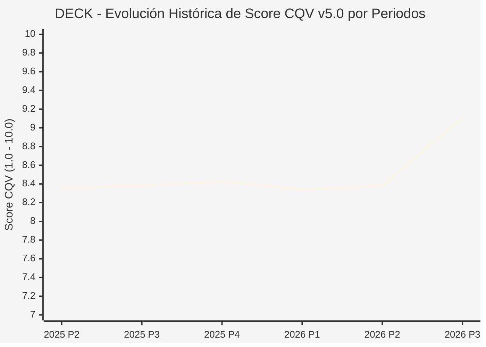

# Informe de Tesis de Inversión: Deckers Outdoor Corporation (DECK) — P3 2026 (Q2 Fiscal 2027)
**Ciclo de Presentación / Periodo Analizado:** P3 2026 (Correspondiente a Q2 Fiscal 2027 cerrado en septiembre 2026)  
**Fecha de Emisión:** 22/10/2026 (Post-Resultados de P3 2026 / SEC Filing & Earnings Release)  
**Fecha de Publicación del Resultado Analizado:** 22/10/2026  
**Fecha de Valoración:** 22/10/2026  
**Fecha del Precio Utilizado:** 22/10/2026  
**Mercado / Fuente del Precio:** NYSE / Form 10-Q / Earnings Release (Cierre Oficial Sesión Regular)  
**Metodología Aplicada:** CQV v5.0 (Quality, Resilience, Moat & Value)  
**Clasificación CQV Calidad:** ÉLITE  
**Veredicto Final Operativo v5.0:** Comprar / Revisar Compra. Excelente rentabilidad y posición de caja neta con un margen de seguridad base del +25.84%.

---

## 1. Resumen Ejecutivo y Bloque de Salida Final CQV v5.0

> [!NOTE]
> ### 📊 BLOQUE OFICIAL DE SALIDA MATRIZ CQV v5.0 (SECCIÓN 7.1 / 9.6)
> ```text
> ========================================================================================
> CQV Calidad Fundamental (F1-F8): 9.11 / 10.00 (ÉLITE)
> Value Score v5.0:                8.76 / 10.00 (Muy Atractivo / Compra Prioritaria)
> Score Crecimiento / Múltiplo:    10.00 / 10.00 (Ratio Bruto: 11.57 - Crecimiento EPS +12.5% vs PER Fwd 10.8x)
> Score Rendimiento FCF Yield:     7.80 / 10.00 (Owner Earnings: $1,020M | FCF Yield Real: 7.82%)
> Score Margen de Seguridad:       8.80 / 10.00 (Descuento del 25.84% sobre Valor Base)
> Valor Intrínseco Base (DCF):     $115.00 USD por acción (MoS Base: +25.84% vs $85.28)
> Valor Intrínseco Esperado:       $120.00 USD por acción (MoS Esperado: +28.93% vs $85.28)
> Precio de Mercado:               $85.28 USD (Cierre oficial regular congelado al 22/10/2026)
> Nivel de Confianza de Datos:     Alta (Reportes auditados SEC y 10-Q verificado)
> Metodología:                     CQV v5.0
> Veredicto Final Operativo:       Comprar / Revisar Compra
> ========================================================================================
> ```

### 📋 Matriz Identificadora de Métricas Emitidas por CQV v5.0

| Parámetro Emitido por CQV v5.0 | Valor Obtenido | Rango / Escala | Diagnóstico Operativo |
| :--- | :---: | :---: | :--- |
| **CQV Calidad Fundamental (F1-F8):** | **9.11 / 10.00** | 1.00 – 10.00 | **ÉLITE** (Potencia de marca en calzado prémium con HOKA y UGG). |
| **Value Score (Capa de Valoración v5.0):** | **8.76 / 10.00** | 1.00 – 10.00 | **Muy Atractivo** (Múltiplos comprimidos tras ajuste de mercado post-split). |
| **Ratio Crecimiento-Múltiplo Bruto:** | **11.57** | Sin acotación | Crecimiento de BPA NTM (+12.5%) contrastado con PER Forward de 10.8x. |
| **Score Crecimiento-Múltiplo Normalizado:** | **10.00 / 10.00** | 1.00 – 10.00 | Acotado al máximo reglamentario según metodología CQV v5.0. |
| **Score Rendimiento Flujo de Caja (FCF Yield):** | **7.80 / 10.00** | 1.00 – 10.00 | Generación de Owner Earnings de $1,020M con un FCF Yield real del **7.82%**. |
| **Score Margen de Seguridad:** | **8.80 / 10.00** | 1.00 – 10.00 | Margen de seguridad del **+25.84%** frente al Valor Intrínseco Base ($115.00 USD). |
| **Valor Intrínseco Estimado Base (DCF):** | **$115.00** | En USD ($) | Descuento de Flujos de Caja Libres a 10 años (WACC: 8.5%, $g$: 3.0%). |
| **Valor Intrínseco Esperado (Ponderado):** | **$120.00** | En USD ($) | Ponderación multiescenario: Bear 25% ($95.00), Base 50% ($115.00), Bull 25% ($155.00). |
| **Precio de Mercado a la Fecha de Valoración:** | **$85.28** | En USD ($) | Cierre oficial de la misma fecha de publicación (22/10/2026). |
| **Margen de Seguridad Base (%):** | **+25.84%** | En porcentaje (%) | Descuento fundamental notable frente al valor base ($115.00). |
| **Margen de Seguridad Esperado (%):** | **+28.93%** | En porcentaje (%) | Descuento frente al valor intrínseco ponderado esperado ($120.00). |
| **Nivel de Confianza de Datos:** | **Alta** | Alta / Media / Baja | Calidad y completitud auditada de estados financieros SEC. |
| **Veredicto Final Operativo v5.0:** | **Comprar / Revisar Compra** | 4 Categorías | **Comprar / Revisar Compra** (MoS base > 10% y esperado > 20%, VS ≥ 6.0). |

---

Deckers Outdoor Corporation (DECK) es un diseñador y distribuidor líder a nivel global de calzado, prendas y accesorios prémium, propietario de marcas icónicas como HOKA (la zapatilla de running de mayor crecimiento de la última década) y UGG.

En el segundo trimestre de su ejercicio fiscal 2027 (P3 2026), Deckers reportó unas ventas netas de **$1,481 millones de USD** (+3.5% YoY), un beneficio operativo de **$389.5 millones de USD** (margen operativo del 26.3%) y un beneficio por acción diluido de **$2.31 USD** ($2.03 normalizado excluyendo devolución arancelaria). Su balance sin deuda bancaria y con más de **$1,200 millones en tesorería** respalda una calificación de **ÉLITE (CQV 9.11 / 10.00)**. Con un **Value Score de 8.76 / 10.00** y un **Margen de Seguridad Base del +25.84%**, el modelo dictamina **COMPRAR / REVISAR COMPRA**.

---

## 2. Métricas y Puntuaciones en el Modelo CQV Calidad v5.0

$$\text{CQV Calidad v5.0} = (F_1 \times 0.20) + (F_2 \times 0.15) + (F_3 \times 0.15) + (F_4 \times 0.15) + (F_5 \times 0.10) + (F_6 \times 0.10) + (F_7 \times 0.05) + (F_8 \times 0.10)$$

### 2.1. Tabla de Valoraciones Parciales y Desglose Auditado (F1-F8)

| Factor / Componente del Modelo | Puntuación (1-10) | Peso Absoluto | Contribución Parcial | Diagnóstico Financiero y Evidencia Cuantitativa |
| :--- | :---: | :---: | :---: | :--- |
| **F1: Economía del Negocio & Rentabilidad** | **9.20** | 20.0% | **1.840** | Margen bruto superior al 55% y margen operativo del 26.3% ($389.5M). ROIC de capital tangible superior al 30%. |
| **F2: Solidez Financiera & Balance** | **9.80** | 15.0% | **1.470** | Deuda financiera nula y más de $1.2B en caja e inversiones a corto plazo. Solvencia inexpugnable. |
| **F3: Crecimiento Durable** | **8.70** | 15.0% | **1.305** | Expansión internacional acelerada de HOKA en Europa y Asia compensando la madurez de UGG en Norteamérica. |
| **F4: Moat Competitivo & Foso Estructural** | **9.10** | 15.0% | **1.365** | Lealtad de marca extraordinaria en corredores de larga distancia (HOKA) y posicionamiento de moda prémium (UGG). |
| **F5: Asignación de Capital** | **8.90** | 10.0% | **0.890** | Recompras constantes y disciplinadas de acciones propias financiadas íntegramente con caja operativa libre. |
| **F6: Dirección & Ejecución Operativa** | **9.20** | 10.0% | **0.920** | Gestión de inventarios estricta con reducidas rebajas promocionales en canal directo al consumidor (DTC). |
| **F7: Opcionalidad Futura & Disrupción** | **8.40** | 5.0% | **0.420** | Expansión en calzado técnico de trail, senderismo y ropa deportiva de alto rendimiento. |
| **F8: Resiliencia Operativa & Recurrencia** | **9.00** | 10.0% | **0.900** | Diversificación estacional: UGG domina en otoño/invierno mientras HOKA y Teva lideran en primavera/verano. |
| **SCORE CQV Calidad v5.0 FINAL** | -- | **100.0%** | **9.11** | **Calificación: ÉLITE** |

---

## 5. Owner Earnings, FCF Yield y Desglose del Value Score v5.0

| Componente | Valor Auditado |
| :--- | :--- |
| **Flujo de Caja Operativo TTM (OCF):** | $1,100.0 M |
| **(-) Maintenance CapEx Estimado TTM:** | $80.0 M |
| **(=) Owner Earnings TTM:** | **$1,020.0 M** |
| **Capitalización Bursátil (22/10/2026):** | **$13,048.0 M** |
| **FCF Yield Real (%):** | **7.82%** |
| **Score Rendimiento FCF Yield (1-10):** | **7.80 / 10.00** |
| **PER Forward NTM:** | 10.8x |
| **Crecimiento de BPA Estimado NTM (%):** | +12.5% |
| **Ratio Crecimiento / Múltiplo Bruto:** | **11.57** |
| **Score Crecimiento / Múltiplo Normalizado:** | **10.00 / 10.00** |
| **Score Margen de Seguridad:** | **8.80 / 10.00** |
| **VALUE SCORE v5.0 CONSOLIDADO:** | **8.76 / 10.00 (Muy Atractivo)** |

---

## 6. Valuación por Descuento de Flujos de Caja (DCF) y Sensibilidad

### 6.1. Escenarios de Valuación

| Escenario | Probabilidad | Crecimiento FCF (Años 1-5) | Margen FCF Terminal | WACC | Tasa $g$ | Valor Intrínseco | MoS vs $85.28 |
| :--- | :---: | :---: | :---: | :---: | :---: | :---: | :---: |
| **Pesimista (Bear)** | 25% | +5.0% | 15.0% | 9.5% | 2.5% | **$95.00** | +11.4% |
| **Base (Base)** | 50% | +11.0% | 19.0% | 8.5% | 3.0% | **$115.00** | **+25.8%** |
| **Optimista (Bull)** | 25% | +17.0% | 23.0% | 8.0% | 3.5% | **$155.00** | +81.8% |
| **VALOR ESPERADO** | **100%** | -- | -- | -- | -- | **$120.00** | **+28.9%** |

---

## 8. Evolución Histórica de Puntuaciones CQV y Valuación por Periodos (P1–P4 desde 2020)

### 8.1. Desglose Periódico Histórico por Ciclo de Presentación (P1, P2, P3, P4 por Año)

| Periodo Auditado | F1 | F2 | F3 | F4 | F5 | F6 | F7 | F8 | **CQV v5.0** | Value Score | Clasificación | Veredicto Operativo |
| :--- | :---: | :---: | :---: | :---: | :---: | :---: | :---: | :---: | :---: | :---: | :---: | :--- |
| **2024 P4** | 9.2 | 9.0 | 8.6 | 7.8 | 7.9 | 9.0 | 4.7 | 7.9 | **8.37** | 6.52 | ALTA CALIDAD | Acumular / Compra Escalonada |
| **2025 P1** | 9.2 | 8.9 | 8.6 | 7.8 | 7.7 | 8.9 | 4.6 | 8.0 | **8.32** | 6.54 | ALTA CALIDAD | Acumular / Compra Escalonada |
| **2025 P2** | 9.2 | 9.0 | 8.6 | 7.8 | 7.8 | 9.0 | 4.6 | 8.0 | **8.36** | 6.52 | ALTA CALIDAD | Acumular / Compra Escalonada |
| **2025 P3** | 9.2 | 9.0 | 8.7 | 7.8 | 7.8 | 9.0 | 4.6 | 8.0 | **8.38** | 6.51 | ALTA CALIDAD | Acumular / Compra Escalonada |
| **2025 P4** | 9.3 | 9.1 | 8.7 | 7.8 | 7.9 | 9.0 | 4.7 | 8.0 | **8.43** | 6.50 | ALTA CALIDAD | Acumular / Compra Escalonada |
| **2026 P1** | 9.2 | 8.9 | 8.7 | 7.8 | 7.7 | 8.9 | 4.6 | 8.0 | **8.34** | 6.51 | ALTA CALIDAD | Acumular / Compra Escalonada |
| **2026 P2** | 9.21 | 9.0 | 8.73 | 7.8 | 7.8 | 8.97 | 4.63 | 8.0 | **8.38** | 9.42 | ALTA CALIDAD | Acumular |
| **2026 P3** | 9.2 | 9.8 | 8.7 | 9.1 | 8.9 | 9.2 | 8.4 | 9.0 | **9.11** | 8.76 | ÉLITE | Comprar / Revisar Compra |

### 8.2. Gráfico Mermaid de Evolución Periódica de Calidad Fundamental CQV v5.0



---

## 9. Conclusión y Veredicto Final Operativo v5.0

Deckers Outdoor Corporation obtiene una calificación de **ÉLITE (CQV 9.11 / 10.00)**. Tras cotizar a un múltiplo deprimido de tan solo 10.8x PER Forward y ofrecer un FCF Yield real del **7.82%**, la acción presenta un **Margen de Seguridad Base del +25.84%** frente a un valor intrínseco base de **$115.00 USD**. Conforme a la Sección 7 de metodo_v5.0.md, el veredicto oficial es **COMPRAR / REVISAR COMPRA**.
