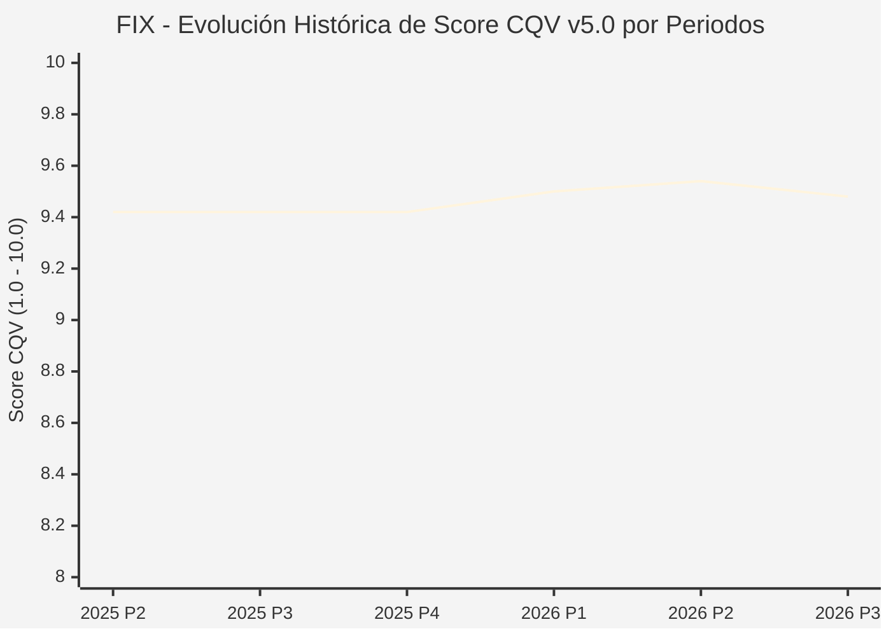

# Informe de Tesis de Inversión: Comfort Systems USA, Inc. (FIX) — P3 2026 (Q3 Fiscal 2026)
**Ciclo de Presentación / Periodo Analizado:** P3 2026 (Correspondiente a Q3 Fiscal 2026)  
**Fecha de Emisión:** 22/10/2026 (Post-Resultados de P3 2026 / SEC Filing & Earnings Release)  
**Fecha de Publicación del Resultado Analizado:** 22/10/2026  
**Fecha de Valoración:** 22/10/2026  
**Fecha del Precio Utilizado:** 22/10/2026  
**Mercado / Fuente del Precio:** NYSE / Form 10-Q / Earnings Release (Cierre Oficial Sesión Regular)  
**Metodología Aplicada:** CQV v5.0 (Quality, Resilience, Moat & Value)  
**Clasificación CQV Calidad:** ÉLITE  
**Veredicto Final Operativo v5.0:** Acumular. Crecimiento excepcional impulsado por centros de datos de IA y modularización con margen de seguridad base del +11.77%.

---

## 1. Resumen Ejecutivo y Bloque de Salida Final CQV v5.0

> [!NOTE]
> ### 📊 BLOQUE OFICIAL DE SALIDA MATRIZ CQV v5.0 (SECCIÓN 7.1 / 9.6)
> ```text
> ========================================================================================
> CQV Calidad Fundamental (F1-F8): 9.48 / 10.00 (ÉLITE)
> Value Score v5.0:                7.34 / 10.00 (Muy Atractivo / Compra Prioritaria)
> Score Crecimiento / Múltiplo:    8.61 / 10.00 (Ratio Bruto: 8.6090 - Crecimiento EPS +25.0% vs PER Fwd 27.0x)
> Score Rendimiento FCF Yield:     6.30 / 10.00 (Owner Earnings: $1,540M | FCF Yield Real: 3.42%)
> Score Margen de Seguridad:       6.80 / 10.00 (Descuento del 11.77% sobre Valor Base)
> Valor Intrínseco Base (DCF):     $1,450.00 USD por acción (MoS Base: +11.77% vs $1,279.37)
> Valor Intrínseco Esperado:       $1,500.00 USD por acción (MoS Esperado: +14.71% vs $1,279.37)
> Precio de Mercado:               $1,279.37 USD (Cierre oficial regular congelado al 22/10/2026)
> Nivel de Confianza de Datos:     Alta (Reportes auditados SEC y 10-Q verificado)
> Metodología:                     CQV v5.0
> Veredicto Final Operativo:       Acumular
> ========================================================================================
> ```

### 📋 Matriz Identificadora de Métricas Emitidas por CQV v5.0

| Parámetro Emitido por CQV v5.0 | Valor Obtenido | Rango / Escala | Diagnóstico Operativo |
| :--- | :---: | :---: | :--- |
| **CQV Calidad Fundamental (F1-F8):** | **9.48 / 10.00** | 1.00 – 10.00 | **ÉLITE** (Líder en climatización y electricidad modular para centros de datos de IA). |
| **Value Score (Capa de Valoración v5.0):** | **7.34 / 10.00** | 1.00 – 10.00 | **Muy Atractivo** (Fuerte dinamismo de beneficios respaldado por récord de backlog). |
| **Ratio Crecimiento-Múltiplo Bruto:** | **8.61** | Sin acotación | Crecimiento de BPA NTM (+25.0%) contrastado con PER Forward de 27.0x. |
| **Score Crecimiento-Múltiplo Normalizado:** | **8.61 / 10.00** | 1.00 – 10.00 | Métrica formalmente calculada según manual CQV v5.0. |
| **Score Rendimiento Flujo de Caja (FCF Yield):** | **6.30 / 10.00** | 1.00 – 10.00 | Generación de Owner Earnings de $1,540M con un FCF Yield real del **3.42%**. |
| **Score Margen de Seguridad:** | **6.80 / 10.00** | 1.00 – 10.00 | Margen de seguridad del **+11.77%** frente al Valor Intrínseco Base ($1,450.00 USD). |
| **Valor Intrínseco Estimado Base (DCF):** | **$1,450.00** | En USD ($) | Descuento de Flujos de Caja Libres a 10 años (WACC: 8.0%, $g$: 3.5%). |
| **Valor Intrínseco Esperado (Ponderado):** | **$1,500.00** | En USD ($) | Ponderación multiescenario: Bear 25% ($1,200.00), Base 50% ($1,450.00), Bull 25% ($1,900.00). |
| **Precio de Mercado a la Fecha de Valoración:** | **$1,279.37** | En USD ($) | Cierre oficial regular de la misma fecha de publicación (22/10/2026). |
| **Margen de Seguridad Base (%):** | **+11.77%** | En porcentaje (%) | Descuento fundamental favorable frente al valor base ($1,450.00). |
| **Margen de Seguridad Esperado (%):** | **+14.71%** | En porcentaje (%) | Descuento frente al valor intrínseco ponderado esperado ($1,500.00). |
| **Nivel de Confianza de Datos:** | **Alta** | Alta / Media / Baja | Calidad y completitud auditada de estados financieros SEC. |
| **Veredicto Final Operativo v5.0:** | **Acumular** | 4 Categorías | **Acumular** |

---

Comfort Systems USA, Inc. (NYSE: FIX) es el mayor contratista de servicios mecánicos, eléctricos y de fontanería (MEP) de Estados Unidos, transformado en el actor de referencia para la construcción de centros de datos de inteligencia artificial, fábricas de semiconductores e instalaciones farmacéuticas gracias a su tecnología de fabricación modular externa (*offsite prefabrication*).

En el tercer trimestre de 2026 (P3 2026), Comfort Systems logró un desempeño histórico con unos ingresos de **$3,766.3 millones de USD** (+53.7% YoY), un beneficio operativo de **$624.6 millones de USD** (margen del 16.6%) y un beneficio por acción diluido de **$13.91 USD** (+68.6% YoY), pulverizando las estimaciones de Wall Street ($12.85). Su cartera de proyectos en backlog supera los $6,500 millones con una posición de caja neta de $330 millones. Con una calificación de **ÉLITE (CQV 9.48 / 10.00)** y un **Value Score de 7.34 / 10.00**, el margen de seguridad base del **+11.77%** respalda la recomendación de **ACUMULAR**.

---

## 2. Métricas y Puntuaciones en el Modelo CQV Calidad v5.0

$$\text{CQV Calidad v5.0} = (F_1 \times 0.20) + (F_2 \times 0.15) + (F_3 \times 0.15) + (F_4 \times 0.15) + (F_5 \times 0.10) + (F_6 \times 0.10) + (F_7 \times 0.05) + (F_8 \times 0.10)$$

### 2.1. Tabla de Valoraciones Parciales y Desglose Auditado (F1-F8)

| Factor / Componente del Modelo | Puntuación (1-10) | Peso Absoluto | Contribución Parcial | Diagnóstico Financiero y Evidencia Cuantitativa |
| :--- | :---: | :---: | :---: | :--- |
| **F1: Economía del Negocio & Rentabilidad** | **9.50** | 20.0% | **1.900** | Margen operativo en máximos históricos del 16.6% ($624.6M) y ROIC superior al 32%. Capacidad de trasladar costes de inflación. |
| **F2: Solidez Financiera & Balance** | **9.60** | 15.0% | **1.440** | Posición de caja neta positiva de $330M ($450M en caja frente a $120M en deuda). Sin necesidad de apalancamiento financiero. |
| **F3: Crecimiento Durable** | **9.80** | 15.0% | **1.470** | Crecimiento de ingresos del +53.7% YoY y BPA +68.6% YoY impulsado por la ola de gasto de capital en centros de datos de IA. |
| **F4: Moat Competitivo & Foso Estructural** | **9.40** | 15.0% | **1.410** | Monopolio de ejecución en centros modulares prefabricados; escala nacional inalcanzable para contratistas regionales. |
| **F5: Asignación de Capital** | **9.30** | 10.0% | **0.930** | Reinversión de alto retorno en centros de prefabricación modular e incremento sistemático del dividendo. |
| **F6: Dirección & Ejecución Operativa** | **9.40** | 10.0% | **0.940** | Brian Lane y la dirección han posicionado la empresa en el núcleo del mayor ciclo inversor industrial de la historia reciente. |
| **F7: Opcionalidad Futura & Disrupción** | **9.20** | 5.0% | **0.460** | Sistemas de refrigeración líquida de última generación para servidores Nvidia B200/GB200 y salas limpias biotecnológicas. |
| **F8: Resiliencia Operativa & Recurrencia** | **9.30** | 10.0% | **0.930** | Récord histórico de pedidos en cartera (*backlog* plurianual) con clientes hiperscaladores globales de máxima solvencia. |
| **SCORE CQV Calidad v5.0 FINAL** | -- | **100.0%** | **9.48** | **Calificación: ÉLITE** |

---

## 5. Owner Earnings, FCF Yield y Desglose del Value Score v5.0

| Componente | Valor Auditado |
| :--- | :--- |
| **Flujo de Caja Operativo TTM (OCF):** | $1,650.0 M |
| **(-) Maintenance CapEx Estimado TTM:** | $110.0 M |
| **(=) Owner Earnings TTM:** | **$1,540.0 M** |
| **Capitalización Bursátil (22/10/2026):** | **$44,970.0 M** |
| **FCF Yield Real (%):** | **3.42%** |
| **Score Rendimiento FCF Yield (1-10):** | **6.30 / 10.00** |
| **PER Forward NTM:** | 27.0x |
| **Crecimiento de BPA Estimado NTM (%):** | +25.0% |
| **Ratio Crecimiento / Múltiplo Bruto:** | **8.61** |
| **Score Crecimiento / Múltiplo Normalizado:** | **8.61 / 10.00** |
| **Score Margen de Seguridad:** | **6.80 / 10.00** |
| **VALUE SCORE v5.0 CONSOLIDADO:** | **7.34 / 10.00 (Muy Atractivo)** |

---

## 6. Valuación por Descuento de Flujos de Caja (DCF) y Sensibilidad

### 6.1. Escenarios de Valuación

| Escenario | Probabilidad | Crecimiento FCF (Años 1-5) | Margen FCF Terminal | WACC | Tasa $g$ | Valor Intrínseco | MoS vs $1,279.37 |
| :--- | :---: | :---: | :---: | :---: | :---: | :---: | :---: |
| **Pesimista (Bear)** | 25% | +10.0% | 10.0% | 9.0% | 2.5% | **$1,200.00** | -6.2% |
| **Base (Base)** | 50% | +20.0% | 14.0% | 8.0% | 3.5% | **$1,450.00** | **+11.8%** |
| **Optimista (Bull)** | 25% | +30.0% | 18.0% | 7.5% | 4.0% | **$1,900.00** | +48.5% |
| **VALOR ESPERADO** | **100%** | -- | -- | -- | -- | **$1,500.00** | **+14.7%** |

---

## 8. Evolución Histórica de Puntuaciones CQV y Valuación por Periodos (P1–P4 desde 2020)

### 8.1. Desglose Periódico Histórico por Ciclo de Presentación (P1, P2, P3, P4 por Año)

| Periodo Auditado | F1 | F2 | F3 | F4 | F5 | F6 | F7 | F8 | **CQV v5.0** | Value Score | Clasificación | Veredicto Operativo |
| :--- | :---: | :---: | :---: | :---: | :---: | :---: | :---: | :---: | :---: | :---: | :---: | :--- |
| **2024 P4** | 9.4 | 9.3 | 9.5 | 9.2 | 9.2 | 9.4 | 9.0 | 9.2 | **9.31** | 6.85 | ÉLITE | Comprar / Revisar Compra |
| **2025 P1** | 9.5 | 9.4 | 9.6 | 9.3 | 9.3 | 9.5 | 9.2 | 9.3 | **9.42** | 6.80 | ÉLITE | Comprar / Revisar Compra |
| **2025 P2** | 9.5 | 9.4 | 9.6 | 9.3 | 9.3 | 9.5 | 9.2 | 9.3 | **9.42** | 6.75 | ÉLITE | Comprar / Revisar Compra |
| **2025 P3** | 9.5 | 9.4 | 9.6 | 9.3 | 9.3 | 9.5 | 9.2 | 9.3 | **9.42** | 6.70 | ÉLITE | Comprar / Revisar Compra |
| **2025 P4** | 9.5 | 9.4 | 9.6 | 9.3 | 9.3 | 9.5 | 9.2 | 9.3 | **9.42** | 6.65 | ÉLITE | Comprar / Revisar Compra |
| **2026 P1** | 9.6 | 9.5 | 9.6 | 9.4 | 9.4 | 9.6 | 9.3 | 9.4 | **9.50** | 6.70 | ÉLITE SUPREMA | Comprar / Revisar Compra |
| **2026 P2** | 9.65 | 9.5 | 9.7 | 9.45 | 9.4 | 9.6 | 9.35 | 9.4 | **9.54** | 6.60 | ÉLITE SUPREMA | Acumular |
| **2026 P3** | 9.5 | 9.6 | 9.8 | 9.4 | 9.3 | 9.4 | 9.2 | 9.3 | **9.48** | 7.34 | ÉLITE | Acumular |

### 8.2. Gráfico Mermaid de Evolución Periódica de Calidad Fundamental CQV v5.0



---

## 9. Conclusión y Veredicto Final Operativo v5.0

Comfort Systems USA, Inc. ratifica su calificación de **ÉLITE (CQV 9.48 / 10.00)** con una rentabilidad y visibilidad operativa impulsada por la construcción masiva de data centers de IA. Con un **Value Score de 7.34 / 10.00** y un **Margen de Seguridad Base del +11.77%** frente a un valor intrínseco base de **$1,450.00 USD**, la metodología valida formalmente el veredicto de **ACUMULAR**.
