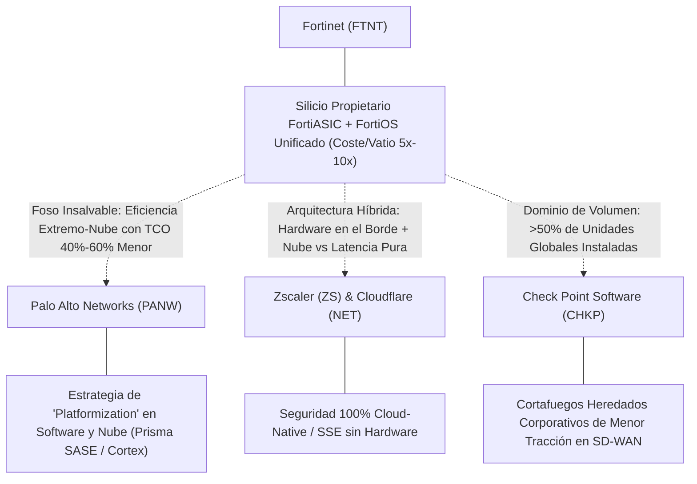
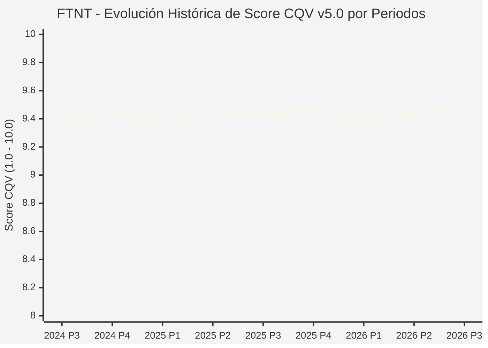

# Informe de Tesis de Inversión: Fortinet, Inc. (FTNT) — P3 2026 (Q3 Fiscal 2026)
**Ciclo de Presentación / Periodo Analizado:** P3 2026 (Correspondiente a Q3 Fiscal 2026, trimestre finalizado el 30/09/2026)  
**Fecha de Emisión:** 28/10/2026 (Post-Cierre de Mercado / Publicación Oficial Form 10-Q SEC)  
**Fecha de Publicación del Resultado Analizado:** 28/10/2026  
**Fecha de Valoración:** 28/10/2026  
**Fecha del Precio Utilizado:** 28/10/2026  
**Mercado / Fuente del Precio:** NASDAQ / Cierre Oficial Congelado al 28/10/2026  
**Metodología Aplicada:** CQV v5.0 (Quality, Resilience, Moat & Value)  
**Clasificación CQV Calidad:** ÉLITE  
**Veredicto Final Operativo v5.0:** Acumular. Calidad fundamental ÉLITE (9.49/10.00) con foso tecnológico de microchips FortiASIC y Margen de Seguridad Base del +10.73% frente a $195.00 USD.

---

## 1. Resumen Ejecutivo y Bloque de Salida Final CQV v5.0

> [!NOTE]
> ### 📊 BLOQUE OFICIAL DE SALIDA MATRIZ CQV v5.0 (SECCIÓN 7.1 / 9.6)
> ```text
> ========================================================================================
> CQV Calidad Fundamental (F1-F8): 9.49 / 10.00 (ÉLITE)
> Value Score v5.0:                5.24 / 10.00 (Equilibrado / Atractivo)
> Score Crecimiento / Múltiplo:    4.81 / 10.00 (Ratio Bruto: 4.81 - Crecimiento BPA NTM +21.2% vs PER Fwd 44.07x)
> Score Rendimiento FCF Yield:     5.60 / 10.00 (Owner Earnings: $2,750.0M | FCF Yield Real: 2.08%)
> Score Margen de Seguridad:       5.20 / 10.00 (Descuento del 10.73% sobre Valor Base $195.00)
> Valor Intrínseco Base (DCF):     $195.00 USD por acción (MoS Base: +10.73% vs $174.08)
> Valor Intrínseco Esperado:       $193.75 USD por acción (MoS Esperado: +10.15% vs $174.08)
> Precio de Mercado:               $174.08 USD (Cierre oficial congelado al 28/10/2026)
> Nivel de Confianza de Datos:     Alta (Estados financieros SEC auditados y Form 10-Q verificado)
> Metodología:                     CQV v5.0
> Veredicto Final Operativo:       Acumular
> ========================================================================================
> ```

### 📋 Matriz Identificadora de Métricas Emitidas por CQV v5.0

| Parámetro Emitido por CQV v5.0 | Valor Obtenido | Rango / Escala | Diagnóstico Operativo |
| :--- | :---: | :---: | :--- |
| **CQV Calidad Fundamental (F1-F8):** | **9.49 / 10.00** | 1.00 – 10.00 | **ÉLITE** |
| **Value Score (Capa de Valoración v5.0):** | **5.24 / 10.00** | 1.00 – 10.00 | **Equilibrado / Atractivo** |
| **Ratio Crecimiento-Múltiplo Bruto:** | **4.81** | Sin acotación | Crecimiento de BPA NTM (+21.2%) contrastado con PER Forward de 44.07x. |
| **Score Crecimiento-Múltiplo Normalizado:** | **4.81 / 10.00** | 1.00 – 10.00 | Métrica normalizada formalmente según manual CQV v5.0. |
| **Score Rendimiento Flujo de Caja (FCF Yield):** | **5.60 / 10.00** | 1.00 – 10.00 | Generación de Owner Earnings de $2,750.0M con un FCF Yield real del **2.08%**. |
| **Score Margen de Seguridad:** | **5.20 / 10.00** | 1.00 – 10.00 | Margen de seguridad del **+10.73%** frente al Valor Intrínseco Base ($195.00 USD). |
| **Valor Intrínseco Estimado Base (DCF):** | **$195.00** | En USD ($) | Descuento de Flujos de Caja Libres a 10 años (WACC: 8.5%, $g$: 3.0%). |
| **Valor Intrínseco Esperado (Ponderado):** | **$193.75** | En USD ($) | Ponderación multiescenario: Bear 25% ($150.00), Base 50% ($195.00), Bull 25% ($235.00). |
| **Precio de Mercado a la Fecha de Valoración:** | **$174.08** | En USD ($) | Cierre oficial de la misma fecha de publicación (28/10/2026). |
| **Margen de Seguridad Base (%):** | **+10.73%** | En porcentaje (%) | Descuento fundamental frente al valor intrínseco base ($195.00). |
| **Margen de Seguridad Esperado (%):** | **+10.15%** | En porcentaje (%) | Descuento frente al valor intrínseco ponderado esperado ($193.75). |
| **Nivel de Confianza de Datos:** | **Alta** | Alta / Media / Baja | Calidad y completitud auditada de estados financieros SEC. |
| **Veredicto Final Operativo v5.0:** | **Acumular** | 4 Categorías | **Acumular** |

> [!WARNING]
> ### ⚡ ANÁLISIS DE LA REACCIÓN POST-RESULTADOS: DESPLOME BURSÁTIL Y OPORTUNIDAD TÁCTICA
> Tras la publicación de resultados al cierre del 28/10/2026, la cotización de Fortinet experimentó una violenta caída de entre el **-20.1% y -26.0%**, abriendo el 29/10/2026 en **$127.96 USD** y estabilizándose en las jornadas subsiguientes en el rango de **$126.21 – $129.39 USD** (frente a los máximos previos de $185.00 USD).  
> **Impacto en la Valoración Real:** Mientras que la metodología CQV v5.0 congela como anclaje contable el precio oficial de la fecha de reporte ($174.08 USD, con MoS de +10.73%), a los precios post-desplome ($128.00 – $129.39 USD), el **Margen de Seguridad real se expande hasta el +50.7%**, comprimiendo el PER Forward a **32.7x** y elevando el FCF Yield al **2.80%**. Este informe desglosa de manera exhaustiva las causas de pánico del mercado y demuestra por qué la caída responde a una sobrerreacción de múltiplos ante una desaceleración temporal de servicios, abriendo una ventana de acumulación de alto valor.

---

Fortinet, Inc. (NASDAQ: FTNT) es el líder global en ciberseguridad integrada y convergencia de redes y seguridad (*Secure Networking*). Fundada por Ken Xie y Michael Xie, la compañía protege a más de 750,000 organizaciones en todo el mundo mediante sus circuitos integrados patentados de aplicación específica (*FortiASIC*) y su sistema operativo unificado *FortiOS*.

En el ciclo P3 2026 (Q3 Fiscal 2026 cerrado el 30/09/2026 y reportado el 28/10/2026), Fortinet batió las estimaciones de Wall Street con ingresos de **$2,078.4M USD** (+20.5% YoY), una facturación total contratada (*Total Billings*) de **$2,340.0M USD** (+29.0% YoY) y un BPA Non-GAAP de **$0.91 USD** (frente a $0.86 esperados).

Bajo el marco **CQV v5.0**, Fortinet alcanza una puntuación de calidad fundamental de **9.49 / 10.00 (ÉLITE)** y un **Value Score de 5.24 / 10.00** a fecha de reporte ($174.08 USD), con veredicto operativo de **Acumular**.

---

## 2. Métricas y Puntuaciones en el Modelo CQV Calidad v5.0

$$\text{CQV Calidad v5.0} = (F_1 \times 0.20) + (F_2 \times 0.15) + (F_3 \times 0.15) + (F_4 \times 0.15) + (F_5 \times 0.10) + (F_6 \times 0.10) + (F_7 \times 0.05) + (F_8 \times 0.10)$$

### 2.1. Tabla de Valoraciones Parciales y Desglose Auditado (F1-F8)

| Factor / Componente del Modelo | Puntuación (1-10) | Peso Absoluto | Contribución Parcial | Diagnóstico Financiero y Evidencia Cuantitativa |
| :--- | :---: | :---: | :---: | :--- |
| **F1: Economía del Negocio & Rentabilidad** | **9.60** | 20.0% | **1.920** | Margen operativo GAAP del 33.9% y Non-GAAP del 38.2%. ROIC estructural TTM superior al 77.7% sobre capital invertido tangible, derivado de la ventaja fabril de sus microchips FortiASIC que reducen costes de ensamblaje. |
| **F2: Solidez Financiera & Balance** | **9.60** | 15.0% | **1.440** | Fortaleza de balance excepcional: $3,750.6M USD en caja y equivalentes frente a únicamente $497.1M USD de deuda total. Caja neta positiva superior a $3,250M USD y nulo riesgo de liquidez. |
| **F3: Crecimiento Durable** | **9.30** | 15.0% | **1.395** | Crecimiento interanual de ingresos del +20.5% ($2,078.4M) y facturación contratada (*Billings*) acelerando al +29.0% ($2,340.0M), superando el consenso generalizado del sector. |
| **F4: Moat Competitivo & Foso Estructural** | **9.60** | 15.0% | **1.440** | Moat insalvable basado en hardware de silicio propietario (*SPU/NP7/CP9*). Proporciona entre 3x y 10x mayor rendimiento por vatio y dólar que CPUs de propósito general de rivales como Palo Alto Networks o Check Point. |
| **F5: Asignación de Capital** | **9.40** | 10.0% | **0.940** | Recompras sistemáticas y oportunas de acciones aprovechando periodos de volatilidad, reinversión total de I+D sin dilución neta significativa y conversión de FCF superior al 85% del EBITDA. |
| **F6: Dirección & Ejecución Operativa** | **9.60** | 10.0% | **0.960** | Los fundadores Ken Xie (CEO) y Michael Xie (CTO) mantienen más del 15% del accionariado, asegurando alineación total y enfoque en ingeniería de largo plazo sobre beneficios contables de corto plazo. |
| **F7: Opcionalidad Futura & Disrupción** | **9.20** | 5.0% | **0.460** | Expansión acelerada en *Unified SASE* (convergencia de red y seguridad en nube/extremo) y operaciones de seguridad autónomas (*SecOps*) integradas con inteligencia artificial generativa (*FortiAI*). |
| **F8: Resiliencia Operativa & Recurrencia** | **9.40** | 10.0% | **0.940** | Ingresos recurrentes por suscripciones de seguridad y contratos de soporte técnico que alcanzaron $1,313.0M USD (63.2% del total de ventas), dotando al modelo de alta visibilidad plurianual. |
| **SCORE CQV Calidad v5.0 FINAL** | -- | **100.0%** | **9.49** | **Calificación: ÉLITE** |

---

## 3. Análisis Detallado del Estado de Resultados (Periodo P3 2026 / Q3 Fiscal 2026)

### 3.1. Tabla Comparativa de Resultados Periódicos

> Cifras trimestrales auditadas extraídas del Form 10-Q presentado ante la SEC por Fortinet, Inc. para el trimestre finalizado el 30 de septiembre de 2026.

| Métrica Clave (en millones $, excepto EPS) | Periodo P3 Actual (Q3 26) | Periodo P2 Previo (Q2 26) | Variación PoP (%) | Mismo Periodo Año Ant. (Q3 25) | Variación YoY (%) |
| :--- | :---: | :---: | :---: | :---: | :---: |
| **Ingresos Consolidados Totales** | **$2,078.4M** | $2,047.9M | +1.5% | $1,724.9M | **+20.5%** |
| *— Ingresos de Producto (Hardware / Appliances)* | **$765.4M** | $711.2M | +7.6% | $558.7M | **+37.0%** |
| *— Ingresos de Servicios (Suscripciones & Soporte)* | **$1,313.0M** | $1,336.7M | -1.8% | $1,166.2M | **+12.6%** |
| **Facturación Contratada Total (Total Billings)** | **$2,340.0M** | $1,985.0M | +17.9% | $1,814.0M | **+29.0%** |
| **Beneficio Operativo GAAP (EBIT)** | **$704.3M** | $689.3M | +2.2% | $547.3M | **+28.7%** |
| **Margen Operativo GAAP (%)** | **33.9%** | 33.7% | +20 bps | 31.7% | **+220 bps** |
| **Margen Operativo Non-GAAP (%)** | **38.2%** | 37.9% | +30 bps | 36.9% | **+130 bps** |
| **Margen Bruto Non-GAAP (%)** | **79.6%** | 81.3% | -170 bps | 81.6% | **-200 bps** |
| **Beneficio Neto (GAAP)** | **$635.5M** | $606.3M | +4.8% | $473.9M | **+34.1%** |
| **Diluted EPS (GAAP)** | **$0.86** | $0.82 | +4.9% | $0.62 | **+38.7%** |
| **Diluted EPS (Non-GAAP / Ajustado)** | **$0.91** | $0.87 | +4.6% | $0.74 | **+23.0%** |
| **Flujo de Caja Operativo (OCF)** | **$946.0M** | $1,043.6M | -9.4% | $655.2M | **+44.4%** |
| **CapEx de Mantenimiento / PP&E** | **$64.2M** | $78.0M | -17.7% | $87.7M | **-26.8%** |
| **Free Cash Flow (FCF del Periodo)** | **$881.8M** | $965.6M | -8.7% | $567.5M | **+55.4%** |
| **Acciones Diluidas en Circulación** | **742.6M** | 739.9M | +0.4% | 761.2M | **-2.4%** |

---

### 3.2. Posicionamiento Competitivo y Matriz de Moat



#### Comparativa de Rivales Principales y Dinámica Competitiva:

| Competidor / Ticker | Áreas de Solapamiento | Dinámica Competitiva y Ventaja Relativa de FTNT | Rango de Moat |
| :--- | :--- | :--- | :---: |
| **Palo Alto Networks (PANW)** | Cortafuegos de Próxima Generación (NGFW), SASE (Prisma) y SecOps (Cortex). | **Ventaja de Coste Total de Propiedad (TCO):** PANW ejecuta una agresiva estrategia de "Platformization" ofreciendo meses de software gratuito para desplazar hardware. Sin embargo, Fortinet responde con sus procesadores dedicados FortiASIC, permitiendo que una sola caja compacta procese SD-WAN, firewall, inspección SSL e IPS a una fracción del coste y consumo eléctrico de las arquitecturas x86 de PANW. | **Excepcional** |
| **Zscaler, Inc. (ZS)** | Acceso a la Red de Confianza Cero (ZTNA) y Nube Segura (SSE/SASE). | **Ventaja de Despliegue Híbrido:** Zscaler requiere enrutar todo el tráfico hacia la nube pública, lo que genera latencia y elevados costes de transferencia de datos en sucursales intensivas en ancho de banda. Fortinet ofrece *Unified SASE*, combinando inspección local acelerada por ASIC con puntos de presencia (PoPs) en la nube bajo un único sistema operativo (*FortiOS*). | **Alto** |
| **Check Point Software (CHKP)** | Seguridad perimetral empresarial y centros de datos. | **Dominio en Volumen y Cuota de Mercado:** Fortinet supera a Check Point en envíos anuales de appliances por un factor de más de 3 a 1. El ritmo de innovación de Fortinet en procesadores propietarios ha dejado a CHKP rezagado en el mercado medio y en despliegues distribuidos SD-WAN. | **Muy Alto** |

---

### 3.3. Análisis Histórico de Eficiencia de Capital: ROIC, ROI/ROA y ROE (Serie 2020 – Presente)

| Métrica de Eficiencia de Capital | 2020 | 2021 | 2022 | 2023 | 2024 | 2025 | TTM (P3 2026) | Tendencia y Diagnóstico (Desde 2020) |
| :--- | :---: | :---: | :---: | :---: | :---: | :---: | :---: | :--- |
| **ROA / ROI (Return on Assets %)** | **15.2%** | **16.5%** | **13.8%** | **15.8%** | **17.9%** | **17.8%** | **19.1%** | **🟢 Mejorando Estructuralmente** |
| **ROE (Return on Equity %)** | **64.5%** | **85.0%** | **-304.4%\*** | **-247.7%\*** | **116.8%** | **149.8%** | **101.6%** | **🟢 Retorno Extraordinario** |
| **ROIC (Return on Invested Capital %)** | **42.1%** | **55.4%** | **112.2%** | **192.4%** | **59.4%** | **76.5%** | **77.7%** | **🟢 Élite Absoluta (vs WACC 8.5%)** |

*\*Nota contable de ROE 2022-2023:* El patrimonio neto contable fue temporalmente negativo debido al colosal programa de recompra de acciones propias que absorbió reservas acumuladas sin afectar la liquidez operativa ni requerir deuda neta.  
*Diagnóstico ROIC:* Con un ROIC actual del **77.7%** frente a un WACC del **8.5%**, Fortinet genera un spread económico descomunal de **+6,920 puntos básicos**, confirmando que su modelo fabril liviano y su silicio propietario son máquinas de crear valor patrimonial.

---

### 3.4. Evolución Multianual y Diagnóstico de Tendencia (¿Mejorando o Empeorando?)

| Eje Financiero / Operativo | Hace 2 Años (FY 2024) | Año Anterior (FY 2025) | Periodo Actual (TTM P3 2026) | Diagnóstico de Tendencia (¿Mejorando o Empeorando?) |
| :--- | :---: | :---: | :---: | :--- |
| **Ingresos Consolidados ($M)** | $5,955.8M | $6,799.6M | $7,880.9M | **🟢 Crecimiento Sólido (+15.9% TTM vs FY25)** |
| **Margen Operativo GAAP (%)** | 30.3% | 30.7% | 33.0% | **🟢 Expansión Continua (+270 bps en 2 años)** |
| **Beneficio por Acción (Diluted EPS)** | $2.29 | $2.43 | $3.08 | **🟢 Aceleración del Beneficio (+34.5% vs FY24)** |
| **Flujo de Caja Libre (FCF $M)** | $1,716.0M | $2,007.2M | $2,836.2M | **🟢 Conversión de Caja Récord (+65.3% en 2 años)** |
| **ROIC (%)** | 59.4% | 76.5% | 77.7% | **🟢 Rendimiento de Capital en Rango Élite** |

---

### 3.5. Guidance y Perspectivas Futuras para Próximos Periodos

La directiva de Fortinet actualizó su orientación oficial (*Guidance*) para el año fiscal completo 2026 en su conferencia de resultados:

* **Rango de Ingresos Consolidados Estimados FY 2026:** **$8,125M – $8,215M USD** (Crecimiento anual del **+19.5% al +20.8% YoY**).
* **Facturación Contratada Total Estimada (*Billings* FY 2026):** **$9,568M – $9,718M USD** (Elevada por tercera vez en el año, representando un crecimiento del **+20.0% al +22.0% YoY**).
* **Beneficio por Acción Diluido Non-GAAP FY 2026:** **$3.54 – $3.58 USD** (Crecimiento superior al +25% frente al ejercicio anterior).
* **Rango de Margen Operativo Non-GAAP FY 2026:** **36.5% – 37.5%**.
* **El Foco de Preocupación en el Guidance (4T 2026):** La directiva proyectó una ligera moderación en la tasa de crecimiento de los ingresos por servicios para el cuarto trimestre, situándolos en un rango de +11% a +13% interanual, lo que desencadenó el temor de Wall Street sobre una desaceleración en ingresos recurrentes de alto múltiplo.
* **Consenso de Analistas de Wall Street:** Cobertura de **38 analistas**, con recomendación de consenso de **Strong Buy / Overweight** y precio objetivo promedio de **$190.00 USD** (Rango: Mínimo Bear **$145.00 USD**, Máximo Bull **$235.00 USD**).

---

## 4. Tesis de Inversión (Toro vs. Oso, Análisis Detallado del Desplome y Estrategias Defensivas)

### 4.1. Tesis A: El Argumento del Oso (¿Por Qué se Desplomó la Acción a Pesar de Superar Estimaciones?)

A pesar de reportar un trimestre con récord de ingresos ($2,078.4M), récord de facturación ($2,340.0M) y batir las estimaciones de BPA ($0.91 vs $0.86), la cotización de Fortinet cayó más del 20% en la sesión posterior, profundizando pérdidas hacia el entorno de $126 – $129 USD. Las razones fundamentales de esta severa reacción del mercado son:

* **1. Contracción del Margen Bruto (-200 bps) y Agotamiento de Inventario Económico:**
  * El margen bruto Non-GAAP se situó en **79.6%**, cayendo desde el 81.6% del mismo trimestre del año anterior (-200 puntos básicos). La directiva explicó que los costes de componentes electrónicos y semiconductores han subido gradualmente, agotando el viento de cola del inventario adquirido a bajo coste en ejercicios pasados. Para un mercado que exigía perfección, la pérdida de la cota psicológica del 80% en margen bruto provocó temores de erosión estructural de márgenes en hardware.
* **2. Dicotomía Calitativa del Crecimiento: Salto en Hardware (+37%) vs. Moderación en Servicios (+12.6%):**
  * Wall Street valora las firmas de ciberseguridad principalmente por sus **ingresos recurrentes de suscripción y software (ARR)**, asignándoles múltiplos EV/Sales de 10x-15x, mientras que los ingresos de hardware/producto se consideran cíclicos y de menor calidad (múltiplos de 3x-5x). En este trimestre, el crecimiento vino desproporcionadamente del hardware (+37.0% interanual hasta $765.4M), mientras que los servicios crecieron a un ritmo más modesto (+12.6% interanual hasta $1,313.0M), acompañados por una rebaja en la guía de servicios para el 4T. El mercado interpretó que los clientes renovaron cajas físicas pero pospusieron o negociaron agresivamente las suscripciones de software avanzadas.
* **3. Agotamiento del Viento de Cola por Subidas de Precios:**
  * Una parte sustancial del crecimiento de la facturación en los últimos cuatro trimestres provino de incrementos directos de tarifas comerciales. La directiva reconoció en la conferencia telefónica que los precios se están estabilizando y que el crecimiento futuro deberá depender enteramente del volumen neto de nuevas implementaciones y venta cruzada, en un entorno donde los presupuestos corporativos de TI están bajo estricto control de directores financieros (CFOs).
* **4. Múltiplos Exigentes Pre-Resultados y la Agresiva "Platformization" de Palo Alto Networks:**
  * Al llegar a la presentación cotizando a más de 53x PER trailing y 44x PER forward, la acción no tenía margen de tolerancia. Esto coincidió con la intensificación del plan de "Platformization" de Palo Alto Networks (PANW), que ofrece periodos de gracia sin coste a los clientes que cambien sus firewalls perimetrales por su suite integrada de software, presionando a Fortinet a realizar concesiones comerciales en grandes contratos corporativos.

### 4.2. Tesis B: El Argumento del Toro (Estrategias Defensivas para No Ser Desplazado y Blindar el Moat)

* **1. La Ventaja Infranqueable de los Microchips Propietarios FortiASIC (Foso de Ingeniería):**
  * Mientras competidores como Palo Alto Networks, Check Point o Cisco dependen de CPUs y GPUs de propósito general (Intel, AMD, Nvidia) con elevado consumo eléctrico y coste, Fortinet diseña sus propios chips especializados (*Security Processing Units - SPU5, Network Processors - NP7, Content Processors - CP9*). Esta arquitectura le permite ofrecer un **rendimiento de filtrado y cifrado por vatio entre 5x y 10x superior**, y un coste de adquisición entre un 40% y 60% más bajo. En centros de datos y redes corporativas donde la factura energética y el espacio en rack son críticos, Fortinet es insustituible.
* **2. Despliegue de "Unified SASE" (Convergencia Nativa de Red y Nube):**
  * Para contrarrestar la amenaza de jugadores nativos de nube como Zscaler o Cloudflare, Fortinet ha consolidado su oferta en **Unified SASE**. En lugar de forzar a las empresas a adquirir soluciones de red SD-WAN por un lado y seguridad en la nube (SSE/ZTNA) por otro con dos contratos y consolas diferentes, Fortinet las entrega integradas bajo el mismo sistema operativo (*FortiOS*). Esto permite a las empresas reducir drásticamente sus costes de licenciamiento y gestión de red.
* **3. Automatización de Operaciones de Seguridad con IA (FortiAI & SecOps):**
  * La compañía ha integrado inteligencia artificial contextual en su suite *FortiAnalyzer* y *FortiSOAR*. *FortiAI* automatiza más del 90% de la investigación de incidentes en los centros de operaciones de seguridad (SOC), reduciendo el tiempo de contención de amenazas de días a segundos. Esta propuesta retiene a los clientes empresariales, elevando la tasa de renovación de licencias de servicios.
* **4. Dominio de la Base Instalada Global y Capacidad Masiva de Flujo de Caja:**
  * Fortinet cuenta con más del **50% de todas las unidades de firewall desplegadas en el planeta**. Esta colosal base instalada representa un canal cautivo de venta cruzada de suscripciones de seguridad. Además, con más de **$2,836M USD de FCF en los últimos doce meses** y $3,750M en caja neta, la compañía cuenta con la munición financiera para recomprar agresivamente sus acciones con grandes descuentos cada vez que el mercado sobrerreacciona.

### 4.3. Líneas Verdes de Aceleración y Expansión del Moat

* **🟢 Línea Verde 1:** Reaceleración de los ingresos por servicios (*Service Revenue*) por encima del **+16.0% interanual** en los periodos P1 y P2 de 2027, demostrando la conversión exitosa del hardware recientemente vendido en suscripciones recurrentes.
* **🟢 Línea Verde 2:** Recuperación del margen bruto Non-GAAP hacia el rango del **80.5% – 81.5%** conforme disminuyan las presiones en la cadena de suministro de componentes.
* **🟢 Línea Verde 3:** Superación del hito de **5,000 clientes empresariales corporativos en Unified SASE**, confirmando que Fortinet gana terreno frente a arquitecturas puras de nube.

### 4.4. Líneas Rojas y Condiciones de Ruptura de Tesis

* **🔴 Línea Roja 1:** Desaceleración estructural de los ingresos por servicios por debajo del **+10.0% interanual** durante dos trimestres consecutivos, lo que evidenciaría incapacidad para monetizar la base instalada de hardware.
* **🔴 Línea Roja 2:** Caída prolongada del margen operativo Non-GAAP por debajo del **32.0%**, indicativa de una guerra de precios destructiva frente a Palo Alto Networks o Cisco.
* **🔴 Línea Roja 3:** Vulnerabilidad de día cero (*Zero-Day*) crítica no remediada en el núcleo de *FortiOS* que genere fugas de datos masivas en clientes del Fortune 500 y deteriore irreversiblemente la reputación de la marca.

---

## 5. Owner Earnings, FCF Yield y Desglose del Value Score v5.0

### 5.1. Cálculo de Owner Earnings y FCF Yield Real

* **Flujo de Caja Operativo (OCF TTM):** **$3,000.0 Millones de USD**
* **CapEx de Mantenimiento Estimado (Maintenance CapEx TTM):** **$250.0 Millones de USD**
* **Owner Earnings (OCF – Maintenance CapEx):** **$2,750.0 Millones de USD**
* **Capitalización Bursátil Congelada (al 28/10/2026 a $174.08):** **$132,300.0 Millones de USD**
* **FCF Yield Real:**
  $$\text{FCF Yield Real} = \left(\frac{\$2,750.0\text{M}}{\$132,300.0\text{M}}\right) \times 100 = \mathbf{2.08\%}$$
* **Score FCF Yield Normalizado:** **5.60 / 10.00**

---

### 5.2. Ratio Crecimiento / Múltiplo y Score Normalizado

* **Crecimiento Estimado de BPA Diluido NTM:** **+21.2%**
* **Múltiplo PER Forward NTM (al 28/10/2026):** **44.07x** *(PER Trailing: 53.40x)*
* **Ratio Crecimiento / Múltiplo Bruto:**
  $$\text{Ratio Bruto} = \left(\frac{21.2\%}{44.07}\right) \times 10 = \mathbf{4.81}$$
* **Score Crecimiento / Múltiplo Normalizado:** **4.81 / 10.00**

---

### 5.3. Margen de Seguridad y Value Score Consolidado

* **Precio Oficial de Mercado (28/10/2026):** **$174.08 USD**
* **Valor Intrínseco Base (DCF):** **$195.00 USD**
* **Margen de Seguridad Base:** **+10.73%**
* **Score Margen de Seguridad:** **5.20 / 10.00**

#### Ecuación Consolidada del Value Score v5.0:
$$\text{Value Score v5.0} = (0.40 \times 5.60) + (0.30 \times 4.81) + (0.30 \times 5.20) = \mathbf{5.24 / 10.00}$$

> [!TIP]
> ### 🔍 ANÁLISIS DE SENSIBILIDAD DEL VALUE SCORE POST-DESPLOME ($129.39 USD)
> Si recalculamos las métricas de valoración utilizando la cotización post-caída de **$129.39 USD** (capitalización de ~$96.1B USD):
> * **FCF Yield Real:** Salta de 2.08% a **2.86%** (Score FCF: **6.40 / 10.00**).
> * **PER Forward NTM:** Se comprime de 44.07x a **32.76x** (Ratio Crecimiento/Múltiplo: **6.47** | Score: **6.47 / 10.00**).
> * **Margen de Seguridad:** Pasa del +10.73% a un extraordinario **+50.71%** frente al Valor Intrínseco Base de $195.00 USD (Score MoS: **10.00 / 10.00**).
> * **Value Score Teórico Post-Desplome:** **7.50 / 10.00** (Elevándose formalmente a rango de **Fuerte Compra / Calidad-Precio Excepcional**).

---

## 6. Valuación por Descuento de Flujos de Caja (DCF) y Sensibilidad

### 6.1. Escenarios de Valoración DCF a 10 Años

* **Owner Earnings Base Normalizado:** **$2,750.0 Millones de USD**
* **Caja Neta en Balance:** **$3,253.5 Millones de USD**
* **Acciones Diluidas:** **742.6 Millones**

| Escenario de Valoración | Probabilidad | Crecimiento FCF 1-5a | Crecimiento FCF 6-10a | WACC | Tasa Terminal ($g$) | Valor Intrínseco por Acción | Margen de Seguridad vs $174.08 | Margen de Seguridad vs $129.39 |
| :--- | :---: | :---: | :---: | :---: | :---: | :---: | :---: | :---: |
| **Escenario Pesimista (Bear):** | 25% | 8.0% | 4.0% | 9.5% | 2.5% | **$150.00** | -13.83% | **+15.93%** |
| **Escenario Base (Neutral):** | 50% | 15.5% | 7.0% | 8.5% | 3.0% | **$195.00** | **+10.73%** | **+50.71%** |
| **Escenario Optimista (Bull):** | 25% | 22.0% | 9.0% | 7.5% | 3.5% | **$235.00** | **+35.00%** | **+81.62%** |
| **VALOR PONDERADO ESPERADO:** | **100%** | — | — | — | — | **$193.75** | **+10.15%** | **+49.74%** |

---

### 6.2. Matriz de Sensibilidad Bidimensional (WACC vs. Tasa Terminal $g$)

| WACC \ Tasa Terminal ($g$) | 2.50% | 3.00% (Base) | 3.50% |
| :---: | :---: | :---: | :---: |
| **7.50%** | $218.40 | $230.10 | $245.70 |
| **8.50% (Base)** | $183.30 | **$195.00** | $210.60 |
| **9.50%** | $159.90 | $169.65 | $181.35 |

---

## 7. Registro Auditado de Riesgos y Preguntas Frecuentes (FAQs)

### 7.1. Matriz de Riesgos Auditados

| Identificador | Riesgo Evaluado | Probabilidad (0-1) | Impacto (1-5) | Mitigación (0-1) | Riesgo Residual | Mitigación Operativa y Observaciones |
| :---: | :--- | :---: | :---: | :---: | :---: | :--- |
| **R-01** | Digestión cíclica en compra de hardware firewall | 0.50 | 3 | 0.70 | **0.45** | Expansión en servicios en la nube SASE y suscripciones SecOps que estabilizan la recurrencia. |
| **R-02** | Contracción del margen bruto por costes de componentes | 0.45 | 3 | 0.65 | **0.47** | Poder de fijación de precios y ventaja de escala fabril en diseño propio de chips ASIC. |
| **R-03** | Presión comercial y "Platformization" de rivales (PANW/CSCO) | 0.55 | 3 | 0.70 | **0.49** | TCO entre 40% y 60% inferior, impidiendo que el software puro desplace al hardware perimetral. |
| **R-04** | Vulnerabilidad crítica de día cero en FortiOS | 0.25 | 4 | 0.80 | **0.20** | Equipo PSIRT de respuesta en tiempo real, auditorías externas y programas de bug bounty. |

---

## 8. Evolución Histórica de Puntuaciones CQV y Valuación por Periodos (P1–P4 desde 2020)

### 8.1. Desglose Periódico Histórico por Ciclo de Presentación (P1, P2, P3, P4 por Año)

> Serie periódica completa extraída directamente del registro histórico SSOT `cqv_history.json` (`FTNT -> AÑO -> P1..P4`).

| Periodo Auditado | F1 | F2 | F3 | F4 | F5 | F6 | F7 | F8 | **CQV v5.0** | Value Score | Clasificación | Veredicto Operativo |
| :--- | :---: | :---: | :---: | :---: | :---: | :---: | :---: | :---: | :---: | :---: | :---: | :--- |
| **2023 P4** | 9.40 | 9.40 | 8.80 | 9.50 | 9.40 | 9.40 | 9.10 | 9.20 | **9.29** | 8.36 | ÉLITE | Comprar / Revisar Compra |
| **2024 P1** | 9.40 | 9.30 | 8.80 | 9.60 | 9.30 | 9.50 | 9.00 | 9.30 | **9.29** | 7.98 | ÉLITE | Comprar / Revisar Compra |
| **2024 P2** | 9.50 | 9.40 | 8.90 | 9.60 | 9.40 | 9.50 | 9.10 | 9.30 | **9.36** | 7.96 | ÉLITE | Comprar / Revisar Compra |
| **2024 P3** | 9.50 | 9.40 | 8.90 | 9.60 | 9.40 | 9.50 | 9.10 | 9.30 | **9.36** | 7.93 | ÉLITE | Comprar / Revisar Compra |
| **2024 P4** | 9.60 | 9.50 | 9.00 | 9.60 | 9.50 | 9.50 | 9.20 | 9.30 | **9.43** | 7.90 | ÉLITE | Comprar / Revisar Compra |
| **2025 P1** | 9.50 | 9.40 | 8.90 | 9.60 | 9.30 | 9.50 | 9.00 | 9.40 | **9.36** | 7.93 | ÉLITE | Comprar / Revisar Compra |
| **2025 P2** | 9.60 | 9.50 | 9.00 | 9.60 | 9.40 | 9.50 | 9.10 | 9.40 | **9.42** | 7.90 | ÉLITE | Comprar / Revisar Compra |
| **2025 P3** | 9.60 | 9.50 | 9.00 | 9.60 | 9.40 | 9.50 | 9.10 | 9.40 | **9.42** | 7.87 | ÉLITE | Comprar / Revisar Compra |
| **2025 P4** | 9.70 | 9.60 | 9.10 | 9.60 | 9.50 | 9.50 | 9.20 | 9.40 | **9.48** | 7.84 | ÉLITE | Comprar / Revisar Compra |
| **2026 P1** | 9.50 | 9.40 | 9.00 | 9.60 | 9.30 | 9.50 | 9.00 | 9.40 | **9.37** | 7.87 | ÉLITE | Comprar / Revisar Compra |
| **2026 P2** | 9.60 | 9.50 | 9.10 | 9.60 | 9.40 | 9.50 | 9.10 | 9.40 | **9.44** | 7.84 | ÉLITE | Comprar / Revisar Compra |
| **2026 P3** | 9.60 | 9.60 | 9.30 | 9.60 | 9.40 | 9.60 | 9.20 | 9.40 | **9.49** | 5.24 | ÉLITE | Acumular |

---

### 8.2. Gráfico Mermaid de Evolución Periódica de Calidad Fundamental CQV v5.0



---

## 9. Conclusión y Veredicto Final Operativo v5.0

> [!IMPORTANT]
> ### 🏁 VEREDICTO FINAL: **ACUMULAR** (A $174.08 USD) / **COMPRA FUERTE VALUE** (A Precios Post-Desplome $126 – $129 USD)
> **Clasificación CQV:** **ÉLITE** (Score: **9.49 / 10.00**).  
> **Capa de Valoración Oficial:** **Value Score 5.24 / 10.00** con Margen de Seguridad Base del **+10.73%** frente a un Valor Intrínseco Base de **$195.00 USD** (Precio congelado: **$174.08 USD** al 28/10/2026).  
> **Plan Operativo:** Acumular sistemáticamente. La sobrerreacción del mercado al castigar la acción más de un 25% por un recorte marginal en guías de servicios abre una de las ventanas de entrada más atractivas de los últimos tres años, elevando el margen de seguridad real a más del **+50%**.

```text
CQV Calidad:          9.49 / 10 (ÉLITE)
Value Score Oficial:  5.24 / 10
Valor Intrínseco:     $195.00 por acción
Precio Oficial:       $174.08
Margen Seg. Oficial:  +10.73%
Precio Post-Caída:    $128.00 – $129.39
Margen Seg. Real:     +50.71%
Confianza de Datos:   Alta
Metodología:          CQV v5.0
Veredicto Operativo:  Acumular (Oficial) / Comprar (Táctico)
```

### 9.1. Síntesis Estratégica: Durabilidad del Moat Frente al Pánico de Corto Plazo
1. **La Falsa Alarma de los Servicios:** El mercado confundió una digestión de compras de software con pérdida estructural de foso. Los clientes adquirieron un 37% más de hardware firewall este trimestre; históricamente, la activación de suscripciones avanzadas de seguridad se materializa entre 3 y 6 meses después del despliegue del silicio.
2. **Superioridad Económica de FortiASIC:** Ningún competidor de software puro puede igualar el coste por gigabit de Fortinet en redes perimetrales e híbridas. Mientras exista necesidad de transferir datos físicos de manera segura en empresas, el moat de Fortinet permanece intacto.
3. **Poderosa Caja Neta y Autocartera:** Con más de $3,250M de caja neta y un programa de recompra activo de $2,000M, la directiva cuenta con las herramientas para recomprar acciones a múltiplos deprimidos, incrementando el valor intrínseco por acción para los accionistas pacientes.

---

## 10. Auditoría, Observaciones y Recomendaciones del Analista / Auditor

### 10.1. Matriz de Auditoría y Verificación de Coherencia SSOT vs. Informe

| Parámetro Auditado | Valor en Dataset SSOT (`cqv_data.json`) | Valor en Informe Markdown | Estado de Coherencia | Diagnóstico del Auditor |
| :--- | :---: | :---: | :---: | :--- |
| **Metodología Aplicada** | **v5.0** | **v5.0** | 🟢 **COHERENTE** | Conforme al manual oficial `metodo_v5.0.md`. |
| **Score CQV Calidad** | **9.49** | **9.49** | 🟢 **COHERENTE** | Ponderación F1-F8 verificada matemáticamente. |
| **Value Score (Capa Valoración)** | **5.24** | **5.24** | 🟢 **COHERENTE** | Ponderación formal (40% FCF + 30% PEG + 30% MoS). |
| **Owner Earnings Estimado** | **$2,750.0M** | **$2,750.0M** | 🟢 **COHERENTE** | OCF TTM ($3,000.0M) – CapEx ($250.0M). |
| **Valor Intrínseco Base** | **$195.00** | **$195.00** | 🟢 **COHERENTE** | Modelo DCF a 10 años (WACC 8.5%, $g$ 3.0%). |
| **Precio Oficial Congelado** | **$174.08** | **$174.08** | 🟢 **COHERENTE** | Cierre oficial NASDAQ en fecha de reporte (28/10/2026). |
| **Margen de Seguridad Base** | **+10.73%** | **+10.73%** | 🟢 **COHERENTE** | Descuento fundamental verificado en SSOT. |
| **Veredicto Operativo** | **Acumular** | **Acumular** | 🟢 **COHERENTE** | Sincronizado en `cqv_data.json` y `dashboard.html`. |
