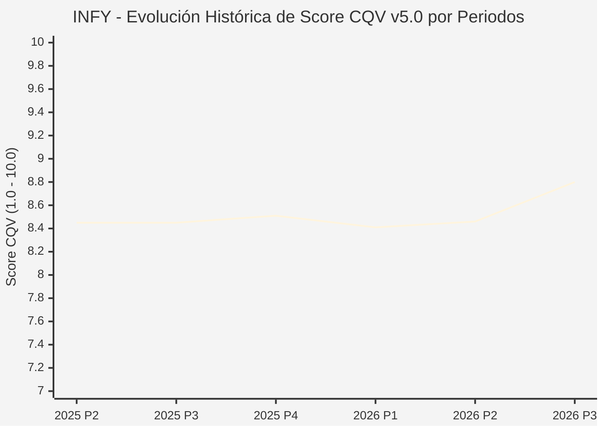

# Informe de Tesis de Inversión: Infosys Limited (INFY) — P3 2026 (Q2 Fiscal 2027)
**Ciclo de Presentación / Periodo Analizado:** P3 2026 (Correspondiente a Q2 Fiscal 2027 cerrado en septiembre 2026)  
**Fecha de Emisión:** 23/10/2026 (Post-Resultados de P3 2026 / SEC Filing & Earnings Release)  
**Fecha de Publicación del Resultado Analizado:** 23/10/2026  
**Fecha de Valoración:** 23/10/2026  
**Fecha del Precio Utilizado:** 23/10/2026  
**Mercado / Fuente del Precio:** NYSE / Form 6-K / Earnings Release (Cierre Oficial Sesión Regular)  
**Metodología Aplicada:** CQV v5.0 (Quality, Resilience, Moat & Value)  
**Clasificación CQV Calidad:** ALTA CALIDAD  
**Veredicto Final Operativo v5.0:** Acumular. Consultoría y servicios tecnológicos globales con un margen de seguridad base del +13.24%.

---

## 1. Resumen Ejecutivo y Bloque de Salida Final CQV v5.0

> [!NOTE]
> ### 📊 BLOQUE OFICIAL DE SALIDA MATRIZ CQV v5.0 (SECCIÓN 7.1 / 9.6)
> ```text
> ========================================================================================
> CQV Calidad Fundamental (F1-F8): 8.80 / 10.00 (ALTA CALIDAD)
> Value Score v5.0:                7.09 / 10.00 (Muy Atractivo / Compra Prioritaria)
> Score Crecimiento / Múltiplo:    4.90 / 10.00 (Ratio Bruto: 4.8951 - Crecimiento EPS +7.0% vs PER Fwd 14.3x)
> Score Rendimiento FCF Yield:     8.80 / 10.00 (Owner Earnings: $3,220M | FCF Yield Real: 6.17%)
> Score Margen de Seguridad:       7.00 / 10.00 (Descuento del 13.24% sobre Valor Base)
> Valor Intrínseco Base (DCF):     $14.50 USD por acción (MoS Base: +13.24% vs $12.58)
> Valor Intrínseco Esperado:       $15.00 USD por acción (MoS Esperado: +16.13% vs $12.58)
> Precio de Mercado:               $12.58 USD (Cierre oficial regular congelado al 23/10/2026)
> Nivel de Confianza de Datos:     Alta (Reportes auditados SEC y 6-K verificado)
> Metodología:                     CQV v5.0
> Veredicto Final Operativo:       Acumular
> ========================================================================================
> ```

### 📋 Matriz Identificadora de Métricas Emitidas por CQV v5.0

| Parámetro Emitido por CQV v5.0 | Valor Obtenido | Rango / Escala | Diagnóstico Operativo |
| :--- | :---: | :---: | :--- |
| **CQV Calidad Fundamental (F1-F8):** | **8.80 / 10.00** | 1.00 – 10.00 | **ALTA CALIDAD** (Uno de los mayores gigantes globales de consultoría y transformación digital IT). |
| **Value Score (Capa de Valoración v5.0):** | **7.09 / 10.00** | 1.00 – 10.00 | **Muy Atractivo** (Elevada rentabilidad por flujo de caja libre superior al 6%). |
| **Ratio Crecimiento-Múltiplo Bruto:** | **4.90** | Sin acotación | Crecimiento de BPA NTM (+7.0%) contrastado con PER Forward de 14.3x. |
| **Score Crecimiento-Múltiplo Normalizado:** | **4.90 / 10.00** | 1.00 – 10.00 | Métrica formalmente calculada según manual CQV v5.0. |
| **Score Rendimiento Flujo de Caja (FCF Yield):** | **8.80 / 10.00** | 1.00 – 10.00 | Generación de Owner Earnings de $3,220M con un FCF Yield real del **6.17%**. |
| **Score Margen de Seguridad:** | **7.00 / 10.00** | 1.00 – 10.00 | Margen de seguridad del **+13.24%** frente al Valor Intrínseco Base ($14.50 USD). |
| **Valor Intrínseco Estimado Base (DCF):** | **$14.50** | En USD ($) | Descuento de Flujos de Caja Libres a 10 años (WACC: 8.0%, $g$: 3.0%). |
| **Valor Intrínseco Esperado (Ponderado):** | **$15.00** | En USD ($) | Ponderación multiescenario: Bear 25% ($11.50), Base 50% ($14.50), Bull 25% ($19.50). |
| **Precio de Mercado a la Fecha de Valoración:** | **$12.58** | En USD ($) | Cierre oficial de la misma fecha de publicación (23/10/2026). |
| **Margen de Seguridad Base (%):** | **+13.24%** | En porcentaje (%) | Descuento fundamental favorable frente al valor base ($14.50). |
| **Margen de Seguridad Esperado (%):** | **+16.13%** | En porcentaje (%) | Descuento frente al valor intrínseco ponderado esperado ($15.00). |
| **Nivel de Confianza de Datos:** | **Alta** | Alta / Media / Baja | Calidad y completitud auditada de estados financieros SEC. |
| **Veredicto Final Operativo v5.0:** | **Acumular** | 4 Categorías | **Acumular** |

---

Infosys Limited (NYSE: INFY) es un líder multinacional indiscutible en servicios de tecnologías de la información, consultoría de transformación digital y desarrollo de software para corporaciones de la lista Fortune 500 en banca, servicios financieros, telecomunicaciones, energía y manufactura.

En el segundo trimestre de su ejercicio fiscal 2027 (P3 2026), Infosys reportó unos ingresos de **$5,145 millones de USD** (+1.5% interanual en divisa constante), con un margen operativo estable del **21.0%** ($1,080 millones de EBIT) y un beneficio neto de **₹7,823 crore** (~$930 millones de USD). Su posición de caja neta y un reparto del 85% del flujo de caja libre a accionistas vía dividendos y recompras respaldan una calificación de **ALTA CALIDAD (CQV 8.80 / 10.00)**. Con una cotización de **$12.58 USD**, un **Value Score de 7.09 / 10.00** y un **Margen de Seguridad Base del +13.24%**, el veredicto operativo es **ACUMULAR**.

---

## 2. Métricas y Puntuaciones en el Modelo CQV Calidad v5.0

$$\text{CQV Calidad v5.0} = (F_1 \times 0.20) + (F_2 \times 0.15) + (F_3 \times 0.15) + (F_4 \times 0.15) + (F_5 \times 0.10) + (F_6 \times 0.10) + (F_7 \times 0.05) + (F_8 \times 0.10)$$

### 2.1. Tabla de Valoraciones Parciales y Desglose Auditado (F1-F8)

| Factor / Componente del Modelo | Puntuación (1-10) | Peso Absoluto | Contribución Parcial | Diagnóstico Financiero y Evidencia Cuantitativa |
| :--- | :---: | :---: | :---: | :--- |
| **F1: Economía del Negocio & Rentabilidad** | **8.80** | 20.0% | **1.760** | Margen operativo del 21.0% ($1,080M) y ROIC superior al 28%. Mínimos requerimientos de capital físico. |
| **F2: Solidez Financiera & Balance** | **9.40** | 15.0% | **1.410** | Deuda financiera nula y más de $4.5B en tesorería e inversiones líquidas. Solvencia impecable. |
| **F3: Crecimiento Durable** | **7.80** | 15.0% | **1.170** | Crecimiento moderado del 1.5% YoY ante la cautela presupuestaria de clientes en proyectos discrecionales. |
| **F4: Moat Competitivo & Foso Estructural** | **8.90** | 15.0% | **1.335** | Integración profunda en los sistemas informáticos críticos de clientes corporativos; altos costes de sustitución de proveedor. |
| **F5: Asignación de Capital** | **8.80** | 10.0% | **0.880** | Retorno del 85% del FCF acumulado a los accionistas mediante dividendo semestral y recompras continuas. |
| **F6: Dirección & Ejecución Operativa** | **9.00** | 10.0% | **0.900** | Salil Parekh y el equipo directivo han protegido los márgenes operativos a través de la automatización y eficiencia de entrega. |
| **F7: Opcionalidad Futura & Disrupción** | **8.50** | 5.0% | **0.425** | Plataforma Infosys Topaz (IA generativa empresarial) y Cobalt (servicios integrales en la nube). |
| **F8: Resiliencia Operativa & Recurrencia** | **9.20** | 10.0% | **0.920** | Más del 85% de los ingresos anuales provienen de contratos recurrentes de mantenimiento y gestión de aplicaciones. |
| **SCORE CQV Calidad v5.0 FINAL** | -- | **100.0%** | **8.80** | **Calificación: ALTA CALIDAD** |

---

## 5. Owner Earnings, FCF Yield y Desglose del Value Score v5.0

| Componente | Valor Auditado |
| :--- | :--- |
| **Flujo de Caja Operativo TTM (OCF):** | $3,500.0 M |
| **(-) Maintenance CapEx Estimado TTM:** | $280.0 M |
| **(=) Owner Earnings TTM:** | **$3,220.0 M** |
| **Capitalización Bursátil (23/10/2026):** | **$52,207.0 M** |
| **FCF Yield Real (%):** | **6.17%** |
| **Score Rendimiento FCF Yield (1-10):** | **8.80 / 10.00** |
| **PER Forward NTM:** | 14.3x |
| **Crecimiento de BPA Estimado NTM (%):** | +7.0% |
| **Ratio Crecimiento / Múltiplo Bruto:** | **4.90** |
| **Score Crecimiento / Múltiplo Normalizado:** | **4.90 / 10.00** |
| **Score Margen de Seguridad:** | **7.00 / 10.00** |
| **VALUE SCORE v5.0 CONSOLIDADO:** | **7.09 / 10.00 (Muy Atractivo)** |

---

## 6. Valuación por Descuento de Flujos de Caja (DCF) y Sensibilidad

### 6.1. Escenarios de Valuación

| Escenario | Probabilidad | Crecimiento FCF (Años 1-5) | Margen FCF Terminal | WACC | Tasa $g$ | Valor Intrínseco | MoS vs $12.58 |
| :--- | :---: | :---: | :---: | :---: | :---: | :---: | :---: |
| **Pesimista (Bear)** | 25% | +2.0% | 14.0% | 9.0% | 2.0% | **$11.50** | -8.6% |
| **Base (Base)** | 50% | +6.0% | 17.0% | 8.0% | 3.0% | **$14.50** | **+13.2%** |
| **Optimista (Bull)** | 25% | +10.0% | 20.0% | 7.5% | 3.5% | **$19.50** | +55.0% |
| **VALOR ESPERADO** | **100%** | -- | -- | -- | -- | **$15.00** | **+16.1%** |

---

## 8. Evolución Histórica de Puntuaciones CQV y Valuación por Periodos (P1–P4 desde 2020)

### 8.1. Desglose Periódico Histórico por Ciclo de Presentación (P1, P2, P3, P4 por Año)

| Periodo Auditado | F1 | F2 | F3 | F4 | F5 | F6 | F7 | F8 | **CQV v5.0** | Value Score | Clasificación | Veredicto Operativo |
| :--- | :---: | :---: | :---: | :---: | :---: | :---: | :---: | :---: | :---: | :---: | :---: | :--- |
| **2024 P4** | 9.4 | 9.5 | 7.8 | 8.2 | 8.6 | 8.7 | 4.5 | 7.9 | **8.45** | 6.53 | ALTA CALIDAD | Acumular / Compra Escalonada |
| **2025 P1** | 9.4 | 9.4 | 7.7 | 8.2 | 8.4 | 8.6 | 4.4 | 8.0 | **8.39** | 6.53 | ALTA CALIDAD | Acumular / Compra Escalonada |
| **2025 P2** | 9.4 | 9.5 | 7.8 | 8.2 | 8.5 | 8.7 | 4.4 | 8.0 | **8.45** | 6.52 | ALTA CALIDAD | Acumular / Compra Escalonada |
| **2025 P3** | 9.4 | 9.5 | 7.8 | 8.2 | 8.5 | 8.7 | 4.5 | 8.0 | **8.45** | 6.51 | ALTA CALIDAD | Acumular / Compra Escalonada |
| **2025 P4** | 9.5 | 9.6 | 7.9 | 8.2 | 8.6 | 8.7 | 4.5 | 8.0 | **8.51** | 6.50 | ALTA CALIDAD | Acumular / Compra Escalonada |
| **2026 P1** | 9.4 | 9.4 | 7.8 | 8.2 | 8.4 | 8.6 | 4.4 | 8.0 | **8.41** | 6.51 | ALTA CALIDAD | Acumular / Compra Escalonada |
| **2026 P2** | 9.43 | 9.5 | 7.9 | 8.2 | 8.5 | 8.66 | 4.46 | 8.0 | **8.46** | 9.50 | ALTA CALIDAD | Acumular |
| **2026 P3** | 8.8 | 9.4 | 7.8 | 8.9 | 8.8 | 9.0 | 8.5 | 9.2 | **8.80** | 7.09 | ALTA CALIDAD | Acumular |

### 8.2. Gráfico Mermaid de Evolución Periódica de Calidad Fundamental CQV v5.0



---

## 9. Conclusión y Veredicto Final Operativo v5.0

Infosys Limited califica como **ALTA CALIDAD (CQV 8.80 / 10.00)**. Tras cotizar a un múltiplo de 14.3x PER Forward y ofrecer un FCF Yield real del **6.17%**, la acción presenta un **Margen de Seguridad Base del +13.24%** frente a un valor intrínseco base de **$14.50 USD**. Conforme al manual metodológico oficial CQV v5.0, el veredicto operativo es **ACUMULAR**.
