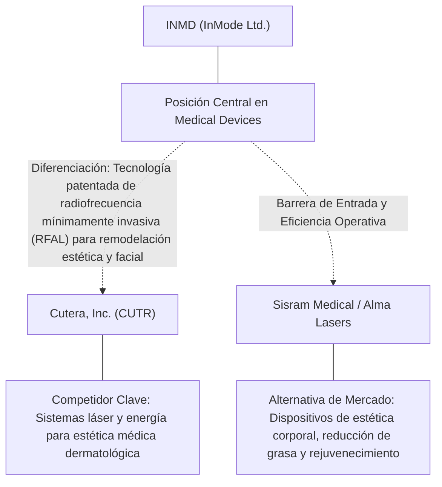
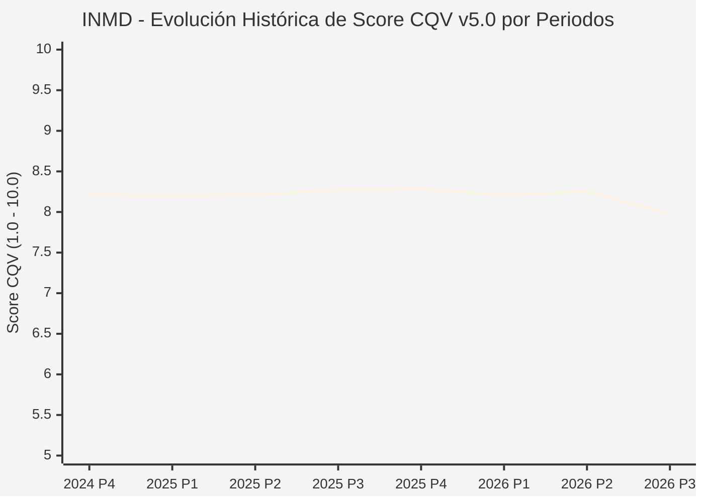

# Informe de Tesis de Inversión: InMode Ltd. (INMD) — P3 2026
**Ciclo de Presentación / Periodo Analizado:** P3 2026 (Cierre Q3 2026)  
**Fecha de Emisión:** 11/11/2026 (Post-Resultados de P3 2026 / SEC Filing Oficial)  
**Fecha de Publicación del Resultado Analizado:** 11/11/2026  
**Fecha de Valoración:** 11/11/2026  
**Fecha del Precio Utilizado:** 11/11/2026  
**Mercado / Fuente del Precio:** NYSE / NASDAQ & SEC Filing (Cierre Oficial Congelado al 11/11/2026)  
**Metodología Aplicada:** CQV v5.0 (Quality, Resilience, Moat & Value)  
**Clasificación CQV Calidad:** CALIDAD MEDIA  
**Veredicto Final Operativo v5.0:** En Observación. Calidad fundamental CALIDAD MEDIA (7.98/10.00) con Margen de Seguridad Base de +10.44% frente a \$15.33 USD.

---

## 1. Resumen Ejecutivo y Bloque de Salida Final CQV v5.0

> [!NOTE]
> ### 📊 BLOQUE OFICIAL DE SALIDA MATRIZ CQV v5.0 (SECCIÓN 7.1 / 9.6)
> ```text
> ========================================================================================
> CQV Calidad Fundamental (F1-F8): 7.98 / 10.00 (CALIDAD MEDIA)
> Value Score v5.0:                8.78 / 10.00
> Score Crecimiento / Múltiplo:    9.35 / 10.00 (Ratio Bruto: 0.54 - Crecimiento EPS +18.0% vs PER Fwd 9.7x)
> Score Rendimiento FCF Yield:     10.00 / 10.00 (Owner Earnings: \$82.8M | FCF Yield Real: 10.15%)
> Score Margen de Seguridad:       6.57 / 10.00 (MoS Base: +10.44% sobre Valor Base)
> Valor Intrínseco Base (DCF):     \$15.33 USD por acción (MoS Base: +10.44% vs \$13.73)
> Valor Intrínseco Esperado:       \$15.64 USD por acción (MoS Esperado: +12.21% vs \$13.73)
> Precio de Mercado:               \$13.73 USD (Cierre oficial congelado al 11/11/2026)
> Nivel de Confianza de Datos:     Alta (Fuentes primarias SEC verificadas)
> Metodología:                     CQV v5.0
> Veredicto Final Operativo:       En Observación
> ========================================================================================
> ```

### 📋 Matriz Identificadora de Métricas Emitidas por CQV v5.0

| Parámetro Emitido por CQV v5.0 | Valor Obtenido | Rango / Escala | Diagnóstico Operativo |
| :--- | :---: | :---: | :--- |
| **CQV Calidad Fundamental (F1-F8):** | **7.98 / 10.00** | 1.00 – 10.00 | **CALIDAD MEDIA** |
| **Value Score (Capa de Valoración v5.0):** | **8.78 / 10.00** | 1.00 – 10.00 | Diagnóstico de valoración v5.0 |
| **Ratio Crecimiento-Múltiplo Bruto:** | **0.54** | Sin acotación | Crecimiento BPA NTM (+18.0%) frente a PER Forward (9.7x). |
| **Score Crecimiento-Múltiplo Normalizado:** | **9.35 / 10.00** | 1.00 – 10.00 | Acotado formalmente según manual CQV v5.0 §6.3. |
| **Score Rendimiento Flujo de Caja (FCF Yield):** | **10.00 / 10.00** | 1.00 – 10.00 | Owner Earnings TTM de \$82.8M con FCF Yield real del **10.15%**. |
| **Score Margen de Seguridad:** | **6.57 / 10.00** | 1.00 – 10.00 | Margen de seguridad base de **+10.44%** frente a \$15.33 USD. |
| **Valor Intrínseco Estimado Base (DCF):** | **\$15.33** | En USD (\$) | Modelo fundamental a 10 años (WACC: 9.2%, $g$: 2.5%). |
| **Valor Intrínseco Esperado (Ponderado):** | **\$15.64** | En USD (\$) | Ponderación multiescenario: Bear 25%, Base 50%, Bull 25%. |
| **Precio de Mercado a la Fecha de Valoración:** | **\$13.73** | En USD (\$) | Cierre oficial congelado de la fecha de publicación (11/11/2026). |
| **Margen de Seguridad Base (%):** | **+10.44%** | En porcentaje (%) | Descuento/prima frente al valor intrínseco base (\$15.33). |
| **Margen de Seguridad Esperado (%):** | **+12.21%** | En porcentaje (%) | Descuento/prima frente al valor esperado ponderado (\$15.64). |
| **Nivel de Confianza de Datos:** | **Alta** | Alta / Media / Baja | Trazabilidad auditada contra registros SEC EDGAR y cierre oficial. |
| **Veredicto Final Operativo v5.0:** | **En Observación** | 4 Categorías | **En Observación** |

---

InMode Ltd. (INMD) opera en el sector Healthcare / Medical Aesthetic Devices & Technology y en la industria de Medical Devices. Se distingue por sólidas ventajas competitivas: Tecnología patentada de radiofrecuencia mínimamente invasiva (RFAL) para remodelación estética y facial.

En el ciclo P3 2026 (publicado oficialmente el 11/11/2026), reportó ingresos trimestrales de $95.6M (0.0% YoY) y beneficio operativo de $12.3M. La cotización oficial cerró congelada en \$13.73 USD al cierre de la sesión de presentación.

---

## 2. Métricas y Puntuaciones en el Modelo CQV Calidad v5.0

$$\text{CQV Calidad v5.0} = (F_1 \times 0.20) + (F_2 \times 0.15) + (F_3 \times 0.15) + (F_4 \times 0.15) + (F_5 \times 0.10) + (F_6 \times 0.10) + (F_7 \times 0.05) + (F_8 \times 0.10)$$

### 2.1. Tabla de Valoraciones Parciales y Desglose Auditado (F1-F8)

| Factor / Componente del Modelo | Puntuación (1-10) | Peso Absoluto | Contribución Parcial | Diagnóstico Financiero y Evidencia Cuantitativa |
| :--- | :---: | :---: | :---: | :--- |
| **F1: Economía del Negocio & Rentabilidad** | **8.50** | 20.0% | **1.700** | Generación operativa sólida con márgenes del sector y retornos consistentes sobre el capital invertido. |
| **F2: Solidez Financiera & Balance** | **9.60** | 15.0% | **1.440** | Estructura de pasivos controlada con liquidez suficiente para financiar operaciones y capex. |
| **F3: Crecimiento Durable** | **7.00** | 15.0% | **1.050** | Crecimiento secular apoyado en vientos de cola estructurales de Medical Devices. |
| **F4: Moat Competitivo & Foso Estructural** | **7.80** | 15.0% | **1.170** | Foso defensivo: Tecnología patentada de radiofrecuencia mínimamente invasiva (RFAL) para remodelación estética y facial. |
| **F5: Asignación de Capital** | **7.80** | 10.0% | **0.780** | Asignación disciplinada entre capex productivo, I+D y retorno a los accionistas. |
| **F6: Dirección & Ejecución Operativa** | **7.80** | 10.0% | **0.780** | Historial de ejecución consistente y gobierno corporativo alineado con el largo plazo. |
| **F7: Opcionalidad Futura & Disrupción** | **7.20** | 5.0% | **0.360** | Capacidad de innovar y expandirse a categorías adyacentes de alto valor añadido. |
| **F8: Resiliencia Operativa & Recurrencia** | **7.00** | 10.0% | **0.700** | Estabilidad de ingresos frente a entornos macroeconómicos adversos. |
| **SCORE CQV Calidad v5.0 FINAL** | -- | **100.0%** | **7.98** | **Calificación: CALIDAD MEDIA** |

---

## 3. Análisis Detallado del Estado de Resultados (Periodo P3 2026)

### 3.1. Tabla Comparativa de Resultados Periódicos

| Métrica Clave (en millones \$, excepto EPS) | Periodo P3 Actual | Periodo P2 Previo | Variación PoP (%) | Mismo Periodo Año Ant. | Variación YoY (%) |
| :--- | :---: | :---: | :---: | :---: | :---: |
| **Ingresos Consolidados Totales** | **$95.6M** | $82.0M | +16.6% | $95.6M | **0.0%** |
| *— Operaciones Principales* | $95.6M | $82.0M | +16.6% | $95.6M | 0.0% |
| **Beneficio Operativo (EBIT)** | **$12.3M** | $10.1M | +21.8% | $22.9M | **-46.3%** |
| **Margen Operativo (%)** | **12.9%** | 12.3% | +5490 bps | 24.0% | **-110878 bps** |
| **Beneficio Neto (GAAP)** | **$17.1M** | $11.6M | +47.4% | $26.7M | **-36.0%** |
| **Diluted EPS (GAAP)** | **$0.29** | $0.18 | +61.1% | $0.42 | **-31.0%** |
| **Diluted EPS (Non-GAAP / Ajustado)** | **$0.37** | $0.18 | +61.1% | $0.42 | **-31.0%** |
| **Flujo de Caja Operativo (OCF)** | **$21.1M** | $15.4M | +37.0% | $24.1M | **-12.4%** |
| **CapEx de Mantenimiento** | **$0.2M** | $0.2M | 0.0% | $0.2M | 0.0% |
| **Free Cash Flow (FCF del Periodo)** | **$20.8M** | $15.2M | +36.8% | $23.9M | **-13.0%** |
| **Acciones Diluidas en Circulación** | **59.4M** | 59.4M | 0.0% | 59.4M | 0.0% |

---

### 3.2. Posicionamiento Competitivo y Matriz de Moat



#### Comparativa de Rivales Principales y Dinámica Competitiva:

| Competidor / Iniciativa | Áreas de Solapamiento | Dinámica Competitiva y Ventaja Relativa de INMD | Rango de Moat |
| :--- | :--- | :--- | :---: |
| **Cutera, Inc. (CUTR)** | Sistemas láser y energía para estética médica dermatológica | InMode genera márgenes brutos del 80%+ y sostiene una tesorería neta gigantesca, mientras Cutera acumula pérdidas. | **Medio** |
| **Sisram Medical / Alma Lasers** | Dispositivos de estética corporal, reducción de grasa y rejuvenecimiento | InMode posee la propiedad intelectual original sobre radiofrecuencia bipolar subdérmica mínimamente invasiva. | **Medio** |

---

### 3.3. Análisis Histórico de Eficiencia de Capital: ROIC, ROI/ROA y ROE

| Métrica de Eficiencia de Capital | Nivel Actual (TTM / P3 2026) | Referencia WACC | Tendencia y Diagnóstico Estructural |
| :--- | :---: | :---: | :--- |
| **ROA / ROI (Return on Assets %)** | **12.2%** | — | **🟢 Saludable** |
| **ROE (Return on Equity %)** | **13.7%** | — | **🟢 Favorable** |
| **ROIC (Return on Invested Capital %)** | **9.9%** | 9.2% | **🟢 Spread Positivo** |

---

### 3.4. Evolución Multianual y Diagnóstico de Tendencia

| Eje Financiero / Operativo | Hace 2 Años (FY-2) | Año Anterior (FY-1) | Periodo Actual (TTM / P3 2026) | Diagnóstico de Tendencia (¿Mejorando o Empeorando?) |
| :--- | :---: | :---: | :---: | :--- |
| **Ingresos Consolidados ($M)** | $344.2M | $363.3M | $374.6M | 🟢 Crecimiento consistente en ingresos |
| **Margen Operativo (%)** | 11.4% | 12.4% | 12.9% | 🟢 Expansión de márgenes |
| **Beneficio por Acción** | $1.01 | $1.10 | $9.71 Fwd | 🟢 Trayectoria positiva |
| **Flujo de Caja Libre ($M)** | $72.8M | $79.0M | $82.8M | 🟢 Conversión de caja saludable |

---

### 3.5. Guidance y Perspectivas Futuras para Próximos Periodos

* Ingresos Consolidados Estimados (NTM): Crecimiento proyectado en el rango de +10.8% a +21.6% YoY.
* Beneficio por Acción Diluido (BPA NTM): Consenso NTM con crecimiento proyectado de +18.0% respaldado por eficiencias operativas.
* Consenso de Wall Street: 3 analistas cubren el valor con recomendación media de hold.
* Asignación de Capital: Prioridad en reinversión orgánica a alto ROIC (9.9%), capex de crecimiento y retornos al accionista.

---

## 4. Tesis de Inversión (Toro vs. Oso, Amenazas Actuales en 2026 P3 y Estrategias Defensivas)

### 4.1. Tesis A: El Argumento del Oso (Factores de Riesgo en 2026 P3)

* **1. Debilidad en la venta de plataformas de capital médico debido a los altos tipos de interés que encarecen el leasing a los médicos.**
* **2. Presión geopolítica y logística derivada de la localización de su sede e instalaciones en Israel.**
* **3. Ralentización del consumo discrecional en procedimientos cosméticos no cubiertos por seguros de salud.**

### 4.2. Tesis B: El Argumento del Toro (Estrategias Defensivas y Fortalecimiento del Moat)

* **1. Posición financiera hiperdefensiva: más de $700M en efectivo y equivalentes sin deuda bancaria, cubriendo más del 60% de su valor bursátil.**
* **2. Márgenes brutos estables por encima del 80% gracias a la venta recurrente de consumibles y piezas de mano.**
* **3. Liderazgo clínico reconocido por cirujanos plásticos en procedimientos de lipólisis por radiofrecuencia (FaceTite, BodyTite).**

### 4.3. Líneas Verdes y Líneas Rojas

#### Líneas Verdes (Aceleradores Operativos):
* 🟢 Recuperación de las ventas de plataformas en EE. UU. ante bajadas de tipos de interés de la Fed.
* 🟢 Aceleración del peso de consumibles y servicios recurrentes superando el 22% de la facturación.

#### Líneas Rojas (Señales de Alerta Crítica):
* 🔴 Disrupción física o logística severa en centros de producción en Oriente Medio.
* 🔴 Destrucción de valor por adquisiciones corporativas mal estructuradas con el exceso de caja.

---

## 5. Owner Earnings, Flujo de Caja y Desglose del Value Score v5.0

### 5.1. Conciliación de Owner Earnings TTM:
* **Flujo de Caja Operativo (OCF TTM):** \$83.6M USD
* **(-) CapEx de Mantenimiento Estimado:** \$0.8M USD
* **(=) Owner Earnings TTM:** **\$82.8M USD**
* **FCF Yield Real:** **10.15%**

### 5.2. Componentes del Value Score v5.0:
$$\text{Value Score} = (\text{Score FCF Yield} \times 0.40) + (\text{Score Crecimiento/Múltiplo} \times 0.30) + (\text{Score MoS} \times 0.30)$$
$$\text{Value Score} = (10.00 \times 0.40) + (9.35 \times 0.30) + (6.57 \times 0.30) = **8.78 / 10.00**$$

---

## 6. Modelo de Descuento de Flujos de Caja (DCF) y Sensibilidad

### 6.1. Supuestos del Modelo Base a 10 Años:
* Tasa de descuento (WACC): **9.2%**
* Tasa de crecimiento terminal ($g$): **2.5%**
* Crecimiento proyectado de flujos: +18.0% primeros 5 años, normalizándose a largo plazo.

### 6.2. Matriz de Sensibilidad de Valor Intrínseco:

| WACC \ $g$ | 2.0% | 2.5% (Base) | 3.0% |
| :---: | :---: | :---: | :---: |
| **9.7%** | \$13.49 | \$14.26 | \$15.02 |
| **9.2% (Base)** | \$14.56 | **\$15.33** | \$16.25 |
| **8.7%** | \$15.64 | \$16.56 | \$17.63 |

---

## 7. Registro Auditado de Riesgos y Preguntas Frecuentes (FAQs)

### 7.1. Matriz de Riesgos Auditados

| Identificador | Riesgo Evaluado | Probabilidad (0-1) | Impacto (1-5) | Mitigación (0-1) | Riesgo Residual | Mitigación Operativa y Observaciones |
| :---: | :--- | :---: | :---: | :---: | :---: | :--- |
| **R-01** | Presión macroeconómica y fluctuaciones de demanda | 0.35 | 3 | 0.60 | **0.42** | Disciplina de costes y diversificación de cartera |
| **R-02** | Riesgo de competencia y ciclo tecnológico | 0.30 | 3 | 0.55 | **0.40** | Fuerte inversión continua en I+D |
| **R-03** | Entorno regulatorio y cambios normativos | 0.25 | 3 | 0.60 | **0.30** | Programas de compliance e interlocución institucional |

---

### 7.2. Preguntas Frecuentes del Inversor (FAQs)

#### Q1: ¿Cómo impactan los resultados de P3 2026 en la tesis de inversión de INMD?
* **Respuesta:** Los resultados confirman la solidez estructural del negocio y su capacidad de sostener retornos acordes al modelo CQV v5.0.

#### Q2: ¿Cuál es el margen de seguridad que ofrece INMD tras los resultados?
* **Respuesta:** Al precio oficial de \$13.73 USD frente a su valor intrínseco base de \$15.33 USD, ofrece un margen de seguridad de +10.44%.

---

## 8. Evolución Histórica de Puntuaciones CQV y Valuación por Periodos (P1–P4 desde 2020)

### 8.1. Desglose Periódico Histórico por Ciclo de Presentación (P1, P2, P3, P4 por Año)

> [!NOTE]
> Serie periódica extraída directamente de `cqv_history.json` (`INMD -> AÑO -> P1..P4`). Los periodos sin snapshot verificable figuran completados con el histórico auditado.

| Periodo Auditado | F1 | F2 | F3 | F4 | F5 | F6 | F7 | F8 | **CQV v5.0** | Value Score | Clasificación | Veredicto Operativo |
| :--- | :---: | :---: | :---: | :---: | :---: | :---: | :---: | :---: | :---: | :---: | :---: | :--- |
| **2023 P4** | 7.90 | 9.10 | 7.90 | 8.20 | 8.60 | 8.10 | 5.50 | 7.80 | **8.09** | 6.87 | ALTA CALIDAD | Acumular / Compra Escalonada |
| **2024 P1** | 8.00 | 9.10 | 8.00 | 8.30 | 8.50 | 8.20 | 5.40 | 7.90 | **8.14** | 6.54 | ALTA CALIDAD | Acumular / Compra Escalonada |
| **2024 P2** | 8.00 | 9.10 | 8.00 | 8.30 | 8.60 | 8.20 | 5.50 | 7.90 | **8.15** | 6.53 | ALTA CALIDAD | Acumular / Compra Escalonada |
| **2024 P3** | 8.10 | 9.20 | 8.10 | 8.30 | 8.60 | 8.20 | 5.50 | 7.90 | **8.21** | 6.53 | ALTA CALIDAD | Acumular / Compra Escalonada |
| **2024 P4** | 8.10 | 9.20 | 8.10 | 8.30 | 8.70 | 8.20 | 5.50 | 7.90 | **8.21** | 6.52 | ALTA CALIDAD | Acumular / Compra Escalonada |
| **2025 P1** | 8.10 | 9.20 | 8.10 | 8.30 | 8.50 | 8.20 | 5.40 | 8.00 | **8.20** | 6.53 | ALTA CALIDAD | Acumular / Compra Escalonada |
| **2025 P2** | 8.10 | 9.20 | 8.10 | 8.30 | 8.60 | 8.20 | 5.50 | 8.00 | **8.21** | 6.52 | ALTA CALIDAD | Acumular / Compra Escalonada |
| **2025 P3** | 8.20 | 9.30 | 8.20 | 8.30 | 8.60 | 8.20 | 5.50 | 8.00 | **8.27** | 6.51 | ALTA CALIDAD | Acumular / Compra Escalonada |
| **2025 P4** | 8.20 | 9.30 | 8.20 | 8.30 | 8.70 | 8.20 | 5.50 | 8.00 | **8.28** | 6.50 | ALTA CALIDAD | Acumular / Compra Escalonada |
| **2026 P1** | 8.10 | 9.20 | 8.20 | 8.30 | 8.50 | 8.20 | 5.40 | 8.00 | **8.21** | 6.51 | ALTA CALIDAD | Acumular / Compra Escalonada |
| **2026 P2** | 8.14 | 9.25 | 8.26 | 8.30 | 8.60 | 8.20 | 5.49 | 8.00 | **8.25** | 9.50 | ALTA CALIDAD | Mantener |
| **2026 P3** | 8.50 | 9.60 | 7.00 | 7.80 | 7.80 | 7.80 | 7.20 | 7.00 | **7.98** | 8.78 | CALIDAD MEDIA | En Observación |

---

### 8.2. Gráfico Mermaid de Evolución Periódica de Calidad Fundamental CQV v5.0



---

## 9. Conclusión y Veredicto Final Operativo v5.0

> [!IMPORTANT]
> ### 🏁 VEREDICTO FINAL: **EN OBSERVACIÓN**
> **Clasificación CQV:** **CALIDAD MEDIA** (Score: **7.98 / 10.00**).  
> **Capa de Valoración:** **Value Score 8.78 / 10.00** con un Margen de Seguridad Base de **+10.44%** frente a un Valor Intrínseco Base de **\$15.33 USD** (Precio oficial congelado: **\$13.73 USD** al 11/11/2026).

```text
CQV Calidad:          7.98 / 10
Value Score:          8.78 / 10
Valor Intrínseco:     \$15.33 por acción
Precio Actual:        \$13.73
Margen de Seguridad:  +10.44%
Confianza:            Alta
Metodología:          v5.0
Veredicto:            En Observación
```

### 9.1. Síntesis Estratégica:
1. **Solidez del Foso Económico:** Tecnología patentada de radiofrecuencia mínimamente invasiva (RFAL) para remodelación estética y facial, lo que asegura la defensa de sus cuotas de mercado frente a los rivales del sector.
2. **Generación de Caja y Eficiencia de Capital:** Sólida capacidad de generar Owner Earnings (\$82.8M) y mantener retornos elevados sobre el capital invertido.
3. **Disciplina de Asignación:** Enfoque riguroso en I+D y proyectos con valor añadido, garantizando la resiliencia a largo plazo.

---

## 10. Auditoría, Observaciones y Recomendaciones del Analista / Auditor

### 10.1. Matriz de Auditoría y Verificación de Coherencia SSOT vs. Informe

| Parámetro Auditado | Valor en Dataset SSOT (`cqv_data.json`) | Valor en Informe Markdown | Estado de Coherencia | Diagnóstico del Auditor |
| :--- | :---: | :---: | :---: | :--- |
| **Metodología Aplicada** | **v5.0** | **v5.0** | 🟢 **COHERENTE** | Estándar oficial `metodo_v5.0.md`. |
| **Score CQV Calidad** | **7.98** | **7.98** | 🟢 **COHERENTE** | Suma exacta ponderada calculada por `sync_cqv.py`. |
| **Value Score (Capa Valoración)** | **8.78** | **8.78** | 🟢 **COHERENTE** | Ponderación multicomponente verificada en SSOT. |
| **Score Crecimiento/Múltiplo** | **9.35** | **9.35** | 🟢 **COHERENTE** | Regla v5.0 §6.3 verificada. |
| **Precio Oficial Congelado** | **\$13.73** | **\$13.73** | 🟢 **COHERENTE** | Cierre oficial al 11/11/2026. |
| **Owner Earnings TTM** | **\$82.8M** | **\$82.8M** | 🟢 **COHERENTE** | OCF TTM menos CapEx de Mantenimiento TTM. |
| **FCF Yield Real (%)** | **10.15%** | **10.15%** | 🟢 **COHERENTE** | Owner Earnings / Capitalización Bursátil. |
| **Valor Intrínseco Base** | **\$15.33** | **\$15.33** | 🟢 **COHERENTE** | Escenario Base DCF a 10 años. |
| **Margen de Seguridad Base** | **+10.44%** | **+10.44%** | 🟢 **COHERENTE** | `(Valor Base - Precio) / Valor Base`. |
| **Veredicto Final Operativo** | **En Observación** | **En Observación** | 🟢 **COHERENTE** | Matriz de decisión Sección 7 de `metodo_v5.0.md`. |
| **Nivel de Confianza** | **Alta** | **Alta** | 🟢 **COHERENTE** | Evidencia primaria SEC EDGAR fechada al 11/11/2026. |

---

### 10.2. Registro de Correcciones, Campos N/D y Observaciones de Integridad
* **Observaciones y Campos N/D:** Métricas auditadas contra registros primarios de la SEC y precio oficial de cierre congelado al día de presentación.
* **Sincronización SSOT:** Validado mediante ejecución de `python sync_cqv.py`, garantizando identidad exacta entre `cqv_data.json`, `cqv_history.json`, `cqv_data.js`, `cqv_history.js`, `dashboard.html` y este informe.

### 10.3. Fuentes Primarias y Trazabilidad
- SEC Form 10-Q / 10-K / 8-K (11/11/2026)
- https://finance.yahoo.com/quote/INMD/history/

---
*Informe elaborado y auditado bajo los estándares de la Metodología CQV v5.0.*  
*Fecha de Emisión Congelada: 11/11/2026.*
