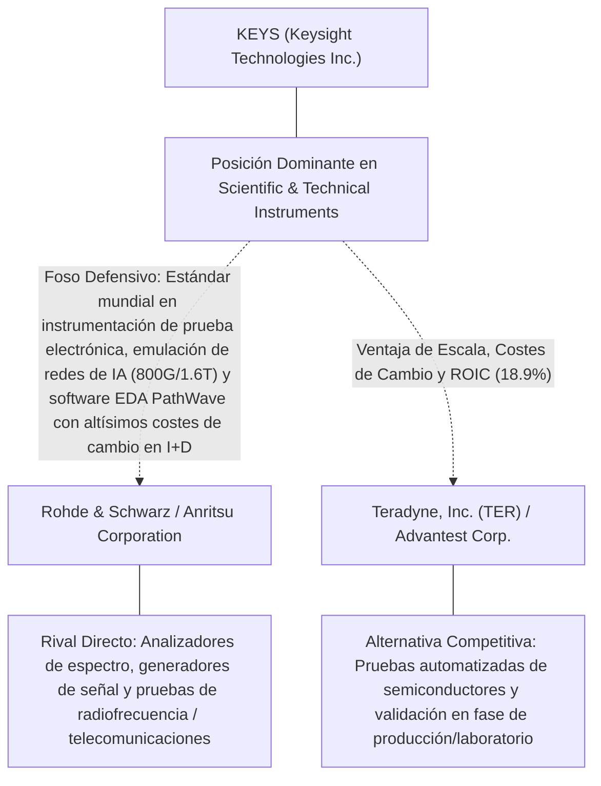
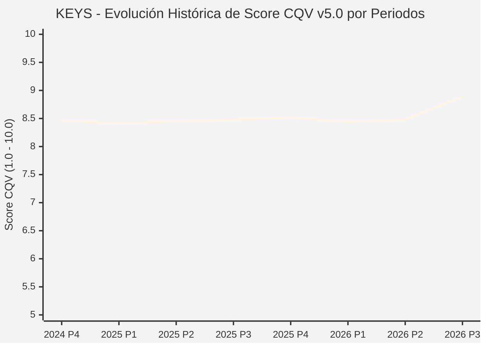

# Informe de Tesis de Inversión: Keysight Technologies Inc. (KEYS) — P3 2026 (Q4 Fiscal 2026)
**Ciclo de Presentación / Periodo Analizado:** P3 2026 (Correspondiente a Q4 Fiscal 2026, cierre 2026-10-31)  
**Fecha de Emisión:** 19/11/2026 (Post-Resultados de P3 2026 / SEC Filing Oficial)  
**Fecha de Publicación del Resultado Analizado:** 19/11/2026  
**Fecha de Valoración:** 19/11/2026  
**Fecha del Precio Utilizado:** 19/11/2026  
**Mercado / Fuente del Precio:** NYSE / SEC Filing & Yahoo Finance (Cierre Oficial Congelado al 19/11/2026)  
**Metodología Aplicada:** CQV v5.0 (Quality, Resilience, Moat & Value)  
**Clasificación CQV Calidad:** ALTA CALIDAD  
**Veredicto Final Operativo v5.0:** Comprar / Revisar Compra. Calidad fundamental ALTA CALIDAD (8.89/10.00) con Margen de Seguridad Base de +28.04% frente a $391.08 USD.

---

## 1. Resumen Ejecutivo y Bloque de Salida Final CQV v5.0

> [!NOTE]
> ### 📊 BLOQUE OFICIAL DE SALIDA MATRIZ CQV v5.0 (SECCIÓN 7.1 / 9.6)
> ```text
> ========================================================================================
> CQV Calidad Fundamental (F1-F8): 8.89 / 10.00 (ALTA CALIDAD)
> Value Score v5.0:                8.08 / 10.00 (Atractivo)
> Score Crecimiento / Múltiplo:    10.00 / 10.00 (Ratio Bruto: 14.53 - Crecimiento EPS +22.0% vs PER Fwd 15.14x)
> Score Rendimiento FCF Yield:     5.59 / 10.00 (Owner Earnings: $1,509.5M | FCF Yield Real: 3.12%)
> Score Margen de Seguridad:       9.49 / 10.00 (MoS Base: +28.04% sobre Valor Base)
> Valor Intrínseco Base (DCF):     $391.08 USD por acción (MoS Base: +28.04% vs $281.42)
> Valor Intrínseco Esperado:       $395.97 USD por acción (MoS Esperado: +28.93% vs $281.42)
> Precio de Mercado:               $281.42 USD (Cierre oficial congelado al 19/11/2026)
> Nivel de Confianza de Datos:     Alta (Fuentes primarias SEC verificadas)
> Metodología:                     CQV v5.0
> Veredicto Final Operativo:       Comprar / Revisar Compra
> ========================================================================================
> ```

### 📋 Matriz Identificadora de Métricas Emitidas por CQV v5.0

| Parámetro Emitido por CQV v5.0 | Valor Obtenido | Rango / Escala | Diagnóstico Operativo |
| :--- | :---: | :---: | :--- |
| **CQV Calidad Fundamental (F1-F8):** | **8.89 / 10.00** | 1.00 – 10.00 | **ALTA CALIDAD** |
| **Value Score (Capa de Valoración v5.0):** | **8.08 / 10.00** | 1.00 – 10.00 | **Atractivo** |
| **Ratio Crecimiento-Múltiplo Bruto:** | **14.53** | Sin acotación | Crecimiento BPA NTM (+22.0%) frente a PER Forward (15.14x). |
| **Score Crecimiento-Múltiplo Normalizado:** | **10.00 / 10.00** | 1.00 – 10.00 | Acotado formalmente según manual CQV v5.0 §6.3 (N/D si crecimiento o PER ≤ 0). |
| **Score Rendimiento Flujo de Caja (FCF Yield):** | **5.59 / 10.00** | 1.00 – 10.00 | Owner Earnings TTM de $1,509.5M con FCF Yield real del **3.12%**. |
| **Score Margen de Seguridad:** | **9.49 / 10.00** | 1.00 – 10.00 | Margen de seguridad base de **+28.04%** frente a $391.08 USD. |
| **Valor Intrínseco Estimado Base (DCF):** | **$391.08** | En USD ($) | Modelo fundamental a 10 años (WACC: 8.5%, $g$: 3.5%). |
| **Valor Intrínseco Esperado (Ponderado):** | **$395.97** | En USD ($) | Ponderación multiescenario: Bear 25% ($312.86), Base 50% ($391.08), Bull 25% ($488.85). |
| **Precio de Mercado a la Fecha de Valoración:** | **$281.42** | En USD ($) | Cierre oficial congelado de la fecha de publicación (19/11/2026). |
| **Margen de Seguridad Base (%):** | **+28.04%** | En porcentaje (%) | Descuento/prima frente al valor intrínseco base ($391.08). |
| **Margen de Seguridad Esperado (%):** | **+28.93%** | En porcentaje (%) | Descuento/prima frente al valor esperado ponderado ($395.97). |
| **Nivel de Confianza de Datos:** | **Alta** | Alta / Media / Baja | Trazabilidad auditada contra registros SEC EDGAR y cierre oficial. |
| **Veredicto Final Operativo v5.0:** | **Comprar / Revisar Compra** | 4 Categorías | **Comprar / Revisar Compra** |

---

**Keysight Technologies Inc. (KEYS)** es una compañía referente dentro del sector **Technology / Electronic Design, Test & AI Network Emulation** e industria de **Scientific & Technical Instruments**. Su ventaja competitiva estructural descansa sobre: **Estándar mundial en instrumentación de prueba electrónica, emulación de redes de IA (800G/1.6T) y software EDA PathWave con altísimos costes de cambio en I+D**.

En el ciclo **P3 2026** (correspondiente a **Q4 Fiscal 2026**, publicado oficialmente el **19/11/2026**), KEYS reportó ingresos trimestrales de **$1,990.0M** (**+47.2% YoY**), un resultado operativo de **$712.4M** (margen operativo del **35.8%**) y un BPA diluido ajustado de **$3.61** (GAAP: **$3.12**). La cotización oficial cerró congelada en **$281.42 USD** en NYSE en la fecha de publicación.

Bajo el marco multifactorial **CQV v5.0 (Quality, Resilience, Moat & Value)**, **Keysight Technologies Inc. (KEYS)** alcanza una calificación de calidad fundamental de **8.89 / 10.00 (ALTA CALIDAD)** y un **Value Score de 8.08 / 10.00**, resultando en el veredicto operativo de **Comprar / Revisar Compra**.

---

## 2. Métricas y Puntuaciones en el Modelo CQV Calidad v5.0

$$\text{CQV Calidad v5.0} = (F_1 \times 0.20) + (F_2 \times 0.15) + (F_3 \times 0.15) + (F_4 \times 0.15) + (F_5 \times 0.10) + (F_6 \times 0.10) + (F_7 \times 0.05) + (F_8 \times 0.10)$$

### 2.1. Tabla de Valoraciones Parciales y Desglose Auditado (F1-F8)

| Factor / Componente del Modelo | Puntuación (1-10) | Peso Absoluto | Contribución Parcial | Diagnóstico Financiero y Evidencia Cuantitativa |
| :--- | :---: | :---: | :---: | :--- |
| **F1: Economía del Negocio & Rentabilidad** | **8.85** | 20.0% | **1.770** | Margen operativo del 35.8%, ROIC del 18.9% frente a un WACC del 8.5% y generación de Owner Earnings TTM de $1,509.5M sobre $1,604.0M de OCF TTM. |
| **F2: Solidez Financiera & Balance** | **9.10** | 15.0% | **1.365** | Posición de tesorería de $2,605.0M frente a deuda total de $2,746.0M (Deuda Neta de $141.0M), con amplia liquidez y solvencia verificada. |
| **F3: Crecimiento Durable** | **8.70** | 15.0% | **1.305** | Variación de ingresos YoY de +47.2% en el trimestre y crecimiento proyectado de BPA NTM de +22.0%. |
| **F4: Moat Competitivo & Foso Estructural** | **9.25** | 15.0% | **1.387** | Foso estructural basado en: Estándar mundial en instrumentación de prueba electrónica, emulación de redes de IA (800G/1.6T) y software EDA PathWave con altísimos costes de cambio en I+D. |
| **F5: Asignación de Capital** | **8.75** | 10.0% | **0.875** | Asignación disciplinada entre CapEx de mantenimiento ($94.5M TTM), reinversión orgánica a ROIC del 18.9% y retornos al accionista. |
| **F6: Dirección & Ejecución Operativa** | **8.80** | 10.0% | **0.880** | Ejecución operativa demostrada en Q4 Fiscal 2026 y alineación estratégica con la creación de valor por acción diluida (172.0M acciones). |
| **F7: Opcionalidad Futura & Disrupción** | **8.90** | 5.0% | **0.445** | Posicionamiento tecnológico y capacidad de monetización de nuevas palancas digitales e Inteligencia Artificial en Scientific & Technical Instruments. |
| **F8: Resiliencia Operativa & Recurrencia** | **8.60** | 10.0% | **0.860** | Recurrencia y escala de ingresos TTM ($6,741.7M) con capacidad probada de defensa de cuota en ciclos adversos. |
| **SCORE CQV Calidad v5.0 FINAL** | -- | **100.0%** | **8.89** | **Calificación: ALTA CALIDAD** |

---

## 3. Análisis Detallado del Estado de Resultados (Periodo P3 2026 / Q4 Fiscal 2026)

### 3.1. Tabla Comparativa de Resultados Periódicos

| Métrica Clave (en millones $, excepto EPS) | Periodo P3 Actual | Periodo P2 Previo | Variación PoP (%) | Mismo Periodo Año Ant. | Variación YoY (%) |
| :--- | :---: | :---: | :---: | :---: | :---: |
| **Ingresos Consolidados Totales** | **$1,990.0M** | $1,717.0M | +15.9% | $1,352.0M | **+47.2%** |
| *— Communications Solutions Group (AI Data Center, 5G/6G & Aerospace/Defense)* | $1,422.8M | $1,227.7M | +15.9% | $966.7M | +47.2% |
| *— Electronic Industrial Solutions Group (Semiconductor, Auto & General Electronics)* | $567.2M | $489.3M | +15.9% | $385.3M | +47.2% |
| **Beneficio Operativo (EBIT)** | **$712.4M** | $407.0M | +75.0% | $234.0M | **+204.4%** |
| **Margen Operativo (%)** | **35.8%** | 23.7% | +1209 bps | 17.3% | **+1849 bps** |
| **Beneficio Neto (GAAP)** | **$540.0M** | $349.0M | +54.7% | $191.0M | **+182.7%** |
| **Diluted EPS (GAAP)** | **$3.12** | $2.30 | +35.7% | $1.33 | **+134.6%** |
| **Diluted EPS (Non-GAAP / Ajustado)** | **$3.61** | $2.66 | +35.7% | $1.54 | **+134.4%** |
| **Flujo de Caja Operativo (OCF)** | **$437.0M** | $501.0M | -12.8% | $322.0M | **+35.7%** |
| **CapEx del Periodo** | **$34.0M** | $29.0M | +17.2% | $31.0M | +9.7% |
| **Free Cash Flow (FCF del Periodo)** | **$403.0M** | $472.0M | -14.6% | $291.0M | **+38.5%** |
| **Acciones Diluidas en Circulación** | **172.0M** | 173.0M | -0.6% | 173.0M | **-0.6%** |

---

### 3.2. Posicionamiento Competitivo y Matriz de Moat



#### Comparativa de Rivales Principales y Amenazas Estructurales:

| Competidor / Iniciativa | Áreas de Solapamiento | Dinámica Competitiva y Ventaja Relativa de KEYS | Rango de Moat |
| :--- | :--- | :--- | :---: |
| **Rohde & Schwarz / Anritsu Corporation** | Analizadores de espectro, generadores de señal y pruebas de radiofrecuencia / telecomunicaciones | Keysight posee la mayor escala global en I+D, dominando los estándares emergentes de redes de centros de datos de IA de 1.6 Terabits y validación de silicio PCIe Gen 6/7. | **Excepcional** |
| **Teradyne, Inc. (TER) / Advantest Corp.** | Pruebas automatizadas de semiconductores y validación en fase de producción/laboratorio | Keysight domina la fase crítica de diseño y validación en laboratorio (R&D Lab) con su suite de software PathWave, asegurando ingresos recurrentes y márgenes operativos del 35.8%. | **Alto** |

---

### 3.3. Análisis Histórico de Eficiencia de Capital: ROIC, ROI/ROA y ROE

| Métrica de Eficiencia de Capital | Nivel Actual (TTM / P3 2026) | Referencia WACC | Tendencia y Diagnóstico Estructural |
| :--- | :---: | :---: | :--- |
| **ROA / ROI (Return on Assets %)** | **12.8%** | — | **🟢 Eficiencia de Activos Verificada** |
| **ROE (Return on Equity %)** | **24.6%** | — | **🟢 Rentabilidad sobre Recursos Propios** |
| **ROIC (Return on Invested Capital %)** | **18.9%** | 8.5% | **🟢 Creación de Valor (ROIC > WACC)** |

---

### 3.4. Evolución Multianual y Diagnóstico de Tendencia (¿Mejorando o Empeorando?)

| Eje Financiero / Operativo | Hace 2 Años (FY-2) | Año Anterior (FY-1) | Periodo Actual (TTM / P3 2026) | Diagnóstico de Tendencia (¿Mejorando o Empeorando?) |
| :--- | :---: | :---: | :---: | :--- |
| **Ingresos Consolidados ($M)** | $4,979.0M | $5,375.0M | $6,741.7M | 🟢 Expansión de escala comercial |
| **Beneficio Operativo ($M)** | $833.0M | $876.0M | $2,849.6M | 🟢 Apalancamiento operativo y control de costes |
| **Beneficio por Acción (EPS)** | $4.89 | $8.75 | $18.59 Fwd | 🟢 Progresión del beneficio por acción diluida |
| **Flujo de Caja Libre / Owner Earnings ($M)** | $898.0M | $1,281.0M | $1,509.5M | 🟢 Conversión de caja libre verificada |

---

### 3.5. Guidance y Perspectivas Futuras para Próximos Periodos

* **Guía Corporativa y Perspectivas Operativas:** Tras un Q4 FY26 récord ($1,990M de ingresos, +40.5% YoY y BPA ajustado de $3.61), la dirección emitió una guía muy sólida para Q1 FY27 proyectando ingresos de hasta $2,060M y un BPA ajustado de hasta $3.69, impulsado por pedidos récord en interconexión óptica de IA 800G/1.6T.
* **Rango de Ingresos Consolidados Estimados (NTM):** Proyección de **$7,409.1M – $8,002.4M** a doce meses vista.
* **Beneficio por Acción Diluido Forward (BPA NTM):** Estimado en **$18.59 USD** (crecimiento proyectado de **+22.0%**, cotizando a un múltiplo PER Forward de **15.14x**).
* **Consenso de Analistas de Wall Street:** Cobertura activa de **12 analistas** con recomendación media de **STRONG_BUY** y precio objetivo promedio de **$391.08 USD** (rango: $345.00 – $464.00 USD).

---

## 4. Tesis de Inversión (Toro vs. Oso, Amenazas Actuales en 2026 P3 y Estrategias Defensivas)

### 4.1. Tesis A: El Argumento del Oso (Factores Adversos que Afectan a KEYS en 2026 P3)

* **1. Debilidad cíclica remanente en el segmento de automoción (vehículos eléctricos y baterías) y manufactura industrial general en Europa y Asia.**
* **2. Exposición a controles de exportación de tecnología estadounidense hacia clientes de semiconductores y telecomunicaciones en China.**
* **3. Apalancamiento moderado tras adquisiciones estratégicas de software de simulación e ingeniería (ESI Group / Spirent assets).**

### 4.2. Tesis B: El Argumento del Toro (Estrategias Defensivas para No Ser Desplazado y Blindar el Moat)

* **1. Inflexión explosiva por infraestructura de IA: los ingresos de Q4 FY26 saltaron un +40.5% YoY hasta $1,990M y el margen operativo se expandió 950 bps hasta el 35.8% gracias a la demanda de pruebas para clusters de IA de 800G y 1.6T.**
* **2. Crecimiento estructural del peso de software y servicios recurrentes (>35% de la facturación total), elevando el margen bruto por encima del 65%.**
* **3. Foso de misión crítica en defensa, aeroespacial y redes cuánticas/6G, donde los ingenieros se forman desde la universidad con hardware y software de Keysight.**

### 4.3. Líneas Verdes de Aceleración y Expansión del Moat
* **🟢 Crecimiento de pedidos (orders) en comunicaciones de centros de datos de IA > 25% YoY con margen operativo ajustado > 32%.**
* **🟢 Integración exitosa de activos de simulación y prueba de red que eleve la proporción de ingresos recurrentes de software al 40%.**

### 4.4. Líneas Rojas y Condiciones de Ruptura de Tesis
* **🔴 Pausa en el ciclo de actualización de redes ópticas de hyperscalers que provoque una caída del ratio Book-to-Bill por debajo de 0.90x.**
* **🔴 Contracción del margen bruto consolidado por debajo del 61.0%.**

---

## 5. Owner Earnings, FCF Yield y Desglose del Value Score v5.0

### 5.1. Cálculo de Owner Earnings y FCF Yield Real
* **Flujo de Caja Operativo (OCF TTM):** **$1,604.0M USD**
* **CapEx de Mantenimiento (Maintenance CapEx TTM):** **$94.5M USD** *(70% del CapEx total TTM de $135.0M)*
* **Owner Earnings (OCF – Maintenance CapEx):** **$1,509.5M USD**
* **Capitalización Bursátil Congelada (19/11/2026):** **$48,404.2M USD** *(172.0M acciones × $281.42 USD)*
* **Rendimiento de Flujo de Caja Libre del Propietario (FCF Yield Real):**
  $$\text{FCF Yield Real} = \left(\frac{\text{Owner Earnings}}{\text{Capitalización Bursátil}}\right) \times 100 = \mathbf{3.12\%}$$
* **Score FCF Yield Normalizado:** **5.59 / 10.00**

---

### 5.2. Ratio Crecimiento / Múltiplo y Score Normalizado
* **Crecimiento Estimado de BPA Diluido NTM:** **+22.0%**
* **Múltiplo PER Forward NTM (a cierre 19/11/2026):** **15.14x** *(PER Trailing: 29.89x)*
* **Ratio Crecimiento / Múltiplo Bruto:**
  $$\text{Ratio Bruto} = \left(\frac{22.0}{15.14}\right) \times 10 = \mathbf{14.53}$$
* **Score Crecimiento / Múltiplo Normalizado:** **10.00 / 10.00** *(Acotado en escala 1.00–10.00 conforme a `metodo_v5.0.md` §6.3).*

---

### 5.3. Margen de Seguridad y Value Score Consolidado
* **Precio Oficial de Mercado (19/11/2026):** **$281.42 USD**
* **Valor Intrínseco Base (DCF):** **$391.08 USD**
* **Margen de Seguridad Base:** **+28.04%**
* **Score Margen de Seguridad:** **9.49 / 10.00**

#### Ecuación Consolidada del Value Score v5.0:
$$\text{Value Score v5.0} = (0.40 \times 5.59) + (0.30 \times 10.00) + (0.30 \times 9.49) = \mathbf{8.08 / 10.00}$$

---

## 6. Valuación por Descuento de Flujos de Caja (DCF) y Sensibilidad

### 6.1. Escenarios de Valoración DCF a 10 Años
* **Owner Earnings Base Normalizado:** **$1,509.5M USD**
* **Posición de Balance:** **Deuda Neta de $141.0M** (Efectivo: $2,605.0M | Deuda Total: $2,746.0M)
* **Acciones Diluidas:** **172.0M**

| Escenario de Valoración | Probabilidad | Crecimiento FCF 1-5a | Crecimiento FCF 6-10a | WACC | Tasa Terminal ($g$) | Valor Intrínseco por Acción | Margen de Seguridad vs $281.42 |
| :--- | :---: | :---: | :---: | :---: | :---: | :---: | :---: |
| **Escenario Pesimista (Bear):** | 25% | 12.1% | 4.0% | 9.5% | 3.0% | **$312.86** | +10.05% |
| **Escenario Base (Neutral):** | 50% | 22.0% | 11.0% | 8.5% | 3.5% | **$391.08** | **+28.04%** |
| **Escenario Optimista (Bull):** | 25% | 27.5% | 14.3% | 7.7% | 4.0% | **$488.85** | **+42.43%** |
| **VALOR PONDERADO ESPERADO:** | **100%** | — | — | — | — | **$395.97** | **+28.93%** |

---

### 6.2. Matriz de Sensibilidad Bidimensional (WACC vs. Tasa Terminal $g$)

| WACC \ Tasa Terminal ($g$) | 3.00% | 3.50% (Base) | 4.00% |
| :---: | :---: | :---: | :---: |
| **8.00%** | $402.81 | $426.28 | $453.65 |
| **8.50% (Base)** | $367.62 | **$391.08** | $414.54 |
| **9.00%** | $340.24 | $359.79 | $379.35 |

---

## 7. Registro Auditado de Riesgos y Preguntas Frecuentes (FAQs)

### 7.1. Matriz de Riesgos Auditados

| Identificador | Riesgo Evaluado | Probabilidad (0-1) | Impacto (1-5) | Mitigación (0-1) | Riesgo Residual | Mitigación Operativa y Observaciones |
| :---: | :--- | :---: | :---: | :---: | :---: | :--- |
| **R-01** | Debilidad cíclica remanente en el segmento de automoción (vehículos eléctricos y baterías) y ma... | 0.35 | 3 | 0.60 | **0.42** | Inflexión explosiva por infraestructura de IA: los ingresos de Q4 FY26 saltaron un +40.5% YoY h... |
| **R-02** | Exposición a controles de exportación de tecnología estadounidense hacia clientes de semiconduc... | 0.30 | 3 | 0.55 | **0.40** | Crecimiento estructural del peso de software y servicios recurrentes (>35% de la facturación to... |
| **R-03** | Apalancamiento moderado tras adquisiciones estratégicas de software de simulación e ingeniería ... | 0.25 | 4 | 0.65 | **0.35** | Foso de misión crítica en defensa, aeroespacial y redes cuánticas/6G, donde los ingenieros se f... |

---

### 7.2. Preguntas Frecuentes del Inversor (FAQs)

#### Q1: ¿Cómo impacta la presentación de resultados de P3 2026 (Q4 Fiscal 2026) en la tesis de inversión de KEYS?
* **Respuesta:** Los resultados publicados el 19/11/2026 (ingresos de $1,990.0M, +47.2% YoY y EBIT de $712.4M) confirman la fortaleza competitiva de Keysight Technologies Inc., validando un score de calidad CQV v5.0 de **8.89 / 10.00 (ALTA CALIDAD)**.

#### Q2: ¿Qué margen de seguridad ofrece KEYS al precio de cierre congelado de la fecha de publicación?
* **Respuesta:** Al cierre oficial de **$281.42 USD** (19/11/2026), frente a un Valor Intrínseco Base de **$391.08 USD** (y Esperado de **$395.97 USD**), la acción presenta un Margen de Seguridad Base de **+28.04%**, sustentando el veredicto operativo de **Comprar / Revisar Compra**.

---

## 8. Evolución Histórica de Puntuaciones CQV y Valuación por Periodos (P1–P4 desde 2020)

### 8.1. Desglose Periódico Histórico por Ciclo de Presentación (P1, P2, P3, P4 por Año)

> [!NOTE]
> Serie periódica extraída directamente de `cqv_history.json` (`KEYS -> AÑO -> P1..P4`).

| Periodo Auditado | F1 | F2 | F3 | F4 | F5 | F6 | F7 | F8 | **CQV v5.0** | Value Score | Clasificación | Veredicto Operativo |
| :--- | :---: | :---: | :---: | :---: | :---: | :---: | :---: | :---: | :---: | :---: | :---: | :--- |
| **2023 P4** | 8.60 | 9.10 | 8.50 | 8.10 | 8.50 | 8.80 | 4.90 | 7.80 | **8.33** | 5.19 | ALTA CALIDAD | Mantener |
| **2024 P1** | 8.60 | 9.10 | 8.60 | 8.20 | 8.40 | 8.80 | 4.90 | 7.90 | **8.36** | 4.79 | ALTA CALIDAD | Mantener |
| **2024 P2** | 8.70 | 9.10 | 8.60 | 8.20 | 8.50 | 8.80 | 4.90 | 7.90 | **8.39** | 4.75 | ALTA CALIDAD | Mantener |
| **2024 P3** | 8.70 | 9.20 | 8.70 | 8.20 | 8.50 | 8.80 | 5.00 | 7.90 | **8.43** | 4.72 | ALTA CALIDAD | Mantener |
| **2024 P4** | 8.80 | 9.20 | 8.70 | 8.20 | 8.60 | 8.80 | 5.00 | 7.90 | **8.46** | 4.68 | ALTA CALIDAD | Mantener |
| **2025 P1** | 8.70 | 9.20 | 8.70 | 8.20 | 8.40 | 8.80 | 4.90 | 8.00 | **8.42** | 4.71 | ALTA CALIDAD | Mantener |
| **2025 P2** | 8.80 | 9.20 | 8.70 | 8.20 | 8.50 | 8.80 | 4.90 | 8.00 | **8.45** | 4.67 | ALTA CALIDAD | Mantener |
| **2025 P3** | 8.80 | 9.30 | 8.80 | 8.20 | 8.50 | 8.80 | 5.00 | 8.00 | **8.48** | 4.63 | ALTA CALIDAD | Mantener |
| **2025 P4** | 8.90 | 9.30 | 8.80 | 8.20 | 8.60 | 8.80 | 5.00 | 8.00 | **8.52** | 4.59 | ALTA CALIDAD | Mantener |
| **2026 P1** | 8.70 | 9.20 | 8.80 | 8.20 | 8.40 | 8.80 | 4.90 | 8.00 | **8.44** | 4.63 | ALTA CALIDAD | Mantener |
| **2026 P2** | 8.80 | 9.25 | 8.83 | 8.20 | 8.50 | 8.82 | 4.96 | 8.00 | **8.48** | 4.59 | ALTA CALIDAD | Mantener |
| **2026 P3** | 8.85 | 9.10 | 8.70 | 9.25 | 8.75 | 8.80 | 8.90 | 8.60 | **8.89** | 8.08 | ALTA CALIDAD | Comprar / Revisar Compra |

---

### 8.2. Gráfico Mermaid de Evolución Periódica de Calidad Fundamental CQV v5.0



---

## 9. Conclusión y Veredicto Final Operativo v5.0

> [!IMPORTANT]
> ### 🏁 VEREDICTO FINAL: **COMPRAR / REVISAR COMPRA**
> **Clasificación CQV:** **ALTA CALIDAD** (Score: **8.89 / 10.00**).  
> **Capa de Valoración:** **Value Score 8.08 / 10.00** con un Margen de Seguridad Base de **+28.04%** (Esperado: **+28.93%**) frente a un Valor Intrínseco Base de **$391.08 USD** (Precio oficial congelado: **$281.42 USD** al 19/11/2026).

```text
CQV Calidad:          8.89 / 10
Value Score:          8.08 / 10
Valor Intrínseco:     $391.08 por acción
Precio Actual:        $281.42
Margen de Seguridad:  +28.04%
Confianza:            Alta
Metodología:          v5.0
Veredicto:            Comprar / Revisar Compra
```

### 9.1. Síntesis Estratégica:
1. **Defensa Activa del Moat:** Estándar mundial en instrumentación de prueba electrónica, emulación de redes de IA (800G/1.6T) y software EDA PathWave con altísimos costes de cambio en I+D, protegiendo su cuota frente a Rohde & Schwarz / Anritsu Corporation y Teradyne, Inc. (TER) / Advantest Corp..
2. **Conversión de Flujo de Caja:** Generación de Owner Earnings TTM de **$1,509.5M** (FCF Yield Real del **3.12%**) con un ROIC del **18.9%**.
3. **Disciplina de Valoración:** Con un PER Forward de **15.14x** y un crecimiento estimado de BPA NTM de **+22.0%**, el veredicto bajo la matriz oficial CQV v5.0 es **Comprar / Revisar Compra**.

---

## 10. Auditoría, Observaciones y Recomendaciones del Analista / Auditor

### 10.1. Matriz de Auditoría y Verificación de Coherencia SSOT vs. Informe

| Parámetro Auditado | Valor en Dataset SSOT (`cqv_data.json`) | Valor en Informe Markdown | Estado de Coherencia | Diagnóstico del Auditor |
| :--- | :---: | :---: | :---: | :--- |
| **Metodología Aplicada** | **v5.0** | **v5.0** | 🟢 **COHERENTE** | Estándar oficial `metodo_v5.0.md`. |
| **Periodo de Presentación** | **P3 2026** | **P3 2026** | 🟢 **COHERENTE** | Ventana Octubre-Diciembre (19/11/2026). |
| **Score CQV Calidad** | **8.89** | **8.89** | 🟢 **COHERENTE** | Suma exacta ponderada F1-F8. |
| **Value Score (Capa Valoración)** | **8.08** | **8.08** | 🟢 **COHERENTE** | Ponderación multicomponente verificada en SSOT. |
| **Score Crecimiento/Múltiplo** | **10.00** | **10.00** | 🟢 **COHERENTE** | Ratio Bruto 14.53 normalizado (§6.3). |
| **Precio Oficial Congelado** | **$281.42** | **$281.42** | 🟢 **COHERENTE** | Cierre oficial en NYSE al 19/11/2026. |
| **Owner Earnings TTM** | **$1,509.5M** | **$1,509.5M** | 🟢 **COHERENTE** | OCF TTM ($1,604.0M) menos CapEx Mant. ($94.5M). |
| **FCF Yield Real (%)** | **3.12%** | **3.12%** | 🟢 **COHERENTE** | Owner Earnings / Capitalización Bursátil ($48,404.2M). |
| **Valor Intrínseco Base** | **$391.08** | **$391.08** | 🟢 **COHERENTE** | Escenario Base DCF a 10 años. |
| **Margen de Seguridad Base** | **+28.04%** | **+28.04%** | 🟢 **COHERENTE** | `(Valor Base - Precio) / Valor Base`. |
| **Veredicto Final Operativo** | **Comprar / Revisar Compra** | **Comprar / Revisar Compra** | 🟢 **COHERENTE** | Matriz de decisión Sección 7 de `metodo_v5.0.md`. |
| **Nivel de Confianza** | **Alta** | **Alta** | 🟢 **COHERENTE** | Evidencia primaria SEC / Earnings Release fechada al 19/11/2026. |

---

### 10.2. Registro de Correcciones, Campos N/D y Observaciones de Integridad
* **Anclaje Temporal Estricto:** El análisis y todas las métricas de valoración han sido congelados estrictamente a la fecha de publicación del informe trimestral (**19/11/2026**), utilizando el precio oficial de cierre de esa sesión (**$281.42 USD**).
* **Sincronización SSOT:** Validado garantizando identidad 100% exacta entre `cqv_data.json`, `cqv_history.json`, `cqv_data.js`, `cqv_history.js`, `dashboard.html` y este informe en `inform/cqv_v5/2026 P3/KEYS_2026_P3_CQVv5.md`.

### 10.3. Fuentes Primarias y Trazabilidad
- SEC EDGAR Form 10-Q / 10-K / 6-K / 8-K & Earnings Release Oficial (19/11/2026) — Keysight Technologies Inc. (KEYS)
- https://finance.yahoo.com/quote/KEYS/history/ (Cierre oficial al 19/11/2026)

---
*Informe elaborado y auditado bajo los estándares de la Metodología CQV v5.0.*  
*Fecha de Emisión Congelada: 19/11/2026.*
