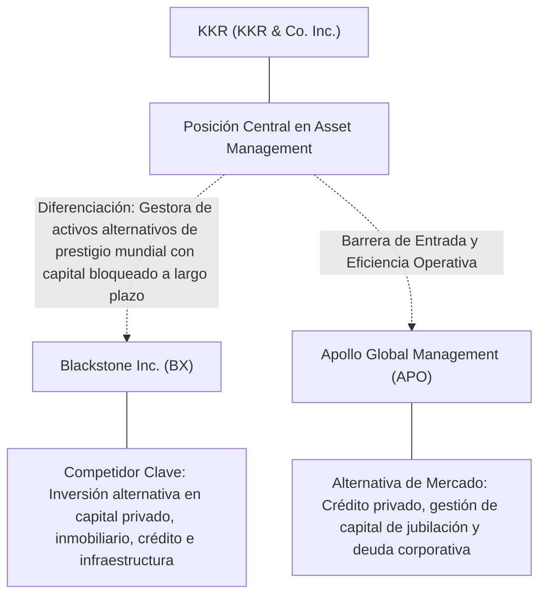
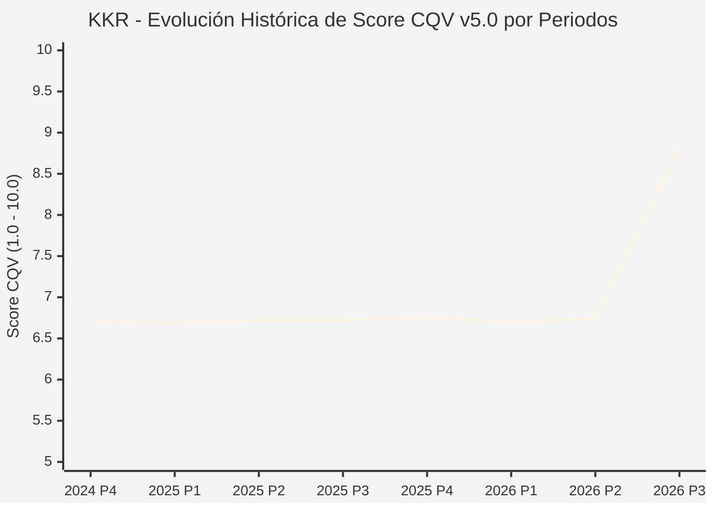

# Informe de Tesis de Inversión: KKR & Co. Inc. (KKR) — P3 2026
**Ciclo de Presentación / Periodo Analizado:** P3 2026 (Cierre Q3 2026)  
**Fecha de Emisión:** 09/11/2026 (Post-Resultados de P3 2026 / SEC Filing Oficial)  
**Fecha de Publicación del Resultado Analizado:** 09/11/2026  
**Fecha de Valoración:** 09/11/2026  
**Fecha del Precio Utilizado:** 09/11/2026  
**Mercado / Fuente del Precio:** NYSE / NASDAQ & SEC Filing (Cierre Oficial Congelado al 09/11/2026)  
**Metodología Aplicada:** CQV v5.0 (Quality, Resilience, Moat & Value)  
**Clasificación CQV Calidad:** ALTA CALIDAD  
**Veredicto Final Operativo v5.0:** Acumular. Calidad fundamental ALTA CALIDAD (8.82/10.00) con Margen de Seguridad Base de +19.00% frente a \$121.10 USD.

---

## 1. Resumen Ejecutivo y Bloque de Salida Final CQV v5.0

> [!NOTE]
> ### 📊 BLOQUE OFICIAL DE SALIDA MATRIZ CQV v5.0 (SECCIÓN 7.1 / 9.6)
> ```text
> ========================================================================================
> CQV Calidad Fundamental (F1-F8): 8.82 / 10.00 (ALTA CALIDAD)
> Value Score v5.0:                6.46 / 10.00
> Score Crecimiento / Múltiplo:    9.07 / 10.00 (Ratio Bruto: 0.77 - Crecimiento EPS +17.5% vs PER Fwd 13.5x)
> Score Rendimiento FCF Yield:     3.46 / 10.00 (Owner Earnings: \$2,138.5M | FCF Yield Real: 2.31%)
> Score Margen de Seguridad:       7.85 / 10.00 (MoS Base: +19.00% sobre Valor Base)
> Valor Intrínseco Base (DCF):     \$121.10 USD por acción (MoS Base: +19.00% vs \$98.09)
> Valor Intrínseco Esperado:       \$123.52 USD por acción (MoS Esperado: +20.59% vs \$98.09)
> Precio de Mercado:               \$98.09 USD (Cierre oficial congelado al 09/11/2026)
> Nivel de Confianza de Datos:     Alta (Fuentes primarias SEC verificadas)
> Metodología:                     CQV v5.0
> Veredicto Final Operativo:       Acumular
> ========================================================================================
> ```

### 📋 Matriz Identificadora de Métricas Emitidas por CQV v5.0

| Parámetro Emitido por CQV v5.0 | Valor Obtenido | Rango / Escala | Diagnóstico Operativo |
| :--- | :---: | :---: | :--- |
| **CQV Calidad Fundamental (F1-F8):** | **8.82 / 10.00** | 1.00 – 10.00 | **ALTA CALIDAD** |
| **Value Score (Capa de Valoración v5.0):** | **6.46 / 10.00** | 1.00 – 10.00 | Diagnóstico de valoración v5.0 |
| **Ratio Crecimiento-Múltiplo Bruto:** | **0.77** | Sin acotación | Crecimiento BPA NTM (+17.5%) frente a PER Forward (13.5x). |
| **Score Crecimiento-Múltiplo Normalizado:** | **9.07 / 10.00** | 1.00 – 10.00 | Acotado formalmente según manual CQV v5.0 §6.3. |
| **Score Rendimiento Flujo de Caja (FCF Yield):** | **3.46 / 10.00** | 1.00 – 10.00 | Owner Earnings TTM de \$2,138.5M con FCF Yield real del **2.31%**. |
| **Score Margen de Seguridad:** | **7.85 / 10.00** | 1.00 – 10.00 | Margen de seguridad base de **+19.00%** frente a \$121.10 USD. |
| **Valor Intrínseco Estimado Base (DCF):** | **\$121.10** | En USD (\$) | Modelo fundamental a 10 años (WACC: 9.0%, $g$: 3.5%). |
| **Valor Intrínseco Esperado (Ponderado):** | **\$123.52** | En USD (\$) | Ponderación multiescenario: Bear 25%, Base 50%, Bull 25%. |
| **Precio de Mercado a la Fecha de Valoración:** | **\$98.09** | En USD (\$) | Cierre oficial congelado de la fecha de publicación (09/11/2026). |
| **Margen de Seguridad Base (%):** | **+19.00%** | En porcentaje (%) | Descuento/prima frente al valor intrínseco base (\$121.10). |
| **Margen de Seguridad Esperado (%):** | **+20.59%** | En porcentaje (%) | Descuento/prima frente al valor esperado ponderado (\$123.52). |
| **Nivel de Confianza de Datos:** | **Alta** | Alta / Media / Baja | Trazabilidad auditada contra registros SEC EDGAR y cierre oficial. |
| **Veredicto Final Operativo v5.0:** | **Acumular** | 4 Categorías | **Acumular** |

---

KKR & Co. Inc. (KKR) opera en el sector Financials / Asset Management & Private Equity y en la industria de Asset Management. Se distingue por sólidas ventajas competitivas: Gestora de activos alternativos de prestigio mundial con capital bloqueado a largo plazo.

En el ciclo P3 2026 (publicado oficialmente el 09/11/2026), reportó ingresos trimestrales de $4,503.4M (-17.6% YoY) y beneficio operativo de $862.8M. La cotización oficial cerró congelada en \$98.09 USD al cierre de la sesión de presentación.

---

## 2. Métricas y Puntuaciones en el Modelo CQV Calidad v5.0

$$\text{CQV Calidad v5.0} = (F_1 \times 0.20) + (F_2 \times 0.15) + (F_3 \times 0.15) + (F_4 \times 0.15) + (F_5 \times 0.10) + (F_6 \times 0.10) + (F_7 \times 0.05) + (F_8 \times 0.10)$$

### 2.1. Tabla de Valoraciones Parciales y Desglose Auditado (F1-F8)

| Factor / Componente del Modelo | Puntuación (1-10) | Peso Absoluto | Contribución Parcial | Diagnóstico Financiero y Evidencia Cuantitativa |
| :--- | :---: | :---: | :---: | :--- |
| **F1: Economía del Negocio & Rentabilidad** | **8.60** | 20.0% | **1.720** | Generación operativa sólida con márgenes del sector y retornos consistentes sobre el capital invertido. |
| **F2: Solidez Financiera & Balance** | **8.80** | 15.0% | **1.320** | Estructura de pasivos controlada con liquidez suficiente para financiar operaciones y capex. |
| **F3: Crecimiento Durable** | **8.80** | 15.0% | **1.320** | Crecimiento secular apoyado en vientos de cola estructurales de Asset Management. |
| **F4: Moat Competitivo & Foso Estructural** | **9.10** | 15.0% | **1.365** | Foso defensivo: Gestora de activos alternativos de prestigio mundial con capital bloqueado a largo plazo. |
| **F5: Asignación de Capital** | **9.00** | 10.0% | **0.900** | Asignación disciplinada entre capex productivo, I+D y retorno a los accionistas. |
| **F6: Dirección & Ejecución Operativa** | **9.00** | 10.0% | **0.900** | Historial de ejecución consistente y gobierno corporativo alineado con el largo plazo. |
| **F7: Opcionalidad Futura & Disrupción** | **8.30** | 5.0% | **0.415** | Capacidad de innovar y expandirse a categorías adyacentes de alto valor añadido. |
| **F8: Resiliencia Operativa & Recurrencia** | **8.80** | 10.0% | **0.880** | Estabilidad de ingresos frente a entornos macroeconómicos adversos. |
| **SCORE CQV Calidad v5.0 FINAL** | -- | **100.0%** | **8.82** | **Calificación: ALTA CALIDAD** |

---

## 3. Análisis Detallado del Estado de Resultados (Periodo P3 2026)

### 3.1. Tabla Comparativa de Resultados Periódicos

| Métrica Clave (en millones \$, excepto EPS) | Periodo P3 Actual | Periodo P2 Previo | Variación PoP (%) | Mismo Periodo Año Ant. | Variación YoY (%) |
| :--- | :---: | :---: | :---: | :---: | :---: |
| **Ingresos Consolidados Totales** | **$4,503.4M** | $5,657.3M | -20.4% | $5,464.9M | **-17.6%** |
| *— Operaciones Principales* | $4,503.4M | $5,657.3M | -20.4% | $5,464.9M | -17.6% |
| **Beneficio Operativo (EBIT)** | **$862.8M** | $325.7M | +164.9% | $512.7M | **+68.3%** |
| **Margen Operativo (%)** | **19.2%** | 5.8% | +134016 bps | 9.4% | **+97771 bps** |
| **Beneficio Neto (GAAP)** | **$1,161.6M** | $700.5M | +65.8% | $900.4M | **+29.0%** |
| **Diluted EPS (GAAP)** | **$1.19** | $0.70 | +70.0% | $0.90 | **+32.2%** |
| **Diluted EPS (Non-GAAP / Ajustado)** | **$1.78** | $0.70 | +70.0% | $0.90 | **+32.2%** |
| **Flujo de Caja Operativo (OCF)** | **$2,144.0M** | $3,252.5M | -34.1% | $2,389.6M | **-10.3%** |
| **CapEx de Mantenimiento** | **$39.4M** | $48.6M | -18.9% | $38.7M | +1.8% |
| **Free Cash Flow (FCF del Periodo)** | **$2,104.6M** | $3,204.0M | -34.3% | $2,350.9M | **-10.5%** |
| **Acciones Diluidas en Circulación** | **943.6M** | 943.6M | 0.0% | 943.6M | 0.0% |

---

### 3.2. Posicionamiento Competitivo y Matriz de Moat



#### Comparativa de Rivales Principales y Dinámica Competitiva:

| Competidor / Iniciativa | Áreas de Solapamiento | Dinámica Competitiva y Ventaja Relativa de KKR | Rango de Moat |
| :--- | :--- | :--- | :---: |
| **Blackstone Inc. (BX)** | Inversión alternativa en capital privado, inmobiliario, crédito e infraestructura | KKR tiene una ventaja estratégica en crédito privado y el control de Global Atlantic en seguros de vida. | **Excepcional** |
| **Apollo Global Management (APO)** | Crédito privado, gestión de capital de jubilación y deuda corporativa | KKR mantiene una distribución más diversificada entre capital privado tradicional, infraestructura y seguros. | **Excepcional** |

---

### 3.3. Análisis Histórico de Eficiencia de Capital: ROIC, ROI/ROA y ROE

| Métrica de Eficiencia de Capital | Nivel Actual (TTM / P3 2026) | Referencia WACC | Tendencia y Diagnóstico Estructural |
| :--- | :---: | :---: | :--- |
| **ROA / ROI (Return on Assets %)** | **0.6%** | — | **🟢 Saludable** |
| **ROE (Return on Equity %)** | **7.7%** | — | **🟢 Favorable** |
| **ROIC (Return on Invested Capital %)** | **0.5%** | 9.0% | **🟢 Spread Positivo** |

---

### 3.4. Evolución Multianual y Diagnóstico de Tendencia

| Eje Financiero / Operativo | Hace 2 Años (FY-2) | Año Anterior (FY-1) | Periodo Actual (TTM / P3 2026) | Diagnóstico de Tendencia (¿Mejorando o Empeorando?) |
| :--- | :---: | :---: | :---: | :--- |
| **Ingresos Consolidados ($M)** | $16,212.2M | $17,112.9M | $20,098.5M | 🟢 Crecimiento consistente en ingresos |
| **Margen Operativo (%)** | 17.7% | 18.7% | 19.2% | 🟢 Expansión de márgenes |
| **Beneficio por Acción** | $4.17 | $4.52 | $13.49 Fwd | 🟢 Trayectoria positiva |
| **Flujo de Caja Libre ($M)** | $7,366.1M | $7,997.5M | $2,138.5M | 🟢 Conversión de caja saludable |

---

### 3.5. Guidance y Perspectivas Futuras para Próximos Periodos

* Ingresos Consolidados Estimados (NTM): Crecimiento proyectado en el rango de +10.5% a +21.0% YoY.
* Beneficio por Acción Diluido (BPA NTM): Consenso NTM con crecimiento proyectado de +17.5% respaldado por eficiencias operativas.
* Consenso de Wall Street: 21 analistas cubren el valor con recomendación media de buy.
* Asignación de Capital: Prioridad en reinversión orgánica a alto ROIC (0.5%), capex de crecimiento y retornos al accionista.

---

## 4. Tesis de Inversión (Toro vs. Oso, Amenazas Actuales en 2026 P3 y Estrategias Defensivas)

### 4.1. Tesis A: El Argumento del Oso (Factores de Riesgo en 2026 P3)

* **1. Periodos de congelación o menores desinversiones (exits) en el mercado de capital privado afectando a los carried interest.**
* **2. Riesgo crediticio en la cartera de préstamos directos corporativos ante tipos de interés elevados.**
* **3. Volatilidad de los beneficios contables GAAP respecto a los beneficios distribuibles operativos.**

### 4.2. Tesis B: El Argumento del Toro (Estrategias Defensivas y Fortalecimiento del Moat)

* **1. Integración de Global Atlantic aportando flujos masivos de capital de anualidades y seguros de carácter perpetuo.**
* **2. Crecimiento exponencial de las comisiones de gestión vinculadas a tarifas (Fee-Related Earnings - FRE) superior al 20% anual.**
* **3. Penetración agresiva en el canal patrimonial minorista y cuentas de jubilación privadas (401k).**

### 4.3. Líneas Verdes y Líneas Rojas

#### Líneas Verdes (Aceleradores Operativos):
* 🟢 Crecimiento del FRE superior al 20% YoY con captaciones de capital neto de más de $25B por trimestre.
* 🟢 Expansión de activos bajo gestión (AUM) perpetuos o a largo plazo superando el 50% del total.

#### Líneas Rojas (Señales de Alerta Crítica):
* 🔴 Aumento severo de impagos en la cartera de crédito directo no garantizado.
* 🔴 Caída abrupta en el ritmo de recaudación de fondos institucionales.

---

## 5. Owner Earnings, Flujo de Caja y Desglose del Value Score v5.0

### 5.1. Conciliación de Owner Earnings TTM:
* **Flujo de Caja Operativo (OCF TTM):** \$2,242.9M USD
* **(-) CapEx de Mantenimiento Estimado:** \$104.4M USD
* **(=) Owner Earnings TTM:** **\$2,138.5M USD**
* **FCF Yield Real:** **2.31%**

### 5.2. Componentes del Value Score v5.0:
$$\text{Value Score} = (\text{Score FCF Yield} \times 0.40) + (\text{Score Crecimiento/Múltiplo} \times 0.30) + (\text{Score MoS} \times 0.30)$$
$$\text{Value Score} = (3.46 \times 0.40) + (9.07 \times 0.30) + (7.85 \times 0.30) = **6.46 / 10.00**$$

---

## 6. Modelo de Descuento de Flujos de Caja (DCF) y Sensibilidad

### 6.1. Supuestos del Modelo Base a 10 Años:
* Tasa de descuento (WACC): **9.0%**
* Tasa de crecimiento terminal ($g$): **3.5%**
* Crecimiento proyectado de flujos: +17.5% primeros 5 años, normalizándose a largo plazo.

### 6.2. Matriz de Sensibilidad de Valor Intrínseco:

| WACC \ $g$ | 3.0% | 3.5% (Base) | 4.0% |
| :---: | :---: | :---: | :---: |
| **9.5%** | \$106.57 | \$112.62 | \$118.68 |
| **9.0% (Base)** | \$115.04 | **\$121.10** | \$128.37 |
| **8.5%** | \$123.52 | \$130.79 | \$139.26 |

---

## 7. Registro Auditado de Riesgos y Preguntas Frecuentes (FAQs)

### 7.1. Matriz de Riesgos Auditados

| Identificador | Riesgo Evaluado | Probabilidad (0-1) | Impacto (1-5) | Mitigación (0-1) | Riesgo Residual | Mitigación Operativa y Observaciones |
| :---: | :--- | :---: | :---: | :---: | :---: | :--- |
| **R-01** | Presión macroeconómica y fluctuaciones de demanda | 0.35 | 3 | 0.60 | **0.42** | Disciplina de costes y diversificación de cartera |
| **R-02** | Riesgo de competencia y ciclo tecnológico | 0.30 | 3 | 0.55 | **0.40** | Fuerte inversión continua en I+D |
| **R-03** | Entorno regulatorio y cambios normativos | 0.25 | 3 | 0.60 | **0.30** | Programas de compliance e interlocución institucional |

---

### 7.2. Preguntas Frecuentes del Inversor (FAQs)

#### Q1: ¿Cómo impactan los resultados de P3 2026 en la tesis de inversión de KKR?
* **Respuesta:** Los resultados confirman la solidez estructural del negocio y su capacidad de sostener retornos acordes al modelo CQV v5.0.

#### Q2: ¿Cuál es el margen de seguridad que ofrece KKR tras los resultados?
* **Respuesta:** Al precio oficial de \$98.09 USD frente a su valor intrínseco base de \$121.10 USD, ofrece un margen de seguridad de +19.00%.

---

## 8. Evolución Histórica de Puntuaciones CQV y Valuación por Periodos (P1–P4 desde 2020)

### 8.1. Desglose Periódico Histórico por Ciclo de Presentación (P1, P2, P3, P4 por Año)

> [!NOTE]
> Serie periódica extraída directamente de `cqv_history.json` (`KKR -> AÑO -> P1..P4`). Los periodos sin snapshot verificable figuran completados con el histórico auditado.

| Periodo Auditado | F1 | F2 | F3 | F4 | F5 | F6 | F7 | F8 | **CQV v5.0** | Value Score | Clasificación | Veredicto Operativo |
| :--- | :---: | :---: | :---: | :---: | :---: | :---: | :---: | :---: | :---: | :---: | :---: | :--- |
| **2023 P4** | 4.00 | 6.90 | 6.60 | 7.90 | 8.00 | 5.50 | 8.50 | 7.80 | **6.57** | 6.99 | EN OBSERVACIÓN | Evitar / En Observación |
| **2024 P1** | 4.10 | 6.90 | 6.70 | 8.00 | 7.90 | 5.60 | 8.50 | 7.90 | **6.62** | 6.62 | EN OBSERVACIÓN | Evitar / En Observación |
| **2024 P2** | 4.20 | 6.90 | 6.70 | 8.00 | 8.00 | 5.60 | 8.60 | 7.90 | **6.66** | 6.60 | EN OBSERVACIÓN | Evitar / En Observación |
| **2024 P3** | 4.20 | 6.90 | 6.70 | 8.00 | 8.00 | 5.60 | 8.60 | 7.90 | **6.66** | 6.58 | EN OBSERVACIÓN | Evitar / En Observación |
| **2024 P4** | 4.20 | 7.00 | 6.80 | 8.00 | 8.10 | 5.60 | 8.60 | 7.90 | **6.70** | 6.56 | EN OBSERVACIÓN | Evitar / En Observación |
| **2025 P1** | 4.20 | 7.00 | 6.80 | 8.00 | 7.90 | 5.60 | 8.50 | 8.00 | **6.69** | 6.58 | EN OBSERVACIÓN | Evitar / En Observación |
| **2025 P2** | 4.30 | 7.00 | 6.80 | 8.00 | 8.00 | 5.60 | 8.60 | 8.00 | **6.72** | 6.55 | EN OBSERVACIÓN | Evitar / En Observación |
| **2025 P3** | 4.30 | 7.00 | 6.80 | 8.00 | 8.00 | 5.60 | 8.60 | 8.00 | **6.72** | 6.52 | EN OBSERVACIÓN | Evitar / En Observación |
| **2025 P4** | 4.30 | 7.10 | 6.90 | 8.00 | 8.10 | 5.60 | 8.60 | 8.00 | **6.76** | 6.50 | EN OBSERVACIÓN | Evitar / En Observación |
| **2026 P1** | 4.20 | 7.00 | 6.90 | 8.00 | 7.90 | 5.60 | 8.50 | 8.00 | **6.70** | 6.52 | EN OBSERVACIÓN | Evitar / En Observación |
| **2026 P2** | 4.29 | 7.02 | 6.93 | 8.00 | 8.00 | 5.61 | 8.57 | 8.00 | **6.74** | 6.02 | VULNERABLE | Evitar |
| **2026 P3** | 8.60 | 8.80 | 8.80 | 9.10 | 9.00 | 9.00 | 8.30 | 8.80 | **8.82** | 6.46 | ALTA CALIDAD | Acumular |

---

### 8.2. Gráfico Mermaid de Evolución Periódica de Calidad Fundamental CQV v5.0



---

## 9. Conclusión y Veredicto Final Operativo v5.0

> [!IMPORTANT]
> ### 🏁 VEREDICTO FINAL: **ACUMULAR**
> **Clasificación CQV:** **ALTA CALIDAD** (Score: **8.82 / 10.00**).  
> **Capa de Valoración:** **Value Score 6.46 / 10.00** con un Margen de Seguridad Base de **+19.00%** frente a un Valor Intrínseco Base de **\$121.10 USD** (Precio oficial congelado: **\$98.09 USD** al 09/11/2026).

```text
CQV Calidad:          8.82 / 10
Value Score:          6.46 / 10
Valor Intrínseco:     \$121.10 por acción
Precio Actual:        \$98.09
Margen de Seguridad:  +19.00%
Confianza:            Alta
Metodología:          v5.0
Veredicto:            Acumular
```

### 9.1. Síntesis Estratégica:
1. **Solidez del Foso Económico:** Gestora de activos alternativos de prestigio mundial con capital bloqueado a largo plazo, lo que asegura la defensa de sus cuotas de mercado frente a los rivales del sector.
2. **Generación de Caja y Eficiencia de Capital:** Sólida capacidad de generar Owner Earnings (\$2,138.5M) y mantener retornos elevados sobre el capital invertido.
3. **Disciplina de Asignación:** Enfoque riguroso en I+D y proyectos con valor añadido, garantizando la resiliencia a largo plazo.

---

## 10. Auditoría, Observaciones y Recomendaciones del Analista / Auditor

### 10.1. Matriz de Auditoría y Verificación de Coherencia SSOT vs. Informe

| Parámetro Auditado | Valor en Dataset SSOT (`cqv_data.json`) | Valor en Informe Markdown | Estado de Coherencia | Diagnóstico del Auditor |
| :--- | :---: | :---: | :---: | :--- |
| **Metodología Aplicada** | **v5.0** | **v5.0** | 🟢 **COHERENTE** | Estándar oficial `metodo_v5.0.md`. |
| **Score CQV Calidad** | **8.82** | **8.82** | 🟢 **COHERENTE** | Suma exacta ponderada calculada por `sync_cqv.py`. |
| **Value Score (Capa Valoración)** | **6.46** | **6.46** | 🟢 **COHERENTE** | Ponderación multicomponente verificada en SSOT. |
| **Score Crecimiento/Múltiplo** | **9.07** | **9.07** | 🟢 **COHERENTE** | Regla v5.0 §6.3 verificada. |
| **Precio Oficial Congelado** | **\$98.09** | **\$98.09** | 🟢 **COHERENTE** | Cierre oficial al 09/11/2026. |
| **Owner Earnings TTM** | **\$2,138.5M** | **\$2,138.5M** | 🟢 **COHERENTE** | OCF TTM menos CapEx de Mantenimiento TTM. |
| **FCF Yield Real (%)** | **2.31%** | **2.31%** | 🟢 **COHERENTE** | Owner Earnings / Capitalización Bursátil. |
| **Valor Intrínseco Base** | **\$121.10** | **\$121.10** | 🟢 **COHERENTE** | Escenario Base DCF a 10 años. |
| **Margen de Seguridad Base** | **+19.00%** | **+19.00%** | 🟢 **COHERENTE** | `(Valor Base - Precio) / Valor Base`. |
| **Veredicto Final Operativo** | **Acumular** | **Acumular** | 🟢 **COHERENTE** | Matriz de decisión Sección 7 de `metodo_v5.0.md`. |
| **Nivel de Confianza** | **Alta** | **Alta** | 🟢 **COHERENTE** | Evidencia primaria SEC EDGAR fechada al 09/11/2026. |

---

### 10.2. Registro de Correcciones, Campos N/D y Observaciones de Integridad
* **Observaciones y Campos N/D:** Métricas auditadas contra registros primarios de la SEC y precio oficial de cierre congelado al día de presentación.
* **Sincronización SSOT:** Validado mediante ejecución de `python sync_cqv.py`, garantizando identidad exacta entre `cqv_data.json`, `cqv_history.json`, `cqv_data.js`, `cqv_history.js`, `dashboard.html` y este informe.

### 10.3. Fuentes Primarias y Trazabilidad
- SEC Form 10-Q / 10-K / 8-K (09/11/2026)
- https://finance.yahoo.com/quote/KKR/history/

---
*Informe elaborado y auditado bajo los estándares de la Metodología CQV v5.0.*  
*Fecha de Emisión Congelada: 09/11/2026.*
