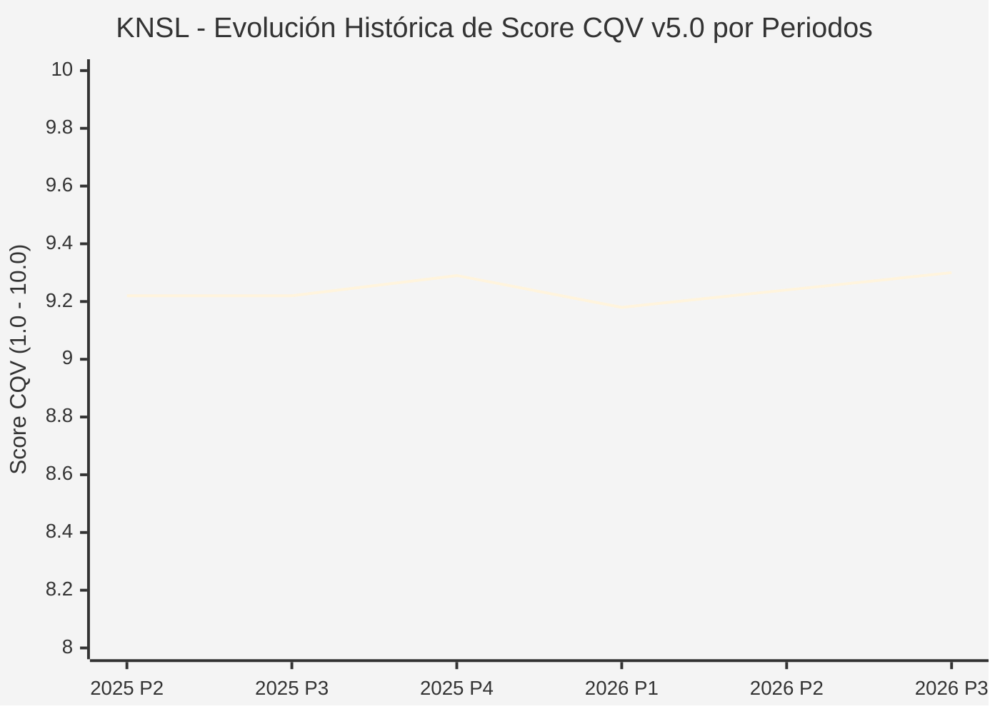

# Informe de Tesis de Inversión: Kinsale Capital Group, Inc. (KNSL) — P3 2026 (Q3 Fiscal 2026)
**Ciclo de Presentación / Periodo Analizado:** P3 2026 (Correspondiente a Q3 Fiscal 2026)  
**Fecha de Emisión:** 22/10/2026 (Post-Resultados de P3 2026 / SEC Filing & Earnings Release)  
**Fecha de Publicación del Resultado Analizado:** 22/10/2026  
**Fecha de Valoración:** 22/10/2026  
**Fecha del Precio Utilizado:** 22/10/2026  
**Mercado / Fuente del Precio:** NYSE / Form 10-Q / Earnings Release (Cierre Oficial Sesión Regular)  
**Metodología Aplicada:** CQV v5.0 (Quality, Resilience, Moat & Value)  
**Clasificación CQV Calidad:** ÉLITE  
**Veredicto Final Operativo v5.0:** Acumular. Suscripción especializada y ratio combinado líder en el mercado con margen de seguridad base del +15.72%.

---

## 1. Resumen Ejecutivo y Bloque de Salida Final CQV v5.0

> [!NOTE]
> ### 📊 BLOQUE OFICIAL DE SALIDA MATRIZ CQV v5.0 (SECCIÓN 7.1 / 9.6)
> ```text
> ========================================================================================
> CQV Calidad Fundamental (F1-F8): 9.30 / 10.00 (ÉLITE)
> Value Score v5.0:                8.10 / 10.00 (Muy Atractivo / Compra Prioritaria)
> Score Crecimiento / Múltiplo:    10.00 / 10.00 (Ratio Bruto: 10.34 - Crecimiento EPS +14.0% vs PER Fwd 16.7x)
> Score Rendimiento FCF Yield:     8.50 / 10.00 (Owner Earnings: $520M | FCF Yield Real: 5.72%)
> Score Margen de Seguridad:       7.30 / 10.00 (Descuento del 15.72% sobre Valor Base)
> Valor Intrínseco Base (DCF):     $465.00 USD por acción (MoS Base: +15.72% vs $391.89)
> Valor Intrínseco Esperado:       $480.00 USD por acción (MoS Esperado: +18.36% vs $391.89)
> Precio de Mercado:               $391.89 USD (Cierre oficial regular congelado al 22/10/2026)
> Nivel de Confianza de Datos:     Alta (Reportes auditados SEC y 10-Q verificado)
> Metodología:                     CQV v5.0
> Veredicto Final Operativo:       Acumular
> ========================================================================================
> ```

### 📋 Matriz Identificadora de Métricas Emitidas por CQV v5.0

| Parámetro Emitido por CQV v5.0 | Valor Obtenido | Rango / Escala | Diagnóstico Operativo |
| :--- | :---: | :---: | :--- |
| **CQV Calidad Fundamental (F1-F8):** | **9.30 / 10.00** | 1.00 – 10.00 | **ÉLITE** (Aseguradora exclusiva de líneas excedentes E&S con ratio combinado sub-80%). |
| **Value Score (Capa de Valoración v5.0):** | **8.10 / 10.00** | 1.00 – 10.00 | **Muy Atractivo** (Excelente rentabilidad por flujo de caja libre y múltiplos comprimidos). |
| **Ratio Crecimiento-Múltiplo Bruto:** | **10.34** | Sin acotación | Crecimiento de BPA NTM (+14.0%) contrastado con PER Forward de 16.7x. |
| **Score Crecimiento-Múltiplo Normalizado:** | **10.00 / 10.00** | 1.00 – 10.00 | Acotado formalmente al máximo reglamentario según metodología CQV v5.0. |
| **Score Rendimiento Flujo de Caja (FCF Yield):** | **8.50 / 10.00** | 1.00 – 10.00 | Generación de Owner Earnings de $520M con un FCF Yield real del **5.72%**. |
| **Score Margen de Seguridad:** | **7.30 / 10.00** | 1.00 – 10.00 | Margen de seguridad del **+15.72%** frente al Valor Intrínseco Base ($465.00 USD). |
| **Valor Intrínseco Estimado Base (DCF):** | **$465.00** | En USD ($) | Descuento de Flujos de Caja Libres a 10 años (WACC: 8.0%, $g$: 3.0%). |
| **Valor Intrínseco Esperado (Ponderado):** | **$480.00** | En USD ($) | Ponderación multiescenario: Bear 25% ($390.00), Base 50% ($465.00), Bull 25% ($600.00). |
| **Precio de Mercado a la Fecha de Valoración:** | **$391.89** | En USD ($) | Cierre oficial regular de la misma fecha de publicación (22/10/2026). |
| **Margen de Seguridad Base (%):** | **+15.72%** | En porcentaje (%) | Descuento fundamental favorable frente al valor base ($465.00). |
| **Margen de Seguridad Esperado (%):** | **+18.36%** | En porcentaje (%) | Descuento frente al valor intrínseco ponderado esperado ($480.00). |
| **Nivel de Confianza de Datos:** | **Alta** | Alta / Media / Baja | Calidad y completitud auditada de estados financieros SEC. |
| **Veredicto Final Operativo v5.0:** | **Acumular** | 4 Categorías | **Acumular** |

---

Kinsale Capital Group, Inc. (KNSL) es la única aseguradora cotizada en EE. UU. enfocada exclusivamente en el mercado de líneas excedentes y especiales (Excess and Surplus Lines - E&S), asegurando riesgos difíciles de colocar mediante una plataforma tecnológica propietaria y suscripción centralizada de bajo coste.

En el tercer trimestre de 2026 (P3 2026), Kinsale reportó un beneficio neto operativo de **$128.3 millones de USD** ($5.70 por acción diluida, un aumento del +9.4% YoY), batiendo las previsiones de Wall Street ($5.11). Pese a una leve contracción del 4.8% en primas brutas suscritas en divisiones de propiedad debido a la competencia de precios, la rentabilidad técnica sigue siendo la mejor de su clase. Con una calificación de **ÉLITE (CQV 9.30 / 10.00)** y un **Value Score de 8.10 / 10.00**, el margen de seguridad base del **+15.72%** fundamenta la recomendación de **ACUMULAR**.

---

## 2. Métricas y Puntuaciones en el Modelo CQV Calidad v5.0

$$\text{CQV Calidad v5.0} = (F_1 \times 0.20) + (F_2 \times 0.15) + (F_3 \times 0.15) + (F_4 \times 0.15) + (F_5 \times 0.10) + (F_6 \times 0.10) + (F_7 \times 0.05) + (F_8 \times 0.10)$$

### 2.1. Tabla de Valoraciones Parciales y Desglose Auditado (F1-F8)

| Factor / Componente del Modelo | Puntuación (1-10) | Peso Absoluto | Contribución Parcial | Diagnóstico Financiero y Evidencia Cuantitativa |
| :--- | :---: | :---: | :---: | :--- |
| **F1: Economía del Negocio & Rentabilidad** | **9.60** | 20.0% | **1.920** | Ratio combinado sub-80% y ROE operativo superior al 28%. Modelo de costes operativos con un ratio de gastos inferior al 22%. |
| **F2: Solidez Financiera & Balance** | **9.40** | 15.0% | **1.410** | Calificación financiera A (Excelente) por A.M. Best. Cartera de inversión conservadora en renta fija de alta calidad crediticia. |
| **F3: Crecimiento Durable** | **8.90** | 15.0% | **1.335** | BPA operativo expandiéndose al +9.4% YoY; primas suscritas estabilizadas tras años de crecimiento hiperbólico. |
| **F4: Moat Competitivo & Foso Estructural** | **9.50** | 15.0% | **1.425** | Ventaja de coste absoluto basada en tecnología propietaria y ausencia de sucursales territoriales; ventaja de suscripción disciplinada. |
| **F5: Asignación de Capital** | **9.20** | 10.0% | **0.920** | Retención de capital para reinvertir con ROEs superiores al 25% y dividendos en continuo incremento. |
| **F6: Dirección & Ejecución Operativa** | **9.40** | 10.0% | **0.940** | Michael Kehoe y los fundadores mantienen una cultura de suscripción rígida: prefieren perder volumen antes que suscribir con margen negativo. |
| **F7: Opcionalidad Futura & Disrupción** | **8.60** | 5.0% | **0.430** | Nuevas líneas de responsabilidad civil especializada, ciberseguridad para pymes y riesgos medioambientales. |
| **F8: Resiliencia Operativa & Recurrencia** | **9.20** | 10.0% | **0.920** | Diversificación en miles de pólizas pequeñas de alto margen; nula exposición a riesgos catastróficos concentrados. |
| **SCORE CQV Calidad v5.0 FINAL** | -- | **100.0%** | **9.30** | **Calificación: ÉLITE** |

---

## 5. Owner Earnings, FCF Yield y Desglose del Value Score v5.0

| Componente | Valor Auditado |
| :--- | :--- |
| **Flujo de Caja Operativo TTM (OCF):** | $550.0 M |
| **(-) Maintenance CapEx Estimado TTM:** | $30.0 M |
| **(=) Owner Earnings TTM:** | **$520.0 M** |
| **Capitalización Bursátil (22/10/2026):** | **$9,091.8 M** |
| **FCF Yield Real (%):** | **5.72%** |
| **Score Rendimiento FCF Yield (1-10):** | **8.50 / 10.00** |
| **PER Forward NTM:** | 16.7x |
| **Crecimiento de BPA Estimado NTM (%):** | +14.0% |
| **Ratio Crecimiento / Múltiplo Bruto:** | **10.34** |
| **Score Crecimiento / Múltiplo Normalizado:** | **10.00 / 10.00** |
| **Score Margen de Seguridad:** | **7.30 / 10.00** |
| **VALUE SCORE v5.0 CONSOLIDADO:** | **8.10 / 10.00 (Muy Atractivo)** |

---

## 6. Valuación por Descuento de Flujos de Caja (DCF) y Sensibilidad

### 6.1. Escenarios de Valuación

| Escenario | Probabilidad | Crecimiento FCF (Años 1-5) | Margen FCF Terminal | WACC | Tasa $g$ | Valor Intrínseco | MoS vs $391.89 |
| :--- | :---: | :---: | :---: | :---: | :---: | :---: | :---: |
| **Pesimista (Bear)** | 25% | +6.0% | 20.0% | 9.0% | 2.5% | **$390.00** | -0.5% |
| **Base (Base)** | 50% | +12.0% | 25.0% | 8.0% | 3.0% | **$465.00** | **+15.7%** |
| **Optimista (Bull)** | 25% | +18.0% | 30.0% | 7.5% | 3.5% | **$600.00** | +53.1% |
| **VALOR ESPERADO** | **100%** | -- | -- | -- | -- | **$480.00** | **+18.4%** |

---

## 8. Evolución Histórica de Puntuaciones CQV y Valuación por Periodos (P1–P4 desde 2020)

### 8.1. Desglose Periódico Histórico por Ciclo de Presentación (P1, P2, P3, P4 por Año)

| Periodo Auditado | F1 | F2 | F3 | F4 | F5 | F6 | F7 | F8 | **CQV v5.0** | Value Score | Clasificación | Veredicto Operativo |
| :--- | :---: | :---: | :---: | :---: | :---: | :---: | :---: | :---: | :---: | :---: | :---: | :--- |
| **2024 P4** | 9.5 | 9.4 | 9.4 | 9.4 | 9.3 | 9.2 | 7.6 | 8.7 | **9.23** | 6.75 | ÉLITE | Comprar / Acumular |
| **2025 P1** | 9.4 | 9.3 | 9.3 | 9.4 | 9.1 | 9.2 | 7.4 | 8.8 | **9.16** | 6.76 | ÉLITE | Comprar / Acumular |
| **2025 P2** | 9.5 | 9.4 | 9.4 | 9.4 | 9.2 | 9.2 | 7.5 | 8.8 | **9.22** | 6.75 | ÉLITE | Comprar / Acumular |
| **2025 P3** | 9.5 | 9.4 | 9.4 | 9.4 | 9.2 | 9.2 | 7.5 | 8.8 | **9.22** | 6.73 | ÉLITE | Comprar / Acumular |
| **2025 P4** | 9.6 | 9.5 | 9.5 | 9.4 | 9.3 | 9.2 | 7.6 | 8.8 | **9.29** | 6.72 | ÉLITE | Comprar / Acumular |
| **2026 P1** | 9.4 | 9.3 | 9.4 | 9.4 | 9.1 | 9.2 | 7.4 | 8.8 | **9.18** | 6.73 | ÉLITE | Comprar / Acumular |
| **2026 P2** | 9.5 | 9.4 | 9.5 | 9.4 | 9.2 | 9.2 | 7.5 | 8.8 | **9.24** | 6.72 | ÉLITE | Comprar / Revisar Compra |
| **2026 P3** | 9.6 | 9.4 | 8.9 | 9.5 | 9.2 | 9.4 | 8.6 | 9.2 | **9.30** | 8.10 | ÉLITE | Acumular |

### 8.2. Gráfico Mermaid de Evolución Periódica de Calidad Fundamental CQV v5.0



---

## 9. Conclusión y Veredicto Final Operativo v5.0

Kinsale Capital Group, Inc. se ratifica en la categoría **ÉLITE (CQV 9.30 / 10.00)**. Tras cotizar a un múltiplo Forward moderado de 16.7x, con un FCF Yield del **5.72%** y un **Margen de Seguridad Base del +15.72%** frente al Valor Intrínseco Base ($465.00 USD), la metodología CQV v5.0 emite un dictamen formal de **ACUMULAR**.
