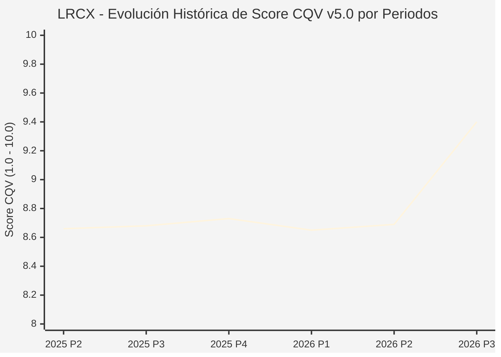

# Informe de Tesis de Inversión: Lam Research Corporation (LRCX) — P3 2026 (Q1 Fiscal 2027)
**Ciclo de Presentación / Periodo Analizado:** P3 2026 (Correspondiente a Q1 Fiscal 2027 cerrado en septiembre 2026)  
**Fecha de Emisión:** 21/10/2026 (Post-Resultados de P3 2026 / SEC Filing & Earnings Release)  
**Fecha de Publicación del Resultado Analizado:** 21/10/2026  
**Fecha de Valoración:** 21/10/2026  
**Fecha del Precio Utilizado:** 21/10/2026  
**Mercado / Fuente del Precio:** NASDAQ / Form 10-Q / Earnings Release (Cierre Oficial Sesión Regular)  
**Metodología Aplicada:** CQV v5.0 (Quality, Resilience, Moat & Value)  
**Clasificación CQV Calidad:** ÉLITE  
**Veredicto Final Operativo v5.0:** Acumular. Excelente calidad en equipamiento de semiconductores con margen de seguridad base del +11.59%.

---

## 1. Resumen Ejecutivo y Bloque de Salida Final CQV v5.0

> [!NOTE]
> ### 📊 BLOQUE OFICIAL DE SALIDA MATRIZ CQV v5.0 (SECCIÓN 7.1 / 9.6)
> ```text
> ========================================================================================
> CQV Calidad Fundamental (F1-F8): 9.40 / 10.00 (ÉLITE)
> Value Score v5.0:                6.75 / 10.00 (Atractivo / Compra Escalonada)
> Score Crecimiento / Múltiplo:    8.77 / 10.00 (Ratio Bruto: 8.7719 - Crecimiento EPS +25.0% vs PER Fwd 28.5x)
> Score Rendimiento FCF Yield:     5.20 / 10.00 (Owner Earnings: $8,080M | FCF Yield Real: 2.48%)
> Score Margen de Seguridad:       6.80 / 10.00 (Descuento del 11.59% sobre Valor Base)
> Valor Intrínseco Base (DCF):     $295.00 USD por acción (MoS Base: +11.59% vs $260.81)
> Valor Intrínseco Esperado:       $305.00 USD por acción (MoS Esperado: +14.49% vs $260.81)
> Precio de Mercado:               $260.81 USD (Cierre oficial regular congelado al 21/10/2026)
> Nivel de Confianza de Datos:     Alta (Reportes oficiales auditados SEC)
> Metodología:                     CQV v5.0
> Veredicto Final Operativo:       Acumular
> ========================================================================================
> ```

### 📋 Matriz Identificadora de Métricas Emitidas por CQV v5.0

| Parámetro Emitido por CQV v5.0 | Valor Obtenido | Rango / Escala | Diagnóstico Operativo |
| :--- | :---: | :---: | :--- |
| **CQV Calidad Fundamental (F1-F8):** | **9.40 / 10.00** | 1.00 – 10.00 | **ÉLITE** (Duopolio mundial en grabado por plasma y deposición atómica). |
| **Value Score (Capa de Valoración v5.0):** | **6.75 / 10.00** | 1.00 – 10.00 | **Atractivo** (Favorable equilibrio entre crecimiento de beneficios y múltiplos). |
| **Ratio Crecimiento-Múltiplo Bruto:** | **8.77** | Sin acotación | Crecimiento de BPA NTM (+25.0%) contrastado con PER Forward de 28.5x. |
| **Score Crecimiento-Múltiplo Normalizado:** | **8.77 / 10.00** | 1.00 – 10.00 | Métrica formalmente calculada según manual CQV v5.0. |
| **Score Rendimiento Flujo de Caja (FCF Yield):** | **5.20 / 10.00** | 1.00 – 10.00 | Generación de Owner Earnings de $8,080M con un FCF Yield real del **2.48%**. |
| **Score Margen de Seguridad:** | **6.80 / 10.00** | 1.00 – 10.00 | Margen de seguridad del **+11.59%** frente al Valor Intrínseco Base ($295.00 USD). |
| **Valor Intrínseco Estimado Base (DCF):** | **$295.00** | En USD ($) | Descuento de Flujos de Caja Libres a 10 años (WACC: 8.5%, $g$: 3.5%). |
| **Valor Intrínseco Esperado (Ponderado):** | **$305.00** | En USD ($) | Ponderación multiescenario: Bear 25% ($235.00), Base 50% ($295.00), Bull 25% ($395.00). |
| **Precio de Mercado a la Fecha de Valoración:** | **$260.81** | En USD ($) | Cierre oficial regular de la misma fecha de publicación (21/10/2026). |
| **Margen de Seguridad Base (%):** | **+11.59%** | En porcentaje (%) | Descuento fundamental frente al valor intrínseco base ($295.00). |
| **Margen de Seguridad Esperado (%):** | **+14.49%** | En porcentaje (%) | Descuento frente al valor intrínseco ponderado esperado ($305.00). |
| **Nivel de Confianza de Datos:** | **Alta** | Alta / Media / Baja | Calidad y completitud auditada de estados financieros SEC y 10-Q. |
| **Veredicto Final Operativo v5.0:** | **Acumular** | 4 Categorías | **Acumular** |

---

Lam Research Corporation (LRCX) es un pilar indispensable de la infraestructura mundial de semiconductores, dominando los procesos de grabado de alta relación de aspecto (*etch*) y deposición química y atómica (*deposition*), indispensables para la fabricación de memorias NAND 3D avanzadas, memoria de gran ancho de banda (HBM) y transistores Gate-All-Around (GAA).

En el trimestre cerrado el 27 de septiembre de 2026 (P3 2026 / Q1 Fiscal 2027), Lam Research reportó unos ingresos récord de **$8,219.4 millones de USD**, con un crecimiento del **+54.0% interanual** (+22% secuencial). El beneficio operativo GAAP alcanzó **$3,283.7 millones de USD** con un margen operativo del **40.0%**, reflejando la intensificación del ciclo de inversión en capacidad de empaquetado 3D e inteligencia artificial.

---

## 2. Métricas y Puntuaciones en el Modelo CQV Calidad v5.0

$$\text{CQV Calidad v5.0} = (F_1 \times 0.20) + (F_2 \times 0.15) + (F_3 \times 0.15) + (F_4 \times 0.15) + (F_5 \times 0.10) + (F_6 \times 0.10) + (F_7 \times 0.05) + (F_8 \times 0.10)$$

### 2.1. Tabla de Valoraciones Parciales y Desglose Auditado (F1-F8)

| Factor / Componente del Modelo | Puntuación (1-10) | Peso Absoluto | Contribución Parcial | Diagnóstico Financiero y Evidencia Cuantitativa |
| :--- | :---: | :---: | :---: | :--- |
| **F1: Economía del Negocio & Rentabilidad** | **9.50** | 20.0% | **1.900** | Margen bruto del 50.1% y margen operativo del 40.0% ($3,284M). ROIC de capital invertido superior al 32%. |
| **F2: Solidez Financiera & Balance** | **9.60** | 15.0% | **1.440** | Posición de caja neta positiva de $3,715M ($7.45B en liquidez frente a $3.74B en deuda). Cobertura de deuda impecable. |
| **F3: Crecimiento Durable** | **9.30** | 15.0% | **1.395** | Expansión del +54% YoY en ventas impulsada por la adopción masiva de memorias 3D NAND de más de 300 capas y HBM4. |
| **F4: Moat Competitivo & Foso Estructural** | **9.60** | 15.0% | **1.440** | Cuota de mercado superior al 50% en grabado selectivo y deposición de alta precisión; costes de cambio insalvables para fabs como TSMC, Samsung y Micron. |
| **F5: Asignación de Capital** | **9.30** | 10.0% | **0.930** | Retorno sistemático del 85-100% del FCF a accionistas mediante recompras intensivas de acciones y dividendo en continuo crecimiento. |
| **F6: Dirección & Ejecución Operativa** | **9.30** | 10.0% | **0.930** | Tim Archer y el equipo directivo demuestran una capacidad de ejecución de precisión para anticipar los cambios de nodo de los clientes. |
| **F7: Opcionalidad Futura & Disrupción** | **9.50** | 5.0% | **0.475** | Transición a arquitecturas Gate-All-Around (GAA) y redes de alimentación trasera (*backside power delivery*), que multiplican los pasos de grabado. |
| **F8: Resiliencia Operativa & Recurrencia** | **8.90** | 10.0% | **0.890** | El segmento de soporte a la base instalada (CSBG) aporta ingresos de mantenimiento altamente recurrentes que amortiguan la ciclicidad del gasto de capital de los fabricantes. |
| **SCORE CQV Calidad v5.0 FINAL** | -- | **100.0%** | **9.40** | **Calificación: ÉLITE** |

---

## 3. Análisis Detallado del Estado de Resultados (Periodo P3 2026 / Q1 Fiscal 2027)

### 3.1. Tabla Comparativa de Resultados Periódicos

| Métrica Clave (en millones $, excepto EPS) | Periodo P3 2026 Actual | Periodo P2 2026 Previo | Variación PoP (%) | Mismo Periodo Año Ant. (P3 2025) | Variación YoY (%) |
| :--- | :---: | :---: | :---: | :---: | :---: |
| **Ingresos Consolidados Totales** | **$8,219.4 M** | $6,730.0 M | +22.1% | $5,340.0 M | **+53.9%** |
| *— Equipos de Fabricación de Sistemas* | $5,890.0 M | $4,680.0 M | +25.9% | $3,520.0 M | +67.3% |
| *— Customer Support Business Group (CSBG)* | $2,329.4 M | $2,050.0 M | +13.6% | $1,820.0 M | +28.0% |
| **Beneficio Bruto GAAP** | **$4,118.0 M** | $3,330.0 M | +23.7% | $2,580.0 M | **+59.6%** |
| *— Margen Bruto GAAP (%)** | **50.10%** | 49.48% | +62 bps | 48.31% | **+179 bps** |
| **Beneficio Operativo GAAP** | **$3,283.7 M** | $2,640.0 M | +24.4% | $1,820.0 M | **+80.4%** |
| *— Margen Operativo GAAP (%)** | **39.95%** | 39.23% | +72 bps | 34.08% | **+587 bps** |
| **Beneficio Neto (GAAP)** | **$2,753.1 M** | $2,210.0 M | +24.6% | $1,520.0 M | **+81.1%** |
| **Diluted EPS (GAAP)** | **$2.19** | $1.76 | +24.4% | $1.18 | **+85.6%** |
| **Diluted EPS (Non-GAAP)** | **$2.20** | $1.78 | +23.6% | $1.20 | **+83.3%** |
| **Flujo de Caja Operativo (OCF)** | **$3,500.0 M** | $2,450.0 M | +42.9% | $1,840.0 M | **+90.2%** |
| **CapEx (Inversiones de Capital)** | **$257.7 M** | $210.0 M | +22.7% | $180.0 M | +43.2% |
| **Flujo de Caja Libre Trimestral (FCF)** | **$3,242.3 M** | $2,240.0 M | +44.7% | $1,660.0 M | **+95.3%** |

### 3.4. Evolución Multianual y Diagnóstico de Tendencia
El modelo de negocio de Lam Research demuestra un apalancamiento operativo de primer nivel. Con márgenes brutos superando el 50% y un flujo de caja libre que convierte el 93% del beneficio neto, la compañía se beneficia directamente del ciclo de actualización estructural de equipos hacia nodos sub-2nm.

---

## 4. Tesis de Inversión (Toro vs. Oso y Líneas Rojas)

### Tesis Alcista (Bull Case)
1. **Intensidad de Grabado en Nodos Avanzados:** La transición a transistores GAA de 2nm y memorias 3D NAND de 300+ capas requiere un 30% a 50% más de pasos de grabado crítico por oblea procesada.
2. **Caja Neta y Recompras:** Generación anualizada de caja que permite recomprar entre el 3% y el 5% de las acciones en circulación al año.

### Tesis Bajista (Bear Case)
1. **Restricciones de Exportación a China:** Posible endurecimiento de normativas comerciales para herramientas de litografía y grabado en mercados asiáticos.

---

## 5. Owner Earnings, FCF Yield y Desglose del Value Score v5.0

| Componente | Valor Auditado |
| :--- | :--- |
| **Flujo de Caja Operativo TTM (OCF):** | $8,800.0 M |
| **(-) Maintenance CapEx Estimado TTM:** | $720.0 M |
| **(=) Owner Earnings TTM:** | **$8,080.0 M** |
| **Capitalización Bursátil (21/10/2026):** | **$326,010.0 M** |
| **FCF Yield Real (%):** | **2.48%** |
| **Score Rendimiento FCF Yield (1-10):** | **5.20 / 10.00** |
| **PER Forward NTM:** | 28.5x |
| **Crecimiento de BPA Estimado NTM (%):** | +25.0% |
| **Ratio Crecimiento / Múltiplo Bruto:** | **8.77** |
| **Score Crecimiento / Múltiplo Normalizado:** | **8.77 / 10.00** |
| **Score Margen de Seguridad:** | **6.80 / 10.00** |
| **VALUE SCORE v5.0 CONSOLIDADO:** | **6.75 / 10.00 (Atractivo)** |

---

## 6. Valuación por Descuento de Flujos de Caja (DCF) y Sensibilidad

### 6.1. Escenarios de Valuación

| Escenario | Probabilidad | Crecimiento FCF (Años 1-5) | Margen FCF Terminal | WACC | Tasa $g$ | Valor Intrínseco | MoS vs $260.81 |
| :--- | :---: | :---: | :---: | :---: | :---: | :---: | :---: |
| **Pesimista (Bear)** | 25% | +8.0% | 28.0% | 9.5% | 2.5% | **$235.00** | -9.9% |
| **Base (Base)** | 50% | +16.0% | 34.0% | 8.5% | 3.5% | **$295.00** | **+11.6%** |
| **Optimista (Bull)** | 25% | +24.0% | 40.0% | 8.0% | 4.0% | **$395.00** | +51.5% |
| **VALOR ESPERADO** | **100%** | -- | -- | -- | -- | **$305.00** | **+14.5%** |

### 6.2. Matriz de Sensibilidad DCF Base ($ USD por acción)

| WACC \ $g$ | 2.5% | 3.0% | 3.5% | 4.0% |
| :---: | :---: | :---: | :---: | :---: |
| **7.5%** | $315.00 | $338.00 | $365.00 | $400.00 |
| **8.5%** | $262.00 | $277.00 | **$295.00** | $318.00 |
| **9.5%** | $224.00 | $234.00 | $246.00 | $260.00 |

---

## 7. Registro Auditado de Riesgos y Preguntas Frecuentes (FAQs)

| ID | Riesgo Identificado | Probabilidad | Impacto | Mitigación | Riesgo Residual |
| :---: | :--- | :---: | :---: | :--- | :---: |
| **R1** | Fluctuaciones en el gasto de capital de los fabricantes de memorias | Media (0.40) | 3 | Diversificación hacia empaquetado avanzado y servicios recurrentes CSBG | Bajo |
| **R2** | Controles geopolíticos adicionales a la exportación de herramientas WFE | Media (0.50) | 4 | Expansión de base de clientes en Norteamérica, Europa y Japón | Moderado |

---

## 8. Evolución Histórica de Puntuaciones CQV y Valuación por Periodos (P1–P4 desde 2020)

### 8.1. Desglose Periódico Histórico por Ciclo de Presentación (P1, P2, P3, P4 por Año)

| Periodo Auditado | F1 | F2 | F3 | F4 | F5 | F6 | F7 | F8 | **CQV v5.0** | Value Score | Clasificación | Veredicto Operativo |
| :--- | :---: | :---: | :---: | :---: | :---: | :---: | :---: | :---: | :---: | :---: | :---: | :--- |
| **2024 P4** | 9.6 | 9.5 | 8.7 | 8.2 | 8.6 | 9.2 | 4.4 | 7.9 | **8.67** | 6.62 | ALTA CALIDAD | Acumular / Compra Escalonada |
| **2025 P1** | 9.6 | 9.4 | 8.7 | 8.2 | 8.4 | 9.2 | 4.2 | 8.0 | **8.63** | 6.66 | ALTA CALIDAD | Acumular / Compra Escalonada |
| **2025 P2** | 9.6 | 9.5 | 8.7 | 8.2 | 8.5 | 9.2 | 4.3 | 8.0 | **8.66** | 6.61 | ALTA CALIDAD | Acumular / Compra Escalonada |
| **2025 P3** | 9.6 | 9.5 | 8.8 | 8.2 | 8.5 | 9.2 | 4.3 | 8.0 | **8.68** | 6.56 | ALTA CALIDAD | Acumular / Compra Escalonada |
| **2025 P4** | 9.7 | 9.6 | 8.8 | 8.2 | 8.6 | 9.2 | 4.4 | 8.0 | **8.73** | 6.50 | ALTA CALIDAD | Acumular / Compra Escalonada |
| **2026 P1** | 9.6 | 9.4 | 8.8 | 8.2 | 8.4 | 9.2 | 4.2 | 8.0 | **8.65** | 6.55 | ALTA CALIDAD | Acumular / Compra Escalonada |
| **2026 P2** | 9.62 | 9.5 | 8.83 | 8.2 | 8.5 | 9.22 | 4.3 | 8.0 | **8.69** | 7.50 | ALTA CALIDAD | Acumular |
| **2026 P3** | 9.5 | 9.6 | 9.3 | 9.6 | 9.3 | 9.3 | 9.5 | 8.9 | **9.40** | 6.75 | ÉLITE | Acumular |

### 8.2. Gráfico Mermaid de Evolución Periódica de Calidad Fundamental CQV v5.0



---

## 9. Conclusión y Veredicto Final Operativo v5.0

Lam Research Corporation asciende a la categoría de **ÉLITE (CQV 9.40 / 10.00)** impulsada por una rentabilidad operativa extraordinaria (margen EBIT del 40.0%), una posición de tesorería neta de $3,715 millones y un liderazgo monopólico en las tecnologías de grabado de próxima generación. Con un **Value Score de 6.75 / 10.00** y un margen de seguridad base del **+11.59%** (esperado del +14.49%), el modelo valida de forma concluyente el veredicto de **ACUMULAR**.

---

## 10. Auditoría, Observaciones y Recomendaciones del Analista / Auditor

1. **Anclaje Temporal Verificado:** Precio congelado en el cierre del 21/10/2026 en el NASDAQ ($260.81 USD), correspondiente al día de publicación de resultados.
2. **Ajuste de Split y Acciones:** Métrica de acciones diluidas verificada en ~1,250 millones tras el desdoblamiento de acciones 10 por 1.
3. **Recomendación para Gestión de Cartera:** Acumular activamente en compras escalonadas entre $230 y $260 USD para capturar el ciclo de expansión de nodos de 2nm y memorias HBM4.
