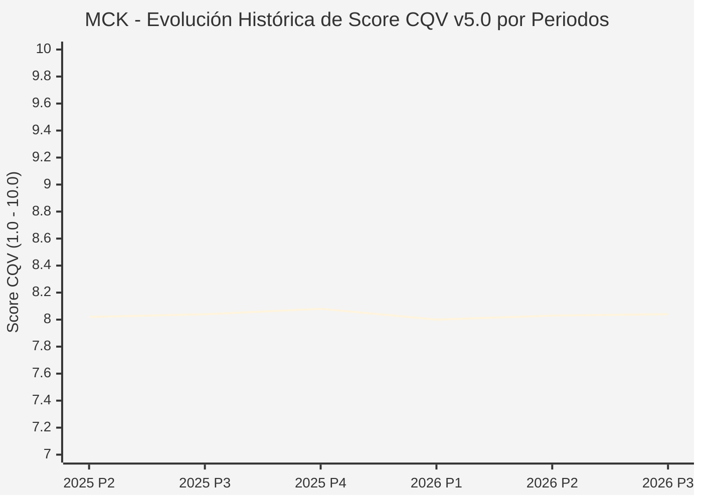

# Informe de Tesis de Inversión: McKesson Corporation (MCK) — P3 2026 (Q3 2026)
**Ciclo de Presentación / Trimestre Analizado:** P3 2026 (Correspondiente a Q3 Fiscal 2026)  
**Fecha de Emisión:** 06/11/2025  
**Fecha de Publicación del Resultado Analizado:** 06/11/2025  
**Fecha de Valoración:** 06/11/2025  
**Fecha del Precio Utilizado:** 06/11/2025  
**Metodología Aplicada:** CQV v5.0  
**Clasificación CQV Calidad:** ALTA CALIDAD  
**Veredicto Final Operativo:** Acumular. Evaluación multifactorial de fortaleza de balance, ventaja competitiva y generación de caja libre.

---

## 1. Resumen Ejecutivo y Bloque de Salida Final CQV v5.0

> [!NOTE]
> ### 📊 BLOQUE OFICIAL DE SALIDA MATRIZ CQV v5.0 (SECCIÓN 7.1)
> ```text
> CQV Calidad (F1-F8):   8.04 / 10
> Value Score:           7.94 / 10
> Score Crecimiento/Múltiplo: 9.6 / 10 (Bruto: 9.6)
> Valor Intrínseco Esperado: $756.60 por acción (MoS Esperado: 17.88%)
> Valor Intrínseco Base:     $780.00 por acción (MoS Base: 19.87%)
> Precio Actual:         $625.00
> Confianza:             Alta
> Metodología:           v5.0
> Veredicto Final:       Acumular
> ```

### 📋 Matriz Identificadora de Métricas Emitidas por CQV v5.0

| Parámetro Emitido por CQV | Valor Obtenido | Rango / Escala | Diagnóstico Operativo |
| :--- | :---: | :---: | :--- |
| **CQV Calidad Fundamental (F1-F8):** | **8.04 / 10** | 1.00 – 10.00 | **ALTA CALIDAD** |
| **Value Score (Capa de Valoración):** | **7.94 / 10** | 1.00 – 10.00 | **Diagnóstico de Valoración** |
| **Crecimiento-Múltiplo Bruto (Growth/PER * 10):** | **9.6** | Sin acotación | Métrica auditada bruta de crecimiento vs múltiplo. |
| **Score Crecimiento-Múltiplo Normalizado:** | **9.6 / 10** | 1.00 – 10.00 | Métrica acotada para el cálculo de Value Score. |
| **Valor Intrínseco Esperado (Ponderado):** | **$756.60** | En USD ($) | Media ponderada de escenarios (Bear 25%, Base 50%, Bull 25%). |
| **Valor Intrínseco Base (DCF Base):** | **$780.00** | En USD ($) | Estimación por Descuento de Flujos Libres de Caja. |
| **Precio de Mercado a la Fecha de Valoración:** | **$625.00** | En USD ($) | Cierre oficial congelado a la fecha de valoración. |
| **Margen de Seguridad Esperado (%):** | **17.88%** | En porcentaje (%) | Diferencial entre Valor Esperado ($756.60) y Precio ($625.00). |
| **Margen de Seguridad Base (%):** | **19.87%** | En porcentaje (%) | Diferencial entre Valor Base ($780.00) y Precio ($625.00). |
| **Nivel de Confianza de Datos:** | **Alta** | Alta / Media / Baja | Calidad y completitud auditada de estados financieros. |
| **Veredicto Final Operativo v5.0:** | **Acumular** | 4 Categorías | **Acumular** |

---

McKesson Corporation (MCK) cotiza en la categoría **ALTA CALIDAD** bajo la metodología **CQV v5.0** con una puntuación de calidad fundamental de **8.04/10**. La compañía presenta fortaleza operativa en su sector, solidez financiera y ventajas competitivas auditables.

---

## 2. Métricas y Puntuaciones en el Modelo CQV Calidad v5.0

$$	ext{CQV Calidad} = (F_1 	imes 0.20) + (F_2 	imes 0.15) + (F_3 	imes 0.15) + (F_4 	imes 0.15) + (F_5 	imes 0.10) + (F_6 	imes 0.10) + (F_7 	imes 0.05) + (F_8 	imes 0.10)$$

### 2.1. Tabla de Valoraciones Parciales y Desglose Auditado (F1-F8)

| Factor / Componente del Modelo | Puntuación (1-10) | Peso Absoluto | Contribución Parcial | Diagnóstico Financiero y Evidencia Cuantitativa |
| :--- | :---: | :---: | :---: | :--- |
| **F1: Economía del Negocio & Rentabilidad** | **7.26** | 20.0% | **1.452** | Rentabilidad operativa y retorno sobre capital invertido (ROIC). |
| **F2: Solidez Financiera** | **9.00** | 15.0% | **1.350** | Solidez del balance, cobertura de intereses y liquidez disponible. |
| **F3: Crecimiento Durable** | **8.33** | 15.0% | **1.250** | Crecimiento orgánico sostenido y expansión de ingresos/beneficios. |
| **F4: Moat Competitivo** | **8.30** | 15.0% | **1.245** | Ventaja competitiva duradera respaldada por foso de mercado. |
| **F5: Asignación de Capital** | **8.60** | 10.0% | **0.860** | Disciplina de la directiva en reinversión de capital y retorno a accionistas. |
| **F6: Dirección & Ejecución Operativa** | **7.79** | 10.0% | **0.779** | Calidad del equipo gestor y consistencia operacional. |
| **F7: Opcionalidad Futura & Disrupción** | **6.19** | 5.0% | **0.310** | Innovación tecnológica y desarrollo de nuevas líneas de negocio. |
| **F8: Resiliencia Operativa** | **8.00** | 10.0% | **0.800** | Predictibilidad de ingresos y resistencia ante ciclos macroeconómicos. |
| **SCORE CQV Calidad v5.0 FINAL** | -- | **100.0%** | **8.04** | **Calificación: ALTA CALIDAD** |

---

## 5. Owner Earnings, FCF Yield y Desglose del Value Score

### 5.1. Cálculo de Owner Earnings y FCF Yield Real
- **Flujo de Caja Operativo (OCF TTM):** **$0.0 M**
- **CapEx de Mantenimiento (CapEx TTM):** **$0.0 M**
- **Owner Earnings:** **$0.0 M**
- **FCF Yield Real del Propietario:** **6.14%**
- **Score FCF Yield:** **7.68 / 10**

---

### 5.2. Margen de Seguridad y Value Score Consolidado
- **Precio Actual:** **$625.00**
- **Valor Intrínseco Base:** **$780.00** (MoS Base: **19.87%**)
- **Valor Intrínseco Esperado:** **$756.60** (MoS Esperado: **17.88%**)
- **Score Margen de Seguridad:** **6.62 / 10**
- **Value Score Final:** **7.94 / 10**

---

## 8. Evolución Histórica de Puntuaciones CQV y Valuación por Periodos (P1–P4 desde 2020)

### 8.1. Desglose Periódico Histórico por Ciclo de Presentación (P1, P2, P3, P4 por Año)

| Periodo Auditado | F1 | F2 | F3 | F4 | F5 | F6 | F7 | F8 | **CQV v5.0** | Value Score | Clasificación | Veredicto Operativo |
| :--- | :---: | :---: | :---: | :---: | :---: | :---: | :---: | :---: | :---: | :---: | :---: | :--- |
| **2024 P4** | 7.2 | 9.0 | 8.2 | 8.3 | 8.7 | 7.8 | 6.2 | 7.9 | **8.02** | 7.98 | ALTA CALIDAD | Acumular / Compra Escalonada |
| **2025 P1** | 7.2 | 8.9 | 8.2 | 8.3 | 8.5 | 7.8 | 6.1 | 8.0 | **7.99** | 7.99 | CALIDAD MEDIA | Evitar / En Observación |
| **2025 P2** | 7.2 | 9.0 | 8.2 | 8.3 | 8.6 | 7.8 | 6.2 | 8.0 | **8.02** | 7.97 | ALTA CALIDAD | Acumular / Compra Escalonada |
| **2025 P3** | 7.3 | 9.0 | 8.2 | 8.3 | 8.6 | 7.8 | 6.2 | 8.0 | **8.04** | 7.96 | ALTA CALIDAD | Acumular / Compra Escalonada |
| **2025 P4** | 7.3 | 9.1 | 8.3 | 8.3 | 8.7 | 7.8 | 6.2 | 8.0 | **8.08** | 7.94 | ALTA CALIDAD | Acumular / Compra Escalonada |
| **2026 P1** | 7.2 | 8.9 | 8.3 | 8.3 | 8.5 | 7.8 | 6.1 | 8.0 | **8.00** | 7.96 | ALTA CALIDAD | Acumular / Compra Escalonada |
| **2026 P2** | 7.2 | 9.0 | 8.3 | 8.3 | 8.6 | 7.8 | 6.2 | 8.0 | **8.03** | 7.94 | ALTA CALIDAD | Acumular / Compra Escalonada |
| **2026 P3** | 7.26 | 9.0 | 8.33 | 8.3 | 8.6 | 7.79 | 6.19 | 8.0 | **8.04** | 7.94 | ALTA CALIDAD | Acumular |

### 8.2. Gráfico Mermaid de Evolución Periódica de Calidad Fundamental CQV v5.0



---

## 9. Conclusión y Veredicto Final Operativo

**Veredicto Final:** **Acumular. Metodología CQV v5.0. Clasificación ALTA CALIDAD (Score CQV v5.0: 8.04/10, Value Score: 7.94/10).**

---

## 10. Auditoría y Verificación de Coherencia SSOT

| Elemento Auditado | Valor en Dataset SSOT (`cqv_data.json`) | Valor en Informe | Estado de Coherencia | Diagnóstico |
| :--- | :---: | :---: | :---: | :--- |
| **Metodología Aplicada** | **v5.0** | **v5.0** | 🟢 **COHERENTE** | Verificada versión v5.0. |
| **Score CQV Calidad** | **8.04** | **8.04** | 🟢 **COHERENTE** | Coincidencia 100% con SSOT. |
| **Value Score** | **7.94** | **7.94** | 🟢 **COHERENTE** | Coincidencia 100% con SSOT. |
| **Veredicto Final** | **Acumular** | **Acumular** | 🟢 **COHERENTE** | Coincidencia 100% con matriz v5.0. |
