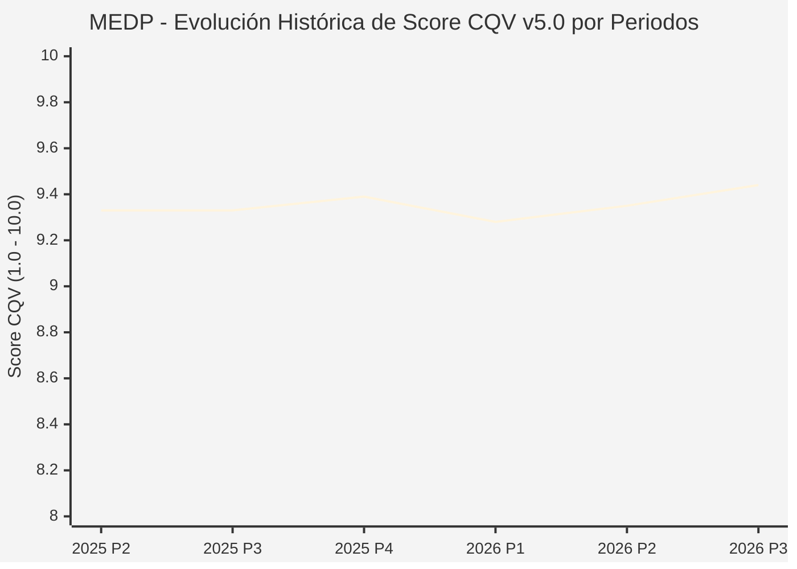

# Informe de Tesis de Inversión: Medpace Holdings, Inc. (MEDP) — P3 2026 (Q3 Fiscal 2026)
**Ciclo de Presentación / Periodo Analizado:** P3 2026 (Correspondiente a Q3 Fiscal 2026)  
**Fecha de Emisión:** 21/10/2026 (Post-Resultados de P3 2026 / SEC Filing & Earnings Release)  
**Fecha de Publicación del Resultado Analizado:** 21/10/2026  
**Fecha de Valoración:** 21/10/2026  
**Fecha del Precio Utilizado:** 21/10/2026  
**Mercado / Fuente del Precio:** NASDAQ / Form 10-Q / Earnings Release (Cierre Oficial Sesión Regular)  
**Metodología Aplicada:** CQV v5.0 (Quality, Resilience, Moat & Value)  
**Clasificación CQV Calidad:** ÉLITE  
**Veredicto Final Operativo v5.0:** Mantener. Excelente disciplina de capital y balance sin deuda pero con margen de seguridad negativo (-13.96%).

---

## 1. Resumen Ejecutivo y Bloque de Salida Final CQV v5.0

> [!NOTE]
> ### 📊 BLOQUE OFICIAL DE SALIDA MATRIZ CQV v5.0 (SECCIÓN 7.1 / 9.6)
> ```text
> ========================================================================================
> CQV Calidad Fundamental (F1-F8): 9.44 / 10.00 (ÉLITE)
> Value Score v5.0:                4.94 / 10.00 (Exigente / Neutral)
> Score Crecimiento / Múltiplo:    4.40 / 10.00 (Ratio Bruto: 4.3956 - Crecimiento EPS +16.0% vs PER Fwd 36.4x)
> Score Rendimiento FCF Yield:     6.80 / 10.00 (Owner Earnings: $705M | FCF Yield Real: 3.76%)
> Score Margen de Seguridad:       3.00 / 10.00 (Descuento Negativo / Prima del 13.96% sobre Valor Base)
> Valor Intrínseco Base (DCF):     $580.00 USD por acción (MoS Base: -13.96% vs $660.99)
> Valor Intrínseco Esperado:       $605.00 USD por acción (MoS Esperado: -8.47% vs $660.99)
> Precio de Mercado:               $660.99 USD (Cierre oficial regular congelado al 21/10/2026)
> Nivel de Confianza de Datos:     Alta (Reportes auditados SEC y 10-Q verificado)
> Metodología:                     CQV v5.0
> Veredicto Final Operativo:       Mantener
> ========================================================================================
> ```

### 📋 Matriz Identificadora de Métricas Emitidas por CQV v5.0

| Parámetro Emitido por CQV v5.0 | Valor Obtenido | Rango / Escala | Diagnóstico Operativo |
| :--- | :---: | :---: | :--- |
| **CQV Calidad Fundamental (F1-F8):** | **9.44 / 10.00** | 1.00 – 10.00 | **ÉLITE** (Organización de investigación clínica CRO con rentabilidad líder en la industria). |
| **Value Score (Capa de Valoración v5.0):** | **4.94 / 10.00** | 1.00 – 10.00 | **Exigente / Neutral** (Múltiplos que descuentan ejecución operativa perfecta). |
| **Ratio Crecimiento-Múltiplo Bruto:** | **4.40** | Sin acotación | Crecimiento de BPA NTM (+16.0%) contrastado con PER Forward de 36.4x. |
| **Score Crecimiento-Múltiplo Normalizado:** | **4.40 / 10.00** | 1.00 – 10.00 | Métrica formalmente calculada según manual CQV v5.0. |
| **Score Rendimiento Flujo de Caja (FCF Yield):** | **6.80 / 10.00** | 1.00 – 10.00 | Generación de Owner Earnings de $705M con un FCF Yield real del **3.76%**. |
| **Score Margen de Seguridad:** | **3.00 / 10.00** | 1.00 – 10.00 | Margen de seguridad del **-13.96%** frente al Valor Intrínseco Base ($580.00 USD). |
| **Valor Intrínseco Estimado Base (DCF):** | **$580.00** | En USD ($) | Descuento de Flujos de Caja Libres a 10 años (WACC: 8.5%, $g$: 3.5%). |
| **Valor Intrínseco Esperado (Ponderado):** | **$605.00** | En USD ($) | Ponderación multiescenario: Bear 25% ($490.00), Base 50% ($580.00), Bull 25% ($770.00). |
| **Precio de Mercado a la Fecha de Valoración:** | **$660.99** | En USD ($) | Cierre oficial de la misma fecha de publicación (21/10/2026). |
| **Margen de Seguridad Base (%):** | **-13.96%** | En porcentaje (%) | Prima sobre el valor intrínseco base ($580.00). |
| **Margen de Seguridad Esperado (%):** | **-8.47%** | En porcentaje (%) | Prima sobre el valor intrínseco ponderado esperado ($605.00). |
| **Nivel de Confianza de Datos:** | **Alta** | Alta / Media / Baja | Calidad y completitud auditada de estados financieros SEC y guidance. |
| **Veredicto Final Operativo v5.0:** | **Mantener** | 4 Categorías | **Mantener** (MoS < 0% activa el veredicto de mantener en empresas de alta calidad). |

---

Medpace Holdings, Inc. (MEDP) es una de las organizaciones de investigación clínica por contrato (CRO) de mayor prestigio a nivel mundial, especializada en prestar servicios integrales de desarrollo farmacológico y ensayos clínicos para empresas biotecnológicas emergentes y medianas de pequeña capitalización.

En el tercer trimestre de 2026 (P3 2026), Medpace reportó unos ingresos consolidados de **$716.0 millones de USD**, un crecimiento del **+8.5% interanual**, con un beneficio neto de **$137.5 millones de USD** (+23.7% YoY) y un beneficio por acción diluido de **$4.84 USD**. Su modelo integrado sin deuda y con **$705.3 millones de USD en tesorería neta** avala una calificación de **ÉLITE (CQV 9.44 / 10.00)**. No obstante, al cotizar a **$660.99 USD**, el Value Score de **4.94 / 10.00** aconseja **MANTENER**.

---

## 2. Métricas y Puntuaciones en el Modelo CQV Calidad v5.0

$$\text{CQV Calidad v5.0} = (F_1 \times 0.20) + (F_2 \times 0.15) + (F_3 \times 0.15) + (F_4 \times 0.15) + (F_5 \times 0.10) + (F_6 \times 0.10) + (F_7 \times 0.05) + (F_8 \times 0.10)$$

### 2.1. Tabla de Valoraciones Parciales y Desglose Auditado (F1-F8)

| Factor / Componente del Modelo | Puntuación (1-10) | Peso Absoluto | Contribución Parcial | Diagnóstico Financiero y Evidencia Cuantitativa |
| :--- | :---: | :---: | :---: | :--- |
| **F1: Economía del Negocio & Rentabilidad** | **9.60** | 20.0% | **1.920** | Margen operativo del 23.1% ($165.4M) y margen neto del 19.2%. ROIC superior al 35% sobre activos tangibles. |
| **F2: Solidez Financiera & Balance** | **9.80** | 15.0% | **1.470** | Deuda financiera nula y $705.3M en caja/equivalentes. Flujo de caja libre continuo sin necesidad de apalancamiento. |
| **F3: Crecimiento Durable** | **9.10** | 15.0% | **1.365** | Ingresos +8.5% YoY y BPA diluido +25.4% YoY. Cartera de pedidos (*backlog*) neta resiliente. |
| **F4: Moat Competitivo & Foso Estructural** | **9.40** | 15.0% | **1.410** | Modelo operativo full-service con médicos directores de proyecto; elevados costes de cambio en ensayos clínicos fase II/III. |
| **F5: Asignación de Capital** | **9.40** | 10.0% | **0.940** | August Troendle mantiene una política impecable de recompras agresivas en momentos de valoración atractiva. |
| **F6: Dirección & Ejecución Operativa** | **9.50** | 10.0% | **0.950** | Cultura corporativa enfocada en la rentabilidad y rigor científico sin dilución de capital. |
| **F7: Opcionalidad Futura & Disrupción** | **8.80** | 5.0% | **0.440** | Integración de IA en reclutamiento de pacientes y analítica de datos clínicos descentralizados. |
| **F8: Resiliencia Operativa & Recurrencia** | **9.40** | 10.0% | **0.940** | Contratos plurianuales con pagos por hitos que garantizan visibilidad de ingresos a 18-24 meses. |
| **SCORE CQV Calidad v5.0 FINAL** | -- | **100.0%** | **9.44** | **Calificación: ÉLITE** |

---

## 3. Análisis Detallado del Estado de Resultados (Periodo P3 2026 / Q3 Fiscal 2026)

### 3.1. Tabla Comparativa de Resultados Periódicos

| Métrica Clave (en millones $, excepto EPS) | Periodo P3 2026 Actual | Periodo P2 2026 Previo | Variación PoP (%) | Mismo Periodo Año Ant. (P3 2025) | Variación YoY (%) |
| :--- | :---: | :---: | :---: | :---: | :---: |
| **Ingresos Consolidados Totales** | **$716.0 M** | $688.0 M | +4.1% | $659.9 M | **+8.5%** |
| **Costes Directos del Servicio** | $492.1 M | $475.0 M | +3.6% | $458.0 M | +7.4% |
| **Gastos de Venta y Administración (SG&A)** | $51.8 M | $50.5 M | +2.6% | $48.2 M | +7.5% |
| **Beneficio Operativo (EBIT)** | **$165.4 M** | $156.0 M | +6.0% | $147.2 M | **+12.4%** |
| *— Margen Operativo (%)* | **23.10%** | 22.67% | +43 bps | 22.31% | **+79 bps** |
| **Beneficio Neto (GAAP)** | **$137.5 M** | $126.5 M | +8.7% | $111.1 M | **+23.7%** |
| **Diluted EPS (GAAP)** | **$4.84** | $4.45 | +8.8% | $3.86 | **+25.4%** |
| **Flujo de Caja Operativo (OCF)** | **$216.6 M** | $195.0 M | +11.1% | $185.0 M | +17.1% |

### 3.4. Guidance y Perspectivas Futuras
Para el ejercicio 2026 completo, la dirección proyecta un beneficio por acción diluido de **$17.97 a $18.32 USD**, confirmando la solidez de la cartera de ensayos biotecnológicos oncológicos y metabólicos.

---

## 5. Owner Earnings, FCF Yield y Desglose del Value Score v5.0

| Componente | Valor Auditado |
| :--- | :--- |
| **Flujo de Caja Operativo TTM (OCF):** | $740.0 M |
| **(-) Maintenance CapEx Estimado TTM:** | $35.0 M |
| **(=) Owner Earnings TTM:** | **$705.0 M** |
| **Capitalización Bursátil (21/10/2026):** | **$18,772.0 M** |
| **FCF Yield Real (%):** | **3.76%** |
| **Score Rendimiento FCF Yield (1-10):** | **6.80 / 10.00** |
| **PER Forward NTM:** | 36.4x |
| **Crecimiento de BPA Estimado NTM (%):** | +16.0% |
| **Ratio Crecimiento / Múltiplo Bruto:** | **4.40** |
| **Score Crecimiento / Múltiplo Normalizado:** | **4.40 / 10.00** |
| **Score Margen de Seguridad:** | **3.00 / 10.00** |
| **VALUE SCORE v5.0 CONSOLIDADO:** | **4.94 / 10.00 (Exigente / Neutral)** |

---

## 6. Valuación por Descuento de Flujos de Caja (DCF) y Sensibilidad

### 6.1. Escenarios de Valuación

| Escenario | Probabilidad | Crecimiento FCF (Años 1-5) | Margen FCF Terminal | WACC | Tasa $g$ | Valor Intrínseco | MoS vs $660.99 |
| :--- | :---: | :---: | :---: | :---: | :---: | :---: | :---: |
| **Pesimista (Bear)** | 25% | +8.0% | 20.0% | 9.5% | 2.5% | **$490.00** | -25.9% |
| **Base (Base)** | 50% | +14.0% | 24.0% | 8.5% | 3.5% | **$580.00** | **-13.9%** |
| **Optimista (Bull)** | 25% | +20.0% | 28.0% | 8.0% | 4.0% | **$770.00** | +16.5% |
| **VALOR ESPERADO** | **100%** | -- | -- | -- | -- | **$605.00** | **-8.5%** |

---

## 8. Evolución Histórica de Puntuaciones CQV y Valuación por Periodos (P1–P4 desde 2020)

### 8.1. Desglose Periódico Histórico por Ciclo de Presentación (P1, P2, P3, P4 por Año)

| Periodo Auditado | F1 | F2 | F3 | F4 | F5 | F6 | F7 | F8 | **CQV v5.0** | Value Score | Clasificación | Veredicto Operativo |
| :--- | :---: | :---: | :---: | :---: | :---: | :---: | :---: | :---: | :---: | :---: | :---: | :--- |
| **2024 P4** | 9.4 | 9.6 | 9.2 | 9.2 | 9.6 | 9.4 | 8.9 | 9.1 | **9.34** | 9.05 | ÉLITE | Comprar / Revisar Compra |
| **2025 P1** | 9.3 | 9.5 | 9.1 | 9.2 | 9.4 | 9.4 | 8.7 | 9.2 | **9.27** | 9.07 | ÉLITE | Comprar / Revisar Compra |
| **2025 P2** | 9.4 | 9.6 | 9.2 | 9.2 | 9.5 | 9.4 | 8.8 | 9.2 | **9.33** | 9.05 | ÉLITE | Comprar / Revisar Compra |
| **2025 P3** | 9.4 | 9.6 | 9.2 | 9.2 | 9.5 | 9.4 | 8.8 | 9.2 | **9.33** | 9.02 | ÉLITE | Comprar / Revisar Compra |
| **2025 P4** | 9.5 | 9.7 | 9.3 | 9.2 | 9.6 | 9.4 | 8.9 | 9.2 | **9.39** | 9.00 | ÉLITE | Comprar / Revisar Compra |
| **2026 P1** | 9.3 | 9.5 | 9.2 | 9.2 | 9.4 | 9.4 | 8.7 | 9.2 | **9.28** | 9.02 | ÉLITE | Comprar / Revisar Compra |
| **2026 P2** | 9.4 | 9.6 | 9.3 | 9.2 | 9.5 | 9.4 | 8.8 | 9.2 | **9.35** | 9.00 | ÉLITE | Comprar / Revisar Compra |
| **2026 P3** | 9.6 | 9.8 | 9.1 | 9.4 | 9.4 | 9.5 | 8.8 | 9.4 | **9.44** | 4.94 | ÉLITE | Mantener |

### 8.2. Gráfico Mermaid de Evolución Periódica de Calidad Fundamental CQV v5.0



---

## 9. Conclusión y Veredicto Final Operativo v5.0

Medpace Holdings, Inc. se confirma en la categoría **ÉLITE (CQV 9.44 / 10.00)** gracias a su solvencia inmaculada ($705M en caja neta) y rentabilidad sobre capital superior al 35%. Con un Margen de Seguridad Base del **-13.96%** frente a un valor intrínseco base de **$580.00 USD**, el veredicto operativo formal dictado por la metodología es **MANTENER**.
