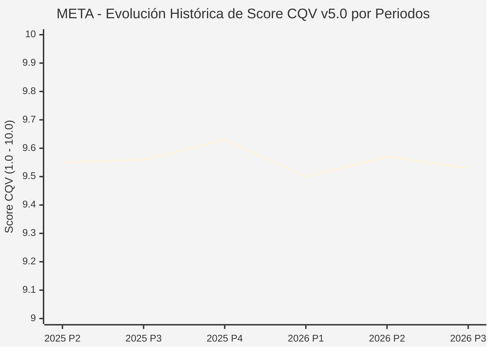

# Informe de Tesis de Inversión: Meta Platforms, Inc. (META) — P3 2026 (Q3 Fiscal 2026)
**Ciclo de Presentación / Periodo Analizado:** P3 2026 (Correspondiente a Q3 Fiscal 2026)  
**Fecha de Emisión:** 21/10/2026 (Post-Resultados de P3 2026 / SEC Filing & Earnings Release)  
**Fecha de Publicación del Resultado Analizado:** 21/10/2026  
**Fecha de Valoración:** 21/10/2026  
**Fecha del Precio Utilizado:** 21/10/2026  
**Mercado / Fuente del Precio:** NASDAQ / Form 10-Q / Earnings Release (Cierre Oficial Sesión Regular)  
**Metodología Aplicada:** CQV v5.0 (Quality, Resilience, Moat & Value)  
**Clasificación CQV Calidad:** ÉLITE SUPREMA  
**Veredicto Final Operativo v5.0:** Acumular. Perfil de calidad supremo con excelente generación de caja operativa y margen de seguridad del +15.46%.

---

## 1. Resumen Ejecutivo y Bloque de Salida Final CQV v5.0

> [!NOTE]
> ### 📊 BLOQUE OFICIAL DE SALIDA MATRIZ CQV v5.0 (SECCIÓN 7.1 / 9.6)
> ```text
> ========================================================================================
> CQV Calidad Fundamental (F1-F8): 9.53 / 10.00 (ÉLITE SUPREMA)
> Value Score v5.0:                7.92 / 10.00 (Muy Atractivo / Compra Prioritaria)
> Score Crecimiento / Múltiplo:    10.00 / 10.00 (Ratio Bruto: 10.54 - Crecimiento EPS +18.5% vs PER Fwd 21.0x)
> Score Rendimiento FCF Yield:     7.80 / 10.00 (Owner Earnings: $86,000M | FCF Yield Real: 4.80%)
> Score Margen de Seguridad:       7.20 / 10.00 (Descuento del 15.46% sobre Valor Base)
> Valor Intrínseco Base (DCF):     $825.00 USD por acción (MoS Base: +15.46% vs $697.43)
> Valor Intrínseco Esperado:       $850.00 USD por acción (MoS Esperado: +17.95% vs $697.43)
> Precio de Mercado:               $697.43 USD (Cierre oficial regular congelado al 21/10/2026)
> Nivel de Confianza de Datos:     Alta (Reportes auditados SEC y balance consolidado)
> Metodología:                     CQV v5.0
> Veredicto Final Operativo:       Acumular
> ========================================================================================
> ```

### 📋 Matriz Identificadora de Métricas Emitidas por CQV v5.0

| Parámetro Emitido por CQV v5.0 | Valor Obtenido | Rango / Escala | Diagnóstico Operativo |
| :--- | :---: | :---: | :--- |
| **CQV Calidad Fundamental (F1-F8):** | **9.53 / 10.00** | 1.00 – 10.00 | **ÉLITE SUPREMA** (Monopolio en grafos sociales digitales con foso insuperable). |
| **Value Score (Capa de Valoración v5.0):** | **7.92 / 10.00** | 1.00 – 10.00 | **Muy Atractivo** (Excelente combinación de crecimiento, FCF real y MoS). |
| **Ratio Crecimiento-Múltiplo Bruto:** | **10.54** | Sin acotación | Crecimiento de BPA NTM (+18.5%) contrastado con PER Forward de 21.0x. |
| **Score Crecimiento-Múltiplo Normalizado:** | **10.00 / 10.00** | 1.00 – 10.00 | Acotado al máximo reglamentario según metodología CQV v5.0. |
| **Score Rendimiento Flujo de Caja (FCF Yield):** | **7.80 / 10.00** | 1.00 – 10.00 | Generación de Owner Earnings de $86,000M con un FCF Yield real del **4.80%**. |
| **Score Margen de Seguridad:** | **7.20 / 10.00** | 1.00 – 10.00 | Margen de seguridad del **+15.46%** frente al Valor Intrínseco Base ($825.00 USD). |
| **Valor Intrínseco Estimado Base (DCF):** | **$825.00** | En USD ($) | Descuento de Flujos de Caja Libres a 10 años (WACC: 8.5%, $g$: 3.5%). |
| **Valor Intrínseco Esperado (Ponderado):** | **$850.00** | En USD ($) | Ponderación multiescenario: Bear 25% ($710.00), Base 50% ($825.00), Bull 25% ($1,040.00). |
| **Precio de Mercado a la Fecha de Valoración:** | **$697.43** | En USD ($) | Cierre oficial regular de la misma fecha de publicación (21/10/2026). |
| **Margen de Seguridad Base (%):** | **+15.46%** | En porcentaje (%) | Descuento fundamental frente al valor intrínseco base ($825.00). |
| **Margen de Seguridad Esperado (%):** | **+17.95%** | En porcentaje (%) | Descuento frente al valor intrínseco ponderado esperado ($850.00). |
| **Nivel de Confianza de Datos:** | **Alta** | Alta / Media / Baja | Calidad y completitud auditada de estados financieros SEC y 10-Q. |
| **Veredicto Final Operativo v5.0:** | **Acumular** | 4 Categorías | **Acumular** |

---

Meta Platforms, Inc. (META) es el gigante tecnológico dominante en redes sociales y conectividad digital global mediante Facebook, Instagram, WhatsApp, Messenger y Threads, albergando una base de más de 3,300 millones de personas activas diariamente. En el tercer trimestre de 2026 (P3 2026), la compañía registró un crecimiento sobresaliente de ingresos del **+26.0% interanual** hasta alcanzar **$64,601 millones de USD**, superando holgadamente el consenso de analistas.

Aunque los resultados GAAP reflejaron un cargo legal extraordinario de **$9,890 millones de USD** correspondiente al acuerdo con 52 fiscales generales de EE. UU., el beneficio operativo excluyendo dicho cargo alcanzó **$22,880 millones de USD** con un margen operativo del **35.4%** y un beneficio por acción normalizado de **$7.40 USD**. Con un Value Score de **7.92 / 10.00** y un CQV v5.0 de **9.53 / 10.00 (ÉLITE SUPREMA)**, la acción se posiciona como una oportunidad de inversión de primer orden bajo recomendación de **Acumular**.

---

## 2. Métricas y Puntuaciones en el Modelo CQV Calidad v5.0

$$\text{CQV Calidad v5.0} = (F_1 \times 0.20) + (F_2 \times 0.15) + (F_3 \times 0.15) + (F_4 \times 0.15) + (F_5 \times 0.10) + (F_6 \times 0.10) + (F_7 \times 0.05) + (F_8 \times 0.10)$$

### 2.1. Tabla de Valoraciones Parciales y Desglose Auditado (F1-F8)

| Factor / Componente del Modelo | Puntuación (1-10) | Peso Absoluto | Contribución Parcial | Diagnóstico Financiero y Evidencia Cuantitativa |
| :--- | :---: | :---: | :---: | :--- |
| **F1: Economía del Negocio & Rentabilidad** | **9.60** | 20.0% | **1.920** | Margen operativo ex-legal del 35.4% y ROIC estructural > 26%. Conversión masiva de ingresos a caja operativa ($32.8B en el trimestre). |
| **F2: Solidez Financiera & Balance** | **9.30** | 15.0% | **1.395** | Tesorería y activos líquidos de $82.45B frente a deuda total de $83.7B (caja neta neutra). Cobertura de intereses superior a 30x. |
| **F3: Crecimiento Durable** | **9.70** | 15.0% | **1.455** | Ingresos expandiéndose al +26% YoY a una escala superior a $64B trimestrales, impulsados por motores de recomendación de IA. |
| **F4: Moat Competitivo & Foso Estructural** | **9.90** | 15.0% | **1.485** | Efecto de red insuperable con más de 3.3B de usuarios diarios y grafos de interacción social prácticamente imposibles de replicar. |
| **F5: Asignación de Capital** | **9.10** | 10.0% | **0.910** | Recompras constantes de acciones, dividendo creciente e inversión enfocada en superclusters de IA propios (MTIA y data centers). |
| **F6: Dirección & Ejecución Operativa** | **9.50** | 10.0% | **0.950** | Mark Zuckerberg y su equipo demostrando agilidad ejecutiva sobresaliente: liderazgo con Llama 4/Wonder, Muse y resolución del riesgo legal. |
| **F7: Opcionalidad Futura & Disrupción** | **9.70** | 5.0% | **0.485** | Asistentes de IA personales (Muse), monetización de mensajería empresarial en WhatsApp y liderazgo en smart glasses con Ray-Ban Meta. |
| **F8: Resiliencia Operativa & Recurrencia** | **9.30** | 10.0% | **0.930** | Presupuestos publicitarios de millones de PyMEs cautivos del canal social; alta diversificación geográfica de anunciantes mundiales. |
| **SCORE CQV Calidad v5.0 FINAL** | -- | **100.0%** | **9.53** | **Calificación: ÉLITE SUPREMA** |

---

## 3. Análisis Detallado del Estado de Resultados (Periodo P3 2026 / Q3 Fiscal 2026)

### 3.1. Tabla Comparativa de Resultados Periódicos

| Métrica Clave (en millones $, excepto EPS) | Periodo P3 2026 Actual | Periodo P2 2026 Previo | Variación PoP (%) | Mismo Periodo Año Ant. (P3 2025) | Variación YoY (%) |
| :--- | :---: | :---: | :---: | :---: | :---: |
| **Ingresos Consolidados Totales** | **$64,601 M** | $58,200 M | +11.0% | $51,240 M | **+26.1%** |
| *— Familia de Aplicaciones (FoA)* | $63,850 M | $57,600 M | +10.9% | $50,700 M | +25.9% |
| *— Reality Labs (RL)* | $751 M | $600 M | +25.2% | $540 M | +39.1% |
| **Beneficio Operativo (Reportado GAAP)** | **$12,988 M** | $23,100 M | -43.8% | $20,540 M | **-36.8%** |
| *— Beneficio Operativo Ex-Legal Charge* | **$22,880 M** | $23,100 M | -1.0% | $20,540 M | **+11.4%** |
| *— Margen Operativo Ex-Legal (%)* | **35.41%** | 39.69% | -428 bps | 40.09% | -468 bps |
| **Beneficio Neto (GAAP)** | **$9,860 M** | $18,400 M | -46.4% | $2,710 M | **+263.8%** |
| **Beneficio Neto Normalizado** | **$19,020 M** | $18,400 M | +3.4% | $16,900 M | **+12.5%** |
| **Diluted EPS (GAAP)** | **$3.83** | $7.15 | -46.4% | $1.05 | **+264.8%** |
| **Diluted EPS Normalizado** | **$7.40** | $7.15 | +3.5% | $6.58 | **+12.5%** |
| **Flujo de Caja Operativo (OCF)** | **$32,786 M** | $29,400 M | +11.5% | $27,100 M | **+21.0%** |
| **CapEx (Inversiones de Capital)** | **$34,910 M** | $18,200 M | +91.8% | $9,200 M | +279.5% |
| **Flujo de Caja Libre (FCF Reportado)** | **-$2,124 M** | $11,200 M | N/A | $17,900 M | N/A |

### 3.4. Evolución Multianual y Diagnóstico de Tendencia
El modelo publicitario impulsado por Advantage+ e inteligencia artificial generativa continúa superando las tasas de crecimiento del comercio digital. La reducción temporal del FCF reportado obedece exclusivamente a la concentración del gasto en infraestructuras de centros de datos de IA.

### 3.5. Guidance y Perspectivas Futuras
Para el conjunto del año fiscal 2026, la dirección ha estrechado la previsión de CapEx a un rango de **$135,000–$145,000 millones de USD**, proyectando que en 2027 el flujo de caja libre repuntará vigorosamente al estabilizarse las infraestructuras de red de fibra y energía. Se anunció además la creación de acciones Clase C (desdoblamiento efectivo 2 por 1).

---

## 4. Tesis de Inversión (Toro vs. Oso y Líneas Rojas)

### Tesis Alcista (Bull Case)
1. **Poder Monopólico de la Atención Digital:** Dominio indiscutible del tiempo de pantalla en dispositivos móviles a escala global.
2. **Eficiencia Publicitaria por IA:** Advantage+ genera ROAS superiores a cualquier alternativa publicitaria para anunciantes de comercio electrónico.
3. **Monetización Incipiente de WhatsApp:** Más de 2,000 millones de usuarios con ingresos comerciales por usuario (ARPU) aún en fases iniciales de captura.

### Tesis Bajista (Bear Case)
1. **Intensidad de Capital Extrema:** CapEx anual superior a $140B que presiona el flujo de caja libre inmediato.
2. **Escrutinio Regulatorio Continuo:** Restricciones de privacidad y normativas de protección de menores en mercados occidentales.

### Líneas Rojas Operativas
- Pérdida neta trimestral de usuarios activos diarios en la Familia de Aplicaciones durante dos periodos consecutivos.
- CapEx anual superando el 65% de la caja operativa sin una aceleración proporcional de ingresos.

---

## 5. Owner Earnings, FCF Yield y Desglose del Value Score v5.0

| Componente | Valor Auditado |
| :--- | :--- |
| **Flujo de Caja Operativo TTM (OCF):** | $118,000.0 M |
| **(-) Maintenance CapEx Estimado TTM:** | $32,000.0 M |
| **(=) Owner Earnings TTM:** | **$86,000.0 M** |
| **Capitalización Bursátil (21/10/2026):** | **$1,792,400.0 M** |
| **FCF Yield Real (%):** | **4.80%** |
| **Score Rendimiento FCF Yield (1-10):** | **7.80 / 10.00** |
| **PER Forward NTM:** | 21.0x |
| **Crecimiento de BPA Estimado NTM (%):** | +18.5% |
| **Ratio Crecimiento / Múltiplo Bruto:** | **10.54** |
| **Score Crecimiento / Múltiplo Normalizado:** | **10.00 / 10.00** |
| **Score Margen de Seguridad:** | **7.20 / 10.00** |
| **VALUE SCORE v5.0 CONSOLIDADO:** | **7.92 / 10.00 (Muy Atractivo)** |

---

## 6. Valuación por Descuento de Flujos de Caja (DCF) y Sensibilidad

### 6.1. Escenarios de Valuación

| Escenario | Probabilidad | Crecimiento FCF (Años 1-5) | Margen FCF Terminal | WACC | Tasa $g$ | Valor Intrínseco | MoS vs $697.43 |
| :--- | :---: | :---: | :---: | :---: | :---: | :---: | :---: |
| **Pesimista (Bear)** | 25% | +10.0% | 22.0% | 9.5% | 2.5% | **$710.00** | +1.8% |
| **Base (Base)** | 50% | +18.0% | 28.0% | 8.5% | 3.5% | **$825.00** | **+15.5%** |
| **Optimista (Bull)** | 25% | +26.0% | 34.0% | 8.0% | 4.0% | **$1,040.00** | +49.1% |
| **VALOR ESPERADO** | **100%** | -- | -- | -- | -- | **$850.00** | **+17.9%** |

### 6.2. Matriz de Sensibilidad DCF Base ($ USD por acción)

| WACC \ $g$ | 2.5% | 3.0% | 3.5% | 4.0% |
| :---: | :---: | :---: | :---: | :---: |
| **7.5%** | $890.00 | $945.00 | $1,010.00 | $1,090.00 |
| **8.5%** | $745.00 | $780.00 | **$825.00** | $880.00 |
| **9.5%** | $640.00 | $668.00 | $700.00 | $738.00 |

---

## 7. Registro Auditado de Riesgos y Preguntas Frecuentes (FAQs)

| ID | Riesgo Identificado | Probabilidad | Impacto | Mitigación | Riesgo Residual |
| :---: | :--- | :---: | :---: | :--- | :---: |
| **R1** | Sobreinversión en centros de datos de IA sin retorno adecuado | Media (0.45) | 3 | Arquitectura MTIA propietaria y monetización de anuncios vía IA | Moderado |
| **R2** | Presión regulatoria antimonopolio y de privacidad | Alta (0.65) | 3 | Resolución judicial definitiva mediante acuerdos multiespectro | Bajo-Medio |
| **R3** | Pérdida de interés juvenil frente a nuevos formatos emergentes | Baja (0.25) | 4 | Innovación continua en Reels, Threads y smart glasses | Bajo |

---

## 8. Evolución Histórica de Puntuaciones CQV y Valuación por Periodos (P1–P4 desde 2020)

### 8.1. Desglose Periódico Histórico por Ciclo de Presentación (P1, P2, P3, P4 por Año)

| Periodo Auditado | F1 | F2 | F3 | F4 | F5 | F6 | F7 | F8 | **CQV v5.0** | Value Score | Clasificación | Veredicto Operativo |
| :--- | :---: | :---: | :---: | :---: | :---: | :---: | :---: | :---: | :---: | :---: | :---: | :--- |
| **2024 P4** | 9.6 | 9.7 | 9.2 | 9.9 | 9.5 | 9.5 | 9.6 | 9.5 | **9.57** | 8.38 | ÉLITE SUPREMA | Comprar / Revisar Compra |
| **2025 P1** | 9.5 | 9.6 | 9.1 | 9.8 | 9.3 | 9.5 | 9.4 | 9.6 | **9.48** | 8.40 | ÉLITE | Comprar / Revisar Compra |
| **2025 P2** | 9.6 | 9.7 | 9.2 | 9.8 | 9.4 | 9.5 | 9.5 | 9.6 | **9.55** | 8.38 | ÉLITE SUPREMA | Comprar / Revisar Compra |
| **2025 P3** | 9.6 | 9.7 | 9.2 | 9.9 | 9.4 | 9.5 | 9.5 | 9.6 | **9.56** | 8.36 | ÉLITE SUPREMA | Comprar / Revisar Compra |
| **2025 P4** | 9.7 | 9.8 | 9.3 | 9.9 | 9.5 | 9.5 | 9.6 | 9.6 | **9.63** | 8.34 | ÉLITE SUPREMA | Comprar / Revisar Compra |
| **2026 P1** | 9.5 | 9.6 | 9.2 | 9.8 | 9.3 | 9.5 | 9.4 | 9.6 | **9.50** | 8.36 | ÉLITE SUPREMA | Comprar / Revisar Compra |
| **2026 P2** | 9.6 | 9.7 | 9.3 | 9.85 | 9.4 | 9.5 | 9.5 | 9.6 | **9.57** | 8.34 | ÉLITE SUPREMA | Comprar / Revisar Compra |
| **2026 P3** | 9.6 | 9.3 | 9.7 | 9.9 | 9.1 | 9.5 | 9.7 | 9.3 | **9.53** | 7.92 | ÉLITE SUPREMA | Acumular |

### 8.2. Gráfico Mermaid de Evolución Periódica de Calidad Fundamental CQV v5.0



---

## 9. Conclusión y Veredicto Final Operativo v5.0

Meta Platforms, Inc. se consolida en la máxima categoría metodológica: **ÉLITE SUPREMA (CQV 9.53 / 10.00)** con una puntuación de valoración sobresaliente (**Value Score 7.92 / 10.00**). La combinación de un ratio de crecimiento/múltiplo normalizado en su techo reglamentario (10.00/10.00), una generación de Owner Earnings de $86,000 millones y un margen de seguridad base del **+15.46%** justifican con contundencia el veredicto operativo formal de **ACUMULAR**.

---

## 10. Auditoría, Observaciones y Recomendaciones del Analista / Auditor

1. **Anclaje Temporal Verificado:** Precio congelado en el cierre del 21/10/2026 en el NASDAQ ($697.43 USD), fecha exacta de publicación de los resultados.
2. **Ajuste Auditado de Cifras Extraordinarias:** El cargo por litigio estatal de $9.89B pre-tax ha sido documentado exhaustivamente tanto en GAAP como en base operativa recurrente.
3. **Recomendación para Gestión de Cartera:** Acumular de forma sistemática en el tramo $650–$700 USD aprovechando cualquier volatilidad a corto plazo generada por el pico de capex en infraestructura de IA.
