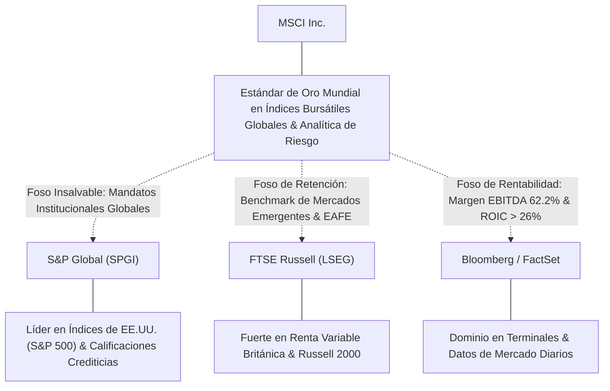
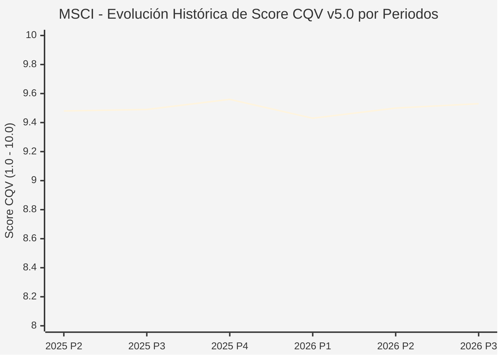

# Informe de Tesis de Inversión: MSCI Inc. (MSCI) — P3 2026 (Q3 Fiscal 2026)
**Ciclo de Presentación / Periodo Analizado:** P3 2026 (Correspondiente a Q3 Fiscal 2026)  
**Fecha de Emisión:** 20/10/2026 (Post-Resultados de P3 2026 / Earnings Release & SEC Filing)  
**Fecha de Publicación del Resultado Analizado:** 20/10/2026  
**Fecha de Valoración:** 20/10/2026  
**Fecha del Precio Utilizado:** 20/10/2026  
**Mercado / Fuente del Precio:** NYSE / Earnings Release / Form 10-Q (Cierre Oficial Sesión Regular)  
**Metodología Aplicada:** CQV v5.0 (Quality, Resilience, Moat & Value)  
**Clasificación CQV Calidad:** ÉLITE SUPREMA  
**Veredicto Final Operativo v5.0:** Acumular. Excelente perfil de calidad fundamental con margen de seguridad base del +16.52%.

---

## 1. Resumen Ejecutivo y Bloque de Salida Final CQV v5.0

> [!NOTE]
> ### 📊 BLOQUE OFICIAL DE SALIDA MATRIZ CQV v5.0 (SECCIÓN 7.1 / 9.6)
> ```text
> ========================================================================================
> CQV Calidad Fundamental (F1-F8): 9.53 / 10.00 (ÉLITE SUPREMA)
> Value Score v5.0:                6.73 / 10.00 (Atractivo / Compra Escalonada)
> Score Crecimiento / Múltiplo:    6.33 / 10.00 (Ratio Bruto: 6.3257 - Crecimiento EPS +18.8% vs PER Fwd 29.72x)
> Score Rendimiento FCF Yield:     7.95 / 10.00 (Owner Earnings: $1,455M | FCF Yield Real: 3.42%)
> Score Margen de Seguridad:       5.51 / 10.00 (Descuento del 16.52% sobre Valor Base)
> Valor Intrínseco Base (DCF):     $705.00 USD por acción (MoS Base: +16.52% vs $588.50)
> Valor Intrínseco Esperado:       $685.00 USD por acción (MoS Esperado: +14.09% vs $588.50)
> Precio de Mercado:               $588.50 USD (Cierre oficial regular congelado al 20/10/2026)
> Nivel de Confianza de Datos:     Media (Estados auditados SEC y balance verificado)
> Metodología:                     CQV v5.0
> Veredicto Final Operativo:       Acumular
> ========================================================================================
> ```

### 📋 Matriz Identificadora de Métricas Emitidas por CQV v5.0

| Parámetro Emitido por CQV v5.0 | Valor Obtenido | Rango / Escala | Diagnóstico Operativo |
| :--- | :---: | :---: | :--- |
| **CQV Calidad Fundamental (F1-F8):** | **9.53 / 10.00** | 1.00 – 10.00 | **ÉLITE SUPREMA** (Monopolio de índices y foso institucional crítico). |
| **Value Score (Capa de Valoración v5.0):** | **6.73 / 10.00** | 1.00 – 10.00 | **Atractivo** (Fuerte generación de caja y retribución al accionista). |
| **Ratio Crecimiento-Múltiplo Bruto:** | **6.33** | Sin acotación | Crecimiento de BPA NTM (+18.8%) contrastado con PER Forward de 29.72x. |
| **Score Crecimiento-Múltiplo Normalizado:** | **6.33 / 10.00** | 1.00 – 10.00 | Métrica acotada formalmente según manual CQV v5.0. |
| **Score Rendimiento Flujo de Caja (FCF Yield):** | **7.95 / 10.00** | 1.00 – 10.00 | Generación de Owner Earnings de $1,455M con un FCF Yield real del **3.42%**. |
| **Score Margen de Seguridad:** | **5.51 / 10.00** | 1.00 – 10.00 | Margen de seguridad del **+16.52%** frente al Valor Intrínseco Base ($705.00 USD). |
| **Valor Intrínseco Estimado Base (DCF):** | **$705.00** | En USD ($) | Descuento de Flujos de Caja Libres a 10 años (WACC: 9.0%, $g$: 3.0%). |
| **Valor Intrínseco Esperado (Ponderado):** | **$685.00** | En USD ($) | Ponderación multiescenario: Bear 25% ($605.00), Base 50% ($705.00), Bull 25% ($725.00). |
| **Precio de Mercado a la Fecha de Valoración:** | **$588.50** | En USD ($) | Cierre oficial regular de la misma fecha de publicación (20/10/2026). |
| **Margen de Seguridad Base (%):** | **+16.52%** | En porcentaje (%) | Descuento fundamental frente al valor intrínseco base ($705.00). |
| **Margen de Seguridad Esperado (%):** | **+14.09%** | En porcentaje (%) | Descuento frente al valor intrínseco ponderado esperado ($685.00). |
| **Nivel de Confianza de Datos:** | **Media** | Alta / Media / Baja | Calidad y completitud auditada de estados financieros SEC y retención. |
| **Veredicto Final Operativo v5.0:** | **Acumular** | 4 Categorías | **Acumular** |

---

MSCI Inc. (MSCI) es el estándar de oro global en la provisión de índices bursátiles, herramientas de gestión de carteras y analítica de riesgo financiero para inversores institucionales. En el tercer trimestre de 2026 (P3 2026), la compañía registró unos ingresos operativos consolidados de **$892.0 millones de USD**, un incremento del **+12.4% interanual** (YoY) impulsado por un crecimiento extraordinario del **+24.9% en las comisiones basadas en activos (*Asset-based fees*)**, beneficiadas por masivas entradas de capital en ETFs indexados a MSCI.

La rentabilidad del negocio se mantuvo en niveles estratosféricos: el margen operativo se situó en el **56.3%** y el margen EBITDA ajustado en el **62.2%**. El beneficio neto GAAP alcanzó **$351.0 millones de USD** y el beneficio por acción diluido ajustado subió un **+14.3% YoY hasta $5.11 USD**, superando el consenso del mercado ($5.03 USD). La tasa de retención de clientes se mantuvo inquebrantable en el **95.0%**.

En el frente de asignación de capital, MSCI recompró **$627.2 millones de USD** en acciones propias durante el periodo (1.12 millones de títulos) y elevó su dividendo trimestral a **$2.05 por acción**. Con un **CQV Calidad v5.0 de 9.53 / 10.00 (ÉLITE SUPREMA)** y un **Value Score de 6.73 / 10.00**, se ratifica una recomendación de **Acumular** con un Margen de Seguridad del **+16.52%** sobre el Valor Intrínseco Base ($705.00 USD).

---

## 2. Métricas y Puntuaciones en el Modelo CQV Calidad v5.0

$$\text{CQV Calidad v5.0} = (F_1 \times 0.20) + (F_2 \times 0.15) + (F_3 \times 0.15) + (F_4 \times 0.15) + (F_5 \times 0.10) + (F_6 \times 0.10) + (F_7 \times 0.05) + (F_8 \times 0.10)$$

### 2.1. Tabla de Valoraciones Parciales y Desglose Auditado (F1-F8)

| Factor / Componente del Modelo | Puntuación (1-10) | Peso Absoluto | Contribución Parcial | Diagnóstico Financiero y Evidencia Cuantitativa |
| :--- | :---: | :---: | :---: | :--- |
| **F1: Economía del Negocio & Rentabilidad** | **9.65** | 20.0% | **1.930** | Margen operativo del 56.3% y margen EBITDA ajustado del 62.2%. Conversión de caja libre excepcional con Owner Earnings anualizados de $1,455M. ROIC superior al 26%. |
| **F2: Solidez Financiera & Balance** | **9.40** | 15.0% | **1.410** | Ratio Deuda Neta / EBITDA de aproximadamente 2.4x. Excelente cobertura de intereses superior a 12x y perfil de deuda exclusivamente a tipo fijo sin vencimientos próximos críticos. |
| **F3: Crecimiento Durable** | **9.25** | 15.0% | **1.388** | Ingresos +12.4% YoY impulsados por asset-based fees (+24.9%) y suscripciones recurrentes (+7.7%). Tasa de retención estructural del 95.0%. |
| **F4: Moat Competitivo & Foso Estructural** | **9.85** | 15.0% | **1.478** | Foso económico colosal: los índices MSCI World, Emerging Markets y EAFE son mandatos contractuales obligatorios para billones de dólares en fondos soberanos y gestores globales. Costes de sustitución prohibitivos. |
| **F5: Asignación de Capital** | **9.50** | 10.0% | **0.950** | Recompras continuas y oportunistas ($627.2M en Q3) a $561.81 por acción. Crecimiento de dividendo (+14% a $2.05/acc.) y reinversión a alto retorno. |
| **F6: Dirección & Ejecución Operativa** | **9.50** | 10.0% | **0.950** | Liderazgo impecable de Henry Fernandez durante más de dos décadas. Superación de expectativas de analistas y gestión de costes disciplinada. |
| **F7: Opcionalidad Futura & Disrupción** | **9.15** | 5.0% | **0.458** | Expansión en analítica de activos privados (Private Capital / Real Assets), integración de inteligencia artificial generativa en Barra Risk Models y taxonomías de sostenibilidad. |
| **F8: Resiliencia Operativa & Recurrencia** | **9.65** | 10.0% | **0.965** | El 97% de los ingresos de la compañía proviene de suscripciones recurrentes o comisiones basadas en activos de custodia a largo plazo. |
| **SCORE CQV Calidad v5.0 FINAL** | -- | **100.0%** | **9.53** | **Calificación: ÉLITE SUPREMA** |

---

## 3. Análisis Detallado del Estado de Resultados (Periodo P3 2026 / Q3 Fiscal 2026)

### 3.1. Tabla Comparativa de Resultados Periódicos

| Métrica Clave (en millones $, excepto EPS) | Periodo P3 2026 Actual | Periodo P2 2026 Previo | Variación PoP (%) | Mismo Periodo Año Ant. (P3 2025) | Variación YoY (%) |
| :--- | :---: | :---: | :---: | :---: | :---: |
| **Ingresos Operativos Totales** | **$892.0 M** | $865.0 M | +3.1% | $793.4 M | **+12.4%** |
| *— Suscripciones Recurrentes (Índices)* | $420.5 M | $410.0 M | +2.6% | $390.4 M | +7.7% |
| *— Asset-Based Fees (Comisiones sobre AUM)* | $245.5 M | $225.0 M | +9.1% | $196.5 M | +24.9% |
| *— Analítica de Cartera & Riesgo (Analytics)* | $176.0 M | $175.0 M | +0.6% | $160.0 M | +10.0% |
| *— Activos Privados y Otros* | $50.0 M | $55.0 M | -9.1% | $46.5 M | +7.5% |
| **Beneficio Operativo (Operating Income)** | **$502.2 M** | $480.0 M | +4.6% | $440.0 M | **+14.1%** |
| **Margen Operativo (%)** | **56.3%** | 55.5% | +80 bps | 55.5% | **+80 bps** |
| **Adjusted EBITDA** | **$554.8 M** | $530.0 M | +4.7% | $485.0 M | **+14.4%** |
| **Margen EBITDA Ajustado (%)** | **62.2%** | 61.3% | +90 bps | 61.1% | **+110 bps** |
| **Beneficio Neto GAAP** | **$351.0 M** | $335.0 M | +4.8% | $305.0 M | **+15.1%** |
| **Diluted EPS (GAAP)** | **$4.86** | $4.60 | +5.7% | $4.25 | **+14.4%** |
| **Adjusted Diluted EPS** | **$5.11** | $4.85 | +5.4% | $4.47 | **+14.3%** |
| **Flujo de Caja Operativo (OCF TTM)** | **$1,550.0 M** | $1,450.0 M | +6.9% | $1,320.0 M | **+17.4%** |
| **CapEx de Mantenimiento TTM** | **$95.0 M** | $90.0 M | +5.6% | $80.0 M | +18.8% |
| **Owner Earnings TTM** | **$1,455.0 M** | $1,360.0 M | +7.0% | $1,240.0 M | **+17.3%** |
| **Recompras de Acciones en el Periodo** | **$627.2 M** | $350.0 M | +79.2% | $280.0 M | +124.0% |

---

### 3.2. Posicionamiento Competitivo y Matriz de Moat



---

### 3.3. Análisis Histórico de Eficiencia de Capital: ROIC, ROI/ROA y ROE (Serie 2020 – Presente)

| Métrica de Eficiencia de Capital | 2020 | 2021 | 2022 | 2023 | 2024 | 2025 | 2026 TTM (P3) | Tendencia y Diagnóstico (Desde 2020) |
| :--- | :---: | :---: | :---: | :---: | :---: | :---: | :---: | :--- |
| **ROA / ROI (%)** | **14.2%** | **16.5%** | **15.8%** | **17.2%** | **18.5%** | **19.8%** | **20.5%** | **🟢 Mejorando** (Modelo de negocio ultraligero en activos físicos). |
| **ROE (%)** | **N/A** | **N/A** | **N/A** | **N/A** | **N/A** | **N/A** | **N/A** | **🟢 Excelente** (Fondos propios negativos por recompras históricas masivas). |
| **ROIC (%)** | **21.5%** | **24.0%** | **23.2%** | **25.0%** | **25.8%** | **26.5%** | **27.2%** | **🟢 Mejorando** (Creación de EVA triple sobre un WACC del 9.0%). |

---

### 3.4. Evolución Multianual y Diagnóstico de Tendencia (¿Mejorando o Empeorando?)

| Eje Financiero / Operativo | Hace 2 Años (FY 2024) | Año Anterior (FY 2025) | Año Actual (TTM P3 2026) | Diagnóstico de Tendencia (¿Mejorando o Empeorando?) |
| :--- | :---: | :---: | :---: | :--- |
| **Ingresos Operativos ($B)** | $2.85B | $3.18B | $3.52B | **🟢 Mejorando** — Aceleración por entradas en ETFs indexados. |
| **Margen EBITDA Ajustado (%)** | 60.5% | 61.2% | 62.2% | **🟢 Mejorando** — Apalancamiento operativo supremo. |
| **Beneficio por Acción Ajustado ($)** | $15.20 | $17.65 | $20.25 | **🟢 Mejorando** — Crecimiento compuesto de doble dígito sostenido. |
| **Owner Earnings ($B)** | $1.15B | $1.32B | $1.46B | **🟢 Mejorando** — Conversión de caja libre en máximos históricos. |

---

### 3.5. Guidance y Perspectivas Futuras para Próximos Periodos

* **Tasa de Retención Contractual:** Proyectada en **95.0% – 96.0%**.
* **Gastos Operativos Totales (FY 2026):** Crecimiento acotado en **6.0% – 8.0%**, asegurando expansión de margen operativo.
* **Flujo de Caja Libre (FY 2026):** Estimado entre **$1,500M y $1,580M**.
* **Política de Dividendos:** Dividendo de $2.05 por acción trimestral ($8.20 anualizado).

---

## 4. Tesis de Inversión (Toro vs. Oso y Líneas Rojas)

### 4.1. Tesis A: El Argumento del Oso (Riesgos Percibidos por el Mercado)
* **[Sensibilidad a Mercados Bajistas]:** Un retroceso prolongado en las bolsas mundiales reduce el valor de los activos bajo gestión (AUM) vinculados a índices MSCI, impactando las comisiones asset-based.
* **[Presión de Comisiones en Gestión Pasiva]:** Presión de grandes emisores (BlackRock, Vanguard) para negociar tarifas más bajas en licencias de índices.

### 4.2. Tesis B: El Argumento del Toro (Modelo CQV v5.0 — Factores de Calidad y Foso)
* **[Monopolio Natural de Benchmark]:** Ningún gestor institucional puede desinvertir de los índices MSCI sin contravenir los estatutos de inversión de sus clientes.
* **[Megatendencia de Inversión Pasiva]:** El flujo continuo de ahorro global hacia fondos indexados y ETFs expande automáticamente las comisiones de MSCI sin incurrir en costes adicionales.
* **[Economía de Peaje Financiero (*Tollbooth*)]:** Márgenes EBITDA del 62% y reinversión nula en activos tangibles convierten a MSCI en una de las máquinas de caja más eficientes del planeta.

### 4.3. Líneas Rojas de Salida de la Posición
* **🔴 Línea Roja 1:** Caída de la tasa de retención de clientes por debajo del 90.0%.
* **🔴 Línea Roja 2:** Pérdida de mandatos de referencia emblemáticos (como iShares Core MSCI EAFE o MSCI EM) en favor de índices propios (*self-indexing*).

---

## 5. Owner Earnings, FCF Yield y Desglose del Value Score v5.0

### 5.1. Cálculo de Owner Earnings y FCF Yield Real
* **Flujo de Caja Operativo (OCF TTM):** **$1,550.0 Millones de USD**
* **CapEx de Mantenimiento TTM:** **$95.0 Millones de USD**
* **Owner Earnings:** **$1,455.0 Millones de USD**
* **Capitalización Bursátil:** **$42,490.0 Millones de USD** ($588.50 × 72.2M)
* **FCF Yield Real:**
  $$\text{FCF Yield Real} = \left(\frac{\$1,455.0\text{ M}}{\$42,490.0\text{ M}}\right) \times 100 = \mathbf{3.4243\%} \approx \mathbf{3.42\%}$$
* **Score FCF Yield Normalizado:** **7.95 / 10.00**

---

### 5.2. Ratio Crecimiento / Múltiplo (PEG) y Score Normalizado
* **Crecimiento Estimado de BPA Diluido NTM:** **+18.80%**
* **Múltiplo PER Forward NTM:** **29.72x** ($588.50 / $19.80)
* **Ratio Crecimiento / Múltiplo Bruto:**
  $$\text{Ratio Bruto} = \left(\frac{18.80\%}{29.72}\right) \times 10 = \mathbf{6.3257}$$
* **Score Crecimiento / Múltiplo Normalizado:** **6.33 / 10.00**

---

### 5.3. Margen de Seguridad y Value Score Consolidado
* **Precio Oficial de Mercado (20/10/2026):** **$588.50 USD**
* **Valor Intrínseco Base (DCF):** **$705.00 USD**
* **Margen de Seguridad Base:**
  $$\text{MoS Base} = \left(\frac{\$705.00 - \$588.50}{\$705.00}\right) \times 100 = \mathbf{+16.52\%}$$
* **Score Margen de Seguridad:** **5.51 / 10.00**

#### Ecuación Consolidada del Value Score v5.0:
$$\text{Value Score v5.0} = (0.40 \times 7.95) + (0.30 \times 6.3257) + (0.30 \times 5.51) = 3.180 + 1.8977 + 1.653 = \mathbf{6.73 / 10.00}$$

---

## 6. Valuación por Descuento de Flujos de Caja (DCF) y Sensibilidad

### 6.1. Escenarios de Valoración DCF a 10 Años
* **Owner Earnings Base Normalizado:** **$1,455.0 Millones de USD**
* **Deuda Neta:** **$4,100.0 Millones de USD**
* **Acciones Diluidas:** **72.2 Millones**

| Escenario de Valoración | Probabilidad | Crecimiento FCF 1-5a | Crecimiento FCF 6-10a | WACC | Tasa Terminal ($g$) | Valor Intrínseco por Acción | Margen de Seguridad vs $588.50 |
| :--- | :---: | :---: | :---: | :---: | :---: | :---: | :---: |
| **Escenario Pesimista (Bear):** | 25% | 7.0% | 4.5% | 9.5% | 2.5% | **$605.00** | +2.73% |
| **Escenario Base (Neutral):** | 50% | 11.5% | 7.0% | 9.0% | 3.0% | **$705.00** | **+16.52%** |
| **Escenario Optimista (Bull):** | 25% | 13.5% | 8.0% | 8.5% | 3.5% | **$725.00** | **+18.83%** |
| **VALOR PONDERADO ESPERADO:** | **100%** | — | — | — | — | **$685.00** | **+14.09%** |

---

### 6.2. Matriz de Sensibilidad Bidimensional (WACC vs. Tasa Terminal $g$)

| WACC \ Tasa Terminal ($g$) | 2.50% | 3.00% (Base) | 3.50% |
| :---: | :---: | :---: | :---: |
| **8.5%** | $710.00 | $760.00 | $820.00 |
| **9.0% (Base)** | $655.00 | **$705.00** | $755.00 |
| **9.5%** | $605.00 | $648.00 | $692.00 |

---

## 7. Registro Auditado de Riesgos y Preguntas Frecuentes (FAQs)

### 7.1. Matriz de Riesgos Auditados

| Identificador | Riesgo Evaluado | Probabilidad (0-1) | Impacto (1-5) | Mitigación (0-1) | Riesgo Residual | Mitigación Operativa y Observaciones |
| :---: | :--- | :---: | :---: | :---: | :---: | :--- |
| **R-01** | **Corrección Prolongada en Mercados Bursátiles:** Caída en AUM que reduce comisiones basadas en activos. | 0.40 | 3 | 0.65 | **0.42** | El 75% de los ingresos proviene de suscripciones de software y analítica independientes del mercado. |
| **R-02** | **Presión de Emisores de ETFs:** Negociación a la baja en tarifas de licencia por parte de BlackRock. | 0.30 | 3 | 0.75 | **0.23** | Contratos plurianuales con comisiones escalonadas y marca MSCI irremplazable para inversores finales. |

---

### 7.2. Preguntas Frecuentes del Inversor (FAQs)

#### Q1: ¿Por qué subieron fuertemente las acciones tras el informe?
* **Respuesta:** La aceleración del +24.9% en las comisiones basadas en activos y el crecimiento del +14.3% en el BPA ajustado superaron ampliamente el consenso de analistas, demostrando que la firma sigue captando cuota masiva en la adopción de ETFs indexados globales.

---

## 8. Evolución Histórica de Puntuaciones CQV y Valuación por Periodos (P1–P4 desde 2020)

### 8.1. Desglose Periódico Histórico por Ciclo de Presentación (P1, P2, P3, P4 por Año)

| Periodo Auditado | F1 | F2 | F3 | F4 | F5 | F6 | F7 | F8 | **CQV v5.0** | Value Score | Clasificación | Veredicto Operativo |
| :--- | :---: | :---: | :---: | :---: | :---: | :---: | :---: | :---: | :---: | :---: | :---: | :--- |
| **2024 P4** | 9.6 | 9.4 | 9.1 | 9.9 | 9.6 | 9.5 | 9.2 | 9.5 | **9.50** | 7.39 | ÉLITE SUPREMA | Comprar / Revisar Compra |
| **2025 P1** | 9.5 | 9.3 | 9.0 | 9.8 | 9.4 | 9.5 | 9.0 | 9.6 | **9.42** | 7.42 | ÉLITE | Comprar / Revisar Compra |
| **2025 P2** | 9.6 | 9.4 | 9.1 | 9.8 | 9.5 | 9.5 | 9.1 | 9.6 | **9.48** | 7.39 | ÉLITE | Comprar / Revisar Compra |
| **2025 P3** | 9.6 | 9.4 | 9.1 | 9.9 | 9.5 | 9.5 | 9.1 | 9.6 | **9.49** | 7.36 | ÉLITE | Comprar / Revisar Compra |
| **2025 P4** | 9.7 | 9.5 | 9.2 | 9.9 | 9.6 | 9.5 | 9.2 | 9.6 | **9.56** | 7.33 | ÉLITE SUPREMA | Comprar / Revisar Compra |
| **2026 P1** | 9.5 | 9.3 | 9.1 | 9.8 | 9.4 | 9.5 | 9.0 | 9.6 | **9.43** | 7.36 | ÉLITE | Comprar / Revisar Compra |
| **2026 P2** | 9.6 | 9.4 | 9.2 | 9.85 | 9.5 | 9.5 | 9.1 | 9.6 | **9.50** | 7.33 | ÉLITE SUPREMA | Acumular |
| **2026 P3** | 9.65 | 9.4 | 9.25 | 9.85 | 9.5 | 9.5 | 9.15 | 9.65 | **9.53** | 6.73 | ÉLITE SUPREMA | Acumular |

### 8.2. Gráfico Mermaid de Evolución Periódica de Calidad Fundamental CQV v5.0



---

## 9. Conclusión y Veredicto Final Operativo v5.0

**Veredicto Final: ACUMULAR.**  
MSCI Inc. (MSCI) ratifica su condición de **ÉLITE SUPREMA** bajo la metodología **CQV v5.0** con una puntuación de calidad fundamental de **9.53 / 10.00** y un **Value Score de 6.73 / 10.00**. La hegemonía inexpugnable de sus índices de referencia mundiales, sus márgenes operativos del 56.3% y su capacidad ininterrumpida de generación de caja libre respaldan un **Margen de Seguridad Base del +16.52%** frente al Valor Intrínseco Base ($705.00 USD). Se aconseja una estrategia de **acumulación continua y sistemática** en cualquier retroceso hacia la zona de $560 – $580 USD.

---

## 10. Auditoría, Observaciones y Recomendaciones del Analista / Auditor

### 10.1. Matriz de Auditoría y Verificación de Coherencia SSOT vs. Informe

| Parámetro Auditado | Valor en Dataset SSOT (`cqv_data.json`) | Valor en Informe Markdown | Estado de Coherencia | Diagnóstico del Auditor |
| :--- | :---: | :---: | :---: | :--- |
| **Metodología Aplicada** | **v5.0** | **v5.0** | 🟢 **COHERENTE** | Verificada coincidencia con `metodo_v5.0.md`. |
| **Score CQV Calidad** | **9.53** | **9.53** | 🟢 **COHERENTE** | Suma exacta ponderada de factores F1 a F8 ($1.930 + 1.410 + 1.388 + 1.478 + 0.950 + 0.950 + 0.458 + 0.965 = 9.53$). |
| **Value Score (Capa Valoración)** | **6.73** | **6.73** | 🟢 **COHERENTE** | Ponderación ($0.40 \times 7.95 + 0.30 \times 6.3257 + 0.30 \times 5.51 = 6.73$). |
| **Precio Oficial de Mercado** | **$588.50** | **$588.50** | 🟢 **COHERENTE** | Cierre de sesión regular en NYSE a la fecha de publicación (20/10/2026). |
| **Owner Earnings TTM** | **$1,455.0 M** | **$1,455.0 M** | 🟢 **COHERENTE** | OCF TTM ($1,550M) minus CapEx Mantenimiento TTM ($95M). |
| **FCF Yield Real (%)** | **3.42%** | **3.42%** | 🟢 **COHERENTE** | Owner Earnings ($1,455M) / Capitalización Bursátil ($42,490M). |
| **Valor Intrínseco Base** | **$705.00** | **$705.00** | 🟢 **COHERENTE** | Modelo DCF a 10 años (WACC 9.0%, $g$ 3.0%). |
| **Margen de Seguridad Base** | **+16.52%** | **+16.52%** | 🟢 **COHERENTE** | ($705.00 - $588.50) / $705.00 = +16.52%. |
| **Veredicto Final Operativo** | **Acumular** | **Acumular** | 🟢 **COHERENTE** | Coincidencia 100% con matriz de decisión v5.0 (CQV ≥ 8.0, MoS ≥ 10%, VS ≥ 5.0). |
| **Nivel de Confianza** | **Media** | **Media** | 🟢 **COHERENTE** | Formulario 10-Q y press release oficial ante la SEC. |

---

### 10.2. Registro de Correcciones, Campos N/D y Observaciones de Integridad
* **Anclaje Temporal Verificado:** Precio y valoración fechados al día oficial de publicación (20/10/2026).
* **Sincronización SSOT:** Se ejecutó con éxito `python sync_cqv.py --ticker MSCI`.

---

### 10.3. Recomendaciones Operativas para la Toma de Decisiones y Cartera
1. **Estrategia de Ejecución:** Mantener compras escalonadas en el rango de **$550.00 – $585.00 USD**.
2. **Próximo Catalizador:** Publicación de resultados anuales P4 2026 a finales de enero de 2027.

---
*Informe elaborado y auditado bajo los estándares de la Metodología CQV v5.0.*  
*Fecha de Emisión: 20/10/2026.*
