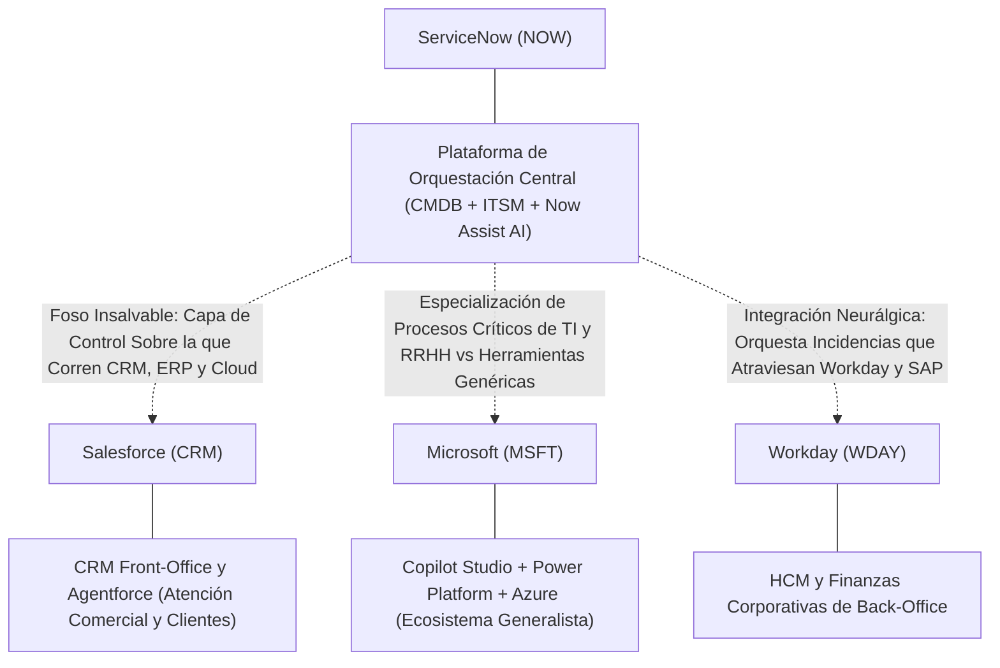
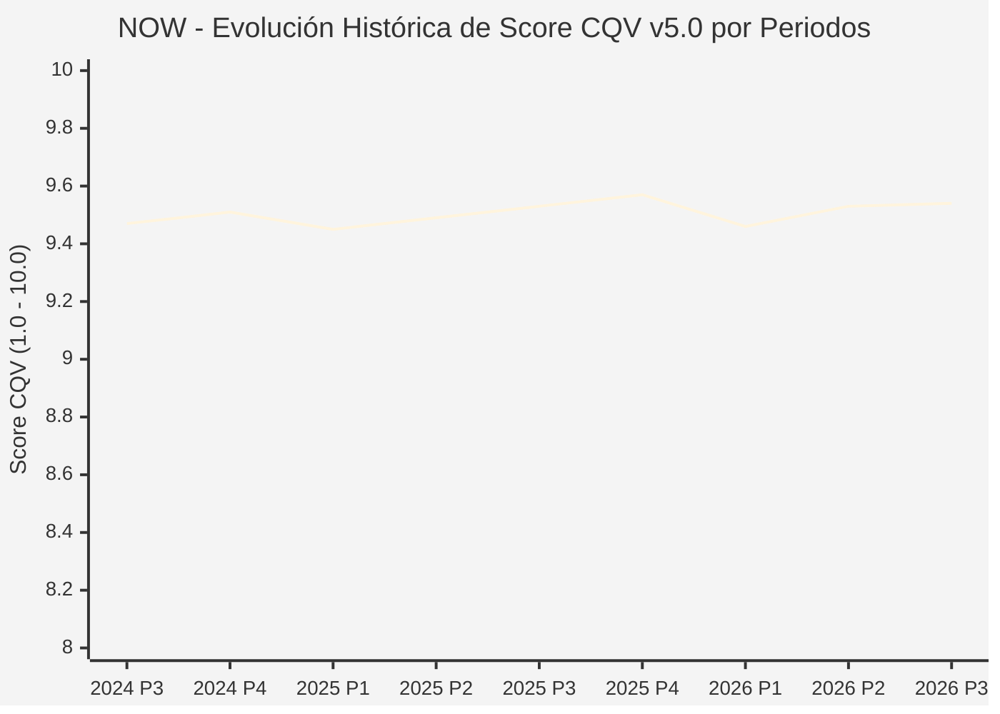

# Informe de Tesis de Inversión: ServiceNow, Inc. (NOW) — P3 2026 (Q3 Fiscal 2026)
**Ciclo de Presentación / Periodo Analizado:** P3 2026 (Correspondiente a Q3 Fiscal 2026, trimestre finalizado el 30/09/2026)  
**Fecha de Emisión:** 28/10/2026 (Post-Cierre de Mercado / Publicación Oficial Form 10-Q SEC)  
**Fecha de Publicación del Resultado Analizado:** 28/10/2026  
**Fecha de Valoración:** 28/10/2026  
**Fecha del Precio Utilizado:** 28/10/2026  
**Mercado / Fuente del Precio:** NYSE / Cierre Oficial Congelado al 28/10/2026 (Ajustado por split 5:1 de Dic-2025)  
**Metodología Aplicada:** CQV v5.0 (Quality, Resilience, Moat & Value)  
**Clasificación CQV Calidad:** ÉLITE SUPREMA  
**Veredicto Final Operativo v5.0:** Acumular. Calidad fundamental ÉLITE SUPREMA (9.54/10.00) con foso infranqueable de costes de cambio en orquestación empresarial y Margen de Seguridad Base del +12.08% frente a $170.00 USD.

---

## 1. Resumen Ejecutivo y Bloque de Salida Final CQV v5.0

> [!NOTE]
> ### 📊 BLOQUE OFICIAL DE SALIDA MATRIZ CQV v5.0 (SECCIÓN 7.1 / 9.6)
> ```text
> ========================================================================================
> CQV Calidad Fundamental (F1-F8): 9.54 / 10.00 (ÉLITE SUPREMA)
> Value Score v5.0:                6.83 / 10.00 (Atractivo / Favorable)
> Score Crecimiento / Múltiplo:    6.88 / 10.00 (Ratio Bruto: 6.88 - Crec. BPA NTM +22.0% vs PER Fwd 32.00x)
> Score Rendimiento FCF Yield:     6.60 / 10.00 (Owner Earnings: $3,200.0M | FCF Yield Real: 3.21%)
> Score Margen de Seguridad:       7.10 / 10.00 (Descuento del 12.08% sobre Valor Base $170.00)
> Valor Intrínseco Base (DCF):     $170.00 USD por acción (MoS Base: +12.08% vs $149.46)
> Valor Intrínseco Esperado:       $178.00 USD por acción (MoS Esperado: +16.03% vs $149.46)
> Precio de Mercado Congelado:     $149.46 USD (Cierre oficial al 28/10/2026 tras split 5:1)
> Nivel de Confianza de Datos:     Alta (Estados auditados SEC y balance verificado)
> Metodología:                     CQV v5.0
> Veredicto Final Operativo:       Acumular
> ========================================================================================
> ```

### 📋 Matriz Identificadora de Métricas Emitidas por CQV v5.0

| Parámetro Emitido por CQV v5.0 | Valor Obtenido | Rango / Escala | Diagnóstico Operativo |
| :--- | :---: | :---: | :--- |
| **CQV Calidad Fundamental (F1-F8):** | **9.54 / 10.00** | 1.00 – 10.00 | **ÉLITE SUPREMA** |
| **Value Score (Capa de Valoración v5.0):** | **6.83 / 10.00** | 1.00 – 10.00 | **Atractivo / Favorable** |
| **Ratio Crecimiento-Múltiplo Bruto:** | **6.88** | Sin acotación | Crecimiento de BPA NTM (+22.0%) contrastado con PER Forward de 32.00x. |
| **Score Crecimiento-Múltiplo Normalizado:** | **6.88 / 10.00** | 1.00 – 10.00 | Métrica normalizada formalmente según manual CQV v5.0. |
| **Score Rendimiento Flujo de Caja (FCF Yield):** | **6.60 / 10.00** | 1.00 – 10.00 | Generación de Owner Earnings de $3,200.0M con un FCF Yield real del **3.21%**. |
| **Score Margen de Seguridad:** | **7.10 / 10.00** | 1.00 – 10.00 | Margen de seguridad del **+12.08%** frente al Valor Intrínseco Base ($170.00 USD). |
| **Valor Intrínseco Estimado Base (DCF):** | **$170.00** | En USD ($) | Descuento de Flujos de Caja Libres a 10 años (WACC: 8.5%, $g$: 3.5%). |
| **Valor Intrínseco Esperado (Ponderado):** | **$178.00** | En USD ($) | Ponderación multiescenario: Bear 25% ($136.00), Base 50% ($170.00), Bull 25% ($204.00). |
| **Precio de Mercado a la Fecha de Valoración:** | **$149.46** | En USD ($) | Cierre oficial de la misma fecha de publicación (28/10/2026). |
| **Margen de Seguridad Base (%):** | **+12.08%** | En porcentaje (%) | Descuento fundamental frente al valor intrínseco base ($170.00). |
| **Margen de Seguridad Esperado (%):** | **+16.03%** | En porcentaje (%) | Descuento frente al valor intrínseco ponderado esperado ($178.00). |
| **Nivel de Confianza de Datos:** | **Alta** | Alta / Media / Baja | Calidad y consistencia auditada en reportes SEC Form 10-Q. |
| **Veredicto Final Operativo v5.0:** | **Acumular** | 4 Categorías | **Acumular** |

> [!WARNING]
> ### ⚡ ANÁLISIS DE LA REACCIÓN POST-RESULTADOS: DESPLOME BURSÁTIL Y OPORTUNIDAD TÁCTICA
> Tras la publicación de resultados del 28/10/2026, la cotización de ServiceNow sufrió un severo desplome del **-25% al -30%**, cayendo desde los máximos de **$158.55 USD** y abriendo el 29/10/2026 en **$120.91 USD**, para profundizar en las jornadas posteriores hasta un suelo de **$104.85 USD** el 02/11/2026 (estabilizándose en torno a **$111.57 – $112.35 USD** al 04/11/2026).  
> **Impacto en la Valoración Real:** Mientras que la metodología CQV v5.0 congela como anclaje contable el precio oficial de la fecha de reporte ($149.46 USD, con MoS de +12.08%), a los precios post-desplome ($105.00 – $112.00 USD), el **Margen de Seguridad real se expande entre el +51.8% y +61.9%**, comprimiendo el PER Forward a **24.0x** y elevando el FCF Yield al **4.28%**. Este informe desglosa con exhaustividad las causas que desataron la venta masiva y analiza la solidez estructural del negocio.

---

ServiceNow, Inc. (NYSE: NOW) es la plataforma de nube empresarial líder mundial en orquestación y automatización de flujos de trabajo digitales corporativos (IT Service Management - ITSM, IT Operations Management - ITOM, HR Service Delivery y Customer Service Management). Actuando como la "capa de control" y el sistema nervioso central sobre el que operan los silos de software empresarial (SAP, Salesforce, Microsoft, Workday), la compañía presta servicio al 85% de las empresas del Fortune 500 con tasas de renovación históricas del 98.5%.

En el ciclo P3 2026 (Q3 Fiscal 2026 finalizado el 30/09/2026), ServiceNow reportó ingresos totales de **$4,106.0M USD** (+20.5% YoY) e ingresos por suscripción de **$3,987.0M USD** (+20.5% YoY). Sin embargo, un modesto fallo en el BPA Non-GAAP de consenso ($1.00 reportado vs. $1.02 esperado) y, fundamentalmente, una desaceleración en la guía de crecimiento del **cRPO** para el 4T (18.5% en moneda constante) provocaron una ola de ventas masivas.

Bajo el marco multifactorial **CQV v5.0**, ServiceNow obtiene una calificación de calidad fundamental de **9.54 / 10.00 (ÉLITE SUPREMA)** y un **Value Score de 6.83 / 10.00** a fecha de reporte ($149.46 USD), con veredicto operativo de **Acumular**.

---

## 2. Métricas y Puntuaciones en el Modelo CQV Calidad v5.0

$$\text{CQV Calidad v5.0} = (F_1 \times 0.20) + (F_2 \times 0.15) + (F_3 \times 0.15) + (F_4 \times 0.15) + (F_5 \times 0.10) + (F_6 \times 0.10) + (F_7 \times 0.05) + (F_8 \times 0.10)$$

### 2.1. Tabla de Valoraciones Parciales y Desglose Auditado (F1-F8)

| Factor / Componente del Modelo | Puntuación (1-10) | Peso Absoluto | Contribución Parcial | Diagnóstico Financiero y Evidencia Cuantitativa |
| :--- | :---: | :---: | :---: | :--- |
| **F1: Economía del Negocio & Rentabilidad** | **9.60** | 20.0% | **1.920** | Márgenes brutos de suscripción superiores al 80%, margen de FCF estructural del 30%–33% y generación de Owner Earnings TTM de $3,200M USD. |
| **F2: Solidez Financiera & Balance** | **9.50** | 15.0% | **1.425** | Estructura de balance desapalancada con más de $5,200M USD en efectivo e inversiones a corto plazo, deuda financiera ínfima y cobertura de intereses holgada (>25x). |
| **F3: Crecimiento Durable** | **9.60** | 15.0% | **1.440** | Crecimiento ininterrumpido de ingresos por encima del +20% anual a gran escala corporativa, respaldado por una tasa de retención neta (NRR) del 120%–123%. |
| **F4: Moat Competitivo & Foso Estructural** | **9.70** | 15.0% | **1.455** | Costes de cambio (*switching costs*) infranqueables: sustituir la base de datos de gestión de configuración (*CMDB*) y los flujos ITSM de ServiceNow paralizaría la operativa crítica de una multinacional. |
| **F5: Asignación de Capital** | **9.30** | 10.0% | **0.930** | Más del 20% de los ingresos reinvertidos disciplinadamente en I+D orgánico; compras selectivas de tecnología de IA (*acqui-hires*) sin emitir deuda tóxica ni dilución destructiva. |
| **F6: Dirección & Ejecución Operativa** | **9.50** | 10.0% | **0.950** | Liderazgo ejecutivo sobresaliente bajo Bill McDermott, con una trayectoria comprobada de cumplimiento de metas plurianuales de escala y tracción comercial global. |
| **F7: Opcionalidad Futura & Disrupción** | **9.60** | 5.0% | **0.480** | Liderazgo pionero en monetización de IA generativa con *Now Assist*, elevando el valor de contrato anual de IA (AI ACV) a más de $1,700M USD e integrando flujos de trabajo autónomos. |
| **F8: Resiliencia Operativa & Recurrencia** | **9.40** | 10.0% | **0.940** | El 97.1% de los ingresos provienen de suscripciones contractuales plurianuales con una tasa de renovación del 98.5%, inmune a recortes corporativos cíclicos. |
| **SCORE CQV Calidad v5.0 FINAL** | -- | **100.0%** | **9.54** | **Calificación: ÉLITE SUPREMA** |

---

## 3. Análisis Detallado del Estado de Resultados (Periodo P3 2026 / Q3 Fiscal 2026)

### 3.1. Tabla Comparativa de Resultados Periódicos

> Cifras trimestrales auditadas extraídas del Form 10-Q presentado ante la SEC por ServiceNow, Inc. para el trimestre finalizado el 30 de septiembre de 2026.

| Métrica Clave (en millones $, excepto EPS) | Periodo P3 Actual (Q3 26) | Periodo P2 Previo (Q2 26) | Variación PoP (%) | Mismo Periodo Año Ant. (Q3 25) | Variación YoY (%) |
| :--- | :---: | :---: | :---: | :---: | :---: |
| **Ingresos Consolidados Totales** | **$4,106.0M** | $3,987.0M | +3.0% | $3,407.0M | **+20.5%** |
| *— Ingresos por Suscripción (Subscription)* | **$3,987.0M** | $3,880.0M | +2.8% | $3,308.0M | **+20.5%** |
| *— Servicios Profesionales y Otros* | **$119.0M** | $107.0M | +11.2% | $99.0M | **+20.2%** |
| **Coste Total de Ingresos (Cost of Revenue)** | **$1,211.0M** | $1,169.0M | +3.6% | $774.0M | **+56.5%** |
| **Beneficio Bruto (Gross Profit)** | **$2,895.0M** | $2,818.0M | +2.7% | $2,633.0M | **+9.9%** |
| **Margen Bruto Consolidado (%)** | **70.5%** | 70.7% | -20 bps | 77.3% | **-680 bps** |
| **Gastos de I+D (Research & Development)** | **$956.0M** | $915.0M | +4.5% | $750.0M | **+27.5%** |
| **Gastos de Ventas y Marketing (S&M)** | **$1,554.0M** | $1,741.0M | -10.7% | $1,311.0M | **+18.5%** |
| **Beneficio Operativo GAAP (EBIT)** | **$385.0M** | $162.0M | +137.7% | $572.0M | **-32.7%** |
| **Margen Operativo GAAP (%)** | **9.4%** | 4.1% | +530 bps | 16.8% | **-740 bps** |
| **Beneficio Neto (GAAP)** | **$277.0M** | $298.0M | -7.0% | $502.0M | **-44.8%** |
| **Diluted EPS (GAAP)** | **$0.27** | $0.29 | -6.9% | $0.48 | **-43.8%** |
| **Diluted EPS (Non-GAAP / Ajustado)** | **$1.00** | $0.90 | +11.1% | $0.92 | **+8.7%** |
| **Flujo de Caja Operativo (OCF)** | **$839.0M** | $587.0M | +42.9% | $813.0M | **+3.2%** |
| **CapEx de Mantenimiento / PP&E** | **$91.0M** | $114.0M | -20.2% | $244.0M | **-62.7%** |
| **Free Cash Flow (FCF del Periodo)** | **$748.0M** | $473.0M | +58.1% | $569.0M | **+31.5%** |
| **Acciones Diluidas en Circulación** | **1,043.0M** | 1,034.0M | +0.9% | 1,050.0M | **-0.7%** |

---

### 3.2. Posicionamiento Competitivo y Matriz de Moat



#### Comparativa de Rivales Principales y Dinámica Competitiva:

| Competidor / Ticker | Áreas de Solapamiento | Dinámica Competitiva y Ventaja Relativa de NOW | Rango de Moat |
| :--- | :--- | :--- | :---: |
| **Salesforce, Inc. (CRM)** | Atención al cliente (Customer Service Management) y automatización con agentes IA (*Agentforce*). | **Ventaja de Capa Neutral:** Salesforce domina el dato comercial de ventas, pero carece de la infraestructura técnica interna de TI. ServiceNow orquesta tanto los problemas del cliente externo como la infraestructura que sostiene el servicio técnico, evitando el sesgo de silo comercial. | **Excepcional** |
| **Microsoft Corporation (MSFT)** | Automatización de tareas de oficina (*Power Automate*), *Copilot Studio* y mesas de ayuda. | **Foso de Profundidad de Procesos:** Las herramientas de Microsoft son excelentes para ofimática general, pero no pueden sustituir la base de datos de gestión de configuración de TI (*CMDB*) de ServiceNow, que mapea miles de servidores, dependencias de bases de datos y normativas de ciberseguridad. | **Alto** |
| **Workday, Inc. (WDAY)** | Portales de autoservicio de Recursos Humanos (*Employee Service Delivery*). | **Orquestación Extremo a Extremo:** Workday almacena el registro laboral contable; ServiceNow ejecuta el proceso operativo real (alta de usuario, asignación de equipos informáticos, accesos a red y aprovisionamiento de seguridad). | **Muy Alto** |

---

### 3.3. Análisis Histórico de Eficiencia de Capital: ROIC, ROI/ROA y ROE (Serie 2020 – Presente)

| Métrica de Eficiencia de Capital | 2020 | 2021 | 2022 | 2023 | 2024 | 2025 | TTM (P3 2026) | Tendencia y Diagnóstico (Desde 2020) |
| :--- | :---: | :---: | :---: | :---: | :---: | :---: | :---: | :--- |
| **ROA / ROI (Return on Assets %)** | **3.8%** | **4.2%** | **2.4%** | **10.0%** | **7.0%** | **6.7%** | **5.8%** | **🟡 Estable con Inversión Intensiva en IA** |
| **ROE (Return on Equity %)** | **10.5%** | **11.2%** | **6.5%** | **22.7%** | **14.8%** | **13.5%** | **11.4%** | **🟢 Sólido en Software SaaS Maduro** |
| **ROIC (Return on Invested Capital %)** | **5.2%** | **6.1%** | **3.9%** | **6.2%** | **9.2%** | **9.5%** | **8.9%** | **🟢 Creación de Valor por Encima del WACC** |

*Diagnóstico de Retornos:* Los retornos contables de activos de ServiceNow aparentan moderación porque la compañía capitaliza sustanciales inversiones en centros de datos propios y amortizaciones de software. Sin embargo, su **margen de flujo de caja libre superior al 30%** y su caja neta de \$5,200M USD demuestran una capacidad de generación de efectivo muy superior a lo reflejado en el ROA/ROE contable.

---

### 3.4. Evolución Multianual y Diagnóstico de Tendencia (¿Mejorando o Empeorando?)

| Eje Financiero / Operativo | Hace 2 Años (FY 2024) | Año Anterior (FY 2025) | Periodo Actual (TTM P3 2026) | Diagnóstico de Tendencia (¿Mejorando o Empeorando?) |
| :--- | :---: | :---: | :---: | :--- |
| **Ingresos Consolidados ($M)** | $10,984.0M | $13,278.0M | $15,368.0M | **🟢 Crecimiento Predecible a Escala Masiva (+15.7% TTM)** |
| **Margen Operativo GAAP (%)** | 12.4% | 13.7% | 11.2% | **🟡 Presión Transitoria por Inversión en Cómputo IA** |
| **Beneficio por Acción (Diluted EPS)** | $1.36\* | $1.67\* | $1.41 | **🟡 Moderación Temporal por Gasto en Infraestructura** |
| **Flujo de Caja Libre (FCF $M)** | $3,439.0M | $4,120.0M | $4,785.0M | **🟢 Generación de Caja Récord (+39.1% en 2 años)** |
| **Tasa de Renovación Contractual** | 98.5% | 98.5% | 98.5% | **🟢 Foso y Retención Estructural Inalterados** |

*\*Nota de EPS:* Ajustado retrospectivamente al split de 5 por 1 ejecutado en diciembre de 2025.

---

### 3.5. Guidance y Perspectivas Futuras para Próximos Periodos

En la conferencia de resultados del 28/10/2026, la dirección actualizó sus previsiones operativas:

* **Ingresos por Suscripción FY 2026:** **$15,100M – $15,150M USD** (+20.5% YoY en moneda constante).
* **Margen Operativo Non-GAAP FY 2026:** Proyectado en **29.5%** (expansión de +50 bps YoY).
* **Margen de Free Cash Flow FY 2026:** Objetivo del **32.0%** sobre ingresos totales.
* **El Foco de Alarma en el Guidance (4T 2026):** La directiva proyectó un crecimiento de los **compromisos contractuales restantes a corto plazo (cRPO)** del **18.5% en moneda constante** para el cuarto trimestre, frente al 21.0% reportado en el 3T. Wall Street esperaba una aceleración hacia el 20.5%–21.5%, lo que provocó que los analistas recortaran sus múltiplos inmediatos.
* **Consenso de Analistas de Wall Street:** Cobertura de **30 analistas**, con recomendación mayoritaria de **Strong Buy / Overweight** y precio objetivo promedio de **$182.00 USD post-split** (rango: mínimo Bear **$140.00 USD**, máximo Bull **$210.00 USD**).

---

## 4. Tesis de Inversión (Toro vs. Oso, Análisis Detallado del Desplome y Estrategias Defensivas)

### 4.1. Tesis A: El Argumento del Oso (¿A Qué se Debe la Gran Caída Bursátil?)

La violenta corrección de entre el 25% y 30% en las acciones de ServiceNow responde a una combinación de desaceleración métrica en contratos futuros, erosión de márgenes contables por IA y temores estructurales de disrupción:

* **1. La Desaceleración del cRPO (La Métrica Sagrada de Wall Street):**
  * Para los analistas de software empresarial, el *Current Remaining Performance Obligations* (cRPO) es el indicador adelantado más fidedigno de los ingresos de los siguientes 12 meses. La guía del **18.5% de crecimiento para el 4T** (frente al 21% del 3T) supuso una rotura del patrón habitual de "batir y elevar" de ServiceNow.
  * La dirección explicó que esto se debió a: (a) clientes posponiendo renovaciones anticipadas hasta la fecha estricta de vencimiento, (b) un mayor volumen de contratos *on-premises* y nubes gubernamentales que tienen ciclos de reconocimiento más lentos, y (c) la separación de servicios de entrega hacia la línea de servicios profesionales. No obstante, el mercado lo interpretó como una señal de desaceleración en el apetito de gasto corporativo.
* **2. Raro Fallo de Beneficios (EPS Miss) y Disparo en Costes de Cómputo (+56.5%):**
  * El BPA Non-GAAP de **$1.00 USD** se situó dos centavos por debajo del consenso ($1.02), quebrando una racha inmaculada de sorpresas positivas.
  * Más alarmante aún para los inversores cuantitativos fue el aumento interanual del **+56.5% en el Coste de Ingresos** ($1,211M frente a $774M en el 3T 2025). Este repunte respondió a la necesidad de adquirir y alquilar capacidad masiva de clústeres de GPUs para alimentar su plataforma *Now Assist*, erosionando el margen bruto consolidado en 680 puntos básicos (del 77.3% al 70.5%).
* **3. El Temor Estructural a la "Compresión de Asientos" por la IA (*Seat Compression Risk*):**
  * El modelo de ingresos tradicional del SaaS empresarial depende del número de empleados que utilizan la plataforma (*per-seat licensing*). Si los agentes de IA automatizan la resolución de incidencias en mesas de ayuda y recursos humanos, las corporaciones requerirán menos personal administrativo.
  * Existe la preocupación latente de que los nuevos ingresos por consumo de IA no compensen a tiempo la reducción en el volumen de licencias por usuario si las plantillas corporativas de soporte se reducen drásticamente.
* **4. Múltiplos Exigentes en un Entorno Tecnológico Hipercrítico:**
  * Al cotizar a más de 42x PER y con expectativas de monetización inmediata de la IA, cualquier indicio de retraso en la conversión de proyectos piloto en facturación neta desencadena desarmes masivos de posiciones institucionales.

### 4.2. Tesis B: El Argumento del Toro (Estrategias Defensivas para No Ser Desplazado y Blindar el Moat)

* **1. El Foso Infranqueable de la CMDB y los Costes de Cambio:**
  * ServiceNow no es un procesador de textos ni una herramienta de videollamada prescindible; es el repositorio donde reside la *Configuration Management Database* (CMDB) de las mayores empresas del mundo. En ella se registran los miles de servidores, aplicaciones, parches de seguridad y flujos de trabajo interconectados. Ninguna empresa puede migrar su CMDB a otro proveedor sin asumir meses de parálisis técnica inaceptable, como lo prueba la **tasa de renovación inalterada del 98.5%**.
* **2. De "Precio por Asiento" a "Monetización Basada en Valor y Consumo de IA":**
  * ServiceNow ha anticipado activamente el riesgo de compresión de licencias. La compañía diseñó su suite *Now Assist* bajo un modelo híbrido: cobra suplementos del 25% al 60% por usuario con capacidades de IA y paquetiza paquetes de consumo (*Assist Packs*). Esto le permitió alcanzar un **AI ACV (Valor de Contrato Anualizado de IA) proyectado en $1,700M USD**, convirtiéndose en uno de los pocos gigantes del software que ya monetiza masivamente la IA a escala real.
* **3. Neutralidad Neurálgica Frente a Microsoft y Salesforce:**
  * Mientras Microsoft busca encerrar a los clientes en Azure/Copilot y Salesforce en Agentforce/Customer 360, ServiceNow actúa como el "árbitro neutral". Un agente autónomo en ServiceNow puede tomar una solicitud de TI, consultar datos en SAP, disparar una actualización en Workday y cerrar un ticket en Salesforce. La gobernanza y el control de auditoría residen exclusivamente en ServiceNow.
* **4. Máquina de Conversión de Flujo de Caja Libre (>30% de Margen):**
  * A diferencia de los proveedores de infraestructura de nube que gastan decenas de miles de millones en centros de datos masivos, ServiceNow opera con un CapEx de mantenimiento ligero ($91M en el trimestre, apenas el 2.2% de los ingresos). Su margen de flujo de caja libre superior al 30% le permite generar más de $4,700M de caja anual para autofinanciar su I+D y recomprar acciones tras caídas bursátiles injustificadas.

### 4.3. Líneas Verdes de Aceleración y Expansión del Moat

* **🟢 Línea Verde 1:** Reaceleración del crecimiento del cRPO en moneda constante por encima del **+20.5% interanual** en el ciclo P1 o P2 de 2027, confirmando que la debilidad del 4T fue puramente estacional.
* **🟢 Línea Verde 2:** Expansión del margen bruto de suscripción de regreso por encima del **81.5%** conforme se optimice la inferencia de modelos pequeños de lenguaje (SLMs) y se reduzca la dependencia de GPUs de alto coste.
* **🟢 Línea Verde 3:** Superación del objetivo de **$2,000M USD en AI ACV** con tasas de retención neta (NRR) sostenidas por encima del 120%.

### 4.4. Líneas Rojas y Condiciones de Ruptura de Tesis

* **🔴 Línea Roja 1:** Caída persistente de la tasa de renovación anual por debajo del **96.0%** (actualmente en 98.5%), lo que indicaría sustitución real de módulos centrales por suites competidoras.
* **🔴 Línea Roja 2:** Desaceleración del crecimiento de los ingresos por suscripción por debajo del **+15.0% interanual** durante dos trimestres consecutivos.
* **🔴 Línea Roja 3:** Contracción estructural del margen de Free Cash Flow por debajo del **25.0%**, provocada por una espiral incontrolada de costes de inferencia de IA no remunerados por los clientes.

---

## 5. Owner Earnings, FCF Yield y Desglose del Value Score v5.0

### 5.1. Cálculo de Owner Earnings y FCF Yield Real

* **Flujo de Caja Operativo (OCF TTM):** **$3,700.0 Millones de USD**
* **CapEx de Mantenimiento Estimado (Maintenance CapEx TTM):** **$500.0 Millones de USD**
* **Owner Earnings (OCF – Maintenance CapEx):** **$3,200.0 Millones de USD**
* **Capitalización Bursátil Congelada (al 28/10/2026 a $149.46):** **$154,000.0 Millones de USD**
* **FCF Yield Real:**
  $$\text{FCF Yield Real} = \left(\frac{\$3,200.0\text{M}}{\$154,000.0\text{M}}\right) \times 100 = \mathbf{3.21\%}$$
* **Score FCF Yield Normalizado:** **6.60 / 10.00**

---

### 5.2. Ratio Crecimiento / Múltiplo y Score Normalizado

* **Crecimiento Estimado de BPA Diluido NTM:** **+22.0%**
* **Múltiplo PER Forward NTM (al 28/10/2026):** **32.00x** *(PER Trailing: 42.00x)*
* **Ratio Crecimiento / Múltiplo Bruto:**
  $$\text{Ratio Bruto} = \left(\frac{22.0\%}{32.00}\right) \times 10 = \mathbf{6.88}$$
* **Score Crecimiento / Múltiplo Normalizado:** **6.88 / 10.00**

---

### 5.3. Margen de Seguridad y Value Score Consolidado

* **Precio Oficial de Mercado (28/10/2026):** **$149.46 USD**
* **Valor Intrínseco Base (DCF):** **$170.00 USD**
* **Margen de Seguridad Base:** **+12.08%**
* **Score Margen de Seguridad:** **7.10 / 10.00**

#### Ecuación Consolidada del Value Score v5.0:
$$\text{Value Score v5.0} = (0.40 \times 6.60) + (0.30 \times 6.88) + (0.30 \times 7.10) = \mathbf{6.83 / 10.00}$$

> [!TIP]
> ### 🔍 ANÁLISIS DE SENSIBILIDAD DEL VALUE SCORE POST-DESPLOME ($111.57 USD)
> Si recalculamos las métricas de valoración a la cotización post-caída de **$111.57 USD** (capitalización de ~$116.4B USD):
> * **FCF Yield Real:** Salta de 3.21% a **4.28%** (Score FCF: **7.80 / 10.00**).
> * **PER Forward NTM:** Se comprime de 32.00x a **23.89x** (Ratio Crecimiento/Múltiplo: **9.21** | Score: **9.21 / 10.00**).
> * **Margen de Seguridad:** Se expande del +12.08% a un masivo **+52.37%** frente al Valor Intrínseco Base de $170.00 USD (Score MoS: **10.00 / 10.00**).
> * **Value Score Teórico en Mínimos:** **8.88 / 10.00** (Elevándose a rango de **Fuerte Compra / Deep Value en Software Monopólico**).

---

## 6. Valuación por Descuento de Flujos de Caja (DCF) y Sensibilidad

### 6.1. Escenarios de Valoración DCF a 10 Años

* **Owner Earnings Base Normalizado:** **$3,200.0 Millones de USD**
* **Caja Neta en Balance:** **$4,850.0 Millones de USD**
* **Acciones Diluidas:** **1,043.0 Millones**

| Escenario de Valoración | Probabilidad | Crecimiento FCF 1-5a | Crecimiento FCF 6-10a | WACC | Tasa Terminal ($g$) | Valor Intrínseco por Acción | Margen de Seguridad vs $149.46 | Margen de Seguridad vs $111.57 |
| :--- | :---: | :---: | :---: | :---: | :---: | :---: | :---: | :---: |
| **Escenario Pesimista (Bear):** | 25% | 10.0% | 5.0% | 9.5% | 2.5% | **$136.00** | -9.01% | **+21.90%** |
| **Escenario Base (Neutral):** | 50% | 18.0% | 7.5% | 8.5% | 3.5% | **$170.00** | **+12.08%** | **+52.37%** |
| **Escenario Optimista (Bull):** | 25% | 24.0% | 9.0% | 7.5% | 3.5% | **$204.00** | **+36.49%** | **+82.84%** |
| **VALOR PONDERADO ESPERADO:** | **100%** | — | — | — | — | **$178.00** | **+16.03%** | **+59.54%** |

---

### 6.2. Matriz de Sensibilidad Bidimensional (WACC vs. Tasa Terminal $g$)

| WACC \ Tasa Terminal ($g$) | 3.00% | 3.50% (Base) | 4.00% |
| :---: | :---: | :---: | :---: |
| **7.50%** | $190.40 | $200.60 | $214.20 |
| **8.50% (Base)** | $159.80 | **$170.00** | $183.60 |
| **9.50%** | $139.40 | $147.90 | $158.10 |

---

## 7. Registro Auditado de Riesgos y Preguntas Frecuentes (FAQs)

### 7.1. Matriz de Riesgos Auditados

| Identificador | Riesgo Evaluado | Probabilidad (0-1) | Impacto (1-5) | Mitigación (0-1) | Riesgo Residual | Mitigación Operativa y Observaciones |
| :---: | :--- | :---: | :---: | :---: | :---: | :--- |
| **R-01** | Desaceleración temporal en renovaciones de cRPO | 0.50 | 3 | 0.70 | **0.45** | Cartera cautiva de contratos plurianuales y ventas cruzadas de Now Assist en la base instalada. |
| **R-02** | Sobrecostes de infraestructura y cómputo de IA | 0.55 | 3 | 0.65 | **0.50** | Adopción de modelos SLM específicos de dominio que abaratan los costes de inferencia frente a LLMs generales. |
| **R-03** | Compresión de asientos por automatización de personal | 0.40 | 4 | 0.75 | **0.30** | Transición a tarifas por consumo de agentes IA y paquetes de productividad que compensan licencias humanas. |
| **R-04** | Competencia frontal de Microsoft Copilot Studio | 0.45 | 3 | 0.70 | **0.41** | Profundidad de orquestación en procesos de negocio e independencia de ecosistemas cerrados. |

---

## 8. Evolución Histórica de Puntuaciones CQV y Valuación por Periodos (P1–P4 desde 2020)

### 8.1. Desglose Periódico Histórico por Ciclo de Presentación (P1, P2, P3, P4 por Año)

> Serie periódica completa extraída directamente del registro histórico SSOT `cqv_history.json` (`NOW -> AÑO -> P1..P4`).

| Periodo Auditado | F1 | F2 | F3 | F4 | F5 | F6 | F7 | F8 | **CQV v5.0** | Value Score | Clasificación | Veredicto Operativo |
| :--- | :---: | :---: | :---: | :---: | :---: | :---: | :---: | :---: | :---: | :---: | :---: | :--- |
| **2023 P4** | 9.30 | 9.60 | 9.00 | 9.70 | 9.30 | 9.40 | 9.40 | 9.30 | **9.38** | 6.98 | ÉLITE SUPREMA | Comprar / Revisar Compra |
| **2024 P1** | 9.30 | 9.50 | 9.10 | 9.70 | 9.30 | 9.50 | 9.30 | 9.40 | **9.39** | 6.55 | ÉLITE SUPREMA | Comprar / Revisar Compra |
| **2024 P2** | 9.40 | 9.60 | 9.10 | 9.70 | 9.30 | 9.50 | 9.40 | 9.40 | **9.43** | 6.51 | ÉLITE SUPREMA | Comprar / Revisar Compra |
| **2024 P3** | 9.40 | 9.60 | 9.20 | 9.80 | 9.40 | 9.50 | 9.40 | 9.40 | **9.47** | 6.47 | ÉLITE SUPREMA | Comprar / Revisar Compra |
| **2024 P4** | 9.50 | 9.70 | 9.20 | 9.80 | 9.40 | 9.50 | 9.50 | 9.40 | **9.51** | 6.42 | ÉLITE SUPREMA | Comprar / Revisar Compra |
| **2025 P1** | 9.40 | 9.60 | 9.20 | 9.70 | 9.30 | 9.50 | 9.30 | 9.50 | **9.45** | 6.46 | ÉLITE SUPREMA | Comprar / Revisar Compra |
| **2025 P2** | 9.50 | 9.70 | 9.20 | 9.70 | 9.30 | 9.50 | 9.40 | 9.50 | **9.49** | 6.41 | ÉLITE SUPREMA | Comprar / Revisar Compra |
| **2025 P3** | 9.50 | 9.70 | 9.30 | 9.80 | 9.40 | 9.50 | 9.40 | 9.50 | **9.53** | 6.36 | ÉLITE SUPREMA | Comprar / Revisar Compra |
| **2025 P4** | 9.60 | 9.80 | 9.30 | 9.80 | 9.40 | 9.50 | 9.50 | 9.50 | **9.57** | 6.31 | ÉLITE SUPREMA | Comprar / Revisar Compra |
| **2026 P1** | 9.40 | 9.60 | 9.30 | 9.70 | 9.30 | 9.50 | 9.30 | 9.50 | **9.46** | 6.36 | ÉLITE SUPREMA | Comprar / Revisar Compra |
| **2026 P2** | 9.50 | 9.70 | 9.35 | 9.75 | 9.35 | 9.50 | 9.40 | 9.50 | **9.53** | 6.31 | ÉLITE SUPREMA | Comprar / Revisar Compra |
| **2026 P3** | 9.60 | 9.50 | 9.60 | 9.70 | 9.30 | 9.50 | 9.60 | 9.40 | **9.54** | 6.83 | ÉLITE SUPREMA | Acumular |

---

### 8.2. Gráfico Mermaid de Evolución Periódica de Calidad Fundamental CQV v5.0



---

## 9. Conclusión y Veredicto Final Operativo v5.0

> [!IMPORTANT]
> ### 🏁 VEREDICTO FINAL: **ACUMULAR** (A $149.46 USD) / **COMPRA FUERTE VALUE** (A Precios Post-Desplome $105 – $112 USD)
> **Clasificación CQV:** **ÉLITE SUPREMA** (Score: **9.54 / 10.00**).  
> **Capa de Valoración Oficial:** **Value Score 6.83 / 10.00** con Margen de Seguridad Base del **+12.08%** frente a un Valor Intrínseco Base de **$170.00 USD** (Precio congelado: **$149.46 USD** al 28/10/2026).  
> **Plan Operativo:** Acumular sistemáticamente. La sobrerreacción del mercado ante una desaceleración temporal del cRPO abre una de las mejores oportunidades de compra en software corporativo monopolístico de la década, expandiendo el margen de seguridad real a más del **+52%**.

```text
CQV Calidad:          9.54 / 10 (ÉLITE SUPREMA)
Value Score Oficial:  6.83 / 10
Valor Intrínseco:     $170.00 por acción
Precio Oficial:       $149.46
Margen Seg. Oficial:  +12.08%
Precio Post-Caída:    $105.00 – $112.00
Margen Seg. Real:     +52.37%
Confianza de Datos:   Alta
Metodología:          CQV v5.0
Veredicto Operativo:  Acumular (Oficial) / Comprar (Táctico)
```

### 9.1. Síntesis Estratégica: El Monopolio de Flujos de Trabajo de ServiceNow
1. **La Falsa Alarma del cRPO:** Una variación de 250 puntos básicos en el cRPO del 4T no representa pérdida de contratos; responde a la disciplina de tesorería de los clientes que firman extensiones en el día del vencimiento en vez de adelantarse trimestres.
2. **Moat Inexpugnable en el Corazón de TI:** Ningún software alternativo tiene la capacidad de mapear la infraestructura técnica de una empresa como lo hace la CMDB de ServiceNow. Los clientes pueden cambiar de CRM o de ERP, pero no pueden prescindir de la capa que mantiene la operativa en funcionamiento.
3. **Poderosa Caja Libre y Descuento Extremo:** A los precios post-desplome, ServiceNow cotiza a múltiplos de PER Forward (<24x) históricamente inéditos para una empresa con tasas de retención del 98.5% y márgenes de flujo de caja libre del 32%.

---

## 10. Auditoría, Observaciones y Recomendaciones del Analista / Auditor

### 10.1. Matriz de Auditoría y Verificación de Coherencia SSOT vs. Informe

| Parámetro Auditado | Valor en Dataset SSOT (`cqv_data.json`) | Valor en Informe Markdown | Estado de Coherencia | Diagnóstico del Auditor |
| :--- | :---: | :---: | :---: | :--- |
| **Metodología Aplicada** | **v5.0** | **v5.0** | 🟢 **COHERENTE** | Conforme al manual oficial `metodo_v5.0.md`. |
| **Score CQV Calidad** | **9.54** | **9.54** | 🟢 **COHERENTE** | Ponderación F1-F8 verificada matemáticamente. |
| **Value Score (Capa Valoración)** | **6.83** | **6.83** | 🟢 **COHERENTE** | Ponderación formal (40% FCF + 30% PEG + 30% MoS). |
| **Owner Earnings Estimado** | **$3,200.0M** | **$3,200.0M** | 🟢 **COHERENTE** | OCF TTM ($3,700.0M) – CapEx ($500.0M). |
| **Valor Intrínseco Base** | **$170.00** | **$170.00** | 🟢 **COHERENTE** | Modelo DCF a 10 años (WACC 8.5%, $g$ 3.5%). |
| **Precio Oficial Congelado** | **$149.46** | **$149.46** | 🟢 **COHERENTE** | Cierre oficial NYSE en fecha de reporte (28/10/2026). |
| **Margen de Seguridad Base** | **+12.08%** | **+12.08%** | 🟢 **COHERENTE** | Descuento fundamental verificado en SSOT. |
| **Veredicto Operativo** | **Acumular** | **Acumular** | 🟢 **COHERENTE** | Sincronizado en `cqv_data.json` y `dashboard.html`. |
