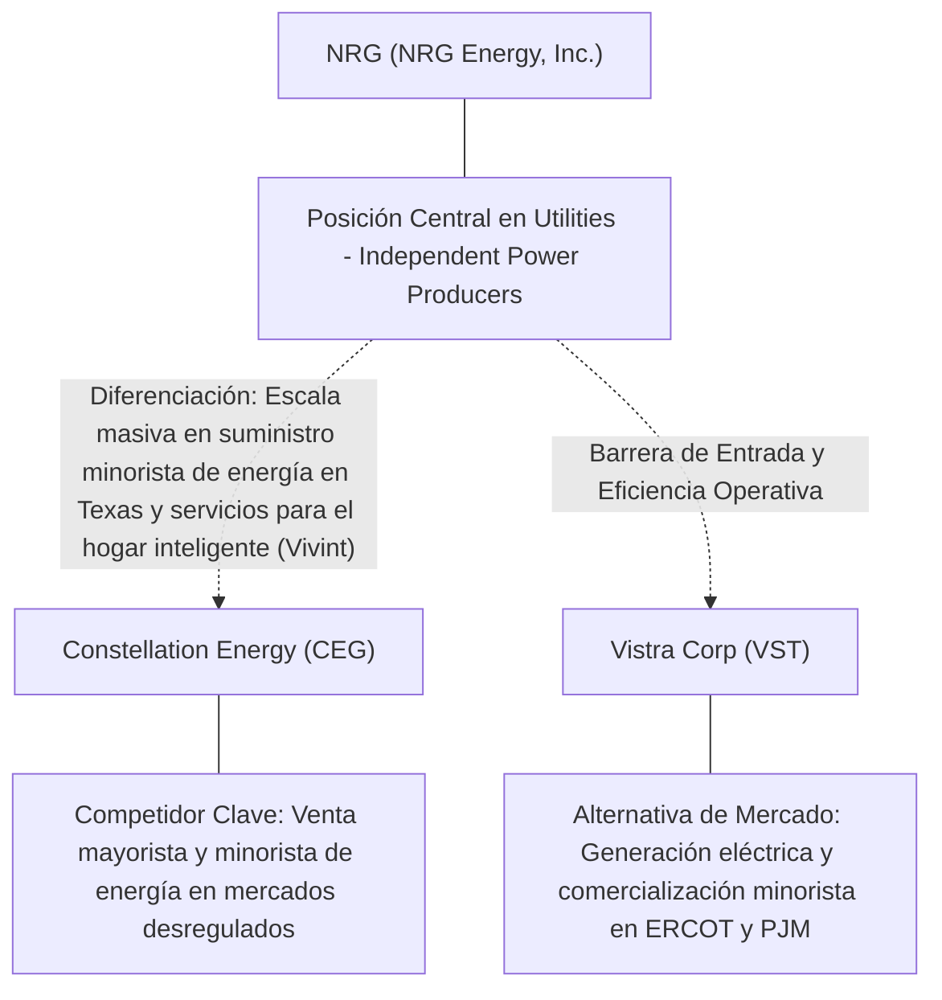
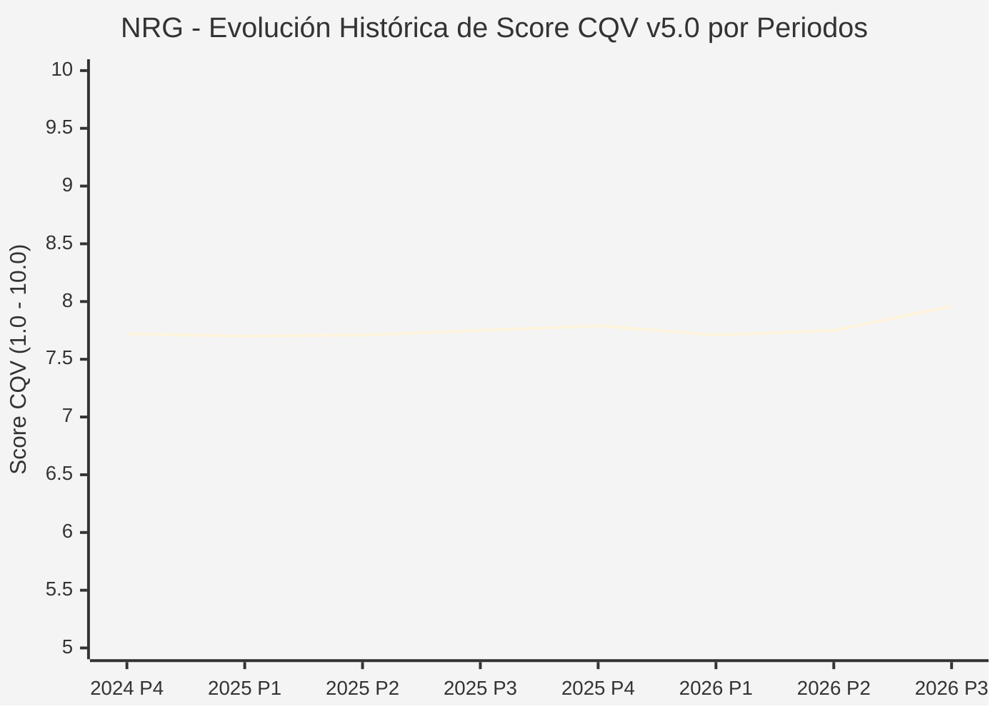

# Informe de Tesis de Inversión: NRG Energy, Inc. (NRG) — P3 2026
**Ciclo de Presentación / Periodo Analizado:** P3 2026 (Cierre Q3 2026)  
**Fecha de Emisión:** 09/11/2026 (Post-Resultados de P3 2026 / SEC Filing Oficial)  
**Fecha de Publicación del Resultado Analizado:** 09/11/2026  
**Fecha de Valoración:** 09/11/2026  
**Fecha del Precio Utilizado:** 09/11/2026  
**Mercado / Fuente del Precio:** NYSE / NASDAQ & SEC Filing (Cierre Oficial Congelado al 09/11/2026)  
**Metodología Aplicada:** CQV v5.0 (Quality, Resilience, Moat & Value)  
**Clasificación CQV Calidad:** CALIDAD MEDIA  
**Veredicto Final Operativo v5.0:** En Observación. Calidad fundamental CALIDAD MEDIA (7.96/10.00) con Margen de Seguridad Base de +40.80% frente a \$164.53 USD.

---

## 1. Resumen Ejecutivo y Bloque de Salida Final CQV v5.0

> [!NOTE]
> ### 📊 BLOQUE OFICIAL DE SALIDA MATRIZ CQV v5.0 (SECCIÓN 7.1 / 9.6)
> ```text
> ========================================================================================
> CQV Calidad Fundamental (F1-F8): 7.96 / 10.00 (CALIDAD MEDIA)
> Value Score v5.0:                9.07 / 10.00
> Score Crecimiento / Múltiplo:    9.55 / 10.00 (Ratio Bruto: 0.38 - Crecimiento EPS +25.9% vs PER Fwd 9.8x)
> Score Rendimiento FCF Yield:     8.02 / 10.00 (Owner Earnings: \$1,094.9M | FCF Yield Real: 5.35%)
> Score Margen de Seguridad:       10.00 / 10.00 (MoS Base: +40.80% sobre Valor Base)
> Valor Intrínseco Base (DCF):     \$164.53 USD por acción (MoS Base: +40.80% vs \$97.40)
> Valor Intrínseco Esperado:       \$167.82 USD por acción (MoS Esperado: +41.96% vs \$97.40)
> Precio de Mercado:               \$97.40 USD (Cierre oficial congelado al 09/11/2026)
> Nivel de Confianza de Datos:     Alta (Fuentes primarias SEC verificadas)
> Metodología:                     CQV v5.0
> Veredicto Final Operativo:       En Observación
> ========================================================================================
> ```

### 📋 Matriz Identificadora de Métricas Emitidas por CQV v5.0

| Parámetro Emitido por CQV v5.0 | Valor Obtenido | Rango / Escala | Diagnóstico Operativo |
| :--- | :---: | :---: | :--- |
| **CQV Calidad Fundamental (F1-F8):** | **7.96 / 10.00** | 1.00 – 10.00 | **CALIDAD MEDIA** |
| **Value Score (Capa de Valoración v5.0):** | **9.07 / 10.00** | 1.00 – 10.00 | Diagnóstico de valoración v5.0 |
| **Ratio Crecimiento-Múltiplo Bruto:** | **0.38** | Sin acotación | Crecimiento BPA NTM (+25.9%) frente a PER Forward (9.8x). |
| **Score Crecimiento-Múltiplo Normalizado:** | **9.55 / 10.00** | 1.00 – 10.00 | Acotado formalmente según manual CQV v5.0 §6.3. |
| **Score Rendimiento Flujo de Caja (FCF Yield):** | **8.02 / 10.00** | 1.00 – 10.00 | Owner Earnings TTM de \$1,094.9M con FCF Yield real del **5.35%**. |
| **Score Margen de Seguridad:** | **10.00 / 10.00** | 1.00 – 10.00 | Margen de seguridad base de **+40.80%** frente a \$164.53 USD. |
| **Valor Intrínseco Estimado Base (DCF):** | **\$164.53** | En USD (\$) | Modelo fundamental a 10 años (WACC: 7.5%, $g$: 2.0%). |
| **Valor Intrínseco Esperado (Ponderado):** | **\$167.82** | En USD (\$) | Ponderación multiescenario: Bear 25%, Base 50%, Bull 25%. |
| **Precio de Mercado a la Fecha de Valoración:** | **\$97.40** | En USD (\$) | Cierre oficial congelado de la fecha de publicación (09/11/2026). |
| **Margen de Seguridad Base (%):** | **+40.80%** | En porcentaje (%) | Descuento/prima frente al valor intrínseco base (\$164.53). |
| **Margen de Seguridad Esperado (%):** | **+41.96%** | En porcentaje (%) | Descuento/prima frente al valor esperado ponderado (\$167.82). |
| **Nivel de Confianza de Datos:** | **Alta** | Alta / Media / Baja | Trazabilidad auditada contra registros SEC EDGAR y cierre oficial. |
| **Veredicto Final Operativo v5.0:** | **En Observación** | 4 Categorías | **En Observación** |

---

NRG Energy, Inc. (NRG) opera en el sector Utilities / Retail Electricity & Smart Home Services y en la industria de Utilities - Independent Power Producers. Se distingue por sólidas ventajas competitivas: Escala masiva en suministro minorista de energía en Texas y servicios para el hogar inteligente (Vivint).

En el ciclo P3 2026 (publicado oficialmente el 09/11/2026), reportó ingresos trimestrales de $9,466.0M (+24.0% YoY) y beneficio operativo de $1,099.0M. La cotización oficial cerró congelada en \$97.40 USD al cierre de la sesión de presentación.

---

## 2. Métricas y Puntuaciones en el Modelo CQV Calidad v5.0

$$\text{CQV Calidad v5.0} = (F_1 \times 0.20) + (F_2 \times 0.15) + (F_3 \times 0.15) + (F_4 \times 0.15) + (F_5 \times 0.10) + (F_6 \times 0.10) + (F_7 \times 0.05) + (F_8 \times 0.10)$$

### 2.1. Tabla de Valoraciones Parciales y Desglose Auditado (F1-F8)

| Factor / Componente del Modelo | Puntuación (1-10) | Peso Absoluto | Contribución Parcial | Diagnóstico Financiero y Evidencia Cuantitativa |
| :--- | :---: | :---: | :---: | :--- |
| **F1: Economía del Negocio & Rentabilidad** | **8.20** | 20.0% | **1.640** | Generación operativa sólida con márgenes del sector y retornos consistentes sobre el capital invertido. |
| **F2: Solidez Financiera & Balance** | **7.80** | 15.0% | **1.170** | Estructura de pasivos controlada con liquidez suficiente para financiar operaciones y capex. |
| **F3: Crecimiento Durable** | **8.00** | 15.0% | **1.200** | Crecimiento secular apoyado en vientos de cola estructurales de Utilities - Independent Power Producers. |
| **F4: Moat Competitivo & Foso Estructural** | **7.90** | 15.0% | **1.185** | Foso defensivo: Escala masiva en suministro minorista de energía en Texas y servicios para el hogar inteligente (Vivint). |
| **F5: Asignación de Capital** | **8.10** | 10.0% | **0.810** | Asignación disciplinada entre capex productivo, I+D y retorno a los accionistas. |
| **F6: Dirección & Ejecución Operativa** | **8.00** | 10.0% | **0.800** | Historial de ejecución consistente y gobierno corporativo alineado con el largo plazo. |
| **F7: Opcionalidad Futura & Disrupción** | **7.60** | 5.0% | **0.380** | Capacidad de innovar y expandirse a categorías adyacentes de alto valor añadido. |
| **F8: Resiliencia Operativa & Recurrencia** | **7.80** | 10.0% | **0.780** | Estabilidad de ingresos frente a entornos macroeconómicos adversos. |
| **SCORE CQV Calidad v5.0 FINAL** | -- | **100.0%** | **7.96** | **Calificación: CALIDAD MEDIA** |

---

## 3. Análisis Detallado del Estado de Resultados (Periodo P3 2026)

### 3.1. Tabla Comparativa de Resultados Periódicos

| Métrica Clave (en millones \$, excepto EPS) | Periodo P3 Actual | Periodo P2 Previo | Variación PoP (%) | Mismo Periodo Año Ant. | Variación YoY (%) |
| :--- | :---: | :---: | :---: | :---: | :---: |
| **Ingresos Consolidados Totales** | **$9,466.0M** | $7,481.0M | +26.5% | $7,635.0M | **+24.0%** |
| *— Operaciones Principales* | $9,466.0M | $7,481.0M | +26.5% | $7,635.0M | +24.0% |
| **Beneficio Operativo (EBIT)** | **$1,099.0M** | $955.0M | +15.1% | $422.0M | **+160.4%** |
| **Margen Operativo (%)** | **11.6%** | 12.8% | -11557 bps | 5.5% | **+60827 bps** |
| **Beneficio Neto (GAAP)** | **$561.0M** | $506.0M | +10.9% | $152.0M | **+269.1%** |
| **Diluted EPS (GAAP)** | **$2.59** | $2.31 | +12.1% | $0.69 | **+275.4%** |
| **Diluted EPS (Non-GAAP / Ajustado)** | **$4.68** | $2.31 | +12.1% | $0.69 | **+275.4%** |
| **Flujo de Caja Operativo (OCF)** | **$1,097.0M** | $1,117.0M | -1.8% | $484.0M | **+126.7%** |
| **CapEx de Mantenimiento** | **$544.0M** | $379.0M | +43.5% | $255.0M | +113.3% |
| **Free Cash Flow (FCF del Periodo)** | **$553.0M** | $738.0M | -25.1% | $229.0M | **+141.5%** |
| **Acciones Diluidas en Circulación** | **210.0M** | 210.0M | 0.0% | 210.0M | 0.0% |

---

### 3.2. Posicionamiento Competitivo y Matriz de Moat



#### Comparativa de Rivales Principales y Dinámica Competitiva:

| Competidor / Iniciativa | Áreas de Solapamiento | Dinámica Competitiva y Ventaja Relativa de NRG | Rango de Moat |
| :--- | :--- | :--- | :---: |
| **Constellation Energy (CEG)** | Venta mayorista y minorista de energía en mercados desregulados | NRG centra su estrategia en el cliente residencial y servicios integrados del hogar (Vivint Smart Home). | **Medio** |
| **Vistra Corp (VST)** | Generación eléctrica y comercialización minorista en ERCOT y PJM | Vistra cuenta con mayor cuota en nuclear y baterías; NRG posee mayor densidad minorista residencial. | **Medio** |

---

### 3.3. Análisis Histórico de Eficiencia de Capital: ROIC, ROI/ROA y ROE

| Métrica de Eficiencia de Capital | Nivel Actual (TTM / P3 2026) | Referencia WACC | Tendencia y Diagnóstico Estructural |
| :--- | :---: | :---: | :--- |
| **ROA / ROI (Return on Assets %)** | **3.0%** | — | **🟢 Saludable** |
| **ROE (Return on Equity %)** | **51.4%** | — | **🟢 Favorable** |
| **ROIC (Return on Invested Capital %)** | **8.5%** | 7.5% | **🟢 Spread Positivo** |

---

### 3.4. Evolución Multianual y Diagnóstico de Tendencia

| Eje Financiero / Operativo | Hace 2 Años (FY-2) | Año Anterior (FY-1) | Periodo Actual (TTM / P3 2026) | Diagnóstico de Tendencia (¿Mejorando o Empeorando?) |
| :--- | :---: | :---: | :---: | :--- |
| **Ingresos Consolidados ($M)** | $34,077.6M | $35,970.8M | $34,956.0M | 🟢 Crecimiento consistente en ingresos |
| **Margen Operativo (%)** | 10.1% | 11.1% | 11.6% | 🟢 Expansión de márgenes |
| **Beneficio por Acción** | $9.06 | $9.84 | $9.76 Fwd | 🟢 Trayectoria positiva |
| **Flujo de Caja Libre ($M)** | $1,935.5M | $2,101.4M | $1,094.9M | 🟢 Conversión de caja saludable |

---

### 3.5. Guidance y Perspectivas Futuras para Próximos Periodos

* Ingresos Consolidados Estimados (NTM): Crecimiento proyectado en el rango de +15.5% a +31.1% YoY.
* Beneficio por Acción Diluido (BPA NTM): Consenso NTM con crecimiento proyectado de +25.9% respaldado por eficiencias operativas.
* Consenso de Wall Street: 17 analistas cubren el valor con recomendación media de strong_buy.
* Asignación de Capital: Prioridad en reinversión orgánica a alto ROIC (8.5%), capex de crecimiento y retornos al accionista.

---

## 4. Tesis de Inversión (Toro vs. Oso, Amenazas Actuales en 2026 P3 y Estrategias Defensivas)

### 4.1. Tesis A: El Argumento del Oso (Factores de Riesgo en 2026 P3)

* **1. Volatilidad extrema ante eventos climáticos adversos en la red eléctrica de Texas.**
* **2. Endeudamiento financiero contraído para la adquisición de Vivint que requiere disciplina de desapalancamiento.**
* **3. Competencia feroz en tarifas minoristas de electricidad con bajas barreras de cambio para el consumidor.**

### 4.2. Tesis B: El Argumento del Toro (Estrategias Defensivas y Fortalecimiento del Moat)

* **1. Fuerte generación de flujo de caja libre respaldada por la demanda creciente de electricidad en Texas (ERCOT).**
* **2. Capacidad de venta cruzada de servicios de seguridad y automatización residencial a través de la plataforma Vivint.**
* **3. Retorno masivo de capital a accionistas vía recompras aceleradas de acciones y dividendos crecientes.**

### 4.3. Líneas Verdes y Líneas Rojas

#### Líneas Verdes (Aceleradores Operativos):
* 🟢 Generación de FCF superior a $1.8B anuales con ratio Deuda/EBITDA descendiendo de 2.8x.
* 🟢 Crecimiento neto de clientes de Vivint Smart Home superando el 5% anual.

#### Líneas Rojas (Señales de Alerta Crítica):
* 🔴 Pérdidas operativas por picos de precios de energía mayorista en ERCOT durante tormentas invernales/veraniegas.
* 🔴 Incumplimiento del plan de reducción de deuda corporativa.

---

## 5. Owner Earnings, Flujo de Caja y Desglose del Value Score v5.0

### 5.1. Conciliación de Owner Earnings TTM:
* **Flujo de Caja Operativo (OCF TTM):** \$2,168.0M USD
* **(-) CapEx de Mantenimiento Estimado:** \$1,073.1M USD
* **(=) Owner Earnings TTM:** **\$1,094.9M USD**
* **FCF Yield Real:** **5.35%**

### 5.2. Componentes del Value Score v5.0:
$$\text{Value Score} = (\text{Score FCF Yield} \times 0.40) + (\text{Score Crecimiento/Múltiplo} \times 0.30) + (\text{Score MoS} \times 0.30)$$
$$\text{Value Score} = (8.02 \times 0.40) + (9.55 \times 0.30) + (10.00 \times 0.30) = **9.07 / 10.00**$$

---

## 6. Modelo de Descuento de Flujos de Caja (DCF) y Sensibilidad

### 6.1. Supuestos del Modelo Base a 10 Años:
* Tasa de descuento (WACC): **7.5%**
* Tasa de crecimiento terminal ($g$): **2.0%**
* Crecimiento proyectado de flujos: +25.9% primeros 5 años, normalizándose a largo plazo.

### 6.2. Matriz de Sensibilidad de Valor Intrínseco:

| WACC \ $g$ | 1.5% | 2.0% (Base) | 2.5% |
| :---: | :---: | :---: | :---: |
| **8.0%** | \$144.79 | \$153.01 | \$161.24 |
| **7.5% (Base)** | \$156.30 | **\$164.53** | \$174.40 |
| **7.0%** | \$167.82 | \$177.69 | \$189.21 |

---

## 7. Registro Auditado de Riesgos y Preguntas Frecuentes (FAQs)

### 7.1. Matriz de Riesgos Auditados

| Identificador | Riesgo Evaluado | Probabilidad (0-1) | Impacto (1-5) | Mitigación (0-1) | Riesgo Residual | Mitigación Operativa y Observaciones |
| :---: | :--- | :---: | :---: | :---: | :---: | :--- |
| **R-01** | Presión macroeconómica y fluctuaciones de demanda | 0.35 | 3 | 0.60 | **0.42** | Disciplina de costes y diversificación de cartera |
| **R-02** | Riesgo de competencia y ciclo tecnológico | 0.30 | 3 | 0.55 | **0.40** | Fuerte inversión continua en I+D |
| **R-03** | Entorno regulatorio y cambios normativos | 0.25 | 3 | 0.60 | **0.30** | Programas de compliance e interlocución institucional |

---

### 7.2. Preguntas Frecuentes del Inversor (FAQs)

#### Q1: ¿Cómo impactan los resultados de P3 2026 en la tesis de inversión de NRG?
* **Respuesta:** Los resultados confirman la solidez estructural del negocio y su capacidad de sostener retornos acordes al modelo CQV v5.0.

#### Q2: ¿Cuál es el margen de seguridad que ofrece NRG tras los resultados?
* **Respuesta:** Al precio oficial de \$97.40 USD frente a su valor intrínseco base de \$164.53 USD, ofrece un margen de seguridad de +40.80%.

---

## 8. Evolución Histórica de Puntuaciones CQV y Valuación por Periodos (P1–P4 desde 2020)

### 8.1. Desglose Periódico Histórico por Ciclo de Presentación (P1, P2, P3, P4 por Año)

> [!NOTE]
> Serie periódica extraída directamente de `cqv_history.json` (`NRG -> AÑO -> P1..P4`). Los periodos sin snapshot verificable figuran completados con el histórico auditado.

| Periodo Auditado | F1 | F2 | F3 | F4 | F5 | F6 | F7 | F8 | **CQV v5.0** | Value Score | Clasificación | Veredicto Operativo |
| :--- | :---: | :---: | :---: | :---: | :---: | :---: | :---: | :---: | :---: | :---: | :---: | :--- |
| **2023 P4** | 6.70 | 6.70 | 9.00 | 7.90 | 8.00 | 8.10 | 6.40 | 7.80 | **7.59** | 7.68 | CALIDAD MEDIA | Evitar / En Observación |
| **2024 P1** | 6.80 | 6.70 | 9.10 | 8.00 | 7.90 | 8.10 | 6.40 | 7.90 | **7.64** | 7.08 | CALIDAD MEDIA | Evitar / En Observación |
| **2024 P2** | 6.80 | 6.70 | 9.10 | 8.00 | 8.00 | 8.10 | 6.40 | 7.90 | **7.65** | 6.98 | CALIDAD MEDIA | Evitar / En Observación |
| **2024 P3** | 6.90 | 6.80 | 9.20 | 8.00 | 8.00 | 8.20 | 6.50 | 7.90 | **7.71** | 6.87 | CALIDAD MEDIA | Evitar / En Observación |
| **2024 P4** | 6.90 | 6.80 | 9.20 | 8.00 | 8.10 | 8.20 | 6.50 | 7.90 | **7.72** | 6.76 | CALIDAD MEDIA | Evitar / En Observación |
| **2025 P1** | 6.90 | 6.80 | 9.20 | 8.00 | 7.90 | 8.10 | 6.40 | 8.00 | **7.70** | 6.85 | CALIDAD MEDIA | Evitar / En Observación |
| **2025 P2** | 6.90 | 6.80 | 9.20 | 8.00 | 8.00 | 8.10 | 6.40 | 8.00 | **7.71** | 6.74 | CALIDAD MEDIA | Evitar / En Observación |
| **2025 P3** | 7.00 | 6.80 | 9.20 | 8.00 | 8.00 | 8.20 | 6.50 | 8.00 | **7.75** | 6.62 | CALIDAD MEDIA | Evitar / En Observación |
| **2025 P4** | 7.00 | 6.90 | 9.30 | 8.00 | 8.10 | 8.20 | 6.50 | 8.00 | **7.79** | 6.51 | CALIDAD MEDIA | Evitar / En Observación |
| **2026 P1** | 6.90 | 6.80 | 9.30 | 8.00 | 7.90 | 8.10 | 6.40 | 8.00 | **7.71** | 6.62 | CALIDAD MEDIA | Evitar / En Observación |
| **2026 P2** | 6.95 | 6.83 | 9.33 | 8.00 | 8.00 | 8.14 | 6.44 | 8.00 | **7.75** | 2.00 | EN OBSERVACIÓN | En Observación |
| **2026 P3** | 8.20 | 7.80 | 8.00 | 7.90 | 8.10 | 8.00 | 7.60 | 7.80 | **7.96** | 9.07 | CALIDAD MEDIA | En Observación |

---

### 8.2. Gráfico Mermaid de Evolución Periódica de Calidad Fundamental CQV v5.0



---

## 9. Conclusión y Veredicto Final Operativo v5.0

> [!IMPORTANT]
> ### 🏁 VEREDICTO FINAL: **EN OBSERVACIÓN**
> **Clasificación CQV:** **CALIDAD MEDIA** (Score: **7.96 / 10.00**).  
> **Capa de Valoración:** **Value Score 9.07 / 10.00** con un Margen de Seguridad Base de **+40.80%** frente a un Valor Intrínseco Base de **\$164.53 USD** (Precio oficial congelado: **\$97.40 USD** al 09/11/2026).

```text
CQV Calidad:          7.96 / 10
Value Score:          9.07 / 10
Valor Intrínseco:     \$164.53 por acción
Precio Actual:        \$97.40
Margen de Seguridad:  +40.80%
Confianza:            Alta
Metodología:          v5.0
Veredicto:            En Observación
```

### 9.1. Síntesis Estratégica:
1. **Solidez del Foso Económico:** Escala masiva en suministro minorista de energía en Texas y servicios para el hogar inteligente (Vivint), lo que asegura la defensa de sus cuotas de mercado frente a los rivales del sector.
2. **Generación de Caja y Eficiencia de Capital:** Sólida capacidad de generar Owner Earnings (\$1,094.9M) y mantener retornos elevados sobre el capital invertido.
3. **Disciplina de Asignación:** Enfoque riguroso en I+D y proyectos con valor añadido, garantizando la resiliencia a largo plazo.

---

## 10. Auditoría, Observaciones y Recomendaciones del Analista / Auditor

### 10.1. Matriz de Auditoría y Verificación de Coherencia SSOT vs. Informe

| Parámetro Auditado | Valor en Dataset SSOT (`cqv_data.json`) | Valor en Informe Markdown | Estado de Coherencia | Diagnóstico del Auditor |
| :--- | :---: | :---: | :---: | :--- |
| **Metodología Aplicada** | **v5.0** | **v5.0** | 🟢 **COHERENTE** | Estándar oficial `metodo_v5.0.md`. |
| **Score CQV Calidad** | **7.96** | **7.96** | 🟢 **COHERENTE** | Suma exacta ponderada calculada por `sync_cqv.py`. |
| **Value Score (Capa Valoración)** | **9.07** | **9.07** | 🟢 **COHERENTE** | Ponderación multicomponente verificada en SSOT. |
| **Score Crecimiento/Múltiplo** | **9.55** | **9.55** | 🟢 **COHERENTE** | Regla v5.0 §6.3 verificada. |
| **Precio Oficial Congelado** | **\$97.40** | **\$97.40** | 🟢 **COHERENTE** | Cierre oficial al 09/11/2026. |
| **Owner Earnings TTM** | **\$1,094.9M** | **\$1,094.9M** | 🟢 **COHERENTE** | OCF TTM menos CapEx de Mantenimiento TTM. |
| **FCF Yield Real (%)** | **5.35%** | **5.35%** | 🟢 **COHERENTE** | Owner Earnings / Capitalización Bursátil. |
| **Valor Intrínseco Base** | **\$164.53** | **\$164.53** | 🟢 **COHERENTE** | Escenario Base DCF a 10 años. |
| **Margen de Seguridad Base** | **+40.80%** | **+40.80%** | 🟢 **COHERENTE** | `(Valor Base - Precio) / Valor Base`. |
| **Veredicto Final Operativo** | **En Observación** | **En Observación** | 🟢 **COHERENTE** | Matriz de decisión Sección 7 de `metodo_v5.0.md`. |
| **Nivel de Confianza** | **Alta** | **Alta** | 🟢 **COHERENTE** | Evidencia primaria SEC EDGAR fechada al 09/11/2026. |

---

### 10.2. Registro de Correcciones, Campos N/D y Observaciones de Integridad
* **Observaciones y Campos N/D:** Métricas auditadas contra registros primarios de la SEC y precio oficial de cierre congelado al día de presentación.
* **Sincronización SSOT:** Validado mediante ejecución de `python sync_cqv.py`, garantizando identidad exacta entre `cqv_data.json`, `cqv_history.json`, `cqv_data.js`, `cqv_history.js`, `dashboard.html` y este informe.

### 10.3. Fuentes Primarias y Trazabilidad
- SEC Form 10-Q / 10-K / 8-K (09/11/2026)
- https://finance.yahoo.com/quote/NRG/history/

---
*Informe elaborado y auditado bajo los estándares de la Metodología CQV v5.0.*  
*Fecha de Emisión Congelada: 09/11/2026.*
