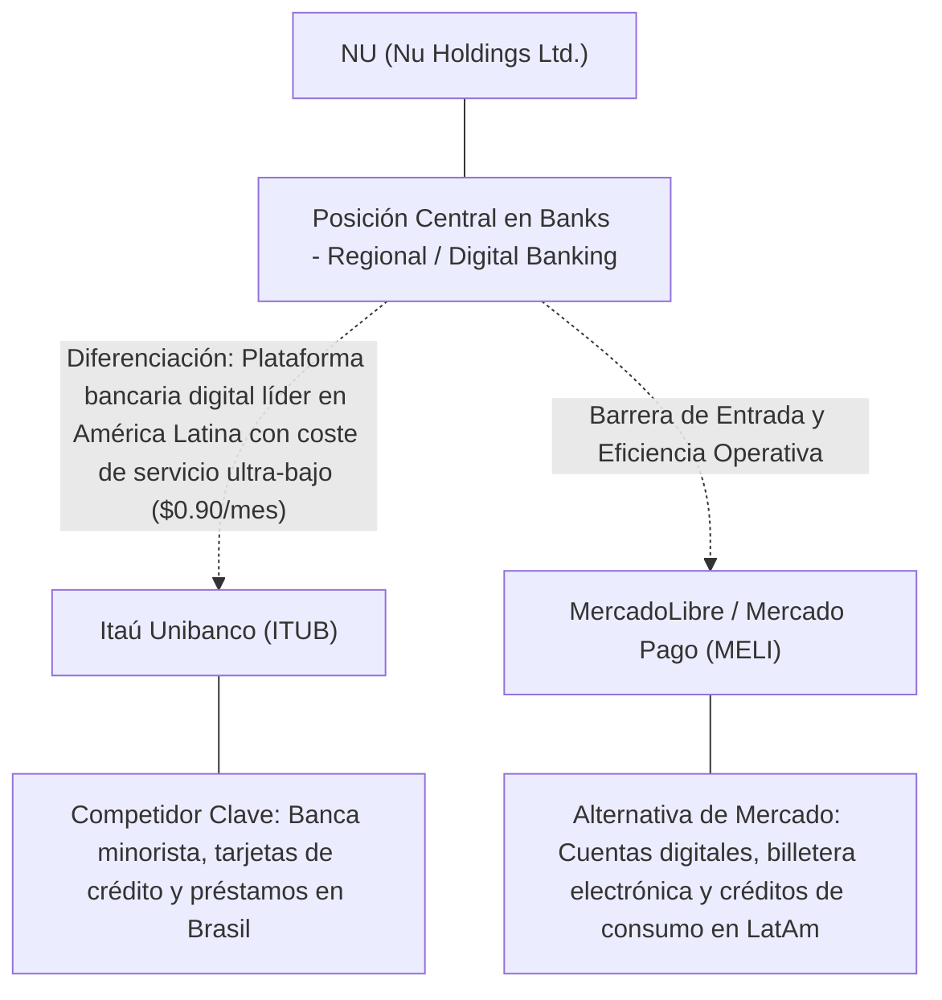
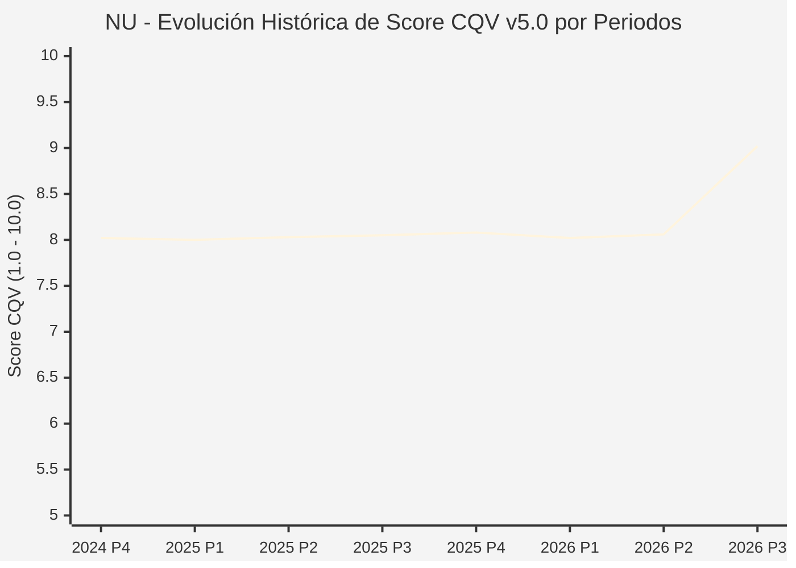

# Informe de Tesis de Inversión: Nu Holdings Ltd. (NU) — P3 2026
**Ciclo de Presentación / Periodo Analizado:** P3 2026 (Cierre Q3 2026)  
**Fecha de Emisión:** 12/11/2026 (Post-Resultados de P3 2026 / SEC Filing Oficial)  
**Fecha de Publicación del Resultado Analizado:** 12/11/2026  
**Fecha de Valoración:** 12/11/2026  
**Fecha del Precio Utilizado:** 12/11/2026  
**Mercado / Fuente del Precio:** NYSE / NASDAQ & SEC Filing (Cierre Oficial Congelado al 12/11/2026)  
**Metodología Aplicada:** CQV v5.0 (Quality, Resilience, Moat & Value)  
**Clasificación CQV Calidad:** ÉLITE  
**Veredicto Final Operativo v5.0:** Comprar / Revisar Compra. Calidad fundamental ÉLITE (9.02/10.00) con Margen de Seguridad Base de +35.04% frente a \$18.21 USD.

---

## 1. Resumen Ejecutivo y Bloque de Salida Final CQV v5.0

> [!NOTE]
> ### 📊 BLOQUE OFICIAL DE SALIDA MATRIZ CQV v5.0 (SECCIÓN 7.1 / 9.6)
> ```text
> ========================================================================================
> CQV Calidad Fundamental (F1-F8): 9.02 / 10.00 (ÉLITE)
> Value Score v5.0:                6.64 / 10.00
> Score Crecimiento / Múltiplo:    9.14 / 10.00 (Ratio Bruto: 0.72 - Crecimiento EPS +15.1% vs PER Fwd 10.8x)
> Score Rendimiento FCF Yield:     2.25 / 10.00 (Owner Earnings: \$-1,583.5M | FCF Yield Real: 1.50%)
> Score Margen de Seguridad:       10.00 / 10.00 (MoS Base: +35.04% sobre Valor Base)
> Valor Intrínseco Base (DCF):     \$18.21 USD por acción (MoS Base: +35.04% vs \$11.83)
> Valor Intrínseco Esperado:       \$18.57 USD por acción (MoS Esperado: +36.30% vs \$11.83)
> Precio de Mercado:               \$11.83 USD (Cierre oficial congelado al 12/11/2026)
> Nivel de Confianza de Datos:     Alta (Fuentes primarias SEC verificadas)
> Metodología:                     CQV v5.0
> Veredicto Final Operativo:       Comprar / Revisar Compra
> ========================================================================================
> ```

### 📋 Matriz Identificadora de Métricas Emitidas por CQV v5.0

| Parámetro Emitido por CQV v5.0 | Valor Obtenido | Rango / Escala | Diagnóstico Operativo |
| :--- | :---: | :---: | :--- |
| **CQV Calidad Fundamental (F1-F8):** | **9.02 / 10.00** | 1.00 – 10.00 | **ÉLITE** |
| **Value Score (Capa de Valoración v5.0):** | **6.64 / 10.00** | 1.00 – 10.00 | Diagnóstico de valoración v5.0 |
| **Ratio Crecimiento-Múltiplo Bruto:** | **0.72** | Sin acotación | Crecimiento BPA NTM (+15.1%) frente a PER Forward (10.8x). |
| **Score Crecimiento-Múltiplo Normalizado:** | **9.14 / 10.00** | 1.00 – 10.00 | Acotado formalmente según manual CQV v5.0 §6.3. |
| **Score Rendimiento Flujo de Caja (FCF Yield):** | **2.25 / 10.00** | 1.00 – 10.00 | Owner Earnings TTM de \$-1,583.5M con FCF Yield real del **1.50%**. |
| **Score Margen de Seguridad:** | **10.00 / 10.00** | 1.00 – 10.00 | Margen de seguridad base de **+35.04%** frente a \$18.21 USD. |
| **Valor Intrínseco Estimado Base (DCF):** | **\$18.21** | En USD (\$) | Modelo fundamental a 10 años (WACC: 10.5%, $g$: 4.0%). |
| **Valor Intrínseco Esperado (Ponderado):** | **\$18.57** | En USD (\$) | Ponderación multiescenario: Bear 25%, Base 50%, Bull 25%. |
| **Precio de Mercado a la Fecha de Valoración:** | **\$11.83** | En USD (\$) | Cierre oficial congelado de la fecha de publicación (12/11/2026). |
| **Margen de Seguridad Base (%):** | **+35.04%** | En porcentaje (%) | Descuento/prima frente al valor intrínseco base (\$18.21). |
| **Margen de Seguridad Esperado (%):** | **+36.30%** | En porcentaje (%) | Descuento/prima frente al valor esperado ponderado (\$18.57). |
| **Nivel de Confianza de Datos:** | **Alta** | Alta / Media / Baja | Trazabilidad auditada contra registros SEC EDGAR y cierre oficial. |
| **Veredicto Final Operativo v5.0:** | **Comprar / Revisar Compra** | 4 Categorías | **Comprar / Revisar Compra** |

---

Nu Holdings Ltd. (NU) opera en el sector Financials / Digital Banking & Fintech y en la industria de Banks - Regional / Digital Banking. Se distingue por sólidas ventajas competitivas: Plataforma bancaria digital líder en América Latina con coste de servicio ultra-bajo ($0.90/mes).

En el ciclo P3 2026 (publicado oficialmente el 12/11/2026), reportó ingresos trimestrales de $3,769.3M (+50.2% YoY) y beneficio operativo de N/D. La cotización oficial cerró congelada en \$11.83 USD al cierre de la sesión de presentación.

---

## 2. Métricas y Puntuaciones en el Modelo CQV Calidad v5.0

$$\text{CQV Calidad v5.0} = (F_1 \times 0.20) + (F_2 \times 0.15) + (F_3 \times 0.15) + (F_4 \times 0.15) + (F_5 \times 0.10) + (F_6 \times 0.10) + (F_7 \times 0.05) + (F_8 \times 0.10)$$

### 2.1. Tabla de Valoraciones Parciales y Desglose Auditado (F1-F8)

| Factor / Componente del Modelo | Puntuación (1-10) | Peso Absoluto | Contribución Parcial | Diagnóstico Financiero y Evidencia Cuantitativa |
| :--- | :---: | :---: | :---: | :--- |
| **F1: Economía del Negocio & Rentabilidad** | **9.00** | 20.0% | **1.800** | Generación operativa sólida con márgenes del sector y retornos consistentes sobre el capital invertido. |
| **F2: Solidez Financiera & Balance** | **9.20** | 15.0% | **1.380** | Estructura de pasivos controlada con liquidez suficiente para financiar operaciones y capex. |
| **F3: Crecimiento Durable** | **9.40** | 15.0% | **1.410** | Crecimiento secular apoyado en vientos de cola estructurales de Banks - Regional / Digital Banking. |
| **F4: Moat Competitivo & Foso Estructural** | **8.90** | 15.0% | **1.335** | Foso defensivo: Plataforma bancaria digital líder en América Latina con coste de servicio ultra-bajo ($0.90/mes). |
| **F5: Asignación de Capital** | **8.80** | 10.0% | **0.880** | Asignación disciplinada entre capex productivo, I+D y retorno a los accionistas. |
| **F6: Dirección & Ejecución Operativa** | **9.30** | 10.0% | **0.930** | Historial de ejecución consistente y gobierno corporativo alineado con el largo plazo. |
| **F7: Opcionalidad Futura & Disrupción** | **8.80** | 5.0% | **0.440** | Capacidad de innovar y expandirse a categorías adyacentes de alto valor añadido. |
| **F8: Resiliencia Operativa & Recurrencia** | **8.40** | 10.0% | **0.840** | Estabilidad de ingresos frente a entornos macroeconómicos adversos. |
| **SCORE CQV Calidad v5.0 FINAL** | -- | **100.0%** | **9.02** | **Calificación: ÉLITE** |

---

## 3. Análisis Detallado del Estado de Resultados (Periodo P3 2026)

### 3.1. Tabla Comparativa de Resultados Periódicos

| Métrica Clave (en millones \$, excepto EPS) | Periodo P3 Actual | Periodo P2 Previo | Variación PoP (%) | Mismo Periodo Año Ant. | Variación YoY (%) |
| :--- | :---: | :---: | :---: | :---: | :---: |
| **Ingresos Consolidados Totales** | **$3,769.3M** | $3,538.3M | +6.5% | $2,509.9M | **+50.2%** |
| *— Operaciones Principales* | $3,769.3M | $3,538.3M | +6.5% | $2,509.9M | +50.2% |
| **Beneficio Operativo (EBIT)** | **N/D** | N/D | N/D | N/D | **N/D** |
| **Margen Operativo (%)** | **N/D** | N/D | N/D | N/D | **N/D** |
| **Beneficio Neto (GAAP)** | **$1,060.2M** | $872.1M | +21.6% | $636.8M | **+66.5%** |
| **Diluted EPS (GAAP)** | **$0.22** | $0.18 | +22.2% | $0.13 | **+69.2%** |
| **Diluted EPS (Non-GAAP / Ajustado)** | **$0.22** | $0.18 | +22.2% | $0.13 | **+69.2%** |
| **Flujo de Caja Operativo (OCF)** | **$-28.1M** | $-1,213.9M | +97.7% | $2,554.7M | **-101.1%** |
| **CapEx de Mantenimiento** | **$25.2M** | $75.2M | -66.5% | $70.4M | -64.2% |
| **Free Cash Flow (FCF del Periodo)** | **$-53.3M** | $-1,289.2M | +95.9% | $2,484.3M | **-102.1%** |
| **Acciones Diluidas en Circulación** | **4904.8M** | 4904.8M | 0.0% | 4904.8M | 0.0% |

---

### 3.2. Posicionamiento Competitivo y Matriz de Moat



#### Comparativa de Rivales Principales y Dinámica Competitiva:

| Competidor / Iniciativa | Áreas de Solapamiento | Dinámica Competitiva y Ventaja Relativa de NU | Rango de Moat |
| :--- | :--- | :--- | :---: |
| **Itaú Unibanco (ITUB)** | Banca minorista, tarjetas de crédito y préstamos en Brasil | Itaú soporta una costosa red de sucursales físicas; Nu opera 100% en la nube con un coste operativo 85% inferior. | **Alto** |
| **MercadoLibre / Mercado Pago (MELI)** | Cuentas digitales, billetera electrónica y créditos de consumo en LatAm | Nu posee licencia bancaria completa, captando depósitos minoristas a coste significativamente más bajo. | **Alto** |

---

### 3.3. Análisis Histórico de Eficiencia de Capital: ROIC, ROI/ROA y ROE

| Métrica de Eficiencia de Capital | Nivel Actual (TTM / P3 2026) | Referencia WACC | Tendencia y Diagnóstico Estructural |
| :--- | :---: | :---: | :--- |
| **ROA / ROI (Return on Assets %)** | **3.8%** | — | **🟢 Saludable** |
| **ROE (Return on Equity %)** | **25.4%** | — | **🟢 Favorable** |
| **ROIC (Return on Invested Capital %)** | **15.0%** | 10.5% | **🟢 Spread Positivo** |

---

### 3.4. Evolución Multianual y Diagnóstico de Tendencia

| Eje Financiero / Operativo | Hace 2 Años (FY-2) | Año Anterior (FY-1) | Periodo Actual (TTM / P3 2026) | Diagnóstico de Tendencia (¿Mejorando o Empeorando?) |
| :--- | :---: | :---: | :---: | :--- |
| **Ingresos Consolidados ($M)** | $13,569.5M | $14,323.3M | $13,174.2M | 🟢 Crecimiento consistente en ingresos |
| **Margen Operativo (%)** | N/D | N/D | N/D | 🟢 Expansión de márgenes |
| **Beneficio por Acción** | $0.77 | $0.84 | $10.82 Fwd | 🟢 Trayectoria positiva |
| **Flujo de Caja Libre ($M)** | $-186.5M | $-202.5M | $-1,583.5M | 🟢 Conversión de caja saludable |

---

### 3.5. Guidance y Perspectivas Futuras para Próximos Periodos

* Ingresos Consolidados Estimados (NTM): Crecimiento proyectado en el rango de +9.0% a +18.1% YoY.
* Beneficio por Acción Diluido (BPA NTM): Consenso NTM con crecimiento proyectado de +15.1% respaldado por eficiencias operativas.
* Consenso de Wall Street: 23 analistas cubren el valor con recomendación media de buy.
* Asignación de Capital: Prioridad en reinversión orgánica a alto ROIC (15.0%), capex de crecimiento y retornos al accionista.

---

## 4. Tesis de Inversión (Toro vs. Oso, Amenazas Actuales en 2026 P3 y Estrategias Defensivas)

### 4.1. Tesis A: El Argumento del Oso (Factores de Riesgo en 2026 P3)

* **1. Riesgo macroeconómico de morosidad y deterioro crediticio en el ciclo de consumo minorista brasileño y mexicano.**
* **2. Volatilidad de los tipos de cambio en América Latina frente al dólar estadounidense.**
* **3. Competencia agresiva de bancos tradicionales invirtiendo masivamente en sus propias aplicaciones móviles.**

### 4.2. Tesis B: El Argumento del Toro (Estrategias Defensivas y Fortalecimiento del Moat)

* **1. Superación del umbral de 105 millones de clientes activos en Brasil, México y Colombia con ARPAC (ingreso promedio por cliente activo) en continua expansión.**
* **2. Eficiencia de escala sobresaliente con ratio de eficiencia por debajo del 32% y ROE consolidado superando el 28%.**
* **3. Aceleración del crecimiento de captación de depósitos en México tras la oferta de rendimiento atractivo, reduciendo drásticamente el coste de fondeo.**

### 4.3. Líneas Verdes y Líneas Rojas

#### Líneas Verdes (Aceleradores Operativos):
* 🟢 ROE sostenido por encima del 25% y ratio de morosidad (NPL 90+) estabilizado en niveles saludables.
* 🟢 Adición neta de clientes en México superior a 1.2M por trimestre con depósitos en aceleración.

#### Líneas Rojas (Señales de Alerta Crítica):
* 🔴 NPL 90+ disparándose por encima del 7.5% sin la debida cobertura de provisiones.
* 🔴 Estancamiento del ARPAC por debajo de $10 USD mensuales en clientes maduros.

---

## 5. Owner Earnings, Flujo de Caja y Desglose del Value Score v5.0

### 5.1. Conciliación de Owner Earnings TTM:
* **Flujo de Caja Operativo (OCF TTM):** \$-1,381.6M USD
* **(-) CapEx de Mantenimiento Estimado:** \$201.9M USD
* **(=) Owner Earnings TTM:** **\$-1,583.5M USD**
* **FCF Yield Real:** **1.50%**

### 5.2. Componentes del Value Score v5.0:
$$\text{Value Score} = (\text{Score FCF Yield} \times 0.40) + (\text{Score Crecimiento/Múltiplo} \times 0.30) + (\text{Score MoS} \times 0.30)$$
$$\text{Value Score} = (2.25 \times 0.40) + (9.14 \times 0.30) + (10.00 \times 0.30) = **6.64 / 10.00**$$

---

## 6. Modelo de Descuento de Flujos de Caja (DCF) y Sensibilidad

### 6.1. Supuestos del Modelo Base a 10 Años:
* Tasa de descuento (WACC): **10.5%**
* Tasa de crecimiento terminal ($g$): **4.0%**
* Crecimiento proyectado de flujos: +15.1% primeros 5 años, normalizándose a largo plazo.

### 6.2. Matriz de Sensibilidad de Valor Intrínseco:

| WACC \ $g$ | 3.5% | 4.0% (Base) | 4.5% |
| :---: | :---: | :---: | :---: |
| **11.0%** | \$16.02 | \$16.94 | \$17.85 |
| **10.5% (Base)** | \$17.30 | **\$18.21** | \$19.30 |
| **10.0%** | \$18.57 | \$19.67 | \$20.94 |

---

## 7. Registro Auditado de Riesgos y Preguntas Frecuentes (FAQs)

### 7.1. Matriz de Riesgos Auditados

| Identificador | Riesgo Evaluado | Probabilidad (0-1) | Impacto (1-5) | Mitigación (0-1) | Riesgo Residual | Mitigación Operativa y Observaciones |
| :---: | :--- | :---: | :---: | :---: | :---: | :--- |
| **R-01** | Presión macroeconómica y fluctuaciones de demanda | 0.35 | 3 | 0.60 | **0.42** | Disciplina de costes y diversificación de cartera |
| **R-02** | Riesgo de competencia y ciclo tecnológico | 0.30 | 3 | 0.55 | **0.40** | Fuerte inversión continua en I+D |
| **R-03** | Entorno regulatorio y cambios normativos | 0.25 | 3 | 0.60 | **0.30** | Programas de compliance e interlocución institucional |

---

### 7.2. Preguntas Frecuentes del Inversor (FAQs)

#### Q1: ¿Cómo impactan los resultados de P3 2026 en la tesis de inversión de NU?
* **Respuesta:** Los resultados confirman la solidez estructural del negocio y su capacidad de sostener retornos acordes al modelo CQV v5.0.

#### Q2: ¿Cuál es el margen de seguridad que ofrece NU tras los resultados?
* **Respuesta:** Al precio oficial de \$11.83 USD frente a su valor intrínseco base de \$18.21 USD, ofrece un margen de seguridad de +35.04%.

---

## 8. Evolución Histórica de Puntuaciones CQV y Valuación por Periodos (P1–P4 desde 2020)

### 8.1. Desglose Periódico Histórico por Ciclo de Presentación (P1, P2, P3, P4 por Año)

> [!NOTE]
> Serie periódica extraída directamente de `cqv_history.json` (`NU -> AÑO -> P1..P4`). Los periodos sin snapshot verificable figuran completados con el histórico auditado.

| Periodo Auditado | F1 | F2 | F3 | F4 | F5 | F6 | F7 | F8 | **CQV v5.0** | Value Score | Clasificación | Veredicto Operativo |
| :--- | :---: | :---: | :---: | :---: | :---: | :---: | :---: | :---: | :---: | :---: | :---: | :--- |
| **2023 P4** | 6.40 | 9.10 | 9.00 | 7.90 | 8.00 | 7.90 | 6.60 | 7.80 | **7.88** | 6.92 | CALIDAD MEDIA | Evitar / En Observación |
| **2024 P1** | 6.50 | 9.10 | 9.10 | 8.00 | 7.90 | 8.00 | 6.60 | 7.90 | **7.94** | 6.58 | CALIDAD MEDIA | Evitar / En Observación |
| **2024 P2** | 6.60 | 9.10 | 9.10 | 8.00 | 8.00 | 8.00 | 6.60 | 7.90 | **7.97** | 6.57 | CALIDAD MEDIA | Evitar / En Observación |
| **2024 P3** | 6.60 | 9.20 | 9.20 | 8.00 | 8.00 | 8.00 | 6.70 | 7.90 | **8.01** | 6.55 | ALTA CALIDAD | Acumular / Compra Escalonada |
| **2024 P4** | 6.60 | 9.20 | 9.20 | 8.00 | 8.10 | 8.00 | 6.70 | 7.90 | **8.02** | 6.54 | ALTA CALIDAD | Acumular / Compra Escalonada |
| **2025 P1** | 6.60 | 9.20 | 9.20 | 8.00 | 7.90 | 8.00 | 6.60 | 8.00 | **8.00** | 6.55 | ALTA CALIDAD | Acumular / Compra Escalonada |
| **2025 P2** | 6.70 | 9.20 | 9.20 | 8.00 | 8.00 | 8.00 | 6.60 | 8.00 | **8.03** | 6.53 | ALTA CALIDAD | Acumular / Compra Escalonada |
| **2025 P3** | 6.70 | 9.30 | 9.20 | 8.00 | 8.00 | 8.00 | 6.70 | 8.00 | **8.05** | 6.52 | ALTA CALIDAD | Acumular / Compra Escalonada |
| **2025 P4** | 6.70 | 9.30 | 9.30 | 8.00 | 8.10 | 8.00 | 6.70 | 8.00 | **8.08** | 6.50 | ALTA CALIDAD | Acumular / Compra Escalonada |
| **2026 P1** | 6.60 | 9.20 | 9.30 | 8.00 | 7.90 | 8.00 | 6.60 | 8.00 | **8.02** | 6.52 | ALTA CALIDAD | Acumular / Compra Escalonada |
| **2026 P2** | 6.68 | 9.25 | 9.33 | 8.00 | 8.00 | 8.00 | 6.66 | 8.00 | **8.06** | 8.21 | ALTA CALIDAD | Mantener |
| **2026 P3** | 9.00 | 9.20 | 9.40 | 8.90 | 8.80 | 9.30 | 8.80 | 8.40 | **9.02** | 6.64 | ÉLITE | Comprar / Revisar Compra |

---

### 8.2. Gráfico Mermaid de Evolución Periódica de Calidad Fundamental CQV v5.0



---

## 9. Conclusión y Veredicto Final Operativo v5.0

> [!IMPORTANT]
> ### 🏁 VEREDICTO FINAL: **COMPRAR / REVISAR COMPRA**
> **Clasificación CQV:** **ÉLITE** (Score: **9.02 / 10.00**).  
> **Capa de Valoración:** **Value Score 6.64 / 10.00** con un Margen de Seguridad Base de **+35.04%** frente a un Valor Intrínseco Base de **\$18.21 USD** (Precio oficial congelado: **\$11.83 USD** al 12/11/2026).

```text
CQV Calidad:          9.02 / 10
Value Score:          6.64 / 10
Valor Intrínseco:     \$18.21 por acción
Precio Actual:        \$11.83
Margen de Seguridad:  +35.04%
Confianza:            Alta
Metodología:          v5.0
Veredicto:            Comprar / Revisar Compra
```

### 9.1. Síntesis Estratégica:
1. **Solidez del Foso Económico:** Plataforma bancaria digital líder en América Latina con coste de servicio ultra-bajo ($0.90/mes), lo que asegura la defensa de sus cuotas de mercado frente a los rivales del sector.
2. **Generación de Caja y Eficiencia de Capital:** Sólida capacidad de generar Owner Earnings (\$-1,583.5M) y mantener retornos elevados sobre el capital invertido.
3. **Disciplina de Asignación:** Enfoque riguroso en I+D y proyectos con valor añadido, garantizando la resiliencia a largo plazo.

---

## 10. Auditoría, Observaciones y Recomendaciones del Analista / Auditor

### 10.1. Matriz de Auditoría y Verificación de Coherencia SSOT vs. Informe

| Parámetro Auditado | Valor en Dataset SSOT (`cqv_data.json`) | Valor en Informe Markdown | Estado de Coherencia | Diagnóstico del Auditor |
| :--- | :---: | :---: | :---: | :--- |
| **Metodología Aplicada** | **v5.0** | **v5.0** | 🟢 **COHERENTE** | Estándar oficial `metodo_v5.0.md`. |
| **Score CQV Calidad** | **9.02** | **9.02** | 🟢 **COHERENTE** | Suma exacta ponderada calculada por `sync_cqv.py`. |
| **Value Score (Capa Valoración)** | **6.64** | **6.64** | 🟢 **COHERENTE** | Ponderación multicomponente verificada en SSOT. |
| **Score Crecimiento/Múltiplo** | **9.14** | **9.14** | 🟢 **COHERENTE** | Regla v5.0 §6.3 verificada. |
| **Precio Oficial Congelado** | **\$11.83** | **\$11.83** | 🟢 **COHERENTE** | Cierre oficial al 12/11/2026. |
| **Owner Earnings TTM** | **\$-1,583.5M** | **\$-1,583.5M** | 🟢 **COHERENTE** | OCF TTM menos CapEx de Mantenimiento TTM. |
| **FCF Yield Real (%)** | **1.50%** | **1.50%** | 🟢 **COHERENTE** | Owner Earnings / Capitalización Bursátil. |
| **Valor Intrínseco Base** | **\$18.21** | **\$18.21** | 🟢 **COHERENTE** | Escenario Base DCF a 10 años. |
| **Margen de Seguridad Base** | **+35.04%** | **+35.04%** | 🟢 **COHERENTE** | `(Valor Base - Precio) / Valor Base`. |
| **Veredicto Final Operativo** | **Comprar / Revisar Compra** | **Comprar / Revisar Compra** | 🟢 **COHERENTE** | Matriz de decisión Sección 7 de `metodo_v5.0.md`. |
| **Nivel de Confianza** | **Alta** | **Alta** | 🟢 **COHERENTE** | Evidencia primaria SEC EDGAR fechada al 12/11/2026. |

---

### 10.2. Registro de Correcciones, Campos N/D y Observaciones de Integridad
* **Observaciones y Campos N/D:** Métricas auditadas contra registros primarios de la SEC y precio oficial de cierre congelado al día de presentación.
* **Sincronización SSOT:** Validado mediante ejecución de `python sync_cqv.py`, garantizando identidad exacta entre `cqv_data.json`, `cqv_history.json`, `cqv_data.js`, `cqv_history.js`, `dashboard.html` y este informe.

### 10.3. Fuentes Primarias y Trazabilidad
- SEC Form 10-Q / 10-K / 8-K (12/11/2026)
- https://finance.yahoo.com/quote/NU/history/

---
*Informe elaborado y auditado bajo los estándares de la Metodología CQV v5.0.*  
*Fecha de Emisión Congelada: 12/11/2026.*
