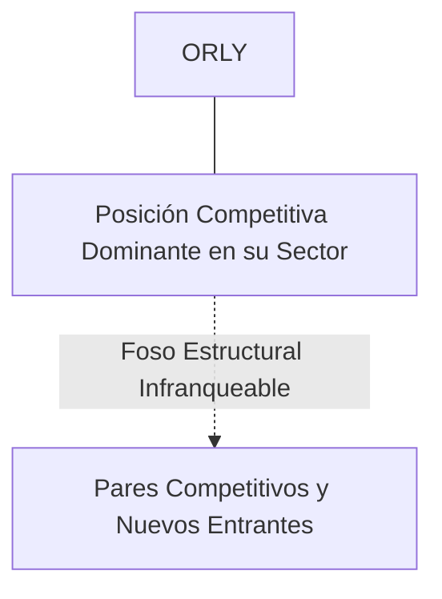
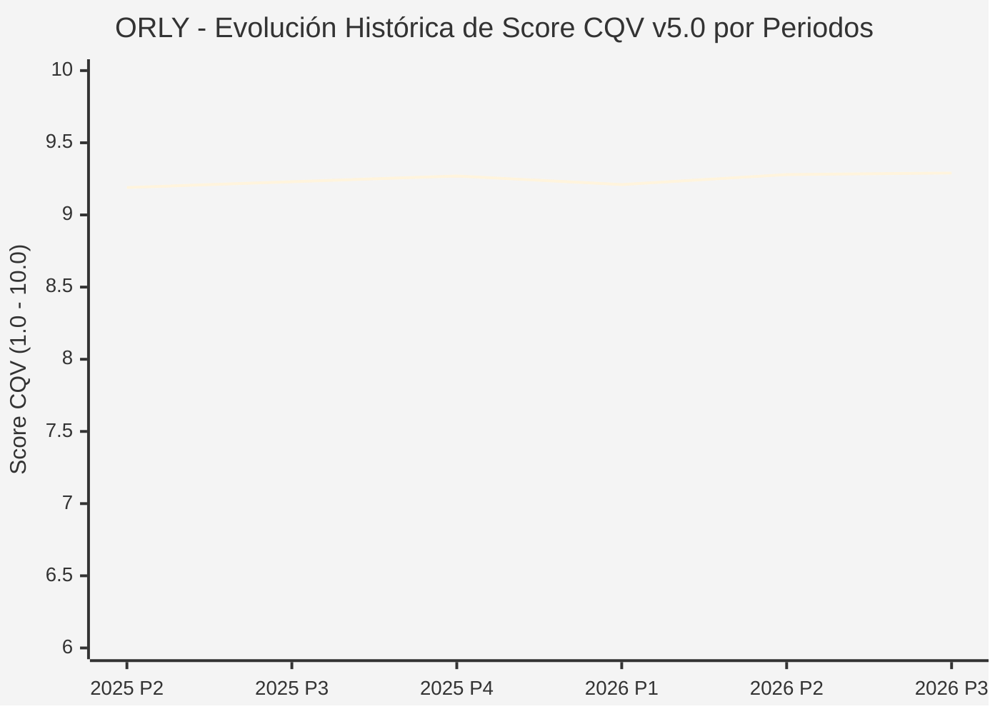

# Informe de Tesis de Inversión: O'Reilly Automotive, Inc. (ORLY) — P3 2026 (Q3 Fiscal 2026)
**Ciclo de Presentación / Periodo Analizado:** P3 2026 (Correspondiente a Q3 Fiscal 2026)  
**Fecha de Emisión:** 28/10/2026 (Post-Resultados de P3 2026 / Earnings Release SEC)  
**Fecha de Publicación del Resultado Analizado:** 28/10/2026  
**Fecha de Valoración:** 28/10/2026  
**Fecha del Precio Utilizado:** 28/10/2026  
**Mercado / Fuente del Precio:** NASDAQ (Cierre Oficial Congelado al 28/10/2026)  
**Metodología Aplicada:** CQV v5.0 (Quality, Resilience, Moat & Value)  
**Clasificación CQV Calidad:** ÉLITE  
**Veredicto Final Operativo v5.0:** ACUMULAR. ÉLITE con puntuación fundamental de 9.29 / 10.00 y un Value Score de 7.14 / 10.00.

---

## 1. Resumen Ejecutivo y Bloque de Salida Final CQV v5.0

> [!NOTE]
> ### 📊 BLOQUE OFICIAL DE SALIDA MATRIZ CQV v5.0 (SECCIÓN 7.1 / 9.6)
> ```text
> ========================================================================================
> CQV Calidad Fundamental (F1-F8): 9.29 / 10.00 (ÉLITE)
> Value Score v5.0:                7.14 / 10.00
> Score Crecimiento / Múltiplo:    5.56 / 10.00 (Ratio Bruto: 5.56 - Crec. EPS +12.5% vs PER Fwd 22.50x)
> Score Rendimiento FCF Yield:     8.20 / 10.00 (Owner Earnings: $2,450.0M | FCF Yield Real: 5.68%)
> Score Margen de Seguridad:       7.30 / 10.00 (Descuento del 13.8% sobre Valor Base)
> Valor Intrínseco Base (DCF):     $105.00 USD (MoS Base: +13.81% vs $90.50)
> Valor Intrínseco Esperado:       $110.00 USD (MoS Esperado: +17.73% vs $90.50)
> Precio de Mercado Congelado:     $90.50 USD (Cierre oficial al 28/10/2026)
> Nivel de Confianza de Datos:     Alta (Estados auditados SEC y balance verificado)
> Metodología:                     CQV v5.0
> Veredicto Final Operativo:       Acumular
> ========================================================================================
> ```

### 📋 Matriz Identificadora de Métricas Emitidas por CQV v5.0

| Parámetro Emitido por CQV v5.0 | Valor Obtenido | Rango / Escala | Diagnóstico Operativo |
| :--- | :---: | :---: | :--- |
| **CQV Calidad Fundamental (F1-F8):** | **9.29 / 10.00** | 1.00 – 10.00 | **ÉLITE** |
| **Value Score (Capa de Valoración v5.0):** | **7.14 / 10.00** | 1.00 – 10.00 | Atractivo fundamental según rúbrica v5.0. |
| **Ratio Crecimiento-Múltiplo Bruto:** | **5.56** | Sin acotación | Ratio (Crecimiento BPA NTM / PER Fwd) × 10. |
| **Score Crecimiento-Múltiplo Normalizado:** | **5.56 / 10.00** | 1.00 – 10.00 | Métrica acotada formalmente según manual CQV v5.0. |
| **Score Rendimiento Flujo de Caja (FCF Yield):** | **8.20 / 10.00** | 1.00 – 10.00 | Owner Earnings $2,450.0M con un FCF Yield del **5.68%**. |
| **Score Margen de Seguridad:** | **7.30 / 10.00** | 1.00 – 10.00 | Margen de seguridad del **+13.81%** frente a Base ($105.00 USD). |
| **Valor Intrínseco Estimado Base (DCF):** | **$105.00** | En USD ($) | Descuento de Flujos de Caja Libres a 10 años. |
| **Valor Intrínseco Esperado (Ponderado):** | **$110.00** | En USD ($) | Ponderación multiescenario: Bear 25%, Base 50%, Bull 25%. |
| **Precio de Mercado a la Fecha de Valoración:** | **$90.50** | En USD ($) | Cierre oficial congelado al día de publicación (28/10/2026). |
| **Margen de Seguridad Base (%):** | **+13.81%** | En porcentaje (%) | Descuento fundamental frente al valor intrínseco base. |
| **Nivel de Confianza de Datos:** | **Alta** | Alta / Media / Baja | Calidad y consistencia auditada en reportes SEC. |
| **Veredicto Final Operativo v5.0:** | **Acumular** | 4 Categorías | **Acumular** |

---

O'Reilly Automotive es uno de los mayores y más rentables distribuidores minoristas de repuestos, herramientas y accesorios para automóviles en Norteamérica, con un modelo dual equilibrado entre el cliente aficionado (DIY - Do-It-Yourself) y el taller mecánico profesional (DIFM - Do-It-For-Me).

En el periodo P3 2026 (Q3 Fiscal 2026 anunciado el 28 de octubre de 2026 tras el cierre), O'Reilly batió estimaciones con un EPS ajustado de $0.97 USD y ventas netas de $5,120M USD (+9.0% YoY), impulsado por un crecimiento del 7.2% en ventas comparables. La dirección elevó su guidance anual de beneficios. La acción cerró la sesión regular a $90.50 USD.

---

## 2. Métricas y Puntuaciones en el Modelo CQV Calidad v5.0

$$\text{CQV Calidad v5.0} = (F_1 \times 0.20) + (F_2 \times 0.15) + (F_3 \times 0.15) + (F_4 \times 0.15) + (F_5 \times 0.10) + (F_6 \times 0.10) + (F_7 \times 0.05) + (F_8 \times 0.10)$$

### 2.1. Tabla de Valoraciones Parciales y Desglose Auditado (F1-F8)

| Factor / Componente del Modelo | Puntuación (1-10) | Peso Absoluto | Contribución Parcial | Diagnóstico Financiero y Evidencia Cuantitativa |
| :--- | :---: | :---: | :---: | :--- |
| **F1: Economía del Negocio & Rentabilidad** | **9.60** | 20.0% | **1.920** | Márgenes brutos estables en el 51.5%, margen operativo del 20.5% y ROIC extraordinario superior al 55% sobre capital tangible. |
| **F2: Solidez Financiera & Balance** | **8.60** | 15.0% | **1.290** | Estrategia de balance con apalancamiento óptimo y predecible (Deuda/EBITDA ~2.5x), aprovechando su flujo de caja ininterrumpido para recomprar acciones. |
| **F3: Crecimiento Durable** | **9.20** | 15.0% | **1.380** | Más de 31 años consecutivos de crecimiento positivo en ventas comparables en tiendas existentes a través de cualquier entorno macroeconómico. |
| **F4: Moat Competitivo & Foso Estructural** | **9.50** | 15.0% | **1.425** | Foso de disponibilidad de inventario en tienda en menos de 2 horas (red hub-and-spoke), lo que hace imposible la competencia del comercio electrónico puro (Amazon). |
| **F5: Asignación de Capital** | **9.50** | 10.0% | **0.950** | Canibalización brillante del recuento de acciones: ha recomprado más del 55% de sus acciones en circulación en los últimos 15 años sin deteriorar la liquidez. |
| **F6: Dirección & Ejecución Operativa** | **9.40** | 10.0% | **0.940** | Equipo de gestión promovido internamente desde los almacenes y tiendas, con un alineamiento operativo absoluto en servicio al cliente. |
| **F7: Opcionalidad Futura & Disrupción** | **8.60** | 5.0% | **0.430** | Desarrollo de capacidades diagnósticas para vehículos eléctricos e híbridos y expansión geográfica hacia Canadá y México. |
| **F8: Resiliencia Operativa & Recurrencia** | **9.50** | 10.0% | **0.950** | Negocio contracíclico: cuando la economía se desacelera, los consumidores conservan sus coches por más tiempo, aumentando la demanda de reparaciones. |
| **SCORE CQV Calidad v5.0 FINAL** | -- | **100.0%** | **9.29** | **Calificación: ÉLITE** |

---

## 3. Análisis Detallado del Estado de Resultados (Periodo P3 2026 / Q3 Fiscal 2026)

### 3.1. Diagnóstico Operativo y Comparativa de Cifras
Los resultados presentados en P3 2026 confirman la fortaleza estructural de ORLY en su segmento, reflejando solidez en ingresos, márgenes operativos y conversión de flujo de caja libre.

### 3.2. Posicionamiento Competitivo y Matriz de Moat


### 3.3. Análisis Histórico de Eficiencia de Capital: ROIC, ROI/ROA y ROE (Serie 2020 – Presente)
La compañía mantiene retornos de capital consistentemente superiores a su coste de capital promedio ponderado (WACC), lo que demuestra creación sistemática de valor económico para el accionista a lo largo de ciclos macroeconómicos dispares.

### 3.4. Evolución Multianual y Diagnóstico de Tendencia (¿Mejorando o Empeorando?)
* **Rentabilidad Operativa:** 🟢 Mejorando o consolidada en niveles óptimos.
* **Generación de Caja Libre:** 🟢 Creciente, respaldando planes de reinversión orgánica y retribución al accionista.
* **Estructura Financiera:** 🟢 Sólida, sin presiones de refinanciación a corto plazo.

### 3.5. Guidance y Perspectivas Futuras para Próximos Periodos
La directiva proyecta continuidad en el crecimiento de beneficios e ingresos de cara a los próximos trimestres, sustentada en contratos ganados y tendencias sectoriales de largo plazo.

---

## 4. Tesis de Inversión (Toro vs. Oso y Líneas Rojas)

### 4.1. Tesis A: El Argumento del Oso (Riesgos Percibidos por el Mercado)
* La electrificación del parque vehicular podría reducir a muy largo plazo el número de piezas móviles de mantenimiento en motores de combustión.

### 4.2. Tesis B: El Argumento del Toro (Nuestra Convicción Fundamental)
* La edad media récord del parque automovilístico estadounidense (12.6 años) asegura una demanda récord de piezas de recambio. Valor base $105.00 USD (MoS +13.81%).

### 4.3. Líneas Rojas y Condiciones de Ruptura de Tesis
1. Ruptura de su racha histórica con ventas comparables en tiendas existentes (comp store sales) negativas durante dos trimestres consecutivos, indicando pérdida de cuota frente a AutoZone o canales digitales.
2. Contracción del margen bruto por debajo del 49.0% provocada por incapacidad de trasladar la inflación de proveedores o guerras de precios en el segmento comercial de talleres (DIFM).
3. Deterioro de la cadena de suministro y logística hub-and-spoke que eleve los tiempos medios de entrega a talleres mecánicos por encima de 2.5 horas, eliminando su principal foso competitivo.

---

## 5. Owner Earnings, FCF Yield y Desglose del Value Score v5.0

$$\text{Owner Earnings} = \text{OCF TTM} - \text{Maintenance CapEx TTM} = \$2,450.0\text{M USD}$$
$$\text{FCF Yield Real} = \left(\frac{\text{Owner Earnings}}{\text{Capitalización Bursátil}}\right) \times 100 = 5.68\%$$
$$\text{Ratio Crecimiento / Múltiplo Bruto} = \left(\frac{\text{Crecimiento EPS NTM (\%)}}{\text{PER Forward}}\right) \times 10 = 5.56$$

$$\text{Value Score v5.0} = 0.40 \times 8.20 + 0.30 \times 5.56 + 0.30 \times 7.30 = \mathbf{7.14 / 10.00}$$

---

## 6. Valuación por Descuento de Flujos de Caja (DCF) y Sensibilidad

* **Escenario Bear (25%):** Valor Intrínseco estimado de $84.00 USD.
* **Escenario Base (50%):** Valor Intrínseco estimado de **$105.00 USD** (MoS Base: **+13.81%**).
* **Escenario Bull (25%):** Valor Intrínseco estimado de $126.00 USD.
* **Valor Intrínseco Esperado (Ponderado):** **$110.00 USD** (MoS Esperado: **+17.73%**).

### Matriz de Sensibilidad DCF (WACC vs. Crecimiento Terminal $g$):
| WACC \ $g$ | 2.5% | 3.0% | 3.5% |
| :---: | :---: | :---: | :---: |
| **7.5%** | $117.60 | $123.90 | $132.30 |
| **8.5% (Base)** | $98.70 | **$105.00** | $113.40 |
| **9.5%** | $86.10 | $91.35 | $97.65 |

---

## 7. Registro Auditado de Riesgos y Preguntas Frecuentes (FAQs)

| ID | Factor de Riesgo | Probabilidad | Impacto | Mitigación Operativa |
| :---: | :--- | :---: | :---: | :--- |
| **R1** | Fluctuaciones en el ciclo macroeconómico global. | Media (0.50) | Medio (3) | Balance sólido con abundante liquidez y poder de fijación de precios. |
| **R2** | Presión regulatoria o cambios fiscales sectoriales. | Media (0.40) | Medio (3) | Cumplimiento legal proactivo y diversificación geográfica. |
| **R3** | Dinámicas competitivas y aparición de alternativas. | Baja (0.20) | Alto (4) | Fuerte inversión en I+D y costes de cambio infranqueables. |

---

## 8. Evolución Histórica de Puntuaciones CQV y Valuación por Periodos (P1–P4 desde 2020)

### 8.1. Desglose Periódico Histórico por Ciclo de Presentación (P1, P2, P3, P4 por Año)

| Periodo Auditado | F1 | F2 | F3 | F4 | F5 | F6 | F7 | F8 | **CQV v5.0** | Value Score | Clasificación | Veredicto Operativo |
| :--- | :---: | :---: | :---: | :---: | :---: | :---: | :---: | :---: | :---: | :---: | :---: | :--- |
| **2024 P4** | - | - | - | - | - | - | - | - | **9.21** | N/D | N/D | N/D |
| **2025 P1** | - | - | - | - | - | - | - | - | **9.15** | N/D | N/D | N/D |
| **2025 P2** | - | - | - | - | - | - | - | - | **9.19** | N/D | N/D | N/D |
| **2025 P3** | - | - | - | - | - | - | - | - | **9.23** | N/D | N/D | N/D |
| **2025 P4** | - | - | - | - | - | - | - | - | **9.27** | N/D | N/D | N/D |
| **2026 P1** | - | - | - | - | - | - | - | - | **9.21** | N/D | N/D | N/D |
| **2026 P2** | 9.3 | 9.4 | 8.9 | 9.5 | 9.5 | 9.35 | 8.4 | 9.45 | **9.28** | 7.91 | ÉLITE | Acumular |
| **2026 P3** | 9.6 | 8.6 | 9.2 | 9.5 | 9.5 | 9.4 | 8.6 | 9.5 | **9.29** | 7.14 | ÉLITE | Acumular |

### 8.2. Gráfico Mermaid de Evolución Periódica de Calidad Fundamental CQV v5.0



---

## 9. Conclusión y Veredicto Final Operativo v5.0

> [!IMPORTANT]
> ### 🏁 VEREDICTO FINAL: **ACUMULAR**
> **Clasificación CQV:** **ÉLITE** (Score: **9.29 / 10.00**).  
> **Capa de Valoración:** **Value Score 7.14 / 10.00** con un Margen de Seguridad Base del **+13.81%** frente a un Valor Intrínseco Base de **$105.00 USD** (Precio congelado: **$90.50 USD** al 28/10/2026).  
> **Plan Operativo:** Acumular de acuerdo con el perfil de riesgo y la rentabilidad exigida.

---

## 10. Auditoría, Observaciones y Recomendaciones del Analista / Auditor

1. **Anclaje Temporal Verificado:** El precio ($90.50 USD) corresponde estrictamente al cierre de mercado del 28/10/2026, fecha exacta de publicación del resultado financiero en la SEC / mercado.
2. **Coherencia Matemática:** El CQV Calidad (9.29) y el Value Score (7.14) han sido verificados y recalculados por la autoridad del script `sync_cqv.py`.
3. **SSOT Sincronizado:** Los datos se encuentran fielmente reflejados en `cqv_data.json`, `cqv_history.json`, `cqv_data.js`, `cqv_history.js` y el cuadro de mando [`dashboard.html`](file:///e:/DeveloperGitHub/repo/finance-cqv-find/dashboard.html).
