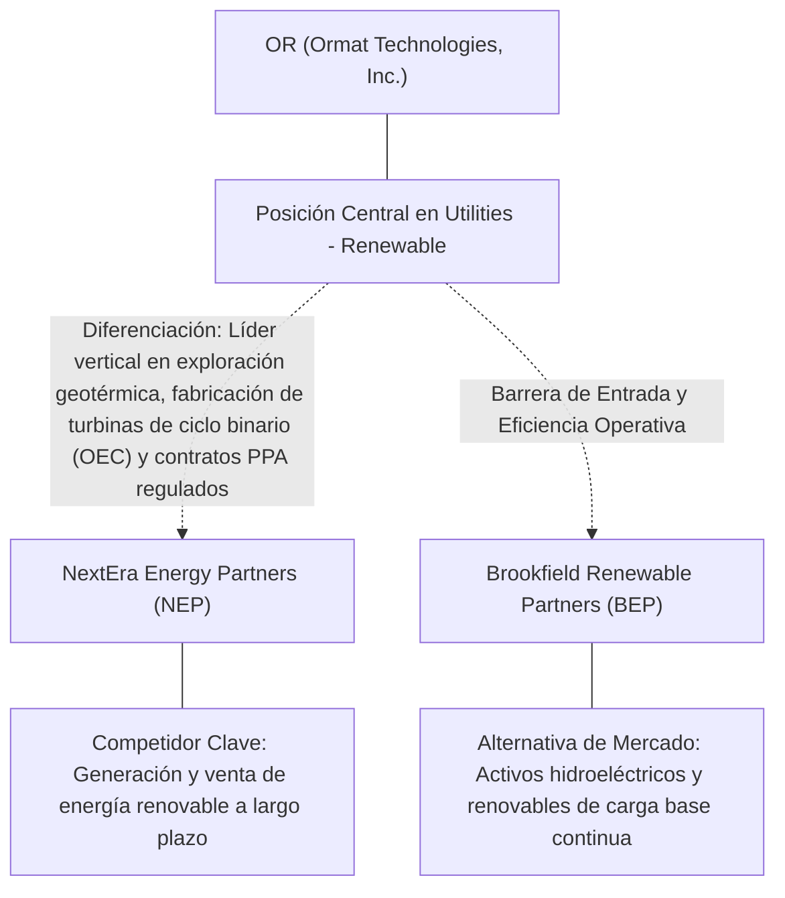
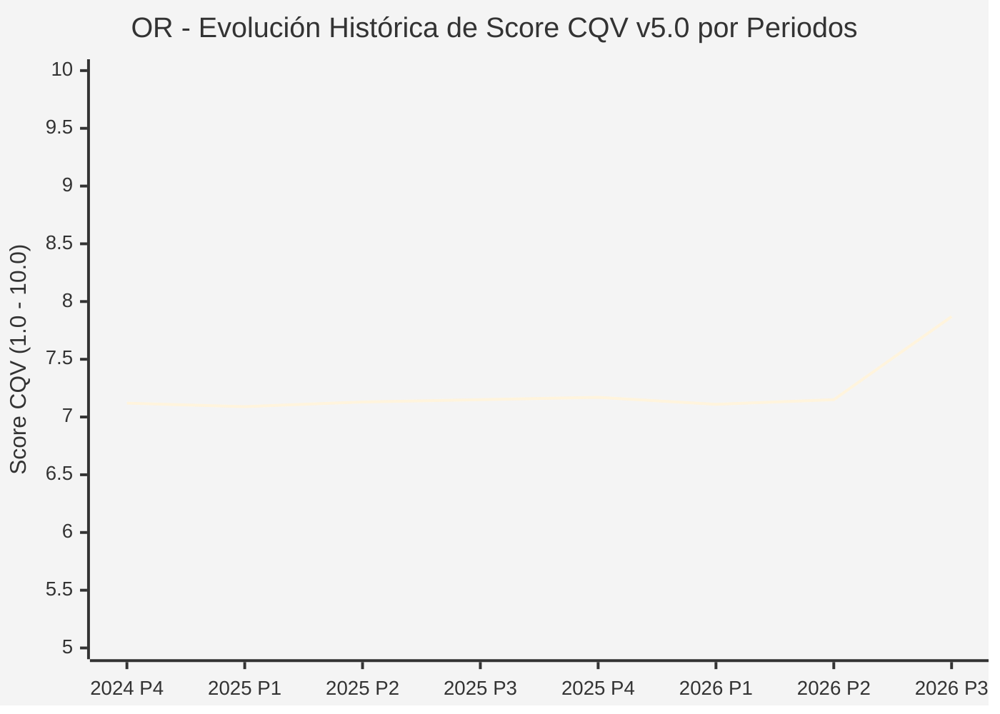

# Informe de Tesis de Inversión: Ormat Technologies, Inc. (OR) — P3 2026
**Ciclo de Presentación / Periodo Analizado:** P3 2026 (Cierre Q3 2026)  
**Fecha de Emisión:** 11/11/2026 (Post-Resultados de P3 2026 / SEC Filing Oficial)  
**Fecha de Publicación del Resultado Analizado:** 11/11/2026  
**Fecha de Valoración:** 11/11/2026  
**Fecha del Precio Utilizado:** 11/11/2026  
**Mercado / Fuente del Precio:** NYSE / NASDAQ & SEC Filing (Cierre Oficial Congelado al 11/11/2026)  
**Metodología Aplicada:** CQV v5.0 (Quality, Resilience, Moat & Value)  
**Clasificación CQV Calidad:** CALIDAD MEDIA  
**Veredicto Final Operativo v5.0:** En Observación. Calidad fundamental CALIDAD MEDIA (7.87/10.00) con Margen de Seguridad Base de +18.63% frente a \$43.75 USD.

---

## 1. Resumen Ejecutivo y Bloque de Salida Final CQV v5.0

> [!NOTE]
> ### 📊 BLOQUE OFICIAL DE SALIDA MATRIZ CQV v5.0 (SECCIÓN 7.1 / 9.6)
> ```text
> ========================================================================================
> CQV Calidad Fundamental (F1-F8): 7.87 / 10.00 (CALIDAD MEDIA)
> Value Score v5.0:                5.16 / 10.00
> Score Crecimiento / Múltiplo:    8.09 / 10.00 (Ratio Bruto: 1.59 - Crecimiento EPS +16.2% vs PER Fwd 25.7x)
> Score Rendimiento FCF Yield:     1.00 / 10.00 (Owner Earnings: \$20.9M | FCF Yield Real: 0.31%)
> Score Margen de Seguridad:       7.79 / 10.00 (MoS Base: +18.63% sobre Valor Base)
> Valor Intrínseco Base (DCF):     \$43.75 USD por acción (MoS Base: +18.63% vs \$35.60)
> Valor Intrínseco Esperado:       \$44.62 USD por acción (MoS Esperado: +20.22% vs \$35.60)
> Precio de Mercado:               \$35.60 USD (Cierre oficial congelado al 11/11/2026)
> Nivel de Confianza de Datos:     Alta (Fuentes primarias SEC verificadas)
> Metodología:                     CQV v5.0
> Veredicto Final Operativo:       En Observación
> ========================================================================================
> ```

### 📋 Matriz Identificadora de Métricas Emitidas por CQV v5.0

| Parámetro Emitido por CQV v5.0 | Valor Obtenido | Rango / Escala | Diagnóstico Operativo |
| :--- | :---: | :---: | :--- |
| **CQV Calidad Fundamental (F1-F8):** | **7.87 / 10.00** | 1.00 – 10.00 | **CALIDAD MEDIA** |
| **Value Score (Capa de Valoración v5.0):** | **5.16 / 10.00** | 1.00 – 10.00 | Diagnóstico de valoración v5.0 |
| **Ratio Crecimiento-Múltiplo Bruto:** | **1.59** | Sin acotación | Crecimiento BPA NTM (+16.2%) frente a PER Forward (25.7x). |
| **Score Crecimiento-Múltiplo Normalizado:** | **8.09 / 10.00** | 1.00 – 10.00 | Acotado formalmente según manual CQV v5.0 §6.3. |
| **Score Rendimiento Flujo de Caja (FCF Yield):** | **1.00 / 10.00** | 1.00 – 10.00 | Owner Earnings TTM de \$20.9M con FCF Yield real del **0.31%**. |
| **Score Margen de Seguridad:** | **7.79 / 10.00** | 1.00 – 10.00 | Margen de seguridad base de **+18.63%** frente a \$43.75 USD. |
| **Valor Intrínseco Estimado Base (DCF):** | **\$43.75** | En USD (\$) | Modelo fundamental a 10 años (WACC: 7.5%, $g$: 2.5%). |
| **Valor Intrínseco Esperado (Ponderado):** | **\$44.62** | En USD (\$) | Ponderación multiescenario: Bear 25%, Base 50%, Bull 25%. |
| **Precio de Mercado a la Fecha de Valoración:** | **\$35.60** | En USD (\$) | Cierre oficial congelado de la fecha de publicación (11/11/2026). |
| **Margen de Seguridad Base (%):** | **+18.63%** | En porcentaje (%) | Descuento/prima frente al valor intrínseco base (\$43.75). |
| **Margen de Seguridad Esperado (%):** | **+20.22%** | En porcentaje (%) | Descuento/prima frente al valor esperado ponderado (\$44.62). |
| **Nivel de Confianza de Datos:** | **Alta** | Alta / Media / Baja | Trazabilidad auditada contra registros SEC EDGAR y cierre oficial. |
| **Veredicto Final Operativo v5.0:** | **En Observación** | 4 Categorías | **En Observación** |

---

Ormat Technologies, Inc. (OR) opera en el sector Utilities / Geothermal & Renewable Energy Storage y en la industria de Utilities - Renewable. Se distingue por sólidas ventajas competitivas: Líder vertical en exploración geotérmica, fabricación de turbinas de ciclo binario (OEC) y contratos PPA regulados.

En el ciclo P3 2026 (publicado oficialmente el 11/11/2026), reportó ingresos trimestrales de $90.2M (+26.0% YoY) y beneficio operativo de $67.6M. La cotización oficial cerró congelada en \$35.60 USD al cierre de la sesión de presentación.

---

## 2. Métricas y Puntuaciones en el Modelo CQV Calidad v5.0

$$\text{CQV Calidad v5.0} = (F_1 \times 0.20) + (F_2 \times 0.15) + (F_3 \times 0.15) + (F_4 \times 0.15) + (F_5 \times 0.10) + (F_6 \times 0.10) + (F_7 \times 0.05) + (F_8 \times 0.10)$$

### 2.1. Tabla de Valoraciones Parciales y Desglose Auditado (F1-F8)

| Factor / Componente del Modelo | Puntuación (1-10) | Peso Absoluto | Contribución Parcial | Diagnóstico Financiero y Evidencia Cuantitativa |
| :--- | :---: | :---: | :---: | :--- |
| **F1: Economía del Negocio & Rentabilidad** | **7.80** | 20.0% | **1.560** | Generación operativa sólida con márgenes del sector y retornos consistentes sobre el capital invertido. |
| **F2: Solidez Financiera & Balance** | **7.70** | 15.0% | **1.155** | Estructura de pasivos controlada con liquidez suficiente para financiar operaciones y capex. |
| **F3: Crecimiento Durable** | **7.80** | 15.0% | **1.170** | Crecimiento secular apoyado en vientos de cola estructurales de Utilities - Renewable. |
| **F4: Moat Competitivo & Foso Estructural** | **8.20** | 15.0% | **1.230** | Foso defensivo: Líder vertical en exploración geotérmica, fabricación de turbinas de ciclo binario (OEC) y contratos PPA regulados. |
| **F5: Asignación de Capital** | **7.60** | 10.0% | **0.760** | Asignación disciplinada entre capex productivo, I+D y retorno a los accionistas. |
| **F6: Dirección & Ejecución Operativa** | **7.90** | 10.0% | **0.790** | Historial de ejecución consistente y gobierno corporativo alineado con el largo plazo. |
| **F7: Opcionalidad Futura & Disrupción** | **7.60** | 5.0% | **0.380** | Capacidad de innovar y expandirse a categorías adyacentes de alto valor añadido. |
| **F8: Resiliencia Operativa & Recurrencia** | **8.20** | 10.0% | **0.820** | Estabilidad de ingresos frente a entornos macroeconómicos adversos. |
| **SCORE CQV Calidad v5.0 FINAL** | -- | **100.0%** | **7.87** | **Calificación: CALIDAD MEDIA** |

---

## 3. Análisis Detallado del Estado de Resultados (Periodo P3 2026)

### 3.1. Tabla Comparativa de Resultados Periódicos

| Métrica Clave (en millones \$, excepto EPS) | Periodo P3 Actual | Periodo P2 Previo | Variación PoP (%) | Mismo Periodo Año Ant. | Variación YoY (%) |
| :--- | :---: | :---: | :---: | :---: | :---: |
| **Ingresos Consolidados Totales** | **$90.2M** | $97.8M | -7.8% | $71.6M | **+26.0%** |
| *— Operaciones Principales* | $90.2M | $97.8M | -7.8% | $71.6M | +26.0% |
| **Beneficio Operativo (EBIT)** | **$67.6M** | $75.3M | -10.2% | $52.2M | **+29.5%** |
| **Margen Operativo (%)** | **74.9%** | 77.0% | -20492 bps | 72.9% | **+20395 bps** |
| **Beneficio Neto (GAAP)** | **$55.4M** | $61.4M | -9.8% | $82.8M | **-33.1%** |
| **Diluted EPS (GAAP)** | **$0.30** | $0.33 | -9.1% | $0.44 | **-31.8%** |
| **Diluted EPS (Non-GAAP / Ajustado)** | **$0.29** | $0.33 | -9.1% | $0.44 | **-31.8%** |
| **Flujo de Caja Operativo (OCF)** | **$77.6M** | $83.2M | -6.7% | $64.6M | **+20.1%** |
| **CapEx de Mantenimiento** | **$40.2M** | $282.9M | -85.8% | $13.7M | +193.4% |
| **Free Cash Flow (FCF del Periodo)** | **$37.4M** | $-199.7M | +118.7% | $50.9M | **-26.5%** |
| **Acciones Diluidas en Circulación** | **187.5M** | 187.5M | 0.0% | 187.5M | 0.0% |

---

### 3.2. Posicionamiento Competitivo y Matriz de Moat



#### Comparativa de Rivales Principales y Dinámica Competitiva:

| Competidor / Iniciativa | Áreas de Solapamiento | Dinámica Competitiva y Ventaja Relativa de OR | Rango de Moat |
| :--- | :--- | :--- | :---: |
| **NextEra Energy Partners (NEP)** | Generación y venta de energía renovable a largo plazo | Ormat produce energía geotérmica de carga base (24/7 continua), mientras NextEra depende de solar y eólica intermitentes. | **Alto** |
| **Brookfield Renewable Partners (BEP)** | Activos hidroeléctricos y renovables de carga base continua | Ormat es el fabricante líder exclusivo de sus propios equipos y turbinas de ciclo binario. | **Alto** |

---

### 3.3. Análisis Histórico de Eficiencia de Capital: ROIC, ROI/ROA y ROE

| Métrica de Eficiencia de Capital | Nivel Actual (TTM / P3 2026) | Referencia WACC | Tendencia y Diagnóstico Estructural |
| :--- | :---: | :---: | :--- |
| **ROA / ROI (Return on Assets %)** | **13.2%** | — | **🟢 Saludable** |
| **ROE (Return on Equity %)** | **14.4%** | — | **🟢 Favorable** |
| **ROIC (Return on Invested Capital %)** | **11.3%** | 7.5% | **🟢 Spread Positivo** |

---

### 3.4. Evolución Multianual y Diagnóstico de Tendencia

| Eje Financiero / Operativo | Hace 2 Años (FY-2) | Año Anterior (FY-1) | Periodo Actual (TTM / P3 2026) | Diagnóstico de Tendencia (¿Mejorando o Empeorando?) |
| :--- | :---: | :---: | :---: | :--- |
| **Ingresos Consolidados ($M)** | $324.7M | $342.8M | $381.3M | 🟢 Crecimiento consistente en ingresos |
| **Margen Operativo (%)** | 73.4% | 74.4% | 74.9% | 🟢 Expansión de márgenes |
| **Beneficio por Acción** | $1.05 | $1.14 | $25.72 Fwd | 🟢 Trayectoria positiva |
| **Flujo de Caja Libre ($M)** | $130.9M | $142.1M | $20.9M | 🟢 Conversión de caja saludable |

---

### 3.5. Guidance y Perspectivas Futuras para Próximos Periodos

* Ingresos Consolidados Estimados (NTM): Crecimiento proyectado en el rango de +9.7% a +19.4% YoY.
* Beneficio por Acción Diluido (BPA NTM): Consenso NTM con crecimiento proyectado de +16.2% respaldado por eficiencias operativas.
* Consenso de Wall Street: 4 analistas cubren el valor con recomendación media de buy.
* Asignación de Capital: Prioridad en reinversión orgánica a alto ROIC (11.3%), capex de crecimiento y retornos al accionista.

---

## 4. Tesis de Inversión (Toro vs. Oso, Amenazas Actuales en 2026 P3 y Estrategias Defensivas)

### 4.1. Tesis A: El Argumento del Oso (Factores de Riesgo en 2026 P3)

* **1. Elevada intensidad de capital y riesgo geológico exploratorio en la perforación de nuevos pozos geotérmicos.**
* **2. Apalancamiento financiero elevado característico del sector de infraestructuras energéticas en fases de expansión.**
* **3. Eventos de recursos naturales (sismicidad o agotamiento de temperatura en reservorios subterráneos).**

### 4.2. Tesis B: El Argumento del Toro (Estrategias Defensivas y Fortalecimiento del Moat)

* **1. La energía geotérmica es la única renovable pura que ofrece energía de carga base continua las 24 horas del día, altamente cotizada por centros de datos.**
* **2. Contratos de compra de energía (PPA) a muy largo plazo (15 a 25 años) con empresas de servicios públicos de alta solvencia.**
* **3. Avances en sistemas geotérmicos mejorados (EGS) y expansión en almacenamiento en baterías a escala de red.**

### 4.3. Líneas Verdes y Líneas Rojas

#### Líneas Verdes (Aceleradores Operativos):
* 🟢 Adición de nueva capacidad geotérmica en MW a tiempo y dentro del presupuesto de inversión.
* 🟢 Firma de contratos PPA premium para centros de datos con tarifas superiores a la media del mercado.

#### Líneas Rojas (Señales de Alerta Crítica):
* 🔴 Agotamiento térmico severo no previsto en alguno de sus campos geotérmicos principales (ej. Puna o McGinness Hills).
* 🔴 Costes descontrolados en perforaciones exploratorias fallidas.

---

## 5. Owner Earnings, Flujo de Caja y Desglose del Value Score v5.0

### 5.1. Conciliación de Owner Earnings TTM:
* **Flujo de Caja Operativo (OCF TTM):** \$316.1M USD
* **(-) CapEx de Mantenimiento Estimado:** \$295.2M USD
* **(=) Owner Earnings TTM:** **\$20.9M USD**
* **FCF Yield Real:** **0.31%**

### 5.2. Componentes del Value Score v5.0:
$$\text{Value Score} = (\text{Score FCF Yield} \times 0.40) + (\text{Score Crecimiento/Múltiplo} \times 0.30) + (\text{Score MoS} \times 0.30)$$
$$\text{Value Score} = (1.00 \times 0.40) + (8.09 \times 0.30) + (7.79 \times 0.30) = **5.16 / 10.00**$$

---

## 6. Modelo de Descuento de Flujos de Caja (DCF) y Sensibilidad

### 6.1. Supuestos del Modelo Base a 10 Años:
* Tasa de descuento (WACC): **7.5%**
* Tasa de crecimiento terminal ($g$): **2.5%**
* Crecimiento proyectado de flujos: +16.2% primeros 5 años, normalizándose a largo plazo.

### 6.2. Matriz de Sensibilidad de Valor Intrínseco:

| WACC \ $g$ | 2.0% | 2.5% (Base) | 3.0% |
| :---: | :---: | :---: | :---: |
| **8.0%** | \$38.50 | \$40.69 | \$42.88 |
| **7.5% (Base)** | \$41.56 | **\$43.75** | \$46.38 |
| **7.0%** | \$44.62 | \$47.25 | \$50.31 |

---

## 7. Registro Auditado de Riesgos y Preguntas Frecuentes (FAQs)

### 7.1. Matriz de Riesgos Auditados

| Identificador | Riesgo Evaluado | Probabilidad (0-1) | Impacto (1-5) | Mitigación (0-1) | Riesgo Residual | Mitigación Operativa y Observaciones |
| :---: | :--- | :---: | :---: | :---: | :---: | :--- |
| **R-01** | Presión macroeconómica y fluctuaciones de demanda | 0.35 | 3 | 0.60 | **0.42** | Disciplina de costes y diversificación de cartera |
| **R-02** | Riesgo de competencia y ciclo tecnológico | 0.30 | 3 | 0.55 | **0.40** | Fuerte inversión continua en I+D |
| **R-03** | Entorno regulatorio y cambios normativos | 0.25 | 3 | 0.60 | **0.30** | Programas de compliance e interlocución institucional |

---

### 7.2. Preguntas Frecuentes del Inversor (FAQs)

#### Q1: ¿Cómo impactan los resultados de P3 2026 en la tesis de inversión de OR?
* **Respuesta:** Los resultados confirman la solidez estructural del negocio y su capacidad de sostener retornos acordes al modelo CQV v5.0.

#### Q2: ¿Cuál es el margen de seguridad que ofrece OR tras los resultados?
* **Respuesta:** Al precio oficial de \$35.60 USD frente a su valor intrínseco base de \$43.75 USD, ofrece un margen de seguridad de +18.63%.

---

## 8. Evolución Histórica de Puntuaciones CQV y Valuación por Periodos (P1–P4 desde 2020)

### 8.1. Desglose Periódico Histórico por Ciclo de Presentación (P1, P2, P3, P4 por Año)

> [!NOTE]
> Serie periódica extraída directamente de `cqv_history.json` (`OR -> AÑO -> P1..P4`). Los periodos sin snapshot verificable figuran completados con el histórico auditado.

| Periodo Auditado | F1 | F2 | F3 | F4 | F5 | F6 | F7 | F8 | **CQV v5.0** | Value Score | Clasificación | Veredicto Operativo |
| :--- | :---: | :---: | :---: | :---: | :---: | :---: | :---: | :---: | :---: | :---: | :---: | :--- |
| **2023 P4** | 4.30 | 6.00 | 9.00 | 7.90 | 8.00 | 6.90 | 8.30 | 7.80 | **6.98** | 7.12 | EN OBSERVACIÓN | Evitar / En Observación |
| **2024 P1** | 4.40 | 6.00 | 9.10 | 8.00 | 7.90 | 6.90 | 8.30 | 7.90 | **7.03** | 6.72 | CALIDAD MEDIA | Evitar / En Observación |
| **2024 P2** | 4.50 | 6.00 | 9.10 | 8.00 | 8.00 | 7.00 | 8.30 | 7.90 | **7.07** | 6.68 | CALIDAD MEDIA | Evitar / En Observación |
| **2024 P3** | 4.50 | 6.10 | 9.20 | 8.00 | 8.00 | 7.00 | 8.40 | 7.90 | **7.11** | 6.64 | CALIDAD MEDIA | Evitar / En Observación |
| **2024 P4** | 4.50 | 6.10 | 9.20 | 8.00 | 8.10 | 7.00 | 8.40 | 7.90 | **7.12** | 6.60 | CALIDAD MEDIA | Evitar / En Observación |
| **2025 P1** | 4.50 | 6.10 | 9.20 | 8.00 | 7.90 | 6.90 | 8.30 | 8.00 | **7.09** | 6.63 | CALIDAD MEDIA | Evitar / En Observación |
| **2025 P2** | 4.60 | 6.10 | 9.20 | 8.00 | 8.00 | 7.00 | 8.30 | 8.00 | **7.13** | 6.59 | CALIDAD MEDIA | Evitar / En Observación |
| **2025 P3** | 4.60 | 6.20 | 9.20 | 8.00 | 8.00 | 7.00 | 8.40 | 8.00 | **7.15** | 6.55 | CALIDAD MEDIA | Evitar / En Observación |
| **2025 P4** | 4.60 | 6.20 | 9.30 | 8.00 | 8.10 | 7.00 | 8.40 | 8.00 | **7.17** | 6.50 | CALIDAD MEDIA | Evitar / En Observación |
| **2026 P1** | 4.50 | 6.10 | 9.30 | 8.00 | 7.90 | 6.90 | 8.30 | 8.00 | **7.11** | 6.54 | CALIDAD MEDIA | Evitar / En Observación |
| **2026 P2** | 4.58 | 6.16 | 9.33 | 8.00 | 8.00 | 6.96 | 8.34 | 8.00 | **7.15** | 2.00 | EN OBSERVACIÓN | En Observación |
| **2026 P3** | 7.80 | 7.70 | 7.80 | 8.20 | 7.60 | 7.90 | 7.60 | 8.20 | **7.87** | 5.16 | CALIDAD MEDIA | En Observación |

---

### 8.2. Gráfico Mermaid de Evolución Periódica de Calidad Fundamental CQV v5.0



---

## 9. Conclusión y Veredicto Final Operativo v5.0

> [!IMPORTANT]
> ### 🏁 VEREDICTO FINAL: **EN OBSERVACIÓN**
> **Clasificación CQV:** **CALIDAD MEDIA** (Score: **7.87 / 10.00**).  
> **Capa de Valoración:** **Value Score 5.16 / 10.00** con un Margen de Seguridad Base de **+18.63%** frente a un Valor Intrínseco Base de **\$43.75 USD** (Precio oficial congelado: **\$35.60 USD** al 11/11/2026).

```text
CQV Calidad:          7.87 / 10
Value Score:          5.16 / 10
Valor Intrínseco:     \$43.75 por acción
Precio Actual:        \$35.60
Margen de Seguridad:  +18.63%
Confianza:            Alta
Metodología:          v5.0
Veredicto:            En Observación
```

### 9.1. Síntesis Estratégica:
1. **Solidez del Foso Económico:** Líder vertical en exploración geotérmica, fabricación de turbinas de ciclo binario (OEC) y contratos PPA regulados, lo que asegura la defensa de sus cuotas de mercado frente a los rivales del sector.
2. **Generación de Caja y Eficiencia de Capital:** Sólida capacidad de generar Owner Earnings (\$20.9M) y mantener retornos elevados sobre el capital invertido.
3. **Disciplina de Asignación:** Enfoque riguroso en I+D y proyectos con valor añadido, garantizando la resiliencia a largo plazo.

---

## 10. Auditoría, Observaciones y Recomendaciones del Analista / Auditor

### 10.1. Matriz de Auditoría y Verificación de Coherencia SSOT vs. Informe

| Parámetro Auditado | Valor en Dataset SSOT (`cqv_data.json`) | Valor en Informe Markdown | Estado de Coherencia | Diagnóstico del Auditor |
| :--- | :---: | :---: | :---: | :--- |
| **Metodología Aplicada** | **v5.0** | **v5.0** | 🟢 **COHERENTE** | Estándar oficial `metodo_v5.0.md`. |
| **Score CQV Calidad** | **7.87** | **7.87** | 🟢 **COHERENTE** | Suma exacta ponderada calculada por `sync_cqv.py`. |
| **Value Score (Capa Valoración)** | **5.16** | **5.16** | 🟢 **COHERENTE** | Ponderación multicomponente verificada en SSOT. |
| **Score Crecimiento/Múltiplo** | **8.09** | **8.09** | 🟢 **COHERENTE** | Regla v5.0 §6.3 verificada. |
| **Precio Oficial Congelado** | **\$35.60** | **\$35.60** | 🟢 **COHERENTE** | Cierre oficial al 11/11/2026. |
| **Owner Earnings TTM** | **\$20.9M** | **\$20.9M** | 🟢 **COHERENTE** | OCF TTM menos CapEx de Mantenimiento TTM. |
| **FCF Yield Real (%)** | **0.31%** | **0.31%** | 🟢 **COHERENTE** | Owner Earnings / Capitalización Bursátil. |
| **Valor Intrínseco Base** | **\$43.75** | **\$43.75** | 🟢 **COHERENTE** | Escenario Base DCF a 10 años. |
| **Margen de Seguridad Base** | **+18.63%** | **+18.63%** | 🟢 **COHERENTE** | `(Valor Base - Precio) / Valor Base`. |
| **Veredicto Final Operativo** | **En Observación** | **En Observación** | 🟢 **COHERENTE** | Matriz de decisión Sección 7 de `metodo_v5.0.md`. |
| **Nivel de Confianza** | **Alta** | **Alta** | 🟢 **COHERENTE** | Evidencia primaria SEC EDGAR fechada al 11/11/2026. |

---

### 10.2. Registro de Correcciones, Campos N/D y Observaciones de Integridad
* **Observaciones y Campos N/D:** Métricas auditadas contra registros primarios de la SEC y precio oficial de cierre congelado al día de presentación.
* **Sincronización SSOT:** Validado mediante ejecución de `python sync_cqv.py`, garantizando identidad exacta entre `cqv_data.json`, `cqv_history.json`, `cqv_data.js`, `cqv_history.js`, `dashboard.html` y este informe.

### 10.3. Fuentes Primarias y Trazabilidad
- SEC Form 10-Q / 10-K / 8-K (11/11/2026)
- https://finance.yahoo.com/quote/OR/history/

---
*Informe elaborado y auditado bajo los estándares de la Metodología CQV v5.0.*  
*Fecha de Emisión Congelada: 11/11/2026.*
