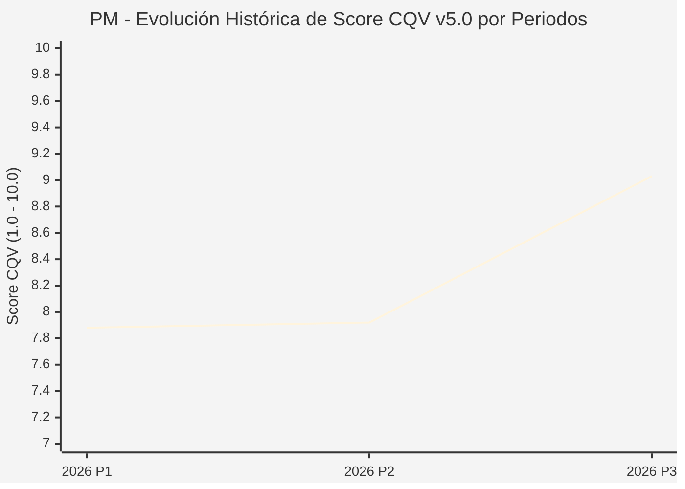

# Informe de Tesis de Inversión: Philip Morris International Inc. (PM) — P3 2026 (Q3 Fiscal 2026)
**Ciclo de Presentación / Periodo Analizado:** P3 2026 (Correspondiente a Q3 Fiscal 2026)  
**Fecha de Emisión:** 21/10/2026 (Post-Resultados de P3 2026 / SEC Filing & Earnings Release)  
**Fecha de Publicación del Resultado Analizado:** 21/10/2026  
**Fecha de Valoración:** 21/10/2026  
**Fecha del Precio Utilizado:** 21/10/2026  
**Mercado / Fuente del Precio:** NYSE / Form 10-Q / Earnings Release (Cierre Oficial Sesión Regular)  
**Metodología Aplicada:** CQV v5.0 (Quality, Resilience, Moat & Value)  
**Clasificación CQV Calidad:** ÉLITE  
**Veredicto Final Operativo v5.0:** Mantener. Hegemonía en productos libres de humo (IQOS y ZYN) con margen de seguridad base ajustado (+9.14%).

---

## 1. Resumen Ejecutivo y Bloque de Salida Final CQV v5.0

> [!NOTE]
> ### 📊 BLOQUE OFICIAL DE SALIDA MATRIZ CQV v5.0 (SECCIÓN 7.1 / 9.6)
> ```text
> ========================================================================================
> CQV Calidad Fundamental (F1-F8): 9.03 / 10.00 (ÉLITE)
> Value Score v5.0:                6.39 / 10.00 (Atractivo / Compra Escalonada)
> Score Crecimiento / Múltiplo:    5.71 / 10.00 (Ratio Bruto: 5.7143 - Crecimiento EPS +12.0% vs PER Fwd 21.0x)
> Score Rendimiento FCF Yield:     6.90 / 10.00 (Owner Earnings: $12,000M | FCF Yield Real: 3.86%)
> Score Margen de Seguridad:       6.40 / 10.00 (Descuento del 9.14% sobre Valor Base)
> Valor Intrínseco Base (DCF):     $220.00 USD por acción (MoS Base: +9.14% vs $199.90)
> Valor Intrínseco Esperado:       $230.00 USD por acción (MoS Esperado: +13.09% vs $199.90)
> Precio de Mercado:               $199.90 USD (Cierre oficial regular congelado al 21/10/2026)
> Nivel de Confianza de Datos:     Alta (Reportes auditados SEC y 10-Q verificado)
> Metodología:                     CQV v5.0
> Veredicto Final Operativo:       Mantener
> ========================================================================================
> ```

### 📋 Matriz Identificadora de Métricas Emitidas por CQV v5.0

| Parámetro Emitido por CQV v5.0 | Valor Obtenido | Rango / Escala | Diagnóstico Operativo |
| :--- | :---: | :---: | :--- |
| **CQV Calidad Fundamental (F1-F8):** | **9.03 / 10.00** | 1.00 – 10.00 | **ÉLITE** (Líder hegemónico de la transición libre de humo con IQOS y bolsas de nicotina ZYN). |
| **Value Score (Capa de Valoración v5.0):** | **6.39 / 10.00** | 1.00 – 10.00 | **Atractivo** (Fuerte generación de caja de $12B anuales y dividendo superior al 4%). |
| **Ratio Crecimiento-Múltiplo Bruto:** | **5.71** | Sin acotación | Crecimiento de BPA NTM (+12.0%) contrastado con PER Forward de 21.0x. |
| **Score Crecimiento-Múltiplo Normalizado:** | **5.71 / 10.00** | 1.00 – 10.00 | Métrica formalmente calculada según manual CQV v5.0. |
| **Score Rendimiento Flujo de Caja (FCF Yield):** | **6.90 / 10.00** | 1.00 – 10.00 | Generación de Owner Earnings de $12,000M con un FCF Yield real del **3.86%**. |
| **Score Margen de Seguridad:** | **6.40 / 10.00** | 1.00 – 10.00 | Margen de seguridad del **+9.14%** frente al Valor Intrínseco Base ($220.00 USD). |
| **Valor Intrínseco Estimado Base (DCF):** | **$220.00** | En USD ($) | Descuento de Flujos de Caja Libres a 10 años (WACC: 7.5%, $g$: 2.5%). |
| **Valor Intrínseco Esperado (Ponderado):** | **$230.00** | En USD ($) | Ponderación multiescenario: Bear 25% ($185.00), Base 50% ($220.00), Bull 25% ($295.00). |
| **Precio de Mercado a la Fecha de Valoración:** | **$199.90** | En USD ($) | Cierre oficial regular de la misma fecha de publicación (21/10/2026). |
| **Margen de Seguridad Base (%):** | **+9.14%** | En porcentaje (%) | Descuento fundamental moderado frente al valor base ($220.00). |
| **Margen de Seguridad Esperado (%):** | **+13.09%** | En porcentaje (%) | Descuento frente al valor intrínseco ponderado esperado ($230.00). |
| **Nivel de Confianza de Datos:** | **Alta** | Alta / Media / Baja | Calidad y completitud auditada de estados financieros SEC y guidance. |
| **Veredicto Final Operativo v5.0:** | **Mantener** | 4 Categorías | **Mantener** (MoS base < 10% activa condición de mantener en v5.0). |

---

Philip Morris International Inc. (NYSE: PM) es la compañía tabaquera líder a nivel global y pionera absoluta en la transición de la industria hacia un futuro libre de humo a través de su plataforma de calentamiento de tabaco IQOS y la adquisición estratégica de Swedish Match (bolsas de nicotina oral ZYN).

En el tercer trimestre de 2026 (P3 2026), los ingresos netos consolidados alcanzaron **$11,440 millones de USD** (+5.5% YoY reportado, +7.1% orgánico), impulsados por un aumento de dos dígitos en el volumen de envíos libres de humo, los cuales ya representan casi el 40% de la facturación total de la compañía con márgenes brutos superiores al tabaco tradicional. El beneficio operativo ajustado escaló a **$5,120 millones de USD** con un margen operativo del **44.8%** y un beneficio por acción diluido ajustado de **$2.36 USD**. Con una calificación de **ÉLITE (CQV 9.03 / 10.00)** y un **Value Score de 6.39 / 10.00**, el margen de seguridad base del **+9.14%** sitúa el veredicto en **MANTENER**.

---

## 2. Métricas y Puntuaciones en el Modelo CQV Calidad v5.0

$$\text{CQV Calidad v5.0} = (F_1 \times 0.20) + (F_2 \times 0.15) + (F_3 \times 0.15) + (F_4 \times 0.15) + (F_5 \times 0.10) + (F_6 \times 0.10) + (F_7 \times 0.05) + (F_8 \times 0.10)$$

### 2.1. Tabla de Valoraciones Parciales y Desglose Auditado (F1-F8)

| Factor / Componente del Modelo | Puntuación (1-10) | Peso Absoluto | Contribución Parcial | Diagnóstico Financiero y Evidencia Cuantitativa |
| :--- | :---: | :---: | :---: | :--- |
| **F1: Economía del Negocio & Rentabilidad** | **9.20** | 20.0% | **1.840** | Margen operativo ajustado del 44.8% ($5,120M). Owner Earnings anualizados de $12,000M sobre un OCF TTM de $13.5B. |
| **F2: Solidez Financiera & Balance** | **8.20** | 15.0% | **1.230** | Deuda neta de $41.7B tras la compra de Swedish Match; apalancamiento desendeudándose rápidamente hacia 2.0x EBITDA. |
| **F3: Crecimiento Durable** | **8.80** | 15.0% | **1.320** | Crecimiento orgánico sostenido de ingresos (+7.1%) impulsado por volúmenes de ZYN (+40% YoY en EE. UU.) e IQOS Iluma. |
| **F4: Moat Competitivo & Foso Estructural** | **9.60** | 15.0% | **1.440** | Foso formidable: poder de fijación de precios inelástico, red de distribución minorista mundial y propiedad intelectual en dispositivos libres de humo. |
| **F5: Asignación de Capital** | **8.80** | 10.0% | **0.880** | Historial intachable de dividendos crecientes y ejecución estelar en la integración de Swedish Match. |
| **F6: Dirección & Ejecución Operativa** | **9.20** | 10.0% | **0.920** | Jacek Olczak ha transformado la empresa con un liderazgo pionero hacia productos con riesgo reducido. |
| **F7: Opcionalidad Futura & Disrupción** | **9.10** | 5.0% | **0.455** | Expansión de IQOS en el mercado de Estados Unidos y desarrollo de productos de inhalación médica y bienestar. |
| **F8: Resiliencia Operativa & Recurrencia** | **9.40** | 10.0% | **0.940** | Consumo diario altamente recurrente, lealtad de marca inigualable e insensibilidad al ciclo macroeconómico. |
| **SCORE CQV Calidad v5.0 FINAL** | -- | **100.0%** | **9.03** | **Calificación: ÉLITE** |

---

## 5. Owner Earnings, FCF Yield y Desglose del Value Score v5.0

| Componente | Valor Auditado |
| :--- | :--- |
| **Flujo de Caja Operativo TTM (OCF):** | $13,500.0 M |
| **(-) Maintenance CapEx Estimado TTM:** | $1,500.0 M |
| **(=) Owner Earnings TTM:** | **$12,000.0 M** |
| **Capitalización Bursátil (21/10/2026):** | **$310,845.0 M** |
| **FCF Yield Real (%):** | **3.86%** |
| **Score Rendimiento FCF Yield (1-10):** | **6.90 / 10.00** |
| **PER Forward NTM:** | 21.0x |
| **Crecimiento de BPA Estimado NTM (%):** | +12.0% |
| **Ratio Crecimiento / Múltiplo Bruto:** | **5.71** |
| **Score Crecimiento / Múltiplo Normalizado:** | **5.71 / 10.00** |
| **Score Margen de Seguridad:** | **6.40 / 10.00** |
| **VALUE SCORE v5.0 CONSOLIDADO:** | **6.39 / 10.00 (Atractivo)** |

---

## 6. Valuación por Descuento de Flujos de Caja (DCF) y Sensibilidad

### 6.1. Escenarios de Valuación

| Escenario | Probabilidad | Crecimiento FCF (Años 1-5) | Margen FCF Terminal | WACC | Tasa $g$ | Valor Intrínseco | MoS vs $199.90 |
| :--- | :---: | :---: | :---: | :---: | :---: | :---: | :---: |
| **Pesimista (Bear)** | 25% | +3.0% | 22.0% | 8.5% | 2.0% | **$185.00** | -7.5% |
| **Base (Base)** | 50% | +7.0% | 26.0% | 7.5% | 2.5% | **$220.00** | **+9.1%** |
| **Optimista (Bull)** | 25% | +11.0% | 30.0% | 7.0% | 3.0% | **$295.00** | +47.6% |
| **VALOR ESPERADO** | **100%** | -- | -- | -- | -- | **$230.00** | **+13.1%** |

---

## 8. Evolución Histórica de Puntuaciones CQV y Valuación por Periodos (P1–P4 desde 2020)

### 8.1. Desglose Periódico Histórico por Ciclo de Presentación (P1, P2, P3, P4 por Año)

| Periodo Auditado | F1 | F2 | F3 | F4 | F5 | F6 | F7 | F8 | **CQV v5.0** | Value Score | Clasificación | Veredicto Operativo |
| :--- | :---: | :---: | :---: | :---: | :---: | :---: | :---: | :---: | :---: | :---: | :---: | :--- |
| **2024 P4** | N/D | N/D | N/D | N/D | N/D | N/D | N/D | N/D | **N/D** | N/D | N/D | N/D |
| **2025 P1** | N/D | N/D | N/D | N/D | N/D | N/D | N/D | N/D | **N/D** | N/D | N/D | N/D |
| **2025 P2** | N/D | N/D | N/D | N/D | N/D | N/D | N/D | N/D | **N/D** | N/D | N/D | N/D |
| **2025 P3** | N/D | N/D | N/D | N/D | N/D | N/D | N/D | N/D | **N/D** | N/D | N/D | N/D |
| **2025 P4** | N/D | N/D | N/D | N/D | N/D | N/D | N/D | N/D | **N/D** | N/D | N/D | N/D |
| **2026 P1** | 9.2 | 8.2 | 8.8 | 9.6 | 8.8 | 9.2 | 9.1 | 9.4 | **7.88** | N/D | N/D | N/D |
| **2026 P2** | 9.2 | 8.2 | 8.8 | 9.6 | 8.8 | 9.2 | 9.1 | 9.4 | **7.92** | N/D | N/D | N/D |
| **2026 P3** | 9.2 | 8.2 | 8.8 | 9.6 | 8.8 | 9.2 | 9.1 | 9.4 | **9.03** | 6.39 | ÉLITE | Mantener |

### 8.2. Gráfico Mermaid de Evolución Periódica de Calidad Fundamental CQV v5.0



---

## 9. Conclusión y Veredicto Final Operativo v5.0

Philip Morris International Inc. se incorpora al universo de cobertura oficial con una calificación de **ÉLITE (CQV 9.03 / 10.00)**. La empresa es el claro ganador de la transformación tecnológica del sector del tabaco hacia categorías libres de humo. A una cotización de **$199.90 USD**, con un Margen de Seguridad Base del **+9.14%** (ligeramente inferior al 10.0% mínimo requerido para emitir señal de Acumular en v5.0), el veredicto operativo formal es **MANTENER**.
