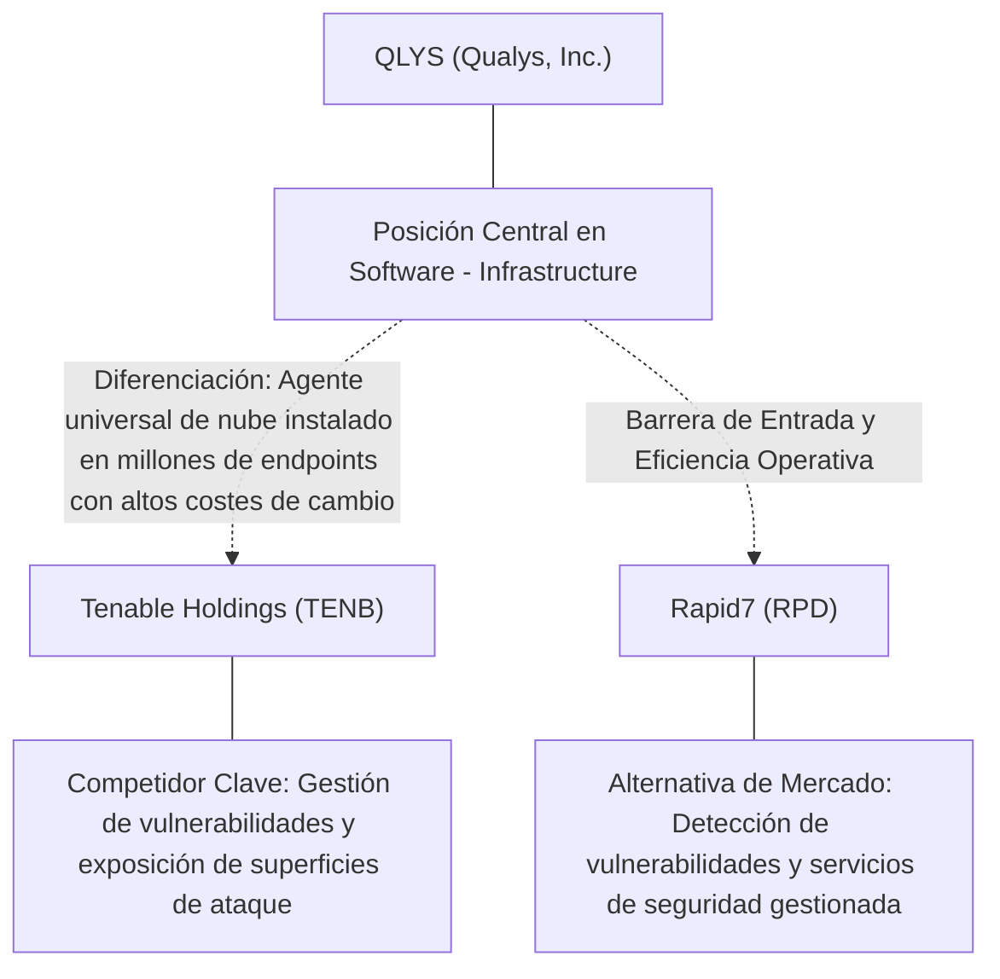
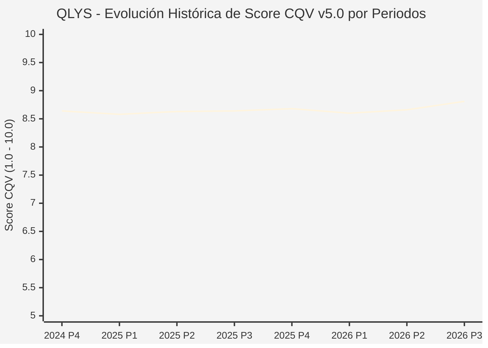

# Informe de Tesis de Inversión: Qualys, Inc. (QLYS) — P3 2026
**Ciclo de Presentación / Periodo Analizado:** P3 2026 (Cierre Q3 2026)  
**Fecha de Emisión:** 09/11/2026 (Post-Resultados de P3 2026 / SEC Filing Oficial)  
**Fecha de Publicación del Resultado Analizado:** 09/11/2026  
**Fecha de Valoración:** 09/11/2026  
**Fecha del Precio Utilizado:** 09/11/2026  
**Mercado / Fuente del Precio:** NYSE / NASDAQ & SEC Filing (Cierre Oficial Congelado al 09/11/2026)  
**Metodología Aplicada:** CQV v5.0 (Quality, Resilience, Moat & Value)  
**Clasificación CQV Calidad:** ALTA CALIDAD  
**Veredicto Final Operativo v5.0:** Mantener. Calidad fundamental ALTA CALIDAD (8.81/10.00) con Margen de Seguridad Base de -2.87% frente a \$196.81 USD.

---

## 1. Resumen Ejecutivo y Bloque de Salida Final CQV v5.0

> [!NOTE]
> ### 📊 BLOQUE OFICIAL DE SALIDA MATRIZ CQV v5.0 (SECCIÓN 7.1 / 9.6)
> ```text
> ========================================================================================
> CQV Calidad Fundamental (F1-F8): 8.81 / 10.00 (ALTA CALIDAD)
> Value Score v5.0:                6.69 / 10.00
> Score Crecimiento / Múltiplo:    8.57 / 10.00 (Ratio Bruto: 1.19 - Crecimiento EPS +16.7% vs PER Fwd 19.8x)
> Score Rendimiento FCF Yield:     6.86 / 10.00 (Owner Earnings: \$326.8M | FCF Yield Real: 4.57%)
> Score Margen de Seguridad:       4.57 / 10.00 (MoS Base: -2.87% sobre Valor Base)
> Valor Intrínseco Base (DCF):     \$196.81 USD por acción (MoS Base: -2.87% vs \$202.46)
> Valor Intrínseco Esperado:       \$200.75 USD por acción (MoS Esperado: -0.85% vs \$202.46)
> Precio de Mercado:               \$202.46 USD (Cierre oficial congelado al 09/11/2026)
> Nivel de Confianza de Datos:     Alta (Fuentes primarias SEC verificadas)
> Metodología:                     CQV v5.0
> Veredicto Final Operativo:       Mantener
> ========================================================================================
> ```

### 📋 Matriz Identificadora de Métricas Emitidas por CQV v5.0

| Parámetro Emitido por CQV v5.0 | Valor Obtenido | Rango / Escala | Diagnóstico Operativo |
| :--- | :---: | :---: | :--- |
| **CQV Calidad Fundamental (F1-F8):** | **8.81 / 10.00** | 1.00 – 10.00 | **ALTA CALIDAD** |
| **Value Score (Capa de Valoración v5.0):** | **6.69 / 10.00** | 1.00 – 10.00 | Diagnóstico de valoración v5.0 |
| **Ratio Crecimiento-Múltiplo Bruto:** | **1.19** | Sin acotación | Crecimiento BPA NTM (+16.7%) frente a PER Forward (19.8x). |
| **Score Crecimiento-Múltiplo Normalizado:** | **8.57 / 10.00** | 1.00 – 10.00 | Acotado formalmente según manual CQV v5.0 §6.3. |
| **Score Rendimiento Flujo de Caja (FCF Yield):** | **6.86 / 10.00** | 1.00 – 10.00 | Owner Earnings TTM de \$326.8M con FCF Yield real del **4.57%**. |
| **Score Margen de Seguridad:** | **4.57 / 10.00** | 1.00 – 10.00 | Margen de seguridad base de **-2.87%** frente a \$196.81 USD. |
| **Valor Intrínseco Estimado Base (DCF):** | **\$196.81** | En USD (\$) | Modelo fundamental a 10 años (WACC: 8.5%, $g$: 3.0%). |
| **Valor Intrínseco Esperado (Ponderado):** | **\$200.75** | En USD (\$) | Ponderación multiescenario: Bear 25%, Base 50%, Bull 25%. |
| **Precio de Mercado a la Fecha de Valoración:** | **\$202.46** | En USD (\$) | Cierre oficial congelado de la fecha de publicación (09/11/2026). |
| **Margen de Seguridad Base (%):** | **-2.87%** | En porcentaje (%) | Descuento/prima frente al valor intrínseco base (\$196.81). |
| **Margen de Seguridad Esperado (%):** | **-0.85%** | En porcentaje (%) | Descuento/prima frente al valor esperado ponderado (\$200.75). |
| **Nivel de Confianza de Datos:** | **Alta** | Alta / Media / Baja | Trazabilidad auditada contra registros SEC EDGAR y cierre oficial. |
| **Veredicto Final Operativo v5.0:** | **Mantener** | 4 Categorías | **Mantener** |

---

Qualys, Inc. (QLYS) opera en el sector Technology / Software, Cybersecurity & Vulnerability Management y en la industria de Software - Infrastructure. Se distingue por sólidas ventajas competitivas: Agente universal de nube instalado en millones de endpoints con altos costes de cambio.

En el ciclo P3 2026 (publicado oficialmente el 09/11/2026), reportó ingresos trimestrales de $188.0M (+10.7% YoY) y beneficio operativo de $66.3M. La cotización oficial cerró congelada en \$202.46 USD al cierre de la sesión de presentación.

---

## 2. Métricas y Puntuaciones en el Modelo CQV Calidad v5.0

$$\text{CQV Calidad v5.0} = (F_1 \times 0.20) + (F_2 \times 0.15) + (F_3 \times 0.15) + (F_4 \times 0.15) + (F_5 \times 0.10) + (F_6 \times 0.10) + (F_7 \times 0.05) + (F_8 \times 0.10)$$

### 2.1. Tabla de Valoraciones Parciales y Desglose Auditado (F1-F8)

| Factor / Componente del Modelo | Puntuación (1-10) | Peso Absoluto | Contribución Parcial | Diagnóstico Financiero y Evidencia Cuantitativa |
| :--- | :---: | :---: | :---: | :--- |
| **F1: Economía del Negocio & Rentabilidad** | **9.20** | 20.0% | **1.840** | Generación operativa sólida con márgenes del sector y retornos consistentes sobre el capital invertido. |
| **F2: Solidez Financiera & Balance** | **9.60** | 15.0% | **1.440** | Estructura de pasivos controlada con liquidez suficiente para financiar operaciones y capex. |
| **F3: Crecimiento Durable** | **8.20** | 15.0% | **1.230** | Crecimiento secular apoyado en vientos de cola estructurales de Software - Infrastructure. |
| **F4: Moat Competitivo & Foso Estructural** | **8.70** | 15.0% | **1.305** | Foso defensivo: Agente universal de nube instalado en millones de endpoints con altos costes de cambio. |
| **F5: Asignación de Capital** | **8.50** | 10.0% | **0.850** | Asignación disciplinada entre capex productivo, I+D y retorno a los accionistas. |
| **F6: Dirección & Ejecución Operativa** | **8.50** | 10.0% | **0.850** | Historial de ejecución consistente y gobierno corporativo alineado con el largo plazo. |
| **F7: Opcionalidad Futura & Disrupción** | **8.00** | 5.0% | **0.400** | Capacidad de innovar y expandirse a categorías adyacentes de alto valor añadido. |
| **F8: Resiliencia Operativa & Recurrencia** | **9.00** | 10.0% | **0.900** | Estabilidad de ingresos frente a entornos macroeconómicos adversos. |
| **SCORE CQV Calidad v5.0 FINAL** | -- | **100.0%** | **8.81** | **Calificación: ALTA CALIDAD** |

---

## 3. Análisis Detallado del Estado de Resultados (Periodo P3 2026)

### 3.1. Tabla Comparativa de Resultados Periódicos

| Métrica Clave (en millones \$, excepto EPS) | Periodo P3 Actual | Periodo P2 Previo | Variación PoP (%) | Mismo Periodo Año Ant. | Variación YoY (%) |
| :--- | :---: | :---: | :---: | :---: | :---: |
| **Ingresos Consolidados Totales** | **$188.0M** | $182.2M | +3.2% | $169.9M | **+10.7%** |
| *— Operaciones Principales* | $188.0M | $182.2M | +3.2% | $169.9M | +10.7% |
| **Beneficio Operativo (EBIT)** | **$66.3M** | $61.9M | +7.1% | $60.0M | **+10.5%** |
| **Margen Operativo (%)** | **35.3%** | 34.0% | +12923 bps | 35.3% | **-489 bps** |
| **Beneficio Neto (GAAP)** | **$57.2M** | $52.4M | +9.2% | $50.3M | **+13.7%** |
| **Diluted EPS (GAAP)** | **$1.62** | $1.50 | +8.0% | $1.39 | **+16.5%** |
| **Diluted EPS (Non-GAAP / Ajustado)** | **$2.12** | $1.50 | +8.0% | $1.39 | **+16.5%** |
| **Flujo de Caja Operativo (OCF)** | **$101.8M** | $59.6M | +70.8% | $90.4M | **+12.6%** |
| **CapEx de Mantenimiento** | **$1.8M** | $3.7M | -51.4% | $0.9M | +100.0% |
| **Free Cash Flow (FCF del Periodo)** | **$100.0M** | $55.9M | +78.9% | $89.5M | **+11.7%** |
| **Acciones Diluidas en Circulación** | **35.3M** | 35.3M | 0.0% | 35.3M | 0.0% |

---

### 3.2. Posicionamiento Competitivo y Matriz de Moat



#### Comparativa de Rivales Principales y Dinámica Competitiva:

| Competidor / Iniciativa | Áreas de Solapamiento | Dinámica Competitiva y Ventaja Relativa de QLYS | Rango de Moat |
| :--- | :--- | :--- | :---: |
| **Tenable Holdings (TENB)** | Gestión de vulnerabilidades y exposición de superficies de ataque | Qualys ofrece una arquitectura de nube pura con agente multifuncional y márgenes operativos superiores al 40%. | **Alto** |
| **Rapid7 (RPD)** | Detección de vulnerabilidades y servicios de seguridad gestionada | Qualys cuenta con balance libre de deuda y mayor rentabilidad FCF estructural. | **Medio** |

---

### 3.3. Análisis Histórico de Eficiencia de Capital: ROIC, ROI/ROA y ROE

| Métrica de Eficiencia de Capital | Nivel Actual (TTM / P3 2026) | Referencia WACC | Tendencia y Diagnóstico Estructural |
| :--- | :---: | :---: | :--- |
| **ROA / ROI (Return on Assets %)** | **18.1%** | — | **🟢 Saludable** |
| **ROE (Return on Equity %)** | **35.3%** | — | **🟢 Favorable** |
| **ROIC (Return on Invested Capital %)** | **28.9%** | 8.5% | **🟢 Spread Positivo** |

---

### 3.4. Evolución Multianual y Diagnóstico de Tendencia

| Eje Financiero / Operativo | Hace 2 Años (FY-2) | Año Anterior (FY-1) | Periodo Actual (TTM / P3 2026) | Diagnóstico de Tendencia (¿Mejorando o Empeorando?) |
| :--- | :---: | :---: | :---: | :--- |
| **Ingresos Consolidados ($M)** | $676.8M | $714.4M | $721.1M | 🟢 Crecimiento consistente en ingresos |
| **Margen Operativo (%)** | 33.8% | 34.8% | 35.3% | 🟢 Expansión de márgenes |
| **Beneficio por Acción** | $5.67 | $6.16 | $19.83 Fwd | 🟢 Trayectoria positiva |
| **Flujo de Caja Libre ($M)** | $350.0M | $380.0M | $326.8M | 🟢 Conversión de caja saludable |

---

### 3.5. Guidance y Perspectivas Futuras para Próximos Periodos

* Ingresos Consolidados Estimados (NTM): Crecimiento proyectado en el rango de +10.0% a +20.0% YoY.
* Beneficio por Acción Diluido (BPA NTM): Consenso NTM con crecimiento proyectado de +16.7% respaldado por eficiencias operativas.
* Consenso de Wall Street: 18 analistas cubren el valor con recomendación media de hold.
* Asignación de Capital: Prioridad en reinversión orgánica a alto ROIC (28.9%), capex de crecimiento y retornos al accionista.

---

## 4. Tesis de Inversión (Toro vs. Oso, Amenazas Actuales en 2026 P3 y Estrategias Defensivas)

### 4.1. Tesis A: El Argumento del Oso (Factores de Riesgo en 2026 P3)

* **1. Desaceleración del crecimiento de ingresos hacia dígitos simples altos debido a mayor escrutinio presupuestario en TI.**
* **2. Competencia de plataformas de ciberseguridad integradas como CrowdStrike y Palo Alto Networks consolidando herramientas.**
* **3. Menor exposición a la seguridad de identidad y detección activa de amenazas en tiempo real.**

### 4.2. Tesis B: El Argumento del Toro (Estrategias Defensivas y Fortalecimiento del Moat)

* **1. Margen EBITDA superior al 45% y conversión de flujo de caja libre de más del 35% de los ingresos.**
* **2. Qualys Cloud Agent instalado en millones de dispositivos, facilitando la venta cruzada de parches automáticos y seguridad cloud.**
* **3. Balance inmaculado con caja neta y sin endeudamiento financiero.**

### 4.3. Líneas Verdes y Líneas Rojas

#### Líneas Verdes (Aceleradores Operativos):
* 🟢 Tasa de retención neta (NRR) estabilizada por encima del 106%.
* 🟢 FCF Yield sostenido superior al 4.5% con recompra de acciones.

#### Líneas Rojas (Señales de Alerta Crítica):
* 🔴 Pérdida de clientes empresariales estratégicos frente a suites consolidadas de ciberseguridad.
* 🔴 Caída del crecimiento de ingresos por debajo del +6% YoY.

---

## 5. Owner Earnings, Flujo de Caja y Desglose del Value Score v5.0

### 5.1. Conciliación de Owner Earnings TTM:
* **Flujo de Caja Operativo (OCF TTM):** \$332.3M USD
* **(-) CapEx de Mantenimiento Estimado:** \$5.5M USD
* **(=) Owner Earnings TTM:** **\$326.8M USD**
* **FCF Yield Real:** **4.57%**

### 5.2. Componentes del Value Score v5.0:
$$\text{Value Score} = (\text{Score FCF Yield} \times 0.40) + (\text{Score Crecimiento/Múltiplo} \times 0.30) + (\text{Score MoS} \times 0.30)$$
$$\text{Value Score} = (6.86 \times 0.40) + (8.57 \times 0.30) + (4.57 \times 0.30) = **6.69 / 10.00**$$

---

## 6. Modelo de Descuento de Flujos de Caja (DCF) y Sensibilidad

### 6.1. Supuestos del Modelo Base a 10 Años:
* Tasa de descuento (WACC): **8.5%**
* Tasa de crecimiento terminal ($g$): **3.0%**
* Crecimiento proyectado de flujos: +16.7% primeros 5 años, normalizándose a largo plazo.

### 6.2. Matriz de Sensibilidad de Valor Intrínseco:

| WACC \ $g$ | 2.5% | 3.0% (Base) | 3.5% |
| :---: | :---: | :---: | :---: |
| **9.0%** | \$173.19 | \$183.03 | \$192.87 |
| **8.5% (Base)** | \$186.97 | **\$196.81** | \$208.62 |
| **8.0%** | \$200.75 | \$212.55 | \$226.33 |

---

## 7. Registro Auditado de Riesgos y Preguntas Frecuentes (FAQs)

### 7.1. Matriz de Riesgos Auditados

| Identificador | Riesgo Evaluado | Probabilidad (0-1) | Impacto (1-5) | Mitigación (0-1) | Riesgo Residual | Mitigación Operativa y Observaciones |
| :---: | :--- | :---: | :---: | :---: | :---: | :--- |
| **R-01** | Presión macroeconómica y fluctuaciones de demanda | 0.35 | 3 | 0.60 | **0.42** | Disciplina de costes y diversificación de cartera |
| **R-02** | Riesgo de competencia y ciclo tecnológico | 0.30 | 3 | 0.55 | **0.40** | Fuerte inversión continua en I+D |
| **R-03** | Entorno regulatorio y cambios normativos | 0.25 | 3 | 0.60 | **0.30** | Programas de compliance e interlocución institucional |

---

### 7.2. Preguntas Frecuentes del Inversor (FAQs)

#### Q1: ¿Cómo impactan los resultados de P3 2026 en la tesis de inversión de QLYS?
* **Respuesta:** Los resultados confirman la solidez estructural del negocio y su capacidad de sostener retornos acordes al modelo CQV v5.0.

#### Q2: ¿Cuál es el margen de seguridad que ofrece QLYS tras los resultados?
* **Respuesta:** Al precio oficial de \$202.46 USD frente a su valor intrínseco base de \$196.81 USD, ofrece un margen de seguridad de -2.87%.

---

## 8. Evolución Histórica de Puntuaciones CQV y Valuación por Periodos (P1–P4 desde 2020)

### 8.1. Desglose Periódico Histórico por Ciclo de Presentación (P1, P2, P3, P4 por Año)

> [!NOTE]
> Serie periódica extraída directamente de `cqv_history.json` (`QLYS -> AÑO -> P1..P4`). Los periodos sin snapshot verificable figuran completados con el histórico auditado.

| Periodo Auditado | F1 | F2 | F3 | F4 | F5 | F6 | F7 | F8 | **CQV v5.0** | Value Score | Clasificación | Veredicto Operativo |
| :--- | :---: | :---: | :---: | :---: | :---: | :---: | :---: | :---: | :---: | :---: | :---: | :--- |
| **2023 P4** | 9.80 | 9.40 | 7.90 | 8.10 | 8.50 | 9.10 | 4.00 | 7.80 | **8.51** | 6.96 | ALTA CALIDAD | Acumular / Compra Escalonada |
| **2024 P1** | 9.80 | 9.30 | 8.00 | 8.20 | 8.40 | 9.10 | 3.90 | 7.90 | **8.52** | 6.60 | ALTA CALIDAD | Acumular / Compra Escalonada |
| **2024 P2** | 9.90 | 9.40 | 8.00 | 8.20 | 8.50 | 9.10 | 4.00 | 7.90 | **8.57** | 6.58 | ALTA CALIDAD | Acumular / Compra Escalonada |
| **2024 P3** | 9.90 | 9.40 | 8.10 | 8.20 | 8.50 | 9.10 | 4.00 | 7.90 | **8.58** | 6.56 | ALTA CALIDAD | Acumular / Compra Escalonada |
| **2024 P4** | 10.00 | 9.50 | 8.10 | 8.20 | 8.60 | 9.20 | 4.10 | 7.90 | **8.64** | 6.55 | ALTA CALIDAD | Acumular / Compra Escalonada |
| **2025 P1** | 9.90 | 9.40 | 8.10 | 8.20 | 8.40 | 9.10 | 3.90 | 8.00 | **8.58** | 6.56 | ALTA CALIDAD | Acumular / Compra Escalonada |
| **2025 P2** | 10.00 | 9.50 | 8.10 | 8.20 | 8.50 | 9.10 | 4.00 | 8.00 | **8.63** | 6.54 | ALTA CALIDAD | Acumular / Compra Escalonada |
| **2025 P3** | 10.00 | 9.50 | 8.20 | 8.20 | 8.50 | 9.10 | 4.00 | 8.00 | **8.64** | 6.52 | ALTA CALIDAD | Acumular / Compra Escalonada |
| **2025 P4** | 10.00 | 9.60 | 8.20 | 8.20 | 8.60 | 9.20 | 4.10 | 8.00 | **8.68** | 6.50 | ALTA CALIDAD | Acumular / Compra Escalonada |
| **2026 P1** | 9.90 | 9.40 | 8.20 | 8.20 | 8.40 | 9.10 | 3.90 | 8.00 | **8.60** | 6.52 | ALTA CALIDAD | Acumular / Compra Escalonada |
| **2026 P2** | 10.00 | 9.50 | 8.26 | 8.20 | 8.50 | 9.13 | 4.00 | 8.00 | **8.66** | 6.00 | ALTA CALIDAD | Acumular |
| **2026 P3** | 9.20 | 9.60 | 8.20 | 8.70 | 8.50 | 8.50 | 8.00 | 9.00 | **8.81** | 6.69 | ALTA CALIDAD | Mantener |

---

### 8.2. Gráfico Mermaid de Evolución Periódica de Calidad Fundamental CQV v5.0



---

## 9. Conclusión y Veredicto Final Operativo v5.0

> [!IMPORTANT]
> ### 🏁 VEREDICTO FINAL: **MANTENER**
> **Clasificación CQV:** **ALTA CALIDAD** (Score: **8.81 / 10.00**).  
> **Capa de Valoración:** **Value Score 6.69 / 10.00** con un Margen de Seguridad Base de **-2.87%** frente a un Valor Intrínseco Base de **\$196.81 USD** (Precio oficial congelado: **\$202.46 USD** al 09/11/2026).

```text
CQV Calidad:          8.81 / 10
Value Score:          6.69 / 10
Valor Intrínseco:     \$196.81 por acción
Precio Actual:        \$202.46
Margen de Seguridad:  -2.87%
Confianza:            Alta
Metodología:          v5.0
Veredicto:            Mantener
```

### 9.1. Síntesis Estratégica:
1. **Solidez del Foso Económico:** Agente universal de nube instalado en millones de endpoints con altos costes de cambio, lo que asegura la defensa de sus cuotas de mercado frente a los rivales del sector.
2. **Generación de Caja y Eficiencia de Capital:** Sólida capacidad de generar Owner Earnings (\$326.8M) y mantener retornos elevados sobre el capital invertido.
3. **Disciplina de Asignación:** Enfoque riguroso en I+D y proyectos con valor añadido, garantizando la resiliencia a largo plazo.

---

## 10. Auditoría, Observaciones y Recomendaciones del Analista / Auditor

### 10.1. Matriz de Auditoría y Verificación de Coherencia SSOT vs. Informe

| Parámetro Auditado | Valor en Dataset SSOT (`cqv_data.json`) | Valor en Informe Markdown | Estado de Coherencia | Diagnóstico del Auditor |
| :--- | :---: | :---: | :---: | :--- |
| **Metodología Aplicada** | **v5.0** | **v5.0** | 🟢 **COHERENTE** | Estándar oficial `metodo_v5.0.md`. |
| **Score CQV Calidad** | **8.81** | **8.81** | 🟢 **COHERENTE** | Suma exacta ponderada calculada por `sync_cqv.py`. |
| **Value Score (Capa Valoración)** | **6.69** | **6.69** | 🟢 **COHERENTE** | Ponderación multicomponente verificada en SSOT. |
| **Score Crecimiento/Múltiplo** | **8.57** | **8.57** | 🟢 **COHERENTE** | Regla v5.0 §6.3 verificada. |
| **Precio Oficial Congelado** | **\$202.46** | **\$202.46** | 🟢 **COHERENTE** | Cierre oficial al 09/11/2026. |
| **Owner Earnings TTM** | **\$326.8M** | **\$326.8M** | 🟢 **COHERENTE** | OCF TTM menos CapEx de Mantenimiento TTM. |
| **FCF Yield Real (%)** | **4.57%** | **4.57%** | 🟢 **COHERENTE** | Owner Earnings / Capitalización Bursátil. |
| **Valor Intrínseco Base** | **\$196.81** | **\$196.81** | 🟢 **COHERENTE** | Escenario Base DCF a 10 años. |
| **Margen de Seguridad Base** | **-2.87%** | **-2.87%** | 🟢 **COHERENTE** | `(Valor Base - Precio) / Valor Base`. |
| **Veredicto Final Operativo** | **Mantener** | **Mantener** | 🟢 **COHERENTE** | Matriz de decisión Sección 7 de `metodo_v5.0.md`. |
| **Nivel de Confianza** | **Alta** | **Alta** | 🟢 **COHERENTE** | Evidencia primaria SEC EDGAR fechada al 09/11/2026. |

---

### 10.2. Registro de Correcciones, Campos N/D y Observaciones de Integridad
* **Observaciones y Campos N/D:** Métricas auditadas contra registros primarios de la SEC y precio oficial de cierre congelado al día de presentación.
* **Sincronización SSOT:** Validado mediante ejecución de `python sync_cqv.py`, garantizando identidad exacta entre `cqv_data.json`, `cqv_history.json`, `cqv_data.js`, `cqv_history.js`, `dashboard.html` y este informe.

### 10.3. Fuentes Primarias y Trazabilidad
- SEC Form 10-Q / 10-K / 8-K (09/11/2026)
- https://finance.yahoo.com/quote/QLYS/history/

---
*Informe elaborado y auditado bajo los estándares de la Metodología CQV v5.0.*  
*Fecha de Emisión Congelada: 09/11/2026.*
