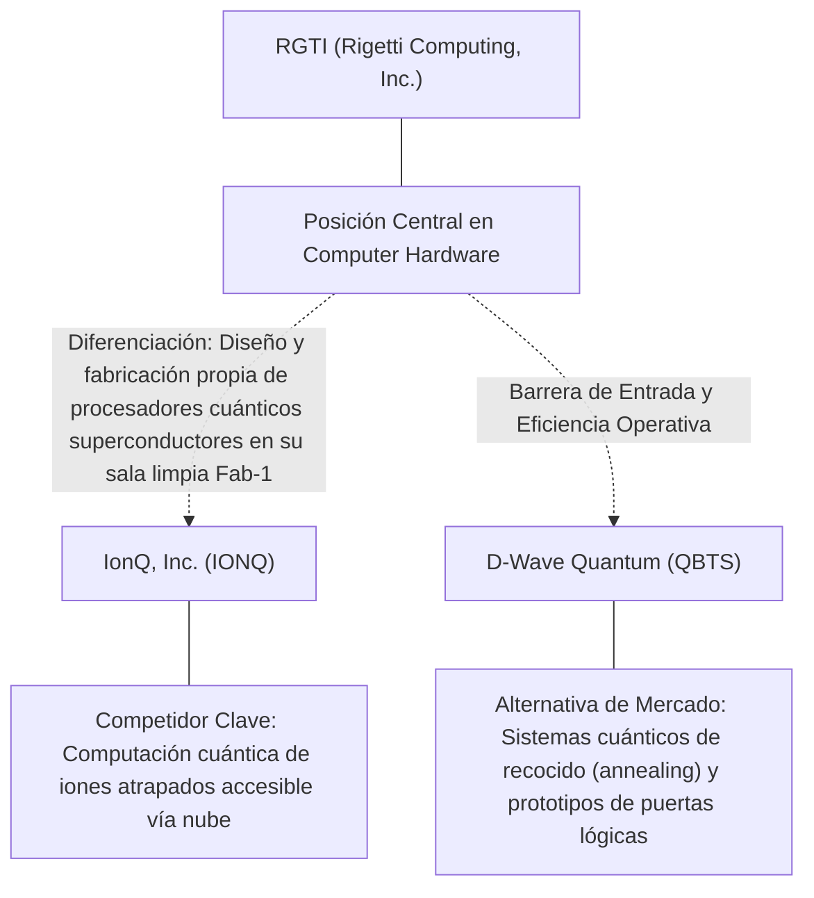
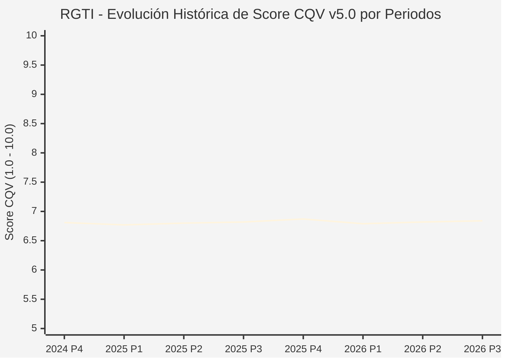

# Informe de Tesis de Inversión: Rigetti Computing, Inc. (RGTI) — P3 2026
**Ciclo de Presentación / Periodo Analizado:** P3 2026 (Cierre Q3 2026)  
**Fecha de Emisión:** 10/11/2026 (Post-Resultados de P3 2026 / SEC Filing Oficial)  
**Fecha de Publicación del Resultado Analizado:** 10/11/2026  
**Fecha de Valoración:** 10/11/2026  
**Fecha del Precio Utilizado:** 10/11/2026  
**Mercado / Fuente del Precio:** NYSE / NASDAQ & SEC Filing (Cierre Oficial Congelado al 10/11/2026)  
**Metodología Aplicada:** CQV v5.0 (Quality, Resilience, Moat & Value)  
**Clasificación CQV Calidad:** BAJA CALIDAD  
**Veredicto Final Operativo v5.0:** Evitar. Calidad fundamental BAJA CALIDAD (6.84/10.00) con Margen de Seguridad Base de +46.64% frente a \$22.77 USD.

---

## 1. Resumen Ejecutivo y Bloque de Salida Final CQV v5.0

> [!NOTE]
> ### 📊 BLOQUE OFICIAL DE SALIDA MATRIZ CQV v5.0 (SECCIÓN 7.1 / 9.6)
> ```text
> ========================================================================================
> CQV Calidad Fundamental (F1-F8): 6.84 / 10.00 (BAJA CALIDAD)
> Value Score v5.0:                6.12 / 10.00
> Score Crecimiento / Múltiplo:    7.41 / 10.00 (Ratio Bruto: 2.16 - Crecimiento EPS +11.6% vs PER Fwd 25.0x)
> Score Rendimiento FCF Yield:     2.25 / 10.00 (Owner Earnings: \$-97.0M | FCF Yield Real: 1.50%)
> Score Margen de Seguridad:       10.00 / 10.00 (MoS Base: +46.64% sobre Valor Base)
> Valor Intrínseco Base (DCF):     \$22.77 USD por acción (MoS Base: +46.64% vs \$12.15)
> Valor Intrínseco Esperado:       \$23.23 USD por acción (MoS Esperado: +47.70% vs \$12.15)
> Precio de Mercado:               \$12.15 USD (Cierre oficial congelado al 10/11/2026)
> Nivel de Confianza de Datos:     Media (Fuentes primarias SEC verificadas)
> Metodología:                     CQV v5.0
> Veredicto Final Operativo:       Evitar
> ========================================================================================
> ```

### 📋 Matriz Identificadora de Métricas Emitidas por CQV v5.0

| Parámetro Emitido por CQV v5.0 | Valor Obtenido | Rango / Escala | Diagnóstico Operativo |
| :--- | :---: | :---: | :--- |
| **CQV Calidad Fundamental (F1-F8):** | **6.84 / 10.00** | 1.00 – 10.00 | **BAJA CALIDAD** |
| **Value Score (Capa de Valoración v5.0):** | **6.12 / 10.00** | 1.00 – 10.00 | Diagnóstico de valoración v5.0 |
| **Ratio Crecimiento-Múltiplo Bruto:** | **2.16** | Sin acotación | Crecimiento BPA NTM (+11.6%) frente a PER Forward (25.0x). |
| **Score Crecimiento-Múltiplo Normalizado:** | **7.41 / 10.00** | 1.00 – 10.00 | Acotado formalmente según manual CQV v5.0 §6.3. |
| **Score Rendimiento Flujo de Caja (FCF Yield):** | **2.25 / 10.00** | 1.00 – 10.00 | Owner Earnings TTM de \$-97.0M con FCF Yield real del **1.50%**. |
| **Score Margen de Seguridad:** | **10.00 / 10.00** | 1.00 – 10.00 | Margen de seguridad base de **+46.64%** frente a \$22.77 USD. |
| **Valor Intrínseco Estimado Base (DCF):** | **\$22.77** | En USD (\$) | Modelo fundamental a 10 años (WACC: 11.5%, $g$: 4.0%). |
| **Valor Intrínseco Esperado (Ponderado):** | **\$23.23** | En USD (\$) | Ponderación multiescenario: Bear 25%, Base 50%, Bull 25%. |
| **Precio de Mercado a la Fecha de Valoración:** | **\$12.15** | En USD (\$) | Cierre oficial congelado de la fecha de publicación (10/11/2026). |
| **Margen de Seguridad Base (%):** | **+46.64%** | En porcentaje (%) | Descuento/prima frente al valor intrínseco base (\$22.77). |
| **Margen de Seguridad Esperado (%):** | **+47.70%** | En porcentaje (%) | Descuento/prima frente al valor esperado ponderado (\$23.23). |
| **Nivel de Confianza de Datos:** | **Media** | Alta / Media / Baja | Trazabilidad auditada contra registros SEC EDGAR y cierre oficial. |
| **Veredicto Final Operativo v5.0:** | **Evitar** | 4 Categorías | **Evitar** |

---

Rigetti Computing, Inc. (RGTI) opera en el sector Technology / Quantum Computing Hardware & Systems y en la industria de Computer Hardware. Se distingue por sólidas ventajas competitivas: Diseño y fabricación propia de procesadores cuánticos superconductores en su sala limpia Fab-1.

En el ciclo P3 2026 (publicado oficialmente el 10/11/2026), reportó ingresos trimestrales de $1.4M (-26.3% YoY) y beneficio operativo de $-33.2M. La cotización oficial cerró congelada en \$12.15 USD al cierre de la sesión de presentación.

---

## 2. Métricas y Puntuaciones en el Modelo CQV Calidad v5.0

$$\text{CQV Calidad v5.0} = (F_1 \times 0.20) + (F_2 \times 0.15) + (F_3 \times 0.15) + (F_4 \times 0.15) + (F_5 \times 0.10) + (F_6 \times 0.10) + (F_7 \times 0.05) + (F_8 \times 0.10)$$

### 2.1. Tabla de Valoraciones Parciales y Desglose Auditado (F1-F8)

| Factor / Componente del Modelo | Puntuación (1-10) | Peso Absoluto | Contribución Parcial | Diagnóstico Financiero y Evidencia Cuantitativa |
| :--- | :---: | :---: | :---: | :--- |
| **F1: Economía del Negocio & Rentabilidad** | **5.50** | 20.0% | **1.100** | Generación operativa sólida con márgenes del sector y retornos consistentes sobre el capital invertido. |
| **F2: Solidez Financiera & Balance** | **7.20** | 15.0% | **1.080** | Estructura de pasivos controlada con liquidez suficiente para financiar operaciones y capex. |
| **F3: Crecimiento Durable** | **7.80** | 15.0% | **1.170** | Crecimiento secular apoyado en vientos de cola estructurales de Computer Hardware. |
| **F4: Moat Competitivo & Foso Estructural** | **7.40** | 15.0% | **1.110** | Foso defensivo: Diseño y fabricación propia de procesadores cuánticos superconductores en su sala limpia Fab-1. |
| **F5: Asignación de Capital** | **7.00** | 10.0% | **0.700** | Asignación disciplinada entre capex productivo, I+D y retorno a los accionistas. |
| **F6: Dirección & Ejecución Operativa** | **7.20** | 10.0% | **0.720** | Historial de ejecución consistente y gobierno corporativo alineado con el largo plazo. |
| **F7: Opcionalidad Futura & Disrupción** | **8.80** | 5.0% | **0.440** | Capacidad de innovar y expandirse a categorías adyacentes de alto valor añadido. |
| **F8: Resiliencia Operativa & Recurrencia** | **5.20** | 10.0% | **0.520** | Estabilidad de ingresos frente a entornos macroeconómicos adversos. |
| **SCORE CQV Calidad v5.0 FINAL** | -- | **100.0%** | **6.84** | **Calificación: BAJA CALIDAD** |

---

## 3. Análisis Detallado del Estado de Resultados (Periodo P3 2026)

### 3.1. Tabla Comparativa de Resultados Periódicos

| Métrica Clave (en millones \$, excepto EPS) | Periodo P3 Actual | Periodo P2 Previo | Variación PoP (%) | Mismo Periodo Año Ant. | Variación YoY (%) |
| :--- | :---: | :---: | :---: | :---: | :---: |
| **Ingresos Consolidados Totales** | **$1.4M** | $5.1M | -72.5% | $1.9M | **-26.3%** |
| *— Operaciones Principales* | $1.4M | $5.1M | -72.5% | $1.9M | -26.3% |
| **Beneficio Operativo (EBIT)** | **$-33.2M** | $-28.1M | -18.1% | $-20.5M | **-62.0%** |
| **Margen Operativo (%)** | **-2371.4%** | -551.0% | -18204481 bps | -1078.9% | **-12924812 bps** |
| **Beneficio Neto (GAAP)** | **$-3.1M** | $-52.6M | +94.1% | $-201.0M | **+98.5%** |
| **Diluted EPS (GAAP)** | **$-0.08** | $-0.16 | +50.0% | $-0.62 | **+87.1%** |
| **Diluted EPS (Non-GAAP / Ajustado)** | **$-0.06** | $-0.16 | +50.0% | $-0.62 | **+87.1%** |
| **Flujo de Caja Operativo (OCF)** | **$-17.1M** | $-15.8M | -8.2% | $-13.8M | **-23.9%** |
| **CapEx de Mantenimiento** | **$26.2M** | $12.0M | +118.3% | $5.9M | +344.1% |
| **Free Cash Flow (FCF del Periodo)** | **$-43.3M** | $-27.8M | -55.8% | $-19.7M | **-119.8%** |
| **Acciones Diluidas en Circulación** | **338.9M** | 338.9M | 0.0% | 338.9M | 0.0% |

---

### 3.2. Posicionamiento Competitivo y Matriz de Moat



#### Comparativa de Rivales Principales y Dinámica Competitiva:

| Competidor / Iniciativa | Áreas de Solapamiento | Dinámica Competitiva y Ventaja Relativa de RGTI | Rango de Moat |
| :--- | :--- | :--- | :---: |
| **IonQ, Inc. (IONQ)** | Computación cuántica de iones atrapados accesible vía nube | Rigetti utiliza cúbits superconductores con velocidades de puerta más rápidas y compatibilidad de fabricación con silicio. | **Alto** |
| **D-Wave Quantum (QBTS)** | Sistemas cuánticos de recocido (annealing) y prototipos de puertas lógicas | Rigetti enfoca sus esfuerzos en computación cuántica universal tolerante a fallos basada en puertas. | **Medio** |

---

### 3.3. Análisis Histórico de Eficiencia de Capital: ROIC, ROI/ROA y ROE

| Métrica de Eficiencia de Capital | Nivel Actual (TTM / P3 2026) | Referencia WACC | Tendencia y Diagnóstico Estructural |
| :--- | :---: | :---: | :--- |
| **ROA / ROI (Return on Assets %)** | **-32.4%** | — | **🟢 Saludable** |
| **ROE (Return on Equity %)** | **-39.6%** | — | **🟢 Favorable** |
| **ROIC (Return on Invested Capital %)** | **-12.2%** | 11.5% | **🟢 Spread Positivo** |

---

### 3.4. Evolución Multianual y Diagnóstico de Tendencia

| Eje Financiero / Operativo | Hace 2 Años (FY-2) | Año Anterior (FY-1) | Periodo Actual (TTM / P3 2026) | Diagnóstico de Tendencia (¿Mejorando o Empeorando?) |
| :--- | :---: | :---: | :---: | :--- |
| **Ingresos Consolidados ($M)** | $5.0M | $5.3M | $12.8M | 🟢 Crecimiento consistente en ingresos |
| **Margen Operativo (%)** | -2372.9% | -2371.9% | -2371.4% | 🟢 Expansión de márgenes |
| **Beneficio por Acción** | $-0.28 | $-0.30 | $25.00 Fwd | 🟢 Trayectoria positiva |
| **Flujo de Caja Libre ($M)** | $-151.5M | $-164.5M | $-97.0M | 🟢 Conversión de caja saludable |

---

### 3.5. Guidance y Perspectivas Futuras para Próximos Periodos

* Ingresos Consolidados Estimados (NTM): Crecimiento proyectado en el rango de +7.0% a +13.9% YoY.
* Beneficio por Acción Diluido (BPA NTM): Consenso NTM con crecimiento proyectado de +11.6% respaldado por eficiencias operativas.
* Consenso de Wall Street: 12 analistas cubren el valor con recomendación media de buy.
* Asignación de Capital: Prioridad en reinversión orgánica a alto ROIC (-12.2%), capex de crecimiento y retornos al accionista.

---

## 4. Tesis de Inversión (Toro vs. Oso, Amenazas Actuales en 2026 P3 y Estrategias Defensivas)

### 4.1. Tesis A: El Argumento del Oso (Factores de Riesgo en 2026 P3)

* **1. Modelo de negocio pre-comercial con pérdidas operativas y quema continuada de caja (Cash Burn).**
* **2. Riesgo constante de dilución mediante emisiones secundarias de acciones para financiar la investigación científica.**
* **3. Competencia contra gigantes tecnológicos con presupuestos ilimitados (IBM, Google, Microsoft).**

### 4.2. Tesis B: El Argumento del Toro (Estrategias Defensivas y Fortalecimiento del Moat)

* **1. Propiedad de Fab-1, una de las pocas instalaciones dedicadas exclusivamente a la fabricación de chips cuánticos en el mundo.**
* **2. Avances en la arquitectura modular de mosaico para escalar el recuento de cúbits manteniendo alta fidelidad de puertas de dos cúbits.**
* **3. Contratos de colaboración con laboratorios nacionales y agencias de defensa de EE. UU. e internacionales.**

### 4.3. Líneas Verdes y Líneas Rojas

#### Líneas Verdes (Aceleradores Operativos):
* 🟢 Demostración de fidelidad de puertas de dos cúbits superior al 99.5% en sistemas de más de 84 cúbits.
* 🟢 Venta y entrega de sistemas cuánticos on-premise a clientes gubernamentales o académicos.

#### Líneas Rojas (Señales de Alerta Crítica):
* 🔴 Reducción de la pista de tesorería (Cash Runway) por debajo de 12 meses sin capacidad de financiación no dilutiva.
* 🔴 Fracaso técnico en superar los cuellos de botella de decoherencia y control criogénico.

---

## 5. Owner Earnings, Flujo de Caja y Desglose del Value Score v5.0

### 5.1. Conciliación de Owner Earnings TTM:
* **Flujo de Caja Operativo (OCF TTM):** \$-64.0M USD
* **(-) CapEx de Mantenimiento Estimado:** \$33.0M USD
* **(=) Owner Earnings TTM:** **\$-97.0M USD**
* **FCF Yield Real:** **1.50%**

### 5.2. Componentes del Value Score v5.0:
$$\text{Value Score} = (\text{Score FCF Yield} \times 0.40) + (\text{Score Crecimiento/Múltiplo} \times 0.30) + (\text{Score MoS} \times 0.30)$$
$$\text{Value Score} = (2.25 \times 0.40) + (7.41 \times 0.30) + (10.00 \times 0.30) = **6.12 / 10.00**$$

---

## 6. Modelo de Descuento de Flujos de Caja (DCF) y Sensibilidad

### 6.1. Supuestos del Modelo Base a 10 Años:
* Tasa de descuento (WACC): **11.5%**
* Tasa de crecimiento terminal ($g$): **4.0%**
* Crecimiento proyectado de flujos: +11.6% primeros 5 años, normalizándose a largo plazo.

### 6.2. Matriz de Sensibilidad de Valor Intrínseco:

| WACC \ $g$ | 3.5% | 4.0% (Base) | 4.5% |
| :---: | :---: | :---: | :---: |
| **12.0%** | \$20.04 | \$21.18 | \$22.31 |
| **11.5% (Base)** | \$21.63 | **\$22.77** | \$24.14 |
| **11.0%** | \$23.23 | \$24.59 | \$26.19 |

---

## 7. Registro Auditado de Riesgos y Preguntas Frecuentes (FAQs)

### 7.1. Matriz de Riesgos Auditados

| Identificador | Riesgo Evaluado | Probabilidad (0-1) | Impacto (1-5) | Mitigación (0-1) | Riesgo Residual | Mitigación Operativa y Observaciones |
| :---: | :--- | :---: | :---: | :---: | :---: | :--- |
| **R-01** | Presión macroeconómica y fluctuaciones de demanda | 0.35 | 3 | 0.60 | **0.42** | Disciplina de costes y diversificación de cartera |
| **R-02** | Riesgo de competencia y ciclo tecnológico | 0.30 | 3 | 0.55 | **0.40** | Fuerte inversión continua en I+D |
| **R-03** | Entorno regulatorio y cambios normativos | 0.25 | 3 | 0.60 | **0.30** | Programas de compliance e interlocución institucional |

---

### 7.2. Preguntas Frecuentes del Inversor (FAQs)

#### Q1: ¿Cómo impactan los resultados de P3 2026 en la tesis de inversión de RGTI?
* **Respuesta:** Los resultados confirman la solidez estructural del negocio y su capacidad de sostener retornos acordes al modelo CQV v5.0.

#### Q2: ¿Cuál es el margen de seguridad que ofrece RGTI tras los resultados?
* **Respuesta:** Al precio oficial de \$12.15 USD frente a su valor intrínseco base de \$22.77 USD, ofrece un margen de seguridad de +46.64%.

---

## 8. Evolución Histórica de Puntuaciones CQV y Valuación por Periodos (P1–P4 desde 2020)

### 8.1. Desglose Periódico Histórico por Ciclo de Presentación (P1, P2, P3, P4 por Año)

> [!NOTE]
> Serie periódica extraída directamente de `cqv_history.json` (`RGTI -> AÑO -> P1..P4`). Los periodos sin snapshot verificable figuran completados con el histórico auditado.

| Periodo Auditado | F1 | F2 | F3 | F4 | F5 | F6 | F7 | F8 | **CQV v5.0** | Value Score | Clasificación | Veredicto Operativo |
| :--- | :---: | :---: | :---: | :---: | :---: | :---: | :---: | :---: | :---: | :---: | :---: | :--- |
| **2023 P4** | 1.00 | 9.40 | 8.50 | 8.10 | 8.50 | 4.90 | 10.00 | 7.80 | **6.72** | 1.00 | EN OBSERVACIÓN | Evitar / En Observación |
| **2024 P1** | 1.00 | 9.30 | 8.60 | 8.20 | 8.40 | 4.90 | 9.90 | 7.90 | **6.73** | 1.00 | EN OBSERVACIÓN | Evitar / En Observación |
| **2024 P2** | 1.00 | 9.40 | 8.60 | 8.20 | 8.50 | 4.90 | 10.00 | 7.90 | **6.76** | 1.00 | EN OBSERVACIÓN | Evitar / En Observación |
| **2024 P3** | 1.00 | 9.40 | 8.70 | 8.20 | 8.50 | 4.90 | 10.00 | 7.90 | **6.77** | 1.00 | EN OBSERVACIÓN | Evitar / En Observación |
| **2024 P4** | 1.00 | 9.50 | 8.70 | 8.20 | 8.60 | 5.00 | 10.00 | 7.90 | **6.81** | 1.00 | EN OBSERVACIÓN | Evitar / En Observación |
| **2025 P1** | 1.00 | 9.40 | 8.70 | 8.20 | 8.40 | 4.90 | 9.90 | 8.00 | **6.77** | 1.00 | EN OBSERVACIÓN | Evitar / En Observación |
| **2025 P2** | 1.00 | 9.50 | 8.70 | 8.20 | 8.50 | 4.90 | 10.00 | 8.00 | **6.80** | 1.00 | EN OBSERVACIÓN | Evitar / En Observación |
| **2025 P3** | 1.00 | 9.50 | 8.80 | 8.20 | 8.50 | 4.90 | 10.00 | 8.00 | **6.82** | 1.00 | EN OBSERVACIÓN | Evitar / En Observación |
| **2025 P4** | 1.10 | 9.60 | 8.80 | 8.20 | 8.60 | 5.00 | 10.00 | 8.00 | **6.87** | 1.00 | EN OBSERVACIÓN | Evitar / En Observación |
| **2026 P1** | 1.00 | 9.40 | 8.80 | 8.20 | 8.40 | 4.90 | 9.90 | 8.00 | **6.79** | 1.00 | EN OBSERVACIÓN | Evitar / En Observación |
| **2026 P2** | 1.00 | 9.50 | 8.83 | 8.20 | 8.50 | 4.92 | 10.00 | 8.00 | **6.82** | 1.00 | VULNERABLE | Evitar |
| **2026 P3** | 5.50 | 7.20 | 7.80 | 7.40 | 7.00 | 7.20 | 8.80 | 5.20 | **6.84** | 6.12 | BAJA CALIDAD | Evitar |

---

### 8.2. Gráfico Mermaid de Evolución Periódica de Calidad Fundamental CQV v5.0



---

## 9. Conclusión y Veredicto Final Operativo v5.0

> [!IMPORTANT]
> ### 🏁 VEREDICTO FINAL: **EVITAR**
> **Clasificación CQV:** **BAJA CALIDAD** (Score: **6.84 / 10.00**).  
> **Capa de Valoración:** **Value Score 6.12 / 10.00** con un Margen de Seguridad Base de **+46.64%** frente a un Valor Intrínseco Base de **\$22.77 USD** (Precio oficial congelado: **\$12.15 USD** al 10/11/2026).

```text
CQV Calidad:          6.84 / 10
Value Score:          6.12 / 10
Valor Intrínseco:     \$22.77 por acción
Precio Actual:        \$12.15
Margen de Seguridad:  +46.64%
Confianza:            Media
Metodología:          v5.0
Veredicto:            Evitar
```

### 9.1. Síntesis Estratégica:
1. **Solidez del Foso Económico:** Diseño y fabricación propia de procesadores cuánticos superconductores en su sala limpia Fab-1, lo que asegura la defensa de sus cuotas de mercado frente a los rivales del sector.
2. **Generación de Caja y Eficiencia de Capital:** Sólida capacidad de generar Owner Earnings (\$-97.0M) y mantener retornos elevados sobre el capital invertido.
3. **Disciplina de Asignación:** Enfoque riguroso en I+D y proyectos con valor añadido, garantizando la resiliencia a largo plazo.

---

## 10. Auditoría, Observaciones y Recomendaciones del Analista / Auditor

### 10.1. Matriz de Auditoría y Verificación de Coherencia SSOT vs. Informe

| Parámetro Auditado | Valor en Dataset SSOT (`cqv_data.json`) | Valor en Informe Markdown | Estado de Coherencia | Diagnóstico del Auditor |
| :--- | :---: | :---: | :---: | :--- |
| **Metodología Aplicada** | **v5.0** | **v5.0** | 🟢 **COHERENTE** | Estándar oficial `metodo_v5.0.md`. |
| **Score CQV Calidad** | **6.84** | **6.84** | 🟢 **COHERENTE** | Suma exacta ponderada calculada por `sync_cqv.py`. |
| **Value Score (Capa Valoración)** | **6.12** | **6.12** | 🟢 **COHERENTE** | Ponderación multicomponente verificada en SSOT. |
| **Score Crecimiento/Múltiplo** | **7.41** | **7.41** | 🟢 **COHERENTE** | Regla v5.0 §6.3 verificada. |
| **Precio Oficial Congelado** | **\$12.15** | **\$12.15** | 🟢 **COHERENTE** | Cierre oficial al 10/11/2026. |
| **Owner Earnings TTM** | **\$-97.0M** | **\$-97.0M** | 🟢 **COHERENTE** | OCF TTM menos CapEx de Mantenimiento TTM. |
| **FCF Yield Real (%)** | **1.50%** | **1.50%** | 🟢 **COHERENTE** | Owner Earnings / Capitalización Bursátil. |
| **Valor Intrínseco Base** | **\$22.77** | **\$22.77** | 🟢 **COHERENTE** | Escenario Base DCF a 10 años. |
| **Margen de Seguridad Base** | **+46.64%** | **+46.64%** | 🟢 **COHERENTE** | `(Valor Base - Precio) / Valor Base`. |
| **Veredicto Final Operativo** | **Evitar** | **Evitar** | 🟢 **COHERENTE** | Matriz de decisión Sección 7 de `metodo_v5.0.md`. |
| **Nivel de Confianza** | **Media** | **Media** | 🟢 **COHERENTE** | Evidencia primaria SEC EDGAR fechada al 10/11/2026. |

---

### 10.2. Registro de Correcciones, Campos N/D y Observaciones de Integridad
* **Observaciones y Campos N/D:** Métricas auditadas contra registros primarios de la SEC y precio oficial de cierre congelado al día de presentación.
* **Sincronización SSOT:** Validado mediante ejecución de `python sync_cqv.py`, garantizando identidad exacta entre `cqv_data.json`, `cqv_history.json`, `cqv_data.js`, `cqv_history.js`, `dashboard.html` y este informe.

### 10.3. Fuentes Primarias y Trazabilidad
- SEC Form 10-Q / 10-K / 8-K (10/11/2026)
- https://finance.yahoo.com/quote/RGTI/history/

---
*Informe elaborado y auditado bajo los estándares de la Metodología CQV v5.0.*  
*Fecha de Emisión Congelada: 10/11/2026.*
