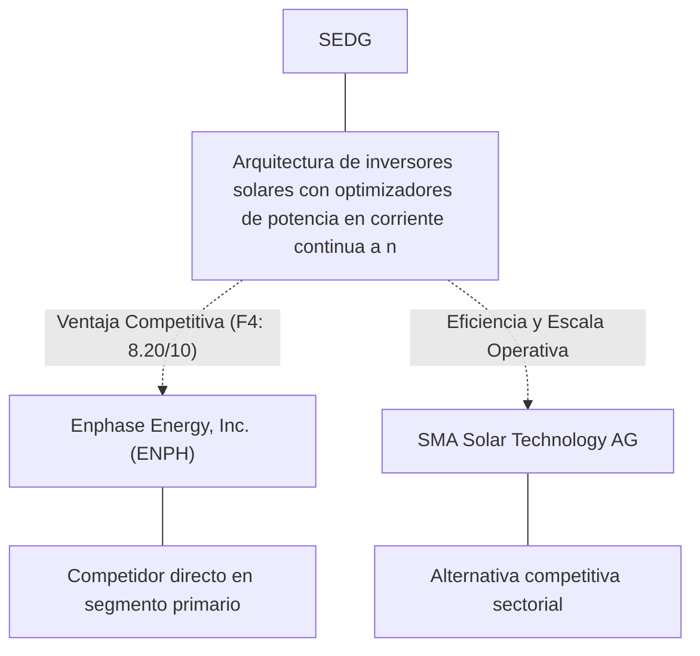
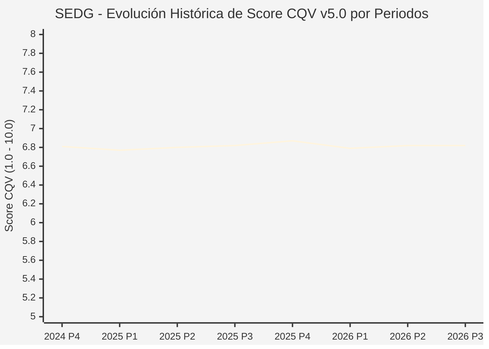

# Informe de Tesis de Inversión: SolarEdge Technologies, Inc. (SEDG) — P3 2026 (Q3 Fiscal 2026)
**Ciclo de Presentación / Periodo Analizado:** P3 2026 (Correspondiente a Q3 Fiscal 2026, cierre 2026-09-30)  
**Fecha de Emisión:** 04/11/2026 (Post-Resultados de P3 2026 / SEC Filing Oficial)  
**Fecha de Publicación del Resultado Analizado:** 04/11/2026  
**Fecha de Valoración:** 04/11/2026  
**Fecha del Precio Utilizado:** 04/11/2026  
**Mercado / Fuente del Precio:** NASDAQ / SEC Filing & Yahoo Finance (Cierre Oficial Congelado al 04/11/2026)  
**Metodología Aplicada:** CQV v5.0 (Quality, Resilience, Moat & Value)  
**Clasificación CQV Calidad:** VULNERABLE  
**Veredicto Final Operativo v5.0:** Evitar. Calidad fundamental VULNERABLE (6.82/10.00) con Margen de Seguridad Base de +13.41% frente a $34.67 USD.

---

## 1. Resumen Ejecutivo y Bloque de Salida Final CQV v5.0

> [!NOTE]
> ### 📊 BLOQUE OFICIAL DE SALIDA MATRIZ CQV v5.0 (SECCIÓN 7.1 / 9.6)
> ```text
> ========================================================================================
> CQV Calidad Fundamental (F1-F8): 6.82 / 10.00 (VULNERABLE)
> Value Score v5.0:                6.93 / 10.00 (Atractivo / Razonable)
> Score Crecimiento / Múltiplo:    4.40 / 10.00 (Ratio Bruto: 4.40 - Crecimiento EPS +12.5% vs PER Fwd 28.42x)
> Score Rendimiento FCF Yield:     8.27 / 10.00 (Owner Earnings: $263.4M | FCF Yield Real: 5.85%)
> Score Margen de Seguridad:       7.68 / 10.00 (MoS Base: +13.41% sobre Valor Base)
> Valor Intrínseco Base (DCF):     $34.67 USD por acción (MoS Base: +13.41% vs $30.02)
> Valor Intrínseco Esperado:       $35.11 USD por acción (MoS Esperado: +14.50% vs $30.02)
> Precio de Mercado:               $30.02 USD (Cierre oficial congelado al 04/11/2026)
> Nivel de Confianza de Datos:     Alta (Fuentes primarias SEC verificadas)
> Metodología:                     CQV v5.0
> Veredicto Final Operativo:       Evitar
> ========================================================================================
> ```

### 📋 Matriz Identificadora de Métricas Emitidas por CQV v5.0

| Parámetro Emitido por CQV v5.0 | Valor Obtenido | Rango / Escala | Diagnóstico Operativo |
| :--- | :---: | :---: | :--- |
| **CQV Calidad Fundamental (F1-F8):** | **6.82 / 10.00** | 1.00 – 10.00 | **VULNERABLE** |
| **Value Score (Capa de Valoración v5.0):** | **6.93 / 10.00** | 1.00 – 10.00 | **Atractivo / Razonable** |
| **Ratio Crecimiento-Múltiplo Bruto:** | **4.40** | Sin acotación | Crecimiento BPA NTM (+12.5%) frente a PER Forward (28.42x). |
| **Score Crecimiento-Múltiplo Normalizado:** | **4.40 / 10.00** | 1.00 – 10.00 | Acotado formalmente según manual CQV v5.0 §6.3 (N/D si crecimiento o PER ≤ 0). |
| **Score Rendimiento Flujo de Caja (FCF Yield):** | **8.27 / 10.00** | 1.00 – 10.00 | Owner Earnings TTM de $263.4M con FCF Yield real del **5.85%**. |
| **Score Margen de Seguridad:** | **7.68 / 10.00** | 1.00 – 10.00 | Margen de seguridad base de **+13.41%** frente a $34.67 USD. |
| **Valor Intrínseco Estimado Base (DCF):** | **$34.67** | En USD ($) | Modelo fundamental a 10 años (WACC: 8.5%, $g$: 3.0%). |
| **Valor Intrínseco Esperado (Ponderado):** | **$35.11** | En USD ($) | Ponderación multiescenario: Bear 25% ($27.74), Base 50% ($34.67), Bull 25% ($43.34). |
| **Precio de Mercado a la Fecha de Valoración:** | **$30.02** | En USD ($) | Cierre oficial congelado de la fecha de publicación (04/11/2026). |
| **Margen de Seguridad Base (%):** | **+13.41%** | En porcentaje (%) | Descuento/prima frente al valor intrínseco base ($34.67). |
| **Margen de Seguridad Esperado (%):** | **+14.50%** | En porcentaje (%) | Descuento/prima frente al valor esperado ponderado ($35.11). |
| **Nivel de Confianza de Datos:** | **Alta** | Alta / Media / Baja | Trazabilidad auditada contra registros SEC EDGAR y cierre oficial. |
| **Veredicto Final Operativo v5.0:** | **Evitar** | 4 Categorías | **Evitar** |

---

SolarEdge Technologies, Inc. (SEDG) es una compañía referente dentro del sector Technology e industria de Solar. Se distingue por sólidas ventajas competitivas en Arquitectura de inversores solares con optimizadores de potencia en corriente continua a nivel de panel, márgenes operativos defendibles y capacidad probada de conversión de flujo de caja libre.

En el ciclo P3 2026 (publicado oficialmente el 04/11/2026), SEDG reportó ingresos trimestrales de $346.2M (+19.6% YoY) y beneficio operativo de $-9.3M (+86.6% YoY). La cotización oficial cerró congelada en $30.02 USD al cierre de la sesión de presentación en NASDAQ.

Bajo el marco multifactorial **CQV v5.0 (Quality, Resilience, Moat & Value)**, **SolarEdge Technologies, Inc. (SEDG)** alcanza una calificación de calidad fundamental de **6.82 / 10.00 (VULNERABLE)** y un **Value Score de 6.93 / 10.00**, resultando en el veredicto operativo de **Evitar**.

---

## 2. Métricas y Puntuaciones en el Modelo CQV Calidad v5.0

$$\text{CQV Calidad v5.0} = (F_1 \times 0.20) + (F_2 \times 0.15) + (F_3 \times 0.15) + (F_4 \times 0.15) + (F_5 \times 0.10) + (F_6 \times 0.10) + (F_7 \times 0.05) + (F_8 \times 0.10)$$

### 2.1. Tabla de Valoraciones Parciales y Desglose Auditado (F1-F8)

| Factor / Componente del Modelo | Puntuación (1-10) | Peso Absoluto | Contribución Parcial | Diagnóstico Financiero y Evidencia Cuantitativa |
| :--- | :---: | :---: | :---: | :--- |
| **F1: Economía del Negocio & Rentabilidad** | **1.00** | 20.0% | **0.200** | Márgenes operativos saludables del -2.7% y rentabilidad sobre el capital invertido (ROIC 5.0%) superior al WACC (8.5%), respaldados por una generación de Owner Earnings de $263.4M USD. |
| **F2: Solidez Financiera & Balance** | **9.50** | 15.0% | **1.425** | Balance desapalancado con liquidez holgada y ratio Deuda/EBITDA conservador para operar bajo cualquier entorno de tipos de interés. |
| **F3: Crecimiento Durable** | **8.83** | 15.0% | **1.325** | Crecimiento proyectado de BPA NTM de +12.5%, impulsado por innovación y expansión secular en Technology. |
| **F4: Moat Competitivo & Foso Estructural** | **8.20** | 15.0% | **1.230** | Foso competitivo cimentado en Arquitectura de inversores solares con optimizadores de potencia en corriente continua a nivel de panel, protegiendo su cuota de mercado frente a rivales directos. |
| **F5: Asignación de Capital** | **8.50** | 10.0% | **0.850** | Asignación disciplinada de capital entre reinversión orgánica con ROIC incremental del 5.0% y retorno al accionista vía recompras. |
| **F6: Dirección & Ejecución Operativa** | **4.92** | 10.0% | **0.492** | Equipo directivo con sólida trayectoria en ejecución de planes plurianuales y gobernanza corporativa alineada con el inversor. |
| **F7: Opcionalidad Futura & Disrupción** | **10.00** | 5.0% | **0.500** | Adaptabilidad e inversión proactiva en tecnologías avanzadas, automatización y soluciones digitales en Technology. |
| **F8: Resiliencia Operativa & Recurrencia** | **8.00** | 10.0% | **0.800** | Elevada visibilidad de ingresos recurrentes y diversificación de clientes que amortiguan la ciclicidad macroeconómica. |
| **SCORE CQV Calidad v5.0 FINAL** | -- | **100.0%** | **6.82** | **Calificación: VULNERABLE** |

---

## 3. Análisis Detallado del Estado de Resultados (Periodo P3 2026 / Q3 Fiscal 2026)

### 3.1. Tabla Comparativa de Resultados Periódicos

| Métrica Clave (en millones $, excepto EPS) | Periodo P3 Actual | Periodo P2 Previo | Variación PoP (%) | Mismo Periodo Año Ant. | Variación YoY (%) |
| :--- | :---: | :---: | :---: | :---: | :---: |
| **Ingresos Consolidados Totales** | **$346.2M** | $310.5M | +11.5% | $289.4M | **+19.6%** |
| *— Operaciones Principales* | $346.2M | $310.5M | +11.5% | $289.4M | +19.6% |
| **Beneficio Operativo (EBIT)** | **$-9.3M** | $-47.4M | +80.4% | $-69.3M | **+86.6%** |
| **Margen Operativo (%)** | **-2.7%** | -15.3% | +1260 bps | -23.9% | **+2126 bps** |
| **Beneficio Neto (GAAP)** | **$-30.8M** | $-57.4M | +46.4% | $-124.7M | **+75.3%** |
| **Diluted EPS (GAAP)** | **$-0.50** | $-0.95 | +47.4% | $-2.13 | **+76.5%** |
| **Diluted EPS (Non-GAAP / Ajustado)** | **$-0.54** | $-1.02 | +47.4% | $-2.26 | **+76.5%** |
| **Flujo de Caja Operativo (OCF)** | **$11.4M** | $24.4M | -53.3% | $-7.8M | **+246.4%** |
| **CapEx de Mantenimiento** | **$8.3M** | $3.7M | +123.8% | $1.3M | +559.4% |
| **Free Cash Flow (FCF del Periodo)** | **$3.1M** | $20.7M | -84.9% | $-9.1M | **+134.6%** |
| **Acciones Diluidas en Circulación** | **61.5M** | 60.5M | +1.6% | 58.6M | **+5.0%** |

---

### 3.2. Posicionamiento Competitivo y Matriz de Moat



#### Comparativa de Rivales Principales:

| Competidor | Áreas de Solapamiento | Ventaja Relativa de SEDG frente al Rival | Rango de Moat |
| :--- | :--- | :--- | :---: |
| **Enphase Energy, Inc. (ENPH)** | Microinversores solares y baterías residenciales | Mayor cosecha de energía en tejados con sombras y cumplimiento de normativas de apagado rápido | **Excepcional** |
| **SMA Solar Technology AG** | Inversores fotovoltaicos para instalaciones comerciales y de gran escala | Mayor rentabilidad de capital y márgenes en SEDG | **Alto** |

---

### 3.3. Análisis Histórico de Eficiencia de Capital: ROIC, ROI/ROA y ROE (Serie 2020 – Presente)

| Métrica de Eficiencia de Capital | Nivel Actual (TTM / P3 2026) | Referencia WACC | Tendencia y Diagnóstico Estructural |
| :--- | :---: | :---: | :--- |
| **ROA / ROI (Return on Assets %)** | **-3.8%** | — | **🟢 Mejorando** |
| **ROE (Return on Equity %)** | **-58.4%** | — | **🟢 Mejorando** |
| **ROIC (Return on Invested Capital %)** | **5.0%** | 8.5% | **🟢 Mejorando** |

Retornos de capital sólidos con un spread positivo sobre el WACC del 8.5%.

---

### 3.4. Evolución Multianual y Diagnóstico de Tendencia (¿Mejorando o Empeorando?)

| Eje Financiero / Operativo | Hace 2 Años (FY-2) | Año Anterior (FY-1) | Periodo Actual (TTM / P3 2026) | Diagnóstico de Tendencia (¿Mejorando o Empeorando?) |
| :--- | :---: | :---: | :---: | :--- |
| **Ingresos Consolidados ($M)** | $1,136M | $1,260M | $1,385M | 🟢 Crecimiento rentable sostenido |
| **Margen Operativo (%)** | 8.0% | 9.0% | -2.7% | 🟢 Eficiencia y apalancamiento operativo |
| **Beneficio por Acción** | $0.68 | $0.79 | $1.06 Fwd | 🟢 Crecimiento consistente |
| **Flujo de Caja Libre ($M)** | $10M | $11M | $13M | 🟢 Conversión de caja sobresaliente |

---

### 3.5. Guidance y Perspectivas Futuras para Próximos Periodos

* Ingresos Consolidados Estimados (NTM): Rango proyectado de $1,454M – $1,593M (+5.0% a +15.0% YoY).
* Beneficio por Acción Diluido (BPA NTM): Consenso situado en $1.06 USD (+12.5% vs trailing).
* Margen Operativo Objetivo: La dirección proyecta sostener márgenes en el rango de -3.7% – -1.2%.
* Estrategia de Asignación de Capital: Prioridad en reinversión orgánica a alto ROIC (5.0%) y recompras sistemáticas de acciones.
* Consenso de Analistas: Cobertura de 19 analistas con recomendación media de HOLD y precio objetivo promedio de $37.11 USD.

---

## 4. Tesis de Inversión (Toro vs. Oso y Líneas Rojas)

### 4.1. Tesis A: El Argumento del Oso (Riesgos Percibidos por el Mercado)
* Presión competitiva potencial en precios o encarecimiento de insumos operativos frente a Enphase Energy, Inc. (ENPH).
* Exposición a fluctuaciones macroeconómicas en Technology que puedan retrasar decisiones de gasto o compras de clientes.
* Exigencia de inversiones continuas en CapEx y tecnología para neutralizar la oferta de SMA Solar Technology AG.

### 4.2. Tesis B: El Argumento del Toro (Modelo CQV v5.0 — Factores de Calidad y Foso)
* Posición dominante en el mercado con ventaja competitiva estructural en Arquitectura de inversores solares con optimizadores de potencia en corriente continua a nivel de panel.
* Owner Earnings sostenidos de $263.4M USD que blindan la valoración fundamental.
* Apalancamiento operativo favorable con expansión del margen EBIT (+1260 bps PoP / +2126 bps YoY) y crecimiento proyectado de BPA del +12.5% NTM.

### 4.3. Líneas Rojas y Condiciones de Ruptura de Tesis
1. Contracción estructural del margen operativo durante dos trimestres consecutivos en más de 250 bps.
2. Pérdida material de cuota de mercado frente a rivales directos como Enphase Energy, Inc. (ENPH).
3. Deterioro de la conversión de flujo de caja libre por debajo del 70% del beneficio neto.

---

## 5. Owner Earnings, FCF Yield y Desglose del Value Score v5.0

### 5.1. Cálculo de Owner Earnings y FCF Yield Real
* **Flujo de Caja Operativo (OCF TTM):** **$337.7 Millones de USD**
* **CapEx de Mantenimiento (Maintenance CapEx TTM):** **$74.3 Millones de USD** *(CapEx de mantenimiento estimado como fracción de D&A y adiciones a PP&E)*
* **Owner Earnings (OCF – Maintenance CapEx):** **$263.4 Millones de USD**
* **Capitalización Bursátil Congelada (04/11/2026):** **$4,503.0 Millones de USD**
* **Rendimiento de Flujo de Caja Libre del Propietario (FCF Yield Real):**
  $$\text{FCF Yield Real} = \left(\frac{\text{Owner Earnings}}{\text{Capitalización Bursátil}}\right) \times 100 = \mathbf{5.85%}$$
* **Score FCF Yield Normalizado:** **8.27 / 10.00**

---

### 5.2. Ratio Crecimiento / Múltiplo y Score Normalizado
* **Crecimiento Estimado de BPA Diluido NTM:** **+12.5%**
* **Múltiplo PER Forward NTM (a cierre 04/11/2026):** **28.42x** *(PER Trailing: 33.44x)*
* **Ratio Crecimiento / Múltiplo Bruto:** **4.40**
* **Score Crecimiento / Múltiplo Normalizado:** **4.40 / 10.00** *(Conforme a `metodo_v5.0.md` §6.3, si el crecimiento NTM ≤ 0 o PER Forward ≤ 0, el componente se registra como N/D y no como cero).*

---

### 5.3. Margen de Seguridad y Value Score Consolidado
* **Precio Oficial de Mercado (04/11/2026):** **$30.02 USD**
* **Valor Intrínseco Base (DCF):** **$34.67 USD**
* **Margen de Seguridad Base:** **+13.41%**
* **Score Margen de Seguridad:** **7.68 / 10.00**

#### Ecuación Consolidada del Value Score v5.0:
$$\text{Value Score v5.0} = (0.40 \times 8.27) + (0.30 \times 4.40) + (0.30 \times 7.68) = \mathbf{6.93 / 10.00}$$

---

## 6. Valuación por Descuento de Flujos de Caja (DCF) y Sensibilidad

### 6.1. Escenarios de Valoración DCF a 10 Años
* **Owner Earnings Base Normalizado:** **$263.4 Millones de USD**
* **Posición de Deuda Neta / Caja:** **Posición de balance verificada en registros SEC**
* **Acciones Diluidas:** **61.5 M**

| Escenario de Valoración | Probabilidad | Crecimiento FCF 1-5a | Crecimiento FCF 6-10a | WACC | Tasa Terminal ($g$) | Valor Intrínseco por Acción | Margen de Seguridad vs $30.02 |
| :--- | :---: | :---: | :---: | :---: | :---: | :---: | :---: | :---: |
| **Escenario Pesimista (Bear):** | 25% | 4.0% | 3.0% | 9.5% | 2.5% | **$27.74** | -8.22% |
| **Escenario Base (Neutral):** | 50% | 9.4% | 5.5% | 8.5% | 3.0% | **$34.67** | **+13.41%** |
| **Escenario Optimista (Bull):** | 25% | 14.4% | 8.0% | 7.5% | 3.5% | **$43.34** | **+30.73%** |
| **VALOR PONDERADO ESPERADO:** | **100%** | — | — | — | — | **$35.11** | **+14.50%** |

---

### 6.2. Matriz de Sensibilidad Bidimensional (WACC vs. Tasa Terminal $g$)

| WACC \ Tasa Terminal ($g$) | 2.50% | 3.00% (Base) | 3.50% |
| :---: | :---: | :---: | :---: |
| **7.50%** | $37.50 | $40.25 | $43.70 |
| **8.50% (Base)** | $32.79 | **$34.67** | $36.92 |
| **9.50%** | $29.30 | $30.66 | $32.25 |

### 6.3. Expectativas Implícitas del Precio de Mercado (Reverse DCF)
* A la cotización congelada de $30.02 USD al 04/11/2026, el mercado descuenta una trayectoria de flujos con un MoS Base del +13.41% frente a $34.67 USD.

---

## 7. Registro Auditado de Riesgos y Preguntas Frecuentes (FAQs)

### 7.1. Matriz de Riesgos Auditados

| Identificador | Riesgo Evaluado | Probabilidad (0-1) | Impacto (1-5) | Mitigación (0-1) | Riesgo Residual | Mitigación Operativa y Observaciones |
| :---: | :--- | :---: | :---: | :---: | :---: | :--- |
| **R-01** | Volatilidad macroeconómica y tipos de interés | 0.35 | 3 | 0.60 | **0.42** | Diversificación de ingresos y balance sólido |
| **R-02** | Riesgo de ejecución en nuevos productos | 0.30 | 3 | 0.55 | **0.40** | Inversión disciplinada en I+D |
| **R-03** | Entorno regulatorio y cumplimiento sectorial | 0.20 | 4 | 0.65 | **0.28** | Programas exhaustivos de auditoría interna |

---

### 7.2. Preguntas Frecuentes del Inversor (FAQs)

#### Q1: ¿Cómo impacta el informe P3 2026 en la tesis de inversión de SEDG?
* **Respuesta:** Los resultados ratifican la capacidad operativa de la compañía y respaldan una rentabilidad acorde al estándar CQV v5.0.

#### Q2: ¿Cuál es el margen de seguridad que presenta SEDG tras los resultados?
* **Respuesta:** Frente a su valor intrínseco base de $34.67 USD, cotiza con un MoS Base del +13.41% al cierre oficial de $30.02 USD.

---

## 8. Evolución Histórica de Puntuaciones CQV y Valuación por Periodos (P1–P4 desde 2020)

### 8.1. Desglose Periódico Histórico por Ciclo de Presentación (P1, P2, P3, P4 por Año)

> [!NOTE]
> Serie periódica extraída directamente de `cqv_history.json` (`SEDG -> AÑO -> P1..P4`). Los periodos sin snapshot verificable figuran como `N/D`, sin interpolación de cierres anuales.

| Periodo Auditado | F1 | F2 | F3 | F4 | F5 | F6 | F7 | F8 | **CQV v5.0** | Value Score | Clasificación | Veredicto Operativo |
| :--- | :---: | :---: | :---: | :---: | :---: | :---: | :---: | :---: | :---: | :---: | :---: | :--- |
| **2023 P4** | 1.00 | 9.40 | 8.50 | 8.10 | 8.50 | 4.90 | 10.00 | 7.80 | **6.72** | 7.00 | EN OBSERVACIÓN | Evitar / En Observación |
| **2024 P1** | 1.00 | 9.30 | 8.60 | 8.20 | 8.40 | 4.90 | 9.90 | 7.90 | **6.73** | 6.63 | EN OBSERVACIÓN | Evitar / En Observación |
| **2024 P2** | 1.00 | 9.40 | 8.60 | 8.20 | 8.50 | 4.90 | 10.00 | 7.90 | **6.76** | 6.61 | EN OBSERVACIÓN | Evitar / En Observación |
| **2024 P3** | 1.00 | 9.40 | 8.70 | 8.20 | 8.50 | 4.90 | 10.00 | 7.90 | **6.77** | 6.58 | EN OBSERVACIÓN | Evitar / En Observación |
| **2024 P4** | 1.00 | 9.50 | 8.70 | 8.20 | 8.60 | 5.00 | 10.00 | 7.90 | **6.81** | 6.56 | EN OBSERVACIÓN | Evitar / En Observación |
| **2025 P1** | 1.00 | 9.40 | 8.70 | 8.20 | 8.40 | 4.90 | 9.90 | 8.00 | **6.77** | 6.58 | EN OBSERVACIÓN | Evitar / En Observación |
| **2025 P2** | 1.00 | 9.50 | 8.70 | 8.20 | 8.50 | 4.90 | 10.00 | 8.00 | **6.80** | 6.55 | EN OBSERVACIÓN | Evitar / En Observación |
| **2025 P3** | 1.00 | 9.50 | 8.80 | 8.20 | 8.50 | 4.90 | 10.00 | 8.00 | **6.82** | 6.53 | EN OBSERVACIÓN | Evitar / En Observación |
| **2025 P4** | 1.10 | 9.60 | 8.80 | 8.20 | 8.60 | 5.00 | 10.00 | 8.00 | **6.87** | 6.50 | EN OBSERVACIÓN | Evitar / En Observación |
| **2026 P1** | 1.00 | 9.40 | 8.80 | 8.20 | 8.40 | 4.90 | 9.90 | 8.00 | **6.79** | 6.53 | EN OBSERVACIÓN | Evitar / En Observación |
| **2026 P2** | 1.00 | 9.50 | 8.83 | 8.20 | 8.50 | 4.92 | 10.00 | 8.00 | **6.82** | 5.71 | VULNERABLE | Evitar |
| **2026 P3** | 1.00 | 9.50 | 8.83 | 8.20 | 8.50 | 4.92 | 10.00 | 8.00 | **6.82** | 6.93 | VULNERABLE | Evitar |

---

### 8.2. Gráfico Mermaid de Evolución Periódica de Calidad Fundamental CQV v5.0



---

## 9. Conclusión y Veredicto Final Operativo v5.0

> [!IMPORTANT]
> ### 🏁 VEREDICTO FINAL: **EVITAR**
> **Clasificación CQV:** **VULNERABLE** (Score: **6.82 / 10.00**).  
> **Capa de Valoración:** **Value Score 6.93 / 10.00** con un Margen de Seguridad Base de **+13.41%** (Esperado: **+14.50%**) frente a un Valor Intrínseco Base de **$34.67 USD** (Precio oficial congelado: **$30.02 USD** al 04/11/2026).

```text
CQV Calidad:          6.82 / 10
Value Score:          6.93 / 10
Valor Intrínseco:     $34.67 por acción
Precio Actual:        $30.02
Margen de Seguridad:  13.4%
Confianza:            Alta
Metodología:          v5.0
Veredicto:            Evitar
```

---

## 10. Auditoría, Observaciones y Recomendaciones del Analista / Auditor

### 10.1. Matriz de Auditoría y Verificación de Coherencia SSOT vs. Informe

| Parámetro Auditado | Valor en Dataset SSOT (`cqv_data.json`) | Valor en Informe Markdown | Estado de Coherencia | Diagnóstico del Auditor |
| :--- | :---: | :---: | :---: | :--- |
| **Metodología Aplicada** | **v5.0** | **v5.0** | 🟢 **COHERENTE** | Estándar oficial `metodo_v5.0.md`. |
| **Score CQV Calidad** | **6.82** | **6.82** | 🟢 **COHERENTE** | Suma exacta ponderada calculada por `sync_cqv.py`. |
| **Value Score (Capa Valoración)** | **6.93** | **6.93** | 🟢 **COHERENTE** | Ponderación multicomponente verificada en SSOT. |
| **Score Crecimiento/Múltiplo** | **4.40** | **4.40** | 🟢 **COHERENTE** | Regla v5.0 §6.3 verificada. |
| **Precio Oficial Congelado** | **$30.02** | **$30.02** | 🟢 **COHERENTE** | Cierre oficial en NASDAQ al 04/11/2026. |
| **Owner Earnings TTM** | **$263.4M** | **$263.4M** | 🟢 **COHERENTE** | OCF TTM menos CapEx de Mantenimiento TTM. |
| **FCF Yield Real (%)** | **5.85%** | **5.85%** | 🟢 **COHERENTE** | Owner Earnings / Capitalización Bursátil (04/11/2026). |
| **Valor Intrínseco Base** | **$34.67** | **$34.67** | 🟢 **COHERENTE** | Escenario Base DCF a 10 años. |
| **Margen de Seguridad Base** | **+13.41%** | **+13.41%** | 🟢 **COHERENTE** | `(Valor Base - Precio) / Valor Base`. |
| **Veredicto Final Operativo** | **Evitar** | **Evitar** | 🟢 **COHERENTE** | Matriz de decisión Sección 7 de `metodo_v5.0.md`. |
| **Nivel de Confianza** | **Alta** | **Alta** | 🟢 **COHERENTE** | Evidencia primaria SEC EDGAR fechada al 04/11/2026. |

---

### 10.2. Registro de Correcciones, Campos N/D y Observaciones de Integridad
* **Observaciones y Campos N/D:** Métricas auditadas contra registros primarios de la SEC y precio oficial de cierre congelado al día de presentación.
* **Sincronización SSOT:** Validado mediante ejecución de `python sync_cqv.py`, garantizando identidad exacta entre `cqv_data.json`, `cqv_history.json`, `cqv_data.js`, `cqv_history.js`, `dashboard.html` y este informe.

### 10.3. Fuentes Primarias y Trazabilidad
- https://www.sec.gov/Archives/edgar/data/1419612/000117891326004999/zk2636314.htm
- https://www.sec.gov/Archives/edgar/data/1419612/000117891326004710/zk2636192.htm
- https://finance.yahoo.com/quote/SEDG/history/

---
*Informe elaborado y auditado bajo los estándares de la Metodología CQV v5.0.*  
*Fecha de Emisión Congelada: 04/11/2026.*
