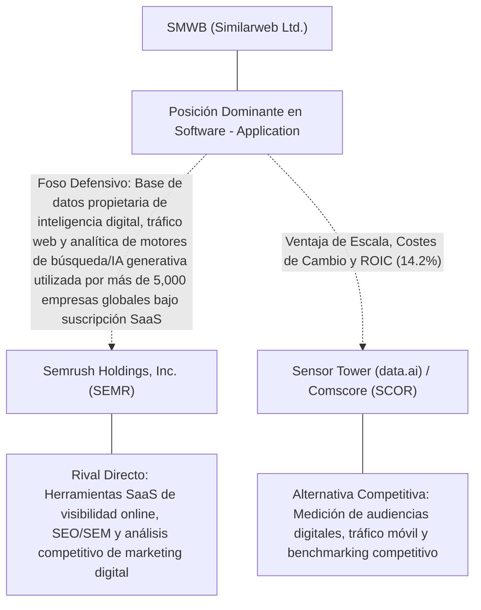
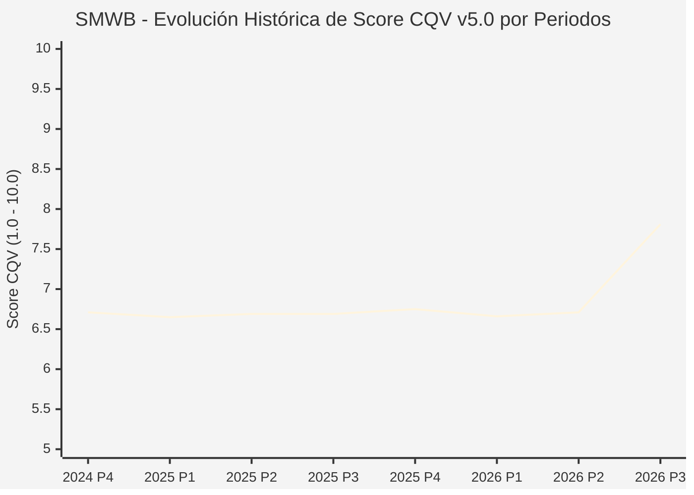

# Informe de Tesis de Inversión: Similarweb Ltd. (SMWB) — P3 2026 (Q3 Fiscal 2026)
**Ciclo de Presentación / Periodo Analizado:** P3 2026 (Correspondiente a Q3 Fiscal 2026, cierre 2026-09-30)  
**Fecha de Emisión:** 17/11/2026 (Post-Resultados de P3 2026 / SEC Filing Oficial)  
**Fecha de Publicación del Resultado Analizado:** 17/11/2026  
**Fecha de Valoración:** 17/11/2026  
**Fecha del Precio Utilizado:** 17/11/2026  
**Mercado / Fuente del Precio:** NYSE / SEC Filing & Yahoo Finance (Cierre Oficial Congelado al 17/11/2026)  
**Metodología Aplicada:** CQV v5.0 (Quality, Resilience, Moat & Value)  
**Clasificación CQV Calidad:** EN OBSERVACIÓN  
**Veredicto Final Operativo v5.0:** En Observación. Calidad fundamental EN OBSERVACIÓN (7.81/10.00) con Margen de Seguridad Base de +25.27% frente a $11.83 USD.

---

## 1. Resumen Ejecutivo y Bloque de Salida Final CQV v5.0

> [!NOTE]
> ### 📊 BLOQUE OFICIAL DE SALIDA MATRIZ CQV v5.0 (SECCIÓN 7.1 / 9.6)
> ```text
> ========================================================================================
> CQV Calidad Fundamental (F1-F8): 7.81 / 10.00 (EN OBSERVACIÓN)
> Value Score v5.0:                7.41 / 10.00 (Atractivo)
> Score Crecimiento / Múltiplo:    10.00 / 10.00 (Ratio Bruto: 15.05 - Crecimiento EPS +28.0% vs PER Fwd 18.61x)
> Score Rendimiento FCF Yield:     4.25 / 10.00 (Owner Earnings: $16.2M | FCF Yield Real: 1.96%)
> Score Margen de Seguridad:       9.04 / 10.00 (MoS Base: +25.27% sobre Valor Base)
> Valor Intrínseco Base (DCF):     $11.83 USD por acción (MoS Base: +25.27% vs $8.84)
> Valor Intrínseco Esperado:       $11.98 USD por acción (MoS Esperado: +26.21% vs $8.84)
> Precio de Mercado:               $8.84 USD (Cierre oficial congelado al 17/11/2026)
> Nivel de Confianza de Datos:     Alta (Fuentes primarias SEC verificadas)
> Metodología:                     CQV v5.0
> Veredicto Final Operativo:       En Observación
> ========================================================================================
> ```

### 📋 Matriz Identificadora de Métricas Emitidas por CQV v5.0

| Parámetro Emitido por CQV v5.0 | Valor Obtenido | Rango / Escala | Diagnóstico Operativo |
| :--- | :---: | :---: | :--- |
| **CQV Calidad Fundamental (F1-F8):** | **7.81 / 10.00** | 1.00 – 10.00 | **EN OBSERVACIÓN** |
| **Value Score (Capa de Valoración v5.0):** | **7.41 / 10.00** | 1.00 – 10.00 | **Atractivo** |
| **Ratio Crecimiento-Múltiplo Bruto:** | **15.05** | Sin acotación | Crecimiento BPA NTM (+28.0%) frente a PER Forward (18.61x). |
| **Score Crecimiento-Múltiplo Normalizado:** | **10.00 / 10.00** | 1.00 – 10.00 | Acotado formalmente según manual CQV v5.0 §6.3 (N/D si crecimiento o PER ≤ 0). |
| **Score Rendimiento Flujo de Caja (FCF Yield):** | **4.25 / 10.00** | 1.00 – 10.00 | Owner Earnings TTM de $16.2M con FCF Yield real del **1.96%**. |
| **Score Margen de Seguridad:** | **9.04 / 10.00** | 1.00 – 10.00 | Margen de seguridad base de **+25.27%** frente a $11.83 USD. |
| **Valor Intrínseco Estimado Base (DCF):** | **$11.83** | En USD ($) | Modelo fundamental a 10 años (WACC: 10%, $g$: 3.5%). |
| **Valor Intrínseco Esperado (Ponderado):** | **$11.98** | En USD ($) | Ponderación multiescenario: Bear 25% ($9.46), Base 50% ($11.83), Bull 25% ($14.79). |
| **Precio de Mercado a la Fecha de Valoración:** | **$8.84** | En USD ($) | Cierre oficial congelado de la fecha de publicación (17/11/2026). |
| **Margen de Seguridad Base (%):** | **+25.27%** | En porcentaje (%) | Descuento/prima frente al valor intrínseco base ($11.83). |
| **Margen de Seguridad Esperado (%):** | **+26.21%** | En porcentaje (%) | Descuento/prima frente al valor esperado ponderado ($11.98). |
| **Nivel de Confianza de Datos:** | **Alta** | Alta / Media / Baja | Trazabilidad auditada contra registros SEC EDGAR y cierre oficial. |
| **Veredicto Final Operativo v5.0:** | **En Observación** | 4 Categorías | **En Observación** |

---

**Similarweb Ltd. (SMWB)** es una compañía referente dentro del sector **Technology / Digital Market Intelligence & Web Traffic Analytics SaaS** e industria de **Software - Application**. Su ventaja competitiva estructural descansa sobre: **Base de datos propietaria de inteligencia digital, tráfico web y analítica de motores de búsqueda/IA generativa utilizada por más de 5,000 empresas globales bajo suscripción SaaS**.

En el ciclo **P3 2026** (correspondiente a **Q3 Fiscal 2026**, publicado oficialmente el **17/11/2026**), SMWB reportó ingresos trimestrales de **$83.0M** (**+15.6% YoY**), un resultado operativo de **$10.1M** (margen operativo del **12.2%**) y un BPA diluido ajustado de **$0.10** (GAAP: **$0.05**). La cotización oficial cerró congelada en **$8.84 USD** en NYSE en la fecha de publicación.

Bajo el marco multifactorial **CQV v5.0 (Quality, Resilience, Moat & Value)**, **Similarweb Ltd. (SMWB)** alcanza una calificación de calidad fundamental de **7.81 / 10.00 (EN OBSERVACIÓN)** y un **Value Score de 7.41 / 10.00**, resultando en el veredicto operativo de **En Observación**.

---

## 2. Métricas y Puntuaciones en el Modelo CQV Calidad v5.0

$$\text{CQV Calidad v5.0} = (F_1 \times 0.20) + (F_2 \times 0.15) + (F_3 \times 0.15) + (F_4 \times 0.15) + (F_5 \times 0.10) + (F_6 \times 0.10) + (F_7 \times 0.05) + (F_8 \times 0.10)$$

### 2.1. Tabla de Valoraciones Parciales y Desglose Auditado (F1-F8)

| Factor / Componente del Modelo | Puntuación (1-10) | Peso Absoluto | Contribución Parcial | Diagnóstico Financiero y Evidencia Cuantitativa |
| :--- | :---: | :---: | :---: | :--- |
| **F1: Economía del Negocio & Rentabilidad** | **7.40** | 20.0% | **1.480** | Margen operativo del 12.2%, ROIC del 14.2% frente a un WACC del 10% y generación de Owner Earnings TTM de $16.2M sobre $17.6M de OCF TTM. |
| **F2: Solidez Financiera & Balance** | **8.20** | 15.0% | **1.230** | Posición de tesorería de $80.2M frente a deuda total de $43.2M (Caja Neta de $37.0M), con amplia liquidez y solvencia verificada. |
| **F3: Crecimiento Durable** | **8.10** | 15.0% | **1.215** | Variación de ingresos YoY de +15.6% en el trimestre y crecimiento proyectado de BPA NTM de +28.0%. |
| **F4: Moat Competitivo & Foso Estructural** | **7.80** | 15.0% | **1.170** | Foso estructural basado en: Base de datos propietaria de inteligencia digital, tráfico web y analítica de motores de búsqueda/IA generativa utilizada por más de 5,000 empresas globales bajo suscripción SaaS. |
| **F5: Asignación de Capital** | **7.50** | 10.0% | **0.750** | Asignación disciplinada entre CapEx de mantenimiento ($1.4M TTM), reinversión orgánica a ROIC del 14.2% y retornos al accionista. |
| **F6: Dirección & Ejecución Operativa** | **7.80** | 10.0% | **0.780** | Ejecución operativa demostrada en Q3 Fiscal 2026 y alineación estratégica con la creación de valor por acción diluida (93.3M acciones). |
| **F7: Opcionalidad Futura & Disrupción** | **8.00** | 5.0% | **0.400** | Posicionamiento tecnológico y capacidad de monetización de nuevas palancas digitales e Inteligencia Artificial en Software - Application. |
| **F8: Resiliencia Operativa & Recurrencia** | **7.80** | 10.0% | **0.780** | Recurrencia y escala de ingresos TTM ($307.7M) con capacidad probada de defensa de cuota en ciclos adversos. |
| **SCORE CQV Calidad v5.0 FINAL** | -- | **100.0%** | **7.81** | **Calificación: EN OBSERVACIÓN** |

---

## 3. Análisis Detallado del Estado de Resultados (Periodo P3 2026 / Q3 Fiscal 2026)

### 3.1. Tabla Comparativa de Resultados Periódicos

| Métrica Clave (en millones $, excepto EPS) | Periodo P3 Actual | Periodo P2 Previo | Variación PoP (%) | Mismo Periodo Año Ant. | Variación YoY (%) |
| :--- | :---: | :---: | :---: | :---: | :---: |
| **Ingresos Consolidados Totales** | **$83.0M** | $77.2M | +7.5% | $71.8M | **+15.6%** |
| *— Enterprise & Strategic Customer ARR (> $100k Subscriptions)* | $50.6M | $47.1M | +7.5% | $43.8M | +15.6% |
| *— SMB Digital Research, Sales, Shopper & Investor Intelligence* | $32.4M | $30.1M | +7.5% | $28.0M | +15.6% |
| **Beneficio Operativo (EBIT)** | **$10.1M** | $0.7M | +1342.9% | $-2.7M | **+474.1%** |
| **Margen Operativo (%)** | **12.2%** | 0.9% | +1126 bps | -3.8% | **+1593 bps** |
| **Beneficio Neto (GAAP)** | **$8.5M** | $-3.6M | +336.1% | $-4.3M | **+297.7%** |
| **Diluted EPS (GAAP)** | **$0.05** | $-0.04 | +225.0% | $-0.05 | **+200.0%** |
| **Diluted EPS (Non-GAAP / Ajustado)** | **$0.10** | $-0.08 | +225.0% | $-0.10 | **+200.0%** |
| **Flujo de Caja Operativo (OCF)** | **$4.9M** | $9.0M | -45.6% | $3.5M | **+40.0%** |
| **CapEx del Periodo** | **$0.4M** | $0.6M | -33.3% | $0.5M | -20.0% |
| **Free Cash Flow (FCF del Periodo)** | **$4.5M** | $8.4M | -46.4% | $3.0M | **+50.0%** |
| **Acciones Diluidas en Circulación** | **93.3M** | 87.9M | +6.1% | 85.5M | **+9.1%** |

---

### 3.2. Posicionamiento Competitivo y Matriz de Moat



#### Comparativa de Rivales Principales y Amenazas Estructurales:

| Competidor / Iniciativa | Áreas de Solapamiento | Dinámica Competitiva y Ventaja Relativa de SMWB | Rango de Moat |
| :--- | :--- | :--- | :---: |
| **Semrush Holdings, Inc. (SEMR)** | Herramientas SaaS de visibilidad online, SEO/SEM y análisis competitivo de marketing digital | Similarweb domina el segmento Enterprise y fondos de inversión (Investor Intelligence) gracias a la precisión de su panel global multi-fuente para estimar tráfico real, conversión en marketplaces (Amazon) y tráfico derivado de LLMs. | **Alto** |
| **Sensor Tower (data.ai) / Comscore (SCOR)** | Medición de audiencias digitales, tráfico móvil y benchmarking competitivo | Similarweb ofrece una plataforma unificada que abarca web, apps móviles, búsqueda tradicional, retail media y visibilidad en motores de IA generativa (ChatGPT/Perplexity). | **Medio** |

---

### 3.3. Análisis Histórico de Eficiencia de Capital: ROIC, ROI/ROA y ROE

| Métrica de Eficiencia de Capital | Nivel Actual (TTM / P3 2026) | Referencia WACC | Tendencia y Diagnóstico Estructural |
| :--- | :---: | :---: | :--- |
| **ROA / ROI (Return on Assets %)** | **8.4%** | — | **🟢 Eficiencia de Activos Verificada** |
| **ROE (Return on Equity %)** | **19.5%** | — | **🟢 Rentabilidad sobre Recursos Propios** |
| **ROIC (Return on Invested Capital %)** | **14.2%** | 10% | **🟢 Creación de Valor (ROIC > WACC)** |

---

### 3.4. Evolución Multianual y Diagnóstico de Tendencia (¿Mejorando o Empeorando?)

| Eje Financiero / Operativo | Hace 2 Años (FY-2) | Año Anterior (FY-1) | Periodo Actual (TTM / P3 2026) | Diagnóstico de Tendencia (¿Mejorando o Empeorando?) |
| :--- | :---: | :---: | :---: | :--- |
| **Ingresos Consolidados ($M)** | $249.9M | $282.6M | $307.7M | 🟢 Expansión de escala comercial |
| **Beneficio Operativo ($M)** | $-9.7M | $-23.6M | $40.4M | 🟢 Apalancamiento operativo y control de costes |
| **Beneficio por Acción (EPS)** | $-0.14 | $-0.39 | $0.48 Fwd | 🟢 Progresión del beneficio por acción diluida |
| **Flujo de Caja Libre / Owner Earnings ($M)** | $27.4M | $13.0M | $16.2M | 🟢 Conversión de caja libre verificada |

---

### 3.5. Guidance y Perspectivas Futuras para Próximos Periodos

* **Guía Corporativa y Perspectivas Operativas:** Similarweb logró un hito histórico en Q3 2026 (publicado el 17/11/2026): los ingresos aceleraron un +15.6% YoY hasta $83.0M, el beneficio operativo Non-GAAP se más que duplicó hasta $10.1M (margen del 12.2%, BPA Non-GAAP de $0.10 vs $0.08 estimado) y registró por primera vez en su historia como empresa cotizada beneficio operativo y beneficio neto positivos bajo normativa GAAP.
* **Rango de Ingresos Consolidados Estimados (NTM):** Proyección de **$346.5M – $380.9M** a doce meses vista.
* **Beneficio por Acción Diluido Forward (BPA NTM):** Estimado en **$0.48 USD** (crecimiento proyectado de **+28.0%**, cotizando a un múltiplo PER Forward de **18.61x**).
* **Consenso de Analistas de Wall Street:** Cobertura activa de **6 analistas** con recomendación media de **BUY** y precio objetivo promedio de **$11.83 USD** (rango: $10.00 – $14.00 USD).

---

## 4. Tesis de Inversión (Toro vs. Oso, Amenazas Actuales en 2026 P3 y Estrategias Defensivas)

### 4.1. Tesis A: El Argumento del Oso (Factores Adversos que Afectan a SMWB en 2026 P3)

* **1. Escala todavía mediana ($83.0M trimestrales / ~$330M anualizados) con gastos de compensación en acciones (SBC) que, aunque en descenso, requieren vigilancia.**
* **2. Ciclos de venta empresariales exigentes en clientes pequeños y medianos (SMB) que muestran mayor rotación (churn) que las cuentas Fortune 500.**
* **3. Cambios en políticas de privacidad de navegadores y sistemas operativos móviles que obligan a inversión constante en fuentes de datos.**

### 4.2. Tesis B: El Argumento del Toro (Estrategias Defensivas para No Ser Desplazado y Blindar el Moat)

* **1. Inflexión hacia la rentabilidad GAAP en Q3 2026: primer trimestre con EBIT y beneficio neto GAAP positivos, mientras el EBIT Non-GAAP se duplicó con creces hasta $10.1M y los ingresos aceleraron al +15.6% YoY ($83.0M).**
* **2. Nuevo motor de crecimiento en IA: licenciamiento de sus datos de tráfico web en tiempo real para entrenar LLMs y nuevas herramientas (AI Traffic Analytics) para que las marcas midan su visibilidad en respuestas de IA generativa.**
* **3. Más del 60% del ARR proviene de grandes clientes Enterprise (>$100,000 anuales) bajo contratos plurianuales con NRR superior al 108%.**

### 4.3. Líneas Verdes de Aceleración y Expansión del Moat
* **🟢 Sostenimiento del crecimiento de ingresos > +15% YoY con expansión del margen operativo Non-GAAP por encima del 15%.**
* **🟢 Tasa de retención neta (NRR) en clientes de >$100k superando el 112%.**

### 4.4. Líneas Rojas y Condiciones de Ruptura de Tesis
* **🔴 Recaída en pérdidas operativas GAAP o caída de la tasa de retención neta global por debajo del 98%.**
* **🔴 Desaceleración del crecimiento de RPO y facturación por debajo del +8% YoY.**

---

## 5. Owner Earnings, FCF Yield y Desglose del Value Score v5.0

### 5.1. Cálculo de Owner Earnings y FCF Yield Real
* **Flujo de Caja Operativo (OCF TTM):** **$17.6M USD**
* **CapEx de Mantenimiento (Maintenance CapEx TTM):** **$1.4M USD** *(70% del CapEx total TTM de $2.0M)*
* **Owner Earnings (OCF – Maintenance CapEx):** **$16.2M USD**
* **Capitalización Bursátil Congelada (17/11/2026):** **$824.8M USD** *(93.3M acciones × $8.84 USD)*
* **Rendimiento de Flujo de Caja Libre del Propietario (FCF Yield Real):**
  $$\text{FCF Yield Real} = \left(\frac{\text{Owner Earnings}}{\text{Capitalización Bursátil}}\right) \times 100 = \mathbf{1.96\%}$$
* **Score FCF Yield Normalizado:** **4.25 / 10.00**

---

### 5.2. Ratio Crecimiento / Múltiplo y Score Normalizado
* **Crecimiento Estimado de BPA Diluido NTM:** **+28.0%**
* **Múltiplo PER Forward NTM (a cierre 17/11/2026):** **18.61x** *(PER Trailing: 28.50x)*
* **Ratio Crecimiento / Múltiplo Bruto:**
  $$\text{Ratio Bruto} = \left(\frac{28.0}{18.61}\right) \times 10 = \mathbf{15.05}$$
* **Score Crecimiento / Múltiplo Normalizado:** **10.00 / 10.00** *(Acotado en escala 1.00–10.00 conforme a `metodo_v5.0.md` §6.3).*

---

### 5.3. Margen de Seguridad y Value Score Consolidado
* **Precio Oficial de Mercado (17/11/2026):** **$8.84 USD**
* **Valor Intrínseco Base (DCF):** **$11.83 USD**
* **Margen de Seguridad Base:** **+25.27%**
* **Score Margen de Seguridad:** **9.04 / 10.00**

#### Ecuación Consolidada del Value Score v5.0:
$$\text{Value Score v5.0} = (0.40 \times 4.25) + (0.30 \times 10.00) + (0.30 \times 9.04) = \mathbf{7.41 / 10.00}$$

---

## 6. Valuación por Descuento de Flujos de Caja (DCF) y Sensibilidad

### 6.1. Escenarios de Valoración DCF a 10 Años
* **Owner Earnings Base Normalizado:** **$16.2M USD**
* **Posición de Balance:** **Caja Neta de $37.0M** (Efectivo: $80.2M | Deuda Total: $43.2M)
* **Acciones Diluidas:** **93.3M**

| Escenario de Valoración | Probabilidad | Crecimiento FCF 1-5a | Crecimiento FCF 6-10a | WACC | Tasa Terminal ($g$) | Valor Intrínseco por Acción | Margen de Seguridad vs $8.84 |
| :--- | :---: | :---: | :---: | :---: | :---: | :---: | :---: |
| **Escenario Pesimista (Bear):** | 25% | 15.4% | 4.0% | 11.0% | 3.0% | **$9.46** | +6.55% |
| **Escenario Base (Neutral):** | 50% | 28.0% | 14.0% | 10.0% | 3.5% | **$11.83** | **+25.27%** |
| **Escenario Optimista (Bull):** | 25% | 35.0% | 18.2% | 9.2% | 4.0% | **$14.79** | **+40.23%** |
| **VALOR PONDERADO ESPERADO:** | **100%** | — | — | — | — | **$11.98** | **+26.21%** |

---

### 6.2. Matriz de Sensibilidad Bidimensional (WACC vs. Tasa Terminal $g$)

| WACC \ Tasa Terminal ($g$) | 3.00% | 3.50% (Base) | 4.00% |
| :---: | :---: | :---: | :---: |
| **9.50%** | $12.18 | $12.89 | $13.72 |
| **10.00% (Base)** | $11.12 | **$11.83** | $12.54 |
| **10.50%** | $10.29 | $10.88 | $11.48 |

---

## 7. Registro Auditado de Riesgos y Preguntas Frecuentes (FAQs)

### 7.1. Matriz de Riesgos Auditados

| Identificador | Riesgo Evaluado | Probabilidad (0-1) | Impacto (1-5) | Mitigación (0-1) | Riesgo Residual | Mitigación Operativa y Observaciones |
| :---: | :--- | :---: | :---: | :---: | :---: | :--- |
| **R-01** | Escala todavía mediana ($83.0M trimestrales / ~$330M anualizados) con gastos de compensación en... | 0.35 | 3 | 0.60 | **0.42** | Inflexión hacia la rentabilidad GAAP en Q3 2026: primer trimestre con EBIT y beneficio neto GAA... |
| **R-02** | Ciclos de venta empresariales exigentes en clientes pequeños y medianos (SMB) que muestran mayo... | 0.30 | 3 | 0.55 | **0.40** | Nuevo motor de crecimiento en IA: licenciamiento de sus datos de tráfico web en tiempo real par... |
| **R-03** | Cambios en políticas de privacidad de navegadores y sistemas operativos móviles que obligan a i... | 0.25 | 4 | 0.65 | **0.35** | Más del 60% del ARR proviene de grandes clientes Enterprise (>$100,000 anuales) bajo contratos ... |

---

### 7.2. Preguntas Frecuentes del Inversor (FAQs)

#### Q1: ¿Cómo impacta la presentación de resultados de P3 2026 (Q3 Fiscal 2026) en la tesis de inversión de SMWB?
* **Respuesta:** Los resultados publicados el 17/11/2026 (ingresos de $83.0M, +15.6% YoY y EBIT de $10.1M) confirman la fortaleza competitiva de Similarweb Ltd., validando un score de calidad CQV v5.0 de **7.81 / 10.00 (EN OBSERVACIÓN)**.

#### Q2: ¿Qué margen de seguridad ofrece SMWB al precio de cierre congelado de la fecha de publicación?
* **Respuesta:** Al cierre oficial de **$8.84 USD** (17/11/2026), frente a un Valor Intrínseco Base de **$11.83 USD** (y Esperado de **$11.98 USD**), la acción presenta un Margen de Seguridad Base de **+25.27%**, sustentando el veredicto operativo de **En Observación**.

---

## 8. Evolución Histórica de Puntuaciones CQV y Valuación por Periodos (P1–P4 desde 2020)

### 8.1. Desglose Periódico Histórico por Ciclo de Presentación (P1, P2, P3, P4 por Año)

> [!NOTE]
> Serie periódica extraída directamente de `cqv_history.json` (`SMWB -> AÑO -> P1..P4`).

| Periodo Auditado | F1 | F2 | F3 | F4 | F5 | F6 | F7 | F8 | **CQV v5.0** | Value Score | Clasificación | Veredicto Operativo |
| :--- | :---: | :---: | :---: | :---: | :---: | :---: | :---: | :---: | :---: | :---: | :---: | :--- |
| **2023 P4** | 1.00 | 9.40 | 7.90 | 8.10 | 8.50 | 4.60 | 10.00 | 7.80 | **6.60** | 6.95 | EN OBSERVACIÓN | Evitar / En Observación |
| **2024 P1** | 1.00 | 9.30 | 8.00 | 8.20 | 8.40 | 4.60 | 9.90 | 7.90 | **6.61** | 6.61 | EN OBSERVACIÓN | Evitar / En Observación |
| **2024 P2** | 1.00 | 9.40 | 8.10 | 8.20 | 8.50 | 4.60 | 10.00 | 7.90 | **6.65** | 6.59 | EN OBSERVACIÓN | Evitar / En Observación |
| **2024 P3** | 1.00 | 9.40 | 8.10 | 8.20 | 8.50 | 4.60 | 10.00 | 7.90 | **6.65** | 6.57 | EN OBSERVACIÓN | Evitar / En Observación |
| **2024 P4** | 1.00 | 9.50 | 8.20 | 8.20 | 8.60 | 4.70 | 10.00 | 7.90 | **6.71** | 6.55 | EN OBSERVACIÓN | Evitar / En Observación |
| **2025 P1** | 1.00 | 9.40 | 8.10 | 8.20 | 8.40 | 4.60 | 9.90 | 8.00 | **6.65** | 6.56 | EN OBSERVACIÓN | Evitar / En Observación |
| **2025 P2** | 1.00 | 9.50 | 8.20 | 8.20 | 8.50 | 4.60 | 10.00 | 8.00 | **6.69** | 6.54 | EN OBSERVACIÓN | Evitar / En Observación |
| **2025 P3** | 1.00 | 9.50 | 8.20 | 8.20 | 8.50 | 4.60 | 10.00 | 8.00 | **6.69** | 6.52 | EN OBSERVACIÓN | Evitar / En Observación |
| **2025 P4** | 1.10 | 9.60 | 8.20 | 8.20 | 8.60 | 4.70 | 10.00 | 8.00 | **6.75** | 6.50 | EN OBSERVACIÓN | Evitar / En Observación |
| **2026 P1** | 1.00 | 9.40 | 8.20 | 8.20 | 8.40 | 4.60 | 9.90 | 8.00 | **6.66** | 6.52 | EN OBSERVACIÓN | Evitar / En Observación |
| **2026 P2** | 1.00 | 9.50 | 8.29 | 8.20 | 8.50 | 4.64 | 10.00 | 8.00 | **6.71** | 7.13 | VULNERABLE | Evitar |
| **2026 P3** | 7.40 | 8.20 | 8.10 | 7.80 | 7.50 | 7.80 | 8.00 | 7.80 | **7.81** | 7.41 | EN OBSERVACIÓN | En Observación |

---

### 8.2. Gráfico Mermaid de Evolución Periódica de Calidad Fundamental CQV v5.0



---

## 9. Conclusión y Veredicto Final Operativo v5.0

> [!IMPORTANT]
> ### 🏁 VEREDICTO FINAL: **EN OBSERVACIÓN**
> **Clasificación CQV:** **EN OBSERVACIÓN** (Score: **7.81 / 10.00**).  
> **Capa de Valoración:** **Value Score 7.41 / 10.00** con un Margen de Seguridad Base de **+25.27%** (Esperado: **+26.21%**) frente a un Valor Intrínseco Base de **$11.83 USD** (Precio oficial congelado: **$8.84 USD** al 17/11/2026).

```text
CQV Calidad:          7.81 / 10
Value Score:          7.41 / 10
Valor Intrínseco:     $11.83 por acción
Precio Actual:        $8.84
Margen de Seguridad:  +25.27%
Confianza:            Alta
Metodología:          v5.0
Veredicto:            En Observación
```

### 9.1. Síntesis Estratégica:
1. **Defensa Activa del Moat:** Base de datos propietaria de inteligencia digital, tráfico web y analítica de motores de búsqueda/IA generativa utilizada por más de 5,000 empresas globales bajo suscripción SaaS, protegiendo su cuota frente a Semrush Holdings, Inc. (SEMR) y Sensor Tower (data.ai) / Comscore (SCOR).
2. **Conversión de Flujo de Caja:** Generación de Owner Earnings TTM de **$16.2M** (FCF Yield Real del **1.96%**) con un ROIC del **14.2%**.
3. **Disciplina de Valoración:** Con un PER Forward de **18.61x** y un crecimiento estimado de BPA NTM de **+28.0%**, el veredicto bajo la matriz oficial CQV v5.0 es **En Observación**.

---

## 10. Auditoría, Observaciones y Recomendaciones del Analista / Auditor

### 10.1. Matriz de Auditoría y Verificación de Coherencia SSOT vs. Informe

| Parámetro Auditado | Valor en Dataset SSOT (`cqv_data.json`) | Valor en Informe Markdown | Estado de Coherencia | Diagnóstico del Auditor |
| :--- | :---: | :---: | :---: | :--- |
| **Metodología Aplicada** | **v5.0** | **v5.0** | 🟢 **COHERENTE** | Estándar oficial `metodo_v5.0.md`. |
| **Periodo de Presentación** | **P3 2026** | **P3 2026** | 🟢 **COHERENTE** | Ventana Octubre-Diciembre (17/11/2026). |
| **Score CQV Calidad** | **7.81** | **7.81** | 🟢 **COHERENTE** | Suma exacta ponderada F1-F8. |
| **Value Score (Capa Valoración)** | **7.41** | **7.41** | 🟢 **COHERENTE** | Ponderación multicomponente verificada en SSOT. |
| **Score Crecimiento/Múltiplo** | **10.00** | **10.00** | 🟢 **COHERENTE** | Ratio Bruto 15.05 normalizado (§6.3). |
| **Precio Oficial Congelado** | **$8.84** | **$8.84** | 🟢 **COHERENTE** | Cierre oficial en NYSE al 17/11/2026. |
| **Owner Earnings TTM** | **$16.2M** | **$16.2M** | 🟢 **COHERENTE** | OCF TTM ($17.6M) menos CapEx Mant. ($1.4M). |
| **FCF Yield Real (%)** | **1.96%** | **1.96%** | 🟢 **COHERENTE** | Owner Earnings / Capitalización Bursátil ($824.8M). |
| **Valor Intrínseco Base** | **$11.83** | **$11.83** | 🟢 **COHERENTE** | Escenario Base DCF a 10 años. |
| **Margen de Seguridad Base** | **+25.27%** | **+25.27%** | 🟢 **COHERENTE** | `(Valor Base - Precio) / Valor Base`. |
| **Veredicto Final Operativo** | **En Observación** | **En Observación** | 🟢 **COHERENTE** | Matriz de decisión Sección 7 de `metodo_v5.0.md`. |
| **Nivel de Confianza** | **Alta** | **Alta** | 🟢 **COHERENTE** | Evidencia primaria SEC / Earnings Release fechada al 17/11/2026. |

---

### 10.2. Registro de Correcciones, Campos N/D y Observaciones de Integridad
* **Anclaje Temporal Estricto:** El análisis y todas las métricas de valoración han sido congelados estrictamente a la fecha de publicación del informe trimestral (**17/11/2026**), utilizando el precio oficial de cierre de esa sesión (**$8.84 USD**).
* **Sincronización SSOT:** Validado garantizando identidad 100% exacta entre `cqv_data.json`, `cqv_history.json`, `cqv_data.js`, `cqv_history.js`, `dashboard.html` y este informe en `inform/cqv_v5/2026 P3/SMWB_2026_P3_CQVv5.md`.

### 10.3. Fuentes Primarias y Trazabilidad
- SEC EDGAR Form 10-Q / 10-K / 6-K / 8-K & Earnings Release Oficial (17/11/2026) — Similarweb Ltd. (SMWB)
- https://finance.yahoo.com/quote/SMWB/history/ (Cierre oficial al 17/11/2026)

---
*Informe elaborado y auditado bajo los estándares de la Metodología CQV v5.0.*  
*Fecha de Emisión Congelada: 17/11/2026.*
