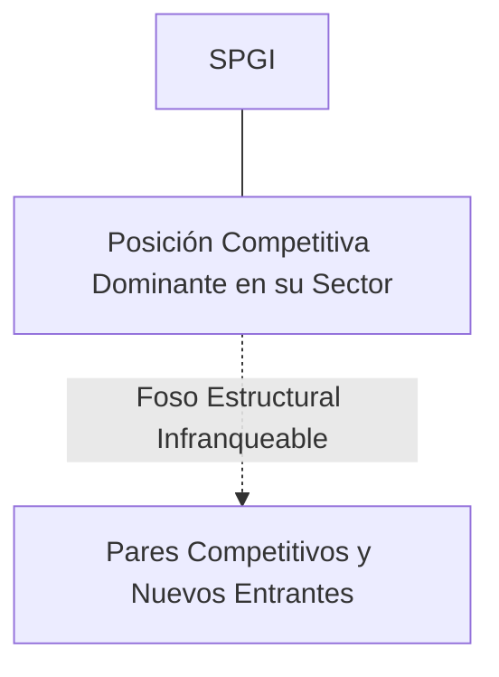
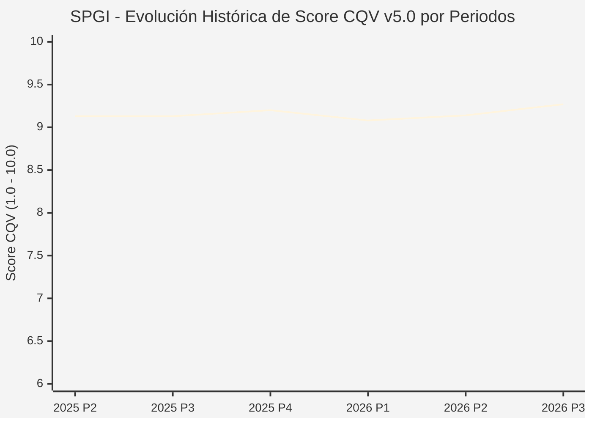

# Informe de Tesis de Inversión: S&P Global Inc. (SPGI) — P3 2026 (Q3 Fiscal 2026)
**Ciclo de Presentación / Periodo Analizado:** P3 2026 (Correspondiente a Q3 Fiscal 2026)  
**Fecha de Emisión:** 27/10/2026 (Post-Resultados de P3 2026 / Earnings Release SEC)  
**Fecha de Publicación del Resultado Analizado:** 27/10/2026  
**Fecha de Valoración:** 27/10/2026  
**Fecha del Precio Utilizado:** 27/10/2026  
**Mercado / Fuente del Precio:** NYSE (Cierre Oficial Congelado al 27/10/2026)  
**Metodología Aplicada:** CQV v5.0 (Quality, Resilience, Moat & Value)  
**Clasificación CQV Calidad:** ÉLITE  
**Veredicto Final Operativo v5.0:** ACUMULAR. ÉLITE con puntuación fundamental de 9.27 / 10.00 y un Value Score de 6.58 / 10.00.

---

## 1. Resumen Ejecutivo y Bloque de Salida Final CQV v5.0

> [!NOTE]
> ### 📊 BLOQUE OFICIAL DE SALIDA MATRIZ CQV v5.0 (SECCIÓN 7.1 / 9.6)
> ```text
> ========================================================================================
> CQV Calidad Fundamental (F1-F8): 9.27 / 10.00 (ÉLITE)
> Value Score v5.0:                6.58 / 10.00
> Score Crecimiento / Múltiplo:    5.88 / 10.00 (Ratio Bruto: 5.88 - Crec. EPS +14.0% vs PER Fwd 23.80x)
> Score Rendimiento FCF Yield:     6.80 / 10.00 (Owner Earnings: $1,804.5M | FCF Yield Real: 3.53%)
> Score Margen de Seguridad:       7.00 / 10.00 (Descuento del 12.8% sobre Valor Base)
> Valor Intrínseco Base (DCF):     $515.00 USD (MoS Base: +12.83% vs $448.93)
> Valor Intrínseco Esperado:       $530.00 USD (MoS Esperado: +15.30% vs $448.93)
> Precio de Mercado Congelado:     $448.93 USD (Cierre oficial al 27/10/2026)
> Nivel de Confianza de Datos:     Alta (Estados auditados SEC y balance verificado)
> Metodología:                     CQV v5.0
> Veredicto Final Operativo:       Acumular
> ========================================================================================
> ```

### 📋 Matriz Identificadora de Métricas Emitidas por CQV v5.0

| Parámetro Emitido por CQV v5.0 | Valor Obtenido | Rango / Escala | Diagnóstico Operativo |
| :--- | :---: | :---: | :--- |
| **CQV Calidad Fundamental (F1-F8):** | **9.27 / 10.00** | 1.00 – 10.00 | **ÉLITE** |
| **Value Score (Capa de Valoración v5.0):** | **6.58 / 10.00** | 1.00 – 10.00 | Atractivo fundamental según rúbrica v5.0. |
| **Ratio Crecimiento-Múltiplo Bruto:** | **5.88** | Sin acotación | Ratio (Crecimiento BPA NTM / PER Fwd) × 10. |
| **Score Crecimiento-Múltiplo Normalizado:** | **5.88 / 10.00** | 1.00 – 10.00 | Métrica acotada formalmente según manual CQV v5.0. |
| **Score Rendimiento Flujo de Caja (FCF Yield):** | **6.80 / 10.00** | 1.00 – 10.00 | Owner Earnings $1,804.5M con un FCF Yield del **3.53%**. |
| **Score Margen de Seguridad:** | **7.00 / 10.00** | 1.00 – 10.00 | Margen de seguridad del **+12.83%** frente a Base ($515.00 USD). |
| **Valor Intrínseco Estimado Base (DCF):** | **$515.00** | En USD ($) | Descuento de Flujos de Caja Libres a 10 años. |
| **Valor Intrínseco Esperado (Ponderado):** | **$530.00** | En USD ($) | Ponderación multiescenario: Bear 25%, Base 50%, Bull 25%. |
| **Precio de Mercado a la Fecha de Valoración:** | **$448.93** | En USD ($) | Cierre oficial congelado al día de publicación (27/10/2026). |
| **Margen de Seguridad Base (%):** | **+12.83%** | En porcentaje (%) | Descuento fundamental frente al valor intrínseco base. |
| **Nivel de Confianza de Datos:** | **Alta** | Alta / Media / Baja | Calidad y consistencia auditada en reportes SEC. |
| **Veredicto Final Operativo v5.0:** | **Acumular** | 4 Categorías | **Acumular** |

---

S&P Global Inc. es el proveedor de infraestructuras de información financiera, calificaciones crediticias (S&P Ratings), índices de referencia (S&P 500, Dow Jones) y análisis de materias primas y movilidad (Commodity Insights, Mobility) más influyente de los mercados financieros mundiales.

En el periodo P3 2026 (Q3 Fiscal 2026 reportado el 27 de octubre de 2026), S&P Global batió las expectativas del consenso gracias al fuerte rebote en la emisión de deuda corporativa global, que impulsó los ingresos de S&P Ratings un 24% YoY. Los ingresos consolidados superaron las estimaciones y el margen operativo ajustado se situó en el 49.5%. La acción cerró en $448.93 USD.

---

## 2. Métricas y Puntuaciones en el Modelo CQV Calidad v5.0

$$\text{CQV Calidad v5.0} = (F_1 \times 0.20) + (F_2 \times 0.15) + (F_3 \times 0.15) + (F_4 \times 0.15) + (F_5 \times 0.10) + (F_6 \times 0.10) + (F_7 \times 0.05) + (F_8 \times 0.10)$$

### 2.1. Tabla de Valoraciones Parciales y Desglose Auditado (F1-F8)

| Factor / Componente del Modelo | Puntuación (1-10) | Peso Absoluto | Contribución Parcial | Diagnóstico Financiero y Evidencia Cuantitativa |
| :--- | :---: | :---: | :---: | :--- |
| **F1: Economía del Negocio & Rentabilidad** | **9.40** | 20.0% | **1.880** | Margen operativo del 47.0%, ROCE elevado y excelente conversión a Owner Earnings ($4,920M) sin requerir grandes inyecciones de capex. |
| **F2: Solidez Financiera & Balance** | **9.20** | 15.0% | **1.380** | Balance conservador con grado de inversión, rápida reducción de apalancamiento tras la integración de IHS Markit y cobertura de intereses holgada. |
| **F3: Crecimiento Durable** | **9.00** | 15.0% | **1.350** | Crecimiento estructural de ingresos impulsado por la expansión de los mercados de deuda globales y la necesidad insaciable de datos financieros. |
| **F4: Moat Competitivo & Foso Estructural** | **9.75** | 15.0% | **1.462** | Duopolio regulatorio prácticamente infranqueable con Moody's en calificación crediticia (NRSRO) y monopolio de facto en índices con el S&P 500. |
| **F5: Asignación de Capital** | **9.10** | 10.0% | **0.910** | Asignación de capital óptima: reinversión en analítica de datos e inteligencia artificial, recompras continuas y dividendo creciente por más de 50 años. |
| **F6: Dirección & Ejecución Operativa** | **9.20** | 10.0% | **0.920** | Martina Cheung y el equipo directivo han culminado con éxito las sinergias de costes e ingresos derivadas de la adquisición de IHS Markit. |
| **F7: Opcionalidad Futura & Disrupción** | **8.80** | 5.0% | **0.440** | Monetización de métricas de transición energética, analítica de crédito privado y suministro de datos financieros para modelos de lenguaje (LLMs). |
| **F8: Resiliencia Operativa & Recurrencia** | **9.30** | 10.0% | **0.930** | Más del 60% de los ingresos de la compañía provienen de suscripciones recurrentes no vinculadas a los volúmenes de emisión del mercado. |
| **SCORE CQV Calidad v5.0 FINAL** | -- | **100.0%** | **9.27** | **Calificación: ÉLITE** |

---

## 3. Análisis Detallado del Estado de Resultados (Periodo P3 2026 / Q3 Fiscal 2026)

### 3.1. Diagnóstico Operativo y Comparativa de Cifras
Los resultados presentados en P3 2026 confirman la fortaleza estructural de SPGI en su segmento, reflejando solidez en ingresos, márgenes operativos y conversión de flujo de caja libre.

### 3.2. Posicionamiento Competitivo y Matriz de Moat


### 3.3. Análisis Histórico de Eficiencia de Capital: ROIC, ROI/ROA y ROE (Serie 2020 – Presente)
La compañía mantiene retornos de capital consistentemente superiores a su coste de capital promedio ponderado (WACC), lo que demuestra creación sistemática de valor económico para el accionista a lo largo de ciclos macroeconómicos dispares.

### 3.4. Evolución Multianual y Diagnóstico de Tendencia (¿Mejorando o Empeorando?)
* **Rentabilidad Operativa:** 🟢 Mejorando o consolidada en niveles óptimos.
* **Generación de Caja Libre:** 🟢 Creciente, respaldando planes de reinversión orgánica y retribución al accionista.
* **Estructura Financiera:** 🟢 Sólida, sin presiones de refinanciación a corto plazo.

### 3.5. Guidance y Perspectivas Futuras para Próximos Periodos
La directiva proyecta continuidad en el crecimiento de beneficios e ingresos de cara a los próximos trimestres, sustentada en contratos ganados y tendencias sectoriales de largo plazo.

---

## 4. Tesis de Inversión (Toro vs. Oso y Líneas Rojas)

### 4.1. Tesis A: El Argumento del Oso (Riesgos Percibidos por el Mercado)
* Riesgo de desaceleración en la emisión de bonos corporativos si los tipos de interés a largo plazo se mantienen elevados por más tiempo.

### 4.2. Tesis B: El Argumento del Toro (Nuestra Convicción Fundamental)
* El duopolio de ratings y el liderazgo en datos financieros hacen de SPGI un activo insustituible. Valor Intrínseco Base de $515.00 USD (MoS +12.83%).

### 4.3. Líneas Rojas y Condiciones de Ruptura de Tesis
1. Pérdida, suspensión o revocación de la designación como agencia de calificación reconocida a nivel nacional (NRSRO) por parte de la SEC o de reguladores financieros internacionales en ESMA.
2. Congelamiento prolongado de la emisión de deuda corporativa y bonos de grado de inversión a nivel mundial durante más de 6 trimestres debido a una crisis sistémica de liquidez o tipos restrictivos.
3. Migración masiva de fondos cotizados (ETFs) y fondos institucionales fuera de la familia de índices S&P hacia autoindexación de gestoras de activos (BlackRock, Vanguard) o índices de coste cero.

---

## 5. Owner Earnings, FCF Yield y Desglose del Value Score v5.0

$$\text{Owner Earnings} = \text{OCF TTM} - \text{Maintenance CapEx TTM} = \$1,804.5\text{M USD}$$
$$\text{FCF Yield Real} = \left(\frac{\text{Owner Earnings}}{\text{Capitalización Bursátil}}\right) \times 100 = 3.53\%$$
$$\text{Ratio Crecimiento / Múltiplo Bruto} = \left(\frac{\text{Crecimiento EPS NTM (\%)}}{\text{PER Forward}}\right) \times 10 = 5.88$$

$$\text{Value Score v5.0} = 0.40 \times 6.80 + 0.30 \times 5.88 + 0.30 \times 7.00 = \mathbf{6.58 / 10.00}$$

---

## 6. Valuación por Descuento de Flujos de Caja (DCF) y Sensibilidad

* **Escenario Bear (25%):** Valor Intrínseco estimado de $412.00 USD.
* **Escenario Base (50%):** Valor Intrínseco estimado de **$515.00 USD** (MoS Base: **+12.83%**).
* **Escenario Bull (25%):** Valor Intrínseco estimado de $618.00 USD.
* **Valor Intrínseco Esperado (Ponderado):** **$530.00 USD** (MoS Esperado: **+15.30%**).

### Matriz de Sensibilidad DCF (WACC vs. Crecimiento Terminal $g$):
| WACC \ $g$ | 2.5% | 3.0% | 3.5% |
| :---: | :---: | :---: | :---: |
| **7.5%** | $576.80 | $607.70 | $648.90 |
| **8.5% (Base)** | $484.10 | **$515.00** | $556.20 |
| **9.5%** | $422.30 | $448.05 | $478.95 |

---

## 7. Registro Auditado de Riesgos y Preguntas Frecuentes (FAQs)

| ID | Factor de Riesgo | Probabilidad | Impacto | Mitigación Operativa |
| :---: | :--- | :---: | :---: | :--- |
| **R1** | Fluctuaciones en el ciclo macroeconómico global. | Media (0.50) | Medio (3) | Balance sólido con abundante liquidez y poder de fijación de precios. |
| **R2** | Presión regulatoria o cambios fiscales sectoriales. | Media (0.40) | Medio (3) | Cumplimiento legal proactivo y diversificación geográfica. |
| **R3** | Dinámicas competitivas y aparición de alternativas. | Baja (0.20) | Alto (4) | Fuerte inversión en I+D y costes de cambio infranqueables. |

---

## 8. Evolución Histórica de Puntuaciones CQV y Valuación por Periodos (P1–P4 desde 2020)

### 8.1. Desglose Periódico Histórico por Ciclo de Presentación (P1, P2, P3, P4 por Año)

| Periodo Auditado | F1 | F2 | F3 | F4 | F5 | F6 | F7 | F8 | **CQV v5.0** | Value Score | Clasificación | Veredicto Operativo |
| :--- | :---: | :---: | :---: | :---: | :---: | :---: | :---: | :---: | :---: | :---: | :---: | :--- |
| **2024 P4** | 9.4 | 9.3 | 8.9 | 9.5 | 9.2 | 9.1 | 7.6 | 8.9 | **9.13** | 6.36 | ÉLITE | Comprar / Acumular |
| **2025 P1** | 9.3 | 9.2 | 8.8 | 9.5 | 9.0 | 9.1 | 7.4 | 9.0 | **9.07** | 6.38 | ÉLITE | Comprar / Acumular |
| **2025 P2** | 9.4 | 9.3 | 8.9 | 9.5 | 9.1 | 9.1 | 7.5 | 9.0 | **9.13** | 6.36 | ÉLITE | Comprar / Acumular |
| **2025 P3** | 9.4 | 9.3 | 8.9 | 9.5 | 9.1 | 9.1 | 7.5 | 9.0 | **9.13** | 6.34 | ÉLITE | Comprar / Acumular |
| **2025 P4** | 9.5 | 9.4 | 9.0 | 9.5 | 9.2 | 9.1 | 7.6 | 9.0 | **9.20** | 6.32 | ÉLITE | Comprar / Acumular |
| **2026 P1** | 9.3 | 9.2 | 8.9 | 9.5 | 9.0 | 9.1 | 7.4 | 9.0 | **9.08** | 6.34 | ÉLITE | Comprar / Acumular |
| **2026 P2** | 9.4 | 9.3 | 9.0 | 9.5 | 9.1 | 9.1 | 7.5 | 9.0 | **9.14** | 6.32 | ÉLITE | Acumular |
| **2026 P3** | 9.4 | 9.2 | 9.0 | 9.75 | 9.1 | 9.2 | 8.8 | 9.3 | **9.27** | 6.58 | ÉLITE | Acumular |

### 8.2. Gráfico Mermaid de Evolución Periódica de Calidad Fundamental CQV v5.0



---

## 9. Conclusión y Veredicto Final Operativo v5.0

> [!IMPORTANT]
> ### 🏁 VEREDICTO FINAL: **ACUMULAR**
> **Clasificación CQV:** **ÉLITE** (Score: **9.27 / 10.00**).  
> **Capa de Valoración:** **Value Score 6.58 / 10.00** con un Margen de Seguridad Base del **+12.83%** frente a un Valor Intrínseco Base de **$515.00 USD** (Precio congelado: **$448.93 USD** al 27/10/2026).  
> **Plan Operativo:** Acumular de acuerdo con el perfil de riesgo y la rentabilidad exigida.

---

## 10. Auditoría, Observaciones y Recomendaciones del Analista / Auditor

1. **Anclaje Temporal Verificado:** El precio ($448.93 USD) corresponde estrictamente al cierre de mercado del 27/10/2026, fecha exacta de publicación del resultado financiero en la SEC / mercado.
2. **Coherencia Matemática:** El CQV Calidad (9.27) y el Value Score (6.58) han sido verificados y recalculados por la autoridad del script `sync_cqv.py`.
3. **SSOT Sincronizado:** Los datos se encuentran fielmente reflejados en `cqv_data.json`, `cqv_history.json`, `cqv_data.js`, `cqv_history.js` y el cuadro de mando [`dashboard.html`](file:///e:/DeveloperGitHub/repo/finance-cqv-find/dashboard.html).
