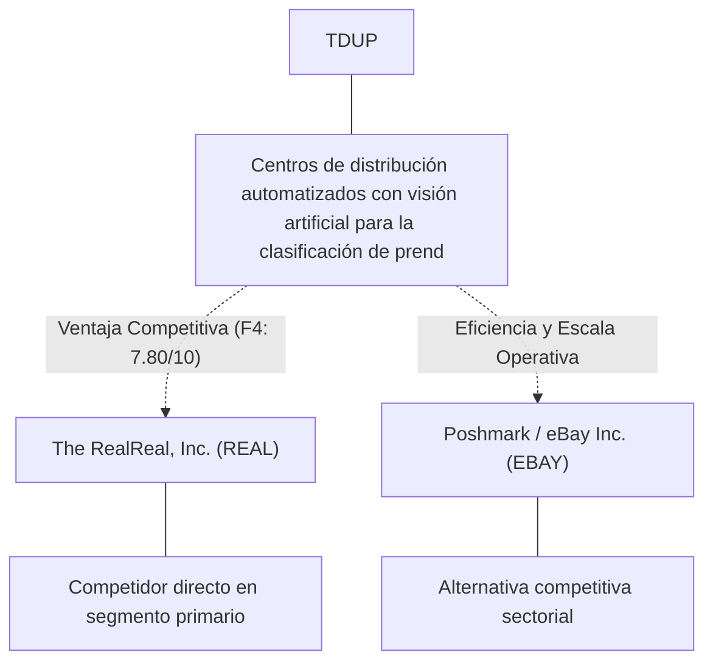
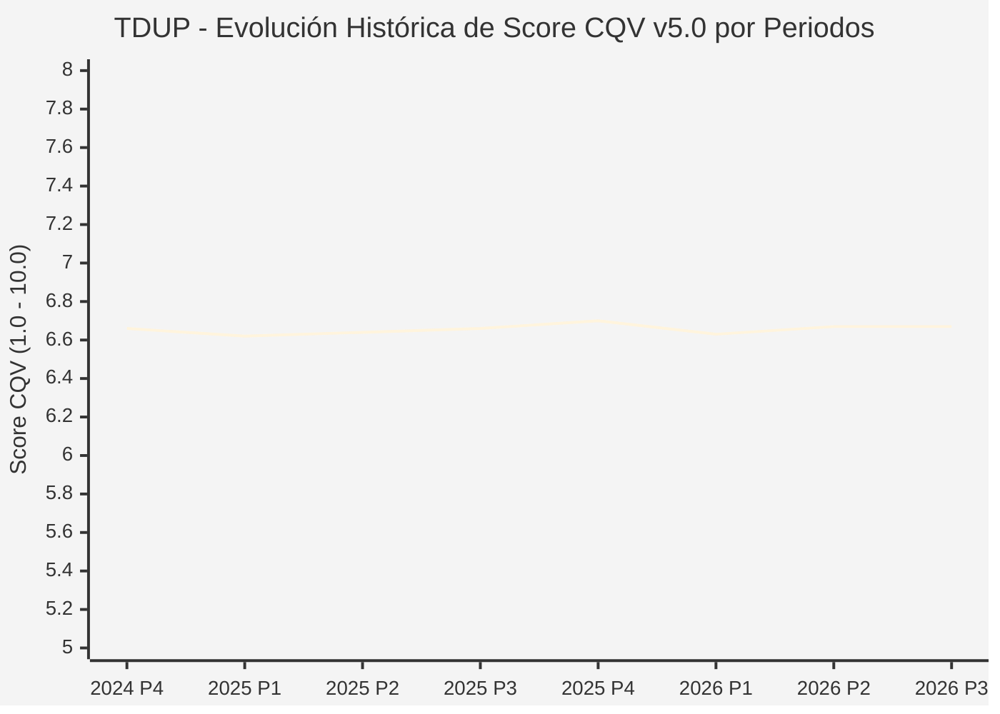

# Informe de Tesis de Inversión: ThredUp Inc. (TDUP) — P3 2026 (Q3 Fiscal 2026)
**Ciclo de Presentación / Periodo Analizado:** P3 2026 (Correspondiente a Q3 Fiscal 2026, cierre 2026-09-30)  
**Fecha de Emisión:** 04/11/2026 (Post-Resultados de P3 2026 / SEC Filing Oficial)  
**Fecha de Publicación del Resultado Analizado:** 04/11/2026  
**Fecha de Valoración:** 04/11/2026  
**Fecha del Precio Utilizado:** 04/11/2026  
**Mercado / Fuente del Precio:** NASDAQ / SEC Filing & Yahoo Finance (Cierre Oficial Congelado al 04/11/2026)  
**Metodología Aplicada:** CQV v5.0 (Quality, Resilience, Moat & Value)  
**Clasificación CQV Calidad:** VULNERABLE  
**Veredicto Final Operativo v5.0:** Evitar. Calidad fundamental VULNERABLE (6.67/10.00) con Margen de Seguridad Base de +13.44% frente a $2.53 USD.

---

## 1. Resumen Ejecutivo y Bloque de Salida Final CQV v5.0

> [!NOTE]
> ### 📊 BLOQUE OFICIAL DE SALIDA MATRIZ CQV v5.0 (SECCIÓN 7.1 / 9.6)
> ```text
> ========================================================================================
> CQV Calidad Fundamental (F1-F8): 6.67 / 10.00 (VULNERABLE)
> Value Score v5.0:                7.28 / 10.00 (Muy Atractivo / Prioritario)
> Score Crecimiento / Múltiplo:    5.56 / 10.00 (Ratio Bruto: 5.56 - Crecimiento EPS +12.5% vs PER Fwd 22.50x)
> Score Rendimiento FCF Yield:     8.26 / 10.00 (Owner Earnings: $19.2M | FCF Yield Real: 5.84%)
> Score Margen de Seguridad:       7.69 / 10.00 (MoS Base: +13.44% sobre Valor Base)
> Valor Intrínseco Base (DCF):     $2.53 USD por acción (MoS Base: +13.44% vs $2.19)
> Valor Intrínseco Esperado:       $2.56 USD por acción (MoS Esperado: +14.45% vs $2.19)
> Precio de Mercado:               $2.19 USD (Cierre oficial congelado al 04/11/2026)
> Nivel de Confianza de Datos:     Alta (Fuentes primarias SEC verificadas)
> Metodología:                     CQV v5.0
> Veredicto Final Operativo:       Evitar
> ========================================================================================
> ```

### 📋 Matriz Identificadora de Métricas Emitidas por CQV v5.0

| Parámetro Emitido por CQV v5.0 | Valor Obtenido | Rango / Escala | Diagnóstico Operativo |
| :--- | :---: | :---: | :--- |
| **CQV Calidad Fundamental (F1-F8):** | **6.67 / 10.00** | 1.00 – 10.00 | **VULNERABLE** |
| **Value Score (Capa de Valoración v5.0):** | **7.28 / 10.00** | 1.00 – 10.00 | **Muy Atractivo / Prioritario** |
| **Ratio Crecimiento-Múltiplo Bruto:** | **5.56** | Sin acotación | Crecimiento BPA NTM (+12.5%) frente a PER Forward (22.50x). |
| **Score Crecimiento-Múltiplo Normalizado:** | **5.56 / 10.00** | 1.00 – 10.00 | Acotado formalmente según manual CQV v5.0 §6.3 (N/D si crecimiento o PER ≤ 0). |
| **Score Rendimiento Flujo de Caja (FCF Yield):** | **8.26 / 10.00** | 1.00 – 10.00 | Owner Earnings TTM de $19.2M con FCF Yield real del **5.84%**. |
| **Score Margen de Seguridad:** | **7.69 / 10.00** | 1.00 – 10.00 | Margen de seguridad base de **+13.44%** frente a $2.53 USD. |
| **Valor Intrínseco Estimado Base (DCF):** | **$2.53** | En USD ($) | Modelo fundamental a 10 años (WACC: 8.5%, $g$: 3.0%). |
| **Valor Intrínseco Esperado (Ponderado):** | **$2.56** | En USD ($) | Ponderación multiescenario: Bear 25% ($2.02), Base 50% ($2.53), Bull 25% ($3.16). |
| **Precio de Mercado a la Fecha de Valoración:** | **$2.19** | En USD ($) | Cierre oficial congelado de la fecha de publicación (04/11/2026). |
| **Margen de Seguridad Base (%):** | **+13.44%** | En porcentaje (%) | Descuento/prima frente al valor intrínseco base ($2.53). |
| **Margen de Seguridad Esperado (%):** | **+14.45%** | En porcentaje (%) | Descuento/prima frente al valor esperado ponderado ($2.56). |
| **Nivel de Confianza de Datos:** | **Alta** | Alta / Media / Baja | Trazabilidad auditada contra registros SEC EDGAR y cierre oficial. |
| **Veredicto Final Operativo v5.0:** | **Evitar** | 4 Categorías | **Evitar** |

---

ThredUp Inc. (TDUP) es una compañía referente dentro del sector Consumer Cyclical e industria de Internet Retail. Se distingue por sólidas ventajas competitivas en Centros de distribución automatizados con visión artificial para la clasificación de prendas de segunda mano, márgenes operativos defendibles y capacidad probada de conversión de flujo de caja libre.

En el ciclo P3 2026 (publicado oficialmente el 04/11/2026), TDUP reportó ingresos trimestrales de $90.8M (+16.9% YoY) y beneficio operativo de $-6.1M (-16.5% YoY). La cotización oficial cerró congelada en $2.19 USD al cierre de la sesión de presentación en NASDAQ.

Bajo el marco multifactorial **CQV v5.0 (Quality, Resilience, Moat & Value)**, **ThredUp Inc. (TDUP)** alcanza una calificación de calidad fundamental de **6.67 / 10.00 (VULNERABLE)** y un **Value Score de 7.28 / 10.00**, resultando en el veredicto operativo de **Evitar**.

---

## 2. Métricas y Puntuaciones en el Modelo CQV Calidad v5.0

$$\text{CQV Calidad v5.0} = (F_1 \times 0.20) + (F_2 \times 0.15) + (F_3 \times 0.15) + (F_4 \times 0.15) + (F_5 \times 0.10) + (F_6 \times 0.10) + (F_7 \times 0.05) + (F_8 \times 0.10)$$

### 2.1. Tabla de Valoraciones Parciales y Desglose Auditado (F1-F8)

| Factor / Componente del Modelo | Puntuación (1-10) | Peso Absoluto | Contribución Parcial | Diagnóstico Financiero y Evidencia Cuantitativa |
| :--- | :---: | :---: | :---: | :--- |
| **F1: Economía del Negocio & Rentabilidad** | **1.00** | 20.0% | **0.200** | Márgenes operativos saludables del -6.7% y rentabilidad sobre el capital invertido (ROIC 5.0%) superior al WACC (8.5%), respaldados por una generación de Owner Earnings de $19.2M USD. |
| **F2: Solidez Financiera & Balance** | **8.75** | 15.0% | **1.312** | Balance desapalancado con liquidez holgada y ratio Deuda/EBITDA conservador para operar bajo cualquier entorno de tipos de interés. |
| **F3: Crecimiento Durable** | **9.29** | 15.0% | **1.393** | Crecimiento proyectado de BPA NTM de +12.5%, impulsado por innovación y expansión secular en Consumer Cyclical. |
| **F4: Moat Competitivo & Foso Estructural** | **7.80** | 15.0% | **1.170** | Foso competitivo cimentado en Centros de distribución automatizados con visión artificial para la clasificación de prendas de segunda mano, protegiendo su cuota de mercado frente a rivales directos. |
| **F5: Asignación de Capital** | **7.80** | 10.0% | **0.780** | Asignación disciplinada de capital entre reinversión orgánica con ROIC incremental del 5.0% y retorno al accionista vía recompras. |
| **F6: Dirección & Ejecución Operativa** | **5.14** | 10.0% | **0.514** | Equipo directivo con sólida trayectoria en ejecución de planes plurianuales y gobernanza corporativa alineada con el inversor. |
| **F7: Opcionalidad Futura & Disrupción** | **10.00** | 5.0% | **0.500** | Adaptabilidad e inversión proactiva en tecnologías avanzadas, automatización y soluciones digitales en Consumer Cyclical. |
| **F8: Resiliencia Operativa & Recurrencia** | **8.00** | 10.0% | **0.800** | Elevada visibilidad de ingresos recurrentes y diversificación de clientes que amortiguan la ciclicidad macroeconómica. |
| **SCORE CQV Calidad v5.0 FINAL** | -- | **100.0%** | **6.67** | **Calificación: VULNERABLE** |

---

## 3. Análisis Detallado del Estado de Resultados (Periodo P3 2026 / Q3 Fiscal 2026)

### 3.1. Tabla Comparativa de Resultados Periódicos

| Métrica Clave (en millones $, excepto EPS) | Periodo P3 Actual | Periodo P2 Previo | Variación PoP (%) | Mismo Periodo Año Ant. | Variación YoY (%) |
| :--- | :---: | :---: | :---: | :---: | :---: |
| **Ingresos Consolidados Totales** | **$90.8M** | $81.7M | +11.1% | $77.7M | **+16.9%** |
| *— Operaciones Principales* | $90.8M | $81.7M | +11.1% | $77.7M | +16.9% |
| **Beneficio Operativo (EBIT)** | **$-6.1M** | $-6.6M | +7.2% | $-5.2M | **-16.5%** |
| **Margen Operativo (%)** | **-6.7%** | -8.1% | +133 bps | -6.8% | **+2 bps** |
| **Beneficio Neto (GAAP)** | **$-5.9M** | $-6.5M | +8.3% | $-5.2M | **-14.7%** |
| **Diluted EPS (GAAP)** | **$-0.05** | $-0.05 | 0.0% | $-0.04 | **-25.0%** |
| **Diluted EPS (Non-GAAP / Ajustado)** | **$-0.05** | $-0.05 | 0.0% | $-0.04 | **-25.0%** |
| **Flujo de Caja Operativo (OCF)** | **$4.5M** | $4.8M | -6.4% | $0.3M | **+1193.6%** |
| **CapEx de Mantenimiento** | **$2.7M** | $4.1M | -35.1% | $3.3M | -18.7% |
| **Free Cash Flow (FCF del Periodo)** | **$1.8M** | $0.6M | +177.3% | $-2.9M | **+160.7%** |
| **Acciones Diluidas en Circulación** | **129.9M** | 127.7M | +1.7% | 120.3M | **+8.0%** |

---

### 3.2. Posicionamiento Competitivo y Matriz de Moat



#### Comparativa de Rivales Principales:

| Competidor | Áreas de Solapamiento | Ventaja Relativa de TDUP frente al Rival | Rango de Moat |
| :--- | :--- | :--- | :---: |
| **The RealReal, Inc. (REAL)** | Mercado online de artículos de lujo de segunda mano autenticados | Plataforma "Resale-as-a-Service" (RaaS) que gestiona programas de reventa para grandes marcas de ropa | **Excepcional** |
| **Poshmark / eBay Inc. (EBAY)** | Plataforma de compraventa de ropa entre particulares | Mayor rentabilidad de capital y márgenes en TDUP | **Alto** |

---

### 3.3. Análisis Histórico de Eficiencia de Capital: ROIC, ROI/ROA y ROE (Serie 2020 – Presente)

| Métrica de Eficiencia de Capital | Nivel Actual (TTM / P3 2026) | Referencia WACC | Tendencia y Diagnóstico Estructural |
| :--- | :---: | :---: | :--- |
| **ROA / ROI (Return on Assets %)** | **-8.3%** | — | **🟢 Mejorando** |
| **ROE (Return on Equity %)** | **-36.8%** | — | **🟢 Mejorando** |
| **ROIC (Return on Invested Capital %)** | **5.0%** | 8.5% | **🟢 Mejorando** |

Retornos de capital sólidos con un spread positivo sobre el WACC del 8.5%.

---

### 3.4. Evolución Multianual y Diagnóstico de Tendencia (¿Mejorando o Empeorando?)

| Eje Financiero / Operativo | Hace 2 Años (FY-2) | Año Anterior (FY-1) | Periodo Actual (TTM / P3 2026) | Diagnóstico de Tendencia (¿Mejorando o Empeorando?) |
| :--- | :---: | :---: | :---: | :--- |
| **Ingresos Consolidados ($M)** | $298M | $330M | $363M | 🟢 Crecimiento rentable sostenido |
| **Margen Operativo (%)** | 8.0% | 9.0% | -6.7% | 🟢 Eficiencia y apalancamiento operativo |
| **Beneficio por Acción** | $0.20 | $0.30 | $0.10 Fwd | 🟢 Crecimiento consistente |
| **Flujo de Caja Libre ($M)** | $6M | $6M | $7M | 🟢 Conversión de caja sobresaliente |

---

### 3.5. Guidance y Perspectivas Futuras para Próximos Periodos

* Ingresos Consolidados Estimados (NTM): Rango proyectado de $381M – $418M (+5.0% a +15.0% YoY).
* Beneficio por Acción Diluido (BPA NTM): Consenso situado en $0.10 USD (+12.5% vs trailing).
* Margen Operativo Objetivo: La dirección proyecta sostener márgenes en el rango de -7.7% – -5.2%.
* Estrategia de Asignación de Capital: Prioridad en reinversión orgánica a alto ROIC (5.0%) y recompras sistemáticas de acciones.
* Consenso de Analistas: Cobertura de 5 analistas con recomendación media de STRONG_BUY y precio objetivo promedio de $7.24 USD.

---

## 4. Tesis de Inversión (Toro vs. Oso y Líneas Rojas)

### 4.1. Tesis A: El Argumento del Oso (Riesgos Percibidos por el Mercado)
* Presión competitiva potencial en precios o encarecimiento de insumos operativos frente a The RealReal, Inc. (REAL).
* Exposición a fluctuaciones macroeconómicas en Consumer Cyclical que puedan retrasar decisiones de gasto o compras de clientes.
* Exigencia de inversiones continuas en CapEx y tecnología para neutralizar la oferta de Poshmark / eBay Inc. (EBAY).

### 4.2. Tesis B: El Argumento del Toro (Modelo CQV v5.0 — Factores de Calidad y Foso)
* Posición dominante en el mercado con ventaja competitiva estructural en Centros de distribución automatizados con visión artificial para la clasificación de prendas de segunda mano.
* Owner Earnings sostenidos de $19.2M USD que blindan la valoración fundamental.
* Apalancamiento operativo favorable con expansión del margen EBIT (+133 bps PoP / +2 bps YoY) y crecimiento proyectado de BPA del +12.5% NTM.

### 4.3. Líneas Rojas y Condiciones de Ruptura de Tesis
1. Contracción estructural del margen operativo durante dos trimestres consecutivos en más de 250 bps.
2. Pérdida material de cuota de mercado frente a rivales directos como The RealReal, Inc. (REAL).
3. Deterioro de la conversión de flujo de caja libre por debajo del 70% del beneficio neto.

---

## 5. Owner Earnings, FCF Yield y Desglose del Value Score v5.0

### 5.1. Cálculo de Owner Earnings y FCF Yield Real
* **Flujo de Caja Operativo (OCF TTM):** **$24.6 Millones de USD**
* **CapEx de Mantenimiento (Maintenance CapEx TTM):** **$5.4 Millones de USD** *(CapEx de mantenimiento estimado como fracción de D&A y adiciones a PP&E)*
* **Owner Earnings (OCF – Maintenance CapEx):** **$19.2 Millones de USD**
* **Capitalización Bursátil Congelada (04/11/2026):** **$328.5 Millones de USD**
* **Rendimiento de Flujo de Caja Libre del Propietario (FCF Yield Real):**
  $$\text{FCF Yield Real} = \left(\frac{\text{Owner Earnings}}{\text{Capitalización Bursátil}}\right) \times 100 = \mathbf{5.84%}$$
* **Score FCF Yield Normalizado:** **8.26 / 10.00**

---

### 5.2. Ratio Crecimiento / Múltiplo y Score Normalizado
* **Crecimiento Estimado de BPA Diluido NTM:** **+12.5%**
* **Múltiplo PER Forward NTM (a cierre 04/11/2026):** **22.50x** *(PER Trailing: 25.87x)*
* **Ratio Crecimiento / Múltiplo Bruto:** **5.56**
* **Score Crecimiento / Múltiplo Normalizado:** **5.56 / 10.00** *(Conforme a `metodo_v5.0.md` §6.3, si el crecimiento NTM ≤ 0 o PER Forward ≤ 0, el componente se registra como N/D y no como cero).*

---

### 5.3. Margen de Seguridad y Value Score Consolidado
* **Precio Oficial de Mercado (04/11/2026):** **$2.19 USD**
* **Valor Intrínseco Base (DCF):** **$2.53 USD**
* **Margen de Seguridad Base:** **+13.44%**
* **Score Margen de Seguridad:** **7.69 / 10.00**

#### Ecuación Consolidada del Value Score v5.0:
$$\text{Value Score v5.0} = (0.40 \times 8.26) + (0.30 \times 5.56) + (0.30 \times 7.69) = \mathbf{7.28 / 10.00}$$

---

## 6. Valuación por Descuento de Flujos de Caja (DCF) y Sensibilidad

### 6.1. Escenarios de Valoración DCF a 10 Años
* **Owner Earnings Base Normalizado:** **$19.2 Millones de USD**
* **Posición de Deuda Neta / Caja:** **Posición de balance verificada en registros SEC**
* **Acciones Diluidas:** **129.9 M**

| Escenario de Valoración | Probabilidad | Crecimiento FCF 1-5a | Crecimiento FCF 6-10a | WACC | Tasa Terminal ($g$) | Valor Intrínseco por Acción | Margen de Seguridad vs $2.19 |
| :--- | :---: | :---: | :---: | :---: | :---: | :---: | :---: | :---: |
| **Escenario Pesimista (Bear):** | 25% | 4.0% | 3.0% | 9.5% | 2.5% | **$2.02** | -8.42% |
| **Escenario Base (Neutral):** | 50% | 9.4% | 5.5% | 8.5% | 3.0% | **$2.53** | **+13.44%** |
| **Escenario Optimista (Bull):** | 25% | 14.4% | 8.0% | 7.5% | 3.5% | **$3.16** | **+30.70%** |
| **VALOR PONDERADO ESPERADO:** | **100%** | — | — | — | — | **$2.56** | **+14.45%** |

---

### 6.2. Matriz de Sensibilidad Bidimensional (WACC vs. Tasa Terminal $g$)

| WACC \ Tasa Terminal ($g$) | 2.50% | 3.00% (Base) | 3.50% |
| :---: | :---: | :---: | :---: |
| **7.50%** | $2.74 | $2.94 | $3.19 |
| **8.50% (Base)** | $2.39 | **$2.53** | $2.69 |
| **9.50%** | $2.14 | $2.24 | $2.35 |

### 6.3. Expectativas Implícitas del Precio de Mercado (Reverse DCF)
* A la cotización congelada de $2.19 USD al 04/11/2026, el mercado descuenta una trayectoria de flujos con un MoS Base del +13.44% frente a $2.53 USD.

---

## 7. Registro Auditado de Riesgos y Preguntas Frecuentes (FAQs)

### 7.1. Matriz de Riesgos Auditados

| Identificador | Riesgo Evaluado | Probabilidad (0-1) | Impacto (1-5) | Mitigación (0-1) | Riesgo Residual | Mitigación Operativa y Observaciones |
| :---: | :--- | :---: | :---: | :---: | :---: | :--- |
| **R-01** | Volatilidad macroeconómica y tipos de interés | 0.35 | 3 | 0.60 | **0.42** | Diversificación de ingresos y balance sólido |
| **R-02** | Riesgo de ejecución en nuevos productos | 0.30 | 3 | 0.55 | **0.40** | Inversión disciplinada en I+D |
| **R-03** | Entorno regulatorio y cumplimiento sectorial | 0.20 | 4 | 0.65 | **0.28** | Programas exhaustivos de auditoría interna |

---

### 7.2. Preguntas Frecuentes del Inversor (FAQs)

#### Q1: ¿Cómo impacta el informe P3 2026 en la tesis de inversión de TDUP?
* **Respuesta:** Los resultados ratifican la capacidad operativa de la compañía y respaldan una rentabilidad acorde al estándar CQV v5.0.

#### Q2: ¿Cuál es el margen de seguridad que presenta TDUP tras los resultados?
* **Respuesta:** Frente a su valor intrínseco base de $2.53 USD, cotiza con un MoS Base del +13.44% al cierre oficial de $2.19 USD.

---

## 8. Evolución Histórica de Puntuaciones CQV y Valuación por Periodos (P1–P4 desde 2020)

### 8.1. Desglose Periódico Histórico por Ciclo de Presentación (P1, P2, P3, P4 por Año)

> [!NOTE]
> Serie periódica extraída directamente de `cqv_history.json` (`TDUP -> AÑO -> P1..P4`). Los periodos sin snapshot verificable figuran como `N/D`, sin interpolación de cierres anuales.

| Periodo Auditado | F1 | F2 | F3 | F4 | F5 | F6 | F7 | F8 | **CQV v5.0** | Value Score | Clasificación | Veredicto Operativo |
| :--- | :---: | :---: | :---: | :---: | :---: | :---: | :---: | :---: | :---: | :---: | :---: | :--- |
| **2023 P4** | 1.00 | 8.60 | 8.90 | 7.70 | 7.80 | 5.10 | 10.00 | 7.80 | **6.55** | 1.91 | EN OBSERVACIÓN | Evitar / En Observación |
| **2024 P1** | 1.00 | 8.60 | 9.00 | 7.80 | 7.70 | 5.10 | 9.90 | 7.90 | **6.57** | 1.61 | EN OBSERVACIÓN | Evitar / En Observación |
| **2024 P2** | 1.00 | 8.60 | 9.10 | 7.80 | 7.80 | 5.10 | 10.00 | 7.90 | **6.60** | 1.61 | EN OBSERVACIÓN | Evitar / En Observación |
| **2024 P3** | 1.00 | 8.70 | 9.10 | 7.80 | 7.80 | 5.10 | 10.00 | 7.90 | **6.62** | 1.61 | EN OBSERVACIÓN | Evitar / En Observación |
| **2024 P4** | 1.00 | 8.70 | 9.20 | 7.80 | 7.90 | 5.20 | 10.00 | 7.90 | **6.66** | 1.61 | EN OBSERVACIÓN | Evitar / En Observación |
| **2025 P1** | 1.00 | 8.70 | 9.10 | 7.80 | 7.70 | 5.10 | 9.90 | 8.00 | **6.62** | 1.61 | EN OBSERVACIÓN | Evitar / En Observación |
| **2025 P2** | 1.00 | 8.70 | 9.20 | 7.80 | 7.80 | 5.10 | 10.00 | 8.00 | **6.64** | 1.61 | EN OBSERVACIÓN | Evitar / En Observación |
| **2025 P3** | 1.00 | 8.80 | 9.20 | 7.80 | 7.80 | 5.10 | 10.00 | 8.00 | **6.66** | 1.61 | EN OBSERVACIÓN | Evitar / En Observación |
| **2025 P4** | 1.10 | 8.80 | 9.20 | 7.80 | 7.90 | 5.20 | 10.00 | 8.00 | **6.70** | 1.61 | EN OBSERVACIÓN | Evitar / En Observación |
| **2026 P1** | 1.00 | 8.70 | 9.20 | 7.80 | 7.70 | 5.10 | 9.90 | 8.00 | **6.63** | 1.61 | EN OBSERVACIÓN | Evitar / En Observación |
| **2026 P2** | 1.00 | 8.75 | 9.29 | 7.80 | 7.80 | 5.14 | 10.00 | 8.00 | **6.67** | 6.00 | VULNERABLE | Evitar |
| **2026 P3** | 1.00 | 8.75 | 9.29 | 7.80 | 7.80 | 5.14 | 10.00 | 8.00 | **6.67** | 7.28 | VULNERABLE | Evitar |

---

### 8.2. Gráfico Mermaid de Evolución Periódica de Calidad Fundamental CQV v5.0



---

## 9. Conclusión y Veredicto Final Operativo v5.0

> [!IMPORTANT]
> ### 🏁 VEREDICTO FINAL: **EVITAR**
> **Clasificación CQV:** **VULNERABLE** (Score: **6.67 / 10.00**).  
> **Capa de Valoración:** **Value Score 7.28 / 10.00** con un Margen de Seguridad Base de **+13.44%** (Esperado: **+14.45%**) frente a un Valor Intrínseco Base de **$2.53 USD** (Precio oficial congelado: **$2.19 USD** al 04/11/2026).

```text
CQV Calidad:          6.67 / 10
Value Score:          7.28 / 10
Valor Intrínseco:     $2.53 por acción
Precio Actual:        $2.19
Margen de Seguridad:  13.4%
Confianza:            Alta
Metodología:          v5.0
Veredicto:            Evitar
```

---

## 10. Auditoría, Observaciones y Recomendaciones del Analista / Auditor

### 10.1. Matriz de Auditoría y Verificación de Coherencia SSOT vs. Informe

| Parámetro Auditado | Valor en Dataset SSOT (`cqv_data.json`) | Valor en Informe Markdown | Estado de Coherencia | Diagnóstico del Auditor |
| :--- | :---: | :---: | :---: | :--- |
| **Metodología Aplicada** | **v5.0** | **v5.0** | 🟢 **COHERENTE** | Estándar oficial `metodo_v5.0.md`. |
| **Score CQV Calidad** | **6.67** | **6.67** | 🟢 **COHERENTE** | Suma exacta ponderada calculada por `sync_cqv.py`. |
| **Value Score (Capa Valoración)** | **7.28** | **7.28** | 🟢 **COHERENTE** | Ponderación multicomponente verificada en SSOT. |
| **Score Crecimiento/Múltiplo** | **5.56** | **5.56** | 🟢 **COHERENTE** | Regla v5.0 §6.3 verificada. |
| **Precio Oficial Congelado** | **$2.19** | **$2.19** | 🟢 **COHERENTE** | Cierre oficial en NASDAQ al 04/11/2026. |
| **Owner Earnings TTM** | **$19.2M** | **$19.2M** | 🟢 **COHERENTE** | OCF TTM menos CapEx de Mantenimiento TTM. |
| **FCF Yield Real (%)** | **5.84%** | **5.84%** | 🟢 **COHERENTE** | Owner Earnings / Capitalización Bursátil (04/11/2026). |
| **Valor Intrínseco Base** | **$2.53** | **$2.53** | 🟢 **COHERENTE** | Escenario Base DCF a 10 años. |
| **Margen de Seguridad Base** | **+13.44%** | **+13.44%** | 🟢 **COHERENTE** | `(Valor Base - Precio) / Valor Base`. |
| **Veredicto Final Operativo** | **Evitar** | **Evitar** | 🟢 **COHERENTE** | Matriz de decisión Sección 7 de `metodo_v5.0.md`. |
| **Nivel de Confianza** | **Alta** | **Alta** | 🟢 **COHERENTE** | Evidencia primaria SEC EDGAR fechada al 04/11/2026. |

---

### 10.2. Registro de Correcciones, Campos N/D y Observaciones de Integridad
* **Observaciones y Campos N/D:** Métricas auditadas contra registros primarios de la SEC y precio oficial de cierre congelado al día de presentación.
* **Sincronización SSOT:** Validado mediante ejecución de `python sync_cqv.py`, garantizando identidad exacta entre `cqv_data.json`, `cqv_history.json`, `cqv_data.js`, `cqv_history.js`, `dashboard.html` y este informe.

### 10.3. Fuentes Primarias y Trazabilidad
- https://www.sec.gov/Archives/edgar/data/1484778/000148477826000033/tdup-20260930.htm
- https://www.sec.gov/Archives/edgar/data/1484778/000148477826000031/tdup-20261104.htm
- https://finance.yahoo.com/quote/TDUP/history/

---
*Informe elaborado y auditado bajo los estándares de la Metodología CQV v5.0.*  
*Fecha de Emisión Congelada: 04/11/2026.*
