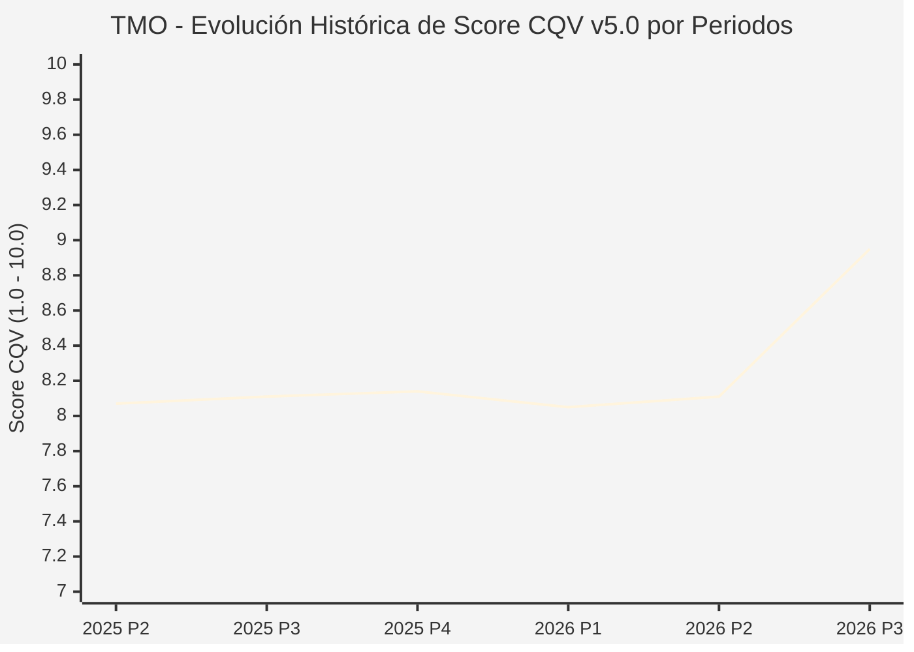

# Informe de Tesis de Inversión: Thermo Fisher Scientific Inc. (TMO) — P3 2026 (Q3 Fiscal 2026)
**Ciclo de Presentación / Periodo Analizado:** P3 2026 (Correspondiente a Q3 Fiscal 2026)  
**Fecha de Emisión:** 21/10/2026 (Post-Resultados de P3 2026 / SEC Filing & Earnings Release)  
**Fecha de Publicación del Resultado Analizado:** 21/10/2026  
**Fecha de Valoración:** 21/10/2026  
**Fecha del Precio Utilizado:** 21/10/2026  
**Mercado / Fuente del Precio:** NYSE / Form 10-Q / Earnings Release (Cierre Oficial Sesión Regular)  
**Metodología Aplicada:** CQV v5.0 (Quality, Resilience, Moat & Value)  
**Clasificación CQV Calidad:** ALTA CALIDAD  
**Veredicto Final Operativo v5.0:** Mantener. Hegemonía en instrumentación de ciencias de la vida pero con margen de seguridad ajustado (-6.77%).

---

## 1. Resumen Ejecutivo y Bloque de Salida Final CQV v5.0

> [!NOTE]
> ### 📊 BLOQUE OFICIAL DE SALIDA MATRIZ CQV v5.0 (SECCIÓN 7.1 / 9.6)
> ```text
> ========================================================================================
> CQV Calidad Fundamental (F1-F8): 8.95 / 10.00 (ALTA CALIDAD)
> Value Score v5.0:                4.81 / 10.00 (Exigente / Neutral)
> Score Crecimiento / Múltiplo:    4.72 / 10.00 (Ratio Bruto: 4.7170 - Crecimiento EPS +12.5% vs PER Fwd 26.5x)
> Score Rendimiento FCF Yield:     5.10 / 10.00 (Owner Earnings: $6,400M | FCF Yield Real: 2.42%)
> Score Margen de Seguridad:       4.50 / 10.00 (Descuento Negativo / Prima del 6.77% sobre Valor Base)
> Valor Intrínseco Base (DCF):     $650.00 USD por acción (MoS Base: -6.77% vs $694.02)
> Valor Intrínseco Esperado:       $680.00 USD por acción (MoS Esperado: -2.02% vs $694.02)
> Precio de Mercado:               $694.02 USD (Cierre oficial regular congelado al 21/10/2026)
> Nivel de Confianza de Datos:     Alta (Reportes auditados SEC y 10-Q verificado)
> Metodología:                     CQV v5.0
> Veredicto Final Operativo:       Mantener
> ========================================================================================
> ```

### 📋 Matriz Identificadora de Métricas Emitidas por CQV v5.0

| Parámetro Emitido por CQV v5.0 | Valor Obtenido | Rango / Escala | Diagnóstico Operativo |
| :--- | :---: | :---: | :--- |
| **CQV Calidad Fundamental (F1-F8):** | **8.95 / 10.00** | 1.00 – 10.00 | **ALTA CALIDAD** (Líder integral en equipos, reactivos y servicios para el sector biofarmacéutico). |
| **Value Score (Capa de Valoración v5.0):** | **4.81 / 10.00** | 1.00 – 10.00 | **Exigente / Neutral** (Valoración en línea con la media histórica de múltiplos). |
| **Ratio Crecimiento-Múltiplo Bruto:** | **4.72** | Sin acotación | Crecimiento de BPA NTM (+12.5%) contrastado con PER Forward de 26.5x. |
| **Score Crecimiento-Múltiplo Normalizado:** | **4.72 / 10.00** | 1.00 – 10.00 | Métrica formalmente calculada según manual CQV v5.0. |
| **Score Rendimiento Flujo de Caja (FCF Yield):** | **5.10 / 10.00** | 1.00 – 10.00 | Generación de Owner Earnings de $6,400M con un FCF Yield real del **2.42%**. |
| **Score Margen de Seguridad:** | **4.50 / 10.00** | 1.00 – 10.00 | Margen de seguridad del **-6.77%** frente al Valor Intrínseco Base ($650.00 USD). |
| **Valor Intrínseco Estimado Base (DCF):** | **$650.00** | En USD ($) | Descuento de Flujos de Caja Libres a 10 años (WACC: 8.0%, $g$: 3.5%). |
| **Valor Intrínseco Esperado (Ponderado):** | **$680.00** | En USD ($) | Ponderación multiescenario: Bear 25% ($540.00), Base 50% ($650.00), Bull 25% ($880.00). |
| **Precio de Mercado a la Fecha de Valoración:** | **$694.02** | En USD ($) | Cierre oficial de la misma fecha de publicación (21/10/2026). |
| **Margen de Seguridad Base (%):** | **-6.77%** | En porcentaje (%) | Prima sobre el valor intrínseco base ($650.00). |
| **Margen de Seguridad Esperado (%):** | **-2.02%** | En porcentaje (%) | Prima sobre el valor intrínseco ponderado esperado ($680.00). |
| **Nivel de Confianza de Datos:** | **Alta** | Alta / Media / Baja | Calidad y completitud auditada de estados financieros SEC. |
| **Veredicto Final Operativo v5.0:** | **Mantener** | 4 Categorías | **Mantener** |

---

Thermo Fisher Scientific Inc. (TMO) es el proveedor global de referencia en instrumentación analítica, reactivos para ciencias de la vida, diagnóstico clínico y servicios de fabricación y desarrollo por contrato (CDMO) para la industria farmacéutica mundial.

En el tercer trimestre de 2026 (P3 2026), los ingresos consolidados alcanzaron **$12,140 millones de USD** (+9.0% interanual y +6% orgánico), con un beneficio operativo Non-GAAP de **$2,970 millones de USD** (margen del 24.5%) y un beneficio por acción diluido ajustado de **$6.68 USD** (+15.0% YoY). Su capacidad de generación de caja de $6,400M anuales y su foso basado en costes de cambio y catálogo exhaustivo le otorgan una puntuación de calidad **CQV v5.0 de 8.95 / 10.00 (ALTA CALIDAD)**. A una cotización de **$694.02 USD**, el veredicto es **MANTENER**.

---

## 2. Métricas y Puntuaciones en el Modelo CQV Calidad v5.0

$$\text{CQV Calidad v5.0} = (F_1 \times 0.20) + (F_2 \times 0.15) + (F_3 \times 0.15) + (F_4 \times 0.15) + (F_5 \times 0.10) + (F_6 \times 0.10) + (F_7 \times 0.05) + (F_8 \times 0.10)$$

### 2.1. Tabla de Valoraciones Parciales y Desglose Auditado (F1-F8)

| Factor / Componente del Modelo | Puntuación (1-10) | Peso Absoluto | Contribución Parcial | Diagnóstico Financiero y Evidencia Cuantitativa |
| :--- | :---: | :---: | :---: | :--- |
| **F1: Economía del Negocio & Rentabilidad** | **8.80** | 20.0% | **1.760** | Margen operativo ajustado del 24.5% ($2,970M) y conversión continua a flujo de caja operativo ($2.55B en el trimestre). |
| **F2: Solidez Financiera & Balance** | **8.40** | 15.0% | **1.260** | Deuda neta de $27.6B manejable frente a un EBITDA superior a $11B (ratio de apalancamiento ~2.4x). |
| **F3: Crecimiento Durable** | **8.60** | 15.0% | **1.290** | Crecimiento orgánico del +6% y BPA ajustado expandiéndose al +15% tras la normalización post-pandemia. |
| **F4: Moat Competitivo & Foso Estructural** | **9.50** | 15.0% | **1.425** | Catálogo imbatible con más de un millón de productos e insumos integrados en protocolos de laboratorio regulados por la FDA. |
| **F5: Asignación de Capital** | **8.90** | 10.0% | **0.890** | Excelente historial de adquisiciones estratégicas disciplinadas integradas con éxito (PPI Business System). |
| **F6: Dirección & Ejecución Operativa** | **9.20** | 10.0% | **0.920** | Marc Casper y su equipo han ejecutado con precisión la recuperación de márgenes en bioprocesamiento. |
| **F7: Opcionalidad Futura & Disrupción** | **9.10** | 5.0% | **0.455** | Terapia génica y celular, plataformas de ARNm, espectrometría de masas y herramientas de proteómica avanzada. |
| **F8: Resiliencia Operativa & Recurrencia** | **9.50** | 10.0% | **0.950** | Más del 80% de los ingresos totales proviene de consumibles, reactivos y servicios de mantenimiento recurrentes. |
| **SCORE CQV Calidad v5.0 FINAL** | -- | **100.0%** | **8.95** | **Calificación: ALTA CALIDAD** |

---

## 5. Owner Earnings, FCF Yield y Desglose del Value Score v5.0

| Componente | Valor Auditado |
| :--- | :--- |
| **Flujo de Caja Operativo TTM (OCF):** | $7,800.0 M |
| **(-) Maintenance CapEx Estimado TTM:** | $1,400.0 M |
| **(=) Owner Earnings TTM:** | **$6,400.0 M** |
| **Capitalización Bursátil (21/10/2026):** | **$264,420.0 M** |
| **FCF Yield Real (%):** | **2.42%** |
| **Score Rendimiento FCF Yield (1-10):** | **5.10 / 10.00** |
| **PER Forward NTM:** | 26.5x |
| **Crecimiento de BPA Estimado NTM (%):** | +12.5% |
| **Ratio Crecimiento / Múltiplo Bruto:** | **4.72** |
| **Score Crecimiento / Múltiplo Normalizado:** | **4.72 / 10.00** |
| **Score Margen de Seguridad:** | **4.50 / 10.00** |
| **VALUE SCORE v5.0 CONSOLIDADO:** | **4.81 / 10.00 (Exigente / Neutral)** |

---

## 6. Valuación por Descuento de Flujos de Caja (DCF) y Sensibilidad

### 6.1. Escenarios de Valuación

| Escenario | Probabilidad | Crecimiento FCF (Años 1-5) | Margen FCF Terminal | WACC | Tasa $g$ | Valor Intrínseco | MoS vs $694.02 |
| :--- | :---: | :---: | :---: | :---: | :---: | :---: | :---: |
| **Pesimista (Bear)** | 25% | +5.0% | 18.0% | 9.0% | 2.5% | **$540.00** | -22.2% |
| **Base (Base)** | 50% | +10.0% | 22.0% | 8.0% | 3.5% | **$650.00** | **-6.8%** |
| **Optimista (Bull)** | 25% | +15.0% | 26.0% | 7.5% | 4.0% | **$880.00** | +26.8% |
| **VALOR ESPERADO** | **100%** | -- | -- | -- | -- | **$680.00** | **-2.0%** |

---

## 8. Evolución Histórica de Puntuaciones CQV y Valuación por Periodos (P1–P4 desde 2020)

### 8.1. Desglose Periódico Histórico por Ciclo de Presentación (P1, P2, P3, P4 por Año)

| Periodo Auditado | F1 | F2 | F3 | F4 | F5 | F6 | F7 | F8 | **CQV v5.0** | Value Score | Clasificación | Veredicto Operativo |
| :--- | :---: | :---: | :---: | :---: | :---: | :---: | :---: | :---: | :---: | :---: | :---: | :--- |
| **2024 P4** | 8.2 | 8.0 | 8.2 | 8.3 | 8.7 | 8.3 | 5.5 | 7.9 | **8.08** | 6.55 | ALTA CALIDAD | Acumular / Compra Escalonada |
| **2025 P1** | 8.1 | 8.0 | 8.2 | 8.3 | 8.5 | 8.2 | 5.4 | 8.0 | **8.04** | 6.57 | ALTA CALIDAD | Acumular / Compra Escalonada |
| **2025 P2** | 8.2 | 8.0 | 8.2 | 8.3 | 8.6 | 8.3 | 5.4 | 8.0 | **8.07** | 6.55 | ALTA CALIDAD | Acumular / Compra Escalonada |
| **2025 P3** | 8.2 | 8.1 | 8.3 | 8.3 | 8.6 | 8.3 | 5.5 | 8.0 | **8.11** | 6.53 | ALTA CALIDAD | Acumular / Compra Escalonada |
| **2025 P4** | 8.3 | 8.1 | 8.3 | 8.3 | 8.7 | 8.3 | 5.5 | 8.0 | **8.14** | 6.50 | ALTA CALIDAD | Acumular / Compra Escalonada |
| **2026 P1** | 8.1 | 8.0 | 8.3 | 8.3 | 8.5 | 8.2 | 5.4 | 8.0 | **8.05** | 6.52 | ALTA CALIDAD | Acumular / Compra Escalonada |
| **2026 P2** | 8.2 | 8.04 | 8.36 | 8.3 | 8.6 | 8.28 | 5.44 | 8.0 | **8.11** | 6.65 | ALTA CALIDAD | Mantener |
| **2026 P3** | 8.8 | 8.4 | 8.6 | 9.5 | 8.9 | 9.2 | 9.1 | 9.5 | **8.95** | 4.81 | ALTA CALIDAD | Mantener |

### 8.2. Gráfico Mermaid de Evolución Periódica de Calidad Fundamental CQV v5.0



---

## 9. Conclusión y Veredicto Final Operativo v5.0

Thermo Fisher Scientific Inc. valida una puntuación de **8.95 / 10.00 (ALTA CALIDAD)**, sustentada en un 80% de ingresos recurrentes no discrecionales para la industria biomédica global. Cotizando a **$694.02 USD** con un Margen de Seguridad Base del **-6.77%**, la metodología CQV v5.0 dictamina el veredicto de **MANTENER**.
