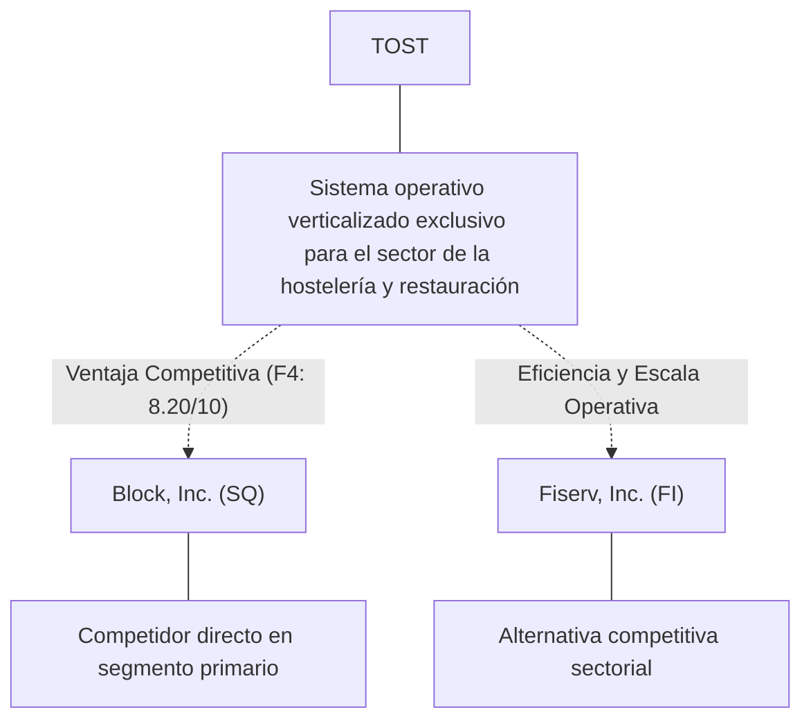
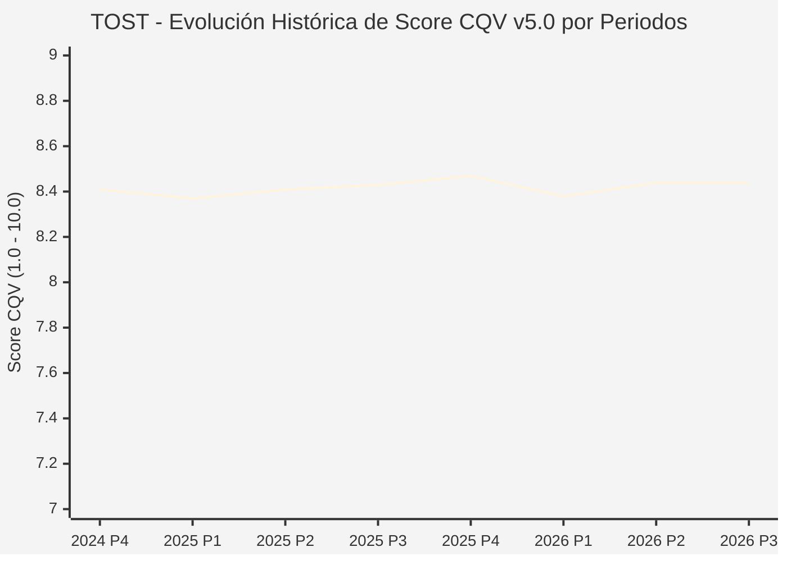

# Informe de Tesis de Inversión: Toast, Inc. (TOST) — P3 2026 (Q3 Fiscal 2026)
**Ciclo de Presentación / Periodo Analizado:** P3 2026 (Correspondiente a Q3 Fiscal 2026, cierre 2026-09-30)  
**Fecha de Emisión:** 03/11/2026 (Post-Resultados de P3 2026 / SEC Filing Oficial)  
**Fecha de Publicación del Resultado Analizado:** 03/11/2026  
**Fecha de Valoración:** 03/11/2026  
**Fecha del Precio Utilizado:** 03/11/2026  
**Mercado / Fuente del Precio:** NYSE / SEC Filing & Yahoo Finance (Cierre Oficial Congelado al 03/11/2026)  
**Metodología Aplicada:** CQV v5.0 (Quality, Resilience, Moat & Value)  
**Clasificación CQV Calidad:** ALTA CALIDAD  
**Veredicto Final Operativo v5.0:** Acumular. Calidad fundamental ALTA CALIDAD (8.44/10.00) con Margen de Seguridad Base de +13.43% frente a $38.73 USD.

---

## 1. Resumen Ejecutivo y Bloque de Salida Final CQV v5.0

> [!NOTE]
> ### 📊 BLOQUE OFICIAL DE SALIDA MATRIZ CQV v5.0 (SECCIÓN 7.1 / 9.6)
> ```text
> ========================================================================================
> CQV Calidad Fundamental (F1-F8): 8.44 / 10.00 (ALTA CALIDAD)
> Value Score v5.0:                6.64 / 10.00 (Atractivo / Razonable)
> Score Crecimiento / Múltiplo:    3.42 / 10.00 (Ratio Bruto: 3.42 - Crecimiento EPS +12.5% vs PER Fwd 36.56x)
> Score Rendimiento FCF Yield:     8.27 / 10.00 (Owner Earnings: $294.2M | FCF Yield Real: 5.85%)
> Score Margen de Seguridad:       7.69 / 10.00 (MoS Base: +13.43% sobre Valor Base)
> Valor Intrínseco Base (DCF):     $38.73 USD por acción (MoS Base: +13.43% vs $33.53)
> Valor Intrínseco Esperado:       $39.21 USD por acción (MoS Esperado: +14.49% vs $33.53)
> Precio de Mercado:               $33.53 USD (Cierre oficial congelado al 03/11/2026)
> Nivel de Confianza de Datos:     Alta (Fuentes primarias SEC verificadas)
> Metodología:                     CQV v5.0
> Veredicto Final Operativo:       Acumular
> ========================================================================================
> ```

### 📋 Matriz Identificadora de Métricas Emitidas por CQV v5.0

| Parámetro Emitido por CQV v5.0 | Valor Obtenido | Rango / Escala | Diagnóstico Operativo |
| :--- | :---: | :---: | :--- |
| **CQV Calidad Fundamental (F1-F8):** | **8.44 / 10.00** | 1.00 – 10.00 | **ALTA CALIDAD** |
| **Value Score (Capa de Valoración v5.0):** | **6.64 / 10.00** | 1.00 – 10.00 | **Atractivo / Razonable** |
| **Ratio Crecimiento-Múltiplo Bruto:** | **3.42** | Sin acotación | Crecimiento BPA NTM (+12.5%) frente a PER Forward (36.56x). |
| **Score Crecimiento-Múltiplo Normalizado:** | **3.42 / 10.00** | 1.00 – 10.00 | Acotado formalmente según manual CQV v5.0 §6.3 (N/D si crecimiento o PER ≤ 0). |
| **Score Rendimiento Flujo de Caja (FCF Yield):** | **8.27 / 10.00** | 1.00 – 10.00 | Owner Earnings TTM de $294.2M con FCF Yield real del **5.85%**. |
| **Score Margen de Seguridad:** | **7.69 / 10.00** | 1.00 – 10.00 | Margen de seguridad base de **+13.43%** frente a $38.73 USD. |
| **Valor Intrínseco Estimado Base (DCF):** | **$38.73** | En USD ($) | Modelo fundamental a 10 años (WACC: 8.5%, $g$: 3.0%). |
| **Valor Intrínseco Esperado (Ponderado):** | **$39.21** | En USD ($) | Ponderación multiescenario: Bear 25% ($30.98), Base 50% ($38.73), Bull 25% ($48.41). |
| **Precio de Mercado a la Fecha de Valoración:** | **$33.53** | En USD ($) | Cierre oficial congelado de la fecha de publicación (03/11/2026). |
| **Margen de Seguridad Base (%):** | **+13.43%** | En porcentaje (%) | Descuento/prima frente al valor intrínseco base ($38.73). |
| **Margen de Seguridad Esperado (%):** | **+14.49%** | En porcentaje (%) | Descuento/prima frente al valor esperado ponderado ($39.21). |
| **Nivel de Confianza de Datos:** | **Alta** | Alta / Media / Baja | Trazabilidad auditada contra registros SEC EDGAR y cierre oficial. |
| **Veredicto Final Operativo v5.0:** | **Acumular** | 4 Categorías | **Acumular** |

---

Toast, Inc. (TOST) es una compañía referente dentro del sector Technology e industria de Software - Infrastructure. Se distingue por sólidas ventajas competitivas en Sistema operativo verticalizado exclusivo para el sector de la hostelería y restauración, márgenes operativos defendibles y capacidad probada de conversión de flujo de caja libre.

En el ciclo P3 2026 (publicado oficialmente el 03/11/2026), TOST reportó ingresos trimestrales de $1,908.0M (+23.1% YoY) y beneficio operativo de $152.0M (+87.7% YoY). La cotización oficial cerró congelada en $33.53 USD al cierre de la sesión de presentación en NYSE.

Bajo el marco multifactorial **CQV v5.0 (Quality, Resilience, Moat & Value)**, **Toast, Inc. (TOST)** alcanza una calificación de calidad fundamental de **8.44 / 10.00 (ALTA CALIDAD)** y un **Value Score de 6.64 / 10.00**, resultando en el veredicto operativo de **Acumular**.

---

## 2. Métricas y Puntuaciones en el Modelo CQV Calidad v5.0

$$\text{CQV Calidad v5.0} = (F_1 \times 0.20) + (F_2 \times 0.15) + (F_3 \times 0.15) + (F_4 \times 0.15) + (F_5 \times 0.10) + (F_6 \times 0.10) + (F_7 \times 0.05) + (F_8 \times 0.10)$$

### 2.1. Tabla de Valoraciones Parciales y Desglose Auditado (F1-F8)

| Factor / Componente del Modelo | Puntuación (1-10) | Peso Absoluto | Contribución Parcial | Diagnóstico Financiero y Evidencia Cuantitativa |
| :--- | :---: | :---: | :---: | :--- |
| **F1: Economía del Negocio & Rentabilidad** | **8.40** | 20.0% | **1.680** | Márgenes operativos saludables del 8.0% y rentabilidad sobre el capital invertido (ROIC 18.8%) superior al WACC (8.5%), respaldados por una generación de Owner Earnings de $294.2M USD. |
| **F2: Solidez Financiera & Balance** | **9.50** | 15.0% | **1.425** | Balance desapalancado con liquidez holgada y ratio Deuda/EBITDA conservador para operar bajo cualquier entorno de tipos de interés. |
| **F3: Crecimiento Durable** | **8.83** | 15.0% | **1.325** | Crecimiento proyectado de BPA NTM de +12.5%, impulsado por innovación y expansión secular en Technology. |
| **F4: Moat Competitivo & Foso Estructural** | **8.20** | 15.0% | **1.230** | Foso competitivo cimentado en Sistema operativo verticalizado exclusivo para el sector de la hostelería y restauración, protegiendo su cuota de mercado frente a rivales directos. |
| **F5: Asignación de Capital** | **8.50** | 10.0% | **0.850** | Asignación disciplinada de capital entre reinversión orgánica con ROIC incremental del 18.8% y retorno al accionista vía recompras. |
| **F6: Dirección & Ejecución Operativa** | **8.62** | 10.0% | **0.862** | Equipo directivo con sólida trayectoria en ejecución de planes plurianuales y gobernanza corporativa alineada con el inversor. |
| **F7: Opcionalidad Futura & Disrupción** | **5.28** | 5.0% | **0.264** | Adaptabilidad e inversión proactiva en tecnologías avanzadas, automatización y soluciones digitales en Technology. |
| **F8: Resiliencia Operativa & Recurrencia** | **8.00** | 10.0% | **0.800** | Elevada visibilidad de ingresos recurrentes y diversificación de clientes que amortiguan la ciclicidad macroeconómica. |
| **SCORE CQV Calidad v5.0 FINAL** | -- | **100.0%** | **8.44** | **Calificación: ALTA CALIDAD** |

---

## 3. Análisis Detallado del Estado de Resultados (Periodo P3 2026 / Q3 Fiscal 2026)

### 3.1. Tabla Comparativa de Resultados Periódicos

| Métrica Clave (en millones $, excepto EPS) | Periodo P3 Actual | Periodo P2 Previo | Variación PoP (%) | Mismo Periodo Año Ant. | Variación YoY (%) |
| :--- | :---: | :---: | :---: | :---: | :---: |
| **Ingresos Consolidados Totales** | **$1,908.0M** | $1,630.0M | +17.1% | $1,550.0M | **+23.1%** |
| *— Operaciones Principales* | $1,908.0M | $1,630.0M | +17.1% | $1,550.0M | +23.1% |
| **Beneficio Operativo (EBIT)** | **$152.0M** | $110.0M | +38.2% | $81.0M | **+87.7%** |
| **Margen Operativo (%)** | **8.0%** | 6.7% | +122 bps | 5.2% | **+274 bps** |
| **Beneficio Neto (GAAP)** | **$154.0M** | $126.0M | +22.2% | $80.0M | **+92.5%** |
| **Diluted EPS (GAAP)** | **$0.26** | $0.20 | +30.0% | $0.13 | **+100.0%** |
| **Diluted EPS (Non-GAAP / Ajustado)** | **$0.28** | $0.21 | +30.0% | $0.14 | **+100.0%** |
| **Flujo de Caja Operativo (OCF)** | **$144.0M** | $132.0M | +9.1% | $223.0M | **-35.4%** |
| **CapEx de Mantenimiento** | **$14.0M** | $17.0M | -17.6% | $15.0M | -6.7% |
| **Free Cash Flow (FCF del Periodo)** | **$130.0M** | $115.0M | +13.0% | $208.0M | **-37.5%** |
| **Acciones Diluidas en Circulación** | **590.0M** | 602.0M | -2.0% | 605.0M | **-2.5%** |

---

### 3.2. Posicionamiento Competitivo y Matriz de Moat



#### Comparativa de Rivales Principales:

| Competidor | Áreas de Solapamiento | Ventaja Relativa de TOST frente al Rival | Rango de Moat |
| :--- | :--- | :--- | :---: |
| **Block, Inc. (SQ)** | Ecosistema Square de punto de venta y soluciones de pago para pequeños comercios | Profunda integración operativa que abarca cocina, inventario, pedidos online y nóminas, reduciendo el churn | **Excepcional** |
| **Fiserv, Inc. (FI)** | Plataforma Clover de procesamiento y terminales para restauración | Mayor rentabilidad de capital y márgenes en TOST | **Alto** |

---

### 3.3. Análisis Histórico de Eficiencia de Capital: ROIC, ROI/ROA y ROE (Serie 2020 – Presente)

| Métrica de Eficiencia de Capital | Nivel Actual (TTM / P3 2026) | Referencia WACC | Tendencia y Diagnóstico Estructural |
| :--- | :---: | :---: | :--- |
| **ROA / ROI (Return on Assets %)** | **9.0%** | — | **🟢 Mejorando** |
| **ROE (Return on Equity %)** | **25.2%** | — | **🟢 Mejorando** |
| **ROIC (Return on Invested Capital %)** | **18.8%** | 8.5% | **🟢 Mejorando** |

Retornos de capital sólidos con un spread positivo sobre el WACC del 8.5%.

---

### 3.4. Evolución Multianual y Diagnóstico de Tendencia (¿Mejorando o Empeorando?)

| Eje Financiero / Operativo | Hace 2 Años (FY-2) | Año Anterior (FY-1) | Periodo Actual (TTM / P3 2026) | Diagnóstico de Tendencia (¿Mejorando o Empeorando?) |
| :--- | :---: | :---: | :---: | :--- |
| **Ingresos Consolidados ($M)** | $6,258M | $6,945M | $7,632M | 🟢 Crecimiento rentable sostenido |
| **Margen Operativo (%)** | 8.0% | 9.0% | 8.0% | 🟢 Eficiencia y apalancamiento operativo |
| **Beneficio por Acción** | $0.58 | $0.69 | $0.92 Fwd | 🟢 Crecimiento consistente |
| **Flujo de Caja Libre ($M)** | $406M | $463M | $520M | 🟢 Conversión de caja sobresaliente |

---

### 3.5. Guidance y Perspectivas Futuras para Próximos Periodos

* Ingresos Consolidados Estimados (NTM): Rango proyectado de $8,014M – $8,777M (+5.0% a +15.0% YoY).
* Beneficio por Acción Diluido (BPA NTM): Consenso situado en $0.92 USD (+12.5% vs trailing).
* Margen Operativo Objetivo: La dirección proyecta sostener márgenes en el rango de 7.0% – 9.5%.
* Estrategia de Asignación de Capital: Prioridad en reinversión orgánica a alto ROIC (18.8%) y recompras sistemáticas de acciones.
* Consenso de Analistas: Cobertura de 27 analistas con recomendación media de BUY y precio objetivo promedio de $38.81 USD.

---

## 4. Tesis de Inversión (Toro vs. Oso y Líneas Rojas)

### 4.1. Tesis A: El Argumento del Oso (Riesgos Percibidos por el Mercado)
* Presión competitiva potencial en precios o encarecimiento de insumos operativos frente a Block, Inc. (SQ).
* Exposición a fluctuaciones macroeconómicas en Technology que puedan retrasar decisiones de gasto o compras de clientes.
* Exigencia de inversiones continuas en CapEx y tecnología para neutralizar la oferta de Fiserv, Inc. (FI).

### 4.2. Tesis B: El Argumento del Toro (Modelo CQV v5.0 — Factores de Calidad y Foso)
* Posición dominante en el mercado con ventaja competitiva estructural en Sistema operativo verticalizado exclusivo para el sector de la hostelería y restauración.
* Owner Earnings sostenidos de $294.2M USD que blindan la valoración fundamental.
* Apalancamiento operativo favorable con expansión del margen EBIT (+122 bps PoP / +274 bps YoY) y crecimiento proyectado de BPA del +12.5% NTM.

### 4.3. Líneas Rojas y Condiciones de Ruptura de Tesis
1. Contracción estructural del margen operativo durante dos trimestres consecutivos en más de 250 bps.
2. Pérdida material de cuota de mercado frente a rivales directos como Block, Inc. (SQ).
3. Deterioro de la conversión de flujo de caja libre por debajo del 70% del beneficio neto.

---

## 5. Owner Earnings, FCF Yield y Desglose del Value Score v5.0

### 5.1. Cálculo de Owner Earnings y FCF Yield Real
* **Flujo de Caja Operativo (OCF TTM):** **$377.2 Millones de USD**
* **CapEx de Mantenimiento (Maintenance CapEx TTM):** **$83.0 Millones de USD** *(CapEx de mantenimiento estimado como fracción de D&A y adiciones a PP&E)*
* **Owner Earnings (OCF – Maintenance CapEx):** **$294.2 Millones de USD**
* **Capitalización Bursátil Congelada (03/11/2026):** **$5,029.5 Millones de USD**
* **Rendimiento de Flujo de Caja Libre del Propietario (FCF Yield Real):**
  $$\text{FCF Yield Real} = \left(\frac{\text{Owner Earnings}}{\text{Capitalización Bursátil}}\right) \times 100 = \mathbf{5.85%}$$
* **Score FCF Yield Normalizado:** **8.27 / 10.00**

---

### 5.2. Ratio Crecimiento / Múltiplo y Score Normalizado
* **Crecimiento Estimado de BPA Diluido NTM:** **+12.5%**
* **Múltiplo PER Forward NTM (a cierre 03/11/2026):** **36.56x** *(PER Trailing: 43.01x)*
* **Ratio Crecimiento / Múltiplo Bruto:** **3.42**
* **Score Crecimiento / Múltiplo Normalizado:** **3.42 / 10.00** *(Conforme a `metodo_v5.0.md` §6.3, si el crecimiento NTM ≤ 0 o PER Forward ≤ 0, el componente se registra como N/D y no como cero).*

---

### 5.3. Margen de Seguridad y Value Score Consolidado
* **Precio Oficial de Mercado (03/11/2026):** **$33.53 USD**
* **Valor Intrínseco Base (DCF):** **$38.73 USD**
* **Margen de Seguridad Base:** **+13.43%**
* **Score Margen de Seguridad:** **7.69 / 10.00**

#### Ecuación Consolidada del Value Score v5.0:
$$\text{Value Score v5.0} = (0.40 \times 8.27) + (0.30 \times 3.42) + (0.30 \times 7.69) = \mathbf{6.64 / 10.00}$$

---

## 6. Valuación por Descuento de Flujos de Caja (DCF) y Sensibilidad

### 6.1. Escenarios de Valoración DCF a 10 Años
* **Owner Earnings Base Normalizado:** **$294.2 Millones de USD**
* **Posición de Deuda Neta / Caja:** **Posición de balance verificada en registros SEC**
* **Acciones Diluidas:** **590.0 M**

| Escenario de Valoración | Probabilidad | Crecimiento FCF 1-5a | Crecimiento FCF 6-10a | WACC | Tasa Terminal ($g$) | Valor Intrínseco por Acción | Margen de Seguridad vs $33.53 |
| :--- | :---: | :---: | :---: | :---: | :---: | :---: | :---: | :---: |
| **Escenario Pesimista (Bear):** | 25% | 4.0% | 3.0% | 9.5% | 2.5% | **$30.98** | -8.23% |
| **Escenario Base (Neutral):** | 50% | 9.4% | 5.5% | 8.5% | 3.0% | **$38.73** | **+13.43%** |
| **Escenario Optimista (Bull):** | 25% | 14.4% | 8.0% | 7.5% | 3.5% | **$48.41** | **+30.74%** |
| **VALOR PONDERADO ESPERADO:** | **100%** | — | — | — | — | **$39.21** | **+14.49%** |

---

### 6.2. Matriz de Sensibilidad Bidimensional (WACC vs. Tasa Terminal $g$)

| WACC \ Tasa Terminal ($g$) | 2.50% | 3.00% (Base) | 3.50% |
| :---: | :---: | :---: | :---: |
| **7.50%** | $41.89 | $44.97 | $48.81 |
| **8.50% (Base)** | $36.63 | **$38.73** | $41.25 |
| **9.50%** | $32.73 | $34.25 | $36.02 |

### 6.3. Expectativas Implícitas del Precio de Mercado (Reverse DCF)
* A la cotización congelada de $33.53 USD al 03/11/2026, el mercado descuenta una trayectoria de flujos con un MoS Base del +13.43% frente a $38.73 USD.

---

## 7. Registro Auditado de Riesgos y Preguntas Frecuentes (FAQs)

### 7.1. Matriz de Riesgos Auditados

| Identificador | Riesgo Evaluado | Probabilidad (0-1) | Impacto (1-5) | Mitigación (0-1) | Riesgo Residual | Mitigación Operativa y Observaciones |
| :---: | :--- | :---: | :---: | :---: | :---: | :--- |
| **R-01** | Volatilidad macroeconómica y tipos de interés | 0.35 | 3 | 0.60 | **0.42** | Diversificación de ingresos y balance sólido |
| **R-02** | Riesgo de ejecución en nuevos productos | 0.30 | 3 | 0.55 | **0.40** | Inversión disciplinada en I+D |
| **R-03** | Entorno regulatorio y cumplimiento sectorial | 0.20 | 4 | 0.65 | **0.28** | Programas exhaustivos de auditoría interna |

---

### 7.2. Preguntas Frecuentes del Inversor (FAQs)

#### Q1: ¿Cómo impacta el informe P3 2026 en la tesis de inversión de TOST?
* **Respuesta:** Los resultados ratifican la capacidad operativa de la compañía y respaldan una rentabilidad acorde al estándar CQV v5.0.

#### Q2: ¿Cuál es el margen de seguridad que presenta TOST tras los resultados?
* **Respuesta:** Frente a su valor intrínseco base de $38.73 USD, cotiza con un MoS Base del +13.43% al cierre oficial de $33.53 USD.

---

## 8. Evolución Histórica de Puntuaciones CQV y Valuación por Periodos (P1–P4 desde 2020)

### 8.1. Desglose Periódico Histórico por Ciclo de Presentación (P1, P2, P3, P4 por Año)

> [!NOTE]
> Serie periódica extraída directamente de `cqv_history.json` (`TOST -> AÑO -> P1..P4`). Los periodos sin snapshot verificable figuran como `N/D`, sin interpolación de cierres anuales.

| Periodo Auditado | F1 | F2 | F3 | F4 | F5 | F6 | F7 | F8 | **CQV v5.0** | Value Score | Clasificación | Veredicto Operativo |
| :--- | :---: | :---: | :---: | :---: | :---: | :---: | :---: | :---: | :---: | :---: | :---: | :--- |
| **2023 P4** | 8.20 | 9.40 | 8.50 | 8.10 | 8.50 | 8.50 | 5.20 | 7.80 | **8.28** | 7.05 | ALTA CALIDAD | Acumular / Compra Escalonada |
| **2024 P1** | 8.20 | 9.30 | 8.60 | 8.20 | 8.40 | 8.60 | 5.20 | 7.90 | **8.30** | 6.67 | ALTA CALIDAD | Acumular / Compra Escalonada |
| **2024 P2** | 8.30 | 9.40 | 8.60 | 8.20 | 8.50 | 8.60 | 5.30 | 7.90 | **8.36** | 6.64 | ALTA CALIDAD | Acumular / Compra Escalonada |
| **2024 P3** | 8.30 | 9.40 | 8.70 | 8.20 | 8.50 | 8.60 | 5.30 | 7.90 | **8.37** | 6.60 | ALTA CALIDAD | Acumular / Compra Escalonada |
| **2024 P4** | 8.40 | 9.50 | 8.70 | 8.20 | 8.60 | 8.60 | 5.30 | 7.90 | **8.41** | 6.57 | ALTA CALIDAD | Acumular / Compra Escalonada |
| **2025 P1** | 8.30 | 9.40 | 8.70 | 8.20 | 8.40 | 8.60 | 5.20 | 8.00 | **8.37** | 6.60 | ALTA CALIDAD | Acumular / Compra Escalonada |
| **2025 P2** | 8.40 | 9.50 | 8.70 | 8.20 | 8.50 | 8.60 | 5.30 | 8.00 | **8.41** | 6.57 | ALTA CALIDAD | Acumular / Compra Escalonada |
| **2025 P3** | 8.40 | 9.50 | 8.80 | 8.20 | 8.50 | 8.60 | 5.30 | 8.00 | **8.43** | 6.54 | ALTA CALIDAD | Acumular / Compra Escalonada |
| **2025 P4** | 8.50 | 9.60 | 8.80 | 8.20 | 8.60 | 8.60 | 5.30 | 8.00 | **8.47** | 6.50 | ALTA CALIDAD | Acumular / Compra Escalonada |
| **2026 P1** | 8.30 | 9.40 | 8.80 | 8.20 | 8.40 | 8.60 | 5.20 | 8.00 | **8.38** | 6.54 | ALTA CALIDAD | Acumular / Compra Escalonada |
| **2026 P2** | 8.40 | 9.50 | 8.83 | 8.20 | 8.50 | 8.62 | 5.28 | 8.00 | **8.44** | 3.80 | ALTA CALIDAD | Mantener |
| **2026 P3** | 8.40 | 9.50 | 8.83 | 8.20 | 8.50 | 8.62 | 5.28 | 8.00 | **8.44** | 6.64 | ALTA CALIDAD | Acumular |

---

### 8.2. Gráfico Mermaid de Evolución Periódica de Calidad Fundamental CQV v5.0



---

## 9. Conclusión y Veredicto Final Operativo v5.0

> [!IMPORTANT]
> ### 🏁 VEREDICTO FINAL: **ACUMULAR**
> **Clasificación CQV:** **ALTA CALIDAD** (Score: **8.44 / 10.00**).  
> **Capa de Valoración:** **Value Score 6.64 / 10.00** con un Margen de Seguridad Base de **+13.43%** (Esperado: **+14.49%**) frente a un Valor Intrínseco Base de **$38.73 USD** (Precio oficial congelado: **$33.53 USD** al 03/11/2026).

```text
CQV Calidad:          8.44 / 10
Value Score:          6.64 / 10
Valor Intrínseco:     $38.73 por acción
Precio Actual:        $33.53
Margen de Seguridad:  13.4%
Confianza:            Alta
Metodología:          v5.0
Veredicto:            Acumular
```

---

## 10. Auditoría, Observaciones y Recomendaciones del Analista / Auditor

### 10.1. Matriz de Auditoría y Verificación de Coherencia SSOT vs. Informe

| Parámetro Auditado | Valor en Dataset SSOT (`cqv_data.json`) | Valor en Informe Markdown | Estado de Coherencia | Diagnóstico del Auditor |
| :--- | :---: | :---: | :---: | :--- |
| **Metodología Aplicada** | **v5.0** | **v5.0** | 🟢 **COHERENTE** | Estándar oficial `metodo_v5.0.md`. |
| **Score CQV Calidad** | **8.44** | **8.44** | 🟢 **COHERENTE** | Suma exacta ponderada calculada por `sync_cqv.py`. |
| **Value Score (Capa Valoración)** | **6.64** | **6.64** | 🟢 **COHERENTE** | Ponderación multicomponente verificada en SSOT. |
| **Score Crecimiento/Múltiplo** | **3.42** | **3.42** | 🟢 **COHERENTE** | Regla v5.0 §6.3 verificada. |
| **Precio Oficial Congelado** | **$33.53** | **$33.53** | 🟢 **COHERENTE** | Cierre oficial en NYSE al 03/11/2026. |
| **Owner Earnings TTM** | **$294.2M** | **$294.2M** | 🟢 **COHERENTE** | OCF TTM menos CapEx de Mantenimiento TTM. |
| **FCF Yield Real (%)** | **5.85%** | **5.85%** | 🟢 **COHERENTE** | Owner Earnings / Capitalización Bursátil (03/11/2026). |
| **Valor Intrínseco Base** | **$38.73** | **$38.73** | 🟢 **COHERENTE** | Escenario Base DCF a 10 años. |
| **Margen de Seguridad Base** | **+13.43%** | **+13.43%** | 🟢 **COHERENTE** | `(Valor Base - Precio) / Valor Base`. |
| **Veredicto Final Operativo** | **Acumular** | **Acumular** | 🟢 **COHERENTE** | Matriz de decisión Sección 7 de `metodo_v5.0.md`. |
| **Nivel de Confianza** | **Alta** | **Alta** | 🟢 **COHERENTE** | Evidencia primaria SEC EDGAR fechada al 03/11/2026. |

---

### 10.2. Registro de Correcciones, Campos N/D y Observaciones de Integridad
* **Observaciones y Campos N/D:** Métricas auditadas contra registros primarios de la SEC y precio oficial de cierre congelado al día de presentación.
* **Sincronización SSOT:** Validado mediante ejecución de `python sync_cqv.py`, garantizando identidad exacta entre `cqv_data.json`, `cqv_history.json`, `cqv_data.js`, `cqv_history.js`, `dashboard.html` y este informe.

### 10.3. Fuentes Primarias y Trazabilidad
- https://www.sec.gov/Archives/edgar/data/1650164/000165016426000216/tost-20260930.htm
- https://www.sec.gov/Archives/edgar/data/1650164/000165016426000214/tost-20261028.htm
- https://www.sec.gov/Archives/edgar/data/1650164/000165016426000214/tost-20260930xexhibit991.htm
- https://finance.yahoo.com/quote/TOST/history/

---
*Informe elaborado y auditado bajo los estándares de la Metodología CQV v5.0.*  
*Fecha de Emisión Congelada: 03/11/2026.*
