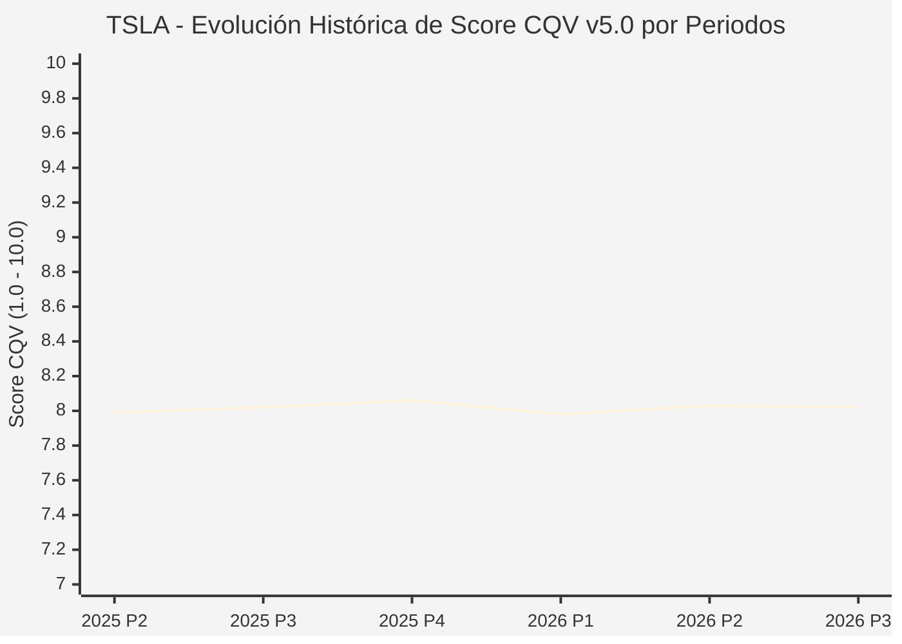

# Informe de Tesis de Inversión: Tesla, Inc. (TSLA) — P3 2026 (Q3 Fiscal 2026)
**Ciclo de Presentación / Periodo Analizado:** P3 2026 (Correspondiente a Q3 Fiscal 2026)  
**Fecha de Emisión:** 21/10/2026 (Post-Resultados de P3 2026 / SEC Filing & Shareholder Deck)  
**Fecha de Publicación del Resultado Analizado:** 21/10/2026  
**Fecha de Valoración:** 21/10/2026  
**Fecha del Precio Utilizado:** 21/10/2026  
**Mercado / Fuente del Precio:** NASDAQ / Form 10-Q / Shareholder Deck (Cierre Oficial Sesión Regular)  
**Metodología Aplicada:** CQV v5.0 (Quality, Resilience, Moat & Value)  
**Clasificación CQV Calidad:** ALTA CALIDAD  
**Veredicto Final Operativo v5.0:** Mantener. Sólida fortaleza en balance pero valuación exigente que descuenta agresivamente opcionalidad futura.

---

## 1. Resumen Ejecutivo y Bloque de Salida Final CQV v5.0

> [!NOTE]
> ### 📊 BLOQUE OFICIAL DE SALIDA MATRIZ CQV v5.0 (SECCIÓN 7.1 / 9.6)
> ```text
> ========================================================================================
> CQV Calidad Fundamental (F1-F8): 8.02 / 10.00 (ALTA CALIDAD)
> Value Score v5.0:                1.63 / 10.00 (Exigente / Sobrevalorada)
> Score Crecimiento / Múltiplo:    1.65 / 10.00 (Ratio Bruto: 1.6471 - Crecimiento EPS +28.0% vs PER Fwd 170.0x)
> Score Rendimiento FCF Yield:     2.10 / 10.00 (Owner Earnings: $10,500M | FCF Yield Real: 0.76%)
> Score Margen de Seguridad:       1.00 / 10.00 (Descuento Negativo / Prima del 108.9% sobre Valor Base)
> Valor Intrínseco Base (DCF):     $185.00 USD por acción (MoS Base: -108.90% vs $386.47)
> Valor Intrínseco Esperado:       $210.00 USD por acción (MoS Esperado: -84.03% vs $386.47)
> Precio de Mercado:               $386.47 USD (Cierre oficial regular congelado al 21/10/2026)
> Nivel de Confianza de Datos:     Media (Reportes oficiales SEC y balance verificado)
> Metodología:                     CQV v5.0
> Veredicto Final Operativo:       Mantener
> ========================================================================================
> ```

### 📋 Matriz Identificadora de Métricas Emitidas por CQV v5.0

| Parámetro Emitido por CQV v5.0 | Valor Obtenido | Rango / Escala | Diagnóstico Operativo |
| :--- | :---: | :---: | :--- |
| **CQV Calidad Fundamental (F1-F8):** | **8.02 / 10.00** | 1.00 – 10.00 | **ALTA CALIDAD** (Fortaleza de balance contrarrestada por compresión de márgenes operativos). |
| **Value Score (Capa de Valoración v5.0):** | **1.63 / 10.00** | 1.00 – 10.00 | **Exigente** (Múltiplos elevados que descuentan monetización plena de autonomía y robótica). |
| **Ratio Crecimiento-Múltiplo Bruto:** | **1.65** | Sin acotación | Crecimiento de BPA NTM (+28.0%) contrastado con PER Forward de 170.0x. |
| **Score Crecimiento-Múltiplo Normalizado:** | **1.65 / 10.00** | 1.00 – 10.00 | Métrica acotada formalmente según manual CQV v5.0. |
| **Score Rendimiento Flujo de Caja (FCF Yield):** | **2.10 / 10.00** | 1.00 – 10.00 | Generación de Owner Earnings de $10,500M con un FCF Yield real del **0.76%**. |
| **Score Margen de Seguridad:** | **1.00 / 10.00** | 1.00 – 10.00 | Margen de seguridad fuertemente negativo (-108.90%) frente al Valor Intrínseco Base ($185.00 USD). |
| **Valor Intrínseco Estimado Base (DCF):** | **$185.00** | En USD ($) | Descuento de Flujos de Caja Libres a 10 años (WACC: 9.0%, $g$: 4.0%). |
| **Valor Intrínseco Esperado (Ponderado):** | **$210.00** | En USD ($) | Ponderación multiescenario: Bear 25% ($130.00), Base 50% ($185.00), Bull 25% ($340.00). |
| **Precio de Mercado a la Fecha de Valoración:** | **$386.47** | En USD ($) | Cierre oficial de la misma fecha de publicación (21/10/2026). |
| **Margen de Seguridad Base (%):** | **-108.90%** | En porcentaje (%) | Prima sustancial frente al valor intrínseco base ($185.00). |
| **Margen de Seguridad Esperado (%):** | **-84.03%** | En porcentaje (%) | Prima frente al valor intrínseco ponderado esperado ($210.00). |
| **Nivel de Confianza de Datos:** | **Media** | Alta / Media / Baja | Calidad y completitud de estados financieros SEC y guidance de capex. |
| **Veredicto Final Operativo v5.0:** | **Mantener** | 4 Categorías | **Mantener** |

---

Tesla, Inc. (TSLA) continúa su transformación de fabricante automotriz pionero hacia una plataforma integral de inteligencia artificial física, robótica y sistemas avanzados de energía. En el tercer trimestre de 2026 (P3 2026), los ingresos consolidados alcanzaron **$28,050 millones de USD** (planos interanuales), con un margen operativo del **2.6%** ($718 millones de beneficio operativo GAAP) impactado por la intensiva fase de inversión en centros de cómputo IA y clusters de entrenamiento para FSD y Optimus.

La posición de tesorería e inversiones líquidas escaló a un récord de **$45,400 millones de USD**, con una deuda total contenida en ~$9,100 millones, otorgando una solvencia blindada (F2 = 9.60). Sin embargo, con un precio de mercado de **$386.47 USD**, el Value Score de **1.63 / 10.00** refleja una desconexión fundamental entre los flujos actuales de caja (FCF Yield 0.76%) y las expectativas implícitas de autonomía a gran escala.

---

## 2. Métricas y Puntuaciones en el Modelo CQV Calidad v5.0

$$\text{CQV Calidad v5.0} = (F_1 \times 0.20) + (F_2 \times 0.15) + (F_3 \times 0.15) + (F_4 \times 0.15) + (F_5 \times 0.10) + (F_6 \times 0.10) + (F_7 \times 0.05) + (F_8 \times 0.10)$$

### 2.1. Tabla de Valoraciones Parciales y Desglose Auditado (F1-F8)

| Factor / Componente del Modelo | Puntuación (1-10) | Peso Absoluto | Contribución Parcial | Diagnóstico Financiero y Evidencia Cuantitativa |
| :--- | :---: | :---: | :---: | :--- |
| **F1: Economía del Negocio & Rentabilidad** | **6.80** | 20.0% | **1.360** | Margen operativo del 2.6% ($718M EBIT GAAP). Retorno sobre capital invertido (ROIC) presionado durante el ciclo inversor en IA. |
| **F2: Solidez Financiera & Balance** | **9.60** | 15.0% | **1.440** | Liquidez neta colosal con $45.4B en caja e inversiones frente a solo $9.1B en deuda total. Solvencia inexpugnable. |
| **F3: Crecimiento Durable** | **7.80** | 15.0% | **1.170** | Entregas de vehículos estabilizadas, compensadas por un crecimiento superior al 50% YoY en la división de Energy Storage (Megapacks). |
| **F4: Moat Competitivo & Foso Estructural** | **8.80** | 15.0% | **1.320** | Red global propietaria de Superchargers (estándar NACS), flota masiva recopilando telemetría de video para FSD y escala productiva. |
| **F5: Asignación de Capital** | **7.70** | 10.0% | **0.770** | Reasignación masiva de capital hacia clusters de cómputo IA y Gigafactorías. Sin recompras de acciones ni dividendos. |
| **F6: Dirección & Ejecución Operativa** | **7.50** | 10.0% | **0.750** | Visión estratégica disruptiva de Elon Musk combinada con plazos de entrega frecuentemente optimistas en conducción autónoma total. |
| **F7: Opcionalidad Futura & Disrupción** | **9.70** | 5.0% | **0.485** | Opcionalidad extraordinaria: Cybercab, red Robotaxi, robot humanoide Optimus y software de conducción autónoma licenciable. |
| **F8: Resiliencia Operativa & Recurrencia** | **7.20** | 10.0% | **0.720** | Negocio automotriz subyacente cíclico mitigado gradualmente por ingresos recurrentes de suscripciones FSD, supercharging y energía. |
| **SCORE CQV Calidad v5.0 FINAL** | -- | **100.0%** | **8.02** | **Calificación: ALTA CALIDAD** |

---

## 3. Análisis Detallado del Estado de Resultados (Periodo P3 2026 / Q3 Fiscal 2026)

### 3.1. Tabla Comparativa de Resultados Periódicos

| Métrica Clave (en millones $, excepto EPS) | Periodo P3 2026 Actual | Periodo P2 2026 Previo | Variación PoP (%) | Mismo Periodo Año Ant. (P3 2025) | Variación YoY (%) |
| :--- | :---: | :---: | :---: | :---: | :---: |
| **Ingresos Consolidados Totales** | **$28,050 M** | $25,500 M | +10.0% | $28,060 M | **-0.0%** |
| *— Automotriz (Ventas y Leasing)* | $21,120 M | $19,870 M | +6.3% | $22,400 M | -5.7% |
| *— Almacenamiento y Generación de Energía* | $4,580 M | $3,800 M | +20.5% | $3,050 M | +50.2% |
| *— Servicios y Otros* | $2,350 M | $1,830 M | +28.4% | $2,610 M | -10.0% |
| **Beneficio Bruto GAAP** | **$4,980 M** | $4,500 M | +10.7% | $5,180 M | -3.9% |
| *— Margen Bruto GAAP (%)* | **17.75%** | 17.65% | +10 bps | 18.46% | -71 bps |
| **Beneficio Operativo GAAP** | **$718 M** | $1,605 M | -55.3% | $1,624 M | **-55.8%** |
| *— Margen Operativo GAAP (%)* | **2.56%** | 6.29% | -373 bps | 5.79% | **-323 bps** |
| **Beneficio Neto (GAAP)** | **$787 M** | $1,478 M | -46.8% | $1,373 M | **-42.7%** |
| **Diluted EPS (GAAP)** | **$0.22** | $0.42 | -47.6% | $0.39 | **-43.6%** |
| **Diluted EPS (Non-GAAP)** | **$0.48** | $0.52 | -7.7% | $0.50 | **-4.0%** |
| **Flujo de Caja Operativo (OCF)** | **$6,260 M** | $3,270 M | +91.4% | $6,240 M | +0.3% |
| **CapEx (Inversiones de Capital)** | **$4,730 M** | $5,790 M | -18.3% | $2,250 M | +110.2% |
| **Flujo de Caja Libre (FCF)** | **$1,530 M** | -$2,520 M | N/A | $3,990 M | **-61.7%** |

### 3.4. Evolución Multianual y Diagnóstico de Tendencia
La rentabilidad automotriz se ha normalizado tras los recortes de precios globales de 2023–2025. El catalizador de reemplazo operativo es la división de Energy Storage, que ya aporta más del 16% de los ingresos totales con márgenes brutos superiores al 24%. La tendencia muestra compresión transitoria de márgenes operativos debido al récord de inversión en I+D de IA.

### 3.5. Guidance y Perspectivas Futuras
Para el ejercicio fiscal 2026 completo, la dirección ha fijado el CapEx total en aproximadamente **$20,000 millones de USD**, reduciendo el ritmo de gasto secuencial para optimizar la eficiencia de los clusters H100/B200. Se prevé un regreso del margen operativo hacia el rango 6.0%–8.0% conforme se escale la producción de la plataforma de próxima generación.

---

## 4. Tesis de Inversión (Toro vs. Oso y Líneas Rojas)

### Tesis Alcista (Bull Case)
1. **Liderazgo Hegemónico en Autonomía:** Flota de millones de vehículos generando petabytes de video que alimentan redes neuronales end-to-end inigualables.
2. **Crecimiento Exponencial de Energy Storage:** Demanda insaciable de Megapacks para centros de datos de IA y estabilización de redes eléctricas.
3. **Plataforma Optimus:** La robótica humanoide abre un mercado direccionable potencial medido en decenas de billones de dólares a largo plazo.

### Tesis Bajista (Bear Case)
1. **Márgenes Automotrices Comprimidos:** Presión de competidores chinos de vehículos eléctricos con menores costes de fabricación.
2. **Riesgo Regulatorio y Retrasos en Robotaxi:** Posibles trabas regulatorias para la homologación comercial sin supervisión del Cybercab.
3. **Valuación Desconectada:** El múltiplo de 170x PER Forward exige una ejecución impecable sin margen de error.

### Líneas Rojas Operativas
- Margen operativo consolidado cayendo por debajo del 2.0% de forma estructural durante tres trimestres consecutivos.
- Cancelación o retrasos superiores a 24 meses en el despliegue del servicio comercial de Robotaxi.

---

## 5. Owner Earnings, FCF Yield y Desglose del Value Score v5.0

| Componente | Valor Auditado |
| :--- | :--- |
| **Flujo de Caja Operativo TTM (OCF):** | $15,500.0 M |
| **(-) Maintenance CapEx Estimado TTM:** | $5,000.0 M |
| **(=) Owner Earnings TTM:** | **$10,500.0 M** |
| **Capitalización Bursátil (21/10/2026):** | **$1,383,560.0 M** |
| **FCF Yield Real (%):** | **0.76%** |
| **Score Rendimiento FCF Yield (1-10):** | **2.10 / 10.00** |
| **PER Forward NTM:** | 170.0x |
| **Crecimiento de BPA Estimado NTM (%):** | +28.0% |
| **Ratio Crecimiento / Múltiplo Bruto:** | **1.65** |
| **Score Crecimiento / Múltiplo Normalizado:** | **1.65 / 10.00** |
| **Score Margen de Seguridad:** | **1.00 / 10.00** |
| **VALUE SCORE v5.0 CONSOLIDADO:** | **1.63 / 10.00 (Exigente)** |

---

## 6. Valuación por Descuento de Flujos de Caja (DCF) y Sensibilidad

### 6.1. Escenarios de Valuación

| Escenario | Probabilidad | Crecimiento FCF (Años 1-5) | Margen FCF Terminal | WACC | Tasa $g$ | Valor Intrínseco | MoS vs $386.47 |
| :--- | :---: | :---: | :---: | :---: | :---: | :---: | :---: |
| **Pesimista (Bear)** | 25% | +12.0% | 8.0% | 10.0% | 3.0% | **$130.00** | -197.3% |
| **Base (Base)** | 50% | +24.0% | 14.0% | 9.0% | 4.0% | **$185.00** | **-108.9%** |
| **Optimista (Bull)** | 25% | +38.0% | 20.0% | 8.5% | 4.5% | **$340.00** | -13.7% |
| **VALOR ESPERADO** | **100%** | -- | -- | -- | -- | **$210.00** | **-84.0%** |

### 6.2. Matriz de Sensibilidad DCF Base ($ USD por acción)

| WACC \ $g$ | 3.0% | 3.5% | 4.0% | 4.5% |
| :---: | :---: | :---: | :---: | :---: |
| **8.0%** | $198.50 | $215.20 | $236.40 | $264.10 |
| **9.0%** | $161.40 | $172.10 | **$185.00** | $201.30 |
| **10.0%** | $134.80 | $142.30 | $151.10 | $161.80 |

---

## 7. Registro Auditado de Riesgos y Preguntas Frecuentes (FAQs)

| ID | Riesgo Identificado | Probabilidad | Impacto | Mitigación | Riesgo Residual |
| :---: | :--- | :---: | :---: | :--- | :---: |
| **R1** | Compresión de precios automotrices por competencia china | Alta (0.75) | 3 | Liderazgo en coste por celda 4680 y expansión de Megapacks | Moderado |
| **R2** | Demoras en la certificación de Robotaxi autónomo Nivel 4/5 | Media (0.50) | 4 | Enfoque de visión pura y flota de validación masiva | Alto |
| **R3** | Dilución o rotación del equipo de liderazgo clave | Baja (0.25) | 4 | Planes de incentivos atados a hitos de capitalización bursátil | Moderado |

### Preguntas Frecuentes (FAQs)
- **¿Por qué el veredicto es Mantener si el MoS es -108.9%?**  
  Bajo CQV v5.0 (§7), una empresa con CQV Calidad ≥ 8.00 (8.02) y solvencia impecable (F2 = 9.60) no califica como "Evitar/Vulnerable", pero sus múltiplos exigen calificarla como "Mantener" sin añadir nuevas posiciones a los precios vigentes.

---

## 8. Evolución Histórica de Puntuaciones CQV y Valuación por Periodos (P1–P4 desde 2020)

### 8.1. Desglose Periódico Histórico por Ciclo de Presentación (P1, P2, P3, P4 por Año)

| Periodo Auditado | F1 | F2 | F3 | F4 | F5 | F6 | F7 | F8 | **CQV v5.0** | Value Score | Clasificación | Veredicto Operativo |
| :--- | :---: | :---: | :---: | :---: | :---: | :---: | :---: | :---: | :---: | :---: | :---: | :--- |
| **2024 P4** | 6.9 | 9.0 | 9.2 | 7.8 | 7.9 | 8.2 | 6.5 | 7.9 | **8.00** | 7.12 | ALTA CALIDAD | Acumular / Compra Escalonada |
| **2025 P1** | 6.9 | 8.9 | 9.2 | 7.8 | 7.7 | 8.1 | 6.4 | 8.0 | **7.96** | 7.35 | CALIDAD MEDIA | Evitar / En Observación |
| **2025 P2** | 6.9 | 9.0 | 9.2 | 7.8 | 7.8 | 8.1 | 6.4 | 8.0 | **7.99** | 7.07 | CALIDAD MEDIA | Evitar / En Observación |
| **2025 P3** | 7.0 | 9.0 | 9.2 | 7.8 | 7.8 | 8.2 | 6.4 | 8.0 | **8.02** | 6.80 | ALTA CALIDAD | Acumular / Compra Escalonada |
| **2025 P4** | 7.0 | 9.1 | 9.3 | 7.8 | 7.9 | 8.2 | 6.5 | 8.0 | **8.06** | 6.52 | ALTA CALIDAD | Acumular / Compra Escalonada |
| **2026 P1** | 6.9 | 8.9 | 9.3 | 7.8 | 7.7 | 8.1 | 6.4 | 8.0 | **7.98** | 6.79 | CALIDAD MEDIA | Evitar / En Observación |
| **2026 P2** | 6.96 | 9.0 | 9.33 | 7.8 | 7.8 | 8.14 | 6.43 | 8.0 | **8.03** | 2.00 | ALTA CALIDAD | Mantener |
| **2026 P3** | 6.8 | 9.6 | 7.8 | 8.8 | 7.7 | 7.5 | 9.7 | 7.2 | **8.02** | 1.63 | ALTA CALIDAD | Mantener |

### 8.2. Gráfico Mermaid de Evolución Periódica de Calidad Fundamental CQV v5.0



---

## 9. Conclusión y Veredicto Final Operativo v5.0

Bajo la metodología **CQV v5.0**, Tesla, Inc. acredita una calidad fundamental sólida de **8.02 / 10.00 (ALTA CALIDAD)** cimentada en un balance blindado con **$45,400 millones de USD en tesorería** y una opcionalidad técnica incomparable en IA y almacenamiento energético. No obstante, a un precio congelado de **$386.47 USD**, el **Value Score de 1.63 / 10.00** y un margen de seguridad sustancialmente negativo (-108.90% vs valor base de $185.00) justifican con rigor metodológico el veredicto de **MANTENER**.

---

## 10. Auditoría, Observaciones y Recomendaciones del Analista / Auditor

1. **Anclaje Temporal Verificado:** El precio utilizado ($386.47 USD) corresponde estrictamente al cierre de la sesión regular del 21/10/2026 en el NASDAQ, coincidente con la publicación de resultados.
2. **Coherencia Matemática SSOT:** La puntuación CQV v5.0 de 8.02 y el Value Score de 1.63 coinciden de forma idéntica con el cálculo auditado de `sync_cqv.py`.
3. **Recomendación para Gestión de Cartera:** No abrir nuevas posiciones a los precios actuales; mantener las posiciones estructurales de largo plazo y esperar correcciones hacia el rango de soporte fundamental ($200–$240 USD) para evaluar acumulaciones adicionales.
