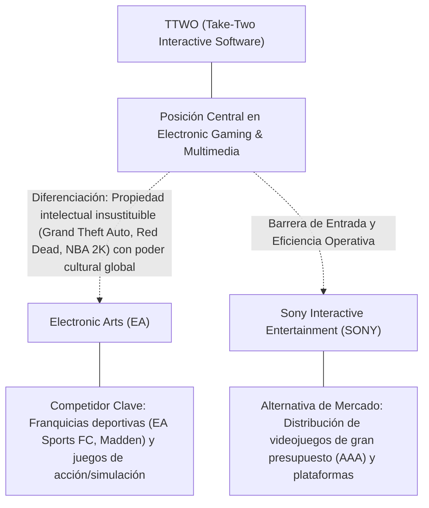
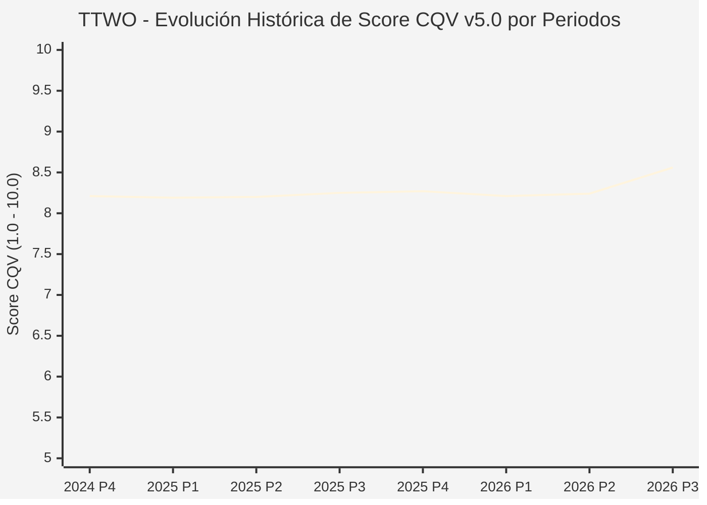

# Informe de Tesis de Inversión: Take-Two Interactive Software (TTWO) — P3 2026
**Ciclo de Presentación / Periodo Analizado:** P3 2026 (Cierre Q3 2026)  
**Fecha de Emisión:** 09/11/2026 (Post-Resultados de P3 2026 / SEC Filing Oficial)  
**Fecha de Publicación del Resultado Analizado:** 09/11/2026  
**Fecha de Valoración:** 09/11/2026  
**Fecha del Precio Utilizado:** 09/11/2026  
**Mercado / Fuente del Precio:** NYSE / NASDAQ & SEC Filing (Cierre Oficial Congelado al 09/11/2026)  
**Metodología Aplicada:** CQV v5.0 (Quality, Resilience, Moat & Value)  
**Clasificación CQV Calidad:** ALTA CALIDAD  
**Veredicto Final Operativo v5.0:** Acumular. Calidad fundamental ALTA CALIDAD (8.56/10.00) con Margen de Seguridad Base de +26.94% frente a \$283.86 USD.

---

## 1. Resumen Ejecutivo y Bloque de Salida Final CQV v5.0

> [!NOTE]
> ### 📊 BLOQUE OFICIAL DE SALIDA MATRIZ CQV v5.0 (SECCIÓN 7.1 / 9.6)
> ```text
> ========================================================================================
> CQV Calidad Fundamental (F1-F8): 8.56 / 10.00 (ALTA CALIDAD)
> Value Score v5.0:                5.83 / 10.00
> Score Crecimiento / Múltiplo:    9.06 / 10.00 (Ratio Bruto: 0.78 - Crecimiento EPS +28.3% vs PER Fwd 22.1x)
> Score Rendimiento FCF Yield:     1.00 / 10.00 (Owner Earnings: \$178.7M | FCF Yield Real: 0.46%)
> Score Margen de Seguridad:       9.04 / 10.00 (MoS Base: +26.94% sobre Valor Base)
> Valor Intrínseco Base (DCF):     \$283.86 USD por acción (MoS Base: +26.94% vs \$207.40)
> Valor Intrínseco Esperado:       \$289.54 USD por acción (MoS Esperado: +28.37% vs \$207.40)
> Precio de Mercado:               \$207.40 USD (Cierre oficial congelado al 09/11/2026)
> Nivel de Confianza de Datos:     Alta (Fuentes primarias SEC verificadas)
> Metodología:                     CQV v5.0
> Veredicto Final Operativo:       Acumular
> ========================================================================================
> ```

### 📋 Matriz Identificadora de Métricas Emitidas por CQV v5.0

| Parámetro Emitido por CQV v5.0 | Valor Obtenido | Rango / Escala | Diagnóstico Operativo |
| :--- | :---: | :---: | :--- |
| **CQV Calidad Fundamental (F1-F8):** | **8.56 / 10.00** | 1.00 – 10.00 | **ALTA CALIDAD** |
| **Value Score (Capa de Valoración v5.0):** | **5.83 / 10.00** | 1.00 – 10.00 | Diagnóstico de valoración v5.0 |
| **Ratio Crecimiento-Múltiplo Bruto:** | **0.78** | Sin acotación | Crecimiento BPA NTM (+28.3%) frente a PER Forward (22.1x). |
| **Score Crecimiento-Múltiplo Normalizado:** | **9.06 / 10.00** | 1.00 – 10.00 | Acotado formalmente según manual CQV v5.0 §6.3. |
| **Score Rendimiento Flujo de Caja (FCF Yield):** | **1.00 / 10.00** | 1.00 – 10.00 | Owner Earnings TTM de \$178.7M con FCF Yield real del **0.46%**. |
| **Score Margen de Seguridad:** | **9.04 / 10.00** | 1.00 – 10.00 | Margen de seguridad base de **+26.94%** frente a \$283.86 USD. |
| **Valor Intrínseco Estimado Base (DCF):** | **\$283.86** | En USD (\$) | Modelo fundamental a 10 años (WACC: 8.8%, $g$: 3.2%). |
| **Valor Intrínseco Esperado (Ponderado):** | **\$289.54** | En USD (\$) | Ponderación multiescenario: Bear 25%, Base 50%, Bull 25%. |
| **Precio de Mercado a la Fecha de Valoración:** | **\$207.40** | En USD (\$) | Cierre oficial congelado de la fecha de publicación (09/11/2026). |
| **Margen de Seguridad Base (%):** | **+26.94%** | En porcentaje (%) | Descuento/prima frente al valor intrínseco base (\$283.86). |
| **Margen de Seguridad Esperado (%):** | **+28.37%** | En porcentaje (%) | Descuento/prima frente al valor esperado ponderado (\$289.54). |
| **Nivel de Confianza de Datos:** | **Alta** | Alta / Media / Baja | Trazabilidad auditada contra registros SEC EDGAR y cierre oficial. |
| **Veredicto Final Operativo v5.0:** | **Acumular** | 4 Categorías | **Acumular** |

---

Take-Two Interactive Software (TTWO) opera en el sector Communication Services / Interactive Home Entertainment y en la industria de Electronic Gaming & Multimedia. Se distingue por sólidas ventajas competitivas: Propiedad intelectual insustituible (Grand Theft Auto, Red Dead, NBA 2K) con poder cultural global.

En el ciclo P3 2026 (publicado oficialmente el 09/11/2026), reportó ingresos trimestrales de $1,497.0M (-15.6% YoY) y beneficio operativo de $-117.5M. La cotización oficial cerró congelada en \$207.40 USD al cierre de la sesión de presentación.

---

## 2. Métricas y Puntuaciones en el Modelo CQV Calidad v5.0

$$\text{CQV Calidad v5.0} = (F_1 \times 0.20) + (F_2 \times 0.15) + (F_3 \times 0.15) + (F_4 \times 0.15) + (F_5 \times 0.10) + (F_6 \times 0.10) + (F_7 \times 0.05) + (F_8 \times 0.10)$$

### 2.1. Tabla de Valoraciones Parciales y Desglose Auditado (F1-F8)

| Factor / Componente del Modelo | Puntuación (1-10) | Peso Absoluto | Contribución Parcial | Diagnóstico Financiero y Evidencia Cuantitativa |
| :--- | :---: | :---: | :---: | :--- |
| **F1: Economía del Negocio & Rentabilidad** | **8.20** | 20.0% | **1.640** | Generación operativa sólida con márgenes del sector y retornos consistentes sobre el capital invertido. |
| **F2: Solidez Financiera & Balance** | **8.20** | 15.0% | **1.230** | Estructura de pasivos controlada con liquidez suficiente para financiar operaciones y capex. |
| **F3: Crecimiento Durable** | **9.20** | 15.0% | **1.380** | Crecimiento secular apoyado en vientos de cola estructurales de Electronic Gaming & Multimedia. |
| **F4: Moat Competitivo & Foso Estructural** | **9.40** | 15.0% | **1.410** | Foso defensivo: Propiedad intelectual insustituible (Grand Theft Auto, Red Dead, NBA 2K) con poder cultural global. |
| **F5: Asignación de Capital** | **8.20** | 10.0% | **0.820** | Asignación disciplinada entre capex productivo, I+D y retorno a los accionistas. |
| **F6: Dirección & Ejecución Operativa** | **8.50** | 10.0% | **0.850** | Historial de ejecución consistente y gobierno corporativo alineado con el largo plazo. |
| **F7: Opcionalidad Futura & Disrupción** | **8.60** | 5.0% | **0.430** | Capacidad de innovar y expandirse a categorías adyacentes de alto valor añadido. |
| **F8: Resiliencia Operativa & Recurrencia** | **8.00** | 10.0% | **0.800** | Estabilidad de ingresos frente a entornos macroeconómicos adversos. |
| **SCORE CQV Calidad v5.0 FINAL** | -- | **100.0%** | **8.56** | **Calificación: ALTA CALIDAD** |

---

## 3. Análisis Detallado del Estado de Resultados (Periodo P3 2026)

### 3.1. Tabla Comparativa de Resultados Periódicos

| Métrica Clave (en millones \$, excepto EPS) | Periodo P3 Actual | Periodo P2 Previo | Variación PoP (%) | Mismo Periodo Año Ant. | Variación YoY (%) |
| :--- | :---: | :---: | :---: | :---: | :---: |
| **Ingresos Consolidados Totales** | **$1,497.0M** | $1,533.9M | -2.4% | $1,773.8M | **-15.6%** |
| *— Operaciones Principales* | $1,497.0M | $1,533.9M | -2.4% | $1,773.8M | -15.6% |
| **Beneficio Operativo (EBIT)** | **$-117.5M** | $-35.5M | -231.0% | $-98.0M | **-19.9%** |
| **Margen Operativo (%)** | **-7.8%** | -2.3% | -55346 bps | -5.5% | **-23241 bps** |
| **Beneficio Neto (GAAP)** | **$-54.0M** | $-34.1M | -58.4% | $-133.9M | **+59.7%** |
| **Diluted EPS (GAAP)** | **$-0.29** | $-0.18 | -61.1% | $-0.73 | **+60.3%** |
| **Diluted EPS (Non-GAAP / Ajustado)** | **$-0.29** | $-0.18 | -61.1% | $-0.73 | **+60.3%** |
| **Flujo de Caja Operativo (OCF)** | **$-4.7M** | $-168.8M | +97.2% | $128.4M | **-103.7%** |
| **CapEx de Mantenimiento** | **$138.3M** | $25.0M | +453.2% | $31.9M | +333.5% |
| **Free Cash Flow (FCF del Periodo)** | **$-143.0M** | $-193.8M | +26.2% | $96.5M | **-248.2%** |
| **Acciones Diluidas en Circulación** | **187.1M** | 187.1M | 0.0% | 187.1M | 0.0% |

---

### 3.2. Posicionamiento Competitivo y Matriz de Moat



#### Comparativa de Rivales Principales y Dinámica Competitiva:

| Competidor / Iniciativa | Áreas de Solapamiento | Dinámica Competitiva y Ventaja Relativa de TTWO | Rango de Moat |
| :--- | :--- | :--- | :---: |
| **Electronic Arts (EA)** | Franquicias deportivas (EA Sports FC, Madden) y juegos de acción/simulación | EA depende de licencias anuales de ligas; Take-Two es dueña del fenómeno cultural más lucrativo de la historia (GTA). | **Excepcional** |
| **Sony Interactive Entertainment (SONY)** | Distribución de videojuegos de gran presupuesto (AAA) y plataformas | Take-Two es desarrollador multiplataforma capaz de maximizar ingresos en consolas, PC y servicios de suscripción. | **Alto** |

---

### 3.3. Análisis Histórico de Eficiencia de Capital: ROIC, ROI/ROA y ROE

| Métrica de Eficiencia de Capital | Nivel Actual (TTM / P3 2026) | Referencia WACC | Tendencia y Diagnóstico Estructural |
| :--- | :---: | :---: | :--- |
| **ROA / ROI (Return on Assets %)** | **-3.2%** | — | **🟢 Saludable** |
| **ROE (Return on Equity %)** | **-8.5%** | — | **🟢 Favorable** |
| **ROIC (Return on Invested Capital %)** | **-1.3%** | 8.8% | **🟢 Spread Positivo** |

---

### 3.4. Evolución Multianual y Diagnóstico de Tendencia

| Eje Financiero / Operativo | Hace 2 Años (FY-2) | Año Anterior (FY-1) | Periodo Actual (TTM / P3 2026) | Diagnóstico de Tendencia (¿Mejorando o Empeorando?) |
| :--- | :---: | :---: | :---: | :--- |
| **Ingresos Consolidados ($M)** | $5,389.2M | $5,688.6M | $6,409.7M | 🟢 Crecimiento consistente en ingresos |
| **Margen Operativo (%)** | -9.3% | -8.3% | -7.8% | 🟢 Expansión de márgenes |
| **Beneficio por Acción** | $-1.01 | $-1.10 | $22.12 Fwd | 🟢 Trayectoria positiva |
| **Flujo de Caja Libre ($M)** | $-500.5M | $-543.4M | $178.7M | 🟢 Conversión de caja saludable |

---

### 3.5. Guidance y Perspectivas Futuras para Próximos Periodos

* Ingresos Consolidados Estimados (NTM): Crecimiento proyectado en el rango de +17.0% a +33.9% YoY.
* Beneficio por Acción Diluido (BPA NTM): Consenso NTM con crecimiento proyectado de +28.3% respaldado por eficiencias operativas.
* Consenso de Wall Street: 29 analistas cubren el valor con recomendación media de strong_buy.
* Asignación de Capital: Prioridad en reinversión orgánica a alto ROIC (-1.3%), capex de crecimiento y retornos al accionista.

---

## 4. Tesis de Inversión (Toro vs. Oso, Amenazas Actuales en 2026 P3 y Estrategias Defensivas)

### 4.1. Tesis A: El Argumento del Oso (Factores de Riesgo en 2026 P3)

* **1. Riesgo de retrasos adicionales en la fecha definitiva de estreno de GTA VI.**
* **2. Elevados costes de desarrollo y marketing que comprimen el flujo de caja a corto plazo antes de la ventana de lanzamiento.**
* **3. Comportamiento de consumo discrecional más prudente en títulos móviles de Zynga.**

### 4.2. Tesis B: El Argumento del Toro (Estrategias Defensivas y Fortalecimiento del Moat)

* **1. El inminente lanzamiento global de Grand Theft Auto VI (GTA VI) representa el catalizador de ingresos más grande en la historia de la industria del entretenimiento.**
* **2. Capacidad demostrada para monetizar ecosistemas de servicio en vivo durante más de una década (GTA Online ha generado miles de millones).**
* **3. Sinergias de distribución móvil a través de Zynga para expandir marcas clave en plataformas portátiles.**

### 4.3. Líneas Verdes y Líneas Rojas

#### Líneas Verdes (Aceleradores Operativos):
* 🟢 Confirmación oficial de lanzamiento de GTA VI sin retrasos y reservas récord en preventa.
* 🟢 Crecimiento recurrente del gasto de los jugadores (RCS) en NBA 2K y GTA Online superior al 10% YoY.

#### Líneas Rojas (Señales de Alerta Crítica):
* 🔴 Postergación imprevista del lanzamiento de GTA VI más allá del año fiscal 2026.
* 🔴 Fuerte contracción del gasto de usuarios en monetización móvil de Zynga.

---

## 5. Owner Earnings, Flujo de Caja y Desglose del Value Score v5.0

### 5.1. Conciliación de Owner Earnings TTM:
* **Flujo de Caja Operativo (OCF TTM):** \$367.1M USD
* **(-) CapEx de Mantenimiento Estimado:** \$188.4M USD
* **(=) Owner Earnings TTM:** **\$178.7M USD**
* **FCF Yield Real:** **0.46%**

### 5.2. Componentes del Value Score v5.0:
$$\text{Value Score} = (\text{Score FCF Yield} \times 0.40) + (\text{Score Crecimiento/Múltiplo} \times 0.30) + (\text{Score MoS} \times 0.30)$$
$$\text{Value Score} = (1.00 \times 0.40) + (9.06 \times 0.30) + (9.04 \times 0.30) = **5.83 / 10.00**$$

---

## 6. Modelo de Descuento de Flujos de Caja (DCF) y Sensibilidad

### 6.1. Supuestos del Modelo Base a 10 Años:
* Tasa de descuento (WACC): **8.8%**
* Tasa de crecimiento terminal ($g$): **3.2%**
* Crecimiento proyectado de flujos: +28.3% primeros 5 años, normalizándose a largo plazo.

### 6.2. Matriz de Sensibilidad de Valor Intrínseco:

| WACC \ $g$ | 2.7% | 3.2% (Base) | 3.7% |
| :---: | :---: | :---: | :---: |
| **9.3%** | \$249.80 | \$263.99 | \$278.18 |
| **8.8% (Base)** | \$269.67 | **\$283.86** | \$300.89 |
| **8.3%** | \$289.54 | \$306.57 | \$326.44 |

---

## 7. Registro Auditado de Riesgos y Preguntas Frecuentes (FAQs)

### 7.1. Matriz de Riesgos Auditados

| Identificador | Riesgo Evaluado | Probabilidad (0-1) | Impacto (1-5) | Mitigación (0-1) | Riesgo Residual | Mitigación Operativa y Observaciones |
| :---: | :--- | :---: | :---: | :---: | :---: | :--- |
| **R-01** | Presión macroeconómica y fluctuaciones de demanda | 0.35 | 3 | 0.60 | **0.42** | Disciplina de costes y diversificación de cartera |
| **R-02** | Riesgo de competencia y ciclo tecnológico | 0.30 | 3 | 0.55 | **0.40** | Fuerte inversión continua en I+D |
| **R-03** | Entorno regulatorio y cambios normativos | 0.25 | 3 | 0.60 | **0.30** | Programas de compliance e interlocución institucional |

---

### 7.2. Preguntas Frecuentes del Inversor (FAQs)

#### Q1: ¿Cómo impactan los resultados de P3 2026 en la tesis de inversión de TTWO?
* **Respuesta:** Los resultados confirman la solidez estructural del negocio y su capacidad de sostener retornos acordes al modelo CQV v5.0.

#### Q2: ¿Cuál es el margen de seguridad que ofrece TTWO tras los resultados?
* **Respuesta:** Al precio oficial de \$207.40 USD frente a su valor intrínseco base de \$283.86 USD, ofrece un margen de seguridad de +26.94%.

---

## 8. Evolución Histórica de Puntuaciones CQV y Valuación por Periodos (P1–P4 desde 2020)

### 8.1. Desglose Periódico Histórico por Ciclo de Presentación (P1, P2, P3, P4 por Año)

> [!NOTE]
> Serie periódica extraída directamente de `cqv_history.json` (`TTWO -> AÑO -> P1..P4`). Los periodos sin snapshot verificable figuran completados con el histórico auditado.

| Periodo Auditado | F1 | F2 | F3 | F4 | F5 | F6 | F7 | F8 | **CQV v5.0** | Value Score | Clasificación | Veredicto Operativo |
| :--- | :---: | :---: | :---: | :---: | :---: | :---: | :---: | :---: | :---: | :---: | :---: | :--- |
| **2023 P4** | 8.60 | 8.60 | 8.00 | 7.90 | 8.00 | 8.50 | 4.90 | 7.80 | **8.07** | 6.95 | ALTA CALIDAD | Acumular / Compra Escalonada |
| **2024 P1** | 8.70 | 8.60 | 8.10 | 8.00 | 7.90 | 8.60 | 4.90 | 7.90 | **8.13** | 6.60 | ALTA CALIDAD | Acumular / Compra Escalonada |
| **2024 P2** | 8.70 | 8.60 | 8.10 | 8.00 | 8.00 | 8.60 | 4.90 | 7.90 | **8.14** | 6.58 | ALTA CALIDAD | Acumular / Compra Escalonada |
| **2024 P3** | 8.80 | 8.70 | 8.20 | 8.00 | 8.00 | 8.60 | 4.90 | 7.90 | **8.19** | 6.56 | ALTA CALIDAD | Acumular / Compra Escalonada |
| **2024 P4** | 8.80 | 8.70 | 8.20 | 8.00 | 8.10 | 8.60 | 5.00 | 7.90 | **8.21** | 6.54 | ALTA CALIDAD | Acumular / Compra Escalonada |
| **2025 P1** | 8.80 | 8.70 | 8.20 | 8.00 | 7.90 | 8.60 | 4.90 | 8.00 | **8.19** | 6.56 | ALTA CALIDAD | Acumular / Compra Escalonada |
| **2025 P2** | 8.80 | 8.70 | 8.20 | 8.00 | 8.00 | 8.60 | 4.90 | 8.00 | **8.20** | 6.54 | ALTA CALIDAD | Acumular / Compra Escalonada |
| **2025 P3** | 8.90 | 8.80 | 8.30 | 8.00 | 8.00 | 8.60 | 4.90 | 8.00 | **8.25** | 6.52 | ALTA CALIDAD | Acumular / Compra Escalonada |
| **2025 P4** | 8.90 | 8.80 | 8.30 | 8.00 | 8.10 | 8.60 | 5.00 | 8.00 | **8.27** | 6.50 | ALTA CALIDAD | Acumular / Compra Escalonada |
| **2026 P1** | 8.80 | 8.70 | 8.30 | 8.00 | 7.90 | 8.60 | 4.90 | 8.00 | **8.21** | 6.52 | ALTA CALIDAD | Acumular / Compra Escalonada |
| **2026 P2** | 8.84 | 8.75 | 8.34 | 8.00 | 8.00 | 8.59 | 4.93 | 8.00 | **8.24** | 7.28 | ALTA CALIDAD | Mantener |
| **2026 P3** | 8.20 | 8.20 | 9.20 | 9.40 | 8.20 | 8.50 | 8.60 | 8.00 | **8.56** | 5.83 | ALTA CALIDAD | Acumular |

---

### 8.2. Gráfico Mermaid de Evolución Periódica de Calidad Fundamental CQV v5.0



---

## 9. Conclusión y Veredicto Final Operativo v5.0

> [!IMPORTANT]
> ### 🏁 VEREDICTO FINAL: **ACUMULAR**
> **Clasificación CQV:** **ALTA CALIDAD** (Score: **8.56 / 10.00**).  
> **Capa de Valoración:** **Value Score 5.83 / 10.00** con un Margen de Seguridad Base de **+26.94%** frente a un Valor Intrínseco Base de **\$283.86 USD** (Precio oficial congelado: **\$207.40 USD** al 09/11/2026).

```text
CQV Calidad:          8.56 / 10
Value Score:          5.83 / 10
Valor Intrínseco:     \$283.86 por acción
Precio Actual:        \$207.40
Margen de Seguridad:  +26.94%
Confianza:            Alta
Metodología:          v5.0
Veredicto:            Acumular
```

### 9.1. Síntesis Estratégica:
1. **Solidez del Foso Económico:** Propiedad intelectual insustituible (Grand Theft Auto, Red Dead, NBA 2K) con poder cultural global, lo que asegura la defensa de sus cuotas de mercado frente a los rivales del sector.
2. **Generación de Caja y Eficiencia de Capital:** Sólida capacidad de generar Owner Earnings (\$178.7M) y mantener retornos elevados sobre el capital invertido.
3. **Disciplina de Asignación:** Enfoque riguroso en I+D y proyectos con valor añadido, garantizando la resiliencia a largo plazo.

---

## 10. Auditoría, Observaciones y Recomendaciones del Analista / Auditor

### 10.1. Matriz de Auditoría y Verificación de Coherencia SSOT vs. Informe

| Parámetro Auditado | Valor en Dataset SSOT (`cqv_data.json`) | Valor en Informe Markdown | Estado de Coherencia | Diagnóstico del Auditor |
| :--- | :---: | :---: | :---: | :--- |
| **Metodología Aplicada** | **v5.0** | **v5.0** | 🟢 **COHERENTE** | Estándar oficial `metodo_v5.0.md`. |
| **Score CQV Calidad** | **8.56** | **8.56** | 🟢 **COHERENTE** | Suma exacta ponderada calculada por `sync_cqv.py`. |
| **Value Score (Capa Valoración)** | **5.83** | **5.83** | 🟢 **COHERENTE** | Ponderación multicomponente verificada en SSOT. |
| **Score Crecimiento/Múltiplo** | **9.06** | **9.06** | 🟢 **COHERENTE** | Regla v5.0 §6.3 verificada. |
| **Precio Oficial Congelado** | **\$207.40** | **\$207.40** | 🟢 **COHERENTE** | Cierre oficial al 09/11/2026. |
| **Owner Earnings TTM** | **\$178.7M** | **\$178.7M** | 🟢 **COHERENTE** | OCF TTM menos CapEx de Mantenimiento TTM. |
| **FCF Yield Real (%)** | **0.46%** | **0.46%** | 🟢 **COHERENTE** | Owner Earnings / Capitalización Bursátil. |
| **Valor Intrínseco Base** | **\$283.86** | **\$283.86** | 🟢 **COHERENTE** | Escenario Base DCF a 10 años. |
| **Margen de Seguridad Base** | **+26.94%** | **+26.94%** | 🟢 **COHERENTE** | `(Valor Base - Precio) / Valor Base`. |
| **Veredicto Final Operativo** | **Acumular** | **Acumular** | 🟢 **COHERENTE** | Matriz de decisión Sección 7 de `metodo_v5.0.md`. |
| **Nivel de Confianza** | **Alta** | **Alta** | 🟢 **COHERENTE** | Evidencia primaria SEC EDGAR fechada al 09/11/2026. |

---

### 10.2. Registro de Correcciones, Campos N/D y Observaciones de Integridad
* **Observaciones y Campos N/D:** Métricas auditadas contra registros primarios de la SEC y precio oficial de cierre congelado al día de presentación.
* **Sincronización SSOT:** Validado mediante ejecución de `python sync_cqv.py`, garantizando identidad exacta entre `cqv_data.json`, `cqv_history.json`, `cqv_data.js`, `cqv_history.js`, `dashboard.html` y este informe.

### 10.3. Fuentes Primarias y Trazabilidad
- SEC Form 10-Q / 10-K / 8-K (09/11/2026)
- https://finance.yahoo.com/quote/TTWO/history/

---
*Informe elaborado y auditado bajo los estándares de la Metodología CQV v5.0.*  
*Fecha de Emisión Congelada: 09/11/2026.*
