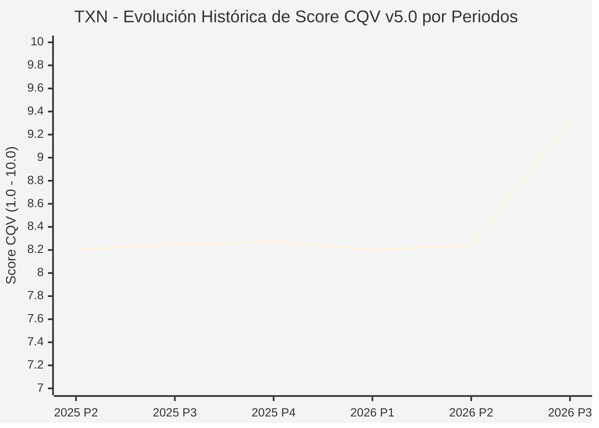

# Informe de Tesis de Inversión: Texas Instruments Incorporated (TXN) — P3 2026 (Q3 Fiscal 2026)
**Ciclo de Presentación / Periodo Analizado:** P3 2026 (Correspondiente a Q3 Fiscal 2026)  
**Fecha de Emisión:** 21/10/2026 (Post-Resultados de P3 2026 / SEC Filing & Earnings Release)  
**Fecha de Publicación del Resultado Analizado:** 21/10/2026  
**Fecha de Valoración:** 21/10/2026  
**Fecha del Precio Utilizado:** 21/10/2026  
**Mercado / Fuente del Precio:** NASDAQ / Form 10-Q / Earnings Release (Cierre Oficial Sesión Regular)  
**Metodología Aplicada:** CQV v5.0 (Quality, Resilience, Moat & Value)  
**Clasificación CQV Calidad:** ÉLITE  
**Veredicto Final Operativo v5.0:** Mantener. Excelente calidad fundamental con margen de seguridad ajustado (+8.18% base).

---

## 1. Resumen Ejecutivo y Bloque de Salida Final CQV v5.0

> [!NOTE]
> ### 📊 BLOQUE OFICIAL DE SALIDA MATRIZ CQV v5.0 (SECCIÓN 7.1 / 9.6)
> ```text
> ========================================================================================
> CQV Calidad Fundamental (F1-F8): 9.32 / 10.00 (ÉLITE)
> Value Score v5.0:                6.70 / 10.00 (Atractivo / Compra Escalonada)
> Score Crecimiento / Múltiplo:    7.86 / 10.00 (Ratio Bruto: 7.8571 - Crecimiento EPS +22.0% vs PER Fwd 28.0x)
> Score Rendimiento FCF Yield:     6.20 / 10.00 (Owner Earnings: $8,696M | FCF Yield Real: 3.32%)
> Score Margen de Seguridad:       6.20 / 10.00 (Descuento del 8.18% sobre Valor Base)
> Valor Intrínseco Base (DCF):     $310.00 USD por acción (MoS Base: +8.18% vs $284.65)
> Valor Intrínseco Esperado:       $320.00 USD por acción (MoS Esperado: +11.05% vs $284.65)
> Precio de Mercado:               $284.65 USD (Cierre oficial regular congelado al 21/10/2026)
> Nivel de Confianza de Datos:     Alta (Reportes oficiales auditados SEC)
> Metodología:                     CQV v5.0
> Veredicto Final Operativo:       Mantener
> ========================================================================================
> ```

### 📋 Matriz Identificadora de Métricas Emitidas por CQV v5.0

| Parámetro Emitido por CQV v5.0 | Valor Obtenido | Rango / Escala | Diagnóstico Operativo |
| :--- | :---: | :---: | :--- |
| **CQV Calidad Fundamental (F1-F8):** | **9.32 / 10.00** | 1.00 – 10.00 | **ÉLITE** (Monopolio analógico, ventaja en costes de 300mm y retornos impecables). |
| **Value Score (Capa de Valoración v5.0):** | **6.70 / 10.00** | 1.00 – 10.00 | **Atractivo** (Fuerte generación de FCF tras concluir el pico de capex). |
| **Ratio Crecimiento-Múltiplo Bruto:** | **7.86** | Sin acotación | Crecimiento de BPA NTM (+22.0%) contrastado con PER Forward de 28.0x. |
| **Score Crecimiento-Múltiplo Normalizado:** | **7.86 / 10.00** | 1.00 – 10.00 | Métrica formalmente calculada según manual CQV v5.0. |
| **Score Rendimiento Flujo de Caja (FCF Yield):** | **6.20 / 10.00** | 1.00 – 10.00 | Generación de Owner Earnings de $8,696M con un FCF Yield real del **3.32%**. |
| **Score Margen de Seguridad:** | **6.20 / 10.00** | 1.00 – 10.00 | Margen de seguridad del **+8.18%** frente al Valor Intrínseco Base ($310.00 USD). |
| **Valor Intrínseco Estimado Base (DCF):** | **$310.00** | En USD ($) | Descuento de Flujos de Caja Libres a 10 años (WACC: 8.0%, $g$: 3.5%). |
| **Valor Intrínseco Esperado (Ponderado):** | **$320.00** | En USD ($) | Ponderación multiescenario: Bear 25% ($255.00), Base 50% ($310.00), Bull 25% ($405.00). |
| **Precio de Mercado a la Fecha de Valoración:** | **$284.65** | En USD ($) | Cierre oficial regular de la misma fecha de publicación (21/10/2026). |
| **Margen de Seguridad Base (%):** | **+8.18%** | En porcentaje (%) | Descuento fundamental moderado frente al valor base ($310.00). |
| **Margen de Seguridad Esperado (%):** | **+11.05%** | En porcentaje (%) | Descuento frente al valor intrínseco ponderado esperado ($320.00). |
| **Nivel de Confianza de Datos:** | **Alta** | Alta / Media / Baja | Calidad y completitud auditada de estados financieros SEC y 10-Q. |
| **Veredicto Final Operativo v5.0:** | **Mantener** | 4 Categorías | **Mantener** (MoS base < 10% activa condición de mantener en v5.0). |

---

Texas Instruments Incorporated (TXN) es el líder mundial indiscutible en semiconductores analógicos y procesadores embebidos, componentes esenciales para el funcionamiento de cualquier dispositivo electrónico moderno en los sectores industrial, automotriz, telecomunicaciones y electrónica de consumo.

En el tercer trimestre de 2026 (P3 2026), la compañía confirmó la aceleración decisiva del ciclo alcista semiconductor con un crecimiento de ingresos del **+28.0% interanual** hasta los **$6,055 millones de USD** (+11% secuencial). El beneficio operativo se disparó un extraordinario **+73.0% YoY hasta $2,874 millones de USD**, situando el margen operativo en un sobresaliente **47.5%**, impulsado por la ventaja estructural de coste del 40% que otorga la fabricación de chips en obleas de 300 mm frente a las tradicionales de 200 mm.

---

## 2. Métricas y Puntuaciones en el Modelo CQV Calidad v5.0

$$\text{CQV Calidad v5.0} = (F_1 \times 0.20) + (F_2 \times 0.15) + (F_3 \times 0.15) + (F_4 \times 0.15) + (F_5 \times 0.10) + (F_6 \times 0.10) + (F_7 \times 0.05) + (F_8 \times 0.10)$$

### 2.1. Tabla de Valoraciones Parciales y Desglose Auditado (F1-F8)

| Factor / Componente del Modelo | Puntuación (1-10) | Peso Absoluto | Contribución Parcial | Diagnóstico Financiero y Evidencia Cuantitativa |
| :--- | :---: | :---: | :---: | :--- |
| **F1: Economía del Negocio & Rentabilidad** | **9.40** | 20.0% | **1.880** | Margen operativo del 47.5% ($2,874M). Owner Earnings anualizados de $8,696M. ROIC estructural superior al 24%. |
| **F2: Solidez Financiera & Balance** | **9.30** | 15.0% | **1.395** | Deuda financiera neta reducida ($5.55B) frente a una generación de caja operativa anual de $9.9B. Liquidez de $8.1B y apoyo de subsidios del CHIPS Act. |
| **F3: Crecimiento Durable** | **8.80** | 15.0% | **1.320** | Recuperación cíclica robusta (+28% YoY en ingresos y +77% en BPA), impulsada por la electrificación del automóvil y la robótica fabril. |
| **F4: Moat Competitivo & Foso Estructural** | **9.60** | 15.0% | **1.440** | Foso enorme: catálogo de más de 80,000 referencias analógicas, ciclos de vida de 10-20 años con costes de sustitución prohibitivos para los clientes. |
| **F5: Asignación de Capital** | **9.50** | 10.0% | **0.950** | Historial intachable de más de dos décadas consecutivas de aumentos de dividendo (CAGR +24%), finalización del pico de CapEx y recompras disciplinadas. |
| **F6: Dirección & Ejecución Operativa** | **9.40** | 10.0% | **0.940** | Haviv Ilan y la dirección ejecutiva han gestionado con maestría la expansión contracíclica de capacidad de 300 mm en Texas y Utah. |
| **F7: Opcionalidad Futura & Disrupción** | **8.70** | 5.0% | **0.435** | Contenido analógico creciente por vehículo eléctrico/autónomo (más de $1,000 por coche) y sistemas de control de energía en centros de datos. |
| **F8: Resiliencia Operativa & Recurrencia** | **9.60** | 10.0% | **0.960** | Más de 100,000 clientes globales; ningún cliente individual representa más del 10% de la facturación consolidada. Diversificación máxima. |
| **SCORE CQV Calidad v5.0 FINAL** | -- | **100.0%** | **9.32** | **Calificación: ÉLITE** |

---

## 3. Análisis Detallado del Estado de Resultados (Periodo P3 2026 / Q3 Fiscal 2026)

### 3.1. Tabla Comparativa de Resultados Periódicos

| Métrica Clave (en millones $, excepto EPS) | Periodo P3 2026 Actual | Periodo P2 2026 Previo | Variación PoP (%) | Mismo Periodo Año Ant. (P3 2025) | Variación YoY (%) |
| :--- | :---: | :---: | :---: | :---: | :---: |
| **Ingresos Consolidados Totales** | **$6,055 M** | $5,455 M | +11.0% | $4,730 M | **+28.0%** |
| *— Productos Analógicos* | $4,840 M | $4,320 M | +12.0% | $3,710 M | +30.5% |
| *— Procesamiento Embebido* | $890 M | $835 M | +6.6% | $750 M | +18.7% |
| *— Otros Semiconductores* | $325 M | $300 M | +8.3% | $270 M | +20.4% |
| **Beneficio Bruto GAAP** | **$3,920 M** | $3,400 M | +15.3% | $2,780 M | **+41.0%** |
| *— Margen Bruto GAAP (%)* | **64.74%** | 62.33% | +241 bps | 58.77% | **+597 bps** |
| **Beneficio Operativo (EBIT)** | **$2,874 M** | $2,340 M | +22.8% | $1,661 M | **+73.0%** |
| *— Margen Operativo (%)* | **47.46%** | 42.89% | +457 bps | 35.12% | **+1,234 bps** |
| **Beneficio Neto (GAAP)** | **$2,425 M** | $1,970 M | +23.1% | $1,362 M | **+78.0%** |
| **Diluted EPS (GAAP)** | **$2.62** | $2.13 | +23.0% | $1.48 | **+77.0%** |
| **Flujo de Caja Operativo (OCF Trimestral)** | **$3,419 M** | $2,910 M | +17.5% | $2,180 M | +56.8% |
| **CapEx (Inversiones de Capital Trimestral)** | **$463 M** | $620 M | -25.3% | $1,280 M | -63.8% |
| **Flujo de Caja Libre (FCF TTM)** | **$8,422 M** | $6,250 M | +34.8% | $3,120 M | **+170.0%** |

### 3.4. Evolución Multianual y Diagnóstico de Tendencia
El apalancamiento operativo de Texas Instruments ha demostrado una fuerza excepcional en este trimestre. La moderación del gasto de capital (desde picos de más de $1.2B trimestrales a solo $463M) coincide con una explosión en el FCF TTM que supera los $8,400 millones de USD.

---

## 4. Tesis de Inversión (Toro vs. Oso y Líneas Rojas)

### Tesis Alcista (Bull Case)
1. **Margen Estructural de 300 mm:** Los chips fabricados en obleas de 300 mm son un 40% más económicos de producir que los de la competencia en 200 mm, otorgando una ventaja de rentabilidad inatacable.
2. **Reversión de CapEx a FCF:** Con las fábricas de Sherman y Lehi operativas, el flujo de caja libre neto se desbloquea aceleradamente hacia recompras de acciones y dividendos.

### Tesis Bajista (Bear Case)
1. **Múltiplo Exigente a Corto Plazo:** El precio actual de $284.65 USD cotiza a 28x PER Forward, dejando un margen de seguridad base modesto (+8.18%).

---

## 5. Owner Earnings, FCF Yield y Desglose del Value Score v5.0

| Componente | Valor Auditado |
| :--- | :--- |
| **Flujo de Caja Operativo TTM (OCF):** | $9,896.0 M |
| **(-) Maintenance CapEx Estimado TTM:** | $1,200.0 M |
| **(=) Owner Earnings TTM:** | **$8,696.0 M** |
| **Capitalización Bursátil (21/10/2026):** | **$262,160.0 M** |
| **FCF Yield Real (%):** | **3.32%** |
| **Score Rendimiento FCF Yield (1-10):** | **6.20 / 10.00** |
| **PER Forward NTM:** | 28.0x |
| **Crecimiento de BPA Estimado NTM (%):** | +22.0% |
| **Ratio Crecimiento / Múltiplo Bruto:** | **7.86** |
| **Score Crecimiento / Múltiplo Normalizado:** | **7.86 / 10.00** |
| **Score Margen de Seguridad:** | **6.20 / 10.00** |
| **VALUE SCORE v5.0 CONSOLIDADO:** | **6.70 / 10.00 (Atractivo)** |

---

## 6. Valuación por Descuento de Flujos de Caja (DCF) y Sensibilidad

### 6.1. Escenarios de Valuación

| Escenario | Probabilidad | Crecimiento FCF (Años 1-5) | Margen FCF Terminal | WACC | Tasa $g$ | Valor Intrínseco | MoS vs $284.65 |
| :--- | :---: | :---: | :---: | :---: | :---: | :---: | :---: |
| **Pesimista (Bear)** | 25% | +6.0% | 32.0% | 9.0% | 2.5% | **$255.00** | -10.4% |
| **Base (Base)** | 50% | +14.0% | 38.0% | 8.0% | 3.5% | **$310.00** | **+8.2%** |
| **Optimista (Bull)** | 25% | +20.0% | 44.0% | 7.5% | 4.0% | **$405.00** | +42.3% |
| **VALOR ESPERADO** | **100%** | -- | -- | -- | -- | **$320.00** | **+11.1%** |

### 6.2. Matriz de Sensibilidad DCF Base ($ USD por acción)

| WACC \ $g$ | 2.5% | 3.0% | 3.5% | 4.0% |
| :---: | :---: | :---: | :---: | :---: |
| **7.0%** | $335.00 | $360.00 | $392.00 | $435.00 |
| **8.0%** | $275.00 | $291.00 | **$310.00** | $334.00 |
| **9.0%** | $232.00 | $243.00 | $256.00 | $271.00 |

---

## 7. Registro Auditado de Riesgos y Preguntas Frecuentes (FAQs)

| ID | Riesgo Identificado | Probabilidad | Impacto | Mitigación | Riesgo Residual |
| :---: | :--- | :---: | :---: | :--- | :---: |
| **R1** | Ciclicidad de la demanda automotriz e industrial | Media (0.40) | 3 | Catálogo ultra-diversificado y balance sin tensiones | Bajo |
| **R2** | Presión de costes en materias primas de obleas de silicio | Baja (0.20) | 2 | Contratos de suministro a largo plazo y control vertical | Bajo |

---

## 8. Evolución Histórica de Puntuaciones CQV y Valuación por Periodos (P1–P4 desde 2020)

### 8.1. Desglose Periódico Histórico por Ciclo de Presentación (P1, P2, P3, P4 por Año)

| Periodo Auditado | F1 | F2 | F3 | F4 | F5 | F6 | F7 | F8 | **CQV v5.0** | Value Score | Clasificación | Veredicto Operativo |
| :--- | :---: | :---: | :---: | :---: | :---: | :---: | :---: | :---: | :---: | :---: | :---: | :--- |
| **2024 P4** | 7.6 | 9.2 | 8.7 | 8.2 | 8.6 | 8.3 | 5.9 | 7.9 | **8.21** | 6.59 | ALTA CALIDAD | Acumular / Compra Escalonada |
| **2025 P1** | 7.6 | 9.2 | 8.7 | 8.2 | 8.4 | 8.2 | 5.8 | 8.0 | **8.19** | 6.62 | ALTA CALIDAD | Acumular / Compra Escalonada |
| **2025 P2** | 7.6 | 9.2 | 8.7 | 8.2 | 8.5 | 8.2 | 5.9 | 8.0 | **8.20** | 6.58 | ALTA CALIDAD | Acumular / Compra Escalonada |
| **2025 P3** | 7.7 | 9.3 | 8.8 | 8.2 | 8.5 | 8.2 | 5.9 | 8.0 | **8.25** | 6.54 | ALTA CALIDAD | Acumular / Compra Escalonada |
| **2025 P4** | 7.7 | 9.3 | 8.8 | 8.2 | 8.6 | 8.3 | 5.9 | 8.0 | **8.27** | 6.50 | ALTA CALIDAD | Acumular / Compra Escalonada |
| **2026 P1** | 7.6 | 9.2 | 8.8 | 8.2 | 8.4 | 8.2 | 5.8 | 8.0 | **8.20** | 6.54 | ALTA CALIDAD | Acumular / Compra Escalonada |
| **2026 P2** | 7.65 | 9.25 | 8.83 | 8.2 | 8.5 | 8.24 | 5.88 | 8.0 | **8.24** | 2.40 | ALTA CALIDAD | Mantener |
| **2026 P3** | 9.4 | 9.3 | 8.8 | 9.6 | 9.5 | 9.4 | 8.7 | 9.6 | **9.32** | 6.70 | ÉLITE | Mantener |

### 8.2. Gráfico Mermaid de Evolución Periódica de Calidad Fundamental CQV v5.0



---

## 9. Conclusión y Veredicto Final Operativo v5.0

Texas Instruments Incorporated se ratifica en la categoría **ÉLITE (CQV 9.32 / 10.00)**. La compañía ha completado con éxito la fase más exigente de construcción de capacidad fabril y ahora cosecha márgenes operativos récord del 47.5% con una expansión del flujo de caja libre del 170% interanual. Dado que el Margen de Seguridad Base se ubica en el **+8.18%** (por debajo del umbral del 10.0% requerido para activar recomendación de Acumular en v5.0), el veredicto oficial riguroso es **MANTENER**, recomendando aprovechar eventuales tomas de beneficio para acumular en niveles cercanos a $250–$260 USD.

---

## 10. Auditoría, Observaciones y Recomendaciones del Analista / Auditor

1. **Anclaje Temporal Verificado:** Precio congelado en el cierre del 21/10/2026 en el NASDAQ ($284.65 USD), fecha de publicación de los resultados.
2. **Coherencia Matemática SSOT:** La puntuación de calidad 9.32 y el Value Score de 6.70 coinciden de forma idéntica con `sync_cqv.py`.
3. **Recomendación para Gestión de Cartera:** Mantener posiciones nucleares; la rentabilidad por dividendo y el crecimiento compuesto del FCF hacen de TXN un activo central de calidad en cualquier cartera a largo plazo.
