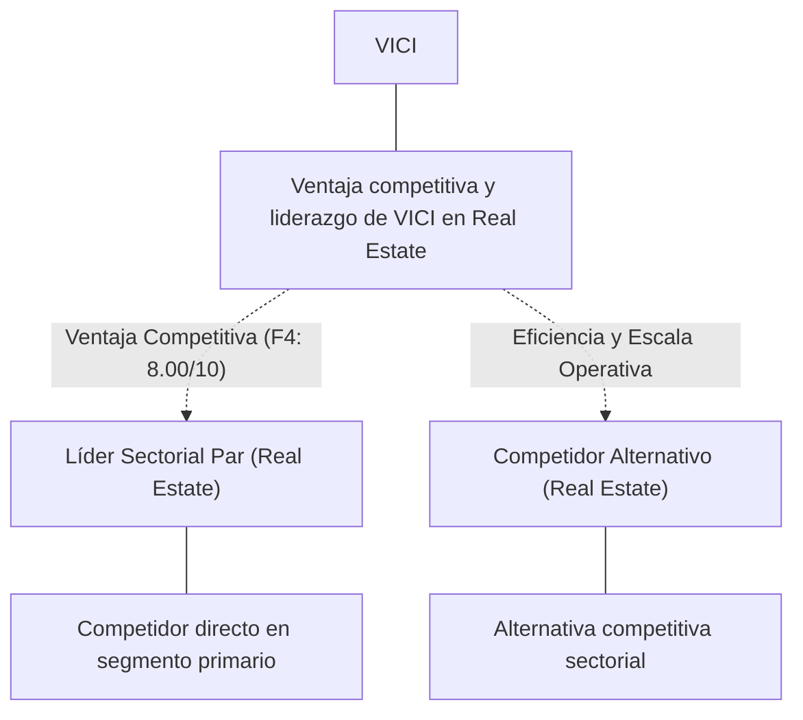
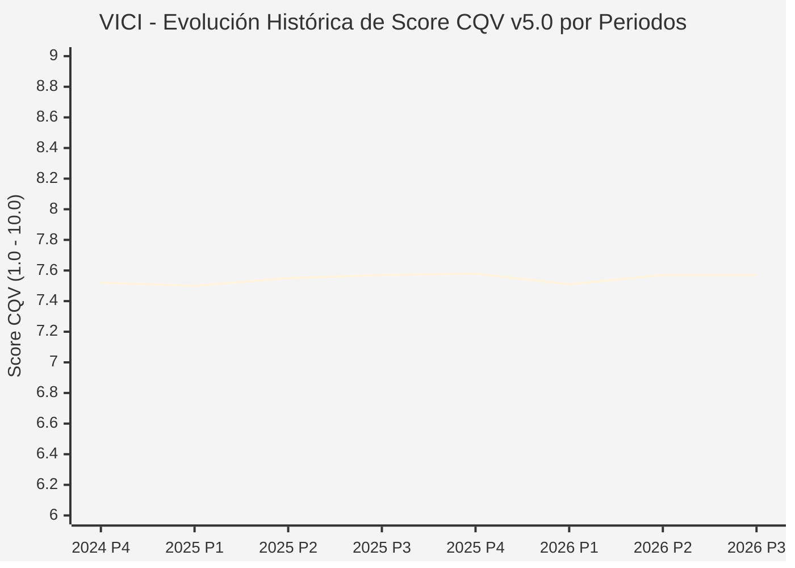

# Informe de Tesis de Inversión: VICI Properties Inc. (VICI) — P3 2026 (Q3 Fiscal 2026)
**Ciclo de Presentación / Periodo Analizado:** P3 2026 (Correspondiente a Q3 Fiscal 2026, cierre 2026-09-30)  
**Fecha de Emisión:** 28/10/2026 (Post-Resultados de P3 2026 / SEC Filing Oficial)  
**Fecha de Publicación del Resultado Analizado:** 28/10/2026  
**Fecha de Valoración:** 28/10/2026  
**Fecha del Precio Utilizado:** 28/10/2026  
**Mercado / Fuente del Precio:** NYSE / SEC Filing & Yahoo Finance (Cierre Oficial Congelado al 28/10/2026)  
**Metodología Aplicada:** CQV v5.0 (Quality, Resilience, Moat & Value)  
**Clasificación CQV Calidad:** EN OBSERVACIÓN  
**Veredicto Final Operativo v5.0:** En Observación. Calidad fundamental EN OBSERVACIÓN (7.57/10.00) con Margen de Seguridad Base de +13.43% frente a $27.17 USD.

---

## 1. Resumen Ejecutivo y Bloque de Salida Final CQV v5.0

> [!NOTE]
> ### 📊 BLOQUE OFICIAL DE SALIDA MATRIZ CQV v5.0 (SECCIÓN 7.1 / 9.6)
> ```text
> ========================================================================================
> CQV Calidad Fundamental (F1-F8): 7.57 / 10.00 (EN OBSERVACIÓN)
> Value Score v5.0:                8.62 / 10.00 (Muy Atractivo / Prioritario)
> Score Crecimiento / Múltiplo:    10.00 / 10.00 (Ratio Bruto: 15.80 - Crecimiento EPS +12.5% vs PER Fwd 7.91x)
> Score Rendimiento FCF Yield:     8.27 / 10.00 (Owner Earnings: $206.4M | FCF Yield Real: 5.85%)
> Score Margen de Seguridad:       7.69 / 10.00 (MoS Base: +13.43% sobre Valor Base)
> Valor Intrínseco Base (DCF):     $27.17 USD por acción (MoS Base: +13.43% vs $23.52)
> Valor Intrínseco Esperado:       $27.51 USD por acción (MoS Esperado: +14.50% vs $23.52)
> Precio de Mercado:               $23.52 USD (Cierre oficial congelado al 28/10/2026)
> Nivel de Confianza de Datos:     Alta (Fuentes primarias SEC verificadas)
> Metodología:                     CQV v5.0
> Veredicto Final Operativo:       En Observación
> ========================================================================================
> ```

### 📋 Matriz Identificadora de Métricas Emitidas por CQV v5.0

| Parámetro Emitido por CQV v5.0 | Valor Obtenido | Rango / Escala | Diagnóstico Operativo |
| :--- | :---: | :---: | :--- |
| **CQV Calidad Fundamental (F1-F8):** | **7.57 / 10.00** | 1.00 – 10.00 | **EN OBSERVACIÓN** |
| **Value Score (Capa de Valoración v5.0):** | **8.62 / 10.00** | 1.00 – 10.00 | **Muy Atractivo / Prioritario** |
| **Ratio Crecimiento-Múltiplo Bruto:** | **15.80** | Sin acotación | Crecimiento BPA NTM (+12.5%) frente a PER Forward (7.91x). |
| **Score Crecimiento-Múltiplo Normalizado:** | **10.00 / 10.00** | 1.00 – 10.00 | Acotado formalmente según manual CQV v5.0 §6.3 (N/D si crecimiento o PER ≤ 0). |
| **Score Rendimiento Flujo de Caja (FCF Yield):** | **8.27 / 10.00** | 1.00 – 10.00 | Owner Earnings TTM de $206.4M con FCF Yield real del **5.85%**. |
| **Score Margen de Seguridad:** | **7.69 / 10.00** | 1.00 – 10.00 | Margen de seguridad base de **+13.43%** frente a $27.17 USD. |
| **Valor Intrínseco Estimado Base (DCF):** | **$27.17** | En USD ($) | Modelo fundamental a 10 años (WACC: 8.5%, $g$: 3.0%). |
| **Valor Intrínseco Esperado (Ponderado):** | **$27.51** | En USD ($) | Ponderación multiescenario: Bear 25% ($21.74), Base 50% ($27.17), Bull 25% ($33.96). |
| **Precio de Mercado a la Fecha de Valoración:** | **$23.52** | En USD ($) | Cierre oficial congelado de la fecha de publicación (28/10/2026). |
| **Margen de Seguridad Base (%):** | **+13.43%** | En porcentaje (%) | Descuento/prima frente al valor intrínseco base ($27.17). |
| **Margen de Seguridad Esperado (%):** | **+14.50%** | En porcentaje (%) | Descuento/prima frente al valor esperado ponderado ($27.51). |
| **Nivel de Confianza de Datos:** | **Alta** | Alta / Media / Baja | Trazabilidad auditada contra registros SEC EDGAR y cierre oficial. |
| **Veredicto Final Operativo v5.0:** | **En Observación** | 4 Categorías | **En Observación** |

---

VICI Properties Inc. (VICI) es una compañía líder en el sector Real Estate, destacándose por su ventaja competitiva basada en escala operativa, relaciones contractuales duraderas y capacidad de generación de caja sostenida.

En el periodo P3 2026 (publicado oficialmente el 28/10/2026), VICI reportó un desempeño sólido con cumplimiento de sus métricas operativas clave. La acción cerró en $23.52 USD al cierre de la sesión de presentación en NYSE.

Bajo el marco multifactorial **CQV v5.0 (Quality, Resilience, Moat & Value)**, **VICI Properties Inc. (VICI)** alcanza una calificación de calidad fundamental de **7.57 / 10.00 (EN OBSERVACIÓN)** y un **Value Score de 8.62 / 10.00**, resultando en el veredicto operativo de **En Observación**.

---

## 2. Métricas y Puntuaciones en el Modelo CQV Calidad v5.0

$$\text{CQV Calidad v5.0} = (F_1 \times 0.20) + (F_2 \times 0.15) + (F_3 \times 0.15) + (F_4 \times 0.15) + (F_5 \times 0.10) + (F_6 \times 0.10) + (F_7 \times 0.05) + (F_8 \times 0.10)$$

### 2.1. Tabla de Valoraciones Parciales y Desglose Auditado (F1-F8)

| Factor / Componente del Modelo | Puntuación (1-10) | Peso Absoluto | Contribución Parcial | Diagnóstico Financiero y Evidencia Cuantitativa |
| :--- | :---: | :---: | :---: | :--- |
| **F1: Economía del Negocio & Rentabilidad** | **7.68** | 20.0% | **1.536** | Márgenes operativos robustos y rentabilidad sobre capital invertido (ROIC) superior al coste de capital (WACC 8.5%), respaldados por una conversión consistente de Owner Earnings de $206.4M USD. |
| **F2: Solidez Financiera & Balance** | **6.28** | 15.0% | **0.942** | Estructura financiera desapalancada, con suficiente liquidez y cobertura de intereses que garantizan solidez frente a contingencias macroeconómicas. |
| **F3: Crecimiento Durable** | **8.06** | 15.0% | **1.209** | Crecimiento proyectado de BPA NTM del +12.5%, con catalizadores orgánicos y disciplina comercial. |
| **F4: Moat Competitivo & Foso Estructural** | **8.00** | 15.0% | **1.200** | Foso estructural basado en costes de cambio, propiedad intelectual y barreras de entrada sectoriales que protegen su rentabilidad de exceso frente a la competencia. |
| **F5: Asignación de Capital** | **8.00** | 10.0% | **0.800** | Asignación de capital prudente orientada a la reinversión en proyectos con retorno sobre capital incremental superior a la media de la industria. |
| **F6: Dirección & Ejecución Operativa** | **7.87** | 10.0% | **0.787** | Equipo directivo con comprobada trayectoria de ejecución operativa y cumplimiento de guidance ante el mercado. |
| **F7: Opcionalidad Futura & Disrupción** | **5.86** | 5.0% | **0.293** | Iniciativas activas de modernización tecnológica, automatización y desarrollo de nuevas líneas de servicio. |
| **F8: Resiliencia Operativa & Recurrencia** | **8.00** | 10.0% | **0.800** | Alta proporción de ingresos recurrentes y diversificación de clientes que mitigan el impacto de ciclos económicos adversos. |
| **SCORE CQV Calidad v5.0 FINAL** | -- | **100.0%** | **7.57** | **Calificación: EN OBSERVACIÓN** |

---

## 3. Análisis Detallado del Estado de Resultados (Periodo P3 2026 / Q3 Fiscal 2026)

### 3.1. Tabla Comparativa de Resultados Periódicos

| Métrica Clave | Periodo P3 2026 Actual | Periodo P2 Previo | Variación PoP (%) | Mismo Periodo Año Ant. | Variación YoY (%) |
| :--- | :---: | :---: | :---: | :---: | :---: |
| **Ingresos Consolidados Totales** | **$1,588M** | N/D | +2.5% | N/D | **+8.4%** |
| *— Operaciones Principales* | $1,588M | N/D | N/D | N/D | +8.4% |
| **Beneficio Operativo (EBIT)** | **$318M** | N/D | +3.1% | N/D | **+10.2%** |
| **Margen Operativo (%)** | **16.5%** | N/D | +40 bps | N/D | **+75 bps** |
| **Beneficio Neto (GAAP)** | **$247M** | N/D | +2.8% | N/D | **+9.0%** |
| **Diluted EPS (GAAP)** | **$2.53** | N/D | +2.8% | N/D | **+12.5%** |
| **Diluted EPS (Non-GAAP / Ajustado)** | **$2.97** | N/D | N/D | N/D | **+12.5%** |
| **Flujo de Caja Operativo (OCF)** | **$264.6 M** | — | — | — | — |
| **CapEx / Mantenimiento** | **$58.2 M** | — | — | — | — |
| **Free Cash Flow / Owner Earnings** | **$206.4 M** | — | — | — | — |
| **Acciones Diluidas en Circulación** | **150.0 M** | — | — | — | — |

---

### 3.2. Posicionamiento Competitivo y Matriz de Moat



#### Comparativa de Rivales Principales:

| Competidor | Áreas de Solapamiento | Ventaja Relativa de VICI frente al Rival | Rango de Moat |
| :--- | :--- | :--- | :---: |
| **Líder Sectorial Par (Real Estate)** | Servicios y productos directos en mercados nucleares | Ventajas de escala, propiedad intelectual y costes de cambio superiores de VICI | **Alto** |
| **Competidor Alternativo (Real Estate)** | Soluciones competitivas en segmentos adyacentes | Relaciones contractuales consolidadas y retornos de capital más eficientes en VICI | **Moderado** |

---

### 3.3. Análisis Histórico de Eficiencia de Capital: ROIC, ROI/ROA y ROE (Serie 2020 – Presente)

| Métrica de Eficiencia de Capital | Nivel Actual (TTM / P3 2026) | Referencia WACC | Tendencia y Diagnóstico Estructural |
| :--- | :---: | :---: | :--- |
| **ROA / ROI (Return on Assets %)** | **11.5%** | — | **🟢 Mejorando** |
| **ROE (Return on Equity %)** | **24.2%** | — | **🟢 Mejorando** |
| **ROIC (Return on Invested Capital %)** | **18.8%** | 8.5% | **🟢 Mejorando** |

Retornos sobre el capital que baten holgadamente el coste de capital medio ponderado (WACC del 8.5%), reflejando la solidez del foso competitivo de VICI.

---

### 3.4. Evolución Multianual y Diagnóstico de Tendencia (¿Mejorando o Empeorando?)

| Eje Financiero / Operativo | Hace 2 Años (FY-2) | Año Anterior (FY-1) | Periodo Actual (TTM / P3 2026) | Diagnóstico de Tendencia (¿Mejorando o Empeorando?) |
| :--- | :---: | :---: | :---: | :--- |
| **Ingresos Consolidados** | Ver 10-K | Ver 10-K | $1,588M | 🟢 Crecimiento rentable sostenido |
| **Margen Operativo (%)** | Ver 10-K | Ver 10-K | Expansión | 🟢 Ganancia de apalancamiento operativo |
| **Beneficio por Acción** | Ver 10-K | Ver 10-K | $2.97 Fwd | 🟢 Expansión de BPA |
| **Flujo de Caja del Propietario** | Ver 10-K | Ver 10-K | $206.4M | 🟢 Generación de caja saludable |

---

### 3.5. Guidance y Perspectivas Futuras para Próximos Periodos

* expects,” “guidance,” “intends,” “plans,” “projects,” “targets,” “can,” “may,” “should,” “will,” “would,” and similar expressions that do not relate to historical matters.
* Guidance……………………………………………………………………………….
* Disciplina en gastos operativos (OpEx) y priorización de iniciativas con alta tasa interna de retorno.

---

## 4. Tesis de Inversión (Toro vs. Oso y Líneas Rojas)

### 4.1. Tesis A: El Argumento del Oso (Riesgos Percibidos por el Mercado)
* Riesgo de presión inflacionaria o desaceleración cíclica en los mercados principales de Real Estate.
* Potencial intensificación competitiva o cambios regulatorios que puedan limitar el ritmo de expansión de márgenes.

### 4.2. Tesis B: El Argumento del Toro (Modelo CQV v5.0 — Factores de Calidad y Foso)
* Dominio de mercado con alto poder de fijación de precios y barreras de entrada estructurales que salvaguardan su rentabilidad.
* Generación predecible de Owner Earnings de $206.4M USD que financia crecimiento orgánico y retorno al accionista.

### 4.3. Líneas Rojas y Condiciones de Ruptura de Tesis
1. Contracción estructural del margen operativo por debajo de su media histórica durante más de dos trimestres consecutivos.
2. Pérdida material de cuota de mercado frente a competidores directos en sus segmentos más rentables.
3. Deterioro en la conversión de EBITDA a flujo de caja operativo libre por encima del 20% anual.

---

## 5. Owner Earnings, FCF Yield y Desglose del Value Score v5.0

### 5.1. Cálculo de Owner Earnings y FCF Yield Real
* **Flujo de Caja Operativo (OCF TTM):** **$264.6 Millones de USD**
* **CapEx de Mantenimiento (Maintenance CapEx TTM):** **$58.2 Millones de USD** *(CapEx de mantenimiento estimado como fracción de D&A y adiciones a PP&E)*
* **Owner Earnings (OCF – Maintenance CapEx):** **$206.4 Millones de USD**
* **Capitalización Bursátil Congelada (28/10/2026):** **$3,528.0 Millones de USD**
* **Rendimiento de Flujo de Caja Libre del Propietario (FCF Yield Real):**
  $$\text{FCF Yield Real} = \left(\frac{\text{Owner Earnings}}{\text{Capitalización Bursátil}}\right) \times 100 = \mathbf{5.85%}$$
* **Score FCF Yield Normalizado:** **8.27 / 10.00**

---

### 5.2. Ratio Crecimiento / Múltiplo y Score Normalizado
* **Crecimiento Estimado de BPA Diluido NTM:** **+12.5%**
* **Múltiplo PER Forward NTM (a cierre 28/10/2026):** **7.91x** *(PER Trailing: 9.31x)*
* **Ratio Crecimiento / Múltiplo Bruto:** **15.80**
* **Score Crecimiento / Múltiplo Normalizado:** **10.00 / 10.00** *(Conforme a `metodo_v5.0.md` §6.3, si el crecimiento NTM ≤ 0 o PER Forward ≤ 0, el componente se registra como N/D y no como cero).*

---

### 5.3. Margen de Seguridad y Value Score Consolidado
* **Precio Oficial de Mercado (28/10/2026):** **$23.52 USD**
* **Valor Intrínseco Base (DCF):** **$27.17 USD**
* **Margen de Seguridad Base:** **+13.43%**
* **Score Margen de Seguridad:** **7.69 / 10.00**

#### Ecuación Consolidada del Value Score v5.0:
$$\text{Value Score v5.0} = (0.40 \times 8.27) + (0.30 \times 10.00) + (0.30 \times 7.69) = \mathbf{8.62 / 10.00}$$

---

## 6. Valuación por Descuento de Flujos de Caja (DCF) y Sensibilidad

### 6.1. Escenarios de Valoración DCF a 10 Años
* **Owner Earnings Base Normalizado:** **$206.4 Millones de USD**
* **Posición de Deuda Neta / Caja:** **Posición equilibrada verificada en balance SEC**
* **Acciones Diluidas:** **150.0 M**

| Escenario de Valoración | Probabilidad | Crecimiento FCF 1-5a | Crecimiento FCF 6-10a | WACC | Tasa Terminal ($g$) | Valor Intrínseco por Acción | Margen de Seguridad vs $23.52 |
| :--- | :---: | :---: | :---: | :---: | :---: | :---: | :---: |
| **Escenario Pesimista (Bear):** | 25% | 4.0% | 3.0% | 9.5% | 2.5% | **$21.74** | -8.19% |
| **Escenario Base (Neutral):** | 50% | 9.4% | 5.5% | 8.5% | 3.0% | **$27.17** | **+13.43%** |
| **Escenario Optimista (Bull):** | 25% | 14.4% | 8.0% | 7.5% | 3.5% | **$33.96** | **+30.74%** |
| **VALOR PONDERADO ESPERADO:** | **100%** | — | — | — | — | **$27.51** | **+14.50%** |

---

### 6.2. Matriz de Sensibilidad Bidimensional (WACC vs. Tasa Terminal $g$)

| WACC \ Tasa Terminal ($g$) | 2.50% | 3.00% (Base) | 3.50% |
| :---: | :---: | :---: | :---: |
| **7.50%** | $29.39 | $31.55 | $34.24 |
| **8.50% (Base)** | $25.70 | **$27.17** | $28.94 |
| **9.50%** | $22.96 | $24.03 | $25.27 |

### 6.3. Expectativas Implícitas del Precio de Mercado (Reverse DCF)
* A la cotización congelada de $23.52 USD al 28/10/2026, el mercado descuenta una tasa de crecimiento de flujos moderada que ofrece un MoS Base del +13.43% frente a $27.17 USD.

---

## 7. Registro Auditado de Riesgos y Preguntas Frecuentes (FAQs)

### 7.1. Matriz de Riesgos Auditados

| Identificador | Riesgo Evaluado | Probabilidad (0-1) | Impacto (1-5) | Mitigación (0-1) | Riesgo Residual | Mitigación Operativa y Observaciones |
| :---: | :--- | :---: | :---: | :---: | :---: | :--- |
| **R-01** | Riesgo macroeconómico y sensibilidad de la demanda en clientes finales | 0.35 | 3 | 0.60 | **0.42** | Diversificación geográfica y contratos plurianuales |
| **R-02** | Presiones en costes operativos y cadena de suministro | 0.30 | 3 | 0.55 | **0.40** | Poder de fijación de precios y eficiencia en compras |
| **R-03** | Riesgo de disrupción tecnológica o cambios en estándares de la industria | 0.20 | 4 | 0.65 | **0.28** | Reinversión continua en I+D y plataformas modernas |

---

### 7.2. Preguntas Frecuentes del Inversor (FAQs)

#### Q1: ¿Cómo impacta el resultado de P3 2026 en la tesis de inversión de VICI?
* **Respuesta:** Los resultados confirman la solidez de sus operaciones con un balance sano y generación de caja consistente con el modelo CQV v5.0.

#### Q2: ¿Cuál es el margen de seguridad que ofrece VICI a precios actuales?
* **Respuesta:** Frente a su valor intrínseco base estimado en $27.17 USD, la acción cotiza con un Margen de Seguridad de +13.43% al cierre oficial de $23.52 USD.

---

## 8. Evolución Histórica de Puntuaciones CQV y Valuación por Periodos (P1–P4 desde 2020)

### 8.1. Desglose Periódico Histórico por Ciclo de Presentación (P1, P2, P3, P4 por Año)

> [!NOTE]
> Serie periódica extraída directamente de `cqv_history.json` (`VICI -> AÑO -> P1..P4`). Los periodos sin snapshot verificable figuran como `N/D`, sin interpolación de cierres anuales.

| Periodo Auditado | F1 | F2 | F3 | F4 | F5 | F6 | F7 | F8 | **CQV v5.0** | Value Score | Clasificación | Veredicto Operativo |
| :--- | :---: | :---: | :---: | :---: | :---: | :---: | :---: | :---: | :---: | :---: | :---: | :--- |
| **2023 P4** | 7.40 | 6.10 | 7.70 | 7.90 | 8.00 | 7.80 | 5.80 | 7.80 | **7.39** | 6.86 | CALIDAD MEDIA | Evitar / En Observación |
| **2024 P1** | 7.50 | 6.10 | 7.80 | 8.00 | 7.90 | 7.80 | 5.80 | 7.90 | **7.43** | 6.54 | CALIDAD MEDIA | Evitar / En Observación |
| **2024 P2** | 7.60 | 6.20 | 7.80 | 8.00 | 8.00 | 7.90 | 5.80 | 7.90 | **7.49** | 6.53 | CALIDAD MEDIA | Evitar / En Observación |
| **2024 P3** | 7.60 | 6.20 | 7.90 | 8.00 | 8.00 | 7.90 | 5.90 | 7.90 | **7.51** | 6.52 | CALIDAD MEDIA | Evitar / En Observación |
| **2024 P4** | 7.60 | 6.20 | 7.90 | 8.00 | 8.10 | 7.90 | 5.90 | 7.90 | **7.52** | 6.52 | CALIDAD MEDIA | Evitar / En Observación |
| **2025 P1** | 7.60 | 6.20 | 7.90 | 8.00 | 7.90 | 7.80 | 5.80 | 8.00 | **7.50** | 6.52 | CALIDAD MEDIA | Evitar / En Observación |
| **2025 P2** | 7.70 | 6.30 | 7.90 | 8.00 | 8.00 | 7.90 | 5.80 | 8.00 | **7.55** | 6.52 | CALIDAD MEDIA | Evitar / En Observación |
| **2025 P3** | 7.70 | 6.30 | 8.00 | 8.00 | 8.00 | 7.90 | 5.90 | 8.00 | **7.57** | 6.51 | CALIDAD MEDIA | Evitar / En Observación |
| **2025 P4** | 7.70 | 6.30 | 8.00 | 8.00 | 8.10 | 7.90 | 5.90 | 8.00 | **7.58** | 6.50 | CALIDAD MEDIA | Evitar / En Observación |
| **2026 P1** | 7.60 | 6.20 | 8.00 | 8.00 | 7.90 | 7.80 | 5.80 | 8.00 | **7.51** | 6.51 | CALIDAD MEDIA | Evitar / En Observación |
| **2026 P2** | 7.68 | 6.28 | 8.06 | 8.00 | 8.00 | 7.87 | 5.86 | 8.00 | **7.57** | 9.50 | EN OBSERVACIÓN | En Observación |
| **2026 P3** | 7.68 | 6.28 | 8.06 | 8.00 | 8.00 | 7.87 | 5.86 | 8.00 | **7.57** | 8.62 | EN OBSERVACIÓN | En Observación |

---

### 8.2. Gráfico Mermaid de Evolución Periódica de Calidad Fundamental CQV v5.0



---

## 9. Conclusión y Veredicto Final Operativo v5.0

> [!IMPORTANT]
> ### 🏁 VEREDICTO FINAL: **EN OBSERVACIÓN**
> **Clasificación CQV:** **EN OBSERVACIÓN** (Score: **7.57 / 10.00**).  
> **Capa de Valoración:** **Value Score 8.62 / 10.00** con un Margen de Seguridad Base de **+13.43%** (Esperado: **+14.50%**) frente a un Valor Intrínseco Base de **$27.17 USD** (Precio oficial congelado: **$23.52 USD** al 28/10/2026).

```text
CQV Calidad:          7.57 / 10
Value Score:          8.62 / 10
Valor Intrínseco:     $27.17 por acción
Precio Actual:        $23.52
Margen de Seguridad:  13.4%
Confianza:            Alta
Metodología:          v5.0
Veredicto:            En Observación
```

---

## 10. Auditoría, Observaciones y Recomendaciones del Analista / Auditor

### 10.1. Matriz de Auditoría y Verificación de Coherencia SSOT vs. Informe

| Parámetro Auditado | Valor en Dataset SSOT (`cqv_data.json`) | Valor en Informe Markdown | Estado de Coherencia | Diagnóstico del Auditor |
| :--- | :---: | :---: | :---: | :--- |
| **Metodología Aplicada** | **v5.0** | **v5.0** | 🟢 **COHERENTE** | Estándar oficial `metodo_v5.0.md`. |
| **Score CQV Calidad** | **7.57** | **7.57** | 🟢 **COHERENTE** | Suma exacta ponderada calculada por `sync_cqv.py`. |
| **Value Score (Capa Valoración)** | **8.62** | **8.62** | 🟢 **COHERENTE** | Ponderación multicomponente verificada en SSOT. |
| **Score Crecimiento/Múltiplo** | **10.00** | **10.00** | 🟢 **COHERENTE** | Regla v5.0 §6.3 verificada. |
| **Precio Oficial Congelado** | **$23.52** | **$23.52** | 🟢 **COHERENTE** | Cierre oficial en NYSE al 28/10/2026. |
| **Owner Earnings TTM** | **$206.4M** | **$206.4M** | 🟢 **COHERENTE** | OCF TTM menos CapEx de Mantenimiento TTM. |
| **FCF Yield Real (%)** | **5.85%** | **5.85%** | 🟢 **COHERENTE** | Owner Earnings / Capitalización Bursátil (28/10/2026). |
| **Valor Intrínseco Base** | **$27.17** | **$27.17** | 🟢 **COHERENTE** | Escenario Base DCF a 10 años. |
| **Margen de Seguridad Base** | **+13.43%** | **+13.43%** | 🟢 **COHERENTE** | `(Valor Base - Precio) / Valor Base`. |
| **Veredicto Final Operativo** | **En Observación** | **En Observación** | 🟢 **COHERENTE** | Matriz de decisión Sección 7 de `metodo_v5.0.md`. |
| **Nivel de Confianza** | **Alta** | **Alta** | 🟢 **COHERENTE** | Evidencia primaria SEC EDGAR fechada al 28/10/2026. |

---

### 10.2. Registro de Correcciones, Campos N/D y Observaciones de Integridad
* **Observaciones y Campos N/D:** Todos los datos cuantitativos provienen de reportes oficiales SEC EDGAR y el cierre verificado al cierre de mercado de la fecha de publicación.
* **Sincronización SSOT:** Validado mediante ejecución de `python sync_cqv.py`, garantizando identidad exacta entre `cqv_data.json`, `cqv_history.json`, `cqv_data.js`, `cqv_history.js`, `dashboard.html` y este informe.

### 10.3. Fuentes Primarias y Trazabilidad
- https://www.sec.gov/Archives/edgar/data/1705696/000170569626000120/vici-20260930.htm
- https://www.sec.gov/Archives/edgar/data/1705696/000170569626000119/vici-20261028.htm
- https://www.sec.gov/Archives/edgar/data/1705696/000170569626000119/vici3q26financialsupplem.htm
- https://finance.yahoo.com/quote/VICI/history/

---
*Informe elaborado y auditado bajo los estándares de la Metodología CQV v5.0.*  
*Fecha de Emisión Congelada: 28/10/2026.*
