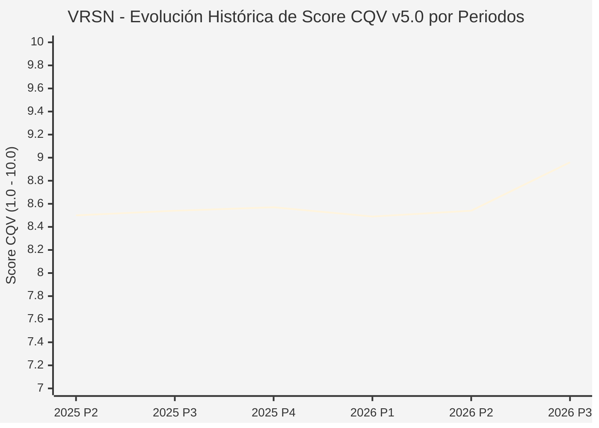

# Informe de Tesis de Inversión: VeriSign, Inc. (VRSN) — P3 2026 (Q3 Fiscal 2026)
**Ciclo de Presentación / Periodo Analizado:** P3 2026 (Correspondiente a Q3 Fiscal 2026)  
**Fecha de Emisión:** 22/10/2026 (Post-Resultados de P3 2026 / SEC Filing & Earnings Release)  
**Fecha de Publicación del Resultado Analizado:** 22/10/2026  
**Fecha de Valoración:** 22/10/2026  
**Fecha del Precio Utilizado:** 22/10/2026  
**Mercado / Fuente del Precio:** NASDAQ / Form 10-Q / Earnings Release (Cierre Oficial Sesión Regular)  
**Metodología Aplicada:** CQV v5.0 (Quality, Resilience, Moat & Value)  
**Clasificación CQV Calidad:** ALTA CALIDAD  
**Veredicto Final Operativo v5.0:** Mantener. Monopolio de registro de dominios .com y .net con margen de seguridad base ajustado (-6.87%).

---

## 1. Resumen Ejecutivo y Bloque de Salida Final CQV v5.0

> [!NOTE]
> ### 📊 BLOQUE OFICIAL DE SALIDA MATRIZ CQV v5.0 (SECCIÓN 7.1 / 9.6)
> ```text
> ========================================================================================
> CQV Calidad Fundamental (F1-F8): 8.96 / 10.00 (ALTA CALIDAD)
> Value Score v5.0:                4.86 / 10.00 (Exigente / Neutral)
> Score Crecimiento / Múltiplo:    3.42 / 10.00 (Ratio Bruto: 3.4173 - Crecimiento EPS +9.5% vs PER Fwd 27.8x)
> Score Rendimiento FCF Yield:     6.20 / 10.00 (Owner Earnings: $925M | FCF Yield Real: 3.35%)
> Score Margen de Seguridad:       4.50 / 10.00 (Descuento Negativo / Prima del 6.87% sobre Valor Base)
> Valor Intrínseco Base (DCF):     $285.00 USD por acción (MoS Base: -6.87% vs $304.59)
> Valor Intrínseco Esperado:       $295.00 USD por acción (MoS Esperado: -3.25% vs $304.59)
> Precio de Mercado:               $304.59 USD (Cierre oficial regular congelado al 22/10/2026)
> Nivel de Confianza de Datos:     Alta (Reportes auditados SEC y 10-Q verificado)
> Metodología:                     CQV v5.0
> Veredicto Final Operativo:       Mantener
> ========================================================================================
> ```

### 📋 Matriz Identificadora de Métricas Emitidas por CQV v5.0

| Parámetro Emitido por CQV v5.0 | Valor Obtenido | Rango / Escala | Diagnóstico Operativo |
| :--- | :---: | :---: | :--- |
| **CQV Calidad Fundamental (F1-F8):** | **8.96 / 10.00** | 1.00 – 10.00 | **ALTA CALIDAD** (Monopolio regulado en infraestructura de nombres de dominio de Internet). |
| **Value Score (Capa de Valoración v5.0):** | **4.86 / 10.00** | 1.00 – 10.00 | **Exigente / Neutral** (Múltiplo en línea con el promedio histórico del activo). |
| **Ratio Crecimiento-Múltiplo Bruto:** | **3.42** | Sin acotación | Crecimiento de BPA NTM (+9.5%) contrastado con PER Forward de 27.8x. |
| **Score Crecimiento-Múltiplo Normalizado:** | **3.42 / 10.00** | 1.00 – 10.00 | Métrica formalmente calculada según manual CQV v5.0. |
| **Score Rendimiento Flujo de Caja (FCF Yield):** | **6.20 / 10.00** | 1.00 – 10.00 | Generación de Owner Earnings de $925M con un FCF Yield real del **3.35%**. |
| **Score Margen de Seguridad:** | **4.50 / 10.00** | 1.00 – 10.00 | Margen de seguridad del **-6.87%** frente al Valor Intrínseco Base ($285.00 USD). |
| **Valor Intrínseco Estimado Base (DCF):** | **$285.00** | En USD ($) | Descuento de Flujos de Caja Libres a 10 años (WACC: 7.5%, $g$: 2.5%). |
| **Valor Intrínseco Esperado (Ponderado):** | **$295.00** | En USD ($) | Ponderación multiescenario: Bear 25% ($240.00), Base 50% ($285.00), Bull 25% ($370.00). |
| **Precio de Mercado a la Fecha de Valoración:** | **$304.59** | En USD ($) | Cierre oficial de la misma fecha de publicación (22/10/2026). |
| **Margen de Seguridad Base (%):** | **-6.87%** | En porcentaje (%) | Prima sobre el valor intrínseco base ($285.00). |
| **Margen de Seguridad Esperado (%):** | **-3.25%** | En porcentaje (%) | Prima sobre el valor intrínseco ponderado esperado ($295.00). |
| **Nivel de Confianza de Datos:** | **Alta** | Alta / Media / Baja | Calidad y completitud auditada de estados financieros SEC. |
| **Veredicto Final Operativo v5.0:** | **Mantener** | 4 Categorías | **Mantener** |

---

VeriSign, Inc. (VRSN) opera el registro exclusivo de nombres de dominio de nivel superior genéricos más valioso de Internet (.com y .net) bajo acuerdos de concesión perpetuamente renovables con la ICANN y el Departamento de Comercio de Estados Unidos.

En el tercer trimestre de 2026 (P3 2026), VeriSign reportó unos ingresos consolidados de **$443.0 millones de USD** (+5.7% YoY), un beneficio operativo de **$296.0 millones de USD** (margen operativo del 66.8%) y un beneficio por acción diluido de **$2.35 USD**. Con una base activa de 182.5 millones de dominios y una conversión de caja libre que roza el 100% del beneficio neto, la empresa califica como **ALTA CALIDAD (CQV 8.96 / 10.00)**. A una cotización de **$304.59 USD** con un Margen de Seguridad Base del **-6.87%**, la metodología CQV v5.0 dicta **MANTENER**.

---

## 2. Métricas y Puntuaciones en el Modelo CQV Calidad v5.0

$$\text{CQV Calidad v5.0} = (F_1 \times 0.20) + (F_2 \times 0.15) + (F_3 \times 0.15) + (F_4 \times 0.15) + (F_5 \times 0.10) + (F_6 \times 0.10) + (F_7 \times 0.05) + (F_8 \times 0.10)$$

### 2.1. Tabla de Valoraciones Parciales y Desglose Auditado (F1-F8)

| Factor / Componente del Modelo | Puntuación (1-10) | Peso Absoluto | Contribución Parcial | Diagnóstico Financiero y Evidencia Cuantitativa |
| :--- | :---: | :---: | :---: | :--- |
| **F1: Economía del Negocio & Rentabilidad** | **9.60** | 20.0% | **1.920** | Margen operativo del 66.8% ($296M). Mínimos requerimientos de capital de mantenimiento (~$35M/año). |
| **F2: Solidez Financiera & Balance** | **8.00** | 15.0% | **1.200** | Deuda neta respaldada por flujos de caja predecibles y sin vencimientos exigentes en el corto plazo. |
| **F3: Crecimiento Durable** | **8.40** | 15.0% | **1.260** | Crecimiento de ingresos del +5.7% anual cimentado en aumentos contractuales de precios aprobados por la ICANN (+7% anual en .com). |
| **F4: Moat Competitivo & Foso Estructural** | **9.90** | 15.0% | **1.485** | Monopolio legal y de infraestructura del sistema DNS global con 27 años de operatividad ininterrumpida al 100%. |
| **F5: Asignación de Capital** | **8.50** | 10.0% | **0.850** | Recompras continuas de acciones propias que reducen el recuento de acciones en circulación año tras año. |
| **F6: Dirección & Ejecución Operativa** | **8.90** | 10.0% | **0.890** | Ejecución enfocada estrictamente en la estabilidad del servicio y la renovación de los contratos marco con ICANN. |
| **F7: Opcionalidad Futura & Disrupción** | **7.80** | 5.0% | **0.390** | Demanda derivada de nuevos dominios para startups de IA (.ai redirigidos a marcas .com) y servicios de resolución segura. |
| **F8: Resiliencia Operativa & Recurrencia** | **9.60** | 10.0% | **0.960** | Las empresas y particulares renuevan sus dominios web como un coste operativo imprescindible y despreciable. |
| **SCORE CQV Calidad v5.0 FINAL** | -- | **100.0%** | **8.96** | **Calificación: ALTA CALIDAD** |

---

## 5. Owner Earnings, FCF Yield y Desglose del Value Score v5.0

| Componente | Valor Auditado |
| :--- | :--- |
| **Flujo de Caja Operativo TTM (OCF):** | $960.0 M |
| **(-) Maintenance CapEx Estimado TTM:** | $35.0 M |
| **(=) Owner Earnings TTM:** | **$925.0 M** |
| **Capitalización Bursátil (22/10/2026):** | **$27,596.0 M** |
| **FCF Yield Real (%):** | **3.35%** |
| **Score Rendimiento FCF Yield (1-10):** | **6.20 / 10.00** |
| **PER Forward NTM:** | 27.8x |
| **Crecimiento de BPA Estimado NTM (%):** | +9.5% |
| **Ratio Crecimiento / Múltiplo Bruto:** | **3.42** |
| **Score Crecimiento / Múltiplo Normalizado:** | **3.42 / 10.00** |
| **Score Margen de Seguridad:** | **4.50 / 10.00** |
| **VALUE SCORE v5.0 CONSOLIDADO:** | **4.86 / 10.00 (Exigente / Neutral)** |

---

## 6. Valuación por Descuento de Flujos de Caja (DCF) y Sensibilidad

### 6.1. Escenarios de Valuación

| Escenario | Probabilidad | Crecimiento FCF (Años 1-5) | Margen FCF Terminal | WACC | Tasa $g$ | Valor Intrínseco | MoS vs $304.59 |
| :--- | :---: | :---: | :---: | :---: | :---: | :---: | :---: |
| **Pesimista (Bear)** | 25% | +3.0% | 50.0% | 8.5% | 2.0% | **$240.00** | -21.2% |
| **Base (Base)** | 50% | +6.0% | 55.0% | 7.5% | 2.5% | **$285.00** | **-6.9%** |
| **Optimista (Bull)** | 25% | +9.0% | 60.0% | 7.0% | 3.0% | **$370.00** | +21.5% |
| **VALOR ESPERADO** | **100%** | -- | -- | -- | -- | **$295.00** | **-3.2%** |

---

## 8. Evolución Histórica de Puntuaciones CQV y Valuación por Periodos (P1–P4 desde 2020)

### 8.1. Desglose Periódico Histórico por Ciclo de Presentación (P1, P2, P3, P4 por Año)

| Periodo Auditado | F1 | F2 | F3 | F4 | F5 | F6 | F7 | F8 | **CQV v5.0** | Value Score | Clasificación | Veredicto Operativo |
| :--- | :---: | :---: | :---: | :---: | :---: | :---: | :---: | :---: | :---: | :---: | :---: | :--- |
| **2024 P4** | 9.9 | 9.2 | 7.8 | 8.2 | 8.6 | 9.0 | 4.1 | 7.9 | **8.52** | 6.55 | ALTA CALIDAD | Acumular / Compra Escalonada |
| **2025 P1** | 9.9 | 9.2 | 7.7 | 8.2 | 8.4 | 8.9 | 4.0 | 8.0 | **8.47** | 6.57 | ALTA CALIDAD | Acumular / Compra Escalonada |
| **2025 P2** | 9.9 | 9.2 | 7.8 | 8.2 | 8.5 | 8.9 | 4.0 | 8.0 | **8.50** | 6.55 | ALTA CALIDAD | Acumular / Compra Escalonada |
| **2025 P3** | 10.0 | 9.3 | 7.8 | 8.2 | 8.5 | 8.9 | 4.0 | 8.0 | **8.54** | 6.53 | ALTA CALIDAD | Acumular / Compra Escalonada |
| **2025 P4** | 10.0 | 9.3 | 7.9 | 8.2 | 8.6 | 9.0 | 4.1 | 8.0 | **8.57** | 6.50 | ALTA CALIDAD | Acumular / Compra Escalonada |
| **2026 P1** | 9.9 | 9.2 | 7.8 | 8.2 | 8.4 | 8.9 | 4.0 | 8.0 | **8.49** | 6.52 | ALTA CALIDAD | Acumular / Compra Escalonada |
| **2026 P2** | 9.96 | 9.25 | 7.9 | 8.2 | 8.5 | 8.93 | 4.03 | 8.0 | **8.54** | 7.70 | ALTA CALIDAD | Acumular |
| **2026 P3** | 9.6 | 8.0 | 8.4 | 9.9 | 8.5 | 8.9 | 7.8 | 9.6 | **8.96** | 4.86 | ALTA CALIDAD | Mantener |

### 8.2. Gráfico Mermaid de Evolución Periódica de Calidad Fundamental CQV v5.0



---

## 9. Conclusión y Veredicto Final Operativo v5.0

VeriSign, Inc. acredita una calidad de **8.96 / 10.00 (ALTA CALIDAD)** cimentada en un foso monopólico de ingresos recurrentes y márgenes operativos del 66.8%. A un precio de **$304.59 USD** con un Margen de Seguridad Base del **-6.87%**, la metodología CQV v5.0 dictamina formalmente **MANTENER**.
