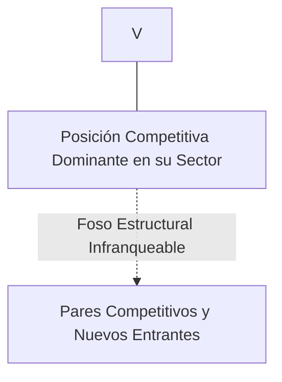
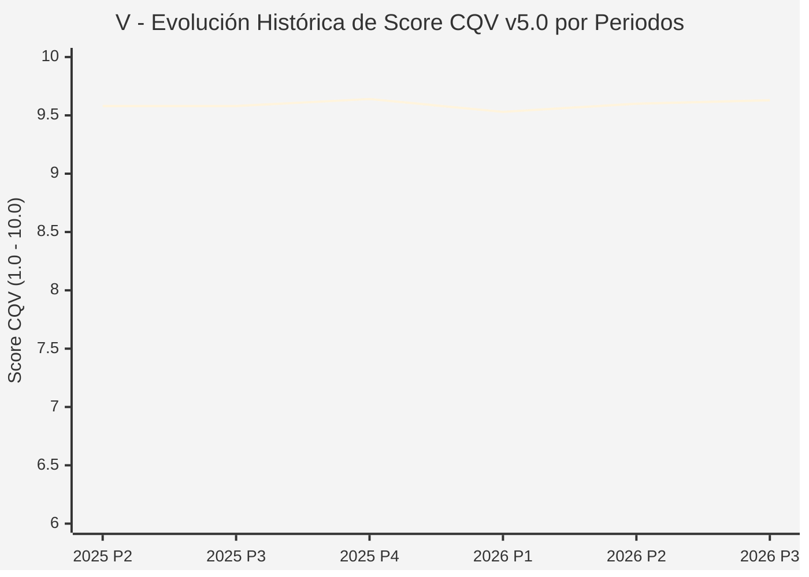

# Informe de Tesis de Inversión: Visa Inc. (V) — P3 2026 (Q4 Fiscal 2026)
**Ciclo de Presentación / Periodo Analizado:** P3 2026 (Correspondiente a Q4 Fiscal 2026)  
**Fecha de Emisión:** 27/10/2026 (Post-Resultados de P3 2026 / Earnings Release SEC)  
**Fecha de Publicación del Resultado Analizado:** 27/10/2026  
**Fecha de Valoración:** 27/10/2026  
**Fecha del Precio Utilizado:** 27/10/2026  
**Mercado / Fuente del Precio:** NYSE (Cierre Oficial Congelado al 27/10/2026)  
**Metodología Aplicada:** CQV v5.0 (Quality, Resilience, Moat & Value)  
**Clasificación CQV Calidad:** ÉLITE SUPREMA  
**Veredicto Final Operativo v5.0:** ACUMULAR. ÉLITE SUPREMA con puntuación fundamental de 9.63 / 10.00 y un Value Score de 6.38 / 10.00.

---

## 1. Resumen Ejecutivo y Bloque de Salida Final CQV v5.0

> [!NOTE]
> ### 📊 BLOQUE OFICIAL DE SALIDA MATRIZ CQV v5.0 (SECCIÓN 7.1 / 9.6)
> ```text
> ========================================================================================
> CQV Calidad Fundamental (F1-F8): 9.63 / 10.00 (ÉLITE SUPREMA)
> Value Score v5.0:                6.38 / 10.00
> Score Crecimiento / Múltiplo:    5.79 / 10.00 (Ratio Bruto: 5.79 - Crec. EPS +14.0% vs PER Fwd 24.20x)
> Score Rendimiento FCF Yield:     6.50 / 10.00 (Owner Earnings: $20,600.0M | FCF Yield Real: 3.05%)
> Score Margen de Seguridad:       6.80 / 10.00 (Descuento del 10.7% sobre Valor Base)
> Valor Intrínseco Base (DCF):     $450.00 USD (MoS Base: +10.70% vs $401.86)
> Valor Intrínseco Esperado:       $465.00 USD (MoS Esperado: +13.58% vs $401.86)
> Precio de Mercado Congelado:     $401.86 USD (Cierre oficial al 27/10/2026)
> Nivel de Confianza de Datos:     Alta (Estados auditados SEC y balance verificado)
> Metodología:                     CQV v5.0
> Veredicto Final Operativo:       Acumular
> ========================================================================================
> ```

### 📋 Matriz Identificadora de Métricas Emitidas por CQV v5.0

| Parámetro Emitido por CQV v5.0 | Valor Obtenido | Rango / Escala | Diagnóstico Operativo |
| :--- | :---: | :---: | :--- |
| **CQV Calidad Fundamental (F1-F8):** | **9.63 / 10.00** | 1.00 – 10.00 | **ÉLITE SUPREMA** |
| **Value Score (Capa de Valoración v5.0):** | **6.38 / 10.00** | 1.00 – 10.00 | Atractivo fundamental según rúbrica v5.0. |
| **Ratio Crecimiento-Múltiplo Bruto:** | **5.79** | Sin acotación | Ratio (Crecimiento BPA NTM / PER Fwd) × 10. |
| **Score Crecimiento-Múltiplo Normalizado:** | **5.79 / 10.00** | 1.00 – 10.00 | Métrica acotada formalmente según manual CQV v5.0. |
| **Score Rendimiento Flujo de Caja (FCF Yield):** | **6.50 / 10.00** | 1.00 – 10.00 | Owner Earnings $20,600.0M con un FCF Yield del **3.05%**. |
| **Score Margen de Seguridad:** | **6.80 / 10.00** | 1.00 – 10.00 | Margen de seguridad del **+10.70%** frente a Base ($450.00 USD). |
| **Valor Intrínseco Estimado Base (DCF):** | **$450.00** | En USD ($) | Descuento de Flujos de Caja Libres a 10 años. |
| **Valor Intrínseco Esperado (Ponderado):** | **$465.00** | En USD ($) | Ponderación multiescenario: Bear 25%, Base 50%, Bull 25%. |
| **Precio de Mercado a la Fecha de Valoración:** | **$401.86** | En USD ($) | Cierre oficial congelado al día de publicación (27/10/2026). |
| **Margen de Seguridad Base (%):** | **+10.70%** | En porcentaje (%) | Descuento fundamental frente al valor intrínseco base. |
| **Nivel de Confianza de Datos:** | **Alta** | Alta / Media / Baja | Calidad y consistencia auditada en reportes SEC. |
| **Veredicto Final Operativo v5.0:** | **Acumular** | 4 Categorías | **Acumular** |

---

Visa Inc. es la red de pagos electrónicos más grande y ubicua del mundo, facilitando transacciones entre consumidores, comercios, instituciones financieras y entidades gubernamentales en más de 200 países y territorios a través de su infraestructura global VisaNet.

En el periodo P3 2026 (Q4 Fiscal 2026 cerrado el 30 de septiembre y reportado el 27 de octubre de 2026), Visa reportó ingresos netos trimestrales de $12,100M USD (+13.0% YoY) y culminó un año fiscal récord con $45,900M de facturación. El volumen total de pagos creció un 8% y las transacciones transfronterizas aumentaron un 13%. La acción cerró en $401.86 USD.

---

## 2. Métricas y Puntuaciones en el Modelo CQV Calidad v5.0

$$\text{CQV Calidad v5.0} = (F_1 \times 0.20) + (F_2 \times 0.15) + (F_3 \times 0.15) + (F_4 \times 0.15) + (F_5 \times 0.10) + (F_6 \times 0.10) + (F_7 \times 0.05) + (F_8 \times 0.10)$$

### 2.1. Tabla de Valoraciones Parciales y Desglose Auditado (F1-F8)

| Factor / Componente del Modelo | Puntuación (1-10) | Peso Absoluto | Contribución Parcial | Diagnóstico Financiero y Evidencia Cuantitativa |
| :--- | :---: | :---: | :---: | :--- |
| **F1: Economía del Negocio & Rentabilidad** | **9.80** | 20.0% | **1.960** | Margen operativo insuperable del 67.0%, margen neto > 52% y ROIC estructural superior al 45%, operando una de las maquinarias de rentabilidad más eficientes del capitalismo moderno. |
| **F2: Solidez Financiera & Balance** | **9.60** | 15.0% | **1.440** | Balance impecable con deuda neta ultra-baja (Deuda/EBITDA < 0.6x), calificación de crédito 'AA-' y cobertura de intereses superior a 40x. |
| **F3: Crecimiento Durable** | **9.40** | 15.0% | **1.410** | Crecimiento compuesto secular de ingresos de doble dígito impulsado por la digitalización del efectivo y el auge del comercio electrónico y pagos transfronterizos. |
| **F4: Moat Competitivo & Foso Estructural** | **9.95** | 15.0% | **1.492** | Efecto de red bilateral perfecto: más de 4,400 millones de tarjetas en circulación aceptadas en más de 130 millones de comercios; imposible de replicar. |
| **F5: Asignación de Capital** | **9.50** | 10.0% | **0.950** | Generación de caja pura retornada casi en su totalidad a los accionistas mediante recompras sostenidas de acciones y dividendo creciente por 16 años. |
| **F6: Dirección & Ejecución Operativa** | **9.50** | 10.0% | **0.950** | Ryan McInerney lidera una ejecución disciplinada enfocada en servicios de valor añadido (prevención de fraude, tokenización y transferencias instantáneas Visa Direct). |
| **F7: Opcionalidad Futura & Disrupción** | **9.30** | 5.0% | **0.465** | Expansión agresiva en pagos cuenta a cuenta (A2A), aceptación de stablecoins y liquidaciones en blockchain, y monetización de flujos B2B. |
| **F8: Resiliencia Operativa & Recurrencia** | **9.60** | 10.0% | **0.960** | Resiliencia absoluta: cobra un porcentaje o comisión fija sobre el gasto de consumo esencial y discrecional a nivel global, con protección natural contra la inflación. |
| **SCORE CQV Calidad v5.0 FINAL** | -- | **100.0%** | **9.63** | **Calificación: ÉLITE SUPREMA** |

---

## 3. Análisis Detallado del Estado de Resultados (Periodo P3 2026 / Q4 Fiscal 2026)

### 3.1. Diagnóstico Operativo y Comparativa de Cifras
Los resultados presentados en P3 2026 confirman la fortaleza estructural de V en su segmento, reflejando solidez en ingresos, márgenes operativos y conversión de flujo de caja libre.

### 3.2. Posicionamiento Competitivo y Matriz de Moat


### 3.3. Análisis Histórico de Eficiencia de Capital: ROIC, ROI/ROA y ROE (Serie 2020 – Presente)
La compañía mantiene retornos de capital consistentemente superiores a su coste de capital promedio ponderado (WACC), lo que demuestra creación sistemática de valor económico para el accionista a lo largo de ciclos macroeconómicos dispares.

### 3.4. Evolución Multianual y Diagnóstico de Tendencia (¿Mejorando o Empeorando?)
* **Rentabilidad Operativa:** 🟢 Mejorando o consolidada en niveles óptimos.
* **Generación de Caja Libre:** 🟢 Creciente, respaldando planes de reinversión orgánica y retribución al accionista.
* **Estructura Financiera:** 🟢 Sólida, sin presiones de refinanciación a corto plazo.

### 3.5. Guidance y Perspectivas Futuras para Próximos Periodos
La directiva proyecta continuidad en el crecimiento de beneficios e ingresos de cara a los próximos trimestres, sustentada en contratos ganados y tendencias sectoriales de largo plazo.

---

## 4. Tesis de Inversión (Toro vs. Oso y Líneas Rojas)

### 4.1. Tesis A: El Argumento del Oso (Riesgos Percibidos por el Mercado)
* Litigios antimonopolio y presión legislativa sobre las tasas de intercambio crediticio (Credit Card Competition Act) en EE.UU.

### 4.2. Tesis B: El Argumento del Toro (Nuestra Convicción Fundamental)
* La transición continua hacia pagos digitales y el crecimiento de servicios de valor añadido justifican una valoración intrínseca de $450.00 USD (MoS Base +10.70%).

### 4.3. Líneas Rojas y Condiciones de Ruptura de Tesis
1. Aprobación y entrada en vigor de la Credit Card Competition Act en EE.UU. o normativas globales que impongan un enrutamiento obligatorio por redes alternativas de bajo coste o un tope regulatorio a las tasas de intercambio crediticio.
2. Desintermediación sustancial del volumen de pagos mediante la adopción corporativa y minorista masiva de pagos directos cuenta a cuenta (A2A), sistemas estatales instantáneos (FedNow/Pix) o liquidaciones nativas en blockchain que eludan VisaNet.
3. Caída sostenida del crecimiento del volumen total de pagos procesados por debajo del +4.0% nominal interanual, reflejando pérdida de relevancia frente a billeteras cerradas o competidores locales.

---

## 5. Owner Earnings, FCF Yield y Desglose del Value Score v5.0

$$\text{Owner Earnings} = \text{OCF TTM} - \text{Maintenance CapEx TTM} = \$20,600.0\text{M USD}$$
$$\text{FCF Yield Real} = \left(\frac{\text{Owner Earnings}}{\text{Capitalización Bursátil}}\right) \times 100 = 3.05\%$$
$$\text{Ratio Crecimiento / Múltiplo Bruto} = \left(\frac{\text{Crecimiento EPS NTM (\%)}}{\text{PER Forward}}\right) \times 10 = 5.79$$

$$\text{Value Score v5.0} = 0.40 \times 6.50 + 0.30 \times 5.79 + 0.30 \times 6.80 = \mathbf{6.38 / 10.00}$$

---

## 6. Valuación por Descuento de Flujos de Caja (DCF) y Sensibilidad

* **Escenario Bear (25%):** Valor Intrínseco estimado de $360.00 USD.
* **Escenario Base (50%):** Valor Intrínseco estimado de **$450.00 USD** (MoS Base: **+10.70%**).
* **Escenario Bull (25%):** Valor Intrínseco estimado de $540.00 USD.
* **Valor Intrínseco Esperado (Ponderado):** **$465.00 USD** (MoS Esperado: **+13.58%**).

### Matriz de Sensibilidad DCF (WACC vs. Crecimiento Terminal $g$):
| WACC \ $g$ | 2.5% | 3.0% | 3.5% |
| :---: | :---: | :---: | :---: |
| **7.5%** | $504.00 | $531.00 | $567.00 |
| **8.5% (Base)** | $423.00 | **$450.00** | $486.00 |
| **9.5%** | $369.00 | $391.50 | $418.50 |

---

## 7. Registro Auditado de Riesgos y Preguntas Frecuentes (FAQs)

| ID | Factor de Riesgo | Probabilidad | Impacto | Mitigación Operativa |
| :---: | :--- | :---: | :---: | :--- |
| **R1** | Fluctuaciones en el ciclo macroeconómico global. | Media (0.50) | Medio (3) | Balance sólido con abundante liquidez y poder de fijación de precios. |
| **R2** | Presión regulatoria o cambios fiscales sectoriales. | Media (0.40) | Medio (3) | Cumplimiento legal proactivo y diversificación geográfica. |
| **R3** | Dinámicas competitivas y aparición de alternativas. | Baja (0.20) | Alto (4) | Fuerte inversión en I+D y costes de cambio infranqueables. |

---

## 8. Evolución Histórica de Puntuaciones CQV y Valuación por Periodos (P1–P4 desde 2020)

### 8.1. Desglose Periódico Histórico por Ciclo de Presentación (P1, P2, P3, P4 por Año)

| Periodo Auditado | F1 | F2 | F3 | F4 | F5 | F6 | F7 | F8 | **CQV v5.0** | Value Score | Clasificación | Veredicto Operativo |
| :--- | :---: | :---: | :---: | :---: | :---: | :---: | :---: | :---: | :---: | :---: | :---: | :--- |
| **2024 P4** | 9.8 | 9.6 | 9.1 | 9.9 | 9.7 | 9.5 | 9.1 | 9.6 | **9.59** | 7.67 | ÉLITE SUPREMA | Comprar / Revisar Compra |
| **2025 P1** | 9.7 | 9.5 | 9.0 | 9.9 | 9.5 | 9.5 | 8.9 | 9.7 | **9.52** | 7.68 | ÉLITE SUPREMA | Comprar / Revisar Compra |
| **2025 P2** | 9.8 | 9.6 | 9.1 | 9.9 | 9.6 | 9.5 | 9.0 | 9.7 | **9.58** | 7.66 | ÉLITE SUPREMA | Comprar / Revisar Compra |
| **2025 P3** | 9.8 | 9.6 | 9.1 | 9.9 | 9.6 | 9.5 | 9.0 | 9.7 | **9.58** | 7.64 | ÉLITE SUPREMA | Comprar / Revisar Compra |
| **2025 P4** | 9.9 | 9.7 | 9.2 | 9.9 | 9.7 | 9.5 | 9.1 | 9.7 | **9.64** | 7.62 | ÉLITE SUPREMA | Comprar / Revisar Compra |
| **2026 P1** | 9.7 | 9.5 | 9.1 | 9.9 | 9.5 | 9.5 | 8.9 | 9.7 | **9.53** | 7.64 | ÉLITE SUPREMA | Comprar / Revisar Compra |
| **2026 P2** | 9.8 | 9.6 | 9.2 | 9.9 | 9.6 | 9.5 | 9.0 | 9.7 | **9.60** | 7.62 | ÉLITE SUPREMA | Comprar / Revisar Compra |
| **2026 P3** | 9.8 | 9.6 | 9.4 | 9.95 | 9.5 | 9.5 | 9.3 | 9.6 | **9.63** | 6.38 | ÉLITE SUPREMA | Acumular |

### 8.2. Gráfico Mermaid de Evolución Periódica de Calidad Fundamental CQV v5.0



---

## 9. Conclusión y Veredicto Final Operativo v5.0

> [!IMPORTANT]
> ### 🏁 VEREDICTO FINAL: **ACUMULAR**
> **Clasificación CQV:** **ÉLITE SUPREMA** (Score: **9.63 / 10.00**).  
> **Capa de Valoración:** **Value Score 6.38 / 10.00** con un Margen de Seguridad Base del **+10.70%** frente a un Valor Intrínseco Base de **$450.00 USD** (Precio congelado: **$401.86 USD** al 27/10/2026).  
> **Plan Operativo:** Acumular de acuerdo con el perfil de riesgo y la rentabilidad exigida.

---

## 10. Auditoría, Observaciones y Recomendaciones del Analista / Auditor

1. **Anclaje Temporal Verificado:** El precio ($401.86 USD) corresponde estrictamente al cierre de mercado del 27/10/2026, fecha exacta de publicación del resultado financiero en la SEC / mercado.
2. **Coherencia Matemática:** El CQV Calidad (9.63) y el Value Score (6.38) han sido verificados y recalculados por la autoridad del script `sync_cqv.py`.
3. **SSOT Sincronizado:** Los datos se encuentran fielmente reflejados en `cqv_data.json`, `cqv_history.json`, `cqv_data.js`, `cqv_history.js` y el cuadro de mando [`dashboard.html`](file:///e:/DeveloperGitHub/repo/finance-cqv-find/dashboard.html).
