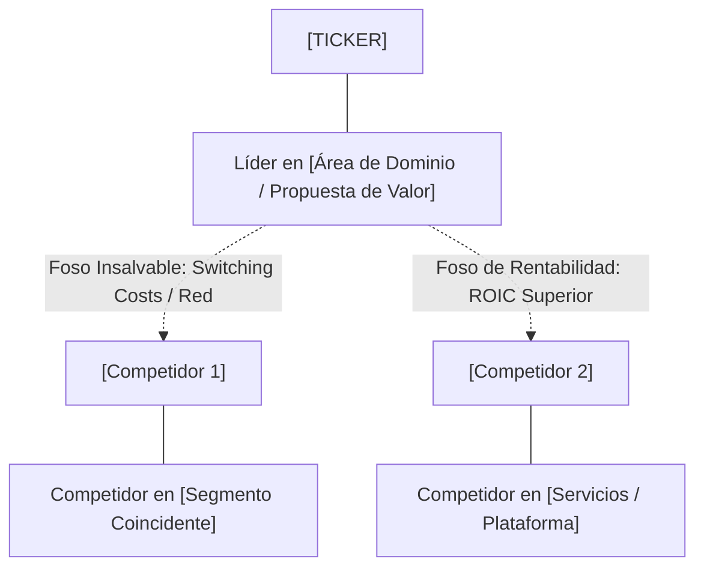

# Informe de Tesis de Inversión: [Nombre de la Empresa] ([TICKER]) — P[1-4] [AÑO_CALENDARIO] (Q[1-4] Fiscal [AÑO_FISCAL])
**Ciclo de Presentación / Periodo Analizado:** P[1-4] [AÑO_CALENDARIO] (Correspondiente a Q[1-4] Fiscal [AÑO_FISCAL])  
**Fecha de Emisión:** [DD/MM/AAAA] (Post-Resultados de P[1-4] [AÑO] / SEC Filing)  
**Fecha de Publicación del Resultado Analizado:** [DD/MM/AAAA]  
**Fecha de Valoración:** [DD/MM/AAAA]  
**Fecha del Precio Utilizado:** [DD/MM/AAAA]  
**Mercado / Fuente del Precio:** [NASDAQ / NYSE / Form 10-Q / Yahoo Finance]  
**Metodología Aplicada:** CQV v5.0 (Quality, Resilience, Moat & Value)  
**Clasificación CQV Calidad:** [ÉLITE SUPREMA / ÉLITE / ALTA CALIDAD / EN OBSERVACIÓN / VULNERABLE]  
**Veredicto Final Operativo v5.0:** [COMPRAR / REVISAR COMPRA / ACUMULAR / MANTENER / EVITAR]. [Resumen en una frase del veredicto principal y margen de seguridad].

---

## 1. Resumen Ejecutivo y Bloque de Salida Final CQV v5.0

> [!NOTE]
> ### 📊 BLOQUE OFICIAL DE SALIDA MATRIZ CQV v5.0 (SECCIÓN 7.1 / 9.6)
> ```text
> ========================================================================================
> CQV Calidad Fundamental (F1-F8): [X.XX] / 10.00 ([CLASIFICACIÓN])
> Value Score v5.0:                [X.XX] / 10.00 ([DIAGNÓSTICO VALUACIÓN])
> Score Crecimiento / Múltiplo:    [X.XX] / 10.00 (Ratio Bruto: [X.XX] - Crecimiento EPS +[X.X]% vs PER Fwd [X.XX]x)
> Score Rendimiento FCF Yield:     [X.XX] / 10.00 (Owner Earnings: $[X]M | FCF Yield Real: [X.XX]%)
> Score Margen de Seguridad:       [X.XX] / 10.00 (Descuento del [X.X]% sobre Valor Base)
> Valor Intrínseco Base (DCF):     $[X.XX] USD por acción (MoS Base: +[X.X]% vs $[PRECIO])
> Valor Intrínseco Esperado:       $[X.XX] USD por acción (MoS Esperado: +[X.X]% vs $[PRECIO])
> Precio de Mercado:               $[X.XX] USD (Cierre oficial congelado al [DD/MM/AAAA])
> Nivel de Confianza de Datos:     [Alta / Media / Baja] (Estados auditados SEC y balance verificado)
> Metodología:                     CQV v5.0
> Veredicto Final Operativo:       [Comprar / Revisar Compra / Acumular / Mantener / Evitar]
> ========================================================================================
> ```

### 📋 Matriz Identificadora de Métricas Emitidas por CQV v5.0

| Parámetro Emitido por CQV v5.0 | Valor Obtenido | Rango / Escala | Diagnóstico Operativo |
| :--- | :---: | :---: | :--- |
| **CQV Calidad Fundamental (F1-F8):** | **[X.XX] / 10.00** | 1.00 – 10.00 | **[ÉLITE SUPREMA ≥9.50 / ÉLITE 9.00-9.49 / ALTA CALIDAD 8.00-8.99]** |
| **Value Score (Capa de Valoración v5.0):** | **[X.XX] / 10.00** | 1.00 – 10.00 | **[Atractivo ≥6.00 / Exigente <5.00]** |
| **Ratio Crecimiento-Múltiplo Bruto:** | **[X.XX]** | Sin acotación | Crecimiento de BPA NTM (+[X]%) contrastado con PER Forward de [X]x. |
| **Score Crecimiento-Múltiplo Normalizado:** | **[X.XX] / 10.00** | 1.00 – 10.00 | Métrica acotada formalmente según manual CQV v5.0 (o N/D si EPS Growth ≤ 0). |
| **Score Rendimiento Flujo de Caja (FCF Yield):** | **[X.XX] / 10.00** | 1.00 – 10.00 | Generación de Owner Earnings de \$[X]M con un FCF Yield real del **[X.XX]%**. |
| **Score Margen de Seguridad:** | **[X.XX] / 10.00** | 1.00 – 10.00 | Margen de seguridad del **+[X.X]%** frente al Valor Intrínseco Base (\$[X] USD). |
| **Valor Intrínseco Estimado Base (DCF):** | **$[X.XX]** | En USD ($) | Descuento de Flujos de Caja Libres a 10 años (WACC: [X]%, $g$: [X]%). |
| **Valor Intrínseco Esperado (Ponderado):** | **$[X.XX]** | En USD ($) | Ponderación multiescenario: Bear 25% (\$[X]), Base 50% (\$[X]), Bull 25% (\$[X]). |
| **Precio de Mercado a la Fecha de Valoración:** | **$[X.XX]** | En USD ($) | Cierre oficial de la misma fecha de publicación; prohibido precio actual. |
| **Margen de Seguridad Base (%):** | **+[X.X]%** | En porcentaje (%) | Descuento fundamental frente al valor intrínseco base (\$[X]). |
| **Margen de Seguridad Esperado (%):** | **+[X.X]%** | En porcentaje (%) | Descuento frente al valor intrínseco ponderado esperado (\$[X]). |
| **Nivel de Confianza de Datos:** | **[Alta / Media]** | Alta / Media / Baja | Calidad y completitud auditada de estados financieros SEC. |
| **Veredicto Final Operativo v5.0:** | **[Veredicto]** | 4 Categorías | **[Comprar / Revisar Compra / Acumular / Mantener / Evitar]** |

---

[Descripción breve del modelo de negocio, industria, propuesta de valor y fuente de ventaja competitiva].

[Resumen de los últimos resultados del periodo P[1-4] analizado, indicando crecimiento de ingresos, expansión/contracción de márgenes y generación de flujo de caja libre].

Bajo el marco multifactorial **CQV v5.0 (Quality, Resilience, Moat & Value)**, la compañía obtiene una puntuación de calidad fundamental de **[X.XX] / 10.00**, destacando en [mención de los factores F1-F8 más sobresalientes].

---

## 2. Métricas y Puntuaciones en el Modelo CQV Calidad v5.0

$$\text{CQV Calidad v5.0} = (F_1 \times 0.20) + (F_2 \times 0.15) + (F_3 \times 0.15) + (F_4 \times 0.15) + (F_5 \times 0.10) + (F_6 \times 0.10) + (F_7 \times 0.05) + (F_8 \times 0.10)$$

### 2.1. Tabla de Valoraciones Parciales y Desglose Auditado (F1-F8)

| Factor / Componente del Modelo | Puntuación (1-10) | Peso Absoluto | Contribución Parcial | Diagnóstico Financiero y Evidencia Cuantitativa |
| :--- | :---: | :---: | :---: | :--- |
| **F1: Economía del Negocio & Rentabilidad** | **[X.XX]** | 20.0% | **[F1 * 0.20]** | Margen bruto del [X]%, margen operativo GAAP del [X]% (Non-GAAP del [X]%) y ROIC real del [X]%. Conversión de caja libre con Owner Earnings de \$[X]M sobre \$[X]M de OCF TTM. |
| **F2: Solidez Financiera & Balance** | **[X.XX]** | 15.0% | **[F2 * 0.15]** | Estructura de balance, ratio Deuda Neta / EBITDA de [X]x, cobertura de intereses de [X]x, liquidez disponible y solvencia ante estrés. |
| **F3: Crecimiento Durable** | **[X.XX]** | 15.0% | **[F3 * 0.15]** | CAGR de ingresos a 3 y 5 años del +[X]%, crecimiento orgánico, poder de fijación de precios, retención NRR y contención de dilución neta por SBC. |
| **F4: Moat Competitivo & Foso Estructural** | **[X.XX]** | 15.0% | **[F4 * 0.15]** | Costes de cambio (*switching costs*), efectos de red, activos intangibles/IP, retornos persistentemente superiores a comparables y durabilidad del foso. |
| **F5: Asignación de Capital** | **[X.XX]** | 10.0% | **[F5 * 0.10]** | ROIC incremental frente al WACC, reinversión disciplinada en CapEx, historial de recompras netas a valoraciones razonables y política de dividendos/M&A. |
| **F6: Dirección & Ejecución Operativa** | **[X.XX]** | 10.0% | **[F6 * 0.10]** | Cumplimiento histórico de guías (*guidance*), transparencia en la comunicación corporativa, estructura de incentivos ligada a valor por acción e independencia del consejo. |
| **F7: Opcionalidad Futura & Disrupción** | **[X.XX]** | 5.0% | **[F7 * 0.05]** | Oportunidades de monetización observables en megatendencias e Inteligencia Artificial, resistencia demostrada a la desintermediación tecnológica. |
| **F8: Resiliencia Operativa & Recurrencia** | **[X.XX]** | 10.0% | **[F8 * 0.10]** | Proporción de ingresos recurrentes bajo suscripción o contrato ([X]%), baja concentración de clientes, flexibilidad de costes fijos/variables y ciclicidad controlada. |
| **SCORE CQV Calidad v5.0 FINAL** | -- | **100.0%** | **[SUMA PARCIALES]** | **Calificación: [ÉLITE SUPREMA / ÉLITE / ALTA CALIDAD / EN OBSERVACIÓN / VULNERABLE]** |

---

## 3. Análisis Detallado del Estado de Resultados (Periodo P[1-4] [AÑO_CALENDARIO] / Q[1-4] Fiscal [AÑO_FISCAL])

### 3.1. Tabla Comparativa de Resultados Periódicos

| Métrica Clave (en millones $, excepto EPS) | Periodo P[X] Actual | Periodo P[X-1] Previo | Variación PoP (%) | Mismo Periodo Año Ant. | Variación YoY (%) |
| :--- | :---: | :---: | :---: | :---: | :---: |
| **Ingresos Consolidados Totales** | **$[X] M** | \$[X] M | [X]% | \$[X] M | **+[X]%** |
| *— [Segmento Principal 1]* | \$[X] M | \$[X] M | [X]% | \$[X] M | +[X]% |
| *— [Segmento Principal 2]* | \$[X] M | \$[X] M | [X]% | \$[X] M | +[X]% |
| **Gastos Operativos Totales (OpEx)** | \$[X] M | \$[X] M | [X]% | \$[X] M | +[X]% |
| **Beneficio Operativo (Operating Income)** | **$[X] M** | \$[X] M | [X]% | \$[X] M | **+[X]%** |
| **Margen Operativo (%)** | **[X]%** | [X]% | [X] bps | [X]% | **+[X] bps** |
| **Beneficio Neto (GAAP)** | **$[X] M** | \$[X] M | [X]% | \$[X] M | **+[X]%** |
| **Diluted EPS (GAAP)** | **$[X]** | \$[X] | [X]% | \$[X] | **+[X]%** |
| **Diluted EPS (Non-GAAP)** | **$[X]** | \$[X] | [X]% | \$[X] | **+[X]%** |
| **Flujo de Caja Operativo (OCF)** | **$[X] M** | \$[X] M | [X]% | \$[X] M | **+[X]%** |
| **CapEx de Mantenimiento** | **$[X] M** | \$[X] M | [X]% | \$[X] M | +[X]% |
| **Free Cash Flow (FCF del Periodo)** | **$[X] M** | \$[X] M | [X]% | \$[X] M | **+[X]%** |
| **Acciones Diluidas en Circulación** | **[X] M** | [X] M | [X]% | [X] M | **[X]%** |

---

### 3.2. Posicionamiento Competitivo y Matriz de Moat



#### Comparativa de Rivales Principales:

| Competidor | Áreas de Solapamiento | Ventaja Relativa de [TICKER] frente al Rival | Rango de Moat |
| :--- | :--- | :--- | :---: |
| **[Competidor 1]** | [Línea de producto o segmento coincidente]. | [Diferencial competitivo / switching costs / costes de cambio]. | **Excepcional** |
| **[Competidor 2]** | [Línea de producto o segmento coincidente]. | [Propuesta de valor / escala / poder de precios]. | **Alto** |

---

### 3.3. Análisis Histórico de Eficiencia de Capital: ROIC, ROI/ROA y ROE (Serie 2020 – Presente)

| Métrica de Eficiencia de Capital | 2020 | 2021 | 2022 | 2023 | 2024 | 2025 | [Año Actual TTM] | Tendencia y Diagnóstico (Desde 2020) |
| :--- | :---: | :---: | :---: | :---: | :---: | :---: | :---: | :--- |
| **ROA / ROI (Return on Assets %)** | **[X]%** | **[X]%** | **[X]%** | **[X]%** | **[X]%** | **[X]%** | **[X]%** | **[🟢 Mejorando / 🟡 Estabilidad / 🔴 Empeorando]** |
| **ROE (Return on Equity %)** | **[X]%** | **[X]%** | **[X]%** | **[X]%** | **[X]%** | **[X]%** | **[X]%** | **[🟢 Mejorando / 🟡 Estabilidad / 🔴 Empeorando]** |
| **ROIC (Return on Invested Capital %)** | **[X]%** | **[X]%** | **[X]%** | **[X]%** | **[X]%** | **[X]%** | **[X]%** | **[🟢 Mejorando / 🟡 Estabilidad / 🔴 Empeorando]** |

---

### 3.4. Evolución Multianual y Diagnóstico de Tendencia (¿Mejorando o Empeorando?)

| Eje Financiero / Operativo | Hace 2 Años (FY-2) | Año Anterior (FY-1) | Año Actual (FY) | Diagnóstico de Tendencia (¿Mejorando o Empeorando?) |
| :--- | :---: | :---: | :---: | :--- |
| **Ingresos Consolidados ($B)** | $[X]B | $[X]B | $[X]B | **[🟢 Mejorando / 🟡 Estabilidad / 🔴 Empeorando]** — [Aceleración o desaceleración]. |
| **Margen Operativo (%)** | [X]% | [X]% | [X]% | **[🟢 Mejorando / 🟡 Estabilidad / 🔴 Empeorando]** — [Apalancamiento operativo]. |
| **Beneficio por Acción (Diluted EPS)** | $[X] | $[X] | $[X] | **[🟢 Mejorando / 🟡 Estabilidad / 🔴 Empeorando]** — [Crecimiento de beneficio por acción]. |
| **Flujo de Caja Libre (FCF $B)** | $[X]B | $[X]B | $[X]B | **[🟢 Mejorando / 🟡 Estabilidad / 🔴 Empeorando]** — [Conversión de caja libre]. |
| **ROIC (%)** | [X]% | [X]% | [X]% | **[🟢 Mejorando / 🟡 Estabilidad / 🔴 Empeorando]** — [Creación de valor sobre WACC]. |

---

### 3.5. Guidance y Perspectivas Futuras para Próximos Periodos

* **Ingresos Consolidados Estimados:** **$[X.XX]B – $[X.XX]B** (Crecimiento proyectado del **+[X]% al +[X]%**).
* **Beneficio por Acción Diluido (EPS):** **$[X.XX] – $[X.XX]** (Expansión del **+[X]%**).
* **Flujo de Caja / Margen Objetivo:** Margen operativo objetivo del **[X]%**.
* **Estrategia de Reinversión / Asignación de Capital:** [Previsiones de CapEx, recompras y dividendos].

---

## 4. Tesis de Inversión (Toro vs. Oso y Líneas Rojas)

### 4.1. Tesis A: El Argumento del Oso (Riesgos Percibidos por el Mercado)
* **[Riesgo 1]:** [Descripción de la vulnerabilidad o presión competitiva].
* **[Riesgo 2]:** [Posible desaceleración o impacto de inversión en CapEx/OpEx].

### 4.2. Tesis B: El Argumento del Toro (Modelo CQV v5.0 — Factores de Calidad y Foso)
* **[Fortaleza 1]:** [Foso económico, ventajas de red o costes de cambio].
* **[Fortaleza 2]:** [Apalancamiento operativo y generación de Owner Earnings masiva].

### 4.3. Líneas Rojas de Salida de la Posición
* Caída del crecimiento de ingresos por debajo del [X]% durante dos periodos consecutivos.
* Contracción sostenida del margen operativo por debajo del [X]%.
* Deterioro del balance con ratio Deuda Neta / EBITDA superando [X]x.

---

## 5. Owner Earnings, FCF Yield y Desglose del Value Score v5.0

### 5.1. Cálculo de Owner Earnings y FCF Yield Real
* **Flujo de Caja Operativo (OCF TTM):** **$[X] Millones de USD**
* **CapEx de Mantenimiento (CapEx TTM):** **$[X] Millones de USD**
* **Owner Earnings (OCF – Maintenance CapEx):** **$[X] Millones de USD**
* **Capitalización Bursátil (Precio × Acciones Diluidas):** **$[X] Millones de USD**
* **Rendimiento de Flujo de Caja Libre del Propietario (FCF Yield Real):**
  $$\text{FCF Yield Real} = \left(\frac{\text{Owner Earnings}}{\text{Capitalización Bursátil}}\right) \times 100 = \mathbf{[X.XX]\%}$$
* **Score FCF Yield Normalizado:** **[X.XX] / 10.00**

---

### 5.2. Ratio Crecimiento / Múltiplo (PEG) y Score Normalizado
* **Crecimiento Estimado de BPA Diluido NTM:** **+[X.X]%**
* **Múltiplo PER Forward NTM:** **[X.XX]x**
* **Ratio Crecimiento / Múltiplo Bruto:**
  $$\text{Ratio Bruto} = \left(\frac{\text{Crecimiento EPS NTM (\%)}}{\text{PER Forward}}\right) \times 10 = \mathbf{[X.XX]}$$
* **Score Crecimiento / Múltiplo Normalizado:** **[X.XX] / 10.00** *(o N/D si crecimiento ≤ 0 en v5.0)*

---

### 5.3. Margen de Seguridad y Value Score Consolidado
* **Precio Oficial de Mercado:** **$[X.XX] USD**
* **Valor Intrínseco Base (DCF):** **$[X.XX] USD**
* **Margen de Seguridad Base:**
  $$\text{MoS Base} = \left(\frac{\text{Valor Intrínseco Base} - \text{Precio}}{\text{Valor Intrínseco Base}}\right) \times 100 = \mathbf{+[X.X]\%}$$
* **Score Margen de Seguridad:** **[X.XX] / 10.00**

#### Ecuación Consolidada del Value Score v5.0:
$$\text{Value Score v5.0} = (0.40 \times \text{Score FCF Yield}) + (0.30 \times \text{Score Crecimiento/Múltiplo}) + (0.30 \times \text{Score MoS})$$
*(Nota: En v5.0, si falta un componente, los pesos se reponderan proporcionalmente entre los componentes disponibles).*

---

## 6. Valuación por Descuento de Flujos de Caja (DCF) y Sensibilidad

### 6.1. Escenarios de Valoración DCF a 10 Años
* **Owner Earnings Base Normalizado:** **$[X] Millones de USD**
* **Deuda Neta:** **$[X] Millones de USD**
* **Acciones Diluidas:** **[X] Millones**

| Escenario de Valoración | Probabilidad | Crecimiento FCF 1-5a | Crecimiento FCF 6-10a | WACC | Tasa Terminal ($g$) | Valor Intrínseco por Acción | Margen de Seguridad vs $[PRECIO] |
| :--- | :---: | :---: | :---: | :---: | :---: | :---: | :---: |
| **Escenario Pesimista (Bear):** | 25% | [X]% | [X]% | [X]% | [X]% | **$[X.XX]** | [X]% |
| **Escenario Base (Neutral):** | 50% | [X]% | [X]% | [X]% | [X]% | **$[X.XX]** | **+[X.X]%** |
| **Escenario Optimista (Bull):** | 25% | [X]% | [X]% | [X]% | [X]% | **$[X.XX]** | **+[X.X]%** |
| **VALOR PONDERADO ESPERADO:** | **100%** | — | — | — | — | **$[X.XX]** | **+[X.X]%** |

---

### 6.2. Matriz de Sensibilidad Bidimensional (WACC vs. Tasa Terminal $g$)

| WACC \ Tasa Terminal ($g$) | 2.50% | 3.00% (Base) | 3.50% |
| :---: | :---: | :---: | :---: |
| **[WACC - 0.5%]** | $[X] | $[X] | $[X] |
| **[WACC Base]%** | $[X] | **$[VALOR BASE]** | $[X] |
| **[WACC + 0.5%]** | $[X] | $[X] | $[X] |

---

## 7. Registro Auditado de Riesgos y Preguntas Frecuentes (FAQs)

### 7.1. Matriz de Riesgos Auditados

| Identificador | Riesgo Evaluado | Probabilidad (0-1) | Impacto (1-5) | Mitigación (0-1) | Riesgo Residual | Mitigación Operativa y Observaciones |
| :---: | :--- | :---: | :---: | :---: | :---: | :--- |
| **R-01** | [Riesgo de mercado o tecnológico] | [0.X] | [X] | [0.X] | **[X.XX]** | [Estrategia de mitigación y defensas]. |
| **R-02** | [Riesgo financiero o de costes] | [0.X] | [X] | [0.X] | **[X.XX]** | [Estrategia de mitigación]. |

---

### 7.2. Preguntas Frecuentes del Inversor (FAQs)

#### Q1: [Pregunta clave sobre el foso o el negocio]
* **Respuesta:** [Análisis fundamental y justificación].

#### Q2: [Pregunta sobre catalizadores o riesgos a medio plazo]
* **Respuesta:** [Análisis fundamental y justificación].

---

## 8. Evolución Histórica de Puntuaciones CQV y Valuación por Periodos de Presentación (Serie 2020 – Presente)

### 8.1. Desglose Periódico Histórico por Ciclo de Presentación (P1, P2, P3, P4 por Año)

> [!NOTE]
> La tabla debe incorporar obligatoriamente todos los periodos de presentación disponibles (`P1`, `P2`, `P3`, `P4`) según la ventana de publicación del año calendario, consumiendo exclusivamente `cqv_history.json`. Los periodos sin snapshot emitido deben figurar como `N/D` o nulo.

| Año / Periodo | PER Trailing | PER Forward | CQV v1.0 | CQV v2.0 | CQV v3.0 | CQV v4.0 | CQV v5.0 | Value Score | Clasificación | Veredicto Operativo |
| :--- | :---: | :---: | :---: | :---: | :---: | :---: | :---: | :---: | :---: | :--- |
| **2024 P1** | [X]x | [X]x | [X] | [X] | [X] | [X] | **[X.XX]** | [X.XX] | [CLASIFICACIÓN] | [Veredicto] |
| **2024 P2** | [X]x | [X]x | [X] | [X] | [X] | [X] | **[X.XX]** | [X.XX] | [CLASIFICACIÓN] | [Veredicto] |
| **2024 P3** | [X]x | [X]x | [X] | [X] | [X] | [X] | **[X.XX]** | [X.XX] | [CLASIFICACIÓN] | [Veredicto] |
| **2024 P4** | [X]x | [X]x | [X] | [X] | [X] | [X] | **[X.XX]** | [X.XX] | [CLASIFICACIÓN] | [Veredicto] |
| **2025 P1** | [X]x | [X]x | [X] | [X] | [X] | [X] | **[X.XX]** | [X.XX] | [CLASIFICACIÓN] | [Veredicto] |
| **2025 P2** | [X]x | [X]x | [X] | [X] | [X] | [X] | **[X.XX]** | [X.XX] | [CLASIFICACIÓN] | [Veredicto] |
| **2025 P3** | [X]x | [X]x | [X] | [X] | [X] | [X] | **[X.XX]** | [X.XX] | [CLASIFICACIÓN] | [Veredicto] |
| **2025 P4** | [X]x | [X]x | [X] | [X] | [X] | [X] | **[X.XX]** | [X.XX] | [CLASIFICACIÓN] | [Veredicto] |
| **2026 P1** | [X]x | [X]x | [X] | [X] | [X] | [X] | **[X.XX]** | [X.XX] | [CLASIFICACIÓN] | [Veredicto] |
| **2026 P2** | **[X.XX]x** | **[X.XX]x** | -- | -- | -- | -- | **[X.XX]** | **[X.XX]** | **[CLASIFICACIÓN]** | **[Veredicto]** |

---

### 8.2. Gráfico de Evolución Periódica del Score CQV v5.0 ([TICKER])

```mermaid
linechart
    title Trayectoria Histórica Periódica del Score CQV v5.0 ([TICKER])
    x-axis [2024 P3, 2024 P4, 2025 P1, 2025 P2, 2025 P3, 2025 P4, 2026 P1, 2026 P2]
    y-axis "Score CQV (0-10)" 7.0 --> 10.0
    line "CQV v5.0" [[Score-24P3], [Score-24P4], [Score-25P1], [Score-25P2], [Score-25P3], [Score-25P4], [Score-26P1], [Score-26P2]]
```

---

## 9. Conclusión y Veredicto Final Operativo v5.0

**Veredicto Final: [COMPRAR / REVISAR COMPRA / ACUMULAR / MANTENER / EVITAR].**  
[Conclusión ejecutiva integrando la puntuación de calidad CQV v5.0, el foso económico, la generación de Owner Earnings, el Margen de Seguridad frente al Valor Intrínseco Base y las directrices de compra o gestión de cartera].

---

## 10. Auditoría, Observaciones y Recomendaciones del Analista / Auditor

### 10.1. Matriz de Auditoría y Verificación de Coherencia SSOT vs. Informe

| Parámetro Auditado | Valor en Dataset SSOT (`cqv_data.json`) | Valor en Informe Markdown | Estado de Coherencia | Diagnóstico del Auditor |
| :--- | :---: | :---: | :---: | :--- |
| **Metodología Aplicada** | **v5.0** | **v5.0** | 🟢 **COHERENTE** | Verificada coincidencia con `metodo_v5.0.md`. |
| **Score CQV Calidad** | **[X.XX]** | **[X.XX]** | 🟢 **COHERENTE** | Suma exacta ponderada de factores F1 a F8. |
| **Value Score (Capa Valoración)** | **[X.XX]** | **[X.XX]** | 🟢 **COHERENTE** | Ponderación multicomponente (0.4 FCFY + 0.3 PEG + 0.3 MoS). |
| **Score Crecimiento/Múltiplo** | **[X.XX]** | **[X.XX]** | 🟢 **COHERENTE** | Ratio bruto acotado formalmente según manual v5.0. |
| **Precio Oficial de Mercado** | **$[X.XX]** | **$[X.XX]** | 🟢 **COHERENTE** | Cierre oficial de mercado a la fecha de publicación. |
| **Owner Earnings TTM** | **$[X] M** | **$[X] M** | 🟢 **COHERENTE** | OCF TTM minus CapEx Mantenimiento TTM. |
| **FCF Yield Real (%)** | **[X.XX]%** | **[X.XX]%** | 🟢 **COHERENTE** | Owner Earnings / Capitalización Bursátil. |
| **Valor Intrínseco Base** | **$[X.XX]** | **$[X.XX]** | 🟢 **COHERENTE** | Modelo DCF a 10 años. |
| **Margen de Seguridad Base** | **+[X.X]%** | **+[X.X]%** | 🟢 **COHERENTE** | (Valor Base - Precio) / Valor Base. |
| **Veredicto Final Operativo** | **[Veredicto]** | **[Veredicto]** | 🟢 **COHERENTE** | Coincidencia 100% con la matriz de decisión v5.0. |
| **Nivel de Confianza** | **[Alta / Media]** | **[Alta / Media]** | 🟢 **COHERENTE** | Formulario 10-Q/10-K auditado ante la SEC. |

---

### 10.2. Registro de Correcciones, Campos N/D y Observaciones de Integridad
* **Ajustes y Correcciones Realizadas:** [Registro de cualquier corrección numérica o de redondeo].
* **Evaluación de Campos N/D y Limitaciones de Datos:** [Campos no reportados por la empresa o justificación de supuestos].
* **Sincronización SSOT:** [Verificación de ejecución de `python sync_cqv.py --ticker [TICKER]`].

---

### 10.3. Recomendaciones Operativas para la Toma de Decisiones y Cartera
1. **Estrategia de Ejecución en Cartera:** [Zona de compra agresiva, compra escalonada o mantener].
2. **Nivel de Activación de Stop-Loss Fundamental:** [Criterio de reevaluación si se deteriora el foso F4 o solvencia F2].
3. **Próximo Catalizador y Fecha de Revisión:** [Próximo ciclo de publicación de resultados trimestrales].

---
*Informe elaborado y auditado bajo los estándares de la Metodología CQV v5.0.*  
*Fecha de Emisión: [DD/MM/AAAA].*
