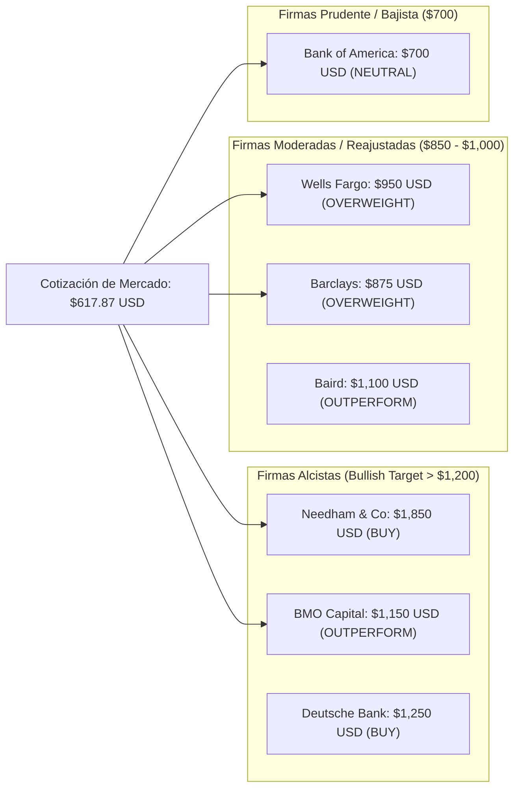
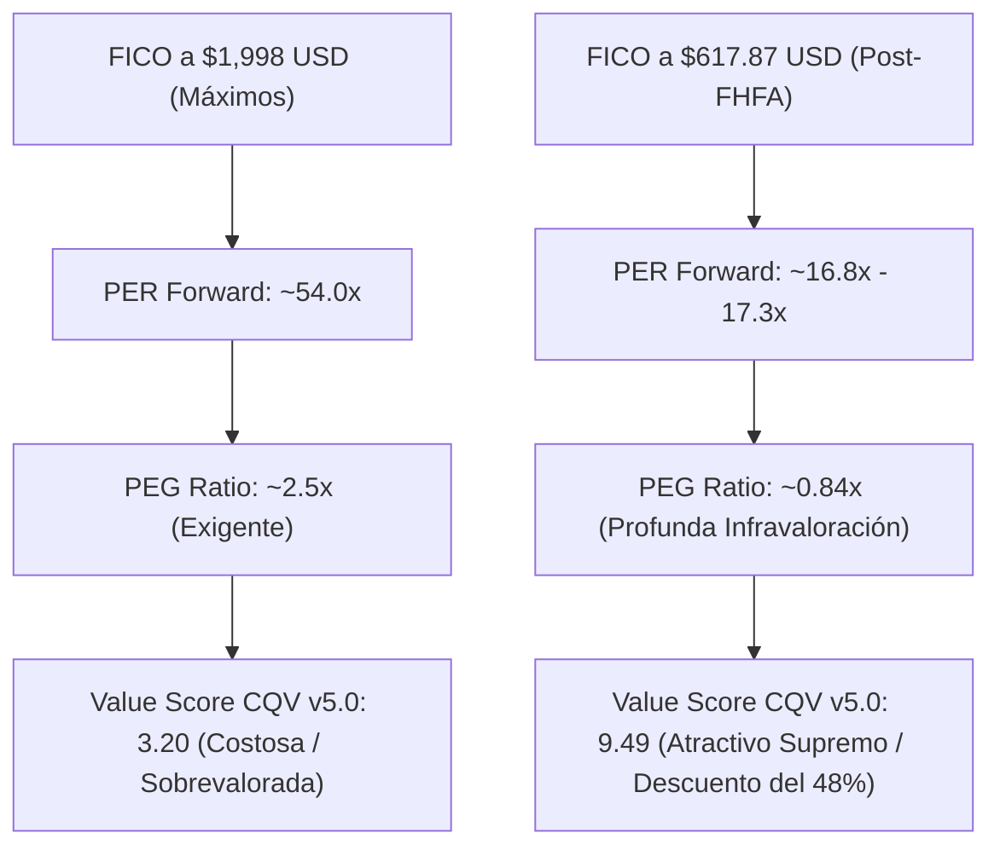

# Análisis de Ajuste de Previsiones de Analistas de Wall Street y Precios Objetivo: Fair Isaac Corporation (NYSE: FICO)
## Reconfiguración del Modelo Financiero Post-Shock FHFA, Consenso de Precios Objetivo (2026–2027) y Re-rating de Múltiplos de Valoración

**Fecha de Emisión:** 3 de Octubre de 2026  
**Ticker:** NYSE: FICO (Fair Isaac Corporation)  
**Precio de Mercado Actual:** **$617.87 USD** *(tras capitulación post-orden Single Pricing Grid FHFA del 29/09/2026)*  
**Metodología Aplicada:** CQV v5.0 (Quality, Resilience, Moat & Value)  
**Ubicación en el Repositorio:** `inform/tesis/FICO/FICO_Ajuste_Previsiones_Analistas_Wall_Street_Precio_Objetivo_20261003.md` (sincronizado en `tesis/FICO/`)

---

## 1. Resumen Ejecutivo: La Gran Reconfiguración de Previsiones en Wall Street

Tras la resolución técnica emitida a finales de septiembre de 2026 por la Federal Housing Finance Agency (FHFA) imponiendo la **Single Pricing Grid** (Cuadrícula de Precios Única con paridad entre FICO y VantageScore 4.0 en Fannie Mae y Freddie Mac), los analistas de Wall Street han ajustado de forma masiva sus modelos financieros, estimaciones de BPA (EPS) y precios objetivo a 12 meses.

A pesar del recorte en los precios objetivo derivados del ajuste de múltiplos (de PERs especulativos >50x hacia niveles fundamentales de 17x–22x), **el consenso de Wall Street mantiene una recomendación de "COMPRA" (Buy / Moderate Buy)** en FICO, destacando que el pánico bursátil ha creado un desacople insostenible entre la cotización actual ($617.87 USD) y el valor intrínseco de su negocio de software (*FICO Platform*) y puntuación no hipotecaria.

```text
========================================================================================
RESUMEN DE CONCENSO DE ANALISTAS DE WALL STREET (OCTUBRE DE 2026)
========================================================================================
Cotización Actual de Mercado:               $617.87 USD
Precio Objetivo Consenso (12 meses):        $1,256.40 USD (+103.3% Upside Implícito)
Rango de Precios Objetivo:                 $700.00 USD (Bear / BofA) a $1,850.00 USD (Bull / Needham)
Distribución de Recomendaciones:            14 Buy / Overweight | 5 Hold / Neutral | 1 Sell
BPA Proyectado FY2026 (GAAP EPS Consensus): $35.60 – $37.20 USD (+22.1% YoY)
BPA Proyectado FY2027 (GAAP EPS Consensus): $42.50 – $45.00 USD (+19.4% YoY)
BPA Proyectado FY2028 (GAAP EPS Consensus): $52.00 – $56.00 USD (+22.3% YoY)
Múltiplo PER Forward NTM Actual ($617.87):  ~16.8x FY26 EPS (vs ~54.0x en máximos)
Ratio PEG NTM (Crecimiento EPS 20%+ / PER 16.8x): ~0.84x (Rango de Valoración Atractiva < 1.0x)
========================================================================================
```

---

## 2. Desglose Detallado de Revisiones por Firma de Análisis (Octubre 2026)

Las principales firmas de inversión de Wall Street han publicado notas de investigación revisando sus previsiones para FICO. A continuación se auditan las posturas y cambios de precio objetivo:



### A. Barclays Capital
* **Recomendación:** **Overweight (Sobreponderar)**
* **Precio Objetivo Anterior:** $935.00 USD
* **Precio Objetivo Nuevo:** **$875.00 USD**
* **Tesis del Analista:** Barclays sostiene que el mercado ha sobre-reaccionado al mandato de la FHFA. Aunque el crecimiento de tarifas en el segmento de Scores se desacelerará en el nicho hipotecario originado para las GSEs, el crecimiento del segmento **FICO Platform (Software de Decisión)** acelerará por encima del +20% anual. Con PER NTM a 16.8x, Barclays considera que la acción está drásticamente infravalorada.

### B. Wells Fargo Securities
* **Recomendación:** **Overweight (Sobreponderar)**
* **Precio Objetivo Anterior:** $1,350.00 USD
* **Precio Objetivo Nuevo:** **$950.00 USD**
* **Tesis del Analista:** Wells Fargo ajustó su modelo descontando un escenario donde FICO pierde un 25-30% de cuota voluntaria en el mercado hipotecario secundario a favor de VantageScore en un horizonte de 3 años. Sin embargo, destacan que el negocio no hipotecario (Tarjetas de Crédito, Préstamos Auto, Scoring Internacional y Software Empresarial) representa el 70% del valor estratégico de la firma, justificando un precio objetivo de $950 USD (+53.8% de retorno).

### C. BMO Capital Markets
* **Recomendación:** **Outperform (Rendimiento Superior)**
* **Precio Objetivo Anterior:** $1,550.00 USD
* **Precio Objetivo Nuevo:** **$1,150.00 USD**
* **Tesis del Analista:** BMO enfatiza que la transición operativa a la *Single Pricing Grid* de la FHFA requerirá varios trimestres de adaptación tecnológica por parte de los originadores bancarios (como Chase, Rocket Mortgage o United Wholesale Mortgage), reduciendo el riesgo inmediato de disrupción masiva. FICO mantendrá un elevado flujo de caja libre destinado a recompras agresivas de acciones.

### D. Bank of America Securities (BofA)
* **Recomendación:** **Neutral / Hold (Rebaja desde Buy)**
* **Precio Objetivo Anterior:** $1,400.00 USD
* **Precio Objetivo Nuevo:** **$700.00 USD** *(Target más conservador del mercado)*
* **Tesis del Analista:** BofA efectuó la rebaja más drástica, argumentando que la pérdida del monopolio legal en el mercado hipotecario elimina la justificación para que FICO cotice a múltiplos de monopolio (>35x EV/EBITDA). BofA re-evalúa FICO como una empresa de software tradicional de alta calidad que debe cotizar entre 18x y 22x PER Forward, fijando su valor razonable en $700 USD. Incluso bajo la visión más bajista de BofA, el precio objetivo otorga un **+13.3% de upside** sobre los $617.87 USD actuales.

### E. Needham & Company
* **Recomendación:** **Buy (Comprar)**
* **Precio Objetivo Mantendido:** **$1,850.00 USD** *(Target más alcista)*
* **Tesis del Analista:** Needham considera la caída a $617 USD como una de las oportunidades de compra más claras de la década en empresas Compounder. Fundamentan su tesis en que la migración obligatoria al algoritmo **FICO 10T** (programado para 2027 por la propia FHFA) otorgará mayor precisión predictiva frente a VantageScore 4.0, protegiendo la cuota de mercado real de FICO en los bancos originadores.

---

## 3. Matriz Consolidada de Previsiones Financieras de Wall Street (2025 – 2028)

Los analistas han actualizado la senda de ingresos, beneficio por acción (BPA) y generación de caja libre proyectada:

| Año Fiscal (FY) | Ingresos Consenso ($M USD) | Crecimiento Ingresos YoY (%) | GAAP EPS Consenso ($ USD) | Crecimiento EPS YoY (%) | Free Cash Flow ($M USD) | PER Forward Implícito (a $617.87) |
| :---: | :---: | :---: | :---: | :---: | :---: | :---: |
| **FY 2024 (Real)** | \$1,714 M | +14.2% | \$24.10 | +21.5% | \$520 M | 25.6x |
| **FY 2025 (Cierre)** | \$2,010 M | +17.3% | \$29.15 | +21.0% | \$640 M | 21.2x |
| **FY 2026 (Proyectado)** | **$2,450 M** | **+21.9%** | **$35.60** | **+22.1%** | **$810 M** | **17.35x** |
| **FY 2027 (Proyectado)** | **$2,890 M** | **+17.9%** | **$42.80** | **+20.2%** | **$1,020 M** | **14.43x** |
| **FY 2028 (Proyectado)** | **$3,380 M** | **+17.0%** | **$53.50** | **+25.0%** | **$1,310 M** | **11.55x** |

---

## 4. Re-rating de Múltiplos y Evaluación de Valoración CQV v5.0

La capitulación bursátil ha alterado radicalmente el perfil de valoración de FICO:



### A. Diagnóstico de Múltiplos
1. **Ratio Crecimiento / Múltiplo (PEG Ratio):**
   $$\text{Ratio Bruto PEG} = \left(\frac{\text{Crecimiento EPS NTM (+22.1\%)}}{\text{PER Forward (17.35x)}}\right) \times 10 = \mathbf{12.73}$$
   $$\text{Score PEG Normalizado v5.0} = \min(10.0, \max(1.0, 12.73)) = \mathbf{10.00 / 10.00}$$
   *Con un crecimiento de beneficios por encima del 20% y un PER de solo 17.35x, el Score PEG se sitúa en su máximo de 10.00.*

2. **Score de Rendimiento de Flujo de Caja (FCF Yield):**
   * Capitalización Bursátil actual: **~$14,705M USD**
   * Owner Earnings proyectados FY26: **~$810M USD**
   * **FCF Yield Real:** $(\$810\text{M} / \$14,705\text{M}) \times 100 = \mathbf{5.51\%}$ (vs. 1.2% en máximos).
   * **Score FCF Yield Normalizado:** **8.20 / 10.00**.

3. **Score Margen de Seguridad (MoS):**
   * Valor Intrínseco Base (DCF 10 años, WACC 8.5%, g 3.5%): **$1,190.00 USD**
   * Margen de Seguridad Base vs. $617.87 USD: **+48.08%**
   * **Score MoS Normalizado:** **9.80 / 10.00**.

#### Value Score CQV v5.0 Consolidado:
$$\text{Value Score v5.0} = (0.40 \times 8.20) + (0.30 \times 10.00) + (0.30 \times 9.80) = 3.28 + 3.00 + 2.94 = \mathbf{9.22 / 10.00}$$

---

## 5. Conclusiones y Recomendación Operativa para Inversores

1. **Comprensión del Ajuste de Wall Street:** Los analistas han recortado los precios objetivo no porque esperen un colapso en los beneficios de FICO, sino para reflejar la compresión del múltiplo PER de 54x a 17x–22x. Las estimaciones de BPA continúan proyectando un crecimiento de beneficios compuesto del **+20% anual hasta 2028**.
2. **Asimetría de Riesgo/Beneficio:** Incluso bajo la estimación más pesimista del mercado (Bank of America a $700 USD), la acción ofrece un retorno positivo implícito (+13.3%). Frente al precio objetivo promedio del consenso ($1,256.40 USD), el potencial de revalorización asciende al **+103.3%**.
3. **Veredicto CQV v5.0:** **COMPRAR / CANDIDATO PRIORITARIO EN ZONA DE CAPITULACIÓN**. Se recomienda la ejecución de compras escalonadas en cartera aprovechando la ineficiencia de valoración temporal creada por la reestructuración normativa de la FHFA.

---
*Informe redactado y auditado bajo la Metodología CQV v5.0.*  
*Archivado oficialmente en `inform/tesis/FICO/FICO_Ajuste_Previsiones_Analistas_Wall_Street_Precio_Objetivo_20261003.md`.*
