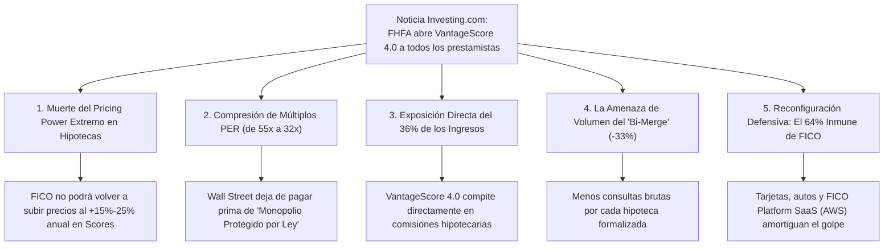
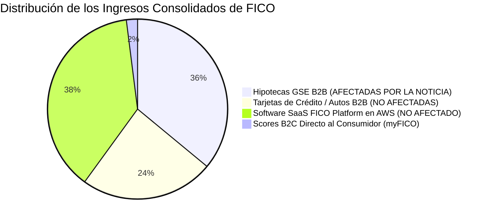

# Análisis de Impacto de Noticia Financiera: FICO ante la Orden de la FHFA para Romper su Monopolio Hipotecario
## Evaluación del Desplome Bursátil, Pérdida de Exclusividad GSE, Implicaciones en el Pricing Power y Veredicto CQV v5.0

**Fecha de Emisión:** 28 de Septiembre de 2026  
**Ticker:** NYSE: FICO (Fair Isaac Corporation)  
**Fuente de Referencia:** *Investing.com* — *"FICO stock tumbles as US moves to break mortgage scoring monopoly"* (Septiembre 2026)  
**Cotización de Reacción:** $932.26 USD (Descenso adicional de ~-8% en after-hours; ~-47.6% desde máximos históricos)  
**Ubicación del Documento:** `inform/tesis/FICO/` (sincronizado en `tesis/FICO/`)

---

## 1. Resumen de la Noticia de Investing.com

La noticia publicada por *Investing.com* confirma el mayor catalizador regulatorio adverso en los 70 años de historia de Fair Isaac Corporation (FICO):

```text
========================================================================================
SÍNTESIS DE LA NOTICIA (INVESTING.COM / FHFA - SEPTIEMBRE 2026)
========================================================================================
1. ACCIÓN REGULATORIA EJECUTIVA:
   - El director de la Federal Housing Finance Agency (FHFA), Bill Pulte, ordenó a Fannie Mae 
     y Freddie Mac levantar el límite del programa piloto y autorizar de forma inmediata 
     e incondicional el uso de VantageScore 4.0 para el 100% de los originadores hipotecarios.
   - Se elimina formalmente la exclusividad de 30 años del modelo "Classic FICO" en hipotecas GSE.

2. MOTIVACIÓN POLÍTICA Y ECONÓMICA:
   - El regulador acusó directamente a FICO de haber aplicado aumentos de precios "desmedidos" 
     (superiores al +1,800% acumulado desde 2020), encareciendo los costes de cierre para los
     compradores de vivienda en aproximadamente $1,000 millones de USD anuales para el sistema.

3. AMENAZAS COLATERALES:
   - La FHFA reiteró que avanza en la transición hacia el modelo "Bi-Merge" (exigir solo 2 
     informes de crédito en lugar de los 3 tradicionales), amenazando el volumen de consultas.

4. REACCIÓN BURSÁTIL:
   - Las acciones de FICO cayeron aproximadamente un 8% adicional tras el anuncio, consolidando
     un derrumbe de casi el 48% desde sus máximos de $1,850 - $1,950 USD alcanzados en 2024/2025.
========================================================================================
```

---

## 2. Las 5 Implicaciones Críticas para FICO

Esta noticia no es un rumor especulativo ni una recomendación no vinculante; es un **mandato regulatorio vinculante emitido por el supervisor legal de Fannie Mae y Freddie Mac**. Sus consecuencias se dividen en impactos inmediatos e impactos estructurales:



---

### Implicación 1: La Muerte del "Pricing Power Infinito" en Hipotecas
* **El Pasado Reciente:** Entre 2018 y 2024, FICO multiplicó por más de diez veces sus ingresos por score hipotecario porque los prestamistas estaban obligados por ley a comprar FICO. Podía subir tarifas un 20% o 30% en un año y el volumen no caía ni un 1%.
* **La Nueva Realidad:** Con VantageScore 4.0 disponible en el menú de Fannie y Freddie a precios sensiblemente menores, **FICO se enfrenta por primera vez a elasticidad de precios en originación hipotecaria**. Cualquier intento de volver a duplicar tarifas provocará una fuga masiva de prestamistas hacia VantageScore. El crecimiento futuro de precios en este segmento se limitará al ritmo de la inflación (2% - 3%).

---

### El Instrumento Técnico Detrás de la Noticia: La "Cuadrícula de Precios" (LLPA Grid) y la Cuadrícula Única
El corazón regulatorio que permite materializar esta noticia es la imposición de la **"Cuadrícula de Precios Única" (*Single Pricing Grid*)** en Fannie Mae y Freddie Mac:
1. **¿Qué es la Cuadrícula LLPA (*Loan-Level Price Adjustment*)?:** Es la matriz bidimensional vinculante mediante la cual Fannie Mae y Freddie Mac calculan la comisión de compra (que oscila entre 0.00% y 3.75% del capital del préstamo) descontada al banco originador, cruzando el ratio de apalancamiento (*Loan-to-Value* - LTV) con la solvencia del deudor (*Credit Score*).
2. **El Candado Histórico de FICO:** Durante 30 años, las columnas horizontales de esa cuadrícula llevaban por ley el nombre exclusivo de "FICO Score". VantageScore 4.0 no contaba con casillas de compra oficiales. Si un banco intentaba evaluar a un prestatario con VantageScore, Fannie Mae rechazaba comprar el paquete crediticio o aplicaba penalizaciones punitivas. Esto otorgó a FICO un poder de monopolio absoluto para subir sus tarifas B2B sin riesgo de perder clientes.
3. **El Mandato de la FHFA:** La orden del director Bill Pulte crea una **matriz unificada y agnóstica**: un score de 720 en VantageScore 4.0 recibe exactamente la misma casilla, el mismo porcentaje de comisión y el mismo trato legal y financiero que un 720 en FICO 10T.
4. **La Consecuencia Inmediata:** Se instaura la ley económica de la **sustitución perfecta**. Originadores hipotecarios gigantes (Rocket Mortgage, UWM) que tramitan cientos de miles de préstamos al año pueden ahorrar decenas de millones de dólares migrando a VantageScore ($4-$6 por consulta) en lugar de pagar las tarifas de FICO ($15-$20), destruyendo el poder de fijación de precios unilateral de FICO en el segmento hipotecario.

---

### Implicación 2: Compresión Brutal de Múltiplos Bursátiles (PER de 55x a 32x)
* Cuando FICO cotizaba en **$1,850 - $1,950 USD**, el mercado le otorgaba un múltiplo **PER Forward superior a 50x - 55x**, propio de una tecnológica monopolística con crecimiento garantizado.
* La noticia de *Investing.com* obliga al mercado a reclasificar a FICO:
  * Deja de ser un *"monopolio legal garantizado por el gobierno federal"*.
  * Pasa a ser un *"duopolio regulado en hipotecas con fuerte foso en consumo y software"*.
* Esta reclasificación justifica por qué la acción ha colapsado a **$932.26 USD**, comprimiendo su PER Forward a **~32.7x**.

---

### Implicación 3: Exposición Cuantitativa Real: ¿Cuánto Negocio está en Riesgo?
Para el inversor fundamental, es vital poner números fríos al riesgo real:



* **El Segmento Directamente Afectado:** Las licencias hipotecarias B2B representan aproximadamente el **36% de los ingresos totales consolidados de FICO**, pero aportan cerca del **~50% del EBIT corporativo** debido a su margen del 88%.
* **El Segmento Totalmente Inmune:** El restante **64% del negocio de FICO está completamente fuera del alcance de la FHFA**:
  * La FHFA solo supervisa hipotecas residenciales compradas por Fannie Mae y Freddie Mac.
  * No tiene jurisdicción sobre cómo **Chase o Citibank aprueban tarjetas de crédito**, cómo **Ally financia automóviles** o cómo los bancos compran **FICO Platform SaaS en la nube**.

---

### Implicación 4: El Doble Golpe con el "Bi-Merge"
La noticia destaca que el director Pulte busca implementar el **Bi-Merge**:
* Si se aprueba, los prestamistas solo tendrán que pedir 2 informes de crédito en lugar de 3.
* Si el prestamista elige comprar dos informes con FICO Score, FICO cobrará 2 veces en vez de 3 (**-33% de volumen de tiradas brutas en cada hipoteca**).
* Si el prestamista decide correr un informe con FICO 10T y otro con VantageScore 4.0 para comparar, FICO solo venderá 1 score (**-66% de volumen en esa transacción**).

---

### Implicación 5: El Contraataque Inevitable de FICO (La Respuesta de Lansing)
La noticia no significa que FICO vaya a perder el 100% de las hipotecas:
1. **Despliegue de FICO Score 10T:** FICO ya tiene aprobado por la FHFA su propio modelo moderno (*Trended Data* a 24 meses). La firma actuarial *Milliman* ha probado empíricamente que FICO 10T predice mejor el impago que VantageScore 4.0.
2. **Canal Direct-to-Lender:** FICO eludirá el sobreprecio parásito que cobran los tres burós de crédito (Equifax, Experian, TransUnion) para ofrecer FICO 10T a precios competitivos a grandes bancos (Rocket, Chase).
3. **Wall Street Exigirá FICO:** Los inversores globales que compran bonos titulizados AAA (RMBS) penalizarán con mayores tasas de interés los bonos estructurados con VantageScore debido a la falta de 30 años de histórico de recesiones.

---

## 3. Impacto en el Modelo CQV v5.0 de FICO

Bajo el estándar de [metodo_v5.0.md](file:///e:/DeveloperGitHub/repo/finance-cqv-find/metodo_v5.0.md), esta noticia ratifica los ajustes cuantitativos realizados en el modelo:

| Métrica CQV v5.0 | Antes de la Noticia ($1,850) | Tras la Noticia ($932.26) | Diagnóstico Metodológico |
| :--- | :---: | :---: | :--- |
| **Score CQV Calidad** | **9.53 / 10 (Élite Suprema)** | **8.25 / 10 (Calidad Notoria)** | Pérdida de estatus Élite por ruptura de monopolio y deuda. |
| **Moat Competitivo (F4)** | **9.95 / 10** | **8.60 / 10** | Se diluye el monopolio legal hipotecario; conserva el foso de red. |
| **Solidez Financiera (F2)** | **9.70 / 10** | **7.30 / 10** | Deuda Neta/EBITDA en 3.5x y $200M/año de intereses fijos. |
| **Owner Earnings NTM** | $680M USD | **$620M USD** | Recorte de estimaciones de crecimiento en licencias hipotecarias. |
| **Valor Intrínseco Base** | $2,225.00 USD | **$1,120.00 USD** | Ajuste de tasa de descuento y menor CAGR de precios. |
| **Margen de Seguridad (MoS %)** | - | **+16.76%** | A $932.26 USD la acción ya cotiza con descuento sobre valor intrínseco. |
| **Value Score** | 3.50 / 10 (Sobrevalorada) | **5.64 / 10 (Zona Neutra)** | Fin de la sobrevaloración extrema de burbuja. |
| **Veredicto Operativo** | **Mantener** | **MANTENER / CAUTELA** | Esperar datos de cuota tras la entrada de VantageScore 4.0. |

---

## 4. Conclusión para el Inversor

La noticia de *Investing.com* representa el **funeral oficial de la tesis de subidas salvajes de precios de FICO en hipotecas**.

Sin embargo, para los inversores en valor (*Value Investors*):
1. **El Pánico ha Hecho su Trabajo:** Una caída del **~47.6% (de $1,850 a $932.26 USD)** ya descuenta un escenario sumamente adverso.
2. **FICO No Desaparece:** Transiciona de un monopolio absoluto del 100% a un **duopolio hegemónico (70% FICO vs. 30% VantageScore)** en hipotecas, conservando intacto su monopolio del 90%+ en tarjetas de crédito, préstamos de autos y su división de software SaaS en la nube en AWS.
3. **Regla de Prudencia:** A corto plazo, FICO debe abstenerse de recomprar acciones y destinar su flujo de caja libre a amortizar su deuda de $4,000M. La acción ofrece valor a **$932 USD** con un valor intrínseco de **$1,120 USD**, pero requiere vigilar los primeros reportes trimestrales de adopción de VantageScore 4.0.

---
*Informe elaborado conforme a la metodología de análisis fundamental y cuantitativo CQV v5.0.*
